# MiChangePageAttributeBatch

- RVA: `0x002A06E0`–`0x002A0A59` (길이 `889` bytes)
- VA: `0x00000001402A06E0`
- 실행 섹션: `.text`
- PDB 이름 있음: `예`; PDB Function 태그: `아니요`
- unwind 정보 RVA: `0x000683E8`
- 디코드: `214`개 명령, `889/889` bytes 표시
- 미해석 바이트: `0` (있으면 어셈블리에 `.byte`로 보존)

> 이 문서는 커널 이미지의 기계어와 PDB 기호를 분석해 생성했습니다. 4번과 5번은 함수 원형과 자료형을 바이너리 사용 방식에서 추정한 C 해석이며 원본 소스 복구 결과는 아닙니다.

## 1. Dependencies

- 직접 호출 지점: **13**; 고유 호출 대상: **11**
- 직접 호출자로 확인된 함수: **7**
- RIP 상대 이미지 참조: **6**

### Outgoing calls
- `0x002A0753` → [MiGetPteLink](../29/MiGetPteLink_function_0029FC60.md) (function, `0x0029FC60`)
- `0x002A077E` → [MiAbortCombineScan](MiAbortCombineScan_function_002A1160.md) (function, `0x002A1160`)
- `0x002A07EB` → [MiLockPageInline](../31/MiLockPageInline_function_0031A340.md) (function, `0x0031A340`)
- `0x002A0816` → [MiFlushEntireTbDueToAttributeChange](../30/MiFlushEntireTbDueToAttributeChange_function_00308AE0.md) (function, `0x00308AE0`)
- `0x002A0838` → [KeInvalidateAllCaches](../30/KeInvalidateAllCaches_function_00308CC0.md) (function, `0x00308CC0`)
- `0x002A0884` → [MiGetPteLink](../29/MiGetPteLink_function_0029FC60.md) (function, `0x0029FC60`)
- `0x002A0905` → [MiMapPageInHyperSpaceWorker](../33/MiMapPageInHyperSpaceWorker_function_00332B10.md) (function, `0x00332B10`)
- `0x002A0915` → [KeInvalidateRangeAllCachesNoIpi](../30/KeInvalidateRangeAllCachesNoIpi_function_00308C50.md) (function, `0x00308C50`)
- `0x002A0964` → [MiFlushEntireTbDueToAttributeChange](../30/MiFlushEntireTbDueToAttributeChange_function_00308AE0.md) (function, `0x00308AE0`)
- `0x002A09ED` → [MiUnlockPage](../31/MiUnlockPage_function_0031A3E0.md) (function, `0x0031A3E0`)
- `0x002A0A10` → [KeShouldYieldProcessor](../27/KeShouldYieldProcessor_function_002773E0.md) (function, `0x002773E0`)
- `0x002A0A47` → [KiCheckVpBackingLongSpinWaitHypercall](../30/KiCheckVpBackingLongSpinWaitHypercall_function_0030F490.md) (function, `0x0030F490`)
- `0x002A0A52` → [HvlNotifyLongSpinWait](../30/HvlNotifyLongSpinWait_function_0030F460.md) (function, `0x0030F460`)

### Direct callers
- [MiConvertContiguousPages](../29/MiConvertContiguousPages_function_0029F894.md) at `0x0029FA07`
- [MiChangePageAttributeAndZeroBatch](../2C/MiChangePageAttributeAndZeroBatch_function_002C98EC.md) at `0x002C993B`
- [MiChangePageAttributeAndZeroBatch](../2C/MiChangePageAttributeAndZeroBatch_function_002C98EC.md) at `0x002C99AF`
- [MiChangePageAttributeAndZeroBatch](../2C/MiChangePageAttributeAndZeroBatch_function_002C98EC.md) at `0x002C99C4`
- [MiChangePageAttributeAndZeroBatch](../2C/MiChangePageAttributeAndZeroBatch_function_002C98EC.md) at `0x002C99D6`
- [MiChangePageAttributeAndZeroBatch](../2C/MiChangePageAttributeAndZeroBatch_function_002C98EC.md) at `0x002C99E5`
- [MiFreeSlabEntry](../2D/MiFreeSlabEntry_function_002DC650.md) at `0x002DC982`
- [MiGetPageChain](../33/MiGetPageChain_function_00330130.md) at `0x003307AB`
- [MiGetPageChain](../33/MiGetPageChain_function_00330130.md) at `0x003307D8`
- [MiSwitchToTransition](../4C/MiSwitchToTransition_function_004C0F5C.md) at `0x004C11A3`
- [MiPerformFinalZeroing](../4F/MiPerformFinalZeroing_function_004F9594.md) at `0x004F95BB`
- [MiChangeAwePageAttributes](../68/MiChangeAwePageAttributes_function_00687FB4.md) at `0x006880BA`

### Static image references
- `0x002A081B` → RVA `0x00E2DC5C` (`.data`; read)
- `0x002A0832` → RVA `0x00E2DC54` (`.data`; read/write)
- `0x002A08D9` → RVA `0x00E2DC58` (`.data`; read/write)
- `0x002A0941` → RVA `0x00010880` (`.rdata`; read)
- `0x002A0A24` → RVA `0x00FC52AC` (`ALMOSTRO`; reference)
- `0x002A0A3D` → RVA `0x00FC6AB8` (`ALMOSTRO`; read)

## 2. Other-region calls and transfers

- 다른 실행 섹션으로 향하는 call: **0**
- 별도 외부 분기/꼬리 이동을 확인하지 못했습니다.

## 3. Assembly (complete function range)

```asm
002A06E0  44 89 4C 24 20                  mov dword ptr [rsp + 0x20], r9d
002A06E5  4C 89 44 24 18                  mov qword ptr [rsp + 0x18], r8
002A06EA  89 54 24 10                     mov dword ptr [rsp + 0x10], edx
002A06EE  53                              push rbx
002A06EF  55                              push rbp
002A06F0  56                              push rsi
002A06F1  57                              push rdi
002A06F2  41 54                           push r12
002A06F4  41 55                           push r13
002A06F6  41 56                           push r14
002A06F8  41 57                           push r15
002A06FA  48 83 EC 48                     sub rsp, 0x48
002A06FE  48 8B 31                        mov rsi, qword ptr [rcx]
002A0701  48 BD FF FF FF FF 7F 00 00 00   movabs rbp, 0x7fffffffff
002A070B  48 89 74 24 30                  mov qword ptr [rsp + 0x30], rsi
002A0710  41 B4 11                        mov r12b, 0x11
002A0713  48 3B F5                        cmp rsi, rbp
002A0716  0F 84 B6 00 00 00               je 0x1402a07d2
002A071C  33 C0                           xor eax, eax
002A071E  48 B9 00 00 00 00 00 DE FF FF   movabs rcx, 0xffffde0000000000
002A0728  8B 9C 24 A8 00 00 00            mov ebx, dword ptr [rsp + 0xa8]
002A072F  4C 8B F6                        mov r14, rsi
002A0732  33 F6                           xor esi, esi
002A0734  89 44 24 24                     mov dword ptr [rsp + 0x24], eax
002A0738  4C 8B F8                        mov r15, rax
002A073B  41 BD 01 00 00 00               mov r13d, 1
002A0741  4B 8D 3C 76                     lea rdi, [r14 + r14*2]
002A0745  48 C1 E7 04                     shl rdi, 4
002A0749  48 8B C1                        mov rax, rcx
002A074C  48 03 F8                        add rdi, rax
002A074F  48 8B 4F 10                     mov rcx, qword ptr [rdi + 0x10]
002A0753  E8 08 F5 FF FF                  call 0x14029fc60
002A0758  4C 8B F0                        mov r14, rax
002A075B  4D 85 FF                        test r15, r15
002A075E  0F 84 80 00 00 00               je 0x1402a07e4
002A0764  F0 48 0F BA 6F 18 3F            lock bts qword ptr [rdi + 0x18], 0x3f
002A076B  72 32                           jb 0x1402a079f
002A076D  8B 47 20                        mov eax, dword ptr [rdi + 0x20]
002A0770  48 8B CF                        mov rcx, rdi
002A0773  C1 E8 10                        shr eax, 0x10
002A0776  24 C0                           and al, 0xc0
002A0778  3C C0                           cmp al, 0xc0
002A077A  44 0F 45 EE                     cmovne r13d, esi
002A077E  E8 DD 09 00 00                  call 0x1402a1160
002A0783  49 FF C7                        inc r15
002A0786  41 80 FC 02                     cmp r12b, 2
002A078A  0F 82 76 02 00 00               jb 0x1402a0a06
002A0790  48 B9 00 00 00 00 00 DE FF FF   movabs rcx, 0xffffde0000000000
002A079A  4C 3B F5                        cmp r14, rbp
002A079D  75 A2                           jne 0x1402a0741
002A079F  48 8B 9C 24 A0 00 00 00         mov rbx, qword ptr [rsp + 0xa0]
002A07A7  48 8B 74 24 30                  mov rsi, qword ptr [rsp + 0x30]
002A07AC  44 88 A4 24 90 00 00 00         mov byte ptr [rsp + 0x90], r12b
002A07B4  45 85 ED                        test r13d, r13d
002A07B7  74 5D                           je 0x1402a0816
002A07B9  8B BC 24 98 00 00 00            mov edi, dword ptr [rsp + 0x98]
002A07C0  45 33 DB                        xor r11d, r11d
002A07C3  4C 8B E6                        mov r12, rsi
002A07C6  45 8B F3                        mov r14d, r11d
002A07C9  48 3B F5                        cmp rsi, rbp
002A07CC  0F 85 81 00 00 00               jne 0x1402a0853
002A07D2  48 83 C4 48                     add rsp, 0x48
002A07D6  41 5F                           pop r15
002A07D8  41 5E                           pop r14
002A07DA  41 5D                           pop r13
002A07DC  41 5C                           pop r12
002A07DE  5F                              pop rdi
002A07DF  5E                              pop rsi
002A07E0  5D                              pop rbp
002A07E1  5B                              pop rbx
002A07E2  C3                              ret
002A07E3  CC                              int3
002A07E4  85 DB                           test ebx, ebx
002A07E6  75 10                           jne 0x1402a07f8
002A07E8  48 8B CF                        mov rcx, rdi
002A07EB  E8 50 9B 07 00                  call 0x14031a340
002A07F0  44 8A E0                        mov r12b, al
002A07F3  E9 75 FF FF FF                  jmp 0x1402a076d
002A07F8  8B EE                           mov ebp, esi
002A07FA  F0 48 0F BA 6F 18 3F            lock bts qword ptr [rdi + 0x18], 0x3f
002A0801  0F 82 1B 02 00 00               jb 0x1402a0a22
002A0807  48 BD FF FF FF FF 7F 00 00 00   movabs rbp, 0x7fffffffff
002A0811  E9 57 FF FF FF                  jmp 0x1402a076d
002A0816  E8 C5 82 06 00                  call 0x140308ae0
002A081B  8B 05 3B D4 B8 00               mov eax, dword ptr [rip + 0xb8d43b]
002A0821  8B BC 24 98 00 00 00            mov edi, dword ptr [rsp + 0x98]
002A0828  4C 3B F8                        cmp r15, rax
002A082B  72 93                           jb 0x1402a07c0
002A082D  83 FF 01                        cmp edi, 1
002A0830  74 8E                           je 0x1402a07c0
002A0832  FF 05 1C D4 B8 00               inc dword ptr [rip + 0xb8d41c]
002A0838  E8 83 84 06 00                  call 0x140308cc0
002A083D  41 BA 01 00 00 00               mov r10d, 1
002A0843  45 33 DB                        xor r11d, r11d
002A0846  44 89 54 24 24                  mov dword ptr [rsp + 0x24], r10d
002A084B  45 8B F3                        mov r14d, r11d
002A084E  4C 8B E6                        mov r12, rsi
002A0851  EB 05                           jmp 0x1402a0858
002A0853  44 8B 54 24 24                  mov r10d, dword ptr [rsp + 0x24]
002A0858  40 8A D7                        mov dl, dil
002A085B  C0 E2 06                        shl dl, 6
002A085E  88 54 24 20                     mov byte ptr [rsp + 0x20], dl
002A0862  4F 8D 0C 64                     lea r9, [r12 + r12*2]
002A0866  48 89 74 24 30                  mov qword ptr [rsp + 0x30], rsi
002A086B  49 C1 E1 04                     shl r9, 4
002A086F  48 B8 00 00 00 00 00 DE FF FF   movabs rax, 0xffffde0000000000
002A0879  48 8B C0                        mov rax, rax
002A087C  49 8D 2C 01                     lea rbp, [r9 + rax]
002A0880  48 8B 4D 10                     mov rcx, qword ptr [rbp + 0x10]
002A0884  E8 D7 F3 FF FF                  call 0x14029fc60
002A0889  8B 4D 20                        mov ecx, dword ptr [rbp + 0x20]
002A088C  4C 8B E0                        mov r12, rax
002A088F  C1 E9 10                        shr ecx, 0x10
002A0892  44 0F B6 C1                     movzx r8d, cl
002A0896  8B 4D 20                        mov ecx, dword ptr [rbp + 0x20]
002A0899  89 4C 24 28                     mov dword ptr [rsp + 0x28], ecx
002A089D  C1 E9 10                        shr ecx, 0x10
002A08A0  80 E1 3F                        and cl, 0x3f
002A08A3  41 C1 E8 06                     shr r8d, 6
002A08A7  0A CA                           or cl, dl
002A08A9  88 4C 24 2A                     mov byte ptr [rsp + 0x2a], cl
002A08AD  8B 44 24 28                     mov eax, dword ptr [rsp + 0x28]
002A08B1  89 45 20                        mov dword ptr [rbp + 0x20], eax
002A08B4  45 85 D2                        test r10d, r10d
002A08B7  0F 85 B8 00 00 00               jne 0x1402a0975
002A08BD  45 85 ED                        test r13d, r13d
002A08C0  0F 85 AF 00 00 00               jne 0x1402a0975
002A08C6  41 83 F8 01                     cmp r8d, 1
002A08CA  0F 85 A5 00 00 00               jne 0x1402a0975
002A08D0  41 3B F8                        cmp edi, r8d
002A08D3  0F 84 9C 00 00 00               je 0x1402a0975
002A08D9  FF 05 79 D3 B8 00               inc dword ptr [rip + 0xb8d379]
002A08DF  45 8D 42 02                     lea r8d, [r10 + 2]
002A08E3  49 C1 F9 04                     sar r9, 4
002A08E7  48 B9 AB AA AA AA AA AA AA AA   movabs rcx, 0xaaaaaaaaaaaaaaab
002A08F1  49 0F AF C9                     imul rcx, r9
002A08F5  41 3B F8                        cmp edi, r8d
002A08F8  45 0F 45 C3                     cmovne r8d, r11d
002A08FC  33 D2                           xor edx, edx
002A08FE  41 81 C8 00 00 00 C0            or r8d, 0xc0000000
002A0905  E8 06 22 09 00                  call 0x140332b10
002A090A  BA 00 10 00 00                  mov edx, 0x1000
002A090F  48 8B C8                        mov rcx, rax
002A0912  48 8B F8                        mov rdi, rax
002A0915  E8 36 83 06 00                  call 0x140308c50
002A091A  48 B8 F8 FF FF FF 7F 00 00 00   movabs rax, 0x7ffffffff8
002A0924  48 C1 EF 09                     shr rdi, 9
002A0928  48 23 F8                        and rdi, rax
002A092B  48 B8 00 00 00 00 80 F6 FF FF   movabs rax, 0xfffff68000000000
002A0935  65 48 8B 0C 25 20 00 00 00      mov rcx, qword ptr gs:[0x20]
002A093E  48 03 F8                        add rdi, rax
002A0941  48 8B 05 38 FF D6 FF            mov rax, qword ptr [rip - 0x2900c8]
002A0948  45 33 DB                        xor r11d, r11d
002A094B  48 8B 91 38 88 00 00            mov rdx, qword ptr [rcx + 0x8838]
002A0952  4C 89 1A                        mov qword ptr [rdx], r11
002A0955  48 89 07                        mov qword ptr [rdi], rax
002A0958  8B BC 24 98 00 00 00            mov edi, dword ptr [rsp + 0x98]
002A095F  83 FF 03                        cmp edi, 3
002A0962  75 08                           jne 0x1402a096c
002A0964  E8 77 81 06 00                  call 0x140308ae0
002A0969  45 33 DB                        xor r11d, r11d
002A096C  44 8B 54 24 24                  mov r10d, dword ptr [rsp + 0x24]
002A0971  8A 54 24 20                     mov dl, byte ptr [rsp + 0x20]
002A0975  48 8B 45 18                     mov rax, qword ptr [rbp + 0x18]
002A0979  48 B9 FF FF FF FF FF FF FF C7   movabs rcx, 0xc7ffffffffffffff
002A0983  48 23 C1                        and rax, rcx
002A0986  48 89 45 18                     mov qword ptr [rbp + 0x18], rax
002A098A  48 83 FB FF                     cmp rbx, -1
002A098E  74 04                           je 0x1402a0994
002A0990  48 89 5D 10                     mov qword ptr [rbp + 0x10], rbx
002A0994  49 FF C6                        inc r14
002A0997  4D 3B F7                        cmp r14, r15
002A099A  74 47                           je 0x1402a09e3
002A099C  48 B8 FF FF FF FF FF FF FF 7F   movabs rax, 0x7fffffffffffffff
002A09A6  F0 48 21 45 18                  lock and qword ptr [rbp + 0x18], rax
002A09AB  48 BD FF FF FF FF 7F 00 00 00   movabs rbp, 0x7fffffffff
002A09B5  4C 3B E5                        cmp r12, rbp
002A09B8  0F 85 A4 FE FF FF               jne 0x1402a0862
002A09BE  44 8A A4 24 90 00 00 00         mov r12b, byte ptr [rsp + 0x90]
002A09C6  B8 00 00 00 00                  mov eax, 0
002A09CB  48 B9 00 00 00 00 00 DE FF FF   movabs rcx, 0xffffde0000000000
002A09D5  48 3B F5                        cmp rsi, rbp
002A09D8  0F 85 4A FD FF FF               jne 0x1402a0728
002A09DE  E9 EF FD FF FF                  jmp 0x1402a07d2
002A09E3  8A 94 24 90 00 00 00            mov dl, byte ptr [rsp + 0x90]
002A09EA  48 8B CD                        mov rcx, rbp
002A09ED  E8 EE 99 07 00                  call 0x14031a3e0
002A09F2  49 8B F4                        mov rsi, r12
002A09F5  4C 89 64 24 30                  mov qword ptr [rsp + 0x30], r12
002A09FA  48 BD FF FF FF FF 7F 00 00 00   movabs rbp, 0x7fffffffff
002A0A04  EB B8                           jmp 0x1402a09be
002A0A06  41 F6 C7 3F                     test r15b, 0x3f
002A0A0A  0F 85 80 FD FF FF               jne 0x1402a0790
002A0A10  E8 CB 69 FD FF                  call 0x1402773e0
002A0A15  85 C0                           test eax, eax
002A0A17  0F 85 82 FD FF FF               jne 0x1402a079f
002A0A1D  E9 6E FD FF FF                  jmp 0x1402a0790
002A0A22  FF C5                           inc ebp
002A0A24  85 2D 82 48 D2 00               test dword ptr [rip + 0xd24882], ebp
002A0A2A  74 11                           je 0x1402a0a3d
002A0A2C  F3 90                           pause
002A0A2E  48 8B 47 18                     mov rax, qword ptr [rdi + 0x18]
002A0A32  48 85 C0                        test rax, rax
002A0A35  0F 89 BF FD FF FF               jns 0x1402a07fa
002A0A3B  EB E5                           jmp 0x1402a0a22
002A0A3D  8B 05 75 60 D2 00               mov eax, dword ptr [rip + 0xd26075]
002A0A43  A8 40                           test al, 0x40
002A0A45  74 E5                           je 0x1402a0a2c
002A0A47  E8 44 EA 06 00                  call 0x14030f490
002A0A4C  84 C0                           test al, al
002A0A4E  74 DC                           je 0x1402a0a2c
002A0A50  8B CD                           mov ecx, ebp
002A0A52  E8 09 EA 06 00                  call 0x14030f460
002A0A57  EB D5                           jmp 0x1402a0a2e
```

## 4. C-style interpretation (structured pseudocode)

```c
__int64 __fastcall MiChangePageAttributeBatch(__int64 a1, int a2, __int64 a3, int a4)
{
    __int64 result;
    __int64 v_r11;
    __int64 v_r13;
    __int64 v_r14;
    __int64 v_r15;
    __int64 v_rbp;
    __int64 v_rdi;
    __int64 v_rsi;
    __int64 v_rsp;
    unsigned __int64 v_stack_m58;
    unsigned int v_stack_m64;
    unsigned int v_stack_p10;
    unsigned __int64 v_stack_p18;
    unsigned int v_stack_p20;
    unsigned int v_stack_p24;
    unsigned int v_stack_p28;
    unsigned __int8 v_stack_p2A;
    unsigned __int64 v_stack_p30;
    unsigned __int8 v_stack_p8;
    unsigned __int8 v_stack_p90;
    unsigned int v_stack_p98;

    v_stack_p20 = a4;
    v_stack_p18 = a3;
    v_stack_p10 = a2;
    v_rsp = (v_rsp) - (72);
    v_stack_m58 = *(unsigned __int64 *)(a1);
    if ((*(unsigned __int64 *)(a1)) == v_rbp) goto loc_002A07D2;
    result = 0;
loc_002A0728:
    v_rsi = 0;
    v_stack_m64 = 0;
loc_002A0741:
    v_rdi = (*(unsigned __int64 *)(a1) + *(unsigned __int64 *)(a1) * 2) << (4);
    v_rdi = (v_rdi) + (a1);
    result = MiGetPteLink(*(unsigned __int64 *)(v_rdi + 16), a2, a3, a4);
    if (0 == 0) goto loc_002A07E4;
    if (condition_is_below) goto loc_002A079F;
loc_002A076D:
    result = (unsigned int)(((unsigned int)(*(unsigned int *)(v_rdi + 32))) >> (16));
    result = (unsigned __int8)((result) & (192));
    v_r13 = 1;
    if (((unsigned __int8)(result)) != 192) { v_r13 = 0; }
    result = MiAbortCombineScan(v_rdi, a2, a3, a4);
    v_r15 = (0) + 1;
    if (17 < 2) goto loc_002A0A06;
loc_002A0790:
    if (result != v_rbp) goto loc_002A0741;
loc_002A079F:
    v_stack_p8 = 17;
    if ((unsigned int)(v_r13) == 0) goto loc_002A0816;
loc_002A07C0:
    v_r11 = 0;
    if (v_stack_m58 != v_rbp) goto loc_002A0853;
loc_002A07D2:
    v_rsp = (v_rsp) + (72);
    return result;
loc_002A07E4:
    if ((unsigned int)(v_stack_p18) != 0) goto loc_002A07F8;
    result = MiLockPageInline((unsigned int)(v_stack_p10), a2, a3, a4);
    goto loc_002A076D;
loc_002A07F8:
loc_002A07FA:
    if (condition_is_below) goto loc_002A0A22;
    goto loc_002A076D;
loc_002A0816:
    result = MiFlushEntireTbDueToAttributeChange((unsigned int)(v_stack_p10), a2, a3, a4);
    if (v_r15 < ((unsigned int)(*(unsigned int *)(v_rip + 12112955)))) goto loc_002A07C0;
    if (((unsigned int)((unsigned int)(v_stack_p98))) == 1) goto loc_002A07C0;
    result = KeInvalidateAllCaches((unsigned int)(v_stack_p10), a2, a3, a4);
    v_r11 = 0;
    v_stack_p24 = 1;
    goto loc_002A0858;
loc_002A0853:
loc_002A0858:
    a2 = (unsigned __int8)(((unsigned __int8)((unsigned int)(v_stack_p98))) << (6));
    v_stack_p20 = (unsigned __int8)(a2);
loc_002A0862:
    v_stack_p30 = v_stack_m58;
    a4 = (v_stack_m58 + v_stack_m58 * 2) << (4);
    result = MiGetPteLink(*(unsigned __int64 *)(a4 + result * 1 + 16), a2, a3, a4);
    a1 = (unsigned int)(((unsigned int)(*(unsigned int *)(a4 + result * 1 + 32))) >> (16));
    v_stack_p28 = (unsigned int)((unsigned int)(*(unsigned int *)(a4 + result * 1 + 32)));
    a1 = (unsigned int)(((unsigned int)(*(unsigned int *)(a4 + result * 1 + 32))) >> (16));
    a1 = (unsigned __int8)((a1) & (63));
    a3 = (unsigned int)(((unsigned __int8)(a1)) >> (6));
    a1 = (unsigned __int8)((a1) | ((unsigned __int8)(a2)));
    v_stack_p2A = (unsigned __int8)(a1);
    *(unsigned int *)(a4 + result * 1 + 32) = (unsigned int)((unsigned int)(v_stack_p28));
    if ((unsigned int)((unsigned int)(v_stack_p24)) != 0) goto loc_002A0975;
    if ((unsigned int)(v_r13) != 0) goto loc_002A0975;
    if (((unsigned int)(a3)) != 1) goto loc_002A0975;
    if (((unsigned int)((unsigned int)(v_stack_p98))) == ((unsigned int)(a3))) goto loc_002A0975;
    a4 = (a4) >> (4);
    a1 = (a1) * (a4);
    a3 = (unsigned int)(v_stack_p24) + 2;
    if (((unsigned int)((unsigned int)(v_stack_p98))) != ((unsigned int)((unsigned int)(v_stack_p24) + 2))) { a3 = 0; }
    a2 = 0;
    a3 = (unsigned int)((a3) | (0xC0000000ULL));
    result = MiMapPageInHyperSpaceWorker(a1, a2, a3, a4);
    result = KeInvalidateRangeAllCachesNoIpi(result, (unsigned int)(0x1000ULL), a3, a4);
    v_rdi = (result) >> (9);
    v_rdi = (v_rdi) & (result);
    v_rdi = (v_rdi) + (result);
    v_r11 = 0;
    *(unsigned __int64 *)(*(unsigned __int64 *)(*(unsigned __int64 *)(gs_base + (0 + 32)) + 34872)) = 0;
    *(unsigned __int64 *)(v_rdi) = *(unsigned __int64 *)(v_rip - 2687176);
    result = *(unsigned __int64 *)(v_rip - 2687176);
    if (((unsigned int)((unsigned int)(v_stack_p98))) == 3) {
        result = MiFlushEntireTbDueToAttributeChange(*(unsigned __int64 *)(gs_base + (0 + 32)), *(unsigned __int64 *)(*(unsigned __int64 *)(gs_base + (0 + 32)) + 34872), a3, a4);
        v_r11 = 0;
    }
loc_002A0975:
    result = (*(unsigned __int64 *)(a4 + result * 1 + 24)) & (*(unsigned __int64 *)(gs_base + (0 + 32)));
    *(unsigned __int64 *)(a4 + result * 1 + 24) = result;
    if (v_stack_p18 != -1) {
        *(unsigned __int64 *)(a4 + result * 1 + 16) = v_stack_p18;
    }
    v_r14 = (0) + 1;
    if (v_r14 == v_r15) goto loc_002A09E3;
    if (result != (a4 + result * 1)) goto loc_002A0862;
loc_002A09BE:
    if (v_stack_m58 != (a4 + result * 1)) goto loc_002A0728;
    goto loc_002A07D2;
loc_002A09E3:
    result = MiUnlockPage(a4 + result * 1, v_stack_p90, a3, a4);
    v_stack_p30 = v_stack_p90;
    goto loc_002A09BE;
loc_002A0A06:
    if ((((unsigned __int8)(v_r15)) & (63)) != 0) goto loc_002A0790;
    result = KeShouldYieldProcessor(a4 + result * 1, v_stack_p90, a3, a4);
    if ((unsigned int)(result) != 0) goto loc_002A079F;
    goto loc_002A0790;
loc_002A0A22:
    v_rbp = (unsigned int)((a4 + result * 1) + 1);
    if (((*(unsigned int *)(v_rip + 13781122)) & ((unsigned int)(v_rbp))) == 0) goto loc_002A0A3D;
loc_002A0A2C:
loc_002A0A2E:
    if (!sign_flag) goto loc_002A07FA;
    goto loc_002A0A22;
loc_002A0A3D:
    if ((((unsigned __int8)((unsigned int)(*(unsigned int *)(v_rip + 13787253)))) & (64)) == 0) goto loc_002A0A2C;
    result = KiCheckVpBackingLongSpinWaitHypercall(a4 + result * 1, v_stack_p90, a3, a4);
    if ((unsigned __int8)(result) == 0) goto loc_002A0A2C;
    result = HvlNotifyLongSpinWait((unsigned int)((unsigned int)(v_rbp)), v_stack_p90, a3, a4);
    goto loc_002A0A2E;
}
```

## 5. (Beta) C Style

```c
int64_t MiChangePageAttributeBatch(void *Arg1, int32_t Arg2, int64_t Arg3, int32_t Arg4)
{
    uint8_t *arg1 = (uint8_t *)Arg1;

    int64_t result;
    int64_t local_r11;
    int64_t local_r13;
    int64_t local_r14;
    int64_t local_r15;
    int64_t local_rbp;
    int64_t local_rdi;
    int64_t local_rsi;
    int64_t local_rsp;
    uint64_t v_stack_m58;
    uint32_t v_stack_m64;
    uint32_t v_stack_p10;
    uint64_t v_stack_p18;
    uint32_t v_stack_p20;
    uint32_t v_stack_p24;
    uint32_t v_stack_p28;
    uint8_t v_stack_p2A;
    uint64_t v_stack_p30;
    uint8_t v_stack_p8;
    uint8_t v_stack_p90;
    uint32_t v_stack_p98;

    v_stack_p20 = Arg4;
    v_stack_p18 = Arg3;
    v_stack_p10 = Arg2;
    local_rsp = (local_rsp) - (72);
    v_stack_m58 = *(uint64_t *)(arg1);
    if ((*(uint64_t *)(arg1)) == local_rbp) goto loc_002A07D2;
    result = 0;
loc_002A0728:
    local_rsi = 0;
    v_stack_m64 = 0;
loc_002A0741:
    local_rdi = (*(uint64_t *)(arg1) + *(uint64_t *)(arg1) * 2) << (4);
    local_rdi = (local_rdi) + (Arg1);
    result = MiGetPteLink(*(uint64_t *)(local_rdi + 0x10), Arg2, Arg3, Arg4);
    if (0 == 0) goto loc_002A07E4;
    if (condition_is_below) goto loc_002A079F;
loc_002A076D:
    result = (uint32_t)(((uint32_t)(*(uint32_t *)(local_rdi + 0x20))) >> (16));
    result = (uint8_t)((result) & (192));
    local_r13 = 1;
    if (((uint8_t)(result)) != 192) { local_r13 = 0; }
    result = MiAbortCombineScan(local_rdi, Arg2, Arg3, Arg4);
    local_r15 = (0) + 1;
    if (17 < 2) goto loc_002A0A06;
loc_002A0790:
    if (result != local_rbp) goto loc_002A0741;
loc_002A079F:
    v_stack_p8 = 17;
    if ((uint32_t)(local_r13) == 0) goto loc_002A0816;
loc_002A07C0:
    local_r11 = 0;
    if (v_stack_m58 != local_rbp) goto loc_002A0853;
loc_002A07D2:
    local_rsp = (local_rsp) + (72);
    return result;
loc_002A07E4:
    if ((uint32_t)(v_stack_p18) != 0) goto loc_002A07F8;
    result = MiLockPageInline((uint32_t)(v_stack_p10), Arg2, Arg3, Arg4);
    goto loc_002A076D;
loc_002A07F8:
loc_002A07FA:
    if (condition_is_below) goto loc_002A0A22;
    goto loc_002A076D;
loc_002A0816:
    result = MiFlushEntireTbDueToAttributeChange((uint32_t)(v_stack_p10), Arg2, Arg3, Arg4);
    if (local_r15 < ((uint32_t)(*(uint32_t *)(v_rip + 0xB8D43B)))) goto loc_002A07C0;
    if (((uint32_t)((uint32_t)(v_stack_p98))) == 1) goto loc_002A07C0;
    result = KeInvalidateAllCaches((uint32_t)(v_stack_p10), Arg2, Arg3, Arg4);
    local_r11 = 0;
    v_stack_p24 = 1;
    goto loc_002A0858;
loc_002A0853:
loc_002A0858:
    Arg2 = (uint8_t)(((uint8_t)((uint32_t)(v_stack_p98))) << (6));
    v_stack_p20 = (uint8_t)(Arg2);
loc_002A0862:
    v_stack_p30 = v_stack_m58;
    Arg4 = (v_stack_m58 + v_stack_m58 * 2) << (4);
    result = MiGetPteLink(*(uint64_t *)(Arg4 + result * 1 + 0x10), Arg2, Arg3, Arg4);
    Arg1 = (uint32_t)(((uint32_t)(*(uint32_t *)(Arg4 + result * 1 + 0x20))) >> (16));
    v_stack_p28 = (uint32_t)((uint32_t)(*(uint32_t *)(Arg4 + result * 1 + 0x20)));
    Arg1 = (uint32_t)(((uint32_t)(*(uint32_t *)(Arg4 + result * 1 + 0x20))) >> (16));
    Arg1 = (uint8_t)((Arg1) & (63));
    Arg3 = (uint32_t)(((uint8_t)(Arg1)) >> (6));
    Arg1 = (uint8_t)((Arg1) | ((uint8_t)(Arg2)));
    v_stack_p2A = (uint8_t)(Arg1);
    *(uint32_t *)(Arg4 + result * 1 + 0x20) = (uint32_t)((uint32_t)(v_stack_p28));
    if ((uint32_t)((uint32_t)(v_stack_p24)) != 0) goto loc_002A0975;
    if ((uint32_t)(local_r13) != 0) goto loc_002A0975;
    if (((uint32_t)(Arg3)) != 1) goto loc_002A0975;
    if (((uint32_t)((uint32_t)(v_stack_p98))) == ((uint32_t)(Arg3))) goto loc_002A0975;
    Arg4 = (Arg4) >> (4);
    Arg1 = (Arg1) * (Arg4);
    Arg3 = (uint32_t)(v_stack_p24) + 2;
    if (((uint32_t)((uint32_t)(v_stack_p98))) != ((uint32_t)((uint32_t)(v_stack_p24) + 2))) { Arg3 = 0; }
    Arg2 = 0;
    Arg3 = (uint32_t)((Arg3) | (0xC0000000ULL));
    result = MiMapPageInHyperSpaceWorker(Arg1, Arg2, Arg3, Arg4);
    result = KeInvalidateRangeAllCachesNoIpi(result, (uint32_t)(0x1000ULL), Arg3, Arg4);
    local_rdi = (result) >> (9);
    local_rdi = (local_rdi) & (result);
    local_rdi = (local_rdi) + (result);
    local_r11 = 0;
    *(uint64_t *)(*(uint64_t *)(*(uint64_t *)(gs_base + (0 + 0x20)) + 0x8838)) = 0;
    *(uint64_t *)(local_rdi) = *(uint64_t *)(v_rip - 0x2900C8);
    result = *(uint64_t *)(v_rip - 0x2900C8);
    if (((uint32_t)((uint32_t)(v_stack_p98))) == 3) {
        result = MiFlushEntireTbDueToAttributeChange(*(uint64_t *)(gs_base + (0 + 0x20)), *(uint64_t *)(*(uint64_t *)(gs_base + (0 + 0x20)) + 0x8838), Arg3, Arg4);
        local_r11 = 0;
    }
loc_002A0975:
    result = (*(uint64_t *)(Arg4 + result * 1 + 0x18)) & (*(uint64_t *)(gs_base + (0 + 0x20)));
    *(uint64_t *)(Arg4 + result * 1 + 0x18) = result;
    if (v_stack_p18 != -1) {
        *(uint64_t *)(Arg4 + result * 1 + 0x10) = v_stack_p18;
    }
    local_r14 = (0) + 1;
    if (local_r14 == local_r15) goto loc_002A09E3;
    if (result != (Arg4 + result * 1)) goto loc_002A0862;
loc_002A09BE:
    if (v_stack_m58 != (Arg4 + result * 1)) goto loc_002A0728;
    goto loc_002A07D2;
loc_002A09E3:
    result = MiUnlockPage(Arg4 + result * 1, v_stack_p90, Arg3, Arg4);
    v_stack_p30 = v_stack_p90;
    goto loc_002A09BE;
loc_002A0A06:
    if ((((uint8_t)(local_r15)) & (63)) != 0) goto loc_002A0790;
    result = KeShouldYieldProcessor(Arg4 + result * 1, v_stack_p90, Arg3, Arg4);
    if ((uint32_t)(result) != 0) goto loc_002A079F;
    goto loc_002A0790;
loc_002A0A22:
    local_rbp = (uint32_t)((Arg4 + result * 1) + 1);
    if (((*(uint32_t *)(v_rip + 0xD24882)) & ((uint32_t)(local_rbp))) == 0) goto loc_002A0A3D;
loc_002A0A2C:
loc_002A0A2E:
    if (!sign_flag) goto loc_002A07FA;
    goto loc_002A0A22;
loc_002A0A3D:
    if ((((uint8_t)((uint32_t)(*(uint32_t *)(v_rip + 0xD26075)))) & (64)) == 0) goto loc_002A0A2C;
    result = KiCheckVpBackingLongSpinWaitHypercall(Arg4 + result * 1, v_stack_p90, Arg3, Arg4);
    if ((uint8_t)(result) == 0) goto loc_002A0A2C;
    result = HvlNotifyLongSpinWait((uint32_t)((uint32_t)(local_rbp)), v_stack_p90, Arg3, Arg4);
    goto loc_002A0A2E;
}
```

### 관측된 메모리 오프셋

구조체 형식이 확인되지 않은 접근은 인자 기준의 오프셋으로만 기록했습니다.

| 기준 인자 | 오프셋 표현 | 폭 (bit) | 접근 |
|---|---:|---:|---|
| `Arg1` | `+ 0x0` | `64` | `R` |

## 6. Execution-region graph

[열기: 2D/3D 그래프와 함수 탐색 컨트롤 패널](../../../control-panel.html?section=text&rva=0x002A06E0&view=graph)

- 2D 그래프는 위에서 아래로 흐르고, 3D 그래프는 빈 공간을 드래그해 회전합니다. Shift+드래그는 이동, 휠은 확대·축소, 함수 노드 선택은 대상 보고서 이동입니다.

### Static fallback

```mermaid
flowchart TD
  bb_002A06E0[BB_002A06E0]
  bb_002A071C[BB_002A071C]
  bb_002A0728[BB_002A0728]
  bb_002A0741[BB_002A0741]
  bb_002A0764[BB_002A0764]
  bb_002A076D[BB_002A076D]
  bb_002A0790[BB_002A0790]
  bb_002A079F[BB_002A079F]
  bb_002A07B9[BB_002A07B9]
  bb_002A07C0[BB_002A07C0]
  bb_002A07D2[BB_002A07D2]
  bb_002A07E3[BB_002A07E3]
  bb_002A07E4[BB_002A07E4]
  bb_002A07E8[BB_002A07E8]
  bb_002A07F8[BB_002A07F8]
  bb_002A07FA[BB_002A07FA]
  bb_002A0807[BB_002A0807]
  bb_002A0816[BB_002A0816]
  bb_002A082D[BB_002A082D]
  bb_002A0832[BB_002A0832]
  bb_002A0853[BB_002A0853]
  bb_002A0858[BB_002A0858]
  bb_002A0862[BB_002A0862]
  bb_002A08BD[BB_002A08BD]
  bb_002A08C6[BB_002A08C6]
  bb_002A08D0[BB_002A08D0]
  bb_002A08D9[BB_002A08D9]
  bb_002A0964[BB_002A0964]
  bb_002A096C[BB_002A096C]
  bb_002A0975[BB_002A0975]
  bb_002A0990[BB_002A0990]
  bb_002A0994[BB_002A0994]
  bb_002A099C[BB_002A099C]
  bb_002A09BE[BB_002A09BE]
  bb_002A09DE[BB_002A09DE]
  bb_002A09E3[BB_002A09E3]
  bb_002A0A06[BB_002A0A06]
  bb_002A0A10[BB_002A0A10]
  bb_002A0A1D[BB_002A0A1D]
  bb_002A0A22[BB_002A0A22]
  bb_002A0A2C[BB_002A0A2C]
  bb_002A0A2E[BB_002A0A2E]
  bb_002A0A3B[BB_002A0A3B]
  bb_002A0A3D[BB_002A0A3D]
  bb_002A0A47[BB_002A0A47]
  bb_002A0A50[BB_002A0A50]
  bb_002A06E0 -->|branch| bb_002A07D2
  bb_002A06E0 -->|fallthrough| bb_002A071C
  bb_002A071C -->|flow| bb_002A0728
  bb_002A0728 -->|flow| bb_002A0741
  bb_002A0741 -->|branch| bb_002A07E4
  bb_002A0741 -->|fallthrough| bb_002A0764
  bb_002A0764 -->|branch| bb_002A079F
  bb_002A0764 -->|fallthrough| bb_002A076D
  bb_002A076D -->|branch| bb_002A0A06
  bb_002A076D -->|fallthrough| bb_002A0790
  bb_002A0790 -->|branch| bb_002A0741
  bb_002A0790 -->|fallthrough| bb_002A079F
  bb_002A079F -->|branch| bb_002A0816
  bb_002A079F -->|fallthrough| bb_002A07B9
  bb_002A07B9 -->|flow| bb_002A07C0
  bb_002A07C0 -->|branch| bb_002A0853
  bb_002A07C0 -->|fallthrough| bb_002A07D2
  bb_002A07E3 -->|flow| bb_002A07E4
  bb_002A07E4 -->|branch| bb_002A07F8
  bb_002A07E4 -->|fallthrough| bb_002A07E8
  bb_002A07E8 -->|branch| bb_002A076D
  bb_002A07F8 -->|flow| bb_002A07FA
  bb_002A07FA -->|branch| bb_002A0A22
  bb_002A07FA -->|fallthrough| bb_002A0807
  bb_002A0807 -->|branch| bb_002A076D
  bb_002A0816 -->|branch| bb_002A07C0
  bb_002A0816 -->|fallthrough| bb_002A082D
  bb_002A082D -->|branch| bb_002A07C0
  bb_002A082D -->|fallthrough| bb_002A0832
  bb_002A0832 -->|branch| bb_002A0858
  bb_002A0853 -->|flow| bb_002A0858
  bb_002A0858 -->|flow| bb_002A0862
  bb_002A0862 -->|branch| bb_002A0975
  bb_002A0862 -->|fallthrough| bb_002A08BD
  bb_002A08BD -->|branch| bb_002A0975
  bb_002A08BD -->|fallthrough| bb_002A08C6
  bb_002A08C6 -->|branch| bb_002A0975
  bb_002A08C6 -->|fallthrough| bb_002A08D0
  bb_002A08D0 -->|branch| bb_002A0975
  bb_002A08D0 -->|fallthrough| bb_002A08D9
  bb_002A08D9 -->|branch| bb_002A096C
  bb_002A08D9 -->|fallthrough| bb_002A0964
  bb_002A0964 -->|flow| bb_002A096C
  bb_002A096C -->|flow| bb_002A0975
  bb_002A0975 -->|branch| bb_002A0994
  bb_002A0975 -->|fallthrough| bb_002A0990
  bb_002A0990 -->|flow| bb_002A0994
  bb_002A0994 -->|branch| bb_002A09E3
  bb_002A0994 -->|fallthrough| bb_002A099C
  bb_002A099C -->|branch| bb_002A0862
  bb_002A099C -->|fallthrough| bb_002A09BE
  bb_002A09BE -->|branch| bb_002A0728
  bb_002A09BE -->|fallthrough| bb_002A09DE
  bb_002A09DE -->|branch| bb_002A07D2
  bb_002A09E3 -->|branch| bb_002A09BE
  bb_002A0A06 -->|branch| bb_002A0790
  bb_002A0A06 -->|fallthrough| bb_002A0A10
  bb_002A0A10 -->|branch| bb_002A079F
  bb_002A0A10 -->|fallthrough| bb_002A0A1D
  bb_002A0A1D -->|branch| bb_002A0790
  bb_002A0A22 -->|branch| bb_002A0A3D
  bb_002A0A22 -->|fallthrough| bb_002A0A2C
  bb_002A0A2C -->|flow| bb_002A0A2E
  bb_002A0A2E -->|branch| bb_002A07FA
  bb_002A0A2E -->|fallthrough| bb_002A0A3B
  bb_002A0A3B -->|branch| bb_002A0A22
  bb_002A0A3D -->|branch| bb_002A0A2C
  bb_002A0A3D -->|fallthrough| bb_002A0A47
  bb_002A0A47 -->|branch| bb_002A0A2C
  bb_002A0A47 -->|fallthrough| bb_002A0A50
  bb_002A0A50 -->|branch| bb_002A0A2E
```


