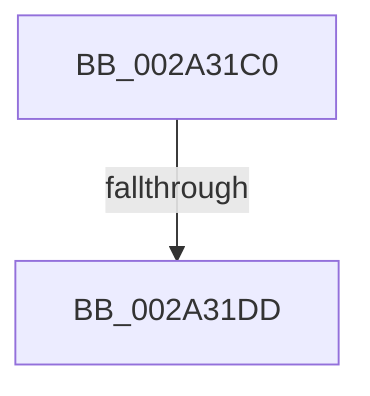

# MiCheckAvailablePagesForFaultDelay

- RVA: `0x002A31C0`–`0x002A31E5` (길이 `37` bytes)
- VA: `0x00000001402A31C0`
- 실행 섹션: `.text`
- PDB 이름 있음: `예`; PDB Function 태그: `아니요`
- unwind 정보 RVA: `0x000686CC`
- 디코드: `10`개 명령, `37/37` bytes 표시
- 미해석 바이트: `0` (있으면 어셈블리에 `.byte`로 보존)

> 이 문서는 커널 이미지의 기계어와 PDB 기호를 분석해 생성했습니다. 4번과 5번은 함수 원형과 자료형을 바이너리 사용 방식에서 추정한 C 해석이며 원본 소스 복구 결과는 아닙니다.

## 1. Dependencies

- 직접 호출 지점: **0**; 고유 호출 대상: **0**
- 직접 호출자로 확인된 함수: **1**
- RIP 상대 이미지 참조: **1**

### Outgoing calls
- 직접 디코드된 call 명령이 없습니다.

### Direct callers
- [sub_002A2D9F](Unknown_function_002A2D9F.md) at `0x002A2DC5`

### Static image references
- `0x002A31DD` → RVA `0x00FC5000` (`ALMOSTRO`; read)

## 2. Other-region calls and transfers

- 다른 실행 섹션으로 향하는 call: **0**
- call이 아닌 외부 분기/꼬리 이동: **1**
  - `0x002A31D7` → [sub_002A3311](Unknown_function_002A3311.md) (`tail-transfer`)

## 3. Assembly (complete function range)

```asm
002A31C0  40 53                           push rbx
002A31C2  57                              push rdi
002A31C3  48 83 EC 28                     sub rsp, 0x28
002A31C7  4C 8B 5C 24 60                  mov r11, qword ptr [rsp + 0x60]
002A31CC  33 DB                           xor ebx, ebx
002A31CE  48 8B FA                        mov rdi, rdx
002A31D1  4C 8B D1                        mov r10, rcx
002A31D4  4D 85 DB                        test r11, r11
002A31D7  0F 85 34 01 00 00               jne 0x1402a3311
002A31DD  66 83 3D 1B 1E D2 00 01         cmp word ptr [rip + 0xd21e1b], 1
```

## 4. C-style interpretation (structured pseudocode)

```c
void __fastcall MiCheckAvailablePagesForFaultDelay(__int64 a1, __int64 a2, __int64 a3, __int64 a4, __int64 a5)
{
    __int64 v_rbx;
    __int64 v_rsp;

    v_rsp = (v_rsp) - (40);
    v_rbx = 0;
    return;
}
```

## 5. (Beta) C Style

```c
void MiCheckAvailablePagesForFaultDelay(int64_t Arg1, int64_t Arg2, int64_t Arg3, int64_t Arg4, int64_t Arg5)
{
    int64_t local_rbx;
    int64_t local_rsp;

    local_rsp = (local_rsp) - (40);
    local_rbx = 0;
    return;
}
```

## 6. Execution-region graph

[열기: 2D/3D 그래프와 함수 탐색 컨트롤 패널](../../../control-panel.html?section=text&rva=0x002A31C0&view=graph)

- 2D 그래프는 위에서 아래로 흐르고, 3D 그래프는 빈 공간을 드래그해 회전합니다. Shift+드래그는 이동, 휠은 확대·축소, 함수 노드 선택은 대상 보고서 이동입니다.

### Static fallback


