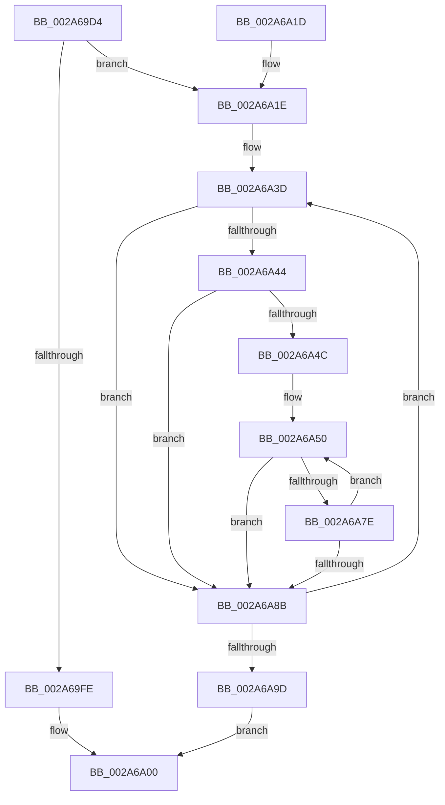

# MiCommitPageTableRangesForVad

- RVA: `0x002A69D4`–`0x002A6AB7` (길이 `227` bytes)
- VA: `0x00000001402A69D4`
- 실행 섹션: `.text`
- PDB 이름 있음: `예`; PDB Function 태그: `아니요`
- unwind 정보 RVA: `0x00068B18`
- 디코드: `68`개 명령, `227/227` bytes 표시
- 미해석 바이트: `0` (있으면 어셈블리에 `.byte`로 보존)

> 이 문서는 커널 이미지의 기계어와 PDB 기호를 분석해 생성했습니다. 4번과 5번은 함수 원형과 자료형을 바이너리 사용 방식에서 추정한 C 해석이며 원본 소스 복구 결과는 아닙니다.

## 1. Dependencies

- 직접 호출 지점: **4**; 고유 호출 대상: **4**
- 직접 호출자로 확인된 함수: **1**
- RIP 상대 이미지 참조: **0**

### Outgoing calls
- `0x002A6A38` → [LOCK_PAGE_TABLE_COMMITMENT](LOCK_PAGE_TABLE_COMMITMENT_function_002A6090.md) (function, `0x002A6090`)
- `0x002A6A73` → [MiCommitPageTablesForVad](../../page/88/MiCommitPageTablesForVad_function_00886D50.md) (function, `0x00886D50`)
- `0x002A6A90` → [ExFreePoolWithTag](../../poolcode/B8/ExFreePoolWithTag_function_00B82870.md) (function, `0x00B82870`)
- `0x002A6AA3` → [UNLOCK_PAGE_TABLE_COMMITMENT](../2E/UNLOCK_PAGE_TABLE_COMMITMENT_function_002E27D0.md) (function, `0x002E27D0`)

### Direct callers
- [MiInsertChildVads](../../page/97/MiInsertChildVads_function_0097DBB0.md) at `0x0097DC23`

### Static image references
- 디코드된 RIP-relative 메모리 참조가 없습니다.

## 2. Other-region calls and transfers

- 다른 실행 섹션으로 향하는 call: **2**
  - `0x002A6A73` → [MiCommitPageTablesForVad](../../page/88/MiCommitPageTablesForVad_function_00886D50.md) (`.text` → `PAGE`)
  - `0x002A6A90` → [ExFreePoolWithTag](../../poolcode/B8/ExFreePoolWithTag_function_00B82870.md) (`.text` → `POOLCODE`)
- 별도 외부 분기/꼬리 이동을 확인하지 못했습니다.

## 3. Assembly (complete function range)

```asm
002A69D4  48 89 5C 24 08                  mov qword ptr [rsp + 8], rbx
002A69D9  48 89 6C 24 10                  mov qword ptr [rsp + 0x10], rbp
002A69DE  48 89 74 24 18                  mov qword ptr [rsp + 0x18], rsi
002A69E3  57                              push rdi
002A69E4  41 54                           push r12
002A69E6  41 55                           push r13
002A69E8  41 56                           push r14
002A69EA  41 57                           push r15
002A69EC  48 83 EC 20                     sub rsp, 0x20
002A69F0  48 8B 59 08                     mov rbx, qword ptr [rcx + 8]
002A69F4  33 F6                           xor esi, esi
002A69F6  48 8B F9                        mov rdi, rcx
002A69F9  48 85 DB                        test rbx, rbx
002A69FC  75 20                           jne 0x1402a6a1e
002A69FE  33 C0                           xor eax, eax
002A6A00  48 8B 5C 24 50                  mov rbx, qword ptr [rsp + 0x50]
002A6A05  48 8B 6C 24 58                  mov rbp, qword ptr [rsp + 0x58]
002A6A0A  48 8B 74 24 60                  mov rsi, qword ptr [rsp + 0x60]
002A6A0F  48 83 C4 20                     add rsp, 0x20
002A6A13  41 5F                           pop r15
002A6A15  41 5E                           pop r14
002A6A17  41 5D                           pop r13
002A6A19  41 5C                           pop r12
002A6A1B  5F                              pop rdi
002A6A1C  C3                              ret
002A6A1D  CC                              int3
002A6A1E  65 4C 8B 3C 25 88 01 00 00      mov r15, qword ptr gs:[0x188]
002A6A27  4D 8B AF B8 00 00 00            mov r13, qword ptr [r15 + 0xb8]
002A6A2E  48 FF 49 10                     dec qword ptr [rcx + 0x10]
002A6A32  49 8B D5                        mov rdx, r13
002A6A35  49 8B CF                        mov rcx, r15
002A6A38  E8 53 F6 FF FF                  call 0x1402a6090
002A6A3D  4C 8B 23                        mov r12, qword ptr [rbx]
002A6A40  85 F6                           test esi, esi
002A6A42  78 47                           js 0x1402a6a8b
002A6A44  33 ED                           xor ebp, ebp
002A6A46  48 39 6B 08                     cmp qword ptr [rbx + 8], rbp
002A6A4A  76 3F                           jbe 0x1402a6a8b
002A6A4C  4C 8D 73 10                     lea r14, [rbx + 0x10]
002A6A50  49 8B 06                        mov rax, qword ptr [r14]
002A6A53  48 8B CF                        mov rcx, rdi
002A6A56  48 8B D0                        mov rdx, rax
002A6A59  25 FF FF 1F 00                  and eax, 0x1fffff
002A6A5E  48 C1 E0 15                     shl rax, 0x15
002A6A62  48 81 E2 00 00 E0 FF            and rdx, 0xffffffffffe00000
002A6A69  4C 8D 80 FF FF 1F 00            lea r8, [rax + 0x1fffff]
002A6A70  4C 03 C2                        add r8, rdx
002A6A73  E8 D8 02 5E 00                  call 0x140886d50
002A6A78  8B F0                           mov esi, eax
002A6A7A  85 C0                           test eax, eax
002A6A7C  78 0D                           js 0x1402a6a8b
002A6A7E  48 FF C5                        inc rbp
002A6A81  49 83 C6 08                     add r14, 8
002A6A85  48 3B 6B 08                     cmp rbp, qword ptr [rbx + 8]
002A6A89  72 C5                           jb 0x1402a6a50
002A6A8B  33 D2                           xor edx, edx
002A6A8D  48 8B CB                        mov rcx, rbx
002A6A90  E8 DB BD 8D 00                  call 0x140b82870
002A6A95  49 8B DC                        mov rbx, r12
002A6A98  4D 85 E4                        test r12, r12
002A6A9B  75 A0                           jne 0x1402a6a3d
002A6A9D  49 8B D5                        mov rdx, r13
002A6AA0  49 8B CF                        mov rcx, r15
002A6AA3  E8 28 BD 03 00                  call 0x1402e27d0
002A6AA8  4C 21 67 08                     and qword ptr [rdi + 8], r12
002A6AAC  8B C6                           mov eax, esi
002A6AAE  48 FF 47 10                     inc qword ptr [rdi + 0x10]
002A6AB2  E9 49 FF FF FF                  jmp 0x1402a6a00
```

## 4. C-style interpretation (structured pseudocode)

```c
__int64 __fastcall MiCommitPageTableRangesForVad(__int64 a1)
{
    __int64 result;
    __int64 v_r14;
    __int64 v_rbp;
    __int64 v_rsi;
    __int64 v_rsp;
    unsigned __int64 v_stack_p10;
    unsigned __int64 v_stack_p18;
    unsigned __int64 v_stack_p8;

    v_stack_p8 = v_rbx;
    v_stack_p10 = v_rbp;
    v_stack_p18 = v_rsi;
    v_rsp = (v_rsp) - (32);
    v_rsi = 0;
    if (*(unsigned __int64 *)(a1 + 8) != 0) goto loc_002A6A1E;
    result = 0;
loc_002A6A00:
    v_rsp = (v_rsp) + (32);
    return result;
loc_002A6A1E:
    result = LOCK_PAGE_TABLE_COMMITMENT(*(unsigned __int64 *)(gs_base + (0 + 392)), *(unsigned __int64 *)(*(unsigned __int64 *)(gs_base + (0 + 392)) + 184), a3, a4);
loc_002A6A3D:
    if (sign_flag) goto loc_002A6A8B;
    v_rbp = 0;
    if ((*(unsigned __int64 *)(v_stack_p8 + 8)) <= 0) goto loc_002A6A8B;
loc_002A6A50:
    result = (unsigned int)((*(unsigned __int64 *)(v_stack_p8 + 16)) & (0x1FFFFFULL));
    result = (result) << (21);
    a2 = (*(unsigned __int64 *)(v_stack_p8 + 16)) & (0xFFFFFFFFFFE00000ULL);
    a3 = (result + 2097151) + (a2);
    result = MiCommitPageTablesForVad(a1, a2, a3, a4);
    if (sign_flag) goto loc_002A6A8B;
    v_rbp = (v_rbp) + 1;
    v_r14 = (v_stack_p8 + 16) + (8);
    if (v_rbp < (*(unsigned __int64 *)(v_stack_p8 + 8))) goto loc_002A6A50;
loc_002A6A8B:
    a2 = 0;
    result = ExFreePoolWithTag(v_stack_p8, a2, a3, a4);
    if (*(unsigned __int64 *)(v_stack_p8) != 0) goto loc_002A6A3D;
    result = UNLOCK_PAGE_TABLE_COMMITMENT(*(unsigned __int64 *)(gs_base + (0 + 392)), *(unsigned __int64 *)(*(unsigned __int64 *)(gs_base + (0 + 392)) + 184), a3, a4);
    goto loc_002A6A00;
}
```

## 5. (Beta) C Style

```c
int64_t MiCommitPageTableRangesForVad(void *Arg1)
{
    uint8_t *arg1 = (uint8_t *)Arg1;

    int64_t result;
    int64_t local_r14;
    int64_t local_rbp;
    int64_t local_rsi;
    int64_t local_rsp;
    uint64_t v_stack_p10;
    uint64_t v_stack_p18;
    uint64_t v_stack_p8;

    v_stack_p8 = local_rbx;
    v_stack_p10 = local_rbp;
    v_stack_p18 = local_rsi;
    local_rsp = (local_rsp) - (32);
    local_rsi = 0;
    if (*(uint64_t *)(arg1 + 0x8) != 0) goto loc_002A6A1E;
    result = 0;
loc_002A6A00:
    local_rsp = (local_rsp) + (32);
    return result;
loc_002A6A1E:
    result = LOCK_PAGE_TABLE_COMMITMENT(*(uint64_t *)(gs_base + (0 + 0x188)), *(uint64_t *)(*(uint64_t *)(gs_base + (0 + 0x188)) + 0xB8), a3, a4);
loc_002A6A3D:
    if (sign_flag) goto loc_002A6A8B;
    local_rbp = 0;
    if ((*(uint64_t *)(v_stack_p8 + 0x8)) <= 0) goto loc_002A6A8B;
loc_002A6A50:
    result = (uint32_t)((*(uint64_t *)(v_stack_p8 + 0x10)) & (0x1FFFFFULL));
    result = (result) << (21);
    a2 = (*(uint64_t *)(v_stack_p8 + 0x10)) & (0xFFFFFFFFFFE00000ULL);
    a3 = (result + 2097151) + (a2);
    result = MiCommitPageTablesForVad(Arg1, a2, a3, a4);
    if (sign_flag) goto loc_002A6A8B;
    local_rbp = (local_rbp) + 1;
    local_r14 = (v_stack_p8 + 16) + (8);
    if (local_rbp < (*(uint64_t *)(v_stack_p8 + 0x8))) goto loc_002A6A50;
loc_002A6A8B:
    a2 = 0;
    result = ExFreePoolWithTag(v_stack_p8, a2, a3, a4);
    if (*(uint64_t *)(v_stack_p8) != 0) goto loc_002A6A3D;
    result = UNLOCK_PAGE_TABLE_COMMITMENT(*(uint64_t *)(gs_base + (0 + 0x188)), *(uint64_t *)(*(uint64_t *)(gs_base + (0 + 0x188)) + 0xB8), a3, a4);
    goto loc_002A6A00;
}
```

### 관측된 메모리 오프셋

구조체 형식이 확인되지 않은 접근은 인자 기준의 오프셋으로만 기록했습니다.

| 기준 인자 | 오프셋 표현 | 폭 (bit) | 접근 |
|---|---:|---:|---|
| `Arg1` | `+ 0x8` | `64` | `R` |
| `Arg1` | `+ 0x8` | `64` | `R/W` |
| `Arg1` | `+ 0x10` | `64` | `R/W` |

## 6. Execution-region graph

[열기: 2D/3D 그래프와 함수 탐색 컨트롤 패널](../../../control-panel.html?section=text&rva=0x002A69D4&view=graph)

- 2D 그래프는 위에서 아래로 흐르고, 3D 그래프는 빈 공간을 드래그해 회전합니다. Shift+드래그는 이동, 휠은 확대·축소, 함수 노드 선택은 대상 보고서 이동입니다.

### Static fallback


