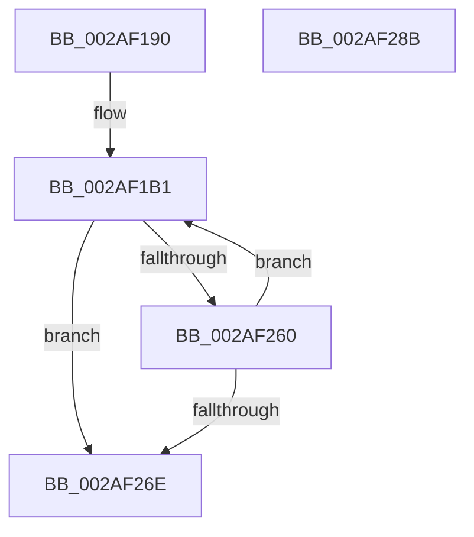

# MiComparePages

- RVA: `0x002AF190`–`0x002AF28C` (길이 `252` bytes)
- VA: `0x00000001402AF190`
- 실행 섹션: `.text`
- PDB 이름 있음: `예`; PDB Function 태그: `아니요`
- unwind 정보 RVA: `0x0006D4AC`
- 디코드: `62`개 명령, `252/252` bytes 표시
- 미해석 바이트: `0` (있으면 어셈블리에 `.byte`로 보존)

> 이 문서는 커널 이미지의 기계어와 PDB 기호를 분석해 생성했습니다. 4번과 5번은 함수 원형과 자료형을 바이너리 사용 방식에서 추정한 C 해석이며 원본 소스 복구 결과는 아닙니다.

## 1. Dependencies

- 직접 호출 지점: **0**; 고유 호출 대상: **0**
- 직접 호출자로 확인된 함수: **1**
- RIP 상대 이미지 참조: **0**

### Outgoing calls
- 직접 디코드된 call 명령이 없습니다.

### Direct callers
- [MiConfirmCombinePageContents](MiConfirmCombinePageContents_function_002AF394.md) at `0x002AF402`

### Static image references
- 디코드된 RIP-relative 메모리 참조가 없습니다.

## 2. Other-region calls and transfers

- 다른 실행 섹션으로 향하는 call: **0**
- 별도 외부 분기/꼬리 이동을 확인하지 못했습니다.

## 3. Assembly (complete function range)

```asm
002AF190  48 89 5C 24 08                  mov qword ptr [rsp + 8], rbx
002AF195  48 89 74 24 10                  mov qword ptr [rsp + 0x10], rsi
002AF19A  48 89 7C 24 18                  mov qword ptr [rsp + 0x18], rdi
002AF19F  4C 89 74 24 20                  mov qword ptr [rsp + 0x20], r14
002AF1A4  41 57                           push r15
002AF1A6  4C 8B F2                        mov r14, rdx
002AF1A9  4C 8B F9                        mov r15, rcx
002AF1AC  B8 F9 01 00 00                  mov eax, 0x1f9
002AF1B1  8D 48 02                        lea ecx, [rax + 2]
002AF1B4  48 8D 1C CD 00 00 00 00         lea rbx, [rcx*8]
002AF1BC  8D 48 03                        lea ecx, [rax + 3]
002AF1BF  4C 8D 1C CD 00 00 00 00         lea r11, [rcx*8]
002AF1C7  8D 48 04                        lea ecx, [rax + 4]
002AF1CA  4C 8D 0C CD 00 00 00 00         lea r9, [rcx*8]
002AF1D2  44 8D 40 FF                     lea r8d, [rax - 1]
002AF1D6  4A 8D 34 C5 00 00 00 00         lea rsi, [r8*8]
002AF1DE  44 8B C0                        mov r8d, eax
002AF1E1  8D 48 05                        lea ecx, [rax + 5]
002AF1E4  8D 50 06                        lea edx, [rax + 6]
002AF1E7  4E 8D 14 C5 00 00 00 00         lea r10, [r8*8]
002AF1EF  44 8D 40 01                     lea r8d, [rax + 1]
002AF1F3  4A 8D 3C C5 00 00 00 00         lea rdi, [r8*8]
002AF1FB  4C 8D 04 CD 00 00 00 00         lea r8, [rcx*8]
002AF203  4B 8B 0C 32                     mov rcx, qword ptr [r10 + r14]
002AF207  4F 8B 14 3A                     mov r10, qword ptr [r10 + r15]
002AF20B  4C 33 D1                        xor r10, rcx
002AF20E  49 8B 0C D6                     mov rcx, qword ptr [r14 + rdx*8]
002AF212  49 8B 14 D7                     mov rdx, qword ptr [r15 + rdx*8]
002AF216  48 33 D1                        xor rdx, rcx
002AF219  4C 0B D2                        or r10, rdx
002AF21C  4B 8B 14 38                     mov rdx, qword ptr [r8 + r15]
002AF220  4B 33 14 30                     xor rdx, qword ptr [r8 + r14]
002AF224  4C 0B D2                        or r10, rdx
002AF227  4B 8B 14 39                     mov rdx, qword ptr [r9 + r15]
002AF22B  4B 33 14 31                     xor rdx, qword ptr [r9 + r14]
002AF22F  4C 0B D2                        or r10, rdx
002AF232  4B 8B 14 3B                     mov rdx, qword ptr [r11 + r15]
002AF236  4B 33 14 33                     xor rdx, qword ptr [r11 + r14]
002AF23A  4C 0B D2                        or r10, rdx
002AF23D  4A 8B 14 3B                     mov rdx, qword ptr [rbx + r15]
002AF241  4A 33 14 33                     xor rdx, qword ptr [rbx + r14]
002AF245  4C 0B D2                        or r10, rdx
002AF248  4A 8B 14 3F                     mov rdx, qword ptr [rdi + r15]
002AF24C  4A 33 14 37                     xor rdx, qword ptr [rdi + r14]
002AF250  4C 0B D2                        or r10, rdx
002AF253  4A 8B 14 3E                     mov rdx, qword ptr [rsi + r15]
002AF257  4A 33 14 36                     xor rdx, qword ptr [rsi + r14]
002AF25B  4C 0B D2                        or r10, rdx
002AF25E  75 0E                           jne 0x1402af26e
002AF260  83 C0 F8                        add eax, -8
002AF263  8D 48 07                        lea ecx, [rax + 7]
002AF266  85 C9                           test ecx, ecx
002AF268  0F 85 43 FF FF FF               jne 0x1402af1b1
002AF26E  48 8B 5C 24 10                  mov rbx, qword ptr [rsp + 0x10]
002AF273  4D 85 D2                        test r10, r10
002AF276  48 8B 74 24 18                  mov rsi, qword ptr [rsp + 0x18]
002AF27B  48 8B 7C 24 20                  mov rdi, qword ptr [rsp + 0x20]
002AF280  0F 94 C0                        sete al
002AF283  4C 8B 74 24 28                  mov r14, qword ptr [rsp + 0x28]
002AF288  41 5F                           pop r15
002AF28A  C3                              ret
002AF28B  CC                              int3
```

## 4. C-style interpretation (structured pseudocode)

```c
__int64 __fastcall MiComparePages(__int64 a1, __int64 a2)
{
    __int64 result;
    __int64 v_r10;
    unsigned __int64 v_stack_p10;
    unsigned __int64 v_stack_p18;
    unsigned __int64 v_stack_p20;
    unsigned __int64 v_stack_p8;

    v_stack_p8 = v_rbx;
    v_stack_p10 = v_rsi;
    v_stack_p18 = v_rdi;
    v_stack_p20 = v_r14;
loc_002AF1B1:
    v_r10 = (*(unsigned __int64 *)(505 * 8 + a1 * 1)) ^ (*(unsigned __int64 *)(505 * 8 + a2 * 1));
    a2 = (*(unsigned __int64 *)(a1 + 505 + 6 * 8)) ^ (*(unsigned __int64 *)(a2 + 505 + 6 * 8));
    v_r10 = (v_r10) | (a2);
    a2 = (*(unsigned __int64 *)(505 + 5 * 8 + a1 * 1)) ^ (*(unsigned __int64 *)(505 + 5 * 8 + a2 * 1));
    v_r10 = (v_r10) | (a2);
    a2 = (*(unsigned __int64 *)(505 + 4 * 8 + a1 * 1)) ^ (*(unsigned __int64 *)(505 + 4 * 8 + a2 * 1));
    v_r10 = (v_r10) | (a2);
    a2 = (*(unsigned __int64 *)(505 + 3 * 8 + a1 * 1)) ^ (*(unsigned __int64 *)(505 + 3 * 8 + a2 * 1));
    v_r10 = (v_r10) | (a2);
    a2 = (*(unsigned __int64 *)(505 + 2 * 8 + a1 * 1)) ^ (*(unsigned __int64 *)(505 + 2 * 8 + a2 * 1));
    v_r10 = (v_r10) | (a2);
    a2 = (*(unsigned __int64 *)(505 + 1 * 8 + a1 * 1)) ^ (*(unsigned __int64 *)(505 + 1 * 8 + a2 * 1));
    v_r10 = (v_r10) | (a2);
    a2 = (*(unsigned __int64 *)(505 - 1 * 8 + a1 * 1)) ^ (*(unsigned __int64 *)(505 - 1 * 8 + a2 * 1));
    v_r10 = (v_r10) | (a2);
    if (condition_is_not_equal) goto loc_002AF26E;
    result = (unsigned int)((505) + (-8));
    if ((unsigned int)(result + 7) != 0) goto loc_002AF1B1;
loc_002AF26E:
    result = (v_r10 == 0) ? 1 : 0;
    return result;
}
```

## 5. (Beta) C Style

```c
int64_t MiComparePages(void *Arg1, void *Arg2)
{
    uint8_t *arg1 = (uint8_t *)Arg1;
    uint8_t *arg2 = (uint8_t *)Arg2;

    int64_t result;
    int64_t local_r10;
    uint64_t v_stack_p10;
    uint64_t v_stack_p18;
    uint64_t v_stack_p20;
    uint64_t v_stack_p8;

    v_stack_p8 = local_rbx;
    v_stack_p10 = local_rsi;
    v_stack_p18 = local_rdi;
    v_stack_p20 = local_r14;
loc_002AF1B1:
    local_r10 = (*(uint64_t *)(505 * 8 + arg1 * 1)) ^ (*(uint64_t *)(505 * 8 + arg2 * 1));
    Arg2 = (*(uint64_t *)(arg1 + 0x1F9 + 0x6 * 8)) ^ (*(uint64_t *)(arg2 + 0x1F9 + 0x6 * 8));
    local_r10 = (local_r10) | (Arg2);
    Arg2 = (*(uint64_t *)(505 + 0x5 * 8 + arg1 * 1)) ^ (*(uint64_t *)(505 + 0x5 * 8 + arg2 * 1));
    local_r10 = (local_r10) | (Arg2);
    Arg2 = (*(uint64_t *)(505 + 0x4 * 8 + arg1 * 1)) ^ (*(uint64_t *)(505 + 0x4 * 8 + arg2 * 1));
    local_r10 = (local_r10) | (Arg2);
    Arg2 = (*(uint64_t *)(505 + 0x3 * 8 + arg1 * 1)) ^ (*(uint64_t *)(505 + 0x3 * 8 + arg2 * 1));
    local_r10 = (local_r10) | (Arg2);
    Arg2 = (*(uint64_t *)(505 + 0x2 * 8 + arg1 * 1)) ^ (*(uint64_t *)(505 + 0x2 * 8 + arg2 * 1));
    local_r10 = (local_r10) | (Arg2);
    Arg2 = (*(uint64_t *)(505 + 0x1 * 8 + arg1 * 1)) ^ (*(uint64_t *)(505 + 0x1 * 8 + arg2 * 1));
    local_r10 = (local_r10) | (Arg2);
    Arg2 = (*(uint64_t *)(505 - 0x1 * 8 + arg1 * 1)) ^ (*(uint64_t *)(505 - 0x1 * 8 + arg2 * 1));
    local_r10 = (local_r10) | (Arg2);
    if (condition_is_not_equal) goto loc_002AF26E;
    result = (uint32_t)((505) + (-8));
    if ((uint32_t)(result + 7) != 0) goto loc_002AF1B1;
loc_002AF26E:
    result = (local_r10 == 0) ? 1 : 0;
    return result;
}
```

### 관측된 메모리 오프셋

구조체 형식이 확인되지 않은 접근은 인자 기준의 오프셋으로만 기록했습니다.

| 기준 인자 | 오프셋 표현 | 폭 (bit) | 접근 |
|---|---:|---:|---|
| `Arg1` | `+ 0x0 + rdx*8` | `64` | `R` |
| `Arg2` | `+ 0x0 + rdx*8` | `64` | `R` |

## 6. Execution-region graph

[열기: 2D/3D 그래프와 함수 탐색 컨트롤 패널](../../../control-panel.html?section=text&rva=0x002AF190&view=graph)

- 2D 그래프는 위에서 아래로 흐르고, 3D 그래프는 빈 공간을 드래그해 회전합니다. Shift+드래그는 이동, 휠은 확대·축소, 함수 노드 선택은 대상 보고서 이동입니다.

### Static fallback


