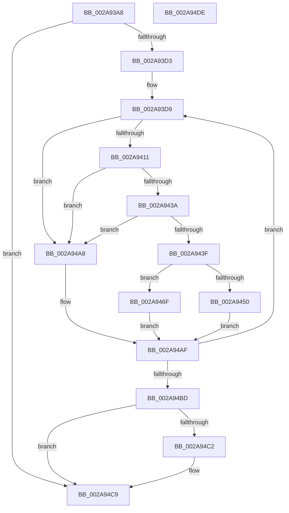

# MiCompressTbFlushList

- RVA: `0x002A93A8`–`0x002A94DF` (길이 `311` bytes)
- VA: `0x00000001402A93A8`
- 실행 섹션: `.text`
- PDB 이름 있음: `예`; PDB Function 태그: `아니요`
- unwind 정보 RVA: `0x00068DE4`
- 디코드: `92`개 명령, `311/311` bytes 표시
- 미해석 바이트: `0` (있으면 어셈블리에 `.byte`로 보존)

> 이 문서는 커널 이미지의 기계어와 PDB 기호를 분석해 생성했습니다. 4번과 5번은 함수 원형과 자료형을 바이너리 사용 방식에서 추정한 C 해석이며 원본 소스 복구 결과는 아닙니다.

## 1. Dependencies

- 직접 호출 지점: **0**; 고유 호출 대상: **0**
- 직접 호출자로 확인된 함수: **11**
- RIP 상대 이미지 참조: **0**

### Outgoing calls
- 직접 디코드된 call 명령이 없습니다.

### Direct callers
- [MmSetAddressRangeModifiedEx](../23/MmSetAddressRangeModifiedEx_function_00236F20.md) at `0x0023750B`
- [MiEmptyWorkingSetHelper](../24/MiEmptyWorkingSetHelper_function_00240C00.md) at `0x002410B0`
- [sub_00241476](../24/Unknown_function_00241476.md) at `0x00241968`
- [MiWalkVaRange](../24/MiWalkVaRange_function_00243BF0.md) at `0x00244904`
- [MiReleasePtes](../24/MiReleasePtes_function_00247240.md) at `0x00247835`
- [MiFlushSingleTbEntry](../28/MiFlushSingleTbEntry_function_0028E730.md) at `0x0028EAC8`
- [sub_002901B8](../29/Unknown_function_002901B8.md) at `0x00290599`
- [sub_0029384E](../29/Unknown_function_0029384E.md) at `0x00293870`
- [MiMakePteClean](MiMakePteClean_function_002A901C.md) at `0x002A9324`
- [MiFlushTbAsNeeded](../31/MiFlushTbAsNeeded_function_00313730.md) at `0x00313BCF`
- [MiReservePtes](../31/MiReservePtes_function_00318D20.md) at `0x00319500`

### Static image references
- 디코드된 RIP-relative 메모리 참조가 없습니다.

## 2. Other-region calls and transfers

- 다른 실행 섹션으로 향하는 call: **0**
- 별도 외부 분기/꼬리 이동을 확인하지 못했습니다.

## 3. Assembly (complete function range)

```asm
002A93A8  48 89 5C 24 10                  mov qword ptr [rsp + 0x10], rbx
002A93AD  48 89 6C 24 18                  mov qword ptr [rsp + 0x18], rbp
002A93B2  48 89 74 24 20                  mov qword ptr [rsp + 0x20], rsi
002A93B7  57                              push rdi
002A93B8  41 54                           push r12
002A93BA  41 56                           push r14
002A93BC  45 33 DB                        xor r11d, r11d
002A93BF  4C 8D 41 28                     lea r8, [rcx + 0x28]
002A93C3  4C 8B C9                        mov r9, rcx
002A93C6  41 8D 5B 01                     lea ebx, [r11 + 1]
002A93CA  39 59 1C                        cmp dword ptr [rcx + 0x1c], ebx
002A93CD  0F 86 F6 00 00 00               jbe 0x1402a94c9
002A93D3  41 BC FF 03 00 00               mov r12d, 0x3ff
002A93D9  49 8B 30                        mov rsi, qword ptr [r8]
002A93DC  BD 00 10 00 00                  mov ebp, 0x1000
002A93E1  44 8B F3                        mov r14d, ebx
002A93E4  4F 8B 54 F1 28                  mov r10, qword ptr [r9 + r14*8 + 0x28]
002A93E9  49 8B D2                        mov rdx, r10
002A93EC  48 C1 EA 0A                     shr rdx, 0xa
002A93F0  83 E2 03                        and edx, 3
002A93F3  8A C2                           mov al, dl
002A93F5  C0 E0 03                        shl al, 3
002A93F8  8D 0C 10                        lea ecx, [rax + rdx]
002A93FB  48 8B C6                        mov rax, rsi
002A93FE  48 C1 E8 0A                     shr rax, 0xa
002A9402  83 E0 03                        and eax, 3
002A9405  48 D3 E5                        shl rbp, cl
002A9408  48 3B D0                        cmp rdx, rax
002A940B  0F 85 97 00 00 00               jne 0x1402a94a8
002A9411  48 C7 C2 00 F0 FF FF            mov rdx, 0xfffffffffffff000
002A9418  48 8B FE                        mov rdi, rsi
002A941B  49 23 FC                        and rdi, r12
002A941E  49 8B CA                        mov rcx, r10
002A9421  48 23 CA                        and rcx, rdx
002A9424  48 8D 47 01                     lea rax, [rdi + 1]
002A9428  48 0F AF C5                     imul rax, rbp
002A942C  48 2B C8                        sub rcx, rax
002A942F  48 8B C6                        mov rax, rsi
002A9432  48 23 C2                        and rax, rdx
002A9435  48 3B C8                        cmp rcx, rax
002A9438  75 6E                           jne 0x1402a94a8
002A943A  49 3B FC                        cmp rdi, r12
002A943D  74 69                           je 0x1402a94a8
002A943F  49 8B C2                        mov rax, r10
002A9442  49 23 C4                        and rax, r12
002A9445  48 FF C0                        inc rax
002A9448  48 03 C7                        add rax, rdi
002A944B  49 3B C4                        cmp rax, r12
002A944E  77 1F                           ja 0x1402a946f
002A9450  48 8D 46 01                     lea rax, [rsi + 1]
002A9454  49 03 C2                        add rax, r10
002A9457  48 8B C8                        mov rcx, rax
002A945A  48 33 CE                        xor rcx, rsi
002A945D  48 81 E1 00 FC FF FF            and rcx, 0xfffffffffffffc00
002A9464  48 33 C8                        xor rcx, rax
002A9467  49 89 08                        mov qword ptr [r8], rcx
002A946A  41 FF C3                        inc r11d
002A946D  EB 40                           jmp 0x1402a94af
002A946F  49 8B D4                        mov rdx, r12
002A9472  49 8B C2                        mov rax, r10
002A9475  48 2B D7                        sub rdx, rdi
002A9478  48 2B C2                        sub rax, rdx
002A947B  48 0F AF EA                     imul rbp, rdx
002A947F  48 8B C8                        mov rcx, rax
002A9482  49 33 CA                        xor rcx, r10
002A9485  48 81 E1 00 FC FF FF            and rcx, 0xfffffffffffffc00
002A948C  48 33 C8                        xor rcx, rax
002A948F  48 03 CD                        add rcx, rbp
002A9492  4B 89 4C F1 28                  mov qword ptr [r9 + r14*8 + 0x28], rcx
002A9497  4D 09 20                        or qword ptr [r8], r12
002A949A  4B 8B 44 F1 28                  mov rax, qword ptr [r9 + r14*8 + 0x28]
002A949F  49 83 C0 08                     add r8, 8
002A94A3  49 89 00                        mov qword ptr [r8], rax
002A94A6  EB 07                           jmp 0x1402a94af
002A94A8  49 83 C0 08                     add r8, 8
002A94AC  4D 89 10                        mov qword ptr [r8], r10
002A94AF  41 8B 41 1C                     mov eax, dword ptr [r9 + 0x1c]
002A94B3  FF C3                           inc ebx
002A94B5  3B D8                           cmp ebx, eax
002A94B7  0F 82 1C FF FF FF               jb 0x1402a93d9
002A94BD  45 85 DB                        test r11d, r11d
002A94C0  74 07                           je 0x1402a94c9
002A94C2  41 2B C3                        sub eax, r11d
002A94C5  41 89 41 1C                     mov dword ptr [r9 + 0x1c], eax
002A94C9  48 8B 5C 24 28                  mov rbx, qword ptr [rsp + 0x28]
002A94CE  48 8B 6C 24 30                  mov rbp, qword ptr [rsp + 0x30]
002A94D3  48 8B 74 24 38                  mov rsi, qword ptr [rsp + 0x38]
002A94D8  41 5E                           pop r14
002A94DA  41 5C                           pop r12
002A94DC  5F                              pop rdi
002A94DD  C3                              ret
002A94DE  CC                              int3
```

## 4. C-style interpretation (structured pseudocode)

```c
__int64 __fastcall MiCompressTbFlushList(__int64 a1)
{
    __int64 result;
    __int64 v_r11;
    __int64 v_rbp;
    __int64 v_rbx;
    __int64 v_rdi;
    unsigned __int64 v_stack_p10;
    unsigned __int64 v_stack_p18;
    unsigned __int64 v_stack_p20;

    v_stack_p10 = v_rbx;
    v_stack_p18 = v_rbp;
    v_stack_p20 = v_rsi;
    v_r11 = 0;
    if ((*(unsigned int *)(a1 + 28)) <= ((unsigned int)(v_r11 + 1))) goto loc_002A94C9;
loc_002A93D9:
    a2 = (*(unsigned __int64 *)(a1 + (unsigned int)((unsigned int)(v_r11 + 1)) * 8 + 40)) >> (10);
    a2 = (unsigned int)((a2) & (3));
    result = (unsigned __int8)(((unsigned __int8)(a2)) << (3));
    result = (*(unsigned __int64 *)(a1 + 40)) >> (10);
    result = (unsigned int)((result) & (3));
    v_rbp = ((unsigned int)(0x1000ULL)) << ((unsigned __int8)(result + a2 * 1));
    if (a2 != result) goto loc_002A94A8;
    v_rdi = (*(unsigned __int64 *)(a1 + 40)) & ((unsigned int)(0x3FFULL));
    a1 = (*(unsigned __int64 *)(a1 + (unsigned int)((unsigned int)(v_r11 + 1)) * 8 + 40)) & (0xFFFFFFFFFFFFF000ULL);
    result = (v_rdi + 1) * (v_rbp);
    a1 = (a1) - (result);
    result = (*(unsigned __int64 *)(a1 + 40)) & (0xFFFFFFFFFFFFF000ULL);
    if (a1 != result) goto loc_002A94A8;
    if (v_rdi == ((unsigned int)(0x3FFULL))) goto loc_002A94A8;
    result = (*(unsigned __int64 *)(a1 + (unsigned int)((unsigned int)(v_r11 + 1)) * 8 + 40)) & ((unsigned int)(0x3FFULL));
    result = (result) + 1;
    result = (result) + (v_rdi);
    if (result > ((unsigned int)(0x3FFULL))) goto loc_002A946F;
    result = (*(unsigned __int64 *)(a1 + 40) + 1) + (*(unsigned __int64 *)(a1 + (unsigned int)((unsigned int)(v_r11 + 1)) * 8 + 40));
    a1 = (result) ^ (*(unsigned __int64 *)(a1 + 40));
    a1 = (a1) & (0xFFFFFFFFFFFFFC00ULL);
    a1 = (a1) ^ (result);
    *(unsigned __int64 *)(a1 + 40) = a1;
    v_r11 = (unsigned int)((v_r11) + 1);
    goto loc_002A94AF;
loc_002A946F:
    a2 = ((unsigned int)(0x3FFULL)) - (v_rdi);
    result = (*(unsigned __int64 *)(a1 + (unsigned int)((unsigned int)(v_r11 + 1)) * 8 + 40)) - (a2);
    v_rbp = (v_rbp) * (a2);
    a1 = (result) ^ (*(unsigned __int64 *)(a1 + (unsigned int)((unsigned int)(v_r11 + 1)) * 8 + 40));
    a1 = (a1) & (0xFFFFFFFFFFFFFC00ULL);
    a1 = (a1) ^ (result);
    a1 = (a1) + (v_rbp);
    *(unsigned __int64 *)(a1 + (unsigned int)((unsigned int)(v_r11 + 1)) * 8 + 40) = a1;
    a3 = (a1 + 40) + (8);
    *(unsigned __int64 *)(a3) = *(unsigned __int64 *)(a1 + (unsigned int)((unsigned int)(v_r11 + 1)) * 8 + 40);
    goto loc_002A94AF;
loc_002A94A8:
    a3 = (a3) + (8);
    *(unsigned __int64 *)(a3) = *(unsigned __int64 *)(a1 + (unsigned int)((unsigned int)(v_r11 + 1)) * 8 + 40);
loc_002A94AF:
    v_rbx = (unsigned int)((v_r11 + 1) + 1);
    if (((unsigned int)(v_rbx)) < ((unsigned int)((unsigned int)(*(unsigned int *)(a1 + 28))))) goto loc_002A93D9;
    result = (unsigned int)(*(unsigned int *)(a1 + 28));
    if ((unsigned int)(v_r11) != 0) {
        result = (unsigned int)(((unsigned int)(*(unsigned int *)(a1 + 28))) - ((unsigned int)(v_r11)));
        *(unsigned int *)(a1 + 28) = (unsigned int)(result);
    }
    return result;
}
```

## 5. (Beta) C Style

```c
int64_t MiCompressTbFlushList(void *Arg1)
{
    uint8_t *arg1 = (uint8_t *)Arg1;

    int64_t result;
    int64_t local_r11;
    int64_t local_rbp;
    int64_t local_rbx;
    int64_t local_rdi;
    uint64_t v_stack_p10;
    uint64_t v_stack_p18;
    uint64_t v_stack_p20;

    v_stack_p10 = local_rbx;
    v_stack_p18 = local_rbp;
    v_stack_p20 = local_rsi;
    local_r11 = 0;
    if ((*(uint32_t *)(arg1 + 0x1C)) <= ((uint32_t)(local_r11 + 1))) goto loc_002A94C9;
loc_002A93D9:
    a2 = (*(uint64_t *)(arg1 + (uint32_t)((uint32_t)(local_r11 + 0x1)) * 8 + 0x28)) >> (10);
    a2 = (uint32_t)((a2) & (3));
    result = (uint8_t)(((uint8_t)(a2)) << (3));
    result = (*(uint64_t *)(arg1 + 0x28)) >> (10);
    result = (uint32_t)((result) & (3));
    local_rbp = ((uint32_t)(0x1000ULL)) << ((uint8_t)(result + a2 * 1));
    if (a2 != result) goto loc_002A94A8;
    local_rdi = (*(uint64_t *)(arg1 + 0x28)) & ((uint32_t)(0x3FFULL));
    Arg1 = (*(uint64_t *)(arg1 + (uint32_t)((uint32_t)(local_r11 + 0x1)) * 8 + 0x28)) & (0xFFFFFFFFFFFFF000ULL);
    result = (local_rdi + 1) * (local_rbp);
    Arg1 = (Arg1) - (result);
    result = (*(uint64_t *)(arg1 + 0x28)) & (0xFFFFFFFFFFFFF000ULL);
    if (Arg1 != result) goto loc_002A94A8;
    if (local_rdi == ((uint32_t)(0x3FFULL))) goto loc_002A94A8;
    result = (*(uint64_t *)(arg1 + (uint32_t)((uint32_t)(local_r11 + 0x1)) * 8 + 0x28)) & ((uint32_t)(0x3FFULL));
    result = (result) + 1;
    result = (result) + (local_rdi);
    if (result > ((uint32_t)(0x3FFULL))) goto loc_002A946F;
    result = (*(uint64_t *)(arg1 + 0x28) + 1) + (*(uint64_t *)(arg1 + (uint32_t)((uint32_t)(local_r11 + 0x1)) * 8 + 0x28));
    Arg1 = (result) ^ (*(uint64_t *)(arg1 + 0x28));
    Arg1 = (Arg1) & (0xFFFFFFFFFFFFFC00ULL);
    Arg1 = (Arg1) ^ (result);
    *(void **)(arg1 + 0x28) = Arg1;
    local_r11 = (uint32_t)((local_r11) + 1);
    goto loc_002A94AF;
loc_002A946F:
    a2 = ((uint32_t)(0x3FFULL)) - (local_rdi);
    result = (*(uint64_t *)(arg1 + (uint32_t)((uint32_t)(local_r11 + 0x1)) * 8 + 0x28)) - (a2);
    local_rbp = (local_rbp) * (a2);
    Arg1 = (result) ^ (*(uint64_t *)(arg1 + (uint32_t)((uint32_t)(local_r11 + 0x1)) * 8 + 0x28));
    Arg1 = (Arg1) & (0xFFFFFFFFFFFFFC00ULL);
    Arg1 = (Arg1) ^ (result);
    Arg1 = (Arg1) + (local_rbp);
    *(void **)(arg1 + (uint32_t)((uint32_t)(local_r11 + 0x1)) * 8 + 0x28) = Arg1;
    a3 = (Arg1 + 40) + (8);
    *(uint64_t *)(a3) = *(uint64_t *)(arg1 + (uint32_t)((uint32_t)(local_r11 + 0x1)) * 8 + 0x28);
    goto loc_002A94AF;
loc_002A94A8:
    a3 = (a3) + (8);
    *(uint64_t *)(a3) = *(uint64_t *)(arg1 + (uint32_t)((uint32_t)(local_r11 + 0x1)) * 8 + 0x28);
loc_002A94AF:
    local_rbx = (uint32_t)((local_r11 + 1) + 1);
    if (((uint32_t)(local_rbx)) < ((uint32_t)((uint32_t)(*(uint32_t *)(arg1 + 0x1C))))) goto loc_002A93D9;
    result = (uint32_t)(*(uint32_t *)(arg1 + 0x1C));
    if ((uint32_t)(local_r11) != 0) {
        result = (uint32_t)(((uint32_t)(*(uint32_t *)(arg1 + 0x1C))) - ((uint32_t)(local_r11)));
        *(uint32_t *)(arg1 + 0x1C) = (uint32_t)(result);
    }
    return result;
}
```

### 관측된 메모리 오프셋

구조체 형식이 확인되지 않은 접근은 인자 기준의 오프셋으로만 기록했습니다.

| 기준 인자 | 오프셋 표현 | 폭 (bit) | 접근 |
|---|---:|---:|---|
| `Arg1` | `+ 0x0` | `64` | `R` |
| `Arg1` | `+ 0x0` | `64` | `R/W` |
| `Arg1` | `+ 0x0` | `64` | `W` |
| `Arg1` | `+ 0x1C` | `32` | `R` |
| `Arg1` | `+ 0x1C` | `32` | `W` |
| `Arg1` | `+ 0x28` | `64` | `R` |
| `Arg1` | `+ 0x28 + r14*8` | `64` | `R` |
| `Arg1` | `+ 0x28 + r14*8` | `64` | `W` |

## 6. Execution-region graph

[열기: 2D/3D 그래프와 함수 탐색 컨트롤 패널](../../../control-panel.html?section=text&rva=0x002A93A8&view=graph)

- 2D 그래프는 위에서 아래로 흐르고, 3D 그래프는 빈 공간을 드래그해 회전합니다. Shift+드래그는 이동, 휠은 확대·축소, 함수 노드 선택은 대상 보고서 이동입니다.

### Static fallback


