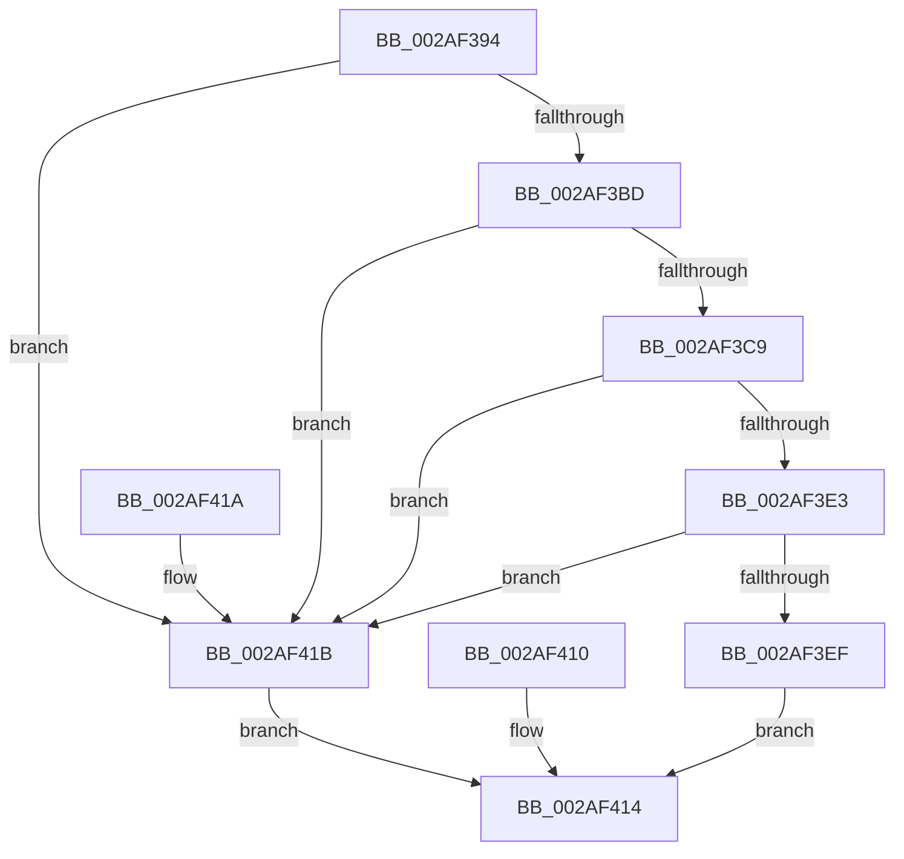

# MiConfirmCombinePageContents

- RVA: `0x002AF394`–`0x002AF41F` (길이 `139` bytes)
- VA: `0x00000001402AF394`
- 실행 섹션: `.text`
- PDB 이름 있음: `예`; PDB Function 태그: `아니요`
- unwind 정보 RVA: `0x0006D4C8`
- 디코드: `39`개 명령, `139/139` bytes 표시
- 미해석 바이트: `0` (있으면 어셈블리에 `.byte`로 보존)

> 이 문서는 커널 이미지의 기계어와 PDB 기호를 분석해 생성했습니다. 4번과 5번은 함수 원형과 자료형을 바이너리 사용 방식에서 추정한 C 해석이며 원본 소스 복구 결과는 아닙니다.

## 1. Dependencies

- 직접 호출 지점: **3**; 고유 호출 대상: **3**
- 직접 호출자로 확인된 함수: **2**
- RIP 상대 이미지 참조: **1**

### Outgoing calls
- `0x002AF3C0` → [MiIsPageOnBadList](../2B/MiIsPageOnBadList_function_002B1018.md) (function, `0x002B1018`)
- `0x002AF3E6` → [MiStandbyPageContentsIntact](MiStandbyPageContentsIntact_function_002AF0D4.md) (function, `0x002AF0D4`)
- `0x002AF402` → [MiComparePages](MiComparePages_function_002AF190.md) (function, `0x002AF190`)

### Direct callers
- [MiCombineWithStandbyExisting](../22/MiCombineWithStandbyExisting_function_00229E74.md) at `0x0022A0A1`
- [MiCombineWithExisting](../22/MiCombineWithExisting_function_0022B4B8.md) at `0x0022B604`

### Static image references
- `0x002AF3D6` → RVA `0x00E30088` (`.data`; read)

## 2. Other-region calls and transfers

- 다른 실행 섹션으로 향하는 call: **0**
- 별도 외부 분기/꼬리 이동을 확인하지 못했습니다.

## 3. Assembly (complete function range)

```asm
002AF394  40 53                           push rbx
002AF396  48 83 EC 30                     sub rsp, 0x30
002AF39A  48 8B D9                        mov rbx, rcx
002AF39D  4C 8D 0C 52                     lea r9, [rdx + rdx*2]
002AF3A1  49 C1 E1 04                     shl r9, 4
002AF3A5  48 B8 00 00 00 00 00 DE FF FF   movabs rax, 0xffffde0000000000
002AF3AF  4C 03 C8                        add r9, rax
002AF3B2  41 8B 41 20                     mov eax, dword ptr [r9 + 0x20]
002AF3B6  C1 E8 18                        shr eax, 0x18
002AF3B9  A8 40                           test al, 0x40
002AF3BB  75 5E                           jne 0x1402af41b
002AF3BD  49 8B C9                        mov rcx, r9
002AF3C0  E8 53 1C 00 00                  call 0x1402b1018
002AF3C5  85 C0                           test eax, eax
002AF3C7  75 52                           jne 0x1402af41b
002AF3C9  49 8B 41 28                     mov rax, qword ptr [r9 + 0x28]
002AF3CD  48 C1 E8 2B                     shr rax, 0x2b
002AF3D1  25 FF 03 00 00                  and eax, 0x3ff
002AF3D6  48 8B 15 AB 0C B8 00            mov rdx, qword ptr [rip + 0xb80cab]
002AF3DD  4C 3B 04 C2                     cmp r8, qword ptr [rdx + rax*8]
002AF3E1  75 38                           jne 0x1402af41b
002AF3E3  49 8B C9                        mov rcx, r9
002AF3E6  E8 E9 FC FF FF                  call 0x1402af0d4
002AF3EB  85 C0                           test eax, eax
002AF3ED  74 2C                           je 0x1402af41b
002AF3EF  48 8B 53 60                     mov rdx, qword ptr [rbx + 0x60]
002AF3F3  48 8D 8A 00 10 00 00            lea rcx, [rdx + 0x1000]
002AF3FA  C7 44 24 20 00 00 00 00         mov dword ptr [rsp + 0x20], 0
002AF402  E8 89 FD FF FF                  call 0x1402af190
002AF407  0F B6 C0                        movzx eax, al
002AF40A  89 44 24 20                     mov dword ptr [rsp + 0x20], eax
002AF40E  EB 04                           jmp 0x1402af414
002AF410  8B 44 24 20                     mov eax, dword ptr [rsp + 0x20]
002AF414  48 83 C4 30                     add rsp, 0x30
002AF418  5B                              pop rbx
002AF419  C3                              ret
002AF41A  CC                              int3
002AF41B  33 C0                           xor eax, eax
002AF41D  EB F5                           jmp 0x1402af414
```

## 4. C-style interpretation (structured pseudocode)

```c
__int64 __fastcall MiConfirmCombinePageContents(__int64 a1, __int64 a2, __int64 a3)
{
    __int64 result;
    __int64 v_rsp;
    unsigned int v_stack_m18;

    v_rsp = (v_rsp) - (48);
    a4 = (a2 + a2 * 2) << (4);
    a4 = (a4) + (result);
    result = (unsigned int)(((unsigned int)(*(unsigned int *)(a4 + 32))) >> (24));
    if ((((unsigned __int8)(result)) & (64)) != 0) goto loc_002AF41B;
    result = MiIsPageOnBadList(a4, a2, a3, a4);
    if ((unsigned int)(result) != 0) goto loc_002AF41B;
    result = (*(unsigned __int64 *)(a4 + 40)) >> (43);
    result = (unsigned int)((result) & (0x3FFULL));
    if (a3 != (*(unsigned __int64 *)(*(unsigned __int64 *)(v_rip + 12061867) + result * 8))) goto loc_002AF41B;
    result = MiStandbyPageContentsIntact(a4, *(unsigned __int64 *)(v_rip + 12061867), a3, a4);
    if ((unsigned int)(result) == 0) goto loc_002AF41B;
    v_stack_m18 = 0;
    result = MiComparePages(*(unsigned __int64 *)(a1 + 96) + 4096, *(unsigned __int64 *)(a1 + 96), a3, a4);
    v_stack_m18 = (unsigned int)((unsigned __int8)(result));
    goto loc_002AF414;
loc_002AF414:
    v_rsp = (v_rsp) + (48);
    return (unsigned __int8)(result);
loc_002AF41B:
    result = 0;
    goto loc_002AF414;
}
```

## 5. (Beta) C Style

```c
int64_t MiConfirmCombinePageContents(void *Arg1, void *Arg2, int64_t Arg3)
{
    uint8_t *arg1 = (uint8_t *)Arg1;
    uint8_t *arg2 = (uint8_t *)Arg2;

    int64_t result;
    int64_t local_rsp;
    uint32_t v_stack_m18;

    local_rsp = (local_rsp) - (48);
    a4 = (Arg2 + Arg2 * 2) << (4);
    a4 = (a4) + (result);
    result = (uint32_t)(((uint32_t)(*(uint32_t *)(a4 + 0x20))) >> (24));
    if ((((uint8_t)(result)) & (64)) != 0) goto loc_002AF41B;
    result = MiIsPageOnBadList(a4, Arg2, Arg3, a4);
    if ((uint32_t)(result) != 0) goto loc_002AF41B;
    result = (*(uint64_t *)(a4 + 0x28)) >> (43);
    result = (uint32_t)((result) & (0x3FFULL));
    if (Arg3 != (*(uint64_t *)(*(uint64_t *)(v_rip + 0xB80CAB) + result * 8))) goto loc_002AF41B;
    result = MiStandbyPageContentsIntact(a4, *(uint64_t *)(v_rip + 0xB80CAB), Arg3, a4);
    if ((uint32_t)(result) == 0) goto loc_002AF41B;
    v_stack_m18 = 0;
    result = MiComparePages(*(uint64_t *)(arg1 + 0x60) + 4096, *(uint64_t *)(arg1 + 0x60), Arg3, a4);
    v_stack_m18 = (uint32_t)((uint8_t)(result));
    goto loc_002AF414;
loc_002AF414:
    local_rsp = (local_rsp) + (48);
    return (uint8_t)(result);
loc_002AF41B:
    result = 0;
    goto loc_002AF414;
}
```

### 관측된 메모리 오프셋

구조체 형식이 확인되지 않은 접근은 인자 기준의 오프셋으로만 기록했습니다.

| 기준 인자 | 오프셋 표현 | 폭 (bit) | 접근 |
|---|---:|---:|---|
| `Arg1` | `+ 0x60` | `64` | `R` |
| `Arg2` | `+ 0x0 + rdx*2` | `64` | `R` |

## 6. Execution-region graph

[열기: 2D/3D 그래프와 함수 탐색 컨트롤 패널](../../../control-panel.html?section=text&rva=0x002AF394&view=graph)

- 2D 그래프는 위에서 아래로 흐르고, 3D 그래프는 빈 공간을 드래그해 회전합니다. Shift+드래그는 이동, 휠은 확대·축소, 함수 노드 선택은 대상 보고서 이동입니다.

### Static fallback


