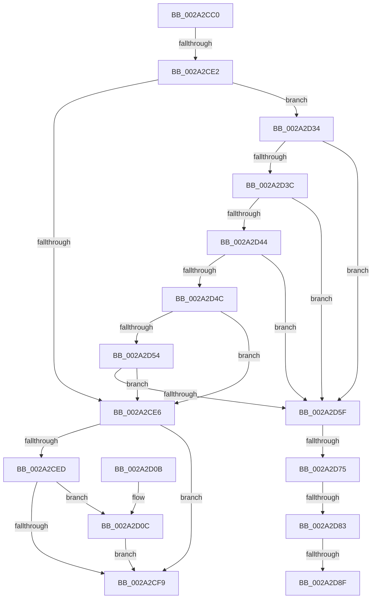

# MiConvertFaultStatus

- RVA: `0x002A2CC0`–`0x002A2D9F` (길이 `223` bytes)
- VA: `0x00000001402A2CC0`
- 실행 섹션: `.text`
- PDB 이름 있음: `예`; PDB Function 태그: `아니요`
- unwind 정보 RVA: `0x00068648`
- 디코드: `58`개 명령, `223/223` bytes 표시
- 미해석 바이트: `0` (있으면 어셈블리에 `.byte`로 보존)

> 이 문서는 커널 이미지의 기계어와 PDB 기호를 분석해 생성했습니다. 4번과 5번은 함수 원형과 자료형을 바이너리 사용 방식에서 추정한 C 해석이며 원본 소스 복구 결과는 아닙니다.

## 1. Dependencies

- 직접 호출 지점: **2**; 고유 호출 대상: **2**
- 직접 호출자로 확인된 함수: **1**
- RIP 상대 이미지 참조: **1**

### Outgoing calls
- `0x002A2D2D` → [EtwTracePageFault](EtwTracePageFault_function_002A2E74.md) (function, `0x002A2E74`)
- `0x002A2D56` → [FsRtlIsTotalDeviceFailure](../40/FsRtlIsTotalDeviceFailure_function_00408710.md) (function, `0x00408710`)

### Direct callers
- [sub_0027F063](../27/Unknown_function_0027F063.md) at `0x0027F15C`

### Static image references
- `0x002A2CED` → RVA `0x00FC6B00` (`ALMOSTRO`; read)

## 2. Other-region calls and transfers

- 다른 실행 섹션으로 향하는 call: **0**
- call이 아닌 외부 분기/꼬리 이동: **4**
  - `0x002A2CDC` → [sub_002A2E22](Unknown_function_002A2E22.md) (`tail-transfer`)
  - `0x002A2D6F` → [sub_002A2E22 + 0x2C](Unknown_function_002A2E22.md) (`tail-transfer`)
  - `0x002A2D7D` → [sub_002A2E22 + 0x2C](Unknown_function_002A2E22.md) (`tail-transfer`)
  - `0x002A2D89` → [sub_002A2E22 + 0xA](Unknown_function_002A2E22.md) (`tail-transfer`)

## 3. Assembly (complete function range)

```asm
002A2CC0  48 89 5C 24 10                  mov qword ptr [rsp + 0x10], rbx
002A2CC5  48 89 74 24 18                  mov qword ptr [rsp + 0x18], rsi
002A2CCA  57                              push rdi
002A2CCB  48 83 EC 30                     sub rsp, 0x30
002A2CCF  41 8B D8                        mov ebx, r8d
002A2CD2  48 8B F9                        mov rdi, rcx
002A2CD5  41 81 F8 34 04 00 C0            cmp r8d, 0xc0000434
002A2CDC  0F 84 40 01 00 00               je 0x1402a2e22
002A2CE2  85 DB                           test ebx, ebx
002A2CE4  78 4E                           js 0x1402a2d34
002A2CE6  48 83 7F 68 00                  cmp qword ptr [rdi + 0x68], 0
002A2CEB  75 0C                           jne 0x1402a2cf9
002A2CED  F7 05 09 3E D2 00 00 10 00 00   test dword ptr [rip + 0xd23e09], 0x1000
002A2CF7  75 13                           jne 0x1402a2d0c
002A2CF9  8B C3                           mov eax, ebx
002A2CFB  48 8B 5C 24 48                  mov rbx, qword ptr [rsp + 0x48]
002A2D00  48 8B 74 24 50                  mov rsi, qword ptr [rsp + 0x50]
002A2D05  48 83 C4 30                     add rsp, 0x30
002A2D09  5F                              pop rdi
002A2D0A  C3                              ret
002A2D0B  CC                              int3
002A2D0C  48 8B 47 10                     mov rax, qword ptr [rdi + 0x10]
002A2D10  41 B9 00 00 00 00               mov r9d, 0
002A2D16  44 8B 47 50                     mov r8d, dword ptr [rdi + 0x50]
002A2D1A  A8 01                           test al, 1
002A2D1C  48 8B 17                        mov rdx, qword ptr [rdi]
002A2D1F  8B CB                           mov ecx, ebx
002A2D21  4C 0F 44 C8                     cmove r9, rax
002A2D25  41 C1 E8 08                     shr r8d, 8
002A2D29  41 80 E0 01                     and r8b, 1
002A2D2D  E8 42 01 00 00                  call 0x1402a2e74
002A2D32  EB C5                           jmp 0x1402a2cf9
002A2D34  81 FB 9A 00 00 C0               cmp ebx, 0xc000009a
002A2D3A  74 23                           je 0x1402a2d5f
002A2D3C  81 FB 17 00 00 C0               cmp ebx, 0xc0000017
002A2D42  74 1B                           je 0x1402a2d5f
002A2D44  81 FB A1 00 00 C0               cmp ebx, 0xc00000a1
002A2D4A  74 13                           je 0x1402a2d5f
002A2D4C  81 FA 00 10 00 00               cmp edx, 0x1000
002A2D52  76 92                           jbe 0x1402a2ce6
002A2D54  8B CB                           mov ecx, ebx
002A2D56  E8 B5 59 16 00                  call 0x140408710
002A2D5B  84 C0                           test al, al
002A2D5D  75 87                           jne 0x1402a2ce6
002A2D5F  65 48 8B 14 25 88 01 00 00      mov rdx, qword ptr gs:[0x188]
002A2D68  F6 82 A8 05 00 00 04            test byte ptr [rdx + 0x5a8], 4
002A2D6F  0F 85 D9 00 00 00               jne 0x1402a2e4e
002A2D75  8B 82 A4 05 00 00               mov eax, dword ptr [rdx + 0x5a4]
002A2D7B  A8 0C                           test al, 0xc
002A2D7D  0F 85 CB 00 00 00               jne 0x1402a2e4e
002A2D83  48 8B 47 10                     mov rax, qword ptr [rdi + 0x10]
002A2D87  A8 01                           test al, 1
002A2D89  0F 85 9D 00 00 00               jne 0x1402a2e2c
002A2D8F  48 8B 47 38                     mov rax, qword ptr [rdi + 0x38]
002A2D93  33 F6                           xor esi, esi
002A2D95  44 8B 4F 50                     mov r9d, dword ptr [rdi + 0x50]
002A2D99  8B DE                           mov ebx, esi
002A2D9B  41 C1 E9 04                     shr r9d, 4
```

## 4. C-style interpretation (structured pseudocode)

```c
__int64 __fastcall MiConvertFaultStatus(__int64 a1, __int64 a2, int a3)
{
    __int64 result;
    __int64 v_rsi;
    __int64 v_rsp;
    unsigned __int64 v_stack_p10;
    unsigned __int64 v_stack_p18;

    v_stack_p10 = v_rbx;
    v_stack_p18 = v_rsi;
    v_rsp = (v_rsp) - (48);
    if (sign_flag) goto loc_002A2D34;
loc_002A2CE6:
    if ((*(unsigned __int64 *)(a1 + 104)) != 0) goto loc_002A2CF9;
    if (((*(unsigned int *)(v_rip + 13778441)) & (0x1000ULL)) != 0) goto loc_002A2D0C;
loc_002A2CF9:
    v_rsp = (v_rsp) + (48);
    return (unsigned int)((unsigned int)((unsigned int)(a3)));
loc_002A2D0C:
    a4 = 0;
    if ((((unsigned __int8)(*(unsigned __int64 *)(a1 + 16))) & (1)) == 0) { a4 = *(unsigned __int64 *)(a1 + 16); }
    a3 = (unsigned int)(((unsigned int)(*(unsigned int *)(a1 + 80))) >> (8));
    a3 = (unsigned __int8)((a3) & (1));
    result = EtwTracePageFault((unsigned int)((unsigned int)(v_stack_p10)), *(unsigned __int64 *)(a1), a3, a4);
    goto loc_002A2CF9;
loc_002A2D34:
    if (((unsigned int)(v_stack_p10)) == 0xC000009AULL) goto loc_002A2D5F;
    if (((unsigned int)(v_stack_p10)) == 0xC0000017ULL) goto loc_002A2D5F;
    if (((unsigned int)(v_stack_p10)) == 0xC00000A1ULL) goto loc_002A2D5F;
    if (((unsigned int)(*(unsigned __int64 *)(a1))) <= 0x1000ULL) goto loc_002A2CE6;
    result = FsRtlIsTotalDeviceFailure((unsigned int)((unsigned int)(v_stack_p10)), *(unsigned __int64 *)(a1), a3, a4);
    if ((unsigned __int8)(result) != 0) goto loc_002A2CE6;
loc_002A2D5F:
    v_rsi = 0;
    a4 = (unsigned int)(((unsigned int)(*(unsigned int *)(a1 + 80))) >> (4));
    return *(unsigned __int64 *)(a1 + 56);
}
```

## 5. (Beta) C Style

```c
int64_t MiConvertFaultStatus(void *Arg1, int64_t Arg2, int32_t Arg3)
{
    uint8_t *arg1 = (uint8_t *)Arg1;

    int64_t result;
    int64_t local_rsi;
    int64_t local_rsp;
    uint64_t v_stack_p10;
    uint64_t v_stack_p18;

    v_stack_p10 = local_rbx;
    v_stack_p18 = local_rsi;
    local_rsp = (local_rsp) - (48);
    if (sign_flag) goto loc_002A2D34;
loc_002A2CE6:
    if ((*(uint64_t *)(arg1 + 0x68)) != 0) goto loc_002A2CF9;
    if (((*(uint32_t *)(v_rip + 0xD23E09)) & (0x1000ULL)) != 0) goto loc_002A2D0C;
loc_002A2CF9:
    local_rsp = (local_rsp) + (48);
    return (uint32_t)((uint32_t)((uint32_t)(Arg3)));
loc_002A2D0C:
    a4 = 0;
    if ((((uint8_t)(*(uint64_t *)(arg1 + 0x10))) & (1)) == 0) { a4 = *(uint64_t *)(arg1 + 0x10); }
    Arg3 = (uint32_t)(((uint32_t)(*(uint32_t *)(arg1 + 0x50))) >> (8));
    Arg3 = (uint8_t)((Arg3) & (1));
    result = EtwTracePageFault((uint32_t)((uint32_t)(v_stack_p10)), *(uint64_t *)(arg1), Arg3, a4);
    goto loc_002A2CF9;
loc_002A2D34:
    if (((uint32_t)(v_stack_p10)) == 0xC000009AULL) goto loc_002A2D5F;
    if (((uint32_t)(v_stack_p10)) == 0xC0000017ULL) goto loc_002A2D5F;
    if (((uint32_t)(v_stack_p10)) == 0xC00000A1ULL) goto loc_002A2D5F;
    if (((uint32_t)(*(uint64_t *)(arg1))) <= 0x1000ULL) goto loc_002A2CE6;
    result = FsRtlIsTotalDeviceFailure((uint32_t)((uint32_t)(v_stack_p10)), *(uint64_t *)(arg1), Arg3, a4);
    if ((uint8_t)(result) != 0) goto loc_002A2CE6;
loc_002A2D5F:
    local_rsi = 0;
    a4 = (uint32_t)(((uint32_t)(*(uint32_t *)(arg1 + 0x50))) >> (4));
    return *(uint64_t *)(arg1 + 0x38);
}
```

### 관측된 메모리 오프셋

구조체 형식이 확인되지 않은 접근은 인자 기준의 오프셋으로만 기록했습니다.

| 기준 인자 | 오프셋 표현 | 폭 (bit) | 접근 |
|---|---:|---:|---|
| `Arg1` | `+ 0x0` | `64` | `R` |
| `Arg1` | `+ 0x10` | `64` | `R` |
| `Arg1` | `+ 0x38` | `64` | `R` |
| `Arg1` | `+ 0x50` | `32` | `R` |
| `Arg1` | `+ 0x68` | `64` | `R` |

## 6. Execution-region graph

[열기: 2D/3D 그래프와 함수 탐색 컨트롤 패널](../../../control-panel.html?section=text&rva=0x002A2CC0&view=graph)

- 2D 그래프는 위에서 아래로 흐르고, 3D 그래프는 빈 공간을 드래그해 회전합니다. Shift+드래그는 이동, 휠은 확대·축소, 함수 노드 선택은 대상 보고서 이동입니다.

### Static fallback


