# MiCopyDataPageToImagePage

- RVA: `0x002AE818`–`0x002AEE0E` (길이 `1,526` bytes)
- VA: `0x00000001402AE818`
- 실행 섹션: `.text`
- PDB 이름 있음: `예`; PDB Function 태그: `아니요`
- unwind 정보 RVA: `0x0006D474`
- 디코드: `378`개 명령, `1,526/1,526` bytes 표시
- 미해석 바이트: `0` (있으면 어셈블리에 `.byte`로 보존)

> 이 문서는 커널 이미지의 기계어와 PDB 기호를 분석해 생성했습니다. 4번과 5번은 함수 원형과 자료형을 바이너리 사용 방식에서 추정한 C 해석이며 원본 소스 복구 결과는 아닙니다.

## 1. Dependencies

- 직접 호출 지점: **31**; 고유 호출 대상: **24**
- 직접 호출자로 확인된 함수: **1**
- RIP 상대 이미지 참조: **4**

### Outgoing calls
- `0x002AE886` → [MiFinalizePageAttribute](../33/MiFinalizePageAttribute_function_00332E30.md) (function, `0x00332E30`)
- `0x002AE89E` → [MiGetSessionIdForVa](../34/MiGetSessionIdForVa_function_00346C60.md) (function, `0x00346C60`)
- `0x002AE8AC` → [MiStartingOffset](../34/MiStartingOffset_function_003482E0.md) (function, `0x003482E0`)
- `0x002AE8BC` → [ExAcquireSpinLockExclusiveAtDpcLevel](../24/ExAcquireSpinLockExclusiveAtDpcLevel_function_00248E80.md) (function, `0x00248E80`)
- `0x002AE8D0` → [ExAcquireSpinLockExclusiveAtDpcLevel](../24/ExAcquireSpinLockExclusiveAtDpcLevel_function_00248E80.md) (function, `0x00248E80`)
- `0x002AE8EB` → [ExReleaseSpinLockExclusiveFromDpcLevel](../24/ExReleaseSpinLockExclusiveFromDpcLevel_function_002497E0.md) (function, `0x002497E0`)
- `0x002AE8F4` → [ExReleaseSpinLockExclusiveFromDpcLevel](../24/ExReleaseSpinLockExclusiveFromDpcLevel_function_002497E0.md) (function, `0x002497E0`)
- `0x002AE8FD` → [MiUnlockDataCopyPages](MiUnlockDataCopyPages_function_002AEE14.md) (function, `0x002AEE14`)
- `0x002AE920` → [ExTryAcquireSpinLockExclusiveAtDpcLevel](../2B/ExTryAcquireSpinLockExclusiveAtDpcLevel_function_002BB800.md) (function, `0x002BB800`)
- `0x002AE930` → [ExReleaseSpinLockExclusiveFromDpcLevel](../24/ExReleaseSpinLockExclusiveFromDpcLevel_function_002497E0.md) (function, `0x002497E0`)
- `0x002AE94E` → [MiEndingOffset](MiEndingOffset_function_002ACEC8.md) (function, `0x002ACEC8`)
- `0x002AE9F7` → [MiTryLockProtoPoolPageAtDpc](../28/MiTryLockProtoPoolPageAtDpc_function_0028B3C8.md) (function, `0x0028B3C8`)
- `0x002AEA26` → [MiStandbyPageContentsIntact](MiStandbyPageContentsIntact_function_002AF0D4.md) (function, `0x002AF0D4`)
- `0x002AEA95` → [MiAllocateHyperSpace](../32/MiAllocateHyperSpace_function_00322F90.md) (function, `0x00322F90`)
- `0x002AEAB7` → [MiMapSinglePage](../22/MiMapSinglePage_function_00229D00.md) (function, `0x00229D00`)
- `0x002AEB0E` → [MiMapSinglePage](../22/MiMapSinglePage_function_00229D00.md) (function, `0x00229D00`)
- `0x002AEB60` → [KeCopyPage](../6B/KeCopyPage_function_006BA0F0.md) (function, `0x006BA0F0`)
- `0x002AEBC1` → [ExReleaseSpinLockExclusiveFromDpcLevel](../24/ExReleaseSpinLockExclusiveFromDpcLevel_function_002497E0.md) (function, `0x002497E0`)
- `0x002AEBD2` → [ExReleaseSpinLockExclusiveFromDpcLevel](../24/ExReleaseSpinLockExclusiveFromDpcLevel_function_002497E0.md) (function, `0x002497E0`)
- `0x002AEBDB` → [MiUnlockDataCopyPages](MiUnlockDataCopyPages_function_002AEE14.md) (function, `0x002AEE14`)
- `0x002AEC02` → [MiInitializeTransitionPfn](MiInitializeTransitionPfn_function_002AC2E8.md) (function, `0x002AC2E8`)
- `0x002AEC98` → [MI_READ_PTE_LOCK_FREE](../28/MI_READ_PTE_LOCK_FREE_function_002828A0.md) (function, `0x002828A0`)
- `0x002AED07` → [MiObtainProtoReference](../31/MiObtainProtoReference_function_00318178.md) (function, `0x00318178`)
- `0x002AED1C` → [MiUnlockProtoPoolPage](../24/MiUnlockProtoPoolPage_function_00246090.md) (function, `0x00246090`)
- `0x002AED31` → [KeSetEvent](../33/KeSetEvent_function_0033F310.md) (function, `0x0033F310`)
- `0x002AED60` → [MiTryLockLeafPage](../37/MiTryLockLeafPage_function_003728DC.md) (function, `0x003728DC`)
- `0x002AEDB3` → [MiAdvanceFaultList](../36/MiAdvanceFaultList_function_003637A0.md) (function, `0x003637A0`)
- `0x002AEDD4` → [memcpy](../6C/memcpy_function_006C6840.md) (function, `0x006C6840`)
- `0x002AEDE8` → [memset](../6C/memset_function_006C6C40.md) (function, `0x006C6C40`)
- `0x002AEDFC` → [KiCheckVpBackingLongSpinWaitHypercall](../30/KiCheckVpBackingLongSpinWaitHypercall_function_0030F490.md) (function, `0x0030F490`)
- `0x002AEE07` → [HvlNotifyLongSpinWait](../30/HvlNotifyLongSpinWait_function_0030F460.md) (function, `0x0030F460`)

### Direct callers
- [MiResolveMappedFileFault](../36/MiResolveMappedFileFault_function_0036B640.md) at `0x0036BA1F`

### Static image references
- `0x002AE8C5` → RVA `0x00E2CD00` (`.data`; read)
- `0x002AEB98` → RVA `0x00010880` (`.rdata`; read)
- `0x002AED8A` → RVA `0x00FC52AC` (`ALMOSTRO`; reference)
- `0x002AEDF2` → RVA `0x00FC6AB8` (`ALMOSTRO`; read)

## 2. Other-region calls and transfers

- 다른 실행 섹션으로 향하는 call: **0**
- 별도 외부 분기/꼬리 이동을 확인하지 못했습니다.

## 3. Assembly (complete function range)

```asm
002AE818  48 8B C4                        mov rax, rsp
002AE81B  4C 89 48 20                     mov qword ptr [rax + 0x20], r9
002AE81F  4C 89 40 18                     mov qword ptr [rax + 0x18], r8
002AE823  48 89 50 10                     mov qword ptr [rax + 0x10], rdx
002AE827  48 89 48 08                     mov qword ptr [rax + 8], rcx
002AE82B  55                              push rbp
002AE82C  53                              push rbx
002AE82D  56                              push rsi
002AE82E  57                              push rdi
002AE82F  41 54                           push r12
002AE831  41 55                           push r13
002AE833  41 56                           push r14
002AE835  41 57                           push r15
002AE837  48 8D 68 B1                     lea rbp, [rax - 0x4f]
002AE83B  48 81 EC 98 00 00 00            sub rsp, 0x98
002AE842  48 8B 45 77                     mov rax, qword ptr [rbp + 0x77]
002AE846  0F 57 C0                        xorps xmm0, xmm0
002AE849  49 8B D8                        mov rbx, r8
002AE84C  48 8B FA                        mov rdi, rdx
002AE84F  4C 8B E9                        mov r13, rcx
002AE852  0F 11 45 D7                     movups xmmword ptr [rbp - 0x29], xmm0
002AE856  4C 8D 3C 40                     lea r15, [rax + rax*2]
002AE85A  48 B8 00 00 00 00 00 DE FF FF   movabs rax, 0xffffde0000000000
002AE864  49 C1 E7 04                     shl r15, 4
002AE868  0F 11 45 E7                     movups xmmword ptr [rbp - 0x19], xmm0
002AE86C  0F 11 45 F7                     movups xmmword ptr [rbp - 9], xmm0
002AE870  48 8B C0                        mov rax, rax
002AE873  4C 03 F8                        add r15, rax
002AE876  BA 01 00 00 00                  mov edx, 1
002AE87B  49 8B CF                        mov rcx, r15
002AE87E  4C 89 7D CF                     mov qword ptr [rbp - 0x31], r15
002AE882  44 8D 42 0F                     lea r8d, [rdx + 0xf]
002AE886  E8 A5 45 08 00                  call 0x140332e30
002AE88B  4C 8B 37                        mov r14, qword ptr [rdi]
002AE88E  49 8B 8D E0 00 00 00            mov rcx, qword ptr [r13 + 0xe0]
002AE895  48 83 65 B7 00                  and qword ptr [rbp - 0x49], 0
002AE89A  4C 89 75 9F                     mov qword ptr [rbp - 0x61], r14
002AE89E  E8 BD 83 09 00                  call 0x140346c60
002AE8A3  44 8B C0                        mov r8d, eax
002AE8A6  48 8B CF                        mov rcx, rdi
002AE8A9  48 8B D3                        mov rdx, rbx
002AE8AC  E8 2F 9A 09 00                  call 0x1403482e0
002AE8B1  49 8D 4E 48                     lea rcx, [r14 + 0x48]
002AE8B5  48 89 45 A7                     mov qword ptr [rbp - 0x59], rax
002AE8B9  4C 8B E0                        mov r12, rax
002AE8BC  E8 BF A5 F9 FF                  call 0x140248e80
002AE8C1  49 8B 5E 40                     mov rbx, qword ptr [r14 + 0x40]
002AE8C5  48 8D 0D 34 E4 B7 00            lea rcx, [rip + 0xb7e434]
002AE8CC  48 83 E3 F0                     and rbx, 0xfffffffffffffff0
002AE8D0  E8 AB A5 F9 FF                  call 0x140248e80
002AE8D5  48 8B 53 28                     mov rdx, qword ptr [rbx + 0x28]
002AE8D9  48 8B 32                        mov rsi, qword ptr [rdx]
002AE8DC  48 85 F6                        test rsi, rsi
002AE8DF  75 38                           jne 0x1402ae919
002AE8E1  48 8D 3D 18 E4 B7 00            lea rdi, [rip + 0xb7e418]
002AE8E8  48 8B CF                        mov rcx, rdi
002AE8EB  E8 F0 AE F9 FF                  call 0x1402497e0
002AE8F0  49 8D 4E 48                     lea rcx, [r14 + 0x48]
002AE8F4  E8 E7 AE F9 FF                  call 0x1402497e0
002AE8F9  48 8D 4D D7                     lea rcx, [rbp - 0x29]
002AE8FD  E8 12 05 00 00                  call 0x1402aee14
002AE902  33 C0                           xor eax, eax
002AE904  48 81 C4 98 00 00 00            add rsp, 0x98
002AE90B  41 5F                           pop r15
002AE90D  41 5E                           pop r14
002AE90F  41 5D                           pop r13
002AE911  41 5C                           pop r12
002AE913  5F                              pop rdi
002AE914  5E                              pop rsi
002AE915  5B                              pop rbx
002AE916  5D                              pop rbp
002AE917  C3                              ret
002AE918  CC                              int3
002AE919  48 8D 7E 48                     lea rdi, [rsi + 0x48]
002AE91D  48 8B CF                        mov rcx, rdi
002AE920  E8 DB CE 00 00                  call 0x1402bb800
002AE925  85 C0                           test eax, eax
002AE927  74 B8                           je 0x1402ae8e1
002AE929  48 8D 0D D0 E3 B7 00            lea rcx, [rip + 0xb7e3d0]
002AE930  E8 AB AE F9 FF                  call 0x1402497e0
002AE935  48 83 7E 20 00                  cmp qword ptr [rsi + 0x20], 0
002AE93A  74 AC                           je 0x1402ae8e8
002AE93C  8B 46 38                        mov eax, dword ptr [rsi + 0x38]
002AE93F  41 B8 03 00 00 00               mov r8d, 3
002AE945  41 84 C0                        test r8b, al
002AE948  75 9E                           jne 0x1402ae8e8
002AE94A  48 8B 4D 5F                     mov rcx, qword ptr [rbp + 0x5f]
002AE94E  E8 75 E5 FF FF                  call 0x1402acec8
002AE953  49 8B DC                        mov rbx, r12
002AE956  48 89 45 C7                     mov qword ptr [rbp - 0x39], rax
002AE95A  48 C1 EB 0C                     shr rbx, 0xc
002AE95E  48 8D 48 FF                     lea rcx, [rax - 1]
002AE962  48 C1 E9 0C                     shr rcx, 0xc
002AE966  41 8D 40 FE                     lea eax, [r8 - 2]
002AE96A  3B D9                           cmp ebx, ecx
002AE96C  44 0F 45 C0                     cmovne r8d, eax
002AE970  48 83 EE 80                     sub rsi, -0x80
002AE974  44 89 45 9B                     mov dword ptr [rbp - 0x65], r8d
002AE978  8B 46 2C                        mov eax, dword ptr [rsi + 0x2c]
002AE97B  3B D8                           cmp ebx, eax
002AE97D  0F 83 F0 03 00 00               jae 0x1402aed73
002AE983  4C 8D 75 D7                     lea r14, [rbp - 0x29]
002AE987  C7 45 97 02 00 00 00            mov dword ptr [rbp - 0x69], 2
002AE98E  45 33 C9                        xor r9d, r9d
002AE991  49 B8 F8 FF FF FF 7F 00 00 00   movabs r8, 0x7ffffffff8
002AE99B  83 7E 68 00                     cmp dword ptr [rsi + 0x68], 0
002AE99F  0F 84 C5 03 00 00               je 0x1402aed6a
002AE9A5  48 8B 4E 08                     mov rcx, qword ptr [rsi + 8]
002AE9A9  48 85 C9                        test rcx, rcx
002AE9AC  0F 84 B8 03 00 00               je 0x1402aed6a
002AE9B2  8B C3                           mov eax, ebx
002AE9B4  48 8D 0C C1                     lea rcx, [rcx + rax*8]
002AE9B8  48 85 C9                        test rcx, rcx
002AE9BB  0F 84 A9 03 00 00               je 0x1402aed6a
002AE9C1  48 8B 45 67                     mov rax, qword ptr [rbp + 0x67]
002AE9C5  48 8B D1                        mov rdx, rcx
002AE9C8  48 C1 EA 09                     shr rdx, 9
002AE9CC  48 C1 E8 09                     shr rax, 9
002AE9D0  49 23 D0                        and rdx, r8
002AE9D3  49 23 C0                        and rax, r8
002AE9D6  49 89 4E 10                     mov qword ptr [r14 + 0x10], rcx
002AE9DA  48 3B D0                        cmp rdx, rax
002AE9DD  0F 84 77 03 00 00               je 0x1402aed5a
002AE9E3  48 8D 45 D7                     lea rax, [rbp - 0x29]
002AE9E7  4C 3B F0                        cmp r14, rax
002AE9EA  0F 85 56 03 00 00               jne 0x1402aed46
002AE9F0  4D 8B CE                        mov r9, r14
002AE9F3  4C 8D 45 B7                     lea r8, [rbp - 0x49]
002AE9F7  E8 CC C9 FD FF                  call 0x14028b3c8
002AE9FC  85 C0                           test eax, eax
002AE9FE  0F 88 66 03 00 00               js 0x1402aed6a
002AEA04  48 8B 45 B7                     mov rax, qword ptr [rbp - 0x49]
002AEA08  49 89 46 08                     mov qword ptr [r14 + 8], rax
002AEA0C  49 8B 0E                        mov rcx, qword ptr [r14]
002AEA0F  48 85 C9                        test rcx, rcx
002AEA12  0F 84 52 03 00 00               je 0x1402aed6a
002AEA18  8B 41 20                        mov eax, dword ptr [rcx + 0x20]
002AEA1B  C1 E8 18                        shr eax, 0x18
002AEA1E  A8 40                           test al, 0x40
002AEA20  0F 85 44 03 00 00               jne 0x1402aed6a
002AEA26  E8 A9 06 00 00                  call 0x1402af0d4
002AEA2B  85 C0                           test eax, eax
002AEA2D  0F 84 37 03 00 00               je 0x1402aed6a
002AEA33  48 8D 45 D7                     lea rax, [rbp - 0x29]
002AEA37  4C 3B F0                        cmp r14, rax
002AEA3A  75 50                           jne 0x1402aea8c
002AEA3C  48 8B 45 A7                     mov rax, qword ptr [rbp - 0x59]
002AEA40  A9 FF 0F 00 00                  test eax, 0xfff
002AEA45  74 45                           je 0x1402aea8c
002AEA47  83 7D 9B 02                     cmp dword ptr [rbp - 0x65], 2
002AEA4B  73 3C                           jae 0x1402aea89
002AEA4D  4C 8B 65 A7                     mov r12, qword ptr [rbp - 0x59]
002AEA51  B8 01 00 00 00                  mov eax, 1
002AEA56  01 45 97                        add dword ptr [rbp - 0x69], eax
002AEA59  03 D8                           add ebx, eax
002AEA5B  49 83 C6 18                     add r14, 0x18
002AEA5F  44 8B C8                        mov r9d, eax
002AEA62  49 B8 F8 FF FF FF 7F 00 00 00   movabs r8, 0x7ffffffff8
002AEA6C  3B 5E 2C                        cmp ebx, dword ptr [rsi + 0x2c]
002AEA6F  0F 82 26 FF FF FF               jb 0x1402ae99b
002AEA75  48 8B 76 10                     mov rsi, qword ptr [rsi + 0x10]
002AEA79  33 DB                           xor ebx, ebx
002AEA7B  48 85 F6                        test rsi, rsi
002AEA7E  0F 84 E6 02 00 00               je 0x1402aed6a
002AEA84  E9 12 FF FF FF                  jmp 0x1402ae99b
002AEA89  44 8B E0                        mov r12d, eax
002AEA8C  8B 5D 97                        mov ebx, dword ptr [rbp - 0x69]
002AEA8F  8B CB                           mov ecx, ebx
002AEA91  48 89 5D BF                     mov qword ptr [rbp - 0x41], rbx
002AEA95  E8 F6 44 07 00                  call 0x140322f90
002AEA9A  48 8B 55 77                     mov rdx, qword ptr [rbp + 0x77]
002AEA9E  48 8B F0                        mov rsi, rax
002AEAA1  48 05 00 10 00 00               add rax, 0x1000
002AEAA7  48 8B CE                        mov rcx, rsi
002AEAAA  45 33 C9                        xor r9d, r9d
002AEAAD  48 89 45 AF                     mov qword ptr [rbp - 0x51], rax
002AEAB1  41 B8 00 00 00 40               mov r8d, 0x40000000
002AEAB7  E8 44 B2 F7 FF                  call 0x140229d00
002AEABC  49 83 CD FF                     or r13, 0xffffffffffffffff
002AEAC0  49 BF 00 00 00 00 00 DE FF FF   movabs r15, 0xffffde0000000000
002AEACA  BB 01 00 00 00                  mov ebx, 1
002AEACF  4C 8D 75 D7                     lea r14, [rbp - 0x29]
002AEAD3  49 8B 16                        mov rdx, qword ptr [r14]
002AEAD6  48 85 D2                        test rdx, rdx
002AEAD9  74 4D                           je 0x1402aeb28
002AEADB  8B 42 20                        mov eax, dword ptr [rdx + 0x20]
002AEADE  C1 E8 10                        shr eax, 0x10
002AEAE1  24 C0                           and al, 0xc0
002AEAE3  3C 40                           cmp al, 0x40
002AEAE5  41 0F 45 DD                     cmovne ebx, r13d
002AEAE9  49 8B C7                        mov rax, r15
002AEAEC  48 8B 4D AF                     mov rcx, qword ptr [rbp - 0x51]
002AEAF0  48 2B D0                        sub rdx, rax
002AEAF3  48 C1 FA 04                     sar rdx, 4
002AEAF7  48 B8 AB AA AA AA AA AA AA AA   movabs rax, 0xaaaaaaaaaaaaaaab
002AEB01  48 0F AF D0                     imul rdx, rax
002AEB05  45 33 C9                        xor r9d, r9d
002AEB08  41 B8 00 00 00 C0               mov r8d, 0xc0000000
002AEB0E  E8 ED B1 F7 FF                  call 0x140229d00
002AEB13  48 81 45 AF 00 10 00 00         add qword ptr [rbp - 0x51], 0x1000
002AEB1B  48 8D 45 07                     lea rax, [rbp + 7]
002AEB1F  49 83 C6 18                     add r14, 0x18
002AEB23  4C 3B F0                        cmp r14, rax
002AEB26  75 AB                           jne 0x1402aead3
002AEB28  48 8B 45 A7                     mov rax, qword ptr [rbp - 0x59]
002AEB2C  41 8B D4                        mov edx, r12d
002AEB2F  4C 8B 75 C7                     mov r14, qword ptr [rbp - 0x39]
002AEB33  B9 FF 0F 00 00                  mov ecx, 0xfff
002AEB38  23 D1                           and edx, ecx
002AEB3A  89 5D 9B                        mov dword ptr [rbp - 0x65], ebx
002AEB3D  48 8B 5D BF                     mov rbx, qword ptr [rbp - 0x41]
002AEB41  81 C2 00 10 00 00               add edx, 0x1000
002AEB47  48 03 D6                        add rdx, rsi
002AEB4A  48 05 00 10 00 00               add rax, 0x1000
002AEB50  49 3B C6                        cmp rax, r14
002AEB53  0F 87 6F 02 00 00               ja 0x1402aedc8
002AEB59  44 8B 45 9B                     mov r8d, dword ptr [rbp - 0x65]
002AEB5D  48 8B CE                        mov rcx, rsi
002AEB60  E8 8B B5 40 00                  call 0x1406ba0f0
002AEB65  48 C1 EE 09                     shr rsi, 9
002AEB69  48 B8 F8 FF FF FF 7F 00 00 00   movabs rax, 0x7ffffffff8
002AEB73  48 23 F0                        and rsi, rax
002AEB76  48 B8 00 00 00 00 80 F6 FF FF   movabs rax, 0xfffff68000000000
002AEB80  4C 8B 7D CF                     mov r15, qword ptr [rbp - 0x31]
002AEB84  45 33 F6                        xor r14d, r14d
002AEB87  4C 8B 6D 57                     mov r13, qword ptr [rbp + 0x57]
002AEB8B  48 03 F0                        add rsi, rax
002AEB8E  45 8D 66 01                     lea r12d, [r14 + 1]
002AEB92  44 39 75 97                     cmp dword ptr [rbp - 0x69], r14d
002AEB96  76 13                           jbe 0x1402aebab
002AEB98  48 8B 05 E1 1C D6 FF            mov rax, qword ptr [rip - 0x29e31f]
002AEB9F  48 89 06                        mov qword ptr [rsi], rax
002AEBA2  48 8D 76 08                     lea rsi, [rsi + 8]
002AEBA6  49 2B DC                        sub rbx, r12
002AEBA9  75 F4                           jne 0x1402aeb9f
002AEBAB  65 48 8B 04 25 20 00 00 00      mov rax, qword ptr gs:[0x20]
002AEBB4  48 8B CF                        mov rcx, rdi
002AEBB7  48 8B 90 38 88 00 00            mov rdx, qword ptr [rax + 0x8838]
002AEBBE  4C 89 32                        mov qword ptr [rdx], r14
002AEBC1  E8 1A AC F9 FF                  call 0x1402497e0
002AEBC6  48 8B 45 9F                     mov rax, qword ptr [rbp - 0x61]
002AEBCA  4C 01 60 20                     add qword ptr [rax + 0x20], r12
002AEBCE  48 8D 48 48                     lea rcx, [rax + 0x48]
002AEBD2  E8 09 AC F9 FF                  call 0x1402497e0
002AEBD7  48 8D 4D D7                     lea rcx, [rbp - 0x29]
002AEBDB  E8 34 02 00 00                  call 0x1402aee14
002AEBE0  41 8B DE                        mov ebx, r14d
002AEBE3  F0 49 0F BA 6F 18 3F            lock bts qword ptr [r15 + 0x18], 0x3f
002AEBEA  0F 82 97 01 00 00               jb 0x1402aed87
002AEBF0  48 8B 5D 67                     mov rbx, qword ptr [rbp + 0x67]
002AEBF4  49 83 C8 FF                     or r8, 0xffffffffffffffff
002AEBF8  48 8B 75 77                     mov rsi, qword ptr [rbp + 0x77]
002AEBFC  48 8B D3                        mov rdx, rbx
002AEBFF  48 8B CE                        mov rcx, rsi
002AEC02  E8 E1 D6 FF FF                  call 0x1402ac2e8
002AEC07  41 8B 47 20                     mov eax, dword ptr [r15 + 0x20]
002AEC0B  49 8D 7D 20                     lea rdi, [r13 + 0x20]
002AEC0F  89 45 77                        mov dword ptr [rbp + 0x77], eax
002AEC12  C1 E8 10                        shr eax, 0x10
002AEC15  24 FA                           and al, 0xfa
002AEC17  0C 02                           or al, 2
002AEC19  88 45 79                        mov byte ptr [rbp + 0x79], al
002AEC1C  8B 45 77                        mov eax, dword ptr [rbp + 0x77]
002AEC1F  41 89 47 20                     mov dword ptr [r15 + 0x20], eax
002AEC23  41 8B 47 20                     mov eax, dword ptr [r15 + 0x20]
002AEC27  89 45 77                        mov dword ptr [rbp + 0x77], eax
002AEC2A  66 44 89 65 77                  mov word ptr [rbp + 0x77], r12w
002AEC2F  8B 45 77                        mov eax, dword ptr [rbp + 0x77]
002AEC32  41 89 47 20                     mov dword ptr [r15 + 0x20], eax
002AEC36  41 8B 47 20                     mov eax, dword ptr [r15 + 0x20]
002AEC3A  89 45 77                        mov dword ptr [rbp + 0x77], eax
002AEC3D  C1 E8 10                        shr eax, 0x10
002AEC40  0C 20                           or al, 0x20
002AEC42  88 45 79                        mov byte ptr [rbp + 0x79], al
002AEC45  8B 45 77                        mov eax, dword ptr [rbp + 0x77]
002AEC48  41 89 47 20                     mov dword ptr [r15 + 0x20], eax
002AEC4C  48 8B 45 6F                     mov rax, qword ptr [rbp + 0x6f]
002AEC50  49 89 3F                        mov qword ptr [r15], rdi
002AEC53  45 8B 9D C0 00 00 00            mov r11d, dword ptr [r13 + 0xc0]
002AEC5A  41 84 C4                        test r12b, al
002AEC5D  0F 85 40 01 00 00               jne 0x1402aeda3
002AEC63  41 8B 47 20                     mov eax, dword ptr [r15 + 0x20]
002AEC67  89 45 77                        mov dword ptr [rbp + 0x77], eax
002AEC6A  C1 E8 18                        shr eax, 0x18
002AEC6D  41 C1 EB 0B                     shr r11d, 0xb
002AEC71  44 32 D8                        xor r11b, al
002AEC74  41 80 E3 07                     and r11b, 7
002AEC78  44 32 D8                        xor r11b, al
002AEC7B  44 88 5D 7A                     mov byte ptr [rbp + 0x7a], r11b
002AEC7F  8B 45 77                        mov eax, dword ptr [rbp + 0x77]
002AEC82  41 89 47 20                     mov dword ptr [r15 + 0x20], eax
002AEC86  48 B8 FF FF FF FF FF FF FF 7F   movabs rax, 0x7fffffffffffffff
002AEC90  F0 49 21 47 18                  lock and qword ptr [r15 + 0x18], rax
002AEC95  48 8B CB                        mov rcx, rbx
002AEC98  E8 03 3C FD FF                  call 0x1402828a0
002AEC9D  49 89 85 A8 00 00 00            mov qword ptr [r13 + 0xa8], rax
002AECA4  33 D2                           xor edx, edx
002AECA6  48 8B 45 A7                     mov rax, qword ptr [rbp - 0x59]
002AECAA  49 89 9D E8 00 00 00            mov qword ptr [r13 + 0xe8], rbx
002AECB1  4D 89 B5 10 01 00 00            mov qword ptr [r13 + 0x110], r14
002AECB8  41 C7 85 18 01 00 00 38 00 42 00  mov dword ptr [r13 + 0x118], 0x420038
002AECC3  4D 89 B5 30 01 00 00            mov qword ptr [r13 + 0x130], r14
002AECCA  49 C7 85 38 01 00 00 00 10 00 00  mov qword ptr [r13 + 0x138], 0x1000
002AECD5  49 89 B5 40 01 00 00            mov qword ptr [r13 + 0x140], rsi
002AECDC  49 89 9D F0 00 00 00            mov qword ptr [r13 + 0xf0], rbx
002AECE3  48 8B 5D 7F                     mov rbx, qword ptr [rbp + 0x7f]
002AECE7  49 89 45 60                     mov qword ptr [r13 + 0x60], rax
002AECEB  48 8B CB                        mov rcx, rbx
002AECEE  48 8B 45 5F                     mov rax, qword ptr [rbp + 0x5f]
002AECF2  49 89 85 D0 00 00 00            mov qword ptr [r13 + 0xd0], rax
002AECF9  4D 89 BD F8 00 00 00            mov qword ptr [r13 + 0xf8], r15
002AED00  4D 89 B5 C8 00 00 00            mov qword ptr [r13 + 0xc8], r14
002AED07  E8 6C 94 06 00                  call 0x140318178
002AED0C  B2 11                           mov dl, 0x11
002AED0E  49 89 9D A0 00 00 00            mov qword ptr [r13 + 0xa0], rbx
002AED15  48 8B CB                        mov rcx, rbx
002AED18  45 89 75 50                     mov dword ptr [r13 + 0x50], r14d
002AED1C  E8 6F 73 F9 FF                  call 0x140246090
002AED21  45 33 C0                        xor r8d, r8d
002AED24  49 C7 45 58 00 10 00 00         mov qword ptr [r13 + 0x58], 0x1000
002AED2C  33 D2                           xor edx, edx
002AED2E  48 8B CF                        mov rcx, rdi
002AED31  E8 DA 05 09 00                  call 0x14033f310
002AED36  65 FF 04 25 98 2E 00 00         inc dword ptr gs:[0x2e98]
002AED3E  41 8B C4                        mov eax, r12d
002AED41  E9 BE FB FF FF                  jmp 0x1402ae904
002AED46  49 8B 46 F8                     mov rax, qword ptr [r14 - 8]
002AED4A  48 C1 E8 09                     shr rax, 9
002AED4E  49 23 C0                        and rax, r8
002AED51  48 3B D0                        cmp rdx, rax
002AED54  0F 85 96 FC FF FF               jne 0x1402ae9f0
002AED5A  4D 8B C6                        mov r8, r14
002AED5D  41 8B D1                        mov edx, r9d
002AED60  E8 77 3B 0C 00                  call 0x1403728dc
002AED65  E9 A2 FC FF FF                  jmp 0x1402aea0c
002AED6A  4C 8B 75 9F                     mov r14, qword ptr [rbp - 0x61]
002AED6E  E9 75 FB FF FF                  jmp 0x1402ae8e8
002AED73  48 8B 76 10                     mov rsi, qword ptr [rsi + 0x10]
002AED77  2B D8                           sub ebx, eax
002AED79  48 85 F6                        test rsi, rsi
002AED7C  0F 85 F6 FB FF FF               jne 0x1402ae978
002AED82  E9 61 FB FF FF                  jmp 0x1402ae8e8
002AED87  41 03 DC                        add ebx, r12d
002AED8A  85 1D 1C 65 D1 00               test dword ptr [rip + 0xd1651c], ebx
002AED90  74 60                           je 0x1402aedf2
002AED92  F3 90                           pause
002AED94  49 8B 47 18                     mov rax, qword ptr [r15 + 0x18]
002AED98  48 85 C0                        test rax, rax
002AED9B  0F 89 42 FE FF FF               jns 0x1402aebe3
002AEDA1  EB E4                           jmp 0x1402aed87
002AEDA3  48 83 E0 FE                     and rax, 0xfffffffffffffffe
002AEDA7  44 38 20                        cmp byte ptr [rax], r12b
002AEDAA  0F 85 B3 FE FF FF               jne 0x1402aec63
002AEDB0  48 8B C8                        mov rcx, rax
002AEDB3  E8 E8 49 0B 00                  call 0x1403637a0
002AEDB8  41 83 CB 20                     or r11d, 0x20
002AEDBC  45 89 9D C0 00 00 00            mov dword ptr [r13 + 0xc0], r11d
002AEDC3  E9 9B FE FF FF                  jmp 0x1402aec63
002AEDC8  45 2B F4                        sub r14d, r12d
002AEDCB  44 23 F1                        and r14d, ecx
002AEDCE  48 8B CE                        mov rcx, rsi
002AEDD1  45 8B C6                        mov r8d, r14d
002AEDD4  E8 67 7A 41 00                  call 0x1406c6840
002AEDD9  41 B8 00 10 00 00               mov r8d, 0x1000
002AEDDF  49 8D 0C 36                     lea rcx, [r14 + rsi]
002AEDE3  45 2B C6                        sub r8d, r14d
002AEDE6  33 D2                           xor edx, edx
002AEDE8  E8 53 7E 41 00                  call 0x1406c6c40
002AEDED  E9 73 FD FF FF                  jmp 0x1402aeb65
002AEDF2  8B 05 C0 7C D1 00               mov eax, dword ptr [rip + 0xd17cc0]
002AEDF8  A8 40                           test al, 0x40
002AEDFA  74 96                           je 0x1402aed92
002AEDFC  E8 8F 06 06 00                  call 0x14030f490
002AEE01  84 C0                           test al, al
002AEE03  74 8D                           je 0x1402aed92
002AEE05  8B CB                           mov ecx, ebx
002AEE07  E8 54 06 06 00                  call 0x14030f460
002AEE0C  EB 86                           jmp 0x1402aed94
```

## 4. C-style interpretation (structured pseudocode)

```c
__int64 __fastcall MiCopyDataPageToImagePage(__int64 a1, __int64 a2, __int64 a3, __int64 a4)
{
    __int64 result;
    __int64 v_r11;
    __int64 v_r13;
    __int64 v_r14;
    __int64 v_r15;
    __int64 v_rbx;
    __int64 v_rsi;
    __int64 v_rsp;

    *(unsigned __int64 *)(v_rsp + 32) = a4;
    *(unsigned __int64 *)(v_rsp + 24) = a3;
    *(unsigned __int64 *)(v_rsp + 16) = a2;
    *(unsigned __int64 *)(v_rsp + 8) = a1;
    v_rsp = (v_rsp) - (152);
    *(unsigned __int64 *)(v_rsp - 79 - 41) = v_xmm0;
    v_r15 = (*(unsigned __int64 *)(v_rsp - 79 + 119) + *(unsigned __int64 *)(v_rsp - 79 + 119) * 2) << (4);
    *(unsigned __int64 *)(v_rsp - 79 - 25) = v_xmm0;
    *(unsigned __int64 *)(v_rsp - 79 - 9) = v_xmm0;
    v_r15 = (v_r15) + (*(unsigned __int64 *)(v_rsp - 79 + 119));
    *(unsigned __int64 *)(v_rsp - 79 - 49) = v_r15;
    result = MiFinalizePageAttribute(v_r15, 1, 1 + 15, a4);
    *(unsigned __int64 *)(v_rsp - 79 - 97) = *(unsigned __int64 *)(a2);
    result = MiGetSessionIdForVa(*(unsigned __int64 *)(a1 + 224), 1, 1 + 15, a4);
    result = MiStartingOffset(a2, a3, (unsigned int)((unsigned int)(result)), a4);
    *(unsigned __int64 *)(v_rsp - 79 - 89) = result;
    result = ExAcquireSpinLockExclusiveAtDpcLevel(*(unsigned __int64 *)(a2) + 72, a3, (unsigned int)((unsigned int)(result)), a4);
    v_rbx = (*(unsigned __int64 *)(*(unsigned __int64 *)(a2) + 64)) & (-16);
    result = ExAcquireSpinLockExclusiveAtDpcLevel(v_rip + 12051508, a3, (unsigned int)((unsigned int)(result)), a4);
    if (*(unsigned __int64 *)(*(unsigned __int64 *)(v_rbx + 40)) != 0) goto loc_002AE919;
loc_002AE8E1:
loc_002AE8E8:
    result = ExReleaseSpinLockExclusiveFromDpcLevel(v_rip + 12051480, *(unsigned __int64 *)(v_rbx + 40), (unsigned int)((unsigned int)(result)), a4);
    result = ExReleaseSpinLockExclusiveFromDpcLevel(*(unsigned __int64 *)(a2) + 72, *(unsigned __int64 *)(v_rbx + 40), (unsigned int)((unsigned int)(result)), a4);
    result = MiUnlockDataCopyPages(v_rsp - 79 - 41, *(unsigned __int64 *)(v_rbx + 40), (unsigned int)((unsigned int)(result)), a4);
    result = 0;
loc_002AE904:
    v_rsp = (v_rsp) + (152);
    return result;
loc_002AE919:
    result = ExTryAcquireSpinLockExclusiveAtDpcLevel(*(unsigned __int64 *)(*(unsigned __int64 *)(v_rbx + 40)) + 72, *(unsigned __int64 *)(v_rbx + 40), (unsigned int)((unsigned int)(result)), a4);
    if ((unsigned int)(result) == 0) goto loc_002AE8E1;
    result = ExReleaseSpinLockExclusiveFromDpcLevel(v_rip + 12051408, *(unsigned __int64 *)(v_rbx + 40), (unsigned int)((unsigned int)(result)), a4);
    if ((*(unsigned __int64 *)(*(unsigned __int64 *)(*(unsigned __int64 *)(v_rbx + 40)) + 32)) == 0) goto loc_002AE8E8;
    if (((3) & ((unsigned __int8)((unsigned int)(*(unsigned int *)(*(unsigned __int64 *)(*(unsigned __int64 *)(v_rbx + 40)) + 56))))) != 0) goto loc_002AE8E8;
    result = MiEndingOffset(*(unsigned __int64 *)(v_rsp - 79 + 95), *(unsigned __int64 *)(v_rbx + 40), 3, a4);
    *(unsigned __int64 *)(v_rsp - 79 - 57) = result;
    v_rbx = (result) >> (12);
    a1 = (result - 1) >> (12);
    a3 = 3;
    if (((unsigned int)(v_rbx)) != ((unsigned int)(a1))) { a3 = (unsigned int)(3 - 2); }
    v_rsi = (*(unsigned __int64 *)(*(unsigned __int64 *)(v_rbx + 40))) - (-128);
    *(unsigned int *)(v_rsp - 79 - 101) = (unsigned int)(a3);
loc_002AE978:
    if (((unsigned int)(v_rbx)) >= ((unsigned int)((unsigned int)(*(unsigned int *)(v_rsi + 44))))) goto loc_002AED73;
    *(unsigned int *)(v_rsp - 79 - 105) = 2;
    a4 = 0;
loc_002AE99B:
    if ((*(unsigned int *)(v_rsi + 104)) == 0) goto loc_002AED6A;
    if (*(unsigned __int64 *)(v_rsi + 8) == 0) goto loc_002AED6A;
    if (*(unsigned __int64 *)(v_rsi + 8) + (unsigned int)((unsigned int)(v_rbx)) * 8 == 0) goto loc_002AED6A;
    a2 = (*(unsigned __int64 *)(v_rsi + 8) + (unsigned int)((unsigned int)(v_rbx)) * 8) >> (9);
    result = (*(unsigned __int64 *)(v_rsp - 79 + 103)) >> (9);
    a2 = (a2) & (a3);
    result = (result) & (a3);
    *(unsigned __int64 *)(v_rsp - 79 - 41 + 16) = *(unsigned __int64 *)(v_rsi + 8) + (unsigned int)((unsigned int)(v_rbx)) * 8;
    if (a2 == result) goto loc_002AED5A;
    if ((v_rsp - 79 - 41) != (v_rsp - 79 - 41)) goto loc_002AED46;
loc_002AE9F0:
    result = MiTryLockProtoPoolPageAtDpc(*(unsigned __int64 *)(v_rsi + 8) + (unsigned int)((unsigned int)(v_rbx)) * 8, a2, v_rsp - 79 - 73, v_rsp - 79 - 41);
    if (sign_flag) goto loc_002AED6A;
    *(unsigned __int64 *)(v_rsp - 79 - 41 + 8) = *(unsigned __int64 *)(v_rsp - 79 - 73);
loc_002AEA0C:
    if (*(unsigned __int64 *)(v_rsp - 79 - 41) == 0) goto loc_002AED6A;
    result = (unsigned int)(((unsigned int)(*(unsigned int *)(*(unsigned __int64 *)(v_rsp - 79 - 41) + 32))) >> (24));
    if ((((unsigned __int8)(result)) & (64)) != 0) goto loc_002AED6A;
    result = MiStandbyPageContentsIntact(*(unsigned __int64 *)(v_rsp - 79 - 41), a2, v_rsp - 79 - 73, v_rsp - 79 - 41);
    if ((unsigned int)(result) == 0) goto loc_002AED6A;
    if ((v_rsp - 79 - 41) != (v_rsp - 79 - 41)) goto loc_002AEA8C;
    if ((((unsigned int)(*(unsigned __int64 *)(v_rsp - 79 - 89))) & (0xFFFULL)) == 0) goto loc_002AEA8C;
    if ((*(unsigned int *)(v_rsp - 79 - 101)) >= 2) goto loc_002AEA89;
    v_rbx = (unsigned int)((v_rbx) + (1));
    v_r14 = (v_rsp - 79 - 41) + (24);
    if (((unsigned int)(v_rbx)) < (*(unsigned int *)(v_rsi + 44))) goto loc_002AE99B;
    v_rbx = 0;
    if (*(unsigned __int64 *)(v_rsi + 16) == 0) goto loc_002AED6A;
    goto loc_002AE99B;
loc_002AEA89:
loc_002AEA8C:
    *(unsigned __int64 *)(v_rsp - 79 - 65) = (unsigned int)(*(unsigned int *)(v_rsp - 79 - 105));
    result = MiAllocateHyperSpace((unsigned int)((unsigned int)((unsigned int)(*(unsigned int *)(v_rsp - 79 - 105)))), a2, v_rsp - 79 - 73, 1);
    result = (result) + (0x1000ULL);
    a4 = 0;
    *(unsigned __int64 *)(v_rsp - 79 - 81) = result;
    result = MiMapSinglePage(result, *(unsigned __int64 *)(v_rsp - 79 + 119), (unsigned int)(0x40000000ULL), a4);
    v_r13 = (a1) | (-1);
loc_002AEAD3:
    if (*(unsigned __int64 *)(v_rsp - 79 - 41) == 0) goto loc_002AEB28;
    result = (unsigned int)(((unsigned int)(*(unsigned int *)(*(unsigned __int64 *)(v_rsp - 79 - 41) + 32))) >> (16));
    result = (unsigned __int8)((result) & (192));
    v_rbx = 1;
    if (((unsigned __int8)(result)) != 64) { v_rbx = (unsigned int)(v_r13); }
    a2 = (*(unsigned __int64 *)(v_rsp - 79 - 41)) - (v_r15);
    a2 = (a2) >> (4);
    a2 = (a2) * (v_r15);
    a4 = 0;
    result = MiMapSinglePage(*(unsigned __int64 *)(v_rsp - 79 - 81), a2, (unsigned int)(0xC0000000ULL), a4);
    v_r14 = (v_rsp - 79 - 41) + (24);
    if (v_r14 != (v_rsp - 79 + 7)) goto loc_002AEAD3;
loc_002AEB28:
    a2 = (unsigned int)((1) & ((unsigned int)((unsigned int)(0xFFFULL))));
    *(unsigned int *)(v_rsp - 79 - 101) = (unsigned int)(v_rbx);
    a2 = (unsigned int)((a2) + (0x1000ULL));
    a2 = (a2) + (result);
    result = (*(unsigned __int64 *)(v_rsp - 79 - 89)) + (0x1000ULL);
    if (result > (*(unsigned __int64 *)(v_rsp - 79 - 57))) goto loc_002AEDC8;
    result = KeCopyPage(result, a2, (unsigned int)(*(unsigned int *)(v_rsp - 79 - 101)), a4);
loc_002AEB65:
    v_rsi = (result) >> (9);
    v_rsi = (v_rsi) & (result);
    v_r14 = 0;
    v_rsi = (v_rsi) + (result);
    if ((*(unsigned int *)(v_rsp - 79 - 105)) <= 0) goto loc_002AEBAB;
loc_002AEB9F:
    *(unsigned __int64 *)(v_rsi) = *(unsigned __int64 *)(v_rip - 2745119);
    v_rbx = (*(unsigned __int64 *)(v_rsp - 79 - 65)) - (v_r14 + 1);
    if (condition_is_not_equal) goto loc_002AEB9F;
loc_002AEBAB:
    *(unsigned __int64 *)(*(unsigned __int64 *)(*(unsigned __int64 *)(gs_base + (0 + 32)) + 34872)) = 0;
    result = ExReleaseSpinLockExclusiveFromDpcLevel(*(unsigned __int64 *)(*(unsigned __int64 *)(v_rbx + 40)) + 72, *(unsigned __int64 *)(*(unsigned __int64 *)(gs_base + (0 + 32)) + 34872), (unsigned int)(*(unsigned int *)(v_rsp - 79 - 101)), a4);
    result = ExReleaseSpinLockExclusiveFromDpcLevel(*(unsigned __int64 *)(v_rsp - 79 - 97) + 72, *(unsigned __int64 *)(*(unsigned __int64 *)(gs_base + (0 + 32)) + 34872), (unsigned int)(*(unsigned int *)(v_rsp - 79 - 101)), a4);
    result = MiUnlockDataCopyPages(v_rsp - 79 - 41, *(unsigned __int64 *)(*(unsigned __int64 *)(gs_base + (0 + 32)) + 34872), (unsigned int)(*(unsigned int *)(v_rsp - 79 - 101)), a4);
loc_002AEBE3:
    if (condition_is_below) goto loc_002AED87;
    a3 = ((unsigned int)(*(unsigned int *)(v_rsp - 79 - 101))) | (-1);
    result = MiInitializeTransitionPfn(*(unsigned __int64 *)(v_rsp - 79 + 119), *(unsigned __int64 *)(v_rsp - 79 + 103), a3, a4);
    *(unsigned int *)(v_rsp - 79 + 119) = (unsigned int)((unsigned int)(*(unsigned int *)(*(unsigned __int64 *)(v_rsp - 79 - 49) + 32)));
    result = (unsigned int)(((unsigned int)(*(unsigned int *)(*(unsigned __int64 *)(v_rsp - 79 - 49) + 32))) >> (16));
    result = (unsigned __int8)((result) & (250));
    result = (unsigned __int8)((result) | (2));
    *(unsigned __int8 *)(v_rsp - 79 + 121) = (unsigned __int8)(result);
    *(unsigned int *)(*(unsigned __int64 *)(v_rsp - 79 - 49) + 32) = (unsigned int)((unsigned int)(*(unsigned int *)(v_rsp - 79 + 119)));
    *(unsigned int *)(v_rsp - 79 + 119) = (unsigned int)((unsigned int)(*(unsigned int *)(*(unsigned __int64 *)(v_rsp - 79 - 49) + 32)));
    *(unsigned __int16 *)(v_rsp - 79 + 119) = (unsigned __int16)(v_r14 + 1);
    *(unsigned int *)(*(unsigned __int64 *)(v_rsp - 79 - 49) + 32) = (unsigned int)((unsigned int)(*(unsigned int *)(v_rsp - 79 + 119)));
    *(unsigned int *)(v_rsp - 79 + 119) = (unsigned int)((unsigned int)(*(unsigned int *)(*(unsigned __int64 *)(v_rsp - 79 - 49) + 32)));
    result = (unsigned int)(((unsigned int)(*(unsigned int *)(*(unsigned __int64 *)(v_rsp - 79 - 49) + 32))) >> (16));
    result = (unsigned __int8)((result) | (32));
    *(unsigned __int8 *)(v_rsp - 79 + 121) = (unsigned __int8)(result);
    *(unsigned int *)(*(unsigned __int64 *)(v_rsp - 79 - 49) + 32) = (unsigned int)((unsigned int)(*(unsigned int *)(v_rsp - 79 + 119)));
    *(unsigned __int64 *)(*(unsigned __int64 *)(v_rsp - 79 - 49)) = *(unsigned __int64 *)(v_rsp - 79 + 87) + 32;
    if ((((unsigned __int8)(v_r14 + 1)) & ((unsigned __int8)(*(unsigned __int64 *)(v_rsp - 79 + 111)))) != 0) goto loc_002AEDA3;
loc_002AEC63:
    *(unsigned int *)(v_rsp - 79 + 119) = (unsigned int)((unsigned int)(*(unsigned int *)(*(unsigned __int64 *)(v_rsp - 79 - 49) + 32)));
    result = (unsigned int)(((unsigned int)(*(unsigned int *)(*(unsigned __int64 *)(v_rsp - 79 - 49) + 32))) >> (24));
    v_r11 = (unsigned int)(((unsigned int)(*(unsigned int *)(*(unsigned __int64 *)(v_rsp - 79 + 87) + 192))) >> (11));
    v_r11 = (unsigned __int8)((v_r11) ^ ((unsigned __int8)(result)));
    v_r11 = (unsigned __int8)((v_r11) & (7));
    v_r11 = (unsigned __int8)((v_r11) ^ ((unsigned __int8)(result)));
    *(unsigned __int8 *)(v_rsp - 79 + 122) = (unsigned __int8)(v_r11);
    *(unsigned int *)(*(unsigned __int64 *)(v_rsp - 79 - 49) + 32) = (unsigned int)((unsigned int)(*(unsigned int *)(v_rsp - 79 + 119)));
    result = MI_READ_PTE_LOCK_FREE(*(unsigned __int64 *)(v_rsp - 79 + 103), *(unsigned __int64 *)(v_rsp - 79 + 103), a3, a4);
    *(unsigned __int64 *)(*(unsigned __int64 *)(v_rsp - 79 + 87) + 168) = result;
    a2 = 0;
    *(unsigned __int64 *)(*(unsigned __int64 *)(v_rsp - 79 + 87) + 232) = *(unsigned __int64 *)(v_rsp - 79 + 103);
    *(unsigned __int64 *)(*(unsigned __int64 *)(v_rsp - 79 + 87) + 272) = 0;
    *(unsigned int *)(*(unsigned __int64 *)(v_rsp - 79 + 87) + 280) = 0x420038ULL;
    *(unsigned __int64 *)(*(unsigned __int64 *)(v_rsp - 79 + 87) + 304) = 0;
    *(unsigned __int64 *)(*(unsigned __int64 *)(v_rsp - 79 + 87) + 312) = 0x1000ULL;
    *(unsigned __int64 *)(*(unsigned __int64 *)(v_rsp - 79 + 87) + 320) = *(unsigned __int64 *)(v_rsp - 79 + 119);
    *(unsigned __int64 *)(*(unsigned __int64 *)(v_rsp - 79 + 87) + 240) = *(unsigned __int64 *)(v_rsp - 79 + 103);
    *(unsigned __int64 *)(*(unsigned __int64 *)(v_rsp - 79 + 87) + 96) = *(unsigned __int64 *)(v_rsp - 79 - 89);
    *(unsigned __int64 *)(*(unsigned __int64 *)(v_rsp - 79 + 87) + 208) = *(unsigned __int64 *)(v_rsp - 79 + 95);
    *(unsigned __int64 *)(*(unsigned __int64 *)(v_rsp - 79 + 87) + 248) = *(unsigned __int64 *)(v_rsp - 79 - 49);
    *(unsigned __int64 *)(*(unsigned __int64 *)(v_rsp - 79 + 87) + 200) = 0;
    result = MiObtainProtoReference(*(unsigned __int64 *)(v_rsp - 79 + 127), a2, a3, a4);
    *(unsigned __int64 *)(*(unsigned __int64 *)(v_rsp - 79 + 87) + 160) = *(unsigned __int64 *)(v_rsp - 79 + 127);
    *(unsigned int *)(*(unsigned __int64 *)(v_rsp - 79 + 87) + 80) = 0;
    result = MiUnlockProtoPoolPage(*(unsigned __int64 *)(v_rsp - 79 + 127), 17, a3, a4);
    a3 = 0;
    *(unsigned __int64 *)(*(unsigned __int64 *)(v_rsp - 79 + 87) + 88) = 0x1000ULL;
    a2 = 0;
    result = KeSetEvent(*(unsigned __int64 *)(v_rsp - 79 + 87) + 32, a2, a3, a4);
    goto loc_002AE904;
loc_002AED46:
    result = (*(unsigned __int64 *)(v_r14 - 8)) >> (9);
    result = (result) & (0);
    if (0 != result) goto loc_002AE9F0;
loc_002AED5A:
    result = MiTryLockLeafPage(*(unsigned __int64 *)(v_rsp - 79 + 87) + 32, 0, 0, a4);
    goto loc_002AEA0C;
loc_002AED6A:
    goto loc_002AE8E8;
loc_002AED73:
    v_rbx = (unsigned int)((*(unsigned __int64 *)(v_rsp - 79 + 127)) - ((unsigned int)(result)));
    if (*(unsigned __int64 *)(*(unsigned __int64 *)(v_rsp - 79 + 119) + 16) != 0) goto loc_002AE978;
    goto loc_002AE8E8;
loc_002AED87:
    v_rbx = (unsigned int)((v_rbx) + ((unsigned int)(v_r14 + 1)));
    if (((*(unsigned int *)(v_rip + 13722908)) & ((unsigned int)(v_rbx))) == 0) goto loc_002AEDF2;
loc_002AED92:
loc_002AED94:
    if (!sign_flag) goto loc_002AEBE3;
    goto loc_002AED87;
loc_002AEDA3:
    result = (*(unsigned __int64 *)(*(unsigned __int64 *)(v_rsp - 79 - 49) + 24)) & (-2);
    if ((*(unsigned __int8 *)(result)) != ((unsigned __int8)(v_r14 + 1))) goto loc_002AEC63;
    result = MiAdvanceFaultList(result, 0, 0, a4);
    v_r11 = (unsigned int)((v_r11) | (32));
    *(unsigned int *)(*(unsigned __int64 *)(v_rsp - 79 + 87) + 192) = (unsigned int)(v_r11);
    goto loc_002AEC63;
loc_002AEDC8:
    v_r14 = (unsigned int)((*(unsigned __int64 *)(v_rsp - 79 - 97)) - ((unsigned int)(v_r14 + 1)));
    v_r14 = (unsigned int)((v_r14) & ((unsigned int)(result)));
    result = memcpy(*(unsigned __int64 *)(*(unsigned __int64 *)(v_rsp - 79 + 119) + 16), 0, (unsigned int)((unsigned int)(v_r14)), a4);
    a3 = (unsigned int)(((unsigned int)(0x1000ULL)) - ((unsigned int)(v_r14)));
    a2 = 0;
    result = memset(v_r14 + *(unsigned __int64 *)(*(unsigned __int64 *)(v_rsp - 79 + 119) + 16) * 1, a2, a3, a4);
    goto loc_002AEB65;
loc_002AEDF2:
    if ((((unsigned __int8)((unsigned int)(*(unsigned int *)(v_rip + 13728960)))) & (64)) == 0) goto loc_002AED92;
    result = KiCheckVpBackingLongSpinWaitHypercall(v_r14 + *(unsigned __int64 *)(*(unsigned __int64 *)(v_rsp - 79 + 119) + 16) * 1, a2, a3, a4);
    if ((unsigned __int8)(result) == 0) goto loc_002AED92;
    result = HvlNotifyLongSpinWait((unsigned int)((unsigned int)(v_rbx)), a2, a3, a4);
    goto loc_002AED94;
}
```

## 5. (Beta) C Style

```c
int64_t MiCopyDataPageToImagePage(void *Arg1, void *Arg2, int64_t Arg3, int64_t Arg4)
{
    uint8_t *arg1 = (uint8_t *)Arg1;
    uint8_t *arg2 = (uint8_t *)Arg2;

    int64_t result;
    int64_t local_r11;
    int64_t local_r13;
    int64_t local_r14;
    int64_t local_r15;
    int64_t local_rbx;
    int64_t local_rsi;
    int64_t local_rsp;

    *(uint64_t *)(local_rsp + 0x20) = Arg4;
    *(uint64_t *)(local_rsp + 0x18) = Arg3;
    *(void **)(local_rsp + 0x10) = Arg2;
    *(void **)(local_rsp + 0x8) = Arg1;
    local_rsp = (local_rsp) - (152);
    *(uint64_t *)(local_rsp - 0x4F - 0x29) = v_xmm0;
    local_r15 = (*(uint64_t *)(local_rsp - 0x4F + 0x77) + *(uint64_t *)(local_rsp - 0x4F + 0x77) * 2) << (4);
    *(uint64_t *)(local_rsp - 0x4F - 0x19) = v_xmm0;
    *(uint64_t *)(local_rsp - 0x4F - 0x9) = v_xmm0;
    local_r15 = (local_r15) + (*(uint64_t *)(local_rsp - 0x4F + 0x77));
    *(uint64_t *)(local_rsp - 0x4F - 0x31) = local_r15;
    result = MiFinalizePageAttribute(local_r15, 1, 1 + 15, Arg4);
    *(uint64_t *)(local_rsp - 0x4F - 0x61) = *(uint64_t *)(arg2);
    result = MiGetSessionIdForVa(*(uint64_t *)(arg1 + 0xE0), 1, 1 + 15, Arg4);
    result = MiStartingOffset(Arg2, Arg3, (uint32_t)((uint32_t)(result)), Arg4);
    *(uint64_t *)(local_rsp - 0x4F - 0x59) = result;
    result = ExAcquireSpinLockExclusiveAtDpcLevel(*(uint64_t *)(arg2) + 72, Arg3, (uint32_t)((uint32_t)(result)), Arg4);
    local_rbx = (*(uint64_t *)(*(uint64_t *)(arg2) + 0x40)) & (-16);
    result = ExAcquireSpinLockExclusiveAtDpcLevel(v_rip + 12051508, Arg3, (uint32_t)((uint32_t)(result)), Arg4);
    if (*(uint64_t *)(*(uint64_t *)(local_rbx + 0x28)) != 0) goto loc_002AE919;
loc_002AE8E1:
loc_002AE8E8:
    result = ExReleaseSpinLockExclusiveFromDpcLevel(v_rip + 12051480, *(uint64_t *)(local_rbx + 0x28), (uint32_t)((uint32_t)(result)), Arg4);
    result = ExReleaseSpinLockExclusiveFromDpcLevel(*(uint64_t *)(arg2) + 72, *(uint64_t *)(local_rbx + 0x28), (uint32_t)((uint32_t)(result)), Arg4);
    result = MiUnlockDataCopyPages(local_rsp - 79 - 41, *(uint64_t *)(local_rbx + 0x28), (uint32_t)((uint32_t)(result)), Arg4);
    result = 0;
loc_002AE904:
    local_rsp = (local_rsp) + (152);
    return result;
loc_002AE919:
    result = ExTryAcquireSpinLockExclusiveAtDpcLevel(*(uint64_t *)(*(uint64_t *)(local_rbx + 0x28)) + 72, *(uint64_t *)(local_rbx + 0x28), (uint32_t)((uint32_t)(result)), Arg4);
    if ((uint32_t)(result) == 0) goto loc_002AE8E1;
    result = ExReleaseSpinLockExclusiveFromDpcLevel(v_rip + 12051408, *(uint64_t *)(local_rbx + 0x28), (uint32_t)((uint32_t)(result)), Arg4);
    if ((*(uint64_t *)(*(uint64_t *)(*(uint64_t *)(local_rbx + 0x28)) + 0x20)) == 0) goto loc_002AE8E8;
    if (((3) & ((uint8_t)((uint32_t)(*(uint32_t *)(*(uint64_t *)(*(uint64_t *)(local_rbx + 0x28)) + 0x38))))) != 0) goto loc_002AE8E8;
    result = MiEndingOffset(*(uint64_t *)(local_rsp - 0x4F + 0x5F), *(uint64_t *)(local_rbx + 0x28), 3, Arg4);
    *(uint64_t *)(local_rsp - 0x4F - 0x39) = result;
    local_rbx = (result) >> (12);
    Arg1 = (result - 1) >> (12);
    Arg3 = 3;
    if (((uint32_t)(local_rbx)) != ((uint32_t)(Arg1))) { Arg3 = (uint32_t)(3 - 2); }
    local_rsi = (*(uint64_t *)(*(uint64_t *)(local_rbx + 0x28))) - (-128);
    *(uint32_t *)(local_rsp - 0x4F - 0x65) = (uint32_t)(Arg3);
loc_002AE978:
    if (((uint32_t)(local_rbx)) >= ((uint32_t)((uint32_t)(*(uint32_t *)(local_rsi + 0x2C))))) goto loc_002AED73;
    *(uint32_t *)(local_rsp - 0x4F - 0x69) = 2;
    Arg4 = 0;
loc_002AE99B:
    if ((*(uint32_t *)(local_rsi + 0x68)) == 0) goto loc_002AED6A;
    if (*(uint64_t *)(local_rsi + 0x8) == 0) goto loc_002AED6A;
    if (*(uint64_t *)(local_rsi + 0x8) + (uint32_t)((uint32_t)(local_rbx)) * 8 == 0) goto loc_002AED6A;
    Arg2 = (*(uint64_t *)(local_rsi + 0x8) + (uint32_t)((uint32_t)(local_rbx)) * 8) >> (9);
    result = (*(uint64_t *)(local_rsp - 0x4F + 0x67)) >> (9);
    Arg2 = (Arg2) & (Arg3);
    result = (result) & (Arg3);
    *(uint64_t *)(local_rsp - 0x4F - 0x29 + 0x10) = *(uint64_t *)(local_rsi + 0x8) + (uint32_t)((uint32_t)(local_rbx)) * 8;
    if (Arg2 == result) goto loc_002AED5A;
    if ((local_rsp - 79 - 41) != (local_rsp - 79 - 41)) goto loc_002AED46;
loc_002AE9F0:
    result = MiTryLockProtoPoolPageAtDpc(*(uint64_t *)(local_rsi + 0x8) + (uint32_t)((uint32_t)(local_rbx)) * 8, Arg2, local_rsp - 79 - 73, local_rsp - 79 - 41);
    if (sign_flag) goto loc_002AED6A;
    *(uint64_t *)(local_rsp - 0x4F - 0x29 + 0x8) = *(uint64_t *)(local_rsp - 0x4F - 0x49);
loc_002AEA0C:
    if (*(uint64_t *)(local_rsp - 0x4F - 0x29) == 0) goto loc_002AED6A;
    result = (uint32_t)(((uint32_t)(*(uint32_t *)(*(uint64_t *)(local_rsp - 0x4F - 0x29) + 0x20))) >> (24));
    if ((((uint8_t)(result)) & (64)) != 0) goto loc_002AED6A;
    result = MiStandbyPageContentsIntact(*(uint64_t *)(local_rsp - 0x4F - 0x29), Arg2, local_rsp - 79 - 73, local_rsp - 79 - 41);
    if ((uint32_t)(result) == 0) goto loc_002AED6A;
    if ((local_rsp - 79 - 41) != (local_rsp - 79 - 41)) goto loc_002AEA8C;
    if ((((uint32_t)(*(uint64_t *)(local_rsp - 0x4F - 0x59))) & (0xFFFULL)) == 0) goto loc_002AEA8C;
    if ((*(uint32_t *)(local_rsp - 0x4F - 0x65)) >= 2) goto loc_002AEA89;
    local_rbx = (uint32_t)((local_rbx) + (1));
    local_r14 = (local_rsp - 79 - 41) + (24);
    if (((uint32_t)(local_rbx)) < (*(uint32_t *)(local_rsi + 0x2C))) goto loc_002AE99B;
    local_rbx = 0;
    if (*(uint64_t *)(local_rsi + 0x10) == 0) goto loc_002AED6A;
    goto loc_002AE99B;
loc_002AEA89:
loc_002AEA8C:
    *(uint64_t *)(local_rsp - 0x4F - 0x41) = (uint32_t)(*(uint32_t *)(local_rsp - 0x4F - 0x69));
    result = MiAllocateHyperSpace((uint32_t)((uint32_t)((uint32_t)(*(uint32_t *)(local_rsp - 0x4F - 0x69)))), Arg2, local_rsp - 79 - 73, 1);
    result = (result) + (0x1000ULL);
    Arg4 = 0;
    *(uint64_t *)(local_rsp - 0x4F - 0x51) = result;
    result = MiMapSinglePage(result, *(uint64_t *)(local_rsp - 0x4F + 0x77), (uint32_t)(0x40000000ULL), Arg4);
    local_r13 = (Arg1) | (-1);
loc_002AEAD3:
    if (*(uint64_t *)(local_rsp - 0x4F - 0x29) == 0) goto loc_002AEB28;
    result = (uint32_t)(((uint32_t)(*(uint32_t *)(*(uint64_t *)(local_rsp - 0x4F - 0x29) + 0x20))) >> (16));
    result = (uint8_t)((result) & (192));
    local_rbx = 1;
    if (((uint8_t)(result)) != 64) { local_rbx = (uint32_t)(local_r13); }
    Arg2 = (*(uint64_t *)(local_rsp - 0x4F - 0x29)) - (local_r15);
    Arg2 = (Arg2) >> (4);
    Arg2 = (Arg2) * (local_r15);
    Arg4 = 0;
    result = MiMapSinglePage(*(uint64_t *)(local_rsp - 0x4F - 0x51), Arg2, (uint32_t)(0xC0000000ULL), Arg4);
    local_r14 = (local_rsp - 79 - 41) + (24);
    if (local_r14 != (local_rsp - 79 + 7)) goto loc_002AEAD3;
loc_002AEB28:
    Arg2 = (uint32_t)((1) & ((uint32_t)((uint32_t)(0xFFFULL))));
    *(uint32_t *)(local_rsp - 0x4F - 0x65) = (uint32_t)(local_rbx);
    Arg2 = (uint32_t)((Arg2) + (0x1000ULL));
    Arg2 = (Arg2) + (result);
    result = (*(uint64_t *)(local_rsp - 0x4F - 0x59)) + (0x1000ULL);
    if (result > (*(uint64_t *)(local_rsp - 0x4F - 0x39))) goto loc_002AEDC8;
    result = KeCopyPage(result, Arg2, (uint32_t)(*(uint32_t *)(local_rsp - 0x4F - 0x65)), Arg4);
loc_002AEB65:
    local_rsi = (result) >> (9);
    local_rsi = (local_rsi) & (result);
    local_r14 = 0;
    local_rsi = (local_rsi) + (result);
    if ((*(uint32_t *)(local_rsp - 0x4F - 0x69)) <= 0) goto loc_002AEBAB;
loc_002AEB9F:
    *(uint64_t *)(local_rsi) = *(uint64_t *)(v_rip - 0x29E31F);
    local_rbx = (*(uint64_t *)(local_rsp - 0x4F - 0x41)) - (local_r14 + 1);
    if (condition_is_not_equal) goto loc_002AEB9F;
loc_002AEBAB:
    *(uint64_t *)(*(uint64_t *)(*(uint64_t *)(gs_base + (0 + 0x20)) + 0x8838)) = 0;
    result = ExReleaseSpinLockExclusiveFromDpcLevel(*(uint64_t *)(*(uint64_t *)(local_rbx + 0x28)) + 72, *(uint64_t *)(*(uint64_t *)(gs_base + (0 + 0x20)) + 0x8838), (uint32_t)(*(uint32_t *)(local_rsp - 0x4F - 0x65)), Arg4);
    result = ExReleaseSpinLockExclusiveFromDpcLevel(*(uint64_t *)(local_rsp - 0x4F - 0x61) + 72, *(uint64_t *)(*(uint64_t *)(gs_base + (0 + 0x20)) + 0x8838), (uint32_t)(*(uint32_t *)(local_rsp - 0x4F - 0x65)), Arg4);
    result = MiUnlockDataCopyPages(local_rsp - 79 - 41, *(uint64_t *)(*(uint64_t *)(gs_base + (0 + 0x20)) + 0x8838), (uint32_t)(*(uint32_t *)(local_rsp - 0x4F - 0x65)), Arg4);
loc_002AEBE3:
    if (condition_is_below) goto loc_002AED87;
    Arg3 = ((uint32_t)(*(uint32_t *)(local_rsp - 0x4F - 0x65))) | (-1);
    result = MiInitializeTransitionPfn(*(uint64_t *)(local_rsp - 0x4F + 0x77), *(uint64_t *)(local_rsp - 0x4F + 0x67), Arg3, Arg4);
    *(uint32_t *)(local_rsp - 0x4F + 0x77) = (uint32_t)((uint32_t)(*(uint32_t *)(*(uint64_t *)(local_rsp - 0x4F - 0x31) + 0x20)));
    result = (uint32_t)(((uint32_t)(*(uint32_t *)(*(uint64_t *)(local_rsp - 0x4F - 0x31) + 0x20))) >> (16));
    result = (uint8_t)((result) & (250));
    result = (uint8_t)((result) | (2));
    *(uint8_t *)(local_rsp - 0x4F + 0x79) = (uint8_t)(result);
    *(uint32_t *)(*(uint64_t *)(local_rsp - 0x4F - 0x31) + 0x20) = (uint32_t)((uint32_t)(*(uint32_t *)(local_rsp - 0x4F + 0x77)));
    *(uint32_t *)(local_rsp - 0x4F + 0x77) = (uint32_t)((uint32_t)(*(uint32_t *)(*(uint64_t *)(local_rsp - 0x4F - 0x31) + 0x20)));
    *(uint16_t *)(local_rsp - 0x4F + 0x77) = (uint16_t)(local_r14 + 1);
    *(uint32_t *)(*(uint64_t *)(local_rsp - 0x4F - 0x31) + 0x20) = (uint32_t)((uint32_t)(*(uint32_t *)(local_rsp - 0x4F + 0x77)));
    *(uint32_t *)(local_rsp - 0x4F + 0x77) = (uint32_t)((uint32_t)(*(uint32_t *)(*(uint64_t *)(local_rsp - 0x4F - 0x31) + 0x20)));
    result = (uint32_t)(((uint32_t)(*(uint32_t *)(*(uint64_t *)(local_rsp - 0x4F - 0x31) + 0x20))) >> (16));
    result = (uint8_t)((result) | (32));
    *(uint8_t *)(local_rsp - 0x4F + 0x79) = (uint8_t)(result);
    *(uint32_t *)(*(uint64_t *)(local_rsp - 0x4F - 0x31) + 0x20) = (uint32_t)((uint32_t)(*(uint32_t *)(local_rsp - 0x4F + 0x77)));
    *(uint64_t *)(*(uint64_t *)(local_rsp - 0x4F - 0x31)) = *(uint64_t *)(local_rsp - 0x4F + 0x57) + 32;
    if ((((uint8_t)(local_r14 + 1)) & ((uint8_t)(*(uint64_t *)(local_rsp - 0x4F + 0x6F)))) != 0) goto loc_002AEDA3;
loc_002AEC63:
    *(uint32_t *)(local_rsp - 0x4F + 0x77) = (uint32_t)((uint32_t)(*(uint32_t *)(*(uint64_t *)(local_rsp - 0x4F - 0x31) + 0x20)));
    result = (uint32_t)(((uint32_t)(*(uint32_t *)(*(uint64_t *)(local_rsp - 0x4F - 0x31) + 0x20))) >> (24));
    local_r11 = (uint32_t)(((uint32_t)(*(uint32_t *)(*(uint64_t *)(local_rsp - 0x4F + 0x57) + 0xC0))) >> (11));
    local_r11 = (uint8_t)((local_r11) ^ ((uint8_t)(result)));
    local_r11 = (uint8_t)((local_r11) & (7));
    local_r11 = (uint8_t)((local_r11) ^ ((uint8_t)(result)));
    *(uint8_t *)(local_rsp - 0x4F + 0x7A) = (uint8_t)(local_r11);
    *(uint32_t *)(*(uint64_t *)(local_rsp - 0x4F - 0x31) + 0x20) = (uint32_t)((uint32_t)(*(uint32_t *)(local_rsp - 0x4F + 0x77)));
    result = MI_READ_PTE_LOCK_FREE(*(uint64_t *)(local_rsp - 0x4F + 0x67), *(uint64_t *)(local_rsp - 0x4F + 0x67), Arg3, Arg4);
    *(uint64_t *)(*(uint64_t *)(local_rsp - 0x4F + 0x57) + 0xA8) = result;
    Arg2 = 0;
    *(uint64_t *)(*(uint64_t *)(local_rsp - 0x4F + 0x57) + 0xE8) = *(uint64_t *)(local_rsp - 0x4F + 0x67);
    *(uint64_t *)(*(uint64_t *)(local_rsp - 0x4F + 0x57) + 0x110) = 0;
    *(uint32_t *)(*(uint64_t *)(local_rsp - 0x4F + 0x57) + 0x118) = 0x420038ULL;
    *(uint64_t *)(*(uint64_t *)(local_rsp - 0x4F + 0x57) + 0x130) = 0;
    *(uint64_t *)(*(uint64_t *)(local_rsp - 0x4F + 0x57) + 0x138) = 0x1000ULL;
    *(uint64_t *)(*(uint64_t *)(local_rsp - 0x4F + 0x57) + 0x140) = *(uint64_t *)(local_rsp - 0x4F + 0x77);
    *(uint64_t *)(*(uint64_t *)(local_rsp - 0x4F + 0x57) + 0xF0) = *(uint64_t *)(local_rsp - 0x4F + 0x67);
    *(uint64_t *)(*(uint64_t *)(local_rsp - 0x4F + 0x57) + 0x60) = *(uint64_t *)(local_rsp - 0x4F - 0x59);
    *(uint64_t *)(*(uint64_t *)(local_rsp - 0x4F + 0x57) + 0xD0) = *(uint64_t *)(local_rsp - 0x4F + 0x5F);
    *(uint64_t *)(*(uint64_t *)(local_rsp - 0x4F + 0x57) + 0xF8) = *(uint64_t *)(local_rsp - 0x4F - 0x31);
    *(uint64_t *)(*(uint64_t *)(local_rsp - 0x4F + 0x57) + 0xC8) = 0;
    result = MiObtainProtoReference(*(uint64_t *)(local_rsp - 0x4F + 0x7F), Arg2, Arg3, Arg4);
    *(uint64_t *)(*(uint64_t *)(local_rsp - 0x4F + 0x57) + 0xA0) = *(uint64_t *)(local_rsp - 0x4F + 0x7F);
    *(uint32_t *)(*(uint64_t *)(local_rsp - 0x4F + 0x57) + 0x50) = 0;
    result = MiUnlockProtoPoolPage(*(uint64_t *)(local_rsp - 0x4F + 0x7F), 17, Arg3, Arg4);
    Arg3 = 0;
    *(uint64_t *)(*(uint64_t *)(local_rsp - 0x4F + 0x57) + 0x58) = 0x1000ULL;
    Arg2 = 0;
    result = KeSetEvent(*(uint64_t *)(local_rsp - 0x4F + 0x57) + 32, Arg2, Arg3, Arg4);
    goto loc_002AE904;
loc_002AED46:
    result = (*(uint64_t *)(local_r14 - 0x8)) >> (9);
    result = (result) & (0);
    if (0 != result) goto loc_002AE9F0;
loc_002AED5A:
    result = MiTryLockLeafPage(*(uint64_t *)(local_rsp - 0x4F + 0x57) + 32, 0, 0, Arg4);
    goto loc_002AEA0C;
loc_002AED6A:
    goto loc_002AE8E8;
loc_002AED73:
    local_rbx = (uint32_t)((*(uint64_t *)(local_rsp - 0x4F + 0x7F)) - ((uint32_t)(result)));
    if (*(uint64_t *)(*(uint64_t *)(local_rsp - 0x4F + 0x77) + 0x10) != 0) goto loc_002AE978;
    goto loc_002AE8E8;
loc_002AED87:
    local_rbx = (uint32_t)((local_rbx) + ((uint32_t)(local_r14 + 1)));
    if (((*(uint32_t *)(v_rip + 0xD1651C)) & ((uint32_t)(local_rbx))) == 0) goto loc_002AEDF2;
loc_002AED92:
loc_002AED94:
    if (!sign_flag) goto loc_002AEBE3;
    goto loc_002AED87;
loc_002AEDA3:
    result = (*(uint64_t *)(*(uint64_t *)(local_rsp - 0x4F - 0x31) + 0x18)) & (-2);
    if ((*(uint8_t *)(result)) != ((uint8_t)(local_r14 + 1))) goto loc_002AEC63;
    result = MiAdvanceFaultList(result, 0, 0, Arg4);
    local_r11 = (uint32_t)((local_r11) | (32));
    *(uint32_t *)(*(uint64_t *)(local_rsp - 0x4F + 0x57) + 0xC0) = (uint32_t)(local_r11);
    goto loc_002AEC63;
loc_002AEDC8:
    local_r14 = (uint32_t)((*(uint64_t *)(local_rsp - 0x4F - 0x61)) - ((uint32_t)(local_r14 + 1)));
    local_r14 = (uint32_t)((local_r14) & ((uint32_t)(result)));
    result = memcpy(*(uint64_t *)(*(uint64_t *)(local_rsp - 0x4F + 0x77) + 0x10), 0, (uint32_t)((uint32_t)(local_r14)), Arg4);
    Arg3 = (uint32_t)(((uint32_t)(0x1000ULL)) - ((uint32_t)(local_r14)));
    Arg2 = 0;
    result = memset(local_r14 + *(uint64_t *)(*(uint64_t *)(local_rsp - 0x4F + 0x77) + 0x10) * 1, Arg2, Arg3, Arg4);
    goto loc_002AEB65;
loc_002AEDF2:
    if ((((uint8_t)((uint32_t)(*(uint32_t *)(v_rip + 0xD17CC0)))) & (64)) == 0) goto loc_002AED92;
    result = KiCheckVpBackingLongSpinWaitHypercall(local_r14 + *(uint64_t *)(*(uint64_t *)(local_rsp - 0x4F + 0x77) + 0x10) * 1, Arg2, Arg3, Arg4);
    if ((uint8_t)(result) == 0) goto loc_002AED92;
    result = HvlNotifyLongSpinWait((uint32_t)((uint32_t)(local_rbx)), Arg2, Arg3, Arg4);
    goto loc_002AED94;
}
```

### 관측된 메모리 오프셋

구조체 형식이 확인되지 않은 접근은 인자 기준의 오프셋으로만 기록했습니다.

| 기준 인자 | 오프셋 표현 | 폭 (bit) | 접근 |
|---|---:|---:|---|
| `Arg1` | `+ 0xE0` | `64` | `R` |
| `Arg2` | `+ 0x0` | `64` | `R` |

## 6. Execution-region graph

[열기: 2D/3D 그래프와 함수 탐색 컨트롤 패널](../../../control-panel.html?section=text&rva=0x002AE818&view=graph)

- 2D 그래프는 위에서 아래로 흐르고, 3D 그래프는 빈 공간을 드래그해 회전합니다. Shift+드래그는 이동, 휠은 확대·축소, 함수 노드 선택은 대상 보고서 이동입니다.

### Static fallback

```mermaid
flowchart TD
  bb_002AE818[BB_002AE818]
  bb_002AE8E1[BB_002AE8E1]
  bb_002AE8E8[BB_002AE8E8]
  bb_002AE904[BB_002AE904]
  bb_002AE918[BB_002AE918]
  bb_002AE919[BB_002AE919]
  bb_002AE929[BB_002AE929]
  bb_002AE93C[BB_002AE93C]
  bb_002AE94A[BB_002AE94A]
  bb_002AE978[BB_002AE978]
  bb_002AE983[BB_002AE983]
  bb_002AE99B[BB_002AE99B]
  bb_002AE9A5[BB_002AE9A5]
  bb_002AE9B2[BB_002AE9B2]
  bb_002AE9C1[BB_002AE9C1]
  bb_002AE9E3[BB_002AE9E3]
  bb_002AE9F0[BB_002AE9F0]
  bb_002AEA04[BB_002AEA04]
  bb_002AEA0C[BB_002AEA0C]
  bb_002AEA18[BB_002AEA18]
  bb_002AEA26[BB_002AEA26]
  bb_002AEA33[BB_002AEA33]
  bb_002AEA3C[BB_002AEA3C]
  bb_002AEA47[BB_002AEA47]
  bb_002AEA4D[BB_002AEA4D]
  bb_002AEA75[BB_002AEA75]
  bb_002AEA84[BB_002AEA84]
  bb_002AEA89[BB_002AEA89]
  bb_002AEA8C[BB_002AEA8C]
  bb_002AEAD3[BB_002AEAD3]
  bb_002AEADB[BB_002AEADB]
  bb_002AEB28[BB_002AEB28]
  bb_002AEB59[BB_002AEB59]
  bb_002AEB65[BB_002AEB65]
  bb_002AEB98[BB_002AEB98]
  bb_002AEB9F[BB_002AEB9F]
  bb_002AEBAB[BB_002AEBAB]
  bb_002AEBE3[BB_002AEBE3]
  bb_002AEBF0[BB_002AEBF0]
  bb_002AEC63[BB_002AEC63]
  bb_002AED46[BB_002AED46]
  bb_002AED5A[BB_002AED5A]
  bb_002AED6A[BB_002AED6A]
  bb_002AED73[BB_002AED73]
  bb_002AED82[BB_002AED82]
  bb_002AED87[BB_002AED87]
  bb_002AED92[BB_002AED92]
  bb_002AED94[BB_002AED94]
  bb_002AEDA1[BB_002AEDA1]
  bb_002AEDA3[BB_002AEDA3]
  bb_002AEDB0[BB_002AEDB0]
  bb_002AEDC8[BB_002AEDC8]
  bb_002AEDF2[BB_002AEDF2]
  bb_002AEDFC[BB_002AEDFC]
  bb_002AEE05[BB_002AEE05]
  bb_002AE818 -->|branch| bb_002AE919
  bb_002AE818 -->|fallthrough| bb_002AE8E1
  bb_002AE8E1 -->|flow| bb_002AE8E8
  bb_002AE8E8 -->|flow| bb_002AE904
  bb_002AE918 -->|flow| bb_002AE919
  bb_002AE919 -->|branch| bb_002AE8E1
  bb_002AE919 -->|fallthrough| bb_002AE929
  bb_002AE929 -->|branch| bb_002AE8E8
  bb_002AE929 -->|fallthrough| bb_002AE93C
  bb_002AE93C -->|branch| bb_002AE8E8
  bb_002AE93C -->|fallthrough| bb_002AE94A
  bb_002AE94A -->|flow| bb_002AE978
  bb_002AE978 -->|branch| bb_002AED73
  bb_002AE978 -->|fallthrough| bb_002AE983
  bb_002AE983 -->|flow| bb_002AE99B
  bb_002AE99B -->|branch| bb_002AED6A
  bb_002AE99B -->|fallthrough| bb_002AE9A5
  bb_002AE9A5 -->|branch| bb_002AED6A
  bb_002AE9A5 -->|fallthrough| bb_002AE9B2
  bb_002AE9B2 -->|branch| bb_002AED6A
  bb_002AE9B2 -->|fallthrough| bb_002AE9C1
  bb_002AE9C1 -->|branch| bb_002AED5A
  bb_002AE9C1 -->|fallthrough| bb_002AE9E3
  bb_002AE9E3 -->|branch| bb_002AED46
  bb_002AE9E3 -->|fallthrough| bb_002AE9F0
  bb_002AE9F0 -->|branch| bb_002AED6A
  bb_002AE9F0 -->|fallthrough| bb_002AEA04
  bb_002AEA04 -->|flow| bb_002AEA0C
  bb_002AEA0C -->|branch| bb_002AED6A
  bb_002AEA0C -->|fallthrough| bb_002AEA18
  bb_002AEA18 -->|branch| bb_002AED6A
  bb_002AEA18 -->|fallthrough| bb_002AEA26
  bb_002AEA26 -->|branch| bb_002AED6A
  bb_002AEA26 -->|fallthrough| bb_002AEA33
  bb_002AEA33 -->|branch| bb_002AEA8C
  bb_002AEA33 -->|fallthrough| bb_002AEA3C
  bb_002AEA3C -->|branch| bb_002AEA8C
  bb_002AEA3C -->|fallthrough| bb_002AEA47
  bb_002AEA47 -->|branch| bb_002AEA89
  bb_002AEA47 -->|fallthrough| bb_002AEA4D
  bb_002AEA4D -->|branch| bb_002AE99B
  bb_002AEA4D -->|fallthrough| bb_002AEA75
  bb_002AEA75 -->|branch| bb_002AED6A
  bb_002AEA75 -->|fallthrough| bb_002AEA84
  bb_002AEA84 -->|branch| bb_002AE99B
  bb_002AEA89 -->|flow| bb_002AEA8C
  bb_002AEA8C -->|flow| bb_002AEAD3
  bb_002AEAD3 -->|branch| bb_002AEB28
  bb_002AEAD3 -->|fallthrough| bb_002AEADB
  bb_002AEADB -->|branch| bb_002AEAD3
  bb_002AEADB -->|fallthrough| bb_002AEB28
  bb_002AEB28 -->|branch| bb_002AEDC8
  bb_002AEB28 -->|fallthrough| bb_002AEB59
  bb_002AEB59 -->|flow| bb_002AEB65
  bb_002AEB65 -->|branch| bb_002AEBAB
  bb_002AEB65 -->|fallthrough| bb_002AEB98
  bb_002AEB98 -->|flow| bb_002AEB9F
  bb_002AEB9F -->|branch| bb_002AEB9F
  bb_002AEB9F -->|fallthrough| bb_002AEBAB
  bb_002AEBAB -->|flow| bb_002AEBE3
  bb_002AEBE3 -->|branch| bb_002AED87
  bb_002AEBE3 -->|fallthrough| bb_002AEBF0
  bb_002AEBF0 -->|branch| bb_002AEDA3
  bb_002AEBF0 -->|fallthrough| bb_002AEC63
  bb_002AEC63 -->|branch| bb_002AE904
  bb_002AED46 -->|branch| bb_002AE9F0
  bb_002AED46 -->|fallthrough| bb_002AED5A
  bb_002AED5A -->|branch| bb_002AEA0C
  bb_002AED6A -->|branch| bb_002AE8E8
  bb_002AED73 -->|branch| bb_002AE978
  bb_002AED73 -->|fallthrough| bb_002AED82
  bb_002AED82 -->|branch| bb_002AE8E8
  bb_002AED87 -->|branch| bb_002AEDF2
  bb_002AED87 -->|fallthrough| bb_002AED92
  bb_002AED92 -->|flow| bb_002AED94
  bb_002AED94 -->|branch| bb_002AEBE3
  bb_002AED94 -->|fallthrough| bb_002AEDA1
  bb_002AEDA1 -->|branch| bb_002AED87
  bb_002AEDA3 -->|branch| bb_002AEC63
  bb_002AEDA3 -->|fallthrough| bb_002AEDB0
  bb_002AEDB0 -->|branch| bb_002AEC63
  bb_002AEDC8 -->|branch| bb_002AEB65
  bb_002AEDF2 -->|branch| bb_002AED92
  bb_002AEDF2 -->|fallthrough| bb_002AEDFC
  bb_002AEDFC -->|branch| bb_002AED92
  bb_002AEDFC -->|fallthrough| bb_002AEE05
  bb_002AEE05 -->|branch| bb_002AED94
```


