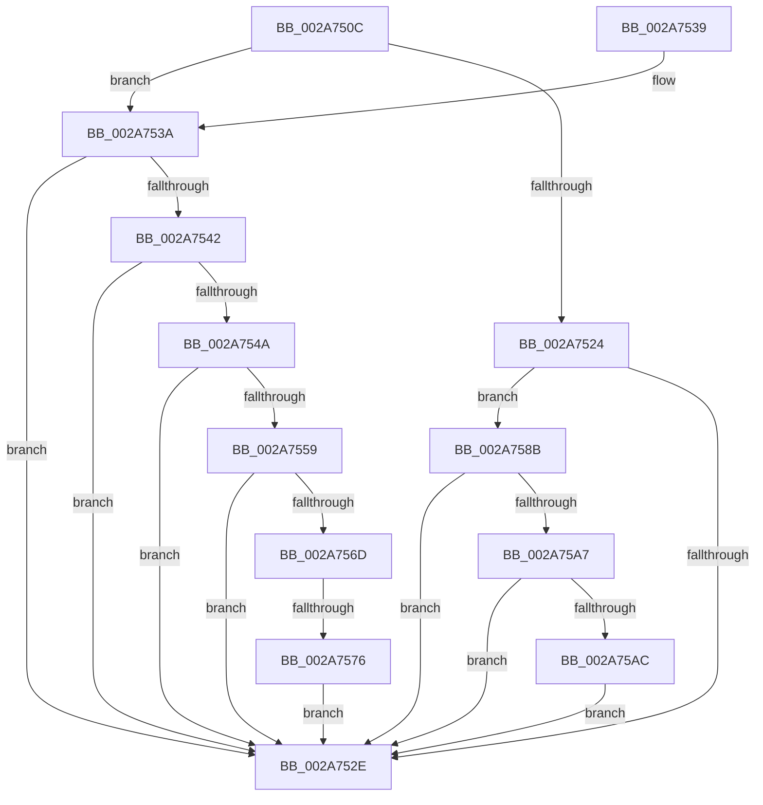

# MiCopyOnWriteCheckConditions

- RVA: `0x002A750C`–`0x002A75C7` (길이 `187` bytes)
- VA: `0x00000001402A750C`
- 실행 섹션: `.text`
- PDB 이름 있음: `예`; PDB Function 태그: `예`
- unwind 정보 RVA: `0x00068BEC`
- 디코드: `48`개 명령, `187/187` bytes 표시
- 미해석 바이트: `0` (있으면 어셈블리에 `.byte`로 보존)

> 이 문서는 커널 이미지의 기계어와 PDB 기호를 분석해 생성했습니다. 4번과 5번은 함수 원형과 자료형을 바이너리 사용 방식에서 추정한 C 해석이며 원본 소스 복구 결과는 아닙니다.

## 1. Dependencies

- 직접 호출 지점: **3**; 고유 호출 대상: **3**
- 직접 호출자로 확인된 함수: **16**
- RIP 상대 이미지 참조: **0**

### Outgoing calls
- `0x002A7584` → [MiReplenishSlabAllocator](../37/MiReplenishSlabAllocator_function_003788E4.md) (function, `0x003788E4`)
- `0x002A75B2` → [LOCK_ADDRESS_SPACE](LOCK_ADDRESS_SPACE_function_002A4944.md) (function, `0x002A4944`)
- `0x002A75BD` → [UNLOCK_ADDRESS_SPACE](UNLOCK_ADDRESS_SPACE_function_002A4844.md) (function, `0x002A4844`)

### Direct callers
- [MmProtectPool](../26/MmProtectPool_function_002697AC.md) at `0x00269F00`
- [sub_0027F528](../27/Unknown_function_0027F528.md) at `0x0027F585`
- [sub_0027F528](../27/Unknown_function_0027F528.md) at `0x0027F59F`
- [MiSplitPrivatePage](MiSplitPrivatePage_function_002A6210.md) at `0x002A6699`
- [sub_002C3A7C](../2C/Unknown_function_002C3A7C.md) at `0x002C3FBF`
- [MiMakeProtoPrivate](../2C/MiMakeProtoPrivate_function_002C64A4.md) at `0x002C65EA`
- [MiSystemFault](../34/MiSystemFault_function_0034AA64.md) at `0x0034AEDB`
- [MiLockCode](../36/MiLockCode_function_0036F91C.md) at `0x003700C7`
- [MiLockAweVadsShared](../4C/MiLockAweVadsShared_function_004CEE3C.md) at `0x004CEE84`
- [MiSplitReducedCommitClonePage](../4F/MiSplitReducedCommitClonePage_function_004FA808.md) at `0x004FA9B8`
- [MiLockDriverPageRange](../67/MiLockDriverPageRange_function_00670160.md) at `0x006704E8`
- [MiReplaceImportEntry](../67/MiReplaceImportEntry_function_00671440.md) at `0x006715DA`
- [MiPrepareImagePagesForHotPatch](../68/MiPrepareImagePagesForHotPatch_function_00683800.md) at `0x00683AE5`
- [sub_006D7AEE](../6D/Unknown_function_006D7AEE.md) at `0x006D7B9D`
- [sub_006D9212](../6D/Unknown_function_006D9212.md) at `0x006D94D8`
- [sub_006E94B4](../6E/Unknown_function_006E94B4.md) at `0x006E9542`
- [sub_006F541A](../6F/Unknown_function_006F541A.md) at `0x006F546B`

### Static image references
- 디코드된 RIP-relative 메모리 참조가 없습니다.

## 2. Other-region calls and transfers

- 다른 실행 섹션으로 향하는 call: **0**
- call이 아닌 외부 분기/꼬리 이동: **1**
  - `0x002A7570` → [sub_006DAF7E](../6D/Unknown_function_006DAF7E.md) (`tail-transfer`)

## 3. Assembly (complete function range)

```asm
002A750C  48 89 5C 24 08                  mov qword ptr [rsp + 8], rbx
002A7511  57                              push rdi
002A7512  48 83 EC 20                     sub rsp, 0x20
002A7516  4D 8B C8                        mov r9, r8
002A7519  4C 8B C1                        mov r8, rcx
002A751C  81 FA 34 04 00 C0               cmp edx, 0xc0000434
002A7522  75 16                           jne 0x1402a753a
002A7524  8B 81 B8 00 00 00               mov eax, dword ptr [rcx + 0xb8]
002A752A  A8 0F                           test al, 0xf
002A752C  74 5D                           je 0x1402a758b
002A752E  48 8B 5C 24 30                  mov rbx, qword ptr [rsp + 0x30]
002A7533  48 83 C4 20                     add rsp, 0x20
002A7537  5F                              pop rdi
002A7538  C3                              ret
002A7539  CC                              int3
002A753A  81 FA 17 00 00 C0               cmp edx, 0xc0000017
002A7540  75 EC                           jne 0x1402a752e
002A7542  44 0F 20 C0                     mov rax, cr8
002A7546  3C 02                           cmp al, 2
002A7548  73 E4                           jae 0x1402a752e
002A754A  65 8B 04 25 3C 3A 00 00         mov eax, dword ptr gs:[0x3a3c]
002A7552  A9 01 00 01 00                  test eax, 0x10001
002A7557  75 D5                           jne 0x1402a752e
002A7559  65 48 8B 04 25 88 01 00 00      mov rax, qword ptr gs:[0x188]
002A7562  8B 88 A4 05 00 00               mov ecx, dword ptr [rax + 0x5a4]
002A7568  F6 C1 0C                        test cl, 0xc
002A756B  75 C1                           jne 0x1402a752e
002A756D  4D 85 C9                        test r9, r9
002A7570  0F 84 08 3A 43 00               je 0x1406daf7e
002A7576  BA 01 00 00 00                  mov edx, 1
002A757B  41 B8 00 00 02 00               mov r8d, 0x20000
002A7581  49 8B C9                        mov rcx, r9
002A7584  E8 5B 13 0D 00                  call 0x1403788e4
002A7589  EB A3                           jmp 0x1402a752e
002A758B  65 48 8B 1C 25 88 01 00 00      mov rbx, qword ptr gs:[0x188]
002A7594  48 8B BB B8 00 00 00            mov rdi, qword ptr [rbx + 0xb8]
002A759B  48 8B 87 70 02 00 00            mov rax, qword ptr [rdi + 0x270]
002A75A2  48 85 C0                        test rax, rax
002A75A5  74 87                           je 0x1402a752e
002A75A7  48 3B C3                        cmp rax, rbx
002A75AA  74 82                           je 0x1402a752e
002A75AC  48 8B D7                        mov rdx, rdi
002A75AF  48 8B CB                        mov rcx, rbx
002A75B2  E8 8D D3 FF FF                  call 0x1402a4944
002A75B7  48 8B D7                        mov rdx, rdi
002A75BA  48 8B CB                        mov rcx, rbx
002A75BD  E8 82 D2 FF FF                  call 0x1402a4844
002A75C2  E9 67 FF FF FF                  jmp 0x1402a752e
```

## 4. C-style interpretation (structured pseudocode)

```c
__int64 __fastcall MiCopyOnWriteCheckConditions(__int64 a1, int a2, __int64 a3)
{
    __int64 result;
    __int64 v_rsp;
    unsigned __int64 v_stack_p8;

    v_stack_p8 = v_rbx;
    v_rsp = (v_rsp) - (32);
    if (a2 != 0xC0000434ULL) goto loc_002A753A;
    if ((((unsigned __int8)((unsigned int)(*(unsigned int *)(a1 + 184)))) & (15)) == 0) goto loc_002A758B;
loc_002A752E:
    v_rsp = (v_rsp) + (32);
    return (unsigned int)(*(unsigned int *)(a1 + 184));
loc_002A753A:
    if (a2 != 0xC0000017ULL) goto loc_002A752E;
    if (((unsigned __int8)(v_cr8)) >= 2) goto loc_002A752E;
    if ((((unsigned int)((unsigned int)(*(unsigned int *)(gs_base + (0 + 14908))))) & (0x10001ULL)) != 0) goto loc_002A752E;
    if ((((unsigned __int8)((unsigned int)(*(unsigned int *)(*(unsigned __int64 *)(gs_base + (0 + 392)) + 1444)))) & (12)) != 0) goto loc_002A752E;
    result = MiReplenishSlabAllocator(a3, 1, (unsigned int)(0x20000ULL), a3);
    goto loc_002A752E;
loc_002A758B:
    if (*(unsigned __int64 *)(*(unsigned __int64 *)(*(unsigned __int64 *)(gs_base + (0 + 392)) + 184) + 624) == 0) goto loc_002A752E;
    if ((*(unsigned __int64 *)(*(unsigned __int64 *)(*(unsigned __int64 *)(gs_base + (0 + 392)) + 184) + 624)) == (*(unsigned __int64 *)(gs_base + (0 + 392)))) goto loc_002A752E;
    result = LOCK_ADDRESS_SPACE(*(unsigned __int64 *)(gs_base + (0 + 392)), *(unsigned __int64 *)(*(unsigned __int64 *)(gs_base + (0 + 392)) + 184), (unsigned int)(0x20000ULL), a3);
    result = UNLOCK_ADDRESS_SPACE(*(unsigned __int64 *)(gs_base + (0 + 392)), *(unsigned __int64 *)(*(unsigned __int64 *)(gs_base + (0 + 392)) + 184), (unsigned int)(0x20000ULL), a3);
    goto loc_002A752E;
}
```

## 5. (Beta) C Style

```c
int64_t MiCopyOnWriteCheckConditions(void *Arg1, int32_t Arg2, int64_t Arg3)
{
    uint8_t *arg1 = (uint8_t *)Arg1;

    int64_t result;
    int64_t local_rsp;
    uint64_t v_stack_p8;

    v_stack_p8 = local_rbx;
    local_rsp = (local_rsp) - (32);
    if (Arg2 != 0xC0000434ULL) goto loc_002A753A;
    if ((((uint8_t)((uint32_t)(*(uint32_t *)(arg1 + 0xB8)))) & (15)) == 0) goto loc_002A758B;
loc_002A752E:
    local_rsp = (local_rsp) + (32);
    return (uint32_t)(*(uint32_t *)(arg1 + 0xB8));
loc_002A753A:
    if (Arg2 != 0xC0000017ULL) goto loc_002A752E;
    if (((uint8_t)(v_cr8)) >= 2) goto loc_002A752E;
    if ((((uint32_t)((uint32_t)(*(uint32_t *)(gs_base + (0 + 0x3A3C))))) & (0x10001ULL)) != 0) goto loc_002A752E;
    if ((((uint8_t)((uint32_t)(*(uint32_t *)(*(uint64_t *)(gs_base + (0 + 0x188)) + 0x5A4)))) & (12)) != 0) goto loc_002A752E;
    result = MiReplenishSlabAllocator(Arg3, 1, (uint32_t)(0x20000ULL), Arg3);
    goto loc_002A752E;
loc_002A758B:
    if (*(uint64_t *)(*(uint64_t *)(*(uint64_t *)(gs_base + (0 + 0x188)) + 0xB8) + 0x270) == 0) goto loc_002A752E;
    if ((*(uint64_t *)(*(uint64_t *)(*(uint64_t *)(gs_base + (0 + 0x188)) + 0xB8) + 0x270)) == (*(uint64_t *)(gs_base + (0 + 0x188)))) goto loc_002A752E;
    result = LOCK_ADDRESS_SPACE(*(uint64_t *)(gs_base + (0 + 0x188)), *(uint64_t *)(*(uint64_t *)(gs_base + (0 + 0x188)) + 0xB8), (uint32_t)(0x20000ULL), Arg3);
    result = UNLOCK_ADDRESS_SPACE(*(uint64_t *)(gs_base + (0 + 0x188)), *(uint64_t *)(*(uint64_t *)(gs_base + (0 + 0x188)) + 0xB8), (uint32_t)(0x20000ULL), Arg3);
    goto loc_002A752E;
}
```

### 관측된 메모리 오프셋

구조체 형식이 확인되지 않은 접근은 인자 기준의 오프셋으로만 기록했습니다.

| 기준 인자 | 오프셋 표현 | 폭 (bit) | 접근 |
|---|---:|---:|---|
| `Arg1` | `+ 0xB8` | `32` | `R` |

## 6. Execution-region graph

[열기: 2D/3D 그래프와 함수 탐색 컨트롤 패널](../../../control-panel.html?section=text&rva=0x002A750C&view=graph)

- 2D 그래프는 위에서 아래로 흐르고, 3D 그래프는 빈 공간을 드래그해 회전합니다. Shift+드래그는 이동, 휠은 확대·축소, 함수 노드 선택은 대상 보고서 이동입니다.

### Static fallback


