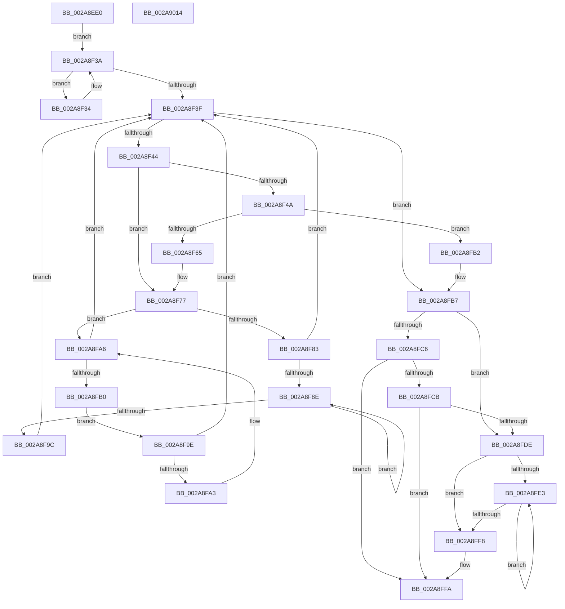

# MiCreateCloneChain

- RVA: `0x002A8EE0`–`0x002A9015` (길이 `309` bytes)
- VA: `0x00000001402A8EE0`
- 실행 섹션: `.text`
- PDB 이름 있음: `예`; PDB Function 태그: `아니요`
- unwind 정보 RVA: `0x00068D9C`
- 디코드: `102`개 명령, `309/309` bytes 표시
- 미해석 바이트: `0` (있으면 어셈블리에 `.byte`로 보존)

> 이 문서는 커널 이미지의 기계어와 PDB 기호를 분석해 생성했습니다. 4번과 5번은 함수 원형과 자료형을 바이너리 사용 방식에서 추정한 C 해석이며 원본 소스 복구 결과는 아닙니다.

## 1. Dependencies

- 직접 호출 지점: **5**; 고유 호출 대상: **5**
- 직접 호출자로 확인된 함수: **1**
- RIP 상대 이미지 참조: **0**

### Outgoing calls
- `0x002A8F21` → [MiLockWorkingSetExclusive](../32/MiLockWorkingSetExclusive_function_003238A0.md) (function, `0x003238A0`)
- `0x002A8F58` → [MiAllocatePool](../35/MiAllocatePool_function_0035B540.md) (function, `0x0035B540`)
- `0x002A8FBD` → [MiUnlockWorkingSetExclusive](../27/MiUnlockWorkingSetExclusive_function_0027EC70.md) (function, `0x0027EC70`)
- `0x002A8FD3` → [PsChargeProcessNonPagedPoolQuota](PsChargeProcessNonPagedPoolQuota_function_002A7B80.md) (function, `0x002A7B80`)
- `0x002A8FEB` → [ExFreePoolWithTag](../../poolcode/B8/ExFreePoolWithTag_function_00B82870.md) (function, `0x00B82870`)

### Direct callers
- [MiCloneProcessAddressSpace](../../page/AD/MiCloneProcessAddressSpace_function_00AD6F7C.md) at `0x00AD7112`

### Static image references
- 디코드된 RIP-relative 메모리 참조가 없습니다.

## 2. Other-region calls and transfers

- 다른 실행 섹션으로 향하는 call: **1**
  - `0x002A8FEB` → [ExFreePoolWithTag](../../poolcode/B8/ExFreePoolWithTag_function_00B82870.md) (`.text` → `POOLCODE`)
- 별도 외부 분기/꼬리 이동을 확인하지 못했습니다.

## 3. Assembly (complete function range)

```asm
002A8EE0  48 89 5C 24 18                  mov qword ptr [rsp + 0x18], rbx
002A8EE5  48 89 4C 24 08                  mov qword ptr [rsp + 8], rcx
002A8EEA  55                              push rbp
002A8EEB  56                              push rsi
002A8EEC  57                              push rdi
002A8EED  41 54                           push r12
002A8EEF  41 55                           push r13
002A8EF1  41 56                           push r14
002A8EF3  41 57                           push r15
002A8EF5  48 83 EC 20                     sub rsp, 0x20
002A8EF9  65 48 8B 04 25 88 01 00 00      mov rax, qword ptr gs:[0x188]
002A8F02  4C 8B FA                        mov r15, rdx
002A8F05  48 83 22 00                     and qword ptr [rdx], 0
002A8F09  33 ED                           xor ebp, ebp
002A8F0B  33 F6                           xor esi, esi
002A8F0D  45 33 F6                        xor r14d, r14d
002A8F10  48 8B 98 B8 00 00 00            mov rbx, qword ptr [rax + 0xb8]
002A8F17  4C 8D A3 00 04 00 00            lea r12, [rbx + 0x400]
002A8F1E  49 8B CC                        mov rcx, r12
002A8F21  E8 7A A9 07 00                  call 0x1403238a0
002A8F26  44 8A E8                        mov r13b, al
002A8F29  33 FF                           xor edi, edi
002A8F2B  48 8B 83 80 02 00 00            mov rax, qword ptr [rbx + 0x280]
002A8F32  EB 06                           jmp 0x1402a8f3a
002A8F34  48 8B F8                        mov rdi, rax
002A8F37  48 8B 00                        mov rax, qword ptr [rax]
002A8F3A  48 85 C0                        test rax, rax
002A8F3D  75 F5                           jne 0x1402a8f34
002A8F3F  48 85 FF                        test rdi, rdi
002A8F42  74 73                           je 0x1402a8fb7
002A8F44  48 39 6F 30                     cmp qword ptr [rdi + 0x30], rbp
002A8F48  74 2D                           je 0x1402a8f77
002A8F4A  BA 70 00 00 00                  mov edx, 0x70
002A8F4F  41 B8 4D 6D 43 64               mov r8d, 0x64436d4d
002A8F55  8D 4A D0                        lea ecx, [rdx - 0x30]
002A8F58  E8 E3 25 0B 00                  call 0x14035b540
002A8F5D  48 8B C8                        mov rcx, rax
002A8F60  48 85 C0                        test rax, rax
002A8F63  74 4D                           je 0x1402a8fb2
002A8F65  48 89 30                        mov qword ptr [rax], rsi
002A8F68  48 8B F0                        mov rsi, rax
002A8F6B  48 8B 47 40                     mov rax, qword ptr [rdi + 0x40]
002A8F6F  48 89 41 40                     mov qword ptr [rcx + 0x40], rax
002A8F73  4C 03 77 40                     add r14, qword ptr [rdi + 0x40]
002A8F77  48 8B 47 08                     mov rax, qword ptr [rdi + 8]
002A8F7B  48 8B CF                        mov rcx, rdi
002A8F7E  48 85 C0                        test rax, rax
002A8F81  74 23                           je 0x1402a8fa6
002A8F83  48 8B 08                        mov rcx, qword ptr [rax]
002A8F86  48 8B F8                        mov rdi, rax
002A8F89  48 85 C9                        test rcx, rcx
002A8F8C  74 B1                           je 0x1402a8f3f
002A8F8E  48 8B 01                        mov rax, qword ptr [rcx]
002A8F91  48 8B F9                        mov rdi, rcx
002A8F94  48 8B C8                        mov rcx, rax
002A8F97  48 85 C0                        test rax, rax
002A8F9A  75 F2                           jne 0x1402a8f8e
002A8F9C  EB A1                           jmp 0x1402a8f3f
002A8F9E  48 39 0F                        cmp qword ptr [rdi], rcx
002A8FA1  74 9C                           je 0x1402a8f3f
002A8FA3  48 8B CF                        mov rcx, rdi
002A8FA6  48 8B 7F 10                     mov rdi, qword ptr [rdi + 0x10]
002A8FAA  48 83 E7 FC                     and rdi, 0xfffffffffffffffc
002A8FAE  74 8F                           je 0x1402a8f3f
002A8FB0  EB EC                           jmp 0x1402a8f9e
002A8FB2  BD 9A 00 00 C0                  mov ebp, 0xc000009a
002A8FB7  41 8A D5                        mov dl, r13b
002A8FBA  49 8B CC                        mov rcx, r12
002A8FBD  E8 AE 5C FD FF                  call 0x14027ec70
002A8FC2  85 ED                           test ebp, ebp
002A8FC4  78 18                           js 0x1402a8fde
002A8FC6  4D 85 F6                        test r14, r14
002A8FC9  74 2F                           je 0x1402a8ffa
002A8FCB  48 8B 4C 24 60                  mov rcx, qword ptr [rsp + 0x60]
002A8FD0  49 8B D6                        mov rdx, r14
002A8FD3  E8 A8 EB FF FF                  call 0x1402a7b80
002A8FD8  8B E8                           mov ebp, eax
002A8FDA  85 C0                           test eax, eax
002A8FDC  79 1C                           jns 0x1402a8ffa
002A8FDE  48 85 F6                        test rsi, rsi
002A8FE1  74 15                           je 0x1402a8ff8
002A8FE3  48 8B 1E                        mov rbx, qword ptr [rsi]
002A8FE6  33 D2                           xor edx, edx
002A8FE8  48 8B CE                        mov rcx, rsi
002A8FEB  E8 80 98 8D 00                  call 0x140b82870
002A8FF0  48 8B F3                        mov rsi, rbx
002A8FF3  48 85 DB                        test rbx, rbx
002A8FF6  75 EB                           jne 0x1402a8fe3
002A8FF8  33 F6                           xor esi, esi
002A8FFA  48 8B 5C 24 70                  mov rbx, qword ptr [rsp + 0x70]
002A8FFF  8B C5                           mov eax, ebp
002A9001  49 89 37                        mov qword ptr [r15], rsi
002A9004  48 83 C4 20                     add rsp, 0x20
002A9008  41 5F                           pop r15
002A900A  41 5E                           pop r14
002A900C  41 5D                           pop r13
002A900E  41 5C                           pop r12
002A9010  5F                              pop rdi
002A9011  5E                              pop rsi
002A9012  5D                              pop rbp
002A9013  C3                              ret
002A9014  CC                              int3
```

## 4. C-style interpretation (structured pseudocode)

```c
__int64 __fastcall MiCreateCloneChain(__int64 a1, __int64 a2)
{
    __int64 result;
    __int64 v_r14;
    __int64 v_rbp;
    __int64 v_rdi;
    __int64 v_rsi;
    __int64 v_rsp;
    unsigned __int64 v_stack_p18;
    unsigned __int64 v_stack_p8;

    v_stack_p18 = v_rbx;
    v_stack_p8 = a1;
    v_rsp = (v_rsp) - (32);
    v_rbp = 0;
    v_rsi = 0;
    v_r14 = 0;
    result = MiLockWorkingSetExclusive(*(unsigned __int64 *)(*(unsigned __int64 *)(gs_base + (0 + 392)) + 184) + 1024, a2, a3, a4);
    v_rdi = 0;
    goto loc_002A8F3A;
loc_002A8F34:
loc_002A8F3A:
    if (*(unsigned __int64 *)(*(unsigned __int64 *)(*(unsigned __int64 *)(*(unsigned __int64 *)(gs_base + (0 + 392)) + 184) + 640)) != 0) goto loc_002A8F34;
loc_002A8F3F:
    if (*(unsigned __int64 *)(*(unsigned __int64 *)(*(unsigned __int64 *)(gs_base + (0 + 392)) + 184) + 640) == 0) goto loc_002A8FB7;
    if ((*(unsigned __int64 *)(*(unsigned __int64 *)(*(unsigned __int64 *)(*(unsigned __int64 *)(gs_base + (0 + 392)) + 184) + 640) + 48)) == 0) goto loc_002A8F77;
    result = MiAllocatePool(112 - 48, 112, (unsigned int)(0x64436D4DULL), a4);
    if (result == 0) goto loc_002A8FB2;
    *(unsigned __int64 *)(result) = 0;
    *(unsigned __int64 *)(result + 64) = *(unsigned __int64 *)(*(unsigned __int64 *)(*(unsigned __int64 *)(*(unsigned __int64 *)(gs_base + (0 + 392)) + 184) + 640) + 64);
    v_r14 = (v_r14) + (*(unsigned __int64 *)(*(unsigned __int64 *)(*(unsigned __int64 *)(*(unsigned __int64 *)(gs_base + (0 + 392)) + 184) + 640) + 64));
loc_002A8F77:
    if (*(unsigned __int64 *)(*(unsigned __int64 *)(*(unsigned __int64 *)(*(unsigned __int64 *)(gs_base + (0 + 392)) + 184) + 640) + 8) == 0) goto loc_002A8FA6;
    if (*(unsigned __int64 *)(*(unsigned __int64 *)(*(unsigned __int64 *)(*(unsigned __int64 *)(*(unsigned __int64 *)(gs_base + (0 + 392)) + 184) + 640) + 8)) == 0) goto loc_002A8F3F;
loc_002A8F8E:
    if (*(unsigned __int64 *)(*(unsigned __int64 *)(*(unsigned __int64 *)(*(unsigned __int64 *)(*(unsigned __int64 *)(*(unsigned __int64 *)(gs_base + (0 + 392)) + 184) + 640) + 8))) != 0) goto loc_002A8F8E;
    goto loc_002A8F3F;
loc_002A8F9E:
    if ((*(unsigned __int64 *)(*(unsigned __int64 *)(*(unsigned __int64 *)(*(unsigned __int64 *)(*(unsigned __int64 *)(*(unsigned __int64 *)(gs_base + (0 + 392)) + 184) + 640) + 8)))) == (*(unsigned __int64 *)(*(unsigned __int64 *)(*(unsigned __int64 *)(*(unsigned __int64 *)(*(unsigned __int64 *)(*(unsigned __int64 *)(gs_base + (0 + 392)) + 184) + 640) + 8))))) goto loc_002A8F3F;
loc_002A8FA6:
    v_rdi = (*(unsigned __int64 *)(*(unsigned __int64 *)(*(unsigned __int64 *)(*(unsigned __int64 *)(*(unsigned __int64 *)(*(unsigned __int64 *)(gs_base + (0 + 392)) + 184) + 640) + 8)) + 16)) & (-4);
    if (condition_is_equal) goto loc_002A8F3F;
    goto loc_002A8F9E;
loc_002A8FB2:
loc_002A8FB7:
    result = MiUnlockWorkingSetExclusive(*(unsigned __int64 *)(*(unsigned __int64 *)(gs_base + (0 + 392)) + 184) + 1024, (unsigned __int8)((unsigned __int8)(result)), (unsigned int)(0x64436D4DULL), a4);
    if (sign_flag) goto loc_002A8FDE;
    if (v_r14 == 0) goto loc_002A8FFA;
    result = PsChargeProcessNonPagedPoolQuota(v_stack_p8, v_r14, (unsigned int)(0x64436D4DULL), a4);
    if (!sign_flag) goto loc_002A8FFA;
loc_002A8FDE:
    if (result == 0) goto loc_002A8FF8;
loc_002A8FE3:
    a2 = 0;
    result = ExFreePoolWithTag(result, a2, (unsigned int)(0x64436D4DULL), a4);
    if (*(unsigned __int64 *)(result) != 0) goto loc_002A8FE3;
loc_002A8FF8:
    v_rsi = 0;
loc_002A8FFA:
    *(unsigned __int64 *)(a2) = 0;
    v_rsp = (v_rsp) + (32);
    return (unsigned int)((unsigned int)((unsigned int)((unsigned int)(result))));
}
```

## 5. (Beta) C Style

```c
int64_t MiCreateCloneChain(int64_t Arg1, void *Arg2)
{
    uint8_t *arg2 = (uint8_t *)Arg2;

    int64_t result;
    int64_t local_r14;
    int64_t local_rbp;
    int64_t local_rdi;
    int64_t local_rsi;
    int64_t local_rsp;
    uint64_t v_stack_p18;
    uint64_t v_stack_p8;

    v_stack_p18 = local_rbx;
    v_stack_p8 = Arg1;
    local_rsp = (local_rsp) - (32);
    local_rbp = 0;
    local_rsi = 0;
    local_r14 = 0;
    result = MiLockWorkingSetExclusive(*(uint64_t *)(*(uint64_t *)(gs_base + (0 + 0x188)) + 0xB8) + 1024, Arg2, a3, a4);
    local_rdi = 0;
    goto loc_002A8F3A;
loc_002A8F34:
loc_002A8F3A:
    if (*(uint64_t *)(*(uint64_t *)(*(uint64_t *)(*(uint64_t *)(gs_base + (0 + 0x188)) + 0xB8) + 0x280)) != 0) goto loc_002A8F34;
loc_002A8F3F:
    if (*(uint64_t *)(*(uint64_t *)(*(uint64_t *)(gs_base + (0 + 0x188)) + 0xB8) + 0x280) == 0) goto loc_002A8FB7;
    if ((*(uint64_t *)(*(uint64_t *)(*(uint64_t *)(*(uint64_t *)(gs_base + (0 + 0x188)) + 0xB8) + 0x280) + 0x30)) == 0) goto loc_002A8F77;
    result = MiAllocatePool(112 - 48, 112, (uint32_t)(0x64436D4DULL), a4);
    if (result == 0) goto loc_002A8FB2;
    *(uint64_t *)(result) = 0;
    *(uint64_t *)(result + 0x40) = *(uint64_t *)(*(uint64_t *)(*(uint64_t *)(*(uint64_t *)(gs_base + (0 + 0x188)) + 0xB8) + 0x280) + 0x40);
    local_r14 = (local_r14) + (*(uint64_t *)(*(uint64_t *)(*(uint64_t *)(*(uint64_t *)(gs_base + (0 + 0x188)) + 0xB8) + 0x280) + 0x40));
loc_002A8F77:
    if (*(uint64_t *)(*(uint64_t *)(*(uint64_t *)(*(uint64_t *)(gs_base + (0 + 0x188)) + 0xB8) + 0x280) + 0x8) == 0) goto loc_002A8FA6;
    if (*(uint64_t *)(*(uint64_t *)(*(uint64_t *)(*(uint64_t *)(*(uint64_t *)(gs_base + (0 + 0x188)) + 0xB8) + 0x280) + 0x8)) == 0) goto loc_002A8F3F;
loc_002A8F8E:
    if (*(uint64_t *)(*(uint64_t *)(*(uint64_t *)(*(uint64_t *)(*(uint64_t *)(*(uint64_t *)(gs_base + (0 + 0x188)) + 0xB8) + 0x280) + 0x8))) != 0) goto loc_002A8F8E;
    goto loc_002A8F3F;
loc_002A8F9E:
    if ((*(uint64_t *)(*(uint64_t *)(*(uint64_t *)(*(uint64_t *)(*(uint64_t *)(*(uint64_t *)(gs_base + (0 + 0x188)) + 0xB8) + 0x280) + 0x8)))) == (*(uint64_t *)(*(uint64_t *)(*(uint64_t *)(*(uint64_t *)(*(uint64_t *)(*(uint64_t *)(gs_base + (0 + 0x188)) + 0xB8) + 0x280) + 0x8))))) goto loc_002A8F3F;
loc_002A8FA6:
    local_rdi = (*(uint64_t *)(*(uint64_t *)(*(uint64_t *)(*(uint64_t *)(*(uint64_t *)(*(uint64_t *)(gs_base + (0 + 0x188)) + 0xB8) + 0x280) + 0x8)) + 0x10)) & (-4);
    if (condition_is_equal) goto loc_002A8F3F;
    goto loc_002A8F9E;
loc_002A8FB2:
loc_002A8FB7:
    result = MiUnlockWorkingSetExclusive(*(uint64_t *)(*(uint64_t *)(gs_base + (0 + 0x188)) + 0xB8) + 1024, (uint8_t)((uint8_t)(result)), (uint32_t)(0x64436D4DULL), a4);
    if (sign_flag) goto loc_002A8FDE;
    if (local_r14 == 0) goto loc_002A8FFA;
    result = PsChargeProcessNonPagedPoolQuota(v_stack_p8, local_r14, (uint32_t)(0x64436D4DULL), a4);
    if (!sign_flag) goto loc_002A8FFA;
loc_002A8FDE:
    if (result == 0) goto loc_002A8FF8;
loc_002A8FE3:
    Arg2 = 0;
    result = ExFreePoolWithTag(result, Arg2, (uint32_t)(0x64436D4DULL), a4);
    if (*(uint64_t *)(result) != 0) goto loc_002A8FE3;
loc_002A8FF8:
    local_rsi = 0;
loc_002A8FFA:
    *(uint64_t *)(arg2) = 0;
    local_rsp = (local_rsp) + (32);
    return (uint32_t)((uint32_t)((uint32_t)((uint32_t)(result))));
}
```

### 관측된 메모리 오프셋

구조체 형식이 확인되지 않은 접근은 인자 기준의 오프셋으로만 기록했습니다.

| 기준 인자 | 오프셋 표현 | 폭 (bit) | 접근 |
|---|---:|---:|---|
| `Arg2` | `+ 0x0` | `64` | `R/W` |
| `Arg2` | `+ 0x0` | `64` | `W` |

## 6. Execution-region graph

[열기: 2D/3D 그래프와 함수 탐색 컨트롤 패널](../../../control-panel.html?section=text&rva=0x002A8EE0&view=graph)

- 2D 그래프는 위에서 아래로 흐르고, 3D 그래프는 빈 공간을 드래그해 회전합니다. Shift+드래그는 이동, 휠은 확대·축소, 함수 노드 선택은 대상 보고서 이동입니다.

### Static fallback


