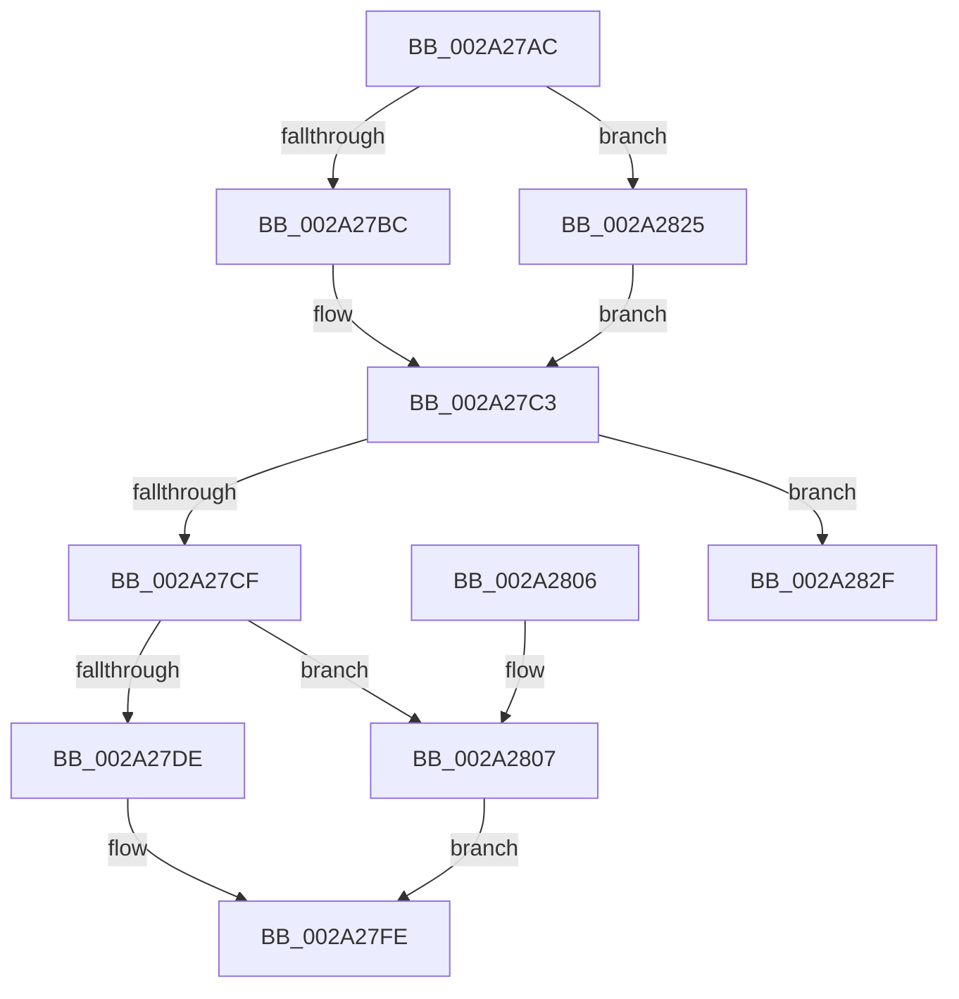

# MiDecreaseUsedPtesInPfn

- RVA: `0x002A27AC`–`0x002A284C` (길이 `160` bytes)
- VA: `0x00000001402A27AC`
- 실행 섹션: `.text`
- PDB 이름 있음: `예`; PDB Function 태그: `아니요`
- unwind 정보 RVA: `0x000685C4`
- 디코드: `46`개 명령, `160/160` bytes 표시
- 미해석 바이트: `0` (있으면 어셈블리에 `.byte`로 보존)

> 이 문서는 커널 이미지의 기계어와 PDB 기호를 분석해 생성했습니다. 4번과 5번은 함수 원형과 자료형을 바이너리 사용 방식에서 추정한 C 해석이며 원본 소스 복구 결과는 아닙니다.

## 1. Dependencies

- 직접 호출 지점: **1**; 고유 호출 대상: **1**
- 직접 호출자로 확인된 함수: **7**
- RIP 상대 이미지 참조: **0**

### Outgoing calls
- `0x002A2846` → [KeBugCheckEx](../4F/KeBugCheckEx_function_004FD660.md) (function, `0x004FD660`)

### Direct callers
- [sub_00293F76](../29/Unknown_function_00293F76.md) at `0x002941BF`
- [MmFreeIndependentPages](MmFreeIndependentPages_function_002A2510.md) at `0x002A263D`
- [MiLockAndDecrementShareCount](MiLockAndDecrementShareCount_function_002A2854.md) at `0x002A2957`
- [MiDeleteNonPagedPoolTail](../2C/MiDeleteNonPagedPoolTail_function_002C20F0.md) at `0x002C215D`
- [MiClearDriverTablePtes](../68/MiClearDriverTablePtes_function_00683024.md) at `0x006832F0`
- [MiClearStaleSecurePageMapping](../../init/C6/MiClearStaleSecurePageMapping_function_00C61CD8.md) at `0x00C61D4D`
- [MiFreeEmptyBootPageTable](../../init/C6/MiFreeEmptyBootPageTable_function_00C62370.md) at `0x00C623DC`
- [MiFreeEmptyBootPageTable](../../init/C6/MiFreeEmptyBootPageTable_function_00C62370.md) at `0x00C624B6`

### Static image references
- 디코드된 RIP-relative 메모리 참조가 없습니다.

## 2. Other-region calls and transfers

- 다른 실행 섹션으로 향하는 call: **0**
- 별도 외부 분기/꼬리 이동을 확인하지 못했습니다.

## 3. Assembly (complete function range)

```asm
002A27AC  48 83 EC 38                     sub rsp, 0x38
002A27B0  8B 41 24                        mov eax, dword ptr [rcx + 0x24]
002A27B3  4C 8B D1                        mov r10, rcx
002A27B6  0F BA E0 1A                     bt eax, 0x1a
002A27BA  73 69                           jae 0x1402a2825
002A27BC  4C 8B 01                        mov r8, qword ptr [rcx]
002A27BF  49 C1 E8 20                     shr r8, 0x20
002A27C3  41 81 E0 FF 03 00 00            and r8d, 0x3ff
002A27CA  44 3B C2                        cmp r8d, edx
002A27CD  72 60                           jb 0x1402a282f
002A27CF  8B 41 24                        mov eax, dword ptr [rcx + 0x24]
002A27D2  44 2B C2                        sub r8d, edx
002A27D5  0F BA E0 1A                     bt eax, 0x1a
002A27D9  45 8B C8                        mov r9d, r8d
002A27DC  73 29                           jae 0x1402a2807
002A27DE  48 8B 01                        mov rax, qword ptr [rcx]
002A27E1  49 C1 E1 20                     shl r9, 0x20
002A27E5  49 8B C9                        mov rcx, r9
002A27E8  48 33 C8                        xor rcx, rax
002A27EB  48 B8 FF FF FF FF 00 FC FF FF   movabs rax, 0xfffffc00ffffffff
002A27F5  48 23 C8                        and rcx, rax
002A27F8  49 33 C9                        xor rcx, r9
002A27FB  49 89 0A                        mov qword ptr [r10], rcx
002A27FE  41 8B C0                        mov eax, r8d
002A2801  48 83 C4 38                     add rsp, 0x38
002A2805  C3                              ret
002A2806  CC                              int3
002A2807  48 8B 49 10                     mov rcx, qword ptr [rcx + 0x10]
002A280B  49 C1 E1 10                     shl r9, 0x10
002A280F  49 8B D1                        mov rdx, r9
002A2812  48 33 D1                        xor rdx, rcx
002A2815  48 81 E2 FF FF 00 FC            and rdx, 0xfffffffffc00ffff
002A281C  49 33 D1                        xor rdx, r9
002A281F  49 89 52 10                     mov qword ptr [r10 + 0x10], rdx
002A2823  EB D9                           jmp 0x1402a27fe
002A2825  4C 8B 41 10                     mov r8, qword ptr [rcx + 0x10]
002A2829  49 C1 E8 10                     shr r8, 0x10
002A282D  EB 94                           jmp 0x1402a27c3
002A282F  8B C2                           mov eax, edx
002A2831  B9 1A 00 00 00                  mov ecx, 0x1a
002A2836  45 8B C8                        mov r9d, r8d
002A2839  BA 90 17 04 00                  mov edx, 0x41790
002A283E  4D 8B C2                        mov r8, r10
002A2841  48 89 44 24 20                  mov qword ptr [rsp + 0x20], rax
002A2846  E8 15 AE 25 00                  call 0x1404fd660
002A284B  CC                              int3
```

## 4. C-style interpretation (structured pseudocode)

```c
__int64 __fastcall MiDecreaseUsedPtesInPfn(__int64 a1, int a2)
{
    __int64 result;
    __int64 v_rsp;
    unsigned __int64 v_stack_p20;

    v_rsp = (v_rsp) - (56);
    if (condition_is_above_or_equal) goto loc_002A2825;
    a3 = (*(unsigned __int64 *)(a1)) >> (32);
loc_002A27C3:
    a3 = (unsigned int)((a3) & (0x3FFULL));
    if (((unsigned int)(a3)) < a2) goto loc_002A282F;
    a3 = (unsigned int)((a3) - (a2));
    if (condition_is_above_or_equal) goto loc_002A2807;
    a4 = ((unsigned int)((unsigned int)(a3))) << (32);
    a1 = (a4) ^ (*(unsigned __int64 *)(a1));
    a1 = (a1) & (*(unsigned __int64 *)(a1));
    a1 = (a1) ^ (a4);
    *(unsigned __int64 *)(a1) = a1;
loc_002A27FE:
    v_rsp = (v_rsp) + (56);
    return (unsigned int)((unsigned int)(a3));
loc_002A2807:
    a4 = (a4) << (16);
    a2 = (a4) ^ (*(unsigned __int64 *)(a1 + 16));
    a2 = (a2) & (0xFFFFFFFFFC00FFFFULL);
    a2 = (a2) ^ (a4);
    *(unsigned __int64 *)(a1 + 16) = a2;
    goto loc_002A27FE;
loc_002A2825:
    a3 = (*(unsigned __int64 *)(*(unsigned __int64 *)(a1 + 16) + 16)) >> (16);
    goto loc_002A27C3;
loc_002A282F:
    v_stack_p20 = (unsigned int)(a2);
    result = KeBugCheckEx(26, (unsigned int)(0x41790ULL), a1, (unsigned int)((unsigned int)(a3)));
    return result;
}
```

## 5. (Beta) C Style

```c
int64_t MiDecreaseUsedPtesInPfn(void *Arg1, int32_t Arg2)
{
    uint8_t *arg1 = (uint8_t *)Arg1;

    int64_t result;
    int64_t local_rsp;
    uint64_t v_stack_p20;

    local_rsp = (local_rsp) - (56);
    if (condition_is_above_or_equal) goto loc_002A2825;
    a3 = (*(uint64_t *)(arg1)) >> (32);
loc_002A27C3:
    a3 = (uint32_t)((a3) & (0x3FFULL));
    if (((uint32_t)(a3)) < Arg2) goto loc_002A282F;
    a3 = (uint32_t)((a3) - (Arg2));
    if (condition_is_above_or_equal) goto loc_002A2807;
    a4 = ((uint32_t)((uint32_t)(a3))) << (32);
    Arg1 = (a4) ^ (*(uint64_t *)(arg1));
    Arg1 = (Arg1) & (*(uint64_t *)(arg1));
    Arg1 = (Arg1) ^ (a4);
    *(void **)(arg1) = Arg1;
loc_002A27FE:
    local_rsp = (local_rsp) + (56);
    return (uint32_t)((uint32_t)(a3));
loc_002A2807:
    a4 = (a4) << (16);
    Arg2 = (a4) ^ (*(uint64_t *)(arg1 + 0x10));
    Arg2 = (Arg2) & (0xFFFFFFFFFC00FFFFULL);
    Arg2 = (Arg2) ^ (a4);
    *(uint64_t *)(arg1 + 0x10) = Arg2;
    goto loc_002A27FE;
loc_002A2825:
    a3 = (*(uint64_t *)(*(uint64_t *)(arg1 + 0x10) + 0x10)) >> (16);
    goto loc_002A27C3;
loc_002A282F:
    v_stack_p20 = (uint32_t)(Arg2);
    result = KeBugCheckEx(26, (uint32_t)(0x41790ULL), Arg1, (uint32_t)((uint32_t)(a3)));
    return result;
}
```

### 관측된 메모리 오프셋

구조체 형식이 확인되지 않은 접근은 인자 기준의 오프셋으로만 기록했습니다.

| 기준 인자 | 오프셋 표현 | 폭 (bit) | 접근 |
|---|---:|---:|---|
| `Arg1` | `+ 0x0` | `64` | `R` |
| `Arg1` | `+ 0x0` | `64` | `W` |
| `Arg1` | `+ 0x10` | `64` | `R` |
| `Arg1` | `+ 0x10` | `64` | `W` |
| `Arg1` | `+ 0x24` | `32` | `R` |

## 6. Execution-region graph

[열기: 2D/3D 그래프와 함수 탐색 컨트롤 패널](../../../control-panel.html?section=text&rva=0x002A27AC&view=graph)

- 2D 그래프는 위에서 아래로 흐르고, 3D 그래프는 빈 공간을 드래그해 회전합니다. Shift+드래그는 이동, 휠은 확대·축소, 함수 노드 선택은 대상 보고서 이동입니다.

### Static fallback


