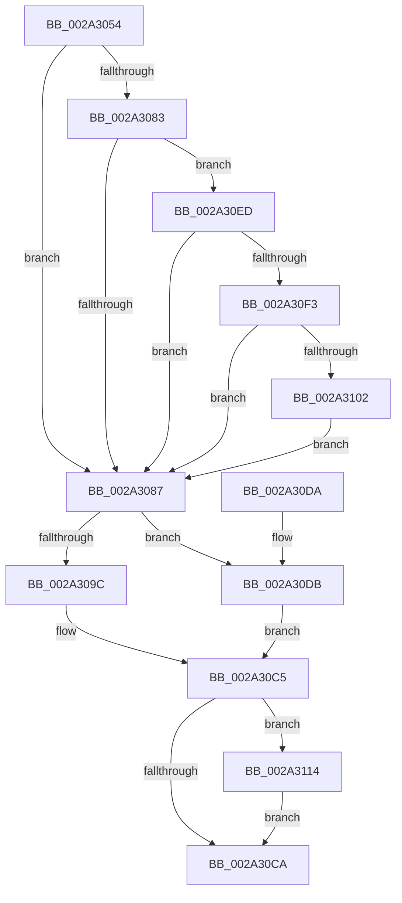

# MiDelayFaultingThread

- RVA: `0x002A3054`–`0x002A3130` (길이 `220` bytes)
- VA: `0x00000001402A3054`
- 실행 섹션: `.text`
- PDB 이름 있음: `예`; PDB Function 태그: `아니요`
- unwind 정보 RVA: `0x000686B8`
- 디코드: `60`개 명령, `220/220` bytes 표시
- 미해석 바이트: `0` (있으면 어셈블리에 `.byte`로 보존)

> 이 문서는 커널 이미지의 기계어와 PDB 기호를 분석해 생성했습니다. 4번과 5번은 함수 원형과 자료형을 바이너리 사용 방식에서 추정한 C 해석이며 원본 소스 복구 결과는 아닙니다.

## 1. Dependencies

- 직접 호출 지점: **5**; 고유 호출 대상: **4**
- 직접 호출자로 확인된 함수: **4**
- RIP 상대 이미지 참조: **2**

### Outgoing calls
- `0x002A30BE` → [MiWaitForAvailablePages](../4A/MiWaitForAvailablePages_function_004A1DCC.md) (function, `0x004A1DCC`)
- `0x002A30E4` → [KeDelayExecutionThread](../20/KeDelayExecutionThread_function_00209550.md) (function, `0x00209550`)
- `0x002A3107` → [KeQueryUnbiasedInterruptTimePrecise](../37/KeQueryUnbiasedInterruptTimePrecise_function_0037AC20.md) (function, `0x0037AC20`)
- `0x002A3119` → [KeQueryUnbiasedInterruptTimePrecise](../37/KeQueryUnbiasedInterruptTimePrecise_function_0037AC20.md) (function, `0x0037AC20`)
- `0x002A3129` → [MiLogDelayFaultingThread](../68/MiLogDelayFaultingThread_function_006869A4.md) (function, `0x006869A4`)

### Direct callers
- [sub_0027F251](../27/Unknown_function_0027F251.md) at `0x0027F29C`
- [sub_002A2D9F](Unknown_function_002A2D9F.md) at `0x002A2DF9`
- [MiUserFault](../32/MiUserFault_function_00329840.md) at `0x00329ECF`
- [MmVirtualAccessFault](../../page/9F/MmVirtualAccessFault_function_009FF98C.md) at `0x009FFA79`

### Static image references
- `0x002A3070` → RVA `0x00E37618` (`.data`; read)
- `0x002A30A6` → RVA `0x00E30088` (`.data`; read)

## 2. Other-region calls and transfers

- 다른 실행 섹션으로 향하는 call: **0**
- 별도 외부 분기/꼬리 이동을 확인하지 못했습니다.

## 3. Assembly (complete function range)

```asm
002A3054  48 89 5C 24 08                  mov qword ptr [rsp + 8], rbx
002A3059  48 89 74 24 20                  mov qword ptr [rsp + 0x20], rsi
002A305E  57                              push rdi
002A305F  48 83 EC 20                     sub rsp, 0x20
002A3063  65 48 8B 04 25 88 01 00 00      mov rax, qword ptr gs:[0x188]
002A306C  33 FF                           xor edi, edi
002A306E  8B D9                           mov ebx, ecx
002A3070  48 8B 0D A1 45 B9 00            mov rcx, qword ptr [rip + 0xb945a1]
002A3077  48 8B B0 B8 00 00 00            mov rsi, qword ptr [rax + 0xb8]
002A307E  48 85 C9                        test rcx, rcx
002A3081  74 04                           je 0x1402a3087
002A3083  39 39                           cmp dword ptr [rcx], edi
002A3085  77 66                           ja 0x1402a30ed
002A3087  0F B7 D3                        movzx edx, bx
002A308A  48 69 CA F0 D8 FF FF            imul rcx, rdx, -0x2710
002A3091  48 89 4C 24 38                  mov qword ptr [rsp + 0x38], rcx
002A3096  0F BA E3 10                     bt ebx, 0x10
002A309A  73 3F                           jae 0x1402a30db
002A309C  0F B7 96 AE 04 00 00            movzx edx, word ptr [rsi + 0x4ae]
002A30A3  44 8B C3                        mov r8d, ebx
002A30A6  48 8B 0D DB CF B8 00            mov rcx, qword ptr [rip + 0xb8cfdb]
002A30AD  41 C1 E8 10                     shr r8d, 0x10
002A30B1  41 83 E0 02                     and r8d, 2
002A30B5  48 8B 0C D1                     mov rcx, qword ptr [rcx + rdx*8]
002A30B9  48 8D 54 24 38                  lea rdx, [rsp + 0x38]
002A30BE  E8 09 ED 1F 00                  call 0x1404a1dcc
002A30C3  8B F0                           mov esi, eax
002A30C5  48 85 FF                        test rdi, rdi
002A30C8  75 4A                           jne 0x1402a3114
002A30CA  48 8B 5C 24 30                  mov rbx, qword ptr [rsp + 0x30]
002A30CF  48 8B 74 24 48                  mov rsi, qword ptr [rsp + 0x48]
002A30D4  48 83 C4 20                     add rsp, 0x20
002A30D8  5F                              pop rdi
002A30D9  C3                              ret
002A30DA  CC                              int3
002A30DB  4C 8D 44 24 38                  lea r8, [rsp + 0x38]
002A30E0  33 D2                           xor edx, edx
002A30E2  33 C9                           xor ecx, ecx
002A30E4  E8 67 64 F6 FF                  call 0x140209550
002A30E9  33 F6                           xor esi, esi
002A30EB  EB D8                           jmp 0x1402a30c5
002A30ED  F6 41 10 01                     test byte ptr [rcx + 0x10], 1
002A30F1  74 94                           je 0x1402a3087
002A30F3  48 8B 49 18                     mov rcx, qword ptr [rcx + 0x18]
002A30F7  48 8B C1                        mov rax, rcx
002A30FA  83 E0 01                        and eax, 1
002A30FD  48 3B C1                        cmp rax, rcx
002A3100  75 85                           jne 0x1402a3087
002A3102  48 8D 4C 24 40                  lea rcx, [rsp + 0x40]
002A3107  E8 14 7B 0D 00                  call 0x14037ac20
002A310C  48 8B F8                        mov rdi, rax
002A310F  E9 73 FF FF FF                  jmp 0x1402a3087
002A3114  48 8D 4C 24 40                  lea rcx, [rsp + 0x40]
002A3119  E8 02 7B 0D 00                  call 0x14037ac20
002A311E  48 2B C7                        sub rax, rdi
002A3121  44 8B C6                        mov r8d, esi
002A3124  48 8B D0                        mov rdx, rax
002A3127  8B CB                           mov ecx, ebx
002A3129  E8 76 38 3E 00                  call 0x1406869a4
002A312E  EB 9A                           jmp 0x1402a30ca
```

## 4. C-style interpretation (structured pseudocode)

```c
__int64 __fastcall MiDelayFaultingThread(int a1)
{
    __int64 result;
    __int64 v_rdi;
    __int64 v_rsi;
    __int64 v_rsp;
    unsigned __int64 v_stack_p10;
    unsigned __int64 v_stack_p20;
    unsigned __int64 v_stack_p38;
    unsigned __int64 v_stack_p40;
    unsigned __int64 v_stack_p8;

    v_stack_p8 = v_rbx;
    v_stack_p20 = v_rsi;
    v_rsp = (v_rsp) - (32);
    v_rdi = 0;
    if (*(unsigned __int64 *)(v_rip + 12141985) == 0) goto loc_002A3087;
    if ((*(unsigned int *)(*(unsigned __int64 *)(v_rip + 12141985))) > 0) goto loc_002A30ED;
loc_002A3087:
    a1 = (*(unsigned __int64 *)(v_rip + 12141985)) * ((unsigned __int16)((unsigned int)(a1)));
    v_stack_p10 = a1;
    if (condition_is_above_or_equal) goto loc_002A30DB;
    a3 = (unsigned int)(((unsigned int)((unsigned int)((unsigned int)(a1)))) >> (16));
    a3 = (unsigned int)((a3) & (2));
    result = MiWaitForAvailablePages(*(unsigned __int64 *)(*(unsigned __int64 *)(v_rip + 12111835) + *(unsigned __int16 *)(*(unsigned __int64 *)(*(unsigned __int64 *)(gs_base + (0 + 392)) + 184) + 1198) * 8), v_stack_p10, a3, a4);
loc_002A30C5:
    if (0 != 0) goto loc_002A3114;
loc_002A30CA:
    v_rsp = (v_rsp) + (32);
    return result;
loc_002A30DB:
    a2 = 0;
    a1 = 0;
    result = KeDelayExecutionThread(a1, a2, v_stack_p38, a4);
    v_rsi = 0;
    goto loc_002A30C5;
loc_002A30ED:
    if (((*(unsigned __int8 *)(a1 + 16)) & (1)) == 0) goto loc_002A3087;
    result = (unsigned int)((*(unsigned __int64 *)(a1 + 24)) & (1));
    if (result != (*(unsigned __int64 *)(a1 + 24))) goto loc_002A3087;
    result = KeQueryUnbiasedInterruptTimePrecise(v_stack_p40, a2, v_stack_p38, a4);
    goto loc_002A3087;
loc_002A3114:
    result = KeQueryUnbiasedInterruptTimePrecise(v_stack_p40, a2, v_stack_p38, a4);
    result = (result) - (result);
    result = MiLogDelayFaultingThread((unsigned int)((unsigned int)(v_stack_p8)), result, 0, a4);
    goto loc_002A30CA;
}
```

## 5. (Beta) C Style

```c
int64_t MiDelayFaultingThread(int32_t Arg1)
{
    int64_t result;
    int64_t local_rdi;
    int64_t local_rsi;
    int64_t local_rsp;
    uint64_t v_stack_p10;
    uint64_t v_stack_p20;
    uint64_t v_stack_p38;
    uint64_t v_stack_p40;
    uint64_t v_stack_p8;

    v_stack_p8 = local_rbx;
    v_stack_p20 = local_rsi;
    local_rsp = (local_rsp) - (32);
    local_rdi = 0;
    if (*(uint64_t *)(v_rip + 0xB945A1) == 0) goto loc_002A3087;
    if ((*(uint32_t *)(*(uint64_t *)(v_rip + 0xB945A1))) > 0) goto loc_002A30ED;
loc_002A3087:
    Arg1 = (*(uint64_t *)(v_rip + 0xB945A1)) * ((uint16_t)((uint32_t)(Arg1)));
    v_stack_p10 = Arg1;
    if (condition_is_above_or_equal) goto loc_002A30DB;
    a3 = (uint32_t)(((uint32_t)((uint32_t)((uint32_t)(Arg1)))) >> (16));
    a3 = (uint32_t)((a3) & (2));
    result = MiWaitForAvailablePages(*(uint64_t *)(*(uint64_t *)(v_rip + 0xB8CFDB) + *(uint16_t *)(*(uint64_t *)(*(uint64_t *)(gs_base + (0 + 0x188)) + 0xB8) + 0x4AE) * 8), v_stack_p10, a3, a4);
loc_002A30C5:
    if (0 != 0) goto loc_002A3114;
loc_002A30CA:
    local_rsp = (local_rsp) + (32);
    return result;
loc_002A30DB:
    a2 = 0;
    Arg1 = 0;
    result = KeDelayExecutionThread(Arg1, a2, v_stack_p38, a4);
    local_rsi = 0;
    goto loc_002A30C5;
loc_002A30ED:
    if (((*(uint8_t *)(Arg1 + 0x10)) & (1)) == 0) goto loc_002A3087;
    result = (uint32_t)((*(uint64_t *)(Arg1 + 0x18)) & (1));
    if (result != (*(uint64_t *)(Arg1 + 0x18))) goto loc_002A3087;
    result = KeQueryUnbiasedInterruptTimePrecise(v_stack_p40, a2, v_stack_p38, a4);
    goto loc_002A3087;
loc_002A3114:
    result = KeQueryUnbiasedInterruptTimePrecise(v_stack_p40, a2, v_stack_p38, a4);
    result = (result) - (result);
    result = MiLogDelayFaultingThread((uint32_t)((uint32_t)(v_stack_p8)), result, 0, a4);
    goto loc_002A30CA;
}
```

## 6. Execution-region graph

[열기: 2D/3D 그래프와 함수 탐색 컨트롤 패널](../../../control-panel.html?section=text&rva=0x002A3054&view=graph)

- 2D 그래프는 위에서 아래로 흐르고, 3D 그래프는 빈 공간을 드래그해 회전합니다. Shift+드래그는 이동, 휠은 확대·축소, 함수 노드 선택은 대상 보고서 이동입니다.

### Static fallback


