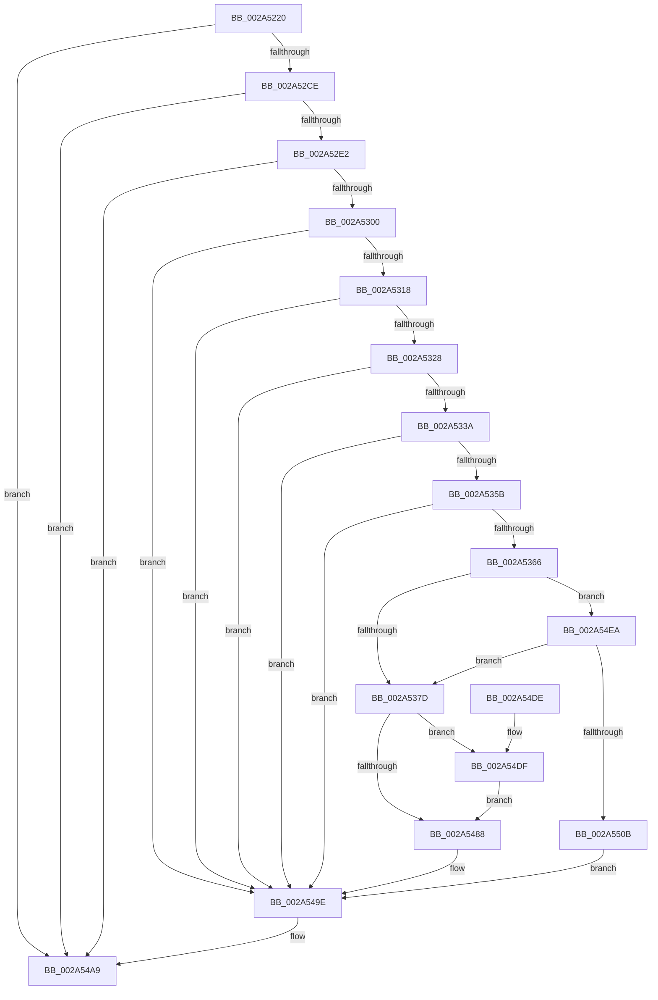

# MiDeleteEmptyPageTables

- RVA: `0x002A5220`–`0x002A550D` (길이 `749` bytes)
- VA: `0x00000001402A5220`
- 실행 섹션: `.text`
- PDB 이름 있음: `예`; PDB Function 태그: `아니요`
- unwind 정보 RVA: `0x000689B4`
- 디코드: `177`개 명령, `749/749` bytes 표시
- 미해석 바이트: `0` (있으면 어셈블리에 `.byte`로 보존)

> 이 문서는 커널 이미지의 기계어와 PDB 기호를 분석해 생성했습니다. 4번과 5번은 함수 원형과 자료형을 바이너리 사용 방식에서 추정한 C 해석이며 원본 소스 복구 결과는 아닙니다.

## 1. Dependencies

- 직접 호출 지점: **17**; 고유 호출 대상: **15**
- 직접 호출자로 확인된 함수: **2**
- RIP 상대 이미지 참조: **3**

### Outgoing calls
- `0x002A527E` → [memset](../6C/memset_function_006C6C40.md) (function, `0x006C6C40`)
- `0x002A528F` → [memset](../6C/memset_function_006C6C40.md) (function, `0x006C6C40`)
- `0x002A52A0` → [memset](../6C/memset_function_006C6C40.md) (function, `0x006C6C40`)
- `0x002A52BB` → [LOCK_ADDRESS_SPACE](LOCK_ADDRESS_SPACE_function_002A4944.md) (function, `0x002A4944`)
- `0x002A52D1` → [MiLocateAddress](../31/MiLocateAddress_function_003168D0.md) (function, `0x003168D0`)
- `0x002A5306` → [MiLockVad](../29/MiLockVad_function_00295810.md) (function, `0x00295810`)
- `0x002A531B` → [MiVadPureReserve](../2C/MiVadPureReserve_function_002C34C0.md) (function, `0x002C34C0`)
- `0x002A53F9` → [MiDecommitInitializePacket](../24/MiDecommitInitializePacket_function_00242F30.md) (function, `0x00242F30`)
- `0x002A546B` → [LOCK_PAGE_TABLE_COMMITMENT](LOCK_PAGE_TABLE_COMMITMENT_function_002A6090.md) (function, `0x002A6090`)
- `0x002A5473` → [MiLockWorkingSetShared](../27/MiLockWorkingSetShared_function_0027CBF0.md) (function, `0x0027CBF0`)
- `0x002A547F` → [MiDeleteVaDirect](../27/MiDeleteVaDirect_function_00277560.md) (function, `0x00277560`)
- `0x002A548E` → [MiUnlockWorkingSetShared](../27/MiUnlockWorkingSetShared_function_0027D690.md) (function, `0x0027D690`)
- `0x002A5499` → [UNLOCK_PAGE_TABLE_COMMITMENT](../2E/UNLOCK_PAGE_TABLE_COMMITMENT_function_002E27D0.md) (function, `0x002E27D0`)
- `0x002A54A4` → [MiUnlockVad](MiUnlockVad_function_002A59C8.md) (function, `0x002A59C8`)
- `0x002A54AF` → [UNLOCK_ADDRESS_SPACE](UNLOCK_ADDRESS_SPACE_function_002A4844.md) (function, `0x002A4844`)
- `0x002A54BE` → [_security_check_cookie](../6A/_security_check_cookie_function_006AC640.md) (function, `0x006AC640`)
- `0x002A54E3` → [MiWalkPageTables](../2C/MiWalkPageTables_function_002C2710.md) (function, `0x002C2710`)

### Direct callers
- [MiDeleteAwePageTables](../68/MiDeleteAwePageTables_function_006884B0.md) at `0x006886A4`
- [MiFreeVirtualMemory](../../page/88/MiFreeVirtualMemory_function_00880268.md) at `0x008804F2`

### Static image references
- `0x002A523F` → RVA `0x00E0A740` (`.data`; read)
- `0x002A544D` → RVA `0x0047FE00` (`MiDeleteEmptyPageTable`; read)
- `0x002A5458` → RVA `0x00483280` (`MiDeleteEmptyPageTableTail`; read)

## 2. Other-region calls and transfers

- 다른 실행 섹션으로 향하는 call: **0**
- 별도 외부 분기/꼬리 이동을 확인하지 못했습니다.

## 3. Assembly (complete function range)

```asm
002A5220  48 89 5C 24 18                  mov qword ptr [rsp + 0x18], rbx
002A5225  55                              push rbp
002A5226  56                              push rsi
002A5227  57                              push rdi
002A5228  41 54                           push r12
002A522A  41 55                           push r13
002A522C  41 56                           push r14
002A522E  41 57                           push r15
002A5230  48 8D AC 24 40 FE FF FF         lea rbp, [rsp - 0x1c0]
002A5238  48 81 EC C0 02 00 00            sub rsp, 0x2c0
002A523F  48 8B 05 FA 54 B6 00            mov rax, qword ptr [rip + 0xb654fa]
002A5246  48 33 C4                        xor rax, rsp
002A5249  48 89 85 B0 01 00 00            mov qword ptr [rbp + 0x1b0], rax
002A5250  0F 57 C0                        xorps xmm0, xmm0
002A5253  33 C0                           xor eax, eax
002A5255  45 8B E8                        mov r13d, r8d
002A5258  48 89 45 80                     mov qword ptr [rbp - 0x80], rax
002A525C  4C 8B FA                        mov r15, rdx
002A525F  4C 8B F1                        mov r14, rcx
002A5262  33 D2                           xor edx, edx
002A5264  48 8D 8D 40 01 00 00            lea rcx, [rbp + 0x140]
002A526B  44 8D 40 68                     lea r8d, [rax + 0x68]
002A526F  0F 11 44 24 50                  movups xmmword ptr [rsp + 0x50], xmm0
002A5274  0F 11 44 24 60                  movups xmmword ptr [rsp + 0x60], xmm0
002A5279  0F 11 44 24 70                  movups xmmword ptr [rsp + 0x70], xmm0
002A527E  E8 BD 19 42 00                  call 0x1406c6c40
002A5283  33 D2                           xor edx, edx
002A5285  48 8D 4D 50                     lea rcx, [rbp + 0x50]
002A5289  41 B8 E0 00 00 00               mov r8d, 0xe0
002A528F  E8 AC 19 42 00                  call 0x1406c6c40
002A5294  33 D2                           xor edx, edx
002A5296  48 8D 4D 90                     lea rcx, [rbp - 0x70]
002A529A  41 B8 C0 00 00 00               mov r8d, 0xc0
002A52A0  E8 9B 19 42 00                  call 0x1406c6c40
002A52A5  65 48 8B 3C 25 88 01 00 00      mov rdi, qword ptr gs:[0x188]
002A52AE  48 8B CF                        mov rcx, rdi
002A52B1  48 8B B7 B8 00 00 00            mov rsi, qword ptr [rdi + 0xb8]
002A52B8  48 8B D6                        mov rdx, rsi
002A52BB  E8 84 F6 FF FF                  call 0x1402a4944
002A52C0  8B 86 F4 01 00 00               mov eax, dword ptr [rsi + 0x1f4]
002A52C6  A8 20                           test al, 0x20
002A52C8  0F 85 DB 01 00 00               jne 0x1402a54a9
002A52CE  49 8B CE                        mov rcx, r14
002A52D1  E8 FA 15 07 00                  call 0x1403168d0
002A52D6  48 8B D8                        mov rbx, rax
002A52D9  48 85 C0                        test rax, rax
002A52DC  0F 84 C7 01 00 00               je 0x1402a54a9
002A52E2  8B 48 1C                        mov ecx, dword ptr [rax + 0x1c]
002A52E5  0F B6 50 21                     movzx edx, byte ptr [rax + 0x21]
002A52E9  48 C1 E2 20                     shl rdx, 0x20
002A52ED  48 0B D1                        or rdx, rcx
002A52F0  49 8B CF                        mov rcx, r15
002A52F3  48 C1 E9 0C                     shr rcx, 0xc
002A52F7  48 3B CA                        cmp rcx, rdx
002A52FA  0F 87 A9 01 00 00               ja 0x1402a54a9
002A5300  48 8B D0                        mov rdx, rax
002A5303  48 8B CF                        mov rcx, rdi
002A5306  E8 05 05 FF FF                  call 0x140295810
002A530B  8B 53 30                        mov edx, dword ptr [rbx + 0x30]
002A530E  0F BA E2 15                     bt edx, 0x15
002A5312  0F 83 86 01 00 00               jae 0x1402a549e
002A5318  48 8B CB                        mov rcx, rbx
002A531B  E8 A0 E1 01 00                  call 0x1402c34c0
002A5320  85 C0                           test eax, eax
002A5322  0F 84 76 01 00 00               je 0x1402a549e
002A5328  81 E2 00 00 20 0C               and edx, 0xc200000
002A532E  81 FA 00 00 20 08               cmp edx, 0x8200000
002A5334  0F 84 64 01 00 00               je 0x1402a549e
002A533A  8B 4B 34                        mov ecx, dword ptr [rbx + 0x34]
002A533D  49 B8 FD FF FF FF 07 00 00 00   movabs r8, 0x7fffffffd
002A5347  0F B6 53 22                     movzx edx, byte ptr [rbx + 0x22]
002A534B  48 C1 E2 20                     shl rdx, 0x20
002A534F  48 0B D1                        or rdx, rcx
002A5352  49 3B D0                        cmp rdx, r8
002A5355  0F 84 43 01 00 00               je 0x1402a549e
002A535B  8B 43 30                        mov eax, dword ptr [rbx + 0x30]
002A535E  A8 04                           test al, 4
002A5360  0F 85 38 01 00 00               jne 0x1402a549e
002A5366  8B 4B 34                        mov ecx, dword ptr [rbx + 0x34]
002A5369  0F B6 53 22                     movzx edx, byte ptr [rbx + 0x22]
002A536D  48 C1 E2 20                     shl rdx, 0x20
002A5371  48 0B D1                        or rdx, rcx
002A5374  49 3B D0                        cmp rdx, r8
002A5377  0F 83 6D 01 00 00               jae 0x1402a54ea
002A537D  48 8B 85 80 01 00 00            mov rax, qword ptr [rbp + 0x180]
002A5384  4C 8D A6 00 04 00 00            lea r12, [rsi + 0x400]
002A538B  48 B9 F8 FF FF FF 7F 00 00 00   movabs rcx, 0x7ffffffff8
002A5395  41 F6 C5 01                     test r13b, 1
002A5399  4D 8B C7                        mov r8, r15
002A539C  48 0F 44 C3                     cmove rax, rbx
002A53A0  49 C1 E8 09                     shr r8, 9
002A53A4  48 89 85 80 01 00 00            mov qword ptr [rbp + 0x180], rax
002A53AB  4C 23 C1                        and r8, rcx
002A53AE  49 8B C6                        mov rax, r14
002A53B1  48 C1 E8 09                     shr rax, 9
002A53B5  48 23 C1                        and rax, rcx
002A53B8  4C 2B C0                        sub r8, rax
002A53BB  49 C1 F8 03                     sar r8, 3
002A53BF  49 FF C0                        inc r8
002A53C2  48 B9 00 00 00 00 80 F6 FF FF   movabs rcx, 0xfffff68000000000
002A53CC  48 8D 14 08                     lea rdx, [rax + rcx]
002A53D0  45 33 C9                        xor r9d, r9d
002A53D3  48 8D 44 24 50                  lea rax, [rsp + 0x50]
002A53D8  48 89 44 24 40                  mov qword ptr [rsp + 0x40], rax
002A53DD  48 8D 4D 50                     lea rcx, [rbp + 0x50]
002A53E1  48 83 64 24 38 00               and qword ptr [rsp + 0x38], 0
002A53E7  C7 44 24 30 21 00 00 00         mov dword ptr [rsp + 0x30], 0x21
002A53EF  48 89 5C 24 28                  mov qword ptr [rsp + 0x28], rbx
002A53F4  48 89 74 24 20                  mov qword ptr [rsp + 0x20], rsi
002A53F9  E8 32 DB F9 FF                  call 0x140242f30
002A53FE  83 65 A0 00                     and dword ptr [rbp - 0x60], 0
002A5402  48 8D 45 50                     lea rax, [rbp + 0x50]
002A5406  48 89 85 30 01 00 00            mov qword ptr [rbp + 0x130], rax
002A540D  48 8B D6                        mov rdx, rsi
002A5410  48 8D 44 24 50                  lea rax, [rsp + 0x50]
002A5415  C7 85 F0 00 00 00 80 00 00 00   mov dword ptr [rbp + 0xf0], 0x80
002A541F  48 89 85 38 01 00 00            mov qword ptr [rbp + 0x138], rax
002A5426  48 8B CF                        mov rcx, rdi
002A5429  8B 45 94                        mov eax, dword ptr [rbp - 0x6c]
002A542C  25 7F FE FF FF                  and eax, 0xfffffe7f
002A5431  C7 45 90 07 00 00 00            mov dword ptr [rbp - 0x70], 7
002A5438  83 C8 40                        or eax, 0x40
002A543B  4C 89 75 B8                     mov qword ptr [rbp - 0x48], r14
002A543F  89 45 94                        mov dword ptr [rbp - 0x6c], eax
002A5442  48 8D 85 30 01 00 00            lea rax, [rbp + 0x130]
002A5449  48 89 45 48                     mov qword ptr [rbp + 0x48], rax
002A544D  48 8D 05 AC A9 1D 00            lea rax, [rip + 0x1da9ac]
002A5454  48 89 45 38                     mov qword ptr [rbp + 0x38], rax
002A5458  48 8D 05 21 DE 1D 00            lea rax, [rip + 0x1dde21]
002A545F  48 89 45 40                     mov qword ptr [rbp + 0x40], rax
002A5463  4C 89 7D C0                     mov qword ptr [rbp - 0x40], r15
002A5467  4C 89 65 B0                     mov qword ptr [rbp - 0x50], r12
002A546B  E8 20 0C 00 00                  call 0x1402a6090
002A5470  49 8B CC                        mov rcx, r12
002A5473  E8 78 77 FD FF                  call 0x14027cbf0
002A5478  48 8D 4D 90                     lea rcx, [rbp - 0x70]
002A547C  88 45 99                        mov byte ptr [rbp - 0x67], al
002A547F  E8 DC 20 FD FF                  call 0x140277560
002A5484  84 C0                           test al, al
002A5486  74 57                           je 0x1402a54df
002A5488  8A 55 99                        mov dl, byte ptr [rbp - 0x67]
002A548B  49 8B CC                        mov rcx, r12
002A548E  E8 FD 81 FD FF                  call 0x14027d690
002A5493  48 8B D6                        mov rdx, rsi
002A5496  48 8B CF                        mov rcx, rdi
002A5499  E8 32 D3 03 00                  call 0x1402e27d0
002A549E  48 8B D3                        mov rdx, rbx
002A54A1  48 8B CF                        mov rcx, rdi
002A54A4  E8 1F 05 00 00                  call 0x1402a59c8
002A54A9  48 8B D6                        mov rdx, rsi
002A54AC  48 8B CF                        mov rcx, rdi
002A54AF  E8 90 F3 FF FF                  call 0x1402a4844
002A54B4  48 8B 8D B0 01 00 00            mov rcx, qword ptr [rbp + 0x1b0]
002A54BB  48 33 CC                        xor rcx, rsp
002A54BE  E8 7D 71 40 00                  call 0x1406ac640
002A54C3  48 8B 9C 24 10 03 00 00         mov rbx, qword ptr [rsp + 0x310]
002A54CB  48 81 C4 C0 02 00 00            add rsp, 0x2c0
002A54D2  41 5F                           pop r15
002A54D4  41 5E                           pop r14
002A54D6  41 5D                           pop r13
002A54D8  41 5C                           pop r12
002A54DA  5F                              pop rdi
002A54DB  5E                              pop rsi
002A54DC  5D                              pop rbp
002A54DD  C3                              ret
002A54DE  CC                              int3
002A54DF  48 8D 4D 90                     lea rcx, [rbp - 0x70]
002A54E3  E8 28 D2 01 00                  call 0x1402c2710
002A54E8  EB 9E                           jmp 0x1402a5488
002A54EA  8B 4B 34                        mov ecx, dword ptr [rbx + 0x34]
002A54ED  48 B8 FE FF FF FF 07 00 00 00   movabs rax, 0x7fffffffe
002A54F7  0F B6 53 22                     movzx edx, byte ptr [rbx + 0x22]
002A54FB  48 C1 E2 20                     shl rdx, 0x20
002A54FF  48 0B D1                        or rdx, rcx
002A5502  48 3B D0                        cmp rdx, rax
002A5505  0F 84 72 FE FF FF               je 0x1402a537d
002A550B  EB 91                           jmp 0x1402a549e
```

## 4. C-style interpretation (structured pseudocode)

```c
__int64 __fastcall MiDeleteEmptyPageTables(__int64 a1, __int64 a2, int a3, int a4)
{
    __int64 result;
    __int64 v_rsp;
    unsigned int v_stack_m108;
    unsigned __int64 v_stack_m1A8;
    unsigned __int64 v_stack_m1B0;
    unsigned __int64 v_stack_m1B8;
    unsigned __int64 v_stack_m1C0;
    unsigned __int64 v_stack_m1F8;
    unsigned __int64 v_stack_m238;
    unsigned __int64 v_stack_m240;
    unsigned __int64 v_stack_m248;
    unsigned int v_stack_m258;
    unsigned __int8 v_stack_m25F;
    unsigned int v_stack_m264;
    unsigned __int64 v_stack_m268;
    unsigned __int64 v_stack_m278;
    unsigned __int64 v_stack_m288;
    unsigned __int64 v_stack_m298;
    unsigned __int64 v_stack_m2A8;
    unsigned __int64 v_stack_m2B8;
    unsigned __int64 v_stack_m2C0;
    unsigned int v_stack_m2C8;
    unsigned __int64 v_stack_m2D0;
    unsigned __int64 v_stack_m2D8;
    unsigned __int64 v_stack_m48;
    unsigned __int64 v_stack_m78;
    unsigned __int64 v_stack_mB8;
    unsigned __int64 v_stack_mC0;
    unsigned __int64 v_stack_mC8;
    unsigned __int64 v_stack_p18;

    v_stack_p18 = v_rbx;
    v_rsp = (v_rsp) - (704);
    result = (*(unsigned __int64 *)(v_rip + 11949306)) ^ (v_rsp);
    v_stack_m48 = result;
    result = 0;
    v_stack_m278 = 0;
    a2 = 0;
    v_stack_m2A8 = v_xmm0;
    v_stack_m298 = v_xmm0;
    v_stack_m288 = v_xmm0;
    result = memset(v_stack_mB8, a2, result + 104, a4);
    a2 = 0;
    result = memset(v_stack_m1A8, a2, 224, a4);
    a2 = 0;
    result = memset(v_stack_m268, a2, 192, a4);
    result = LOCK_ADDRESS_SPACE(*(unsigned __int64 *)(gs_base + (0 + 392)), *(unsigned __int64 *)(*(unsigned __int64 *)(gs_base + (0 + 392)) + 184), 192, a4);
    if ((((unsigned __int8)((unsigned int)(*(unsigned int *)(*(unsigned __int64 *)(*(unsigned __int64 *)(gs_base + (0 + 392)) + 184) + 500)))) & (32)) != 0) goto loc_002A54A9;
    result = MiLocateAddress(a1, *(unsigned __int64 *)(*(unsigned __int64 *)(gs_base + (0 + 392)) + 184), 192, a4);
    if (result == 0) goto loc_002A54A9;
    a2 = (*(unsigned __int8 *)(result + 33)) << (32);
    a2 = (a2) | ((unsigned int)(*(unsigned int *)(result + 28)));
    a1 = (a2) >> (12);
    if (a1 > a2) goto loc_002A54A9;
    result = MiLockVad(*(unsigned __int64 *)(gs_base + (0 + 392)), result, 192, a4);
    if (a1 >= a2) goto loc_002A549E;
    result = MiVadPureReserve(result, (unsigned int)(*(unsigned int *)(result + 48)), 192, a4);
    if ((unsigned int)(result) == 0) goto loc_002A549E;
    a2 = (unsigned int)(((unsigned int)(*(unsigned int *)(result + 48))) & (0xC200000ULL));
    if (((unsigned int)(a2)) == 0x8200000ULL) goto loc_002A549E;
    a2 = (*(unsigned __int8 *)(result + 34)) << (32);
    a2 = (a2) | ((unsigned int)(*(unsigned int *)(result + 52)));
    if (a2 == 192) goto loc_002A549E;
    if ((((unsigned __int8)((unsigned int)(*(unsigned int *)(result + 48)))) & (4)) != 0) goto loc_002A549E;
    a2 = (*(unsigned __int8 *)(result + 34)) << (32);
    a2 = (a2) | ((unsigned int)(*(unsigned int *)(result + 52)));
    if (a2 >= 192) goto loc_002A54EA;
loc_002A537D:
    result = v_stack_m78;
    if ((((unsigned __int8)((unsigned int)(a3))) & (1)) == 0) { result = result; }
    a3 = (a2) >> (9);
    v_stack_m78 = result;
    a3 = (a3) & ((unsigned int)(*(unsigned int *)(result + 52)));
    result = (a1) >> (9);
    result = (result) & ((unsigned int)(*(unsigned int *)(result + 52)));
    a3 = (a3) - (result);
    a3 = (a3) >> (3);
    a3 = (a3) + 1;
    a4 = 0;
    v_stack_m2B8 = v_stack_m2A8;
    v_stack_m2C8 = 33;
    v_stack_m2D0 = result;
    v_stack_m2D8 = *(unsigned __int64 *)(*(unsigned __int64 *)(gs_base + (0 + 392)) + 184);
    result = MiDecommitInitializePacket(v_stack_m1A8, result + (unsigned int)(*(unsigned int *)(result + 52)) * 1, a3, a4);
    v_stack_mC8 = v_stack_m1A8;
    v_stack_m108 = 128;
    v_stack_mC0 = v_stack_m2A8;
    result = (unsigned int)(((unsigned int)(v_stack_m264)) & (0xFFFFFE7FULL));
    v_stack_m268 = 7;
    result = (unsigned int)((result) | (64));
    v_stack_m240 = a1;
    v_stack_m264 = (unsigned int)(result);
    v_stack_m1B0 = v_stack_mC8;
    v_stack_m1C0 = v_rip + 1943980;
    v_stack_m1B8 = v_rip + 1957409;
    v_stack_m238 = a2;
    v_stack_m248 = *(unsigned __int64 *)(*(unsigned __int64 *)(gs_base + (0 + 392)) + 184) + 1024;
    result = LOCK_PAGE_TABLE_COMMITMENT(*(unsigned __int64 *)(gs_base + (0 + 392)), *(unsigned __int64 *)(*(unsigned __int64 *)(gs_base + (0 + 392)) + 184), a3, a4);
    result = MiLockWorkingSetShared(*(unsigned __int64 *)(*(unsigned __int64 *)(gs_base + (0 + 392)) + 184) + 1024, *(unsigned __int64 *)(*(unsigned __int64 *)(gs_base + (0 + 392)) + 184), a3, a4);
    v_stack_m25F = (unsigned __int8)(result);
    result = MiDeleteVaDirect(v_stack_m268, *(unsigned __int64 *)(*(unsigned __int64 *)(gs_base + (0 + 392)) + 184), a3, a4);
    if ((unsigned __int8)(result) == 0) goto loc_002A54DF;
loc_002A5488:
    result = MiUnlockWorkingSetShared(*(unsigned __int64 *)(*(unsigned __int64 *)(gs_base + (0 + 392)) + 184) + 1024, v_stack_m25F, a3, a4);
    result = UNLOCK_PAGE_TABLE_COMMITMENT(*(unsigned __int64 *)(gs_base + (0 + 392)), *(unsigned __int64 *)(*(unsigned __int64 *)(gs_base + (0 + 392)) + 184), a3, a4);
loc_002A549E:
    result = MiUnlockVad(*(unsigned __int64 *)(gs_base + (0 + 392)), result, a3, a4);
loc_002A54A9:
    result = UNLOCK_ADDRESS_SPACE(*(unsigned __int64 *)(gs_base + (0 + 392)), *(unsigned __int64 *)(*(unsigned __int64 *)(gs_base + (0 + 392)) + 184), a3, a4);
    a1 = (v_stack_m48) ^ (v_rsp);
    result = _security_check_cookie(a1, *(unsigned __int64 *)(*(unsigned __int64 *)(gs_base + (0 + 392)) + 184), a3, a4);
    v_rsp = (v_rsp) + (704);
    return result;
loc_002A54DF:
    result = MiWalkPageTables(v_stack_m268, *(unsigned __int64 *)(*(unsigned __int64 *)(gs_base + (0 + 392)) + 184), a3, a4);
    goto loc_002A5488;
loc_002A54EA:
    a2 = (*(unsigned __int8 *)(v_stack_p18 + 34)) << (32);
    a2 = (a2) | ((unsigned int)(*(unsigned int *)(v_stack_p18 + 52)));
    if (a2 == result) goto loc_002A537D;
    goto loc_002A549E;
}
```

## 5. (Beta) C Style

```c
int64_t MiDeleteEmptyPageTables(int64_t Arg1, int64_t Arg2, int32_t Arg3, int32_t Arg4)
{
    int64_t result;
    int64_t local_rsp;
    uint32_t v_stack_m108;
    uint64_t v_stack_m1A8;
    uint64_t v_stack_m1B0;
    uint64_t v_stack_m1B8;
    uint64_t v_stack_m1C0;
    uint64_t v_stack_m1F8;
    uint64_t v_stack_m238;
    uint64_t v_stack_m240;
    uint64_t v_stack_m248;
    uint32_t v_stack_m258;
    uint8_t v_stack_m25F;
    uint32_t v_stack_m264;
    uint64_t v_stack_m268;
    uint64_t v_stack_m278;
    uint64_t v_stack_m288;
    uint64_t v_stack_m298;
    uint64_t v_stack_m2A8;
    uint64_t v_stack_m2B8;
    uint64_t v_stack_m2C0;
    uint32_t v_stack_m2C8;
    uint64_t v_stack_m2D0;
    uint64_t v_stack_m2D8;
    uint64_t v_stack_m48;
    uint64_t v_stack_m78;
    uint64_t v_stack_mB8;
    uint64_t v_stack_mC0;
    uint64_t v_stack_mC8;
    uint64_t v_stack_p18;

    v_stack_p18 = local_rbx;
    local_rsp = (local_rsp) - (704);
    result = (*(uint64_t *)(v_rip + 0xB654FA)) ^ (local_rsp);
    v_stack_m48 = result;
    result = 0;
    v_stack_m278 = 0;
    Arg2 = 0;
    v_stack_m2A8 = v_xmm0;
    v_stack_m298 = v_xmm0;
    v_stack_m288 = v_xmm0;
    result = memset(v_stack_mB8, Arg2, result + 104, Arg4);
    Arg2 = 0;
    result = memset(v_stack_m1A8, Arg2, 224, Arg4);
    Arg2 = 0;
    result = memset(v_stack_m268, Arg2, 192, Arg4);
    result = LOCK_ADDRESS_SPACE(*(uint64_t *)(gs_base + (0 + 0x188)), *(uint64_t *)(*(uint64_t *)(gs_base + (0 + 0x188)) + 0xB8), 192, Arg4);
    if ((((uint8_t)((uint32_t)(*(uint32_t *)(*(uint64_t *)(*(uint64_t *)(gs_base + (0 + 0x188)) + 0xB8) + 0x1F4)))) & (32)) != 0) goto loc_002A54A9;
    result = MiLocateAddress(Arg1, *(uint64_t *)(*(uint64_t *)(gs_base + (0 + 0x188)) + 0xB8), 192, Arg4);
    if (result == 0) goto loc_002A54A9;
    Arg2 = (*(uint8_t *)(result + 0x21)) << (32);
    Arg2 = (Arg2) | ((uint32_t)(*(uint32_t *)(result + 0x1C)));
    Arg1 = (Arg2) >> (12);
    if (Arg1 > Arg2) goto loc_002A54A9;
    result = MiLockVad(*(uint64_t *)(gs_base + (0 + 0x188)), result, 192, Arg4);
    if (Arg1 >= Arg2) goto loc_002A549E;
    result = MiVadPureReserve(result, (uint32_t)(*(uint32_t *)(result + 0x30)), 192, Arg4);
    if ((uint32_t)(result) == 0) goto loc_002A549E;
    Arg2 = (uint32_t)(((uint32_t)(*(uint32_t *)(result + 0x30))) & (0xC200000ULL));
    if (((uint32_t)(Arg2)) == 0x8200000ULL) goto loc_002A549E;
    Arg2 = (*(uint8_t *)(result + 0x22)) << (32);
    Arg2 = (Arg2) | ((uint32_t)(*(uint32_t *)(result + 0x34)));
    if (Arg2 == 192) goto loc_002A549E;
    if ((((uint8_t)((uint32_t)(*(uint32_t *)(result + 0x30)))) & (4)) != 0) goto loc_002A549E;
    Arg2 = (*(uint8_t *)(result + 0x22)) << (32);
    Arg2 = (Arg2) | ((uint32_t)(*(uint32_t *)(result + 0x34)));
    if (Arg2 >= 192) goto loc_002A54EA;
loc_002A537D:
    result = v_stack_m78;
    if ((((uint8_t)((uint32_t)(Arg3))) & (1)) == 0) { result = result; }
    Arg3 = (Arg2) >> (9);
    v_stack_m78 = result;
    Arg3 = (Arg3) & ((uint32_t)(*(uint32_t *)(result + 0x34)));
    result = (Arg1) >> (9);
    result = (result) & ((uint32_t)(*(uint32_t *)(result + 0x34)));
    Arg3 = (Arg3) - (result);
    Arg3 = (Arg3) >> (3);
    Arg3 = (Arg3) + 1;
    Arg4 = 0;
    v_stack_m2B8 = v_stack_m2A8;
    v_stack_m2C8 = 33;
    v_stack_m2D0 = result;
    v_stack_m2D8 = *(uint64_t *)(*(uint64_t *)(gs_base + (0 + 0x188)) + 0xB8);
    result = MiDecommitInitializePacket(v_stack_m1A8, result + (uint32_t)(*(uint32_t *)(result + 0x34)) * 1, Arg3, Arg4);
    v_stack_mC8 = v_stack_m1A8;
    v_stack_m108 = 128;
    v_stack_mC0 = v_stack_m2A8;
    result = (uint32_t)(((uint32_t)(v_stack_m264)) & (0xFFFFFE7FULL));
    v_stack_m268 = 7;
    result = (uint32_t)((result) | (64));
    v_stack_m240 = Arg1;
    v_stack_m264 = (uint32_t)(result);
    v_stack_m1B0 = v_stack_mC8;
    v_stack_m1C0 = v_rip + 1943980;
    v_stack_m1B8 = v_rip + 1957409;
    v_stack_m238 = Arg2;
    v_stack_m248 = *(uint64_t *)(*(uint64_t *)(gs_base + (0 + 0x188)) + 0xB8) + 1024;
    result = LOCK_PAGE_TABLE_COMMITMENT(*(uint64_t *)(gs_base + (0 + 0x188)), *(uint64_t *)(*(uint64_t *)(gs_base + (0 + 0x188)) + 0xB8), Arg3, Arg4);
    result = MiLockWorkingSetShared(*(uint64_t *)(*(uint64_t *)(gs_base + (0 + 0x188)) + 0xB8) + 1024, *(uint64_t *)(*(uint64_t *)(gs_base + (0 + 0x188)) + 0xB8), Arg3, Arg4);
    v_stack_m25F = (uint8_t)(result);
    result = MiDeleteVaDirect(v_stack_m268, *(uint64_t *)(*(uint64_t *)(gs_base + (0 + 0x188)) + 0xB8), Arg3, Arg4);
    if ((uint8_t)(result) == 0) goto loc_002A54DF;
loc_002A5488:
    result = MiUnlockWorkingSetShared(*(uint64_t *)(*(uint64_t *)(gs_base + (0 + 0x188)) + 0xB8) + 1024, v_stack_m25F, Arg3, Arg4);
    result = UNLOCK_PAGE_TABLE_COMMITMENT(*(uint64_t *)(gs_base + (0 + 0x188)), *(uint64_t *)(*(uint64_t *)(gs_base + (0 + 0x188)) + 0xB8), Arg3, Arg4);
loc_002A549E:
    result = MiUnlockVad(*(uint64_t *)(gs_base + (0 + 0x188)), result, Arg3, Arg4);
loc_002A54A9:
    result = UNLOCK_ADDRESS_SPACE(*(uint64_t *)(gs_base + (0 + 0x188)), *(uint64_t *)(*(uint64_t *)(gs_base + (0 + 0x188)) + 0xB8), Arg3, Arg4);
    Arg1 = (v_stack_m48) ^ (local_rsp);
    result = _security_check_cookie(Arg1, *(uint64_t *)(*(uint64_t *)(gs_base + (0 + 0x188)) + 0xB8), Arg3, Arg4);
    local_rsp = (local_rsp) + (704);
    return result;
loc_002A54DF:
    result = MiWalkPageTables(v_stack_m268, *(uint64_t *)(*(uint64_t *)(gs_base + (0 + 0x188)) + 0xB8), Arg3, Arg4);
    goto loc_002A5488;
loc_002A54EA:
    Arg2 = (*(uint8_t *)(v_stack_p18 + 0x22)) << (32);
    Arg2 = (Arg2) | ((uint32_t)(*(uint32_t *)(v_stack_p18 + 0x34)));
    if (Arg2 == result) goto loc_002A537D;
    goto loc_002A549E;
}
```

## 6. Execution-region graph

[열기: 2D/3D 그래프와 함수 탐색 컨트롤 패널](../../../control-panel.html?section=text&rva=0x002A5220&view=graph)

- 2D 그래프는 위에서 아래로 흐르고, 3D 그래프는 빈 공간을 드래그해 회전합니다. Shift+드래그는 이동, 휠은 확대·축소, 함수 노드 선택은 대상 보고서 이동입니다.

### Static fallback


