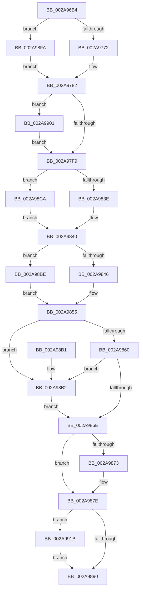

# MiDeletePagablePteRange

- RVA: `0x002A96B4`–`0x002A9931` (길이 `637` bytes)
- VA: `0x00000001402A96B4`
- 실행 섹션: `.text`
- PDB 이름 있음: `예`; PDB Function 태그: `아니요`
- unwind 정보 RVA: `0x00068E28`
- 디코드: `153`개 명령, `637/637` bytes 표시
- 미해석 바이트: `0` (있으면 어셈블리에 `.byte`로 보존)

> 이 문서는 커널 이미지의 기계어와 PDB 기호를 분석해 생성했습니다. 4번과 5번은 함수 원형과 자료형을 바이너리 사용 방식에서 추정한 C 해석이며 원본 소스 복구 결과는 아닙니다.

## 1. Dependencies

- 직접 호출 지점: **12**; 고유 호출 대상: **10**
- 직접 호출자로 확인된 함수: **3**
- RIP 상대 이미지 참조: **3**

### Outgoing calls
- `0x002A96FF` → [memset](../6C/memset_function_006C6C40.md) (function, `0x006C6C40`)
- `0x002A9710` → [memset](../6C/memset_function_006C6C40.md) (function, `0x006C6C40`)
- `0x002A9722` → [memset](../6C/memset_function_006C6C40.md) (function, `0x006C6C40`)
- `0x002A97B0` → [MiDecommitInitializePacket](../24/MiDecommitInitializePacket_function_00242F30.md) (function, `0x00242F30`)
- `0x002A9849` → [MiLockWorkingSetShared](../27/MiLockWorkingSetShared_function_0027CBF0.md) (function, `0x0027CBF0`)
- `0x002A9865` → [MiDeleteVaDirect](../27/MiDeleteVaDirect_function_00277560.md) (function, `0x00277560`)
- `0x002A9879` → [MiUnlockWorkingSetShared](../27/MiUnlockWorkingSetShared_function_0027D690.md) (function, `0x0027D690`)
- `0x002A9883` → [MiDeleteVaFinal](MiDeleteVaFinal_function_002A9940.md) (function, `0x002A9940`)
- `0x002A989A` → [_security_check_cookie](../6A/_security_check_cookie_function_006AC640.md) (function, `0x006AC640`)
- `0x002A98B7` → [MiWalkPageTables](../2C/MiWalkPageTables_function_002C2710.md) (function, `0x002C2710`)
- `0x002A98E9` → [ExAcquireAutoExpandPushLockShared](../20/ExAcquireAutoExpandPushLockShared_function_0020FAF0.md) (function, `0x0020FAF0`)
- `0x002A9927` → [MiUnlockAwePagesShared](../4C/MiUnlockAwePagesShared_function_004C66C4.md) (function, `0x004C66C4`)

### Direct callers
- [MiDeleteRotateAndStopFaults](MiDeleteRotateAndStopFaults_function_002A9540.md) at `0x002A95F6`
- [MiDeleteVirtualAddresses](MiDeleteVirtualAddresses_function_002A9640.md) at `0x002A9686`
- [MiDeleteVadBitmap](../../page/A4/MiDeleteVadBitmap_function_00A45F18.md) at `0x00A45FBC`

### Static image references
- `0x002A96CE` → RVA `0x00E0A740` (`.data`; read)
- `0x002A981F` → RVA `0x002789E0` (`MiDeleteVa`; read)
- `0x002A982A` → RVA `0x00473EF0` (`MiDeleteVaTail`; read)

## 2. Other-region calls and transfers

- 다른 실행 섹션으로 향하는 call: **0**
- 별도 외부 분기/꼬리 이동을 확인하지 못했습니다.

## 3. Assembly (complete function range)

```asm
002A96B4  40 55                           push rbp
002A96B6  53                              push rbx
002A96B7  56                              push rsi
002A96B8  57                              push rdi
002A96B9  41 54                           push r12
002A96BB  41 56                           push r14
002A96BD  41 57                           push r15
002A96BF  48 8D AC 24 80 FE FF FF         lea rbp, [rsp - 0x180]
002A96C7  48 81 EC 80 02 00 00            sub rsp, 0x280
002A96CE  48 8B 05 6B 10 B6 00            mov rax, qword ptr [rip + 0xb6106b]
002A96D5  48 33 C4                        xor rax, rsp
002A96D8  48 89 85 70 01 00 00            mov qword ptr [rbp + 0x170], rax
002A96DF  48 8B B5 F0 01 00 00            mov rsi, qword ptr [rbp + 0x1f0]
002A96E6  40 8A FA                        mov dil, dl
002A96E9  33 D2                           xor edx, edx
002A96EB  4D 8B F0                        mov r14, r8
002A96EE  4C 8B F9                        mov r15, rcx
002A96F1  4D 8B E1                        mov r12, r9
002A96F4  48 8D 8D 00 01 00 00            lea rcx, [rbp + 0x100]
002A96FB  44 8D 42 68                     lea r8d, [rdx + 0x68]
002A96FF  E8 3C D5 41 00                  call 0x1406c6c40
002A9704  33 D2                           xor edx, edx
002A9706  48 8D 4D 10                     lea rcx, [rbp + 0x10]
002A970A  41 B8 E0 00 00 00               mov r8d, 0xe0
002A9710  E8 2B D5 41 00                  call 0x1406c6c40
002A9715  33 D2                           xor edx, edx
002A9717  48 8D 4C 24 50                  lea rcx, [rsp + 0x50]
002A971C  41 B8 C0 00 00 00               mov r8d, 0xc0
002A9722  E8 19 D5 41 00                  call 0x1406c6c40
002A9727  4C 8B 56 20                     mov r10, qword ptr [rsi + 0x20]
002A972B  49 8B D6                        mov rdx, r14
002A972E  49 8B C2                        mov rax, r10
002A9731  4D 8B C4                        mov r8, r12
002A9734  48 F7 D8                        neg rax
002A9737  48 B8 F8 FF FF FF 7F 00 00 00   movabs rax, 0x7ffffffff8
002A9741  45 1B C9                        sbb r9d, r9d
002A9744  49 C1 E8 09                     shr r8, 9
002A9748  4C 23 C0                        and r8, rax
002A974B  48 C1 EA 09                     shr rdx, 9
002A974F  48 23 D0                        and rdx, rax
002A9752  41 F7 D9                        neg r9d
002A9755  41 8B 87 B8 00 00 00            mov eax, dword ptr [r15 + 0xb8]
002A975C  4C 2B C2                        sub r8, rdx
002A975F  49 C1 F8 03                     sar r8, 3
002A9763  41 83 C1 20                     add r9d, 0x20
002A9767  49 FF C0                        inc r8
002A976A  A8 0F                           test al, 0xf
002A976C  0F 85 88 01 00 00               jne 0x1402a98fa
002A9772  65 48 8B 04 25 88 01 00 00      mov rax, qword ptr gs:[0x188]
002A977B  48 8B 88 B8 00 00 00            mov rcx, qword ptr [rax + 0xb8]
002A9782  48 B8 00 00 00 00 80 F6 FF FF   movabs rax, 0xfffff68000000000
002A978C  48 89 74 24 40                  mov qword ptr [rsp + 0x40], rsi
002A9791  48 03 D0                        add rdx, rax
002A9794  48 83 64 24 38 00               and qword ptr [rsp + 0x38], 0
002A979A  44 89 4C 24 30                  mov dword ptr [rsp + 0x30], r9d
002A979F  45 33 C9                        xor r9d, r9d
002A97A2  4C 89 54 24 28                  mov qword ptr [rsp + 0x28], r10
002A97A7  48 89 4C 24 20                  mov qword ptr [rsp + 0x20], rcx
002A97AC  48 8D 4D 10                     lea rcx, [rbp + 0x10]
002A97B0  E8 7B 97 F9 FF                  call 0x140242f30
002A97B5  8B 9D E8 01 00 00               mov ebx, dword ptr [rbp + 0x1e8]
002A97BB  48 8D 45 10                     lea rax, [rbp + 0x10]
002A97BF  81 64 24 54 3F FE FF FF         and dword ptr [rsp + 0x54], 0xfffffe3f
002A97C7  B9 27 00 00 00                  mov ecx, 0x27
002A97CC  48 89 85 F0 00 00 00            mov qword ptr [rbp + 0xf0], rax
002A97D3  48 8D 85 F0 00 00 00            lea rax, [rbp + 0xf0]
002A97DA  48 89 45 08                     mov qword ptr [rbp + 8], rax
002A97DE  89 9D B0 00 00 00               mov dword ptr [rbp + 0xb0], ebx
002A97E4  48 89 B5 F8 00 00 00            mov qword ptr [rbp + 0xf8], rsi
002A97EB  89 4C 24 50                     mov dword ptr [rsp + 0x50], ecx
002A97EF  0F BA E3 08                     bt ebx, 8
002A97F3  0F 82 08 01 00 00               jb 0x1402a9901
002A97F9  0F B6 44 24 58                  movzx eax, byte ptr [rsp + 0x58]
002A97FE  0F BA E3 0B                     bt ebx, 0xb
002A9802  BA 3F 00 00 00                  mov edx, 0x3f
002A9807  4C 89 74 24 78                  mov qword ptr [rsp + 0x78], r14
002A980C  0F 42 C2                        cmovb eax, edx
002A980F  4C 89 65 80                     mov qword ptr [rbp - 0x80], r12
002A9813  88 44 24 58                     mov byte ptr [rsp + 0x58], al
002A9817  45 32 F6                        xor r14b, r14b
002A981A  4C 89 7C 24 70                  mov qword ptr [rsp + 0x70], r15
002A981F  48 8D 05 BA F1 FC FF            lea rax, [rip - 0x30e46]
002A9826  48 89 45 F8                     mov qword ptr [rbp - 8], rax
002A982A  48 8D 05 BF A6 1C 00            lea rax, [rip + 0x1ca6bf]
002A9831  48 89 45 00                     mov qword ptr [rbp], rax
002A9835  83 E3 10                        and ebx, 0x10
002A9838  0F 85 8C 00 00 00               jne 0x1402a98ca
002A983E  33 F6                           xor esi, esi
002A9840  40 80 FF 11                     cmp dil, 0x11
002A9844  75 78                           jne 0x1402a98be
002A9846  49 8B CF                        mov rcx, r15
002A9849  E8 A2 33 FD FF                  call 0x14027cbf0
002A984E  8B 4C 24 50                     mov ecx, dword ptr [rsp + 0x50]
002A9852  40 8A F8                        mov dil, al
002A9855  40 88 7C 24 59                  mov byte ptr [rsp + 0x59], dil
002A985A  0F BA E1 0B                     bt ecx, 0xb
002A985E  72 52                           jb 0x1402a98b2
002A9860  48 8D 4C 24 50                  lea rcx, [rsp + 0x50]
002A9865  E8 F6 DC FC FF                  call 0x140277560
002A986A  84 C0                           test al, al
002A986C  74 44                           je 0x1402a98b2
002A986E  45 84 F6                        test r14b, r14b
002A9871  75 0B                           jne 0x1402a987e
002A9873  40 8A D7                        mov dl, dil
002A9876  49 8B CF                        mov rcx, r15
002A9879  E8 12 3E FD FF                  call 0x14027d690
002A987E  48 8D 4C 24 50                  lea rcx, [rsp + 0x50]
002A9883  E8 B8 00 00 00                  call 0x1402a9940
002A9888  85 DB                           test ebx, ebx
002A988A  0F 85 8B 00 00 00               jne 0x1402a991b
002A9890  48 8B 8D 70 01 00 00            mov rcx, qword ptr [rbp + 0x170]
002A9897  48 33 CC                        xor rcx, rsp
002A989A  E8 A1 2D 40 00                  call 0x1406ac640
002A989F  48 81 C4 80 02 00 00            add rsp, 0x280
002A98A6  41 5F                           pop r15
002A98A8  41 5E                           pop r14
002A98AA  41 5C                           pop r12
002A98AC  5F                              pop rdi
002A98AD  5E                              pop rsi
002A98AE  5B                              pop rbx
002A98AF  5D                              pop rbp
002A98B0  C3                              ret
002A98B1  CC                              int3
002A98B2  48 8D 4C 24 50                  lea rcx, [rsp + 0x50]
002A98B7  E8 54 8E 01 00                  call 0x1402c2710
002A98BC  EB B0                           jmp 0x1402a986e
002A98BE  83 E1 FD                        and ecx, 0xfffffffd
002A98C1  41 B6 01                        mov r14b, 1
002A98C4  89 4C 24 50                     mov dword ptr [rsp + 0x50], ecx
002A98C8  EB 8B                           jmp 0x1402a9855
002A98CA  48 8B 46 28                     mov rax, qword ptr [rsi + 0x28]
002A98CE  33 D2                           xor edx, edx
002A98D0  48 8B 48 20                     mov rcx, qword ptr [rax + 0x20]
002A98D4  65 48 8B 04 25 88 01 00 00      mov rax, qword ptr gs:[0x188]
002A98DD  48 83 C1 40                     add rcx, 0x40
002A98E1  66 FF 88 E6 01 00 00            dec word ptr [rax + 0x1e6]
002A98E8  90                              nop
002A98E9  E8 02 62 F6 FF                  call 0x14020faf0
002A98EE  8B 4C 24 50                     mov ecx, dword ptr [rsp + 0x50]
002A98F2  48 8B F0                        mov rsi, rax
002A98F5  E9 46 FF FF FF                  jmp 0x1402a9840
002A98FA  33 C9                           xor ecx, ecx
002A98FC  E9 81 FE FF FF                  jmp 0x1402a9782
002A9901  0F BA E3 09                     bt ebx, 9
002A9905  B9 27 08 00 00                  mov ecx, 0x827
002A990A  B8 27 18 00 00                  mov eax, 0x1827
002A990F  0F 42 C8                        cmovb ecx, eax
002A9912  89 4C 24 50                     mov dword ptr [rsp + 0x50], ecx
002A9916  E9 DE FE FF FF                  jmp 0x1402a97f9
002A991B  65 48 8B 0C 25 88 01 00 00      mov rcx, qword ptr gs:[0x188]
002A9924  48 8B D6                        mov rdx, rsi
002A9927  E8 98 CD 21 00                  call 0x1404c66c4
002A992C  E9 5F FF FF FF                  jmp 0x1402a9890
```

## 4. C-style interpretation (structured pseudocode)

```c
__int64 __fastcall MiDeletePagablePteRange(__int64 a1, int a2, __int64 a3, __int64 a4, __int64 a5, unsigned int a6, __int64 a7)
{
    __int64 result;
    __int64 v_r14;
    __int64 v_rbx;
    __int64 v_rsi;
    __int64 v_rsp;
    unsigned int v_stack_m108;
    unsigned __int64 v_stack_m1A8;
    unsigned __int64 v_stack_m1B0;
    unsigned __int64 v_stack_m1B8;
    unsigned __int64 v_stack_m1C0;
    unsigned __int64 v_stack_m238;
    unsigned __int64 v_stack_m240;
    unsigned __int64 v_stack_m248;
    unsigned __int8 v_stack_m25F;
    unsigned __int8 v_stack_m260;
    unsigned int v_stack_m264;
    unsigned __int64 v_stack_m268;
    unsigned __int64 v_stack_m278;
    unsigned __int64 v_stack_m280;
    unsigned int v_stack_m288;
    unsigned __int64 v_stack_m290;
    unsigned __int64 v_stack_m298;
    unsigned __int64 v_stack_m48;
    unsigned __int64 v_stack_mB8;
    unsigned __int64 v_stack_mC0;
    unsigned __int64 v_stack_mC8;
    unsigned __int64 v_stack_p50;

    v_rsp = (v_rsp) - (640);
    result = (*(unsigned __int64 *)(v_rip + 11931755)) ^ (v_rsp);
    v_stack_m48 = result;
    a2 = 0;
    result = memset(v_stack_mB8, a2, a2 + 104, a4);
    a2 = 0;
    result = memset(v_stack_m1A8, a2, 224, a4);
    a2 = 0;
    result = memset(v_stack_m268, a2, 192, a4);
    result = -(*(unsigned __int64 *)(a7 + 32));
    a3 = (a4) >> (9);
    a3 = (a3) & (result);
    a2 = (a3) >> (9);
    a2 = (a2) & (result);
    a4 = (unsigned int)(-(a4));
    a3 = (a3) - (a2);
    a3 = (a3) >> (3);
    a4 = (unsigned int)((a4) + (32));
    a3 = (a3) + 1;
    if ((((unsigned __int8)((unsigned int)(*(unsigned int *)(a1 + 184)))) & (15)) != 0) goto loc_002A98FA;
loc_002A9782:
    v_stack_m278 = a7;
    a2 = (a2) + (*(unsigned __int64 *)(gs_base + (0 + 392)));
    v_stack_m288 = (unsigned int)(a4);
    a4 = 0;
    v_stack_m290 = *(unsigned __int64 *)(a7 + 32);
    v_stack_m298 = *(unsigned __int64 *)(*(unsigned __int64 *)(gs_base + (0 + 392)) + 184);
    result = MiDecommitInitializePacket(v_stack_m1A8, a2, a3, a4);
    v_stack_mC8 = v_stack_m1A8;
    v_stack_m1B0 = v_stack_mC8;
    v_stack_m108 = (unsigned int)((unsigned int)(a6));
    v_stack_mC0 = a7;
    v_stack_m268 = 39;
    if (condition_is_below) goto loc_002A9901;
loc_002A97F9:
    v_stack_m240 = a3;
    result = v_stack_m260;
    if (condition_is_below) { result = 63; }
    v_stack_m238 = 0;
    v_stack_m260 = (unsigned __int8)(result);
    v_r14 = 0;
    v_stack_m248 = a1;
    v_stack_m1C0 = v_rip - 200262;
    v_stack_m1B8 = v_rip + 1877695;
    v_rbx = (unsigned int)(((unsigned int)(a6)) & (16));
    if (condition_is_not_equal) goto loc_002A98CA;
    v_rsi = 0;
loc_002A9840:
    if (((unsigned __int8)((unsigned __int8)(a2))) != 17) goto loc_002A98BE;
    result = MiLockWorkingSetShared(a1, 63, a3, a4);
loc_002A9855:
    v_stack_m25F = (unsigned __int8)((unsigned __int8)(result));
    if (((unsigned __int8)((unsigned __int8)(a2))) < 17) goto loc_002A98B2;
    result = MiDeleteVaDirect(v_stack_m268, 63, a3, a4);
    if ((unsigned __int8)(result) == 0) goto loc_002A98B2;
loc_002A986E:
    if (0 == 0) {
        a2 = (unsigned __int8)((unsigned __int8)(result));
        a1 = a1;
        result = MiUnlockWorkingSetShared(a1, a2, a3, a4);
    }
    result = MiDeleteVaFinal(v_stack_m268, a2, a3, a4);
    if ((unsigned int)(v_rbx) != 0) goto loc_002A991B;
loc_002A9890:
    a1 = (v_stack_m48) ^ (v_rsp);
    result = _security_check_cookie(a1, a2, a3, a4);
    v_rsp = (v_rsp) + (640);
    return result;
loc_002A98B2:
    result = MiWalkPageTables(v_stack_p50, a2, a3, a4);
    goto loc_002A986E;
loc_002A98BE:
    a1 = (unsigned int)((v_stack_p50) & (0xFFFFFFFDULL));
    v_stack_p50 = (unsigned int)(a1);
    goto loc_002A9855;
loc_002A98CA:
    a2 = 0;
    a1 = (*(unsigned __int64 *)(*(unsigned __int64 *)(v_rsi + 40) + 32)) + (64);
    result = ExAcquireAutoExpandPushLockShared(a1, a2, a3, a4);
    goto loc_002A9840;
loc_002A98FA:
    a1 = 0;
    goto loc_002A9782;
loc_002A9901:
    a1 = (unsigned int)(0x827ULL);
    if (condition_is_below) { a1 = (unsigned int)((unsigned int)(0x1827ULL)); }
    v_stack_p50 = (unsigned int)(a1);
    goto loc_002A97F9;
loc_002A991B:
    result = MiUnlockAwePagesShared(*(unsigned __int64 *)(gs_base + (0 + 392)), result, a3, a4);
    goto loc_002A9890;
}
```

## 5. (Beta) C Style

```c
int64_t MiDeletePagablePteRange(void *Arg1, int32_t Arg2, int64_t Arg3, int64_t Arg4, uint64_t Arg5, uint32_t Arg6, void *Arg7)
{
    uint8_t *arg1 = (uint8_t *)Arg1;
    uint8_t *arg7 = (uint8_t *)Arg7;

    int64_t result;
    int64_t local_r14;
    int64_t local_rbx;
    int64_t local_rsi;
    int64_t local_rsp;
    uint32_t v_stack_m108;
    uint64_t v_stack_m1A8;
    uint64_t v_stack_m1B0;
    uint64_t v_stack_m1B8;
    uint64_t v_stack_m1C0;
    uint64_t v_stack_m238;
    uint64_t v_stack_m240;
    uint64_t v_stack_m248;
    uint8_t v_stack_m25F;
    uint8_t v_stack_m260;
    uint32_t v_stack_m264;
    uint64_t v_stack_m268;
    uint64_t v_stack_m278;
    uint64_t v_stack_m280;
    uint32_t v_stack_m288;
    uint64_t v_stack_m290;
    uint64_t v_stack_m298;
    uint64_t v_stack_m48;
    uint64_t v_stack_mB8;
    uint64_t v_stack_mC0;
    uint64_t v_stack_mC8;
    uint64_t v_stack_p50;

    local_rsp = (local_rsp) - (640);
    result = (*(uint64_t *)(v_rip + 0xB6106B)) ^ (local_rsp);
    v_stack_m48 = result;
    Arg2 = 0;
    result = memset(v_stack_mB8, Arg2, Arg2 + 104, Arg4);
    Arg2 = 0;
    result = memset(v_stack_m1A8, Arg2, 224, Arg4);
    Arg2 = 0;
    result = memset(v_stack_m268, Arg2, 192, Arg4);
    result = -(*(uint64_t *)(arg7 + 0x20));
    Arg3 = (Arg4) >> (9);
    Arg3 = (Arg3) & (result);
    Arg2 = (Arg3) >> (9);
    Arg2 = (Arg2) & (result);
    Arg4 = (uint32_t)(-(Arg4));
    Arg3 = (Arg3) - (Arg2);
    Arg3 = (Arg3) >> (3);
    Arg4 = (uint32_t)((Arg4) + (32));
    Arg3 = (Arg3) + 1;
    if ((((uint8_t)((uint32_t)(*(uint32_t *)(arg1 + 0xB8)))) & (15)) != 0) goto loc_002A98FA;
loc_002A9782:
    v_stack_m278 = Arg7;
    Arg2 = (Arg2) + (*(uint64_t *)(gs_base + (0 + 0x188)));
    v_stack_m288 = (uint32_t)(Arg4);
    Arg4 = 0;
    v_stack_m290 = *(uint64_t *)(arg7 + 0x20);
    v_stack_m298 = *(uint64_t *)(*(uint64_t *)(gs_base + (0 + 0x188)) + 0xB8);
    result = MiDecommitInitializePacket(v_stack_m1A8, Arg2, Arg3, Arg4);
    v_stack_mC8 = v_stack_m1A8;
    v_stack_m1B0 = v_stack_mC8;
    v_stack_m108 = (uint32_t)((uint32_t)(Arg6));
    v_stack_mC0 = Arg7;
    v_stack_m268 = 39;
    if (condition_is_below) goto loc_002A9901;
loc_002A97F9:
    v_stack_m240 = Arg3;
    result = v_stack_m260;
    if (condition_is_below) { result = 63; }
    v_stack_m238 = 0;
    v_stack_m260 = (uint8_t)(result);
    local_r14 = 0;
    v_stack_m248 = Arg1;
    v_stack_m1C0 = v_rip - 200262;
    v_stack_m1B8 = v_rip + 1877695;
    local_rbx = (uint32_t)(((uint32_t)(Arg6)) & (16));
    if (condition_is_not_equal) goto loc_002A98CA;
    local_rsi = 0;
loc_002A9840:
    if (((uint8_t)((uint8_t)(Arg2))) != 17) goto loc_002A98BE;
    result = MiLockWorkingSetShared(Arg1, 63, Arg3, Arg4);
loc_002A9855:
    v_stack_m25F = (uint8_t)((uint8_t)(result));
    if (((uint8_t)((uint8_t)(Arg2))) < 17) goto loc_002A98B2;
    result = MiDeleteVaDirect(v_stack_m268, 63, Arg3, Arg4);
    if ((uint8_t)(result) == 0) goto loc_002A98B2;
loc_002A986E:
    if (0 == 0) {
        Arg2 = (uint8_t)((uint8_t)(result));
        Arg1 = Arg1;
        result = MiUnlockWorkingSetShared(Arg1, Arg2, Arg3, Arg4);
    }
    result = MiDeleteVaFinal(v_stack_m268, Arg2, Arg3, Arg4);
    if ((uint32_t)(local_rbx) != 0) goto loc_002A991B;
loc_002A9890:
    Arg1 = (v_stack_m48) ^ (local_rsp);
    result = _security_check_cookie(Arg1, Arg2, Arg3, Arg4);
    local_rsp = (local_rsp) + (640);
    return result;
loc_002A98B2:
    result = MiWalkPageTables(v_stack_p50, Arg2, Arg3, Arg4);
    goto loc_002A986E;
loc_002A98BE:
    Arg1 = (uint32_t)((v_stack_p50) & (0xFFFFFFFDULL));
    v_stack_p50 = (uint32_t)(Arg1);
    goto loc_002A9855;
loc_002A98CA:
    Arg2 = 0;
    Arg1 = (*(uint64_t *)(*(uint64_t *)(local_rsi + 0x28) + 0x20)) + (64);
    result = ExAcquireAutoExpandPushLockShared(Arg1, Arg2, Arg3, Arg4);
    goto loc_002A9840;
loc_002A98FA:
    Arg1 = 0;
    goto loc_002A9782;
loc_002A9901:
    Arg1 = (uint32_t)(0x827ULL);
    if (condition_is_below) { Arg1 = (uint32_t)((uint32_t)(0x1827ULL)); }
    v_stack_p50 = (uint32_t)(Arg1);
    goto loc_002A97F9;
loc_002A991B:
    result = MiUnlockAwePagesShared(*(uint64_t *)(gs_base + (0 + 0x188)), result, Arg3, Arg4);
    goto loc_002A9890;
}
```

### 관측된 메모리 오프셋

구조체 형식이 확인되지 않은 접근은 인자 기준의 오프셋으로만 기록했습니다.

| 기준 인자 | 오프셋 표현 | 폭 (bit) | 접근 |
|---|---:|---:|---|
| `Arg1` | `+ 0xB8` | `32` | `R` |
| `Arg7` | `+ 0x20` | `64` | `R` |
| `Arg7` | `+ 0x28` | `64` | `R` |

## 6. Execution-region graph

[열기: 2D/3D 그래프와 함수 탐색 컨트롤 패널](../../../control-panel.html?section=text&rva=0x002A96B4&view=graph)

- 2D 그래프는 위에서 아래로 흐르고, 3D 그래프는 빈 공간을 드래그해 회전합니다. Shift+드래그는 이동, 휠은 확대·축소, 함수 노드 선택은 대상 보고서 이동입니다.

### Static fallback


