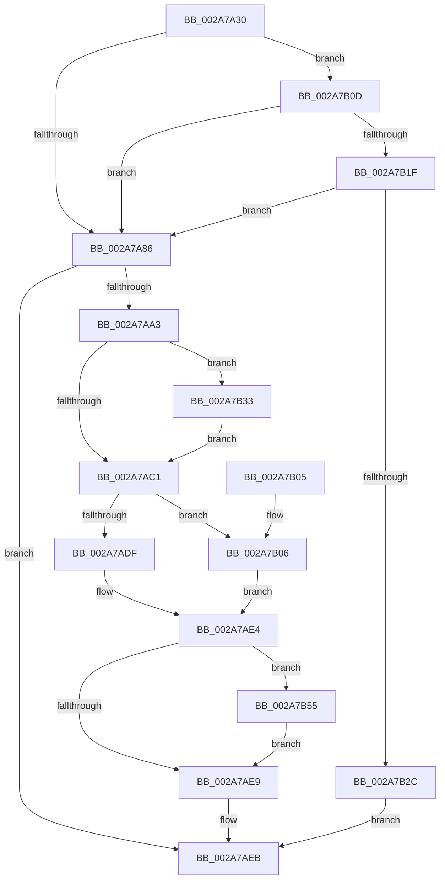

# MiDeletePartialVad

- RVA: `0x002A7A30`–`0x002A7B74` (길이 `324` bytes)
- VA: `0x00000001402A7A30`
- 실행 섹션: `.text`
- PDB 이름 있음: `예`; PDB Function 태그: `아니요`
- unwind 정보 RVA: `0x00068C54`
- 디코드: `83`개 명령, `324/324` bytes 표시
- 미해석 바이트: `0` (있으면 어셈블리에 `.byte`로 보존)

> 이 문서는 커널 이미지의 기계어와 PDB 기호를 분석해 생성했습니다. 4번과 5번은 함수 원형과 자료형을 바이너리 사용 방식에서 추정한 C 해석이며 원본 소스 복구 결과는 아닙니다.

## 1. Dependencies

- 직접 호출 지점: **8**; 고유 호출 대상: **7**
- 직접 호출자로 확인된 함수: **1**
- RIP 상대 이미지 참조: **1**

### Outgoing calls
- `0x002A7A9A` → [MiAllocateSplitVads](../../page/88/MiAllocateSplitVads_function_00887818.md) (function, `0x00887818`)
- `0x002A7AAA` → [MiComputeVadCharges](../2C/MiComputeVadCharges_function_002C3348.md) (function, `0x002C3348`)
- `0x002A7AB3` → [MiPerformVadSplitting](MiPerformVadSplitting_function_002A5A80.md) (function, `0x002A5A80`)
- `0x002A7AC7` → [UNLOCK_ADDRESS_SPACE](UNLOCK_ADDRESS_SPACE_function_002A4844.md) (function, `0x002A4844`)
- `0x002A7ADF` → [MiUnmapVad](../../page/88/MiUnmapVad_function_00889280.md) (function, `0x00889280`)
- `0x002A7B06` → [MiDeleteVad](../../page/88/MiDeleteVad_function_00888C80.md) (function, `0x00888C80`)
- `0x002A7B47` → [MiComputeVadCharges](../2C/MiComputeVadCharges_function_002C3348.md) (function, `0x002C3348`)
- `0x002A7B6A` → [MiReturnResident](../28/MiReturnResident_function_00286890.md) (function, `0x00286890`)

### Direct callers
- [MiFreeVadRange](MiFreeVadRange_function_002A77AC.md) at `0x002A790D`

### Static image references
- `0x002A7B5F` → RVA `0x00E30088` (`.data`; read)

## 2. Other-region calls and transfers

- 다른 실행 섹션으로 향하는 call: **3**
  - `0x002A7A9A` → [MiAllocateSplitVads](../../page/88/MiAllocateSplitVads_function_00887818.md) (`.text` → `PAGE`)
  - `0x002A7ADF` → [MiUnmapVad](../../page/88/MiUnmapVad_function_00889280.md) (`.text` → `PAGE`)
  - `0x002A7B06` → [MiDeleteVad](../../page/88/MiDeleteVad_function_00888C80.md) (`.text` → `PAGE`)
- 별도 외부 분기/꼬리 이동을 확인하지 못했습니다.

## 3. Assembly (complete function range)

```asm
002A7A30  48 8B C4                        mov rax, rsp
002A7A33  48 89 58 08                     mov qword ptr [rax + 8], rbx
002A7A37  48 89 70 10                     mov qword ptr [rax + 0x10], rsi
002A7A3B  48 89 78 18                     mov qword ptr [rax + 0x18], rdi
002A7A3F  4C 89 70 20                     mov qword ptr [rax + 0x20], r14
002A7A43  55                              push rbp
002A7A44  48 8B EC                        mov rbp, rsp
002A7A47  48 83 EC 70                     sub rsp, 0x70
002A7A4B  65 4C 8B 34 25 88 01 00 00      mov r14, qword ptr gs:[0x188]
002A7A54  33 C0                           xor eax, eax
002A7A56  48 83 65 C8 00                  and qword ptr [rbp - 0x38], 0
002A7A5B  0F 57 C0                        xorps xmm0, xmm0
002A7A5E  83 65 DC 00                     and dword ptr [rbp - 0x24], 0
002A7A62  48 8B D9                        mov rbx, rcx
002A7A65  48 83 65 F0 00                  and qword ptr [rbp - 0x10], 0
002A7A6A  F7 41 30 00 00 20 00            test dword ptr [rcx + 0x30], 0x200000
002A7A71  49 8B B6 B8 00 00 00            mov rsi, qword ptr [r14 + 0xb8]
002A7A78  0F 11 45 B0                     movups xmmword ptr [rbp - 0x50], xmm0
002A7A7C  48 89 45 C0                     mov qword ptr [rbp - 0x40], rax
002A7A80  0F 84 87 00 00 00               je 0x1402a7b0d
002A7A86  48 8D 4D C8                     lea rcx, [rbp - 0x38]
002A7A8A  44 89 4D D8                     mov dword ptr [rbp - 0x28], r9d
002A7A8E  48 89 55 E0                     mov qword ptr [rbp - 0x20], rdx
002A7A92  4C 89 45 E8                     mov qword ptr [rbp - 0x18], r8
002A7A96  48 89 5D D0                     mov qword ptr [rbp - 0x30], rbx
002A7A9A  E8 79 FD 5D 00                  call 0x140887818
002A7A9F  85 C0                           test eax, eax
002A7AA1  78 48                           js 0x1402a7aeb
002A7AA3  48 8D 55 B0                     lea rdx, [rbp - 0x50]
002A7AA7  48 8B CB                        mov rcx, rbx
002A7AAA  E8 99 B8 01 00                  call 0x1402c3348
002A7AAF  48 8D 4D C8                     lea rcx, [rbp - 0x38]
002A7AB3  E8 C8 DF FF FF                  call 0x1402a5a80
002A7AB8  48 8B 7D B0                     mov rdi, qword ptr [rbp - 0x50]
002A7ABC  48 85 FF                        test rdi, rdi
002A7ABF  75 72                           jne 0x1402a7b33
002A7AC1  48 8B D6                        mov rdx, rsi
002A7AC4  49 8B CE                        mov rcx, r14
002A7AC7  E8 78 CD FF FF                  call 0x1402a4844
002A7ACC  48 8B 55 30                     mov rdx, qword ptr [rbp + 0x30]
002A7AD0  45 33 C0                        xor r8d, r8d
002A7AD3  F7 43 30 00 00 20 00            test dword ptr [rbx + 0x30], 0x200000
002A7ADA  48 8B CB                        mov rcx, rbx
002A7ADD  75 27                           jne 0x1402a7b06
002A7ADF  E8 9C 17 5E 00                  call 0x140889280
002A7AE4  48 85 FF                        test rdi, rdi
002A7AE7  75 6C                           jne 0x1402a7b55
002A7AE9  33 C0                           xor eax, eax
002A7AEB  4C 8D 5C 24 70                  lea r11, [rsp + 0x70]
002A7AF0  49 8B 5B 10                     mov rbx, qword ptr [r11 + 0x10]
002A7AF4  49 8B 73 18                     mov rsi, qword ptr [r11 + 0x18]
002A7AF8  49 8B 7B 20                     mov rdi, qword ptr [r11 + 0x20]
002A7AFC  4D 8B 73 28                     mov r14, qword ptr [r11 + 0x28]
002A7B00  49 8B E3                        mov rsp, r11
002A7B03  5D                              pop rbp
002A7B04  C3                              ret
002A7B05  CC                              int3
002A7B06  E8 75 11 5E 00                  call 0x140888c80
002A7B0B  EB D7                           jmp 0x1402a7ae4
002A7B0D  48 8B 41 48                     mov rax, qword ptr [rcx + 0x48]
002A7B11  48 8B 08                        mov rcx, qword ptr [rax]
002A7B14  48 83 79 40 00                  cmp qword ptr [rcx + 0x40], 0
002A7B19  0F 84 67 FF FF FF               je 0x1402a7a86
002A7B1F  48 8B 43 78                     mov rax, qword ptr [rbx + 0x78]
002A7B23  48 85 C0                        test rax, rax
002A7B26  0F 89 5A FF FF FF               jns 0x1402a7a86
002A7B2C  B8 21 00 00 C0                  mov eax, 0xc0000021
002A7B31  EB B8                           jmp 0x1402a7aeb
002A7B33  0F 57 C0                        xorps xmm0, xmm0
002A7B36  48 8D 55 B0                     lea rdx, [rbp - 0x50]
002A7B3A  33 C0                           xor eax, eax
002A7B3C  48 8B CB                        mov rcx, rbx
002A7B3F  0F 11 45 B0                     movups xmmword ptr [rbp - 0x50], xmm0
002A7B43  48 89 45 C0                     mov qword ptr [rbp - 0x40], rax
002A7B47  E8 FC B7 01 00                  call 0x1402c3348
002A7B4C  48 2B 7D B0                     sub rdi, qword ptr [rbp - 0x50]
002A7B50  E9 6C FF FF FF                  jmp 0x1402a7ac1
002A7B55  0F B7 86 AE 04 00 00            movzx eax, word ptr [rsi + 0x4ae]
002A7B5C  48 8B D7                        mov rdx, rdi
002A7B5F  48 8B 0D 22 85 B8 00            mov rcx, qword ptr [rip + 0xb88522]
002A7B66  48 8B 0C C1                     mov rcx, qword ptr [rcx + rax*8]
002A7B6A  E8 21 ED FD FF                  call 0x140286890
002A7B6F  E9 75 FF FF FF                  jmp 0x1402a7ae9
```

## 4. C-style interpretation (structured pseudocode)

```c
__int64 __fastcall MiDeletePartialVad(__int64 a1, __int64 a2, __int64 a3, int a4, __int64 a5)
{
    __int64 result;
    __int64 v_rdi;
    __int64 v_rsp;
    unsigned __int64 v_stack_m18;
    unsigned __int64 v_stack_m20;
    unsigned __int64 v_stack_m28;
    unsigned int v_stack_m2C;
    unsigned int v_stack_m30;
    unsigned __int64 v_stack_m38;
    unsigned __int64 v_stack_m40;
    unsigned __int64 v_stack_m48;
    unsigned __int64 v_stack_m58;
    unsigned __int64 v_stack_m8;

    *(unsigned __int64 *)(v_rsp + 8) = v_rbx;
    *(unsigned __int64 *)(v_rsp + 16) = v_rsi;
    *(unsigned __int64 *)(v_rsp + 24) = v_rdi;
    *(unsigned __int64 *)(v_rsp + 32) = v_r14;
    v_rsp = (v_rsp) - (112);
    result = 0;
    v_stack_m58 = v_xmm0;
    v_stack_m48 = 0;
    if (((*(unsigned int *)(a1 + 48)) & (0x200000ULL)) == 0) goto loc_002A7B0D;
loc_002A7A86:
    v_stack_m30 = a4;
    v_stack_m28 = a2;
    v_stack_m20 = a3;
    v_stack_m38 = a1;
    result = MiAllocateSplitVads(v_stack_m40, a2, a3, a4);
    if (sign_flag) goto loc_002A7AEB;
    result = MiComputeVadCharges(a1, v_stack_m58, a3, a4);
    result = MiPerformVadSplitting(v_stack_m40, v_stack_m58, a3, a4);
    if (v_stack_m58 != 0) goto loc_002A7B33;
loc_002A7AC1:
    result = UNLOCK_ADDRESS_SPACE(*(unsigned __int64 *)(gs_base + (0 + 392)), *(unsigned __int64 *)(*(unsigned __int64 *)(gs_base + (0 + 392)) + 184), a3, a4);
    a3 = 0;
    if (((*(unsigned int *)(a1 + 48)) & (0x200000ULL)) != 0) goto loc_002A7B06;
    result = MiUnmapVad(a1, a5, a3, a4);
loc_002A7AE4:
    if (v_stack_m58 != 0) goto loc_002A7B55;
loc_002A7AE9:
    result = 0;
loc_002A7AEB:
    return result;
loc_002A7B06:
    result = MiDeleteVad(a1, a5, a3, a4);
    goto loc_002A7AE4;
loc_002A7B0D:
    if ((*(unsigned __int64 *)(*(unsigned __int64 *)(*(unsigned __int64 *)(a1 + 72)) + 64)) == 0) goto loc_002A7A86;
    if (!sign_flag) goto loc_002A7A86;
    goto loc_002A7AEB;
loc_002A7B33:
    result = 0;
    v_stack_m58 = v_xmm0;
    v_stack_m48 = 0;
    result = MiComputeVadCharges(*(unsigned __int64 *)(v_stack_m8 + 16), v_stack_m58, a3, a4);
    v_rdi = (*(unsigned __int64 *)(v_stack_m8 + 32)) - (v_stack_m58);
    goto loc_002A7AC1;
loc_002A7B55:
    result = MiReturnResident(*(unsigned __int64 *)(*(unsigned __int64 *)(v_rip + 12092706) + *(unsigned __int16 *)(*(unsigned __int64 *)(v_stack_m8 + 24) + 1198) * 8), v_rdi, a3, a4);
    goto loc_002A7AE9;
}
```

## 5. (Beta) C Style

```c
int64_t MiDeletePartialVad(void *Arg1, int64_t Arg2, int64_t Arg3, int32_t Arg4, int64_t Arg5)
{
    uint8_t *arg1 = (uint8_t *)Arg1;

    int64_t result;
    int64_t local_rdi;
    int64_t local_rsp;
    uint64_t v_stack_m18;
    uint64_t v_stack_m20;
    uint64_t v_stack_m28;
    uint32_t v_stack_m2C;
    uint32_t v_stack_m30;
    uint64_t v_stack_m38;
    uint64_t v_stack_m40;
    uint64_t v_stack_m48;
    uint64_t v_stack_m58;
    uint64_t v_stack_m8;

    *(uint64_t *)(local_rsp + 0x8) = local_rbx;
    *(uint64_t *)(local_rsp + 0x10) = local_rsi;
    *(uint64_t *)(local_rsp + 0x18) = local_rdi;
    *(uint64_t *)(local_rsp + 0x20) = local_r14;
    local_rsp = (local_rsp) - (112);
    result = 0;
    v_stack_m58 = v_xmm0;
    v_stack_m48 = 0;
    if (((*(uint32_t *)(arg1 + 0x30)) & (0x200000ULL)) == 0) goto loc_002A7B0D;
loc_002A7A86:
    v_stack_m30 = Arg4;
    v_stack_m28 = Arg2;
    v_stack_m20 = Arg3;
    v_stack_m38 = Arg1;
    result = MiAllocateSplitVads(v_stack_m40, Arg2, Arg3, Arg4);
    if (sign_flag) goto loc_002A7AEB;
    result = MiComputeVadCharges(Arg1, v_stack_m58, Arg3, Arg4);
    result = MiPerformVadSplitting(v_stack_m40, v_stack_m58, Arg3, Arg4);
    if (v_stack_m58 != 0) goto loc_002A7B33;
loc_002A7AC1:
    result = UNLOCK_ADDRESS_SPACE(*(uint64_t *)(gs_base + (0 + 0x188)), *(uint64_t *)(*(uint64_t *)(gs_base + (0 + 0x188)) + 0xB8), Arg3, Arg4);
    Arg3 = 0;
    if (((*(uint32_t *)(arg1 + 0x30)) & (0x200000ULL)) != 0) goto loc_002A7B06;
    result = MiUnmapVad(Arg1, Arg5, Arg3, Arg4);
loc_002A7AE4:
    if (v_stack_m58 != 0) goto loc_002A7B55;
loc_002A7AE9:
    result = 0;
loc_002A7AEB:
    return result;
loc_002A7B06:
    result = MiDeleteVad(Arg1, Arg5, Arg3, Arg4);
    goto loc_002A7AE4;
loc_002A7B0D:
    if ((*(uint64_t *)(*(uint64_t *)(*(uint64_t *)(arg1 + 0x48)) + 0x40)) == 0) goto loc_002A7A86;
    if (!sign_flag) goto loc_002A7A86;
    goto loc_002A7AEB;
loc_002A7B33:
    result = 0;
    v_stack_m58 = v_xmm0;
    v_stack_m48 = 0;
    result = MiComputeVadCharges(*(uint64_t *)(v_stack_m8 + 0x10), v_stack_m58, Arg3, Arg4);
    local_rdi = (*(uint64_t *)(v_stack_m8 + 0x20)) - (v_stack_m58);
    goto loc_002A7AC1;
loc_002A7B55:
    result = MiReturnResident(*(uint64_t *)(*(uint64_t *)(v_rip + 0xB88522) + *(uint16_t *)(*(uint64_t *)(v_stack_m8 + 0x18) + 0x4AE) * 8), local_rdi, Arg3, Arg4);
    goto loc_002A7AE9;
}
```

### 관측된 메모리 오프셋

구조체 형식이 확인되지 않은 접근은 인자 기준의 오프셋으로만 기록했습니다.

| 기준 인자 | 오프셋 표현 | 폭 (bit) | 접근 |
|---|---:|---:|---|
| `Arg1` | `+ 0x30` | `32` | `R` |
| `Arg1` | `+ 0x48` | `64` | `R` |
| `Arg1` | `+ 0x78` | `64` | `R` |

## 6. Execution-region graph

[열기: 2D/3D 그래프와 함수 탐색 컨트롤 패널](../../../control-panel.html?section=text&rva=0x002A7A30&view=graph)

- 2D 그래프는 위에서 아래로 흐르고, 3D 그래프는 빈 공간을 드래그해 회전합니다. Shift+드래그는 이동, 휠은 확대·축소, 함수 노드 선택은 대상 보고서 이동입니다.

### Static fallback


