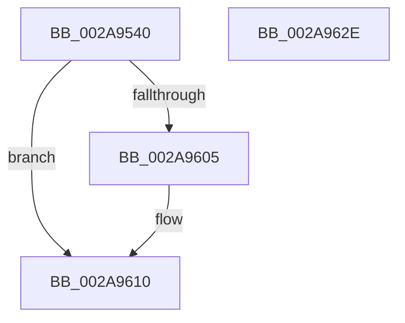

# MiDeleteRotateAndStopFaults

- RVA: `0x002A9540`–`0x002A962F` (길이 `239` bytes)
- VA: `0x00000001402A9540`
- 실행 섹션: `.text`
- PDB 이름 있음: `예`; PDB Function 태그: `아니요`
- unwind 정보 RVA: `0x00068E0C`
- 디코드: `54`개 명령, `239/239` bytes 표시
- 미해석 바이트: `0` (있으면 어셈블리에 `.byte`로 보존)

> 이 문서는 커널 이미지의 기계어와 PDB 기호를 분석해 생성했습니다. 4번과 5번은 함수 원형과 자료형을 바이너리 사용 방식에서 추정한 C 해석이며 원본 소스 복구 결과는 아닙니다.

## 1. Dependencies

- 직접 호출 지점: **3**; 고유 호출 대상: **3**
- 직접 호출자로 확인된 함수: **2**
- RIP 상대 이미지 참조: **0**

### Outgoing calls
- `0x002A9597` → [MiLockWorkingSetExclusive](../32/MiLockWorkingSetExclusive_function_003238A0.md) (function, `0x003238A0`)
- `0x002A95B2` → [MiUnlockWorkingSetExclusive](../27/MiUnlockWorkingSetExclusive_function_0027EC70.md) (function, `0x0027EC70`)
- `0x002A95F6` → [MiDeletePagablePteRange](MiDeletePagablePteRange_function_002A96B4.md) (function, `0x002A96B4`)

### Direct callers
- [MiRotateToFrameBuffer](../../page/A3/MiRotateToFrameBuffer_function_00A38214.md) at `0x00A38463`
- [MiRotateToFrameBufferNoCopy](../../page/A3/MiRotateToFrameBufferNoCopy_function_00A38530.md) at `0x00A38648`

### Static image references
- 디코드된 RIP-relative 메모리 참조가 없습니다.

## 2. Other-region calls and transfers

- 다른 실행 섹션으로 향하는 call: **0**
- 별도 외부 분기/꼬리 이동을 확인하지 못했습니다.

## 3. Assembly (complete function range)

```asm
002A9540  4C 8B DC                        mov r11, rsp
002A9543  49 89 5B 08                     mov qword ptr [r11 + 8], rbx
002A9547  49 89 6B 10                     mov qword ptr [r11 + 0x10], rbp
002A954B  49 89 73 18                     mov qword ptr [r11 + 0x18], rsi
002A954F  49 89 7B 20                     mov qword ptr [r11 + 0x20], rdi
002A9553  41 56                           push r14
002A9555  48 81 EC 80 00 00 00            sub rsp, 0x80
002A955C  0F 57 C0                        xorps xmm0, xmm0
002A955F  33 C0                           xor eax, eax
002A9561  0F 11 44 24 40                  movups xmmword ptr [rsp + 0x40], xmm0
002A9566  4C 8B F1                        mov r14, rcx
002A9569  49 8B F0                        mov rsi, r8
002A956C  0F 11 44 24 50                  movups xmmword ptr [rsp + 0x50], xmm0
002A9571  48 8B EA                        mov rbp, rdx
002A9574  0F 11 44 24 60                  movups xmmword ptr [rsp + 0x60], xmm0
002A9579  49 89 43 E8                     mov qword ptr [r11 - 0x18], rax
002A957D  65 48 8B 04 25 88 01 00 00      mov rax, qword ptr gs:[0x188]
002A9586  48 8B 98 B8 00 00 00            mov rbx, qword ptr [rax + 0xb8]
002A958D  48 8D BB 00 04 00 00            lea rdi, [rbx + 0x400]
002A9594  48 8B CF                        mov rcx, rdi
002A9597  E8 04 A3 07 00                  call 0x1403238a0
002A959C  48 8B 93 68 02 00 00            mov rdx, qword ptr [rbx + 0x268]
002A95A3  48 8B CF                        mov rcx, rdi
002A95A6  48 89 16                        mov qword ptr [rsi], rdx
002A95A9  8A D0                           mov dl, al
002A95AB  48 89 B3 68 02 00 00            mov qword ptr [rbx + 0x268], rsi
002A95B2  E8 B9 56 FD FF                  call 0x14027ec70
002A95B7  48 8B 46 08                     mov rax, qword ptr [rsi + 8]
002A95BB  4C 8B CD                        mov r9, rbp
002A95BE  48 89 44 24 60                  mov qword ptr [rsp + 0x60], rax
002A95C3  4D 8B C6                        mov r8, r14
002A95C6  65 48 8B 04 25 88 01 00 00      mov rax, qword ptr gs:[0x188]
002A95CF  B2 11                           mov dl, 0x11
002A95D1  48 8B 98 B8 00 00 00            mov rbx, qword ptr [rax + 0xb8]
002A95D8  48 8D 44 24 40                  lea rax, [rsp + 0x40]
002A95DD  48 89 44 24 30                  mov qword ptr [rsp + 0x30], rax
002A95E2  C7 44 24 28 88 00 00 00         mov dword ptr [rsp + 0x28], 0x88
002A95EA  83 64 24 20 00                  and dword ptr [rsp + 0x20], 0
002A95EF  48 8D 8B 00 04 00 00            lea rcx, [rbx + 0x400]
002A95F6  E8 B9 00 00 00                  call 0x1402a96b4
002A95FB  48 8B 44 24 58                  mov rax, qword ptr [rsp + 0x58]
002A9600  48 85 C0                        test rax, rax
002A9603  74 0B                           je 0x1402a9610
002A9605  48 F7 D8                        neg rax
002A9608  F0 48 01 83 88 02 00 00         lock add qword ptr [rbx + 0x288], rax
002A9610  4C 8D 9C 24 80 00 00 00         lea r11, [rsp + 0x80]
002A9618  49 8B 5B 10                     mov rbx, qword ptr [r11 + 0x10]
002A961C  49 8B 6B 18                     mov rbp, qword ptr [r11 + 0x18]
002A9620  49 8B 73 20                     mov rsi, qword ptr [r11 + 0x20]
002A9624  49 8B 7B 28                     mov rdi, qword ptr [r11 + 0x28]
002A9628  49 8B E3                        mov rsp, r11
002A962B  41 5E                           pop r14
002A962D  C3                              ret
002A962E  CC                              int3
```

## 4. C-style interpretation (structured pseudocode)

```c
__int64 __fastcall MiDeleteRotateAndStopFaults(__int64 a1, __int64 a2, __int64 a3)
{
    __int64 result;
    __int64 v_rsp;
    unsigned __int64 v_stack_m28;
    unsigned __int64 v_stack_m30;
    unsigned __int64 v_stack_m38;
    unsigned __int64 v_stack_m48;
    unsigned __int64 v_stack_m58;
    unsigned int v_stack_m60;
    unsigned int v_stack_m68;
    unsigned __int64 v_stack_m8;

    *(unsigned __int64 *)(v_rsp + 8) = v_rbx;
    *(unsigned __int64 *)(v_rsp + 16) = v_rbp;
    *(unsigned __int64 *)(v_rsp + 24) = v_rsi;
    *(unsigned __int64 *)(v_rsp + 32) = v_rdi;
    v_rsp = (v_rsp) - (128);
    result = 0;
    v_stack_m48 = v_xmm0;
    v_stack_m38 = v_xmm0;
    v_stack_m28 = v_xmm0;
    *(unsigned __int64 *)(v_rsp - 24) = 0;
    result = MiLockWorkingSetExclusive(*(unsigned __int64 *)(*(unsigned __int64 *)(gs_base + (0 + 392)) + 184) + 1024, a2, a3, a4);
    *(unsigned __int64 *)(a3) = *(unsigned __int64 *)(*(unsigned __int64 *)(*(unsigned __int64 *)(gs_base + (0 + 392)) + 184) + 616);
    *(unsigned __int64 *)(*(unsigned __int64 *)(*(unsigned __int64 *)(gs_base + (0 + 392)) + 184) + 616) = a3;
    result = MiUnlockWorkingSetExclusive(*(unsigned __int64 *)(*(unsigned __int64 *)(gs_base + (0 + 392)) + 184) + 1024, (unsigned __int8)(result), a3, a4);
    v_stack_m28 = *(unsigned __int64 *)(a3 + 8);
    v_stack_m58 = v_stack_m48;
    v_stack_m60 = 136;
    result = MiDeletePagablePteRange(*(unsigned __int64 *)(*(unsigned __int64 *)(gs_base + (0 + 392)) + 184) + 1024, 17, a1, a2);
    result = v_stack_m30;
    if (v_stack_m30 != 0) {
        result = -(v_stack_m30);
    }
    return result;
}
```

## 5. (Beta) C Style

```c
int64_t MiDeleteRotateAndStopFaults(int64_t Arg1, int64_t Arg2, void *Arg3)
{
    uint8_t *arg3 = (uint8_t *)Arg3;

    int64_t result;
    int64_t local_rsp;
    uint64_t v_stack_m28;
    uint64_t v_stack_m30;
    uint64_t v_stack_m38;
    uint64_t v_stack_m48;
    uint64_t v_stack_m58;
    uint32_t v_stack_m60;
    uint32_t v_stack_m68;
    uint64_t v_stack_m8;

    *(uint64_t *)(local_rsp + 0x8) = local_rbx;
    *(uint64_t *)(local_rsp + 0x10) = local_rbp;
    *(uint64_t *)(local_rsp + 0x18) = local_rsi;
    *(uint64_t *)(local_rsp + 0x20) = local_rdi;
    local_rsp = (local_rsp) - (128);
    result = 0;
    v_stack_m48 = v_xmm0;
    v_stack_m38 = v_xmm0;
    v_stack_m28 = v_xmm0;
    *(uint64_t *)(local_rsp - 0x18) = 0;
    result = MiLockWorkingSetExclusive(*(uint64_t *)(*(uint64_t *)(gs_base + (0 + 0x188)) + 0xB8) + 1024, Arg2, Arg3, a4);
    *(uint64_t *)(arg3) = *(uint64_t *)(*(uint64_t *)(*(uint64_t *)(gs_base + (0 + 0x188)) + 0xB8) + 0x268);
    *(void **)(*(uint64_t *)(*(uint64_t *)(gs_base + (0 + 0x188)) + 0xB8) + 0x268) = Arg3;
    result = MiUnlockWorkingSetExclusive(*(uint64_t *)(*(uint64_t *)(gs_base + (0 + 0x188)) + 0xB8) + 1024, (uint8_t)(result), Arg3, a4);
    v_stack_m28 = *(uint64_t *)(arg3 + 0x8);
    v_stack_m58 = v_stack_m48;
    v_stack_m60 = 136;
    result = MiDeletePagablePteRange(*(uint64_t *)(*(uint64_t *)(gs_base + (0 + 0x188)) + 0xB8) + 1024, 17, Arg1, Arg2);
    result = v_stack_m30;
    if (v_stack_m30 != 0) {
        result = -(v_stack_m30);
    }
    return result;
}
```

### 관측된 메모리 오프셋

구조체 형식이 확인되지 않은 접근은 인자 기준의 오프셋으로만 기록했습니다.

| 기준 인자 | 오프셋 표현 | 폭 (bit) | 접근 |
|---|---:|---:|---|
| `Arg3` | `+ 0x0` | `64` | `W` |
| `Arg3` | `+ 0x8` | `64` | `R` |

## 6. Execution-region graph

[열기: 2D/3D 그래프와 함수 탐색 컨트롤 패널](../../../control-panel.html?section=text&rva=0x002A9540&view=graph)

- 2D 그래프는 위에서 아래로 흐르고, 3D 그래프는 빈 공간을 드래그해 회전합니다. Shift+드래그는 이동, 휠은 확대·축소, 함수 노드 선택은 대상 보고서 이동입니다.

### Static fallback


