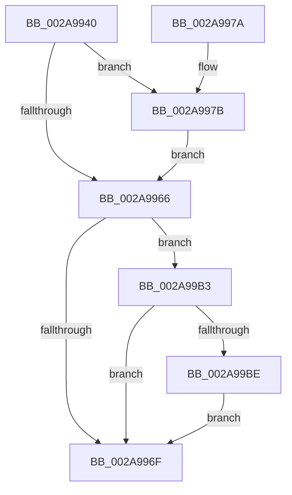

# MiDeleteVaFinal

- RVA: `0x002A9940`–`0x002A99C9` (길이 `137` bytes)
- VA: `0x00000001402A9940`
- 실행 섹션: `.text`
- PDB 이름 있음: `예`; PDB Function 태그: `아니요`
- unwind 정보 RVA: `0x00068E4C`
- 디코드: `36`개 명령, `137/137` bytes 표시
- 미해석 바이트: `0` (있으면 어셈블리에 `.byte`로 보존)

> 이 문서는 커널 이미지의 기계어와 PDB 기호를 분석해 생성했습니다. 4번과 5번은 함수 원형과 자료형을 바이너리 사용 방식에서 추정한 C 해석이며 원본 소스 복구 결과는 아닙니다.

## 1. Dependencies

- 직접 호출 지점: **2**; 고유 호출 대상: **2**
- 직접 호출자로 확인된 함수: **1**
- RIP 상대 이미지 참조: **1**

### Outgoing calls
- `0x002A999F` → [MiFreeLargePages](MiFreeLargePages_function_002A99D0.md) (function, `0x002A99D0`)
- `0x002A99C2` → [MiFreePhysicalPageChain](MiFreePhysicalPageChain_function_002A9F1C.md) (function, `0x002A9F1C`)

### Direct callers
- [MiDeletePagablePteRange](MiDeletePagablePteRange_function_002A96B4.md) at `0x002A9883`

### Static image references
- `0x002A9994` → RVA `0x00E30088` (`.data`; read)

## 2. Other-region calls and transfers

- 다른 실행 섹션으로 향하는 call: **0**
- 별도 외부 분기/꼬리 이동을 확인하지 못했습니다.

## 3. Assembly (complete function range)

```asm
002A9940  48 89 5C 24 10                  mov qword ptr [rsp + 0x10], rbx
002A9945  57                              push rdi
002A9946  48 83 EC 30                     sub rsp, 0x30
002A994A  48 8B B9 B8 00 00 00            mov rdi, qword ptr [rcx + 0xb8]
002A9951  45 33 C0                        xor r8d, r8d
002A9954  4C 89 44 24 40                  mov qword ptr [rsp + 0x40], r8
002A9959  48 8B 5F 08                     mov rbx, qword ptr [rdi + 8]
002A995D  48 8B 53 30                     mov rdx, qword ptr [rbx + 0x30]
002A9961  48 85 D2                        test rdx, rdx
002A9964  78 15                           js 0x1402a997b
002A9966  48 8B 4B 28                     mov rcx, qword ptr [rbx + 0x28]
002A996A  48 85 C9                        test rcx, rcx
002A996D  75 44                           jne 0x1402a99b3
002A996F  48 8B 5C 24 48                  mov rbx, qword ptr [rsp + 0x48]
002A9974  48 83 C4 30                     add rsp, 0x30
002A9978  5F                              pop rdi
002A9979  C3                              ret
002A997A  CC                              int3
002A997B  48 8B 41 20                     mov rax, qword ptr [rcx + 0x20]
002A997F  4C 8D 4B 10                     lea r9, [rbx + 0x10]
002A9983  44 89 44 24 20                  mov dword ptr [rsp + 0x20], r8d
002A9988  4C 8D 44 24 40                  lea r8, [rsp + 0x40]
002A998D  0F B7 88 AE 00 00 00            movzx ecx, word ptr [rax + 0xae]
002A9994  48 8B 05 ED 66 B8 00            mov rax, qword ptr [rip + 0xb866ed]
002A999B  48 8B 0C C8                     mov rcx, qword ptr [rax + rcx*8]
002A999F  E8 2C 00 00 00                  call 0x1402a99d0
002A99A4  48 89 43 08                     mov qword ptr [rbx + 8], rax
002A99A8  48 8B 44 24 40                  mov rax, qword ptr [rsp + 0x40]
002A99AD  48 89 43 30                     mov qword ptr [rbx + 0x30], rax
002A99B1  EB B3                           jmp 0x1402a9966
002A99B3  48 83 7F 60 00                  cmp qword ptr [rdi + 0x60], 0
002A99B8  48 8D 57 60                     lea rdx, [rdi + 0x60]
002A99BC  74 B1                           je 0x1402a996f
002A99BE  48 8B 49 20                     mov rcx, qword ptr [rcx + 0x20]
002A99C2  E8 55 05 00 00                  call 0x1402a9f1c
002A99C7  EB A6                           jmp 0x1402a996f
```

## 4. C-style interpretation (structured pseudocode)

```c
__int64 __fastcall MiDeleteVaFinal(__int64 a1, __int64 a2, int a3)
{
    __int64 result;
    __int64 v_rsp;
    unsigned __int64 v_stack_p10;
    unsigned int v_stack_p20;
    unsigned __int64 v_stack_p40;
    unsigned __int64 v_stack_p8;

    v_stack_p10 = v_rbx;
    v_rsp = (v_rsp) - (48);
    a3 = 0;
    v_stack_p8 = 0;
    if (sign_flag) goto loc_002A997B;
loc_002A9966:
    if (*(unsigned __int64 *)(*(unsigned __int64 *)(*(unsigned __int64 *)(a1 + 184) + 8) + 40) != 0) goto loc_002A99B3;
loc_002A996F:
    v_rsp = (v_rsp) + (48);
    return result;
loc_002A997B:
    v_stack_p20 = 0;
    result = MiFreeLargePages(*(unsigned __int64 *)(*(unsigned __int64 *)(v_rip + 12084973) + *(unsigned __int16 *)(*(unsigned __int64 *)(*(unsigned __int64 *)(*(unsigned __int64 *)(*(unsigned __int64 *)(a1 + 184) + 8) + 40) + 32) + 174) * 8), *(unsigned __int64 *)(*(unsigned __int64 *)(*(unsigned __int64 *)(a1 + 184) + 8) + 48), v_stack_p40, v_stack_p10 + 16);
    *(unsigned __int64 *)(v_stack_p10 + 8) = result;
    *(unsigned __int64 *)(v_stack_p10 + 48) = v_stack_p40;
    goto loc_002A9966;
loc_002A99B3:
    if ((*(unsigned __int64 *)(*(unsigned __int64 *)(a1 + 184) + 96)) == 0) goto loc_002A996F;
    result = MiFreePhysicalPageChain(*(unsigned __int64 *)(*(unsigned __int64 *)(*(unsigned __int64 *)(v_rip + 12084973) + *(unsigned __int16 *)(*(unsigned __int64 *)(*(unsigned __int64 *)(*(unsigned __int64 *)(*(unsigned __int64 *)(a1 + 184) + 8) + 40) + 32) + 174) * 8) + 32), *(unsigned __int64 *)(a1 + 184) + 96, v_stack_p40, v_stack_p10 + 16);
    goto loc_002A996F;
}
```

## 5. (Beta) C Style

```c
int64_t MiDeleteVaFinal(void *Arg1, int64_t Arg2, int32_t Arg3)
{
    uint8_t *arg1 = (uint8_t *)Arg1;

    int64_t result;
    int64_t local_rsp;
    uint64_t v_stack_p10;
    uint32_t v_stack_p20;
    uint64_t v_stack_p40;
    uint64_t v_stack_p8;

    v_stack_p10 = local_rbx;
    local_rsp = (local_rsp) - (48);
    Arg3 = 0;
    v_stack_p8 = 0;
    if (sign_flag) goto loc_002A997B;
loc_002A9966:
    if (*(uint64_t *)(*(uint64_t *)(*(uint64_t *)(arg1 + 0xB8) + 0x8) + 0x28) != 0) goto loc_002A99B3;
loc_002A996F:
    local_rsp = (local_rsp) + (48);
    return result;
loc_002A997B:
    v_stack_p20 = 0;
    result = MiFreeLargePages(*(uint64_t *)(*(uint64_t *)(v_rip + 0xB866ED) + *(uint16_t *)(*(uint64_t *)(*(uint64_t *)(*(uint64_t *)(*(uint64_t *)(arg1 + 0xB8) + 0x8) + 0x28) + 0x20) + 0xAE) * 8), *(uint64_t *)(*(uint64_t *)(*(uint64_t *)(arg1 + 0xB8) + 0x8) + 0x30), v_stack_p40, v_stack_p10 + 16);
    *(uint64_t *)(v_stack_p10 + 0x8) = result;
    *(uint64_t *)(v_stack_p10 + 0x30) = v_stack_p40;
    goto loc_002A9966;
loc_002A99B3:
    if ((*(uint64_t *)(*(uint64_t *)(arg1 + 0xB8) + 0x60)) == 0) goto loc_002A996F;
    result = MiFreePhysicalPageChain(*(uint64_t *)(*(uint64_t *)(*(uint64_t *)(v_rip + 0xB866ED) + *(uint16_t *)(*(uint64_t *)(*(uint64_t *)(*(uint64_t *)(*(uint64_t *)(arg1 + 0xB8) + 0x8) + 0x28) + 0x20) + 0xAE) * 8) + 0x20), *(uint64_t *)(arg1 + 0xB8) + 96, v_stack_p40, v_stack_p10 + 16);
    goto loc_002A996F;
}
```

### 관측된 메모리 오프셋

구조체 형식이 확인되지 않은 접근은 인자 기준의 오프셋으로만 기록했습니다.

| 기준 인자 | 오프셋 표현 | 폭 (bit) | 접근 |
|---|---:|---:|---|
| `Arg1` | `+ 0x20` | `64` | `R` |
| `Arg1` | `+ 0xB8` | `64` | `R` |

## 6. Execution-region graph

[열기: 2D/3D 그래프와 함수 탐색 컨트롤 패널](../../../control-panel.html?section=text&rva=0x002A9940&view=graph)

- 2D 그래프는 위에서 아래로 흐르고, 3D 그래프는 빈 공간을 드래그해 회전합니다. Shift+드래그는 이동, 휠은 확대·축소, 함수 노드 선택은 대상 보고서 이동입니다.

### Static fallback


