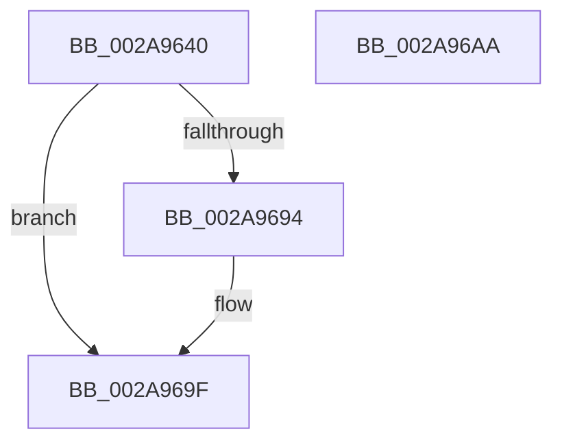

# MiDeleteVirtualAddresses

- RVA: `0x002A9640`–`0x002A96AB` (길이 `107` bytes)
- VA: `0x00000001402A9640`
- 실행 섹션: `.text`
- PDB 이름 있음: `예`; PDB Function 태그: `아니요`
- unwind 정보 RVA: `0x00065960`
- 디코드: `26`개 명령, `107/107` bytes 표시
- 미해석 바이트: `0` (있으면 어셈블리에 `.byte`로 보존)

> 이 문서는 커널 이미지의 기계어와 PDB 기호를 분석해 생성했습니다. 4번과 5번은 함수 원형과 자료형을 바이너리 사용 방식에서 추정한 C 해석이며 원본 소스 복구 결과는 아닙니다.

## 1. Dependencies

- 직접 호출 지점: **1**; 고유 호출 대상: **1**
- 직접 호출자로 확인된 함수: **3**
- RIP 상대 이미지 참조: **0**

### Outgoing calls
- `0x002A9686` → [MiDeletePagablePteRange](MiDeletePagablePteRange_function_002A96B4.md) (function, `0x002A96B4`)

### Direct callers
- [MiDeleteFinalPageTables](../46/MiDeleteFinalPageTables_function_004659AC.md) at `0x00465B70`
- [MiDeleteVad](../../page/88/MiDeleteVad_function_00888C80.md) at `0x00888DEB`
- [sub_00B41C12](../../page/B4/Unknown_function_00B41C12.md) at `0x00B41CDF`

### Static image references
- 디코드된 RIP-relative 메모리 참조가 없습니다.

## 2. Other-region calls and transfers

- 다른 실행 섹션으로 향하는 call: **0**
- 별도 외부 분기/꼬리 이동을 확인하지 못했습니다.

## 3. Assembly (complete function range)

```asm
002A9640  48 89 5C 24 08                  mov qword ptr [rsp + 8], rbx
002A9645  57                              push rdi
002A9646  48 83 EC 40                     sub rsp, 0x40
002A964A  65 48 8B 04 25 88 01 00 00      mov rax, qword ptr gs:[0x188]
002A9653  49 8B D9                        mov rbx, r9
002A9656  41 0F BA E8 07                  bts r8d, 7
002A965B  48 89 5C 24 30                  mov qword ptr [rsp + 0x30], rbx
002A9660  4C 8B D1                        mov r10, rcx
002A9663  44 89 44 24 28                  mov dword ptr [rsp + 0x28], r8d
002A9668  4C 8B CA                        mov r9, rdx
002A966B  C7 44 24 20 00 00 00 00         mov dword ptr [rsp + 0x20], 0
002A9673  48 8B B8 B8 00 00 00            mov rdi, qword ptr [rax + 0xb8]
002A967A  4D 8B C2                        mov r8, r10
002A967D  B2 11                           mov dl, 0x11
002A967F  48 8D 8F 00 04 00 00            lea rcx, [rdi + 0x400]
002A9686  E8 29 00 00 00                  call 0x1402a96b4
002A968B  48 8B 43 18                     mov rax, qword ptr [rbx + 0x18]
002A968F  48 85 C0                        test rax, rax
002A9692  74 0B                           je 0x1402a969f
002A9694  48 F7 D8                        neg rax
002A9697  F0 48 01 87 88 02 00 00         lock add qword ptr [rdi + 0x288], rax
002A969F  48 8B 5C 24 50                  mov rbx, qword ptr [rsp + 0x50]
002A96A4  48 83 C4 40                     add rsp, 0x40
002A96A8  5F                              pop rdi
002A96A9  C3                              ret
002A96AA  CC                              int3
```

## 4. C-style interpretation (structured pseudocode)

```c
__int64 __fastcall MiDeleteVirtualAddresses(__int64 a1, __int64 a2, int a3, __int64 a4)
{
    __int64 result;
    __int64 v_rsp;
    unsigned __int64 v_stack_m18;
    unsigned int v_stack_m20;
    unsigned int v_stack_m28;
    unsigned __int64 v_stack_p8;

    v_stack_p8 = v_rbx;
    v_rsp = (v_rsp) - (64);
    v_stack_m18 = a4;
    v_stack_m20 = a3;
    v_stack_m28 = 0;
    result = MiDeletePagablePteRange(*(unsigned __int64 *)(*(unsigned __int64 *)(gs_base + (0 + 392)) + 184) + 1024, 17, a1, a2);
    result = *(unsigned __int64 *)(a4 + 24);
    if (*(unsigned __int64 *)(a4 + 24) != 0) {
        result = -(*(unsigned __int64 *)(a4 + 24));
    }
    v_rsp = (v_rsp) + (64);
    return result;
}
```

## 5. (Beta) C Style

```c
int64_t MiDeleteVirtualAddresses(int64_t Arg1, int64_t Arg2, int32_t Arg3, void *Arg4)
{
    uint8_t *arg4 = (uint8_t *)Arg4;

    int64_t result;
    int64_t local_rsp;
    uint64_t v_stack_m18;
    uint32_t v_stack_m20;
    uint32_t v_stack_m28;
    uint64_t v_stack_p8;

    v_stack_p8 = local_rbx;
    local_rsp = (local_rsp) - (64);
    v_stack_m18 = Arg4;
    v_stack_m20 = Arg3;
    v_stack_m28 = 0;
    result = MiDeletePagablePteRange(*(uint64_t *)(*(uint64_t *)(gs_base + (0 + 0x188)) + 0xB8) + 1024, 17, Arg1, Arg2);
    result = *(uint64_t *)(arg4 + 0x18);
    if (*(uint64_t *)(arg4 + 0x18) != 0) {
        result = -(*(uint64_t *)(arg4 + 0x18));
    }
    local_rsp = (local_rsp) + (64);
    return result;
}
```

### 관측된 메모리 오프셋

구조체 형식이 확인되지 않은 접근은 인자 기준의 오프셋으로만 기록했습니다.

| 기준 인자 | 오프셋 표현 | 폭 (bit) | 접근 |
|---|---:|---:|---|
| `Arg4` | `+ 0x18` | `64` | `R` |

## 6. Execution-region graph

[열기: 2D/3D 그래프와 함수 탐색 컨트롤 패널](../../../control-panel.html?section=text&rva=0x002A9640&view=graph)

- 2D 그래프는 위에서 아래로 흐르고, 3D 그래프는 빈 공간을 드래그해 회전합니다. Shift+드래그는 이동, 휠은 확대·축소, 함수 노드 선택은 대상 보고서 이동입니다.

### Static fallback


