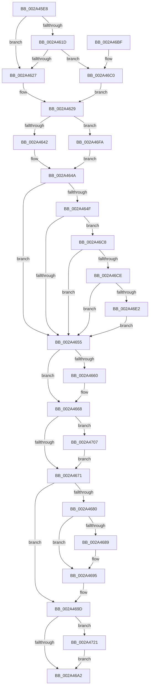

# MiDereferenceControlAreaPfnList

- RVA: `0x002A45E8`–`0x002A4734` (길이 `332` bytes)
- VA: `0x00000001402A45E8`
- 실행 섹션: `.text`
- PDB 이름 있음: `예`; PDB Function 태그: `아니요`
- unwind 정보 RVA: `0x000688E8`
- 디코드: `92`개 명령, `332/332` bytes 표시
- 미해석 바이트: `0` (있으면 어셈블리에 `.byte`로 보존)

> 이 문서는 커널 이미지의 기계어와 PDB 기호를 분석해 생성했습니다. 4번과 5번은 함수 원형과 자료형을 바이너리 사용 방식에서 추정한 C 해석이며 원본 소스 복구 결과는 아닙니다.

## 1. Dependencies

- 직접 호출 지점: **8**; 고유 호출 대상: **8**
- 직접 호출자로 확인된 함수: **5**
- RIP 상대 이미지 참조: **2**

### Outgoing calls
- `0x002A4645` → [ExAcquireSpinLockExclusiveAtDpcLevel](../24/ExAcquireSpinLockExclusiveAtDpcLevel_function_00248E80.md) (function, `0x00248E80`)
- `0x002A4663` → [MiCheckForControlAreaDeletion](../24/MiCheckForControlAreaDeletion_function_00248F30.md) (function, `0x00248F30`)
- `0x002A4675` → [ExReleaseSpinLockExclusiveFromDpcLevel](../24/ExReleaseSpinLockExclusiveFromDpcLevel_function_002497E0.md) (function, `0x002497E0`)
- `0x002A4690` → [KiLowerIrqlProcessIrqlFlags](../4F/KiLowerIrqlProcessIrqlFlags_function_004F5698.md) (function, `0x004F5698`)
- `0x002A46E5` → [MiRemoveUnusedSubsection](MiRemoveUnusedSubsection_function_002A6194.md) (function, `0x002A6194`)
- `0x002A46ED` → [MiInsertUnusedSubsection](../29/MiInsertUnusedSubsection_function_00298D50.md) (function, `0x00298D50`)
- `0x002A46FA` → [ExAcquireSpinLockExclusive](../24/ExAcquireSpinLockExclusive_function_00248690.md) (function, `0x00248690`)
- `0x002A472A` → [MiReturnCrossPartitionSectionCharges](../4B/MiReturnCrossPartitionSectionCharges_function_004BA61C.md) (function, `0x004BA61C`)

### Direct callers
- [MiReleaseInPageRefs](MiReleaseInPageRefs_function_002A4214.md) at `0x002A42D4`
- [MiRestoreTransitionPte](../33/MiRestoreTransitionPte_function_0033DD90.md) at `0x0033E0D6`
- [MiDeleteSectionCluster](../37/MiDeleteSectionCluster_function_00373DF0.md) at `0x003740E3`
- [MiSplitDirectMapPage](../4D/MiSplitDirectMapPage_function_004DAAA0.md) at `0x004DAC48`
- [sub_006EC390](../6E/Unknown_function_006EC390.md) at `0x006EC412`

### Static image references
- `0x002A4680` → RVA `0x00FC6D20` (`ALMOSTRO`; read)
- `0x002A470B` → RVA `0x00E30088` (`.data`; read)

## 2. Other-region calls and transfers

- 다른 실행 섹션으로 향하는 call: **0**
- 별도 외부 분기/꼬리 이동을 확인하지 못했습니다.

## 3. Assembly (complete function range)

```asm
002A45E8  48 8B C4                        mov rax, rsp
002A45EB  48 89 58 08                     mov qword ptr [rax + 8], rbx
002A45EF  48 89 68 10                     mov qword ptr [rax + 0x10], rbp
002A45F3  48 89 70 18                     mov qword ptr [rax + 0x18], rsi
002A45F7  44 89 48 20                     mov dword ptr [rax + 0x20], r9d
002A45FB  57                              push rdi
002A45FC  41 54                           push r12
002A45FE  41 55                           push r13
002A4600  41 56                           push r14
002A4602  41 57                           push r15
002A4604  48 83 EC 20                     sub rsp, 0x20
002A4608  8B 41 38                        mov eax, dword ptr [rcx + 0x38]
002A460B  33 ED                           xor ebp, ebp
002A460D  45 33 ED                        xor r13d, r13d
002A4610  4D 8B E0                        mov r12, r8
002A4613  4C 8B F2                        mov r14, rdx
002A4616  48 8B F9                        mov rdi, rcx
002A4619  A8 20                           test al, 0x20
002A461B  75 0A                           jne 0x1402a4627
002A461D  48 39 69 40                     cmp qword ptr [rcx + 0x40], rbp
002A4621  0F 85 99 00 00 00               jne 0x1402a46c0
002A4627  33 DB                           xor ebx, ebx
002A4629  45 33 FF                        xor r15d, r15d
002A462C  48 39 69 40                     cmp qword ptr [rcx + 0x40], rbp
002A4630  41 0F 95 C7                     setne r15b
002A4634  48 83 C1 48                     add rcx, 0x48
002A4638  41 F6 C1 02                     test r9b, 2
002A463C  0F 84 B8 00 00 00               je 0x1402a46fa
002A4642  40 B6 11                        mov sil, 0x11
002A4645  E8 36 48 FA FF                  call 0x140248e80
002A464A  48 85 DB                        test rbx, rbx
002A464D  74 06                           je 0x1402a4655
002A464F  44 29 63 68                     sub dword ptr [rbx + 0x68], r12d
002A4653  74 73                           je 0x1402a46c8
002A4655  4C 29 67 20                     sub qword ptr [rdi + 0x20], r12
002A4659  F6 44 24 68 01                  test byte ptr [rsp + 0x68], 1
002A465E  74 08                           je 0x1402a4668
002A4660  48 8B CF                        mov rcx, rdi
002A4663  E8 C8 48 FA FF                  call 0x140248f30
002A4668  48 85 ED                        test rbp, rbp
002A466B  0F 85 96 00 00 00               jne 0x1402a4707
002A4671  48 8D 4F 48                     lea rcx, [rdi + 0x48]
002A4675  E8 66 51 FA FF                  call 0x1402497e0
002A467A  40 80 FE 11                     cmp sil, 0x11
002A467E  74 1D                           je 0x1402a469d
002A4680  83 3D 99 26 D2 00 00            cmp dword ptr [rip + 0xd22699], 0
002A4687  74 0C                           je 0x1402a4695
002A4689  44 0F 20 C1                     mov rcx, cr8
002A468D  40 8A D6                        mov dl, sil
002A4690  E8 03 10 25 00                  call 0x1404f5698
002A4695  40 0F B6 C6                     movzx eax, sil
002A4699  44 0F 22 C0                     mov cr8, rax
002A469D  48 85 ED                        test rbp, rbp
002A46A0  75 7F                           jne 0x1402a4721
002A46A2  48 8B 5C 24 50                  mov rbx, qword ptr [rsp + 0x50]
002A46A7  48 8B 6C 24 58                  mov rbp, qword ptr [rsp + 0x58]
002A46AC  48 8B 74 24 60                  mov rsi, qword ptr [rsp + 0x60]
002A46B1  48 83 C4 20                     add rsp, 0x20
002A46B5  41 5F                           pop r15
002A46B7  41 5E                           pop r14
002A46B9  41 5D                           pop r13
002A46BB  41 5C                           pop r12
002A46BD  5F                              pop rdi
002A46BE  C3                              ret
002A46BF  CC                              int3
002A46C0  49 8B DE                        mov rbx, r14
002A46C3  E9 61 FF FF FF                  jmp 0x1402a4629
002A46C8  48 39 6B 50                     cmp qword ptr [rbx + 0x50], rbp
002A46CC  75 87                           jne 0x1402a4655
002A46CE  41 8B 46 20                     mov eax, dword ptr [r14 + 0x20]
002A46D2  25 00 00 09 00                  and eax, 0x90000
002A46D7  3D 00 00 08 00                  cmp eax, 0x80000
002A46DC  0F 85 73 FF FF FF               jne 0x1402a4655
002A46E2  48 8B CB                        mov rcx, rbx
002A46E5  E8 AA 1A 00 00                  call 0x1402a6194
002A46EA  48 8B CB                        mov rcx, rbx
002A46ED  E8 5E 46 FF FF                  call 0x140298d50
002A46F2  48 8B E8                        mov rbp, rax
002A46F5  E9 5B FF FF FF                  jmp 0x1402a4655
002A46FA  E8 91 3F FA FF                  call 0x140248690
002A46FF  40 8A F0                        mov sil, al
002A4702  E9 43 FF FF FF                  jmp 0x1402a464a
002A4707  0F B7 4F 3C                     movzx ecx, word ptr [rdi + 0x3c]
002A470B  48 8B 05 76 B9 B8 00            mov rax, qword ptr [rip + 0xb8b976]
002A4712  81 E1 FF 03 00 00               and ecx, 0x3ff
002A4718  4C 8B 2C C8                     mov r13, qword ptr [rax + rcx*8]
002A471C  E9 50 FF FF FF                  jmp 0x1402a4671
002A4721  4C 8B C5                        mov r8, rbp
002A4724  41 8B D7                        mov edx, r15d
002A4727  49 8B CD                        mov rcx, r13
002A472A  E8 ED 5E 21 00                  call 0x1404ba61c
002A472F  E9 6E FF FF FF                  jmp 0x1402a46a2
```

## 4. C-style interpretation (structured pseudocode)

```c
__int64 __fastcall MiDereferenceControlAreaPfnList(__int64 a1, __int64 a2, __int64 a3, int a4)
{
    __int64 result;
    __int64 v_r13;
    __int64 v_r15;
    __int64 v_rbp;
    __int64 v_rbx;
    __int64 v_rsp;
    unsigned __int64 v_stack_p10;
    unsigned __int64 v_stack_p18;
    unsigned __int8 v_stack_p20;
    unsigned __int64 v_stack_p8;

    *(unsigned __int64 *)(v_rsp + 8) = v_rbx;
    *(unsigned __int64 *)(v_rsp + 16) = v_rbp;
    *(unsigned __int64 *)(v_rsp + 24) = v_rsi;
    *(unsigned int *)(v_rsp + 32) = a4;
    v_rsp = (v_rsp) - (32);
    v_rbp = 0;
    v_r13 = 0;
    if ((((unsigned __int8)((unsigned int)(*(unsigned int *)(a1 + 56)))) & (32)) != 0) goto loc_002A4627;
    if ((*(unsigned __int64 *)(a1 + 64)) != 0) goto loc_002A46C0;
loc_002A4627:
    v_rbx = 0;
loc_002A4629:
    v_r15 = 0;
    v_r15 = ((*(unsigned __int64 *)(a1 + 64)) != 0) ? 1 : 0;
    a1 = (a1) + (72);
    if ((((unsigned __int8)(a4)) & (2)) == 0) goto loc_002A46FA;
    result = ExAcquireSpinLockExclusiveAtDpcLevel(a1, a2, a3, a4);
loc_002A464A:
    if (0 == 0) goto loc_002A4655;
    if (0 == 0) goto loc_002A46C8;
loc_002A4655:
    if (((v_stack_p20) & (1)) != 0) {
        a1 = a1;
        result = MiCheckForControlAreaDeletion(a1, a2, a3, a4);
    }
    if (0 != 0) goto loc_002A4707;
loc_002A4671:
    result = ExReleaseSpinLockExclusiveFromDpcLevel(a1 + 72, a2, a3, a4);
    if (17 == 17) goto loc_002A469D;
    if ((*(unsigned int *)(v_rip + 13772441)) != 0) {
        a1 = v_cr8;
        a2 = 17;
        result = KiLowerIrqlProcessIrqlFlags(a1, a2, a3, a4);
    }
loc_002A469D:
    if (0 != 0) goto loc_002A4721;
loc_002A46A2:
    v_rsp = (v_rsp) + (32);
    return 17;
loc_002A46C0:
    goto loc_002A4629;
loc_002A46C8:
    if ((*(unsigned __int64 *)(a2 + 80)) != v_stack_p10) goto loc_002A4655;
    result = (unsigned int)(((unsigned int)(*(unsigned int *)(a2 + 32))) & (0x90000ULL));
    if (((unsigned int)(result)) != 0x80000ULL) goto loc_002A4655;
    result = MiRemoveUnusedSubsection(a2, a2, a3, a4);
    result = MiInsertUnusedSubsection(a2, a2, a3, a4);
    goto loc_002A4655;
loc_002A46FA:
    result = ExAcquireSpinLockExclusive(a2, a2, a3, a4);
    goto loc_002A464A;
loc_002A4707:
    a1 = (unsigned int)((*(unsigned __int16 *)(a1 + 60)) & (0x3FFULL));
    goto loc_002A4671;
loc_002A4721:
    result = MiReturnCrossPartitionSectionCharges(*(unsigned __int64 *)(*(unsigned __int64 *)(v_rip + 12106102) + a1 * 8), (unsigned int)((unsigned int)(v_r15)), result, a4);
    goto loc_002A46A2;
}
```

## 5. (Beta) C Style

```c
int64_t MiDereferenceControlAreaPfnList(void *Arg1, void *Arg2, int64_t Arg3, int32_t Arg4)
{
    uint8_t *arg1 = (uint8_t *)Arg1;
    uint8_t *arg2 = (uint8_t *)Arg2;

    int64_t result;
    int64_t local_r13;
    int64_t local_r15;
    int64_t local_rbp;
    int64_t local_rbx;
    int64_t local_rsp;
    uint64_t v_stack_p10;
    uint64_t v_stack_p18;
    uint8_t v_stack_p20;
    uint64_t v_stack_p8;

    *(uint64_t *)(local_rsp + 0x8) = local_rbx;
    *(uint64_t *)(local_rsp + 0x10) = local_rbp;
    *(uint64_t *)(local_rsp + 0x18) = local_rsi;
    *(uint32_t *)(local_rsp + 0x20) = Arg4;
    local_rsp = (local_rsp) - (32);
    local_rbp = 0;
    local_r13 = 0;
    if ((((uint8_t)((uint32_t)(*(uint32_t *)(arg1 + 0x38)))) & (32)) != 0) goto loc_002A4627;
    if ((*(uint64_t *)(arg1 + 0x40)) != 0) goto loc_002A46C0;
loc_002A4627:
    local_rbx = 0;
loc_002A4629:
    local_r15 = 0;
    local_r15 = ((*(uint64_t *)(arg1 + 0x40)) != 0) ? 1 : 0;
    Arg1 = (Arg1) + (72);
    if ((((uint8_t)(Arg4)) & (2)) == 0) goto loc_002A46FA;
    result = ExAcquireSpinLockExclusiveAtDpcLevel(Arg1, Arg2, Arg3, Arg4);
loc_002A464A:
    if (0 == 0) goto loc_002A4655;
    if (0 == 0) goto loc_002A46C8;
loc_002A4655:
    if (((v_stack_p20) & (1)) != 0) {
        Arg1 = Arg1;
        result = MiCheckForControlAreaDeletion(Arg1, Arg2, Arg3, Arg4);
    }
    if (0 != 0) goto loc_002A4707;
loc_002A4671:
    result = ExReleaseSpinLockExclusiveFromDpcLevel(Arg1 + 72, Arg2, Arg3, Arg4);
    if (17 == 17) goto loc_002A469D;
    if ((*(uint32_t *)(v_rip + 0xD22699)) != 0) {
        Arg1 = v_cr8;
        Arg2 = 17;
        result = KiLowerIrqlProcessIrqlFlags(Arg1, Arg2, Arg3, Arg4);
    }
loc_002A469D:
    if (0 != 0) goto loc_002A4721;
loc_002A46A2:
    local_rsp = (local_rsp) + (32);
    return 17;
loc_002A46C0:
    goto loc_002A4629;
loc_002A46C8:
    if ((*(uint64_t *)(arg2 + 0x50)) != v_stack_p10) goto loc_002A4655;
    result = (uint32_t)(((uint32_t)(*(uint32_t *)(arg2 + 0x20))) & (0x90000ULL));
    if (((uint32_t)(result)) != 0x80000ULL) goto loc_002A4655;
    result = MiRemoveUnusedSubsection(Arg2, Arg2, Arg3, Arg4);
    result = MiInsertUnusedSubsection(Arg2, Arg2, Arg3, Arg4);
    goto loc_002A4655;
loc_002A46FA:
    result = ExAcquireSpinLockExclusive(Arg2, Arg2, Arg3, Arg4);
    goto loc_002A464A;
loc_002A4707:
    Arg1 = (uint32_t)((*(uint16_t *)(arg1 + 0x3C)) & (0x3FFULL));
    goto loc_002A4671;
loc_002A4721:
    result = MiReturnCrossPartitionSectionCharges(*(uint64_t *)(*(uint64_t *)(v_rip + 0xB8B976) + arg1 * 8), (uint32_t)((uint32_t)(local_r15)), result, Arg4);
    goto loc_002A46A2;
}
```

### 관측된 메모리 오프셋

구조체 형식이 확인되지 않은 접근은 인자 기준의 오프셋으로만 기록했습니다.

| 기준 인자 | 오프셋 표현 | 폭 (bit) | 접근 |
|---|---:|---:|---|
| `Arg1` | `+ 0x20` | `64` | `R/W` |
| `Arg1` | `+ 0x38` | `32` | `R` |
| `Arg1` | `+ 0x3C` | `16` | `R` |
| `Arg1` | `+ 0x40` | `64` | `R` |
| `Arg1` | `+ 0x48` | `64` | `R` |
| `Arg2` | `+ 0x20` | `32` | `R` |

## 6. Execution-region graph

[열기: 2D/3D 그래프와 함수 탐색 컨트롤 패널](../../../control-panel.html?section=text&rva=0x002A45E8&view=graph)

- 2D 그래프는 위에서 아래로 흐르고, 3D 그래프는 빈 공간을 드래그해 회전합니다. Shift+드래그는 이동, 휠은 확대·축소, 함수 노드 선택은 대상 보고서 이동입니다.

### Static fallback


