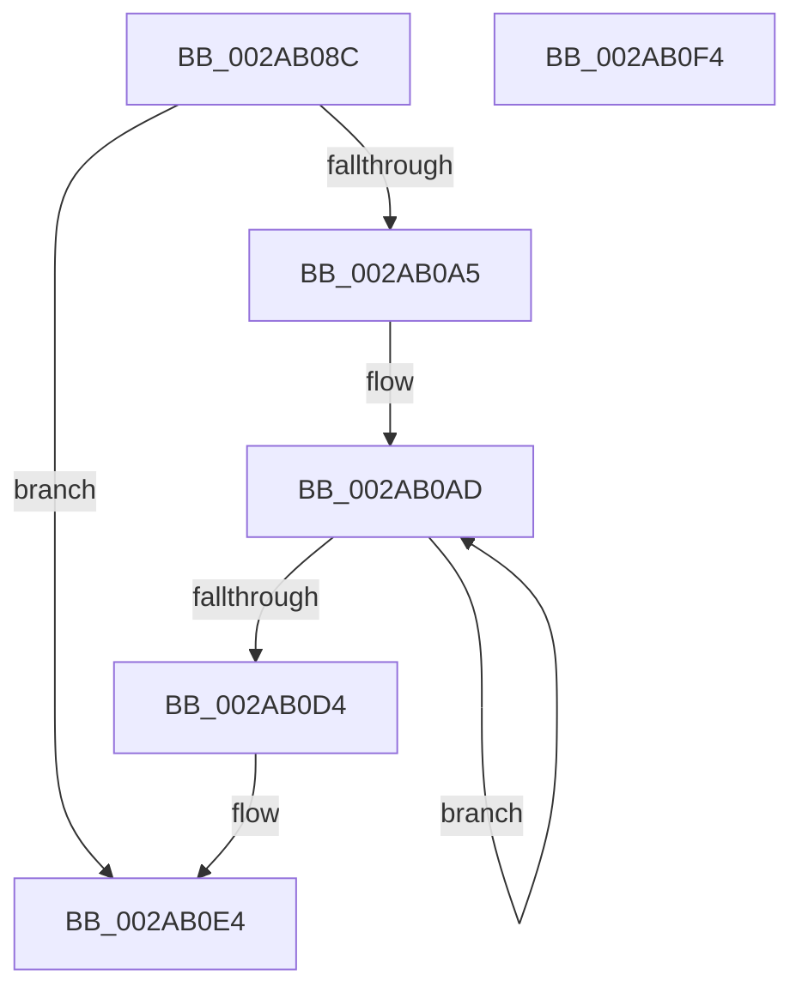

# MiDereferenceIoPageRuns

- RVA: `0x002AB08C`–`0x002AB0F5` (길이 `105` bytes)
- VA: `0x00000001402AB08C`
- 실행 섹션: `.text`
- PDB 이름 있음: `예`; PDB Function 태그: `아니요`
- unwind 정보 RVA: `0x00060BC4`
- 디코드: `30`개 명령, `105/105` bytes 표시
- 미해석 바이트: `0` (있으면 어셈블리에 `.byte`로 보존)

> 이 문서는 커널 이미지의 기계어와 PDB 기호를 분석해 생성했습니다. 4번과 5번은 함수 원형과 자료형을 바이너리 사용 방식에서 추정한 C 해석이며 원본 소스 복구 결과는 아닙니다.

## 1. Dependencies

- 직접 호출 지점: **1**; 고유 호출 대상: **1**
- 직접 호출자로 확인된 함수: **1**
- RIP 상대 이미지 참조: **0**

### Outgoing calls
- `0x002AB0CA` → [MiDereferenceIoPages](MiDereferenceIoPages_function_002AB1B0.md) (function, `0x002AB1B0`)

### Direct callers
- [MiReplaceRotateWithDemandZeroNoCopy](MiReplaceRotateWithDemandZeroNoCopy_function_002AAB04.md) at `0x002AAD0A`

### Static image references
- 디코드된 RIP-relative 메모리 참조가 없습니다.

## 2. Other-region calls and transfers

- 다른 실행 섹션으로 향하는 call: **0**
- 별도 외부 분기/꼬리 이동을 확인하지 못했습니다.

## 3. Assembly (complete function range)

```asm
002AB08C  48 89 5C 24 08                  mov qword ptr [rsp + 8], rbx
002AB091  48 89 74 24 10                  mov qword ptr [rsp + 0x10], rsi
002AB096  57                              push rdi
002AB097  48 83 EC 20                     sub rsp, 0x20
002AB09B  8B 7A 1C                        mov edi, dword ptr [rdx + 0x1c]
002AB09E  48 8B DA                        mov rbx, rdx
002AB0A1  85 FF                           test edi, edi
002AB0A3  74 3F                           je 0x1402ab0e4
002AB0A5  48 8D 72 28                     lea rsi, [rdx + 0x28]
002AB0A9  48 8D 34 FE                     lea rsi, [rsi + rdi*8]
002AB0AD  48 8D 76 F8                     lea rsi, [rsi - 8]
002AB0B1  B9 01 00 00 00                  mov ecx, 1
002AB0B6  48 8B 16                        mov rdx, qword ptr [rsi]
002AB0B9  4C 8B C2                        mov r8, rdx
002AB0BC  48 C1 EA 0C                     shr rdx, 0xc
002AB0C0  41 81 E0 FF 03 00 00            and r8d, 0x3ff
002AB0C7  49 FF C0                        inc r8
002AB0CA  E8 E1 00 00 00                  call 0x1402ab1b0
002AB0CF  83 C7 FF                        add edi, -1
002AB0D2  75 D9                           jne 0x1402ab0ad
002AB0D4  66 21 7B 19                     and word ptr [rbx + 0x19], di
002AB0D8  21 7B 1C                        and dword ptr [rbx + 0x1c], edi
002AB0DB  48 83 63 20 00                  and qword ptr [rbx + 0x20], 0
002AB0E0  83 63 10 DB                     and dword ptr [rbx + 0x10], 0xffffffdb
002AB0E4  48 8B 5C 24 30                  mov rbx, qword ptr [rsp + 0x30]
002AB0E9  48 8B 74 24 38                  mov rsi, qword ptr [rsp + 0x38]
002AB0EE  48 83 C4 20                     add rsp, 0x20
002AB0F2  5F                              pop rdi
002AB0F3  C3                              ret
002AB0F4  CC                              int3
```

## 4. C-style interpretation (structured pseudocode)

```c
__int64 __fastcall MiDereferenceIoPageRuns(__int64 a1, __int64 a2)
{
    __int64 result;
    __int64 v_rdi;
    __int64 v_rsp;
    unsigned __int64 v_stack_p10;
    unsigned __int64 v_stack_p8;

    v_stack_p8 = v_rbx;
    v_stack_p10 = v_rsi;
    v_rsp = (v_rsp) - (32);
    if ((unsigned int)((unsigned int)(*(unsigned int *)(a2 + 28))) == 0) goto loc_002AB0E4;
loc_002AB0AD:
    a2 = (*(unsigned __int64 *)(a2 + 40 + (unsigned int)(*(unsigned int *)(a2 + 28)) * 8 - 8)) >> (12);
    a3 = (unsigned int)((*(unsigned __int64 *)(a2 + 40 + (unsigned int)(*(unsigned int *)(a2 + 28)) * 8 - 8)) & (0x3FFULL));
    a3 = (a3) + 1;
    result = MiDereferenceIoPages(1, a2, a3, a4);
    v_rdi = (unsigned int)(((unsigned int)(*(unsigned int *)(a2 + 28))) + (-1));
    if (condition_is_not_equal) goto loc_002AB0AD;
loc_002AB0E4:
    v_rsp = (v_rsp) + (32);
    return result;
}
```

## 5. (Beta) C Style

```c
int64_t MiDereferenceIoPageRuns(int64_t Arg1, void *Arg2)
{
    uint8_t *arg2 = (uint8_t *)Arg2;

    int64_t result;
    int64_t local_rdi;
    int64_t local_rsp;
    uint64_t v_stack_p10;
    uint64_t v_stack_p8;

    v_stack_p8 = local_rbx;
    v_stack_p10 = local_rsi;
    local_rsp = (local_rsp) - (32);
    if ((uint32_t)((uint32_t)(*(uint32_t *)(arg2 + 0x1C))) == 0) goto loc_002AB0E4;
loc_002AB0AD:
    Arg2 = (*(uint64_t *)(arg2 + 0x28 + (uint32_t)(*(uint32_t *)(arg2 + 0x1C)) * 8 - 0x8)) >> (12);
    a3 = (uint32_t)((*(uint64_t *)(arg2 + 0x28 + (uint32_t)(*(uint32_t *)(arg2 + 0x1C)) * 8 - 0x8)) & (0x3FFULL));
    a3 = (a3) + 1;
    result = MiDereferenceIoPages(1, Arg2, a3, a4);
    local_rdi = (uint32_t)(((uint32_t)(*(uint32_t *)(arg2 + 0x1C))) + (-1));
    if (condition_is_not_equal) goto loc_002AB0AD;
loc_002AB0E4:
    local_rsp = (local_rsp) + (32);
    return result;
}
```

### 관측된 메모리 오프셋

구조체 형식이 확인되지 않은 접근은 인자 기준의 오프셋으로만 기록했습니다.

| 기준 인자 | 오프셋 표현 | 폭 (bit) | 접근 |
|---|---:|---:|---|
| `Arg2` | `- 0x8` | `64` | `R` |
| `Arg2` | `+ 0x0` | `64` | `R` |
| `Arg2` | `+ 0x0 + rdi*8` | `64` | `R` |
| `Arg2` | `+ 0x10` | `32` | `R/W` |
| `Arg2` | `+ 0x19` | `16` | `R/W` |
| `Arg2` | `+ 0x1C` | `32` | `R` |
| `Arg2` | `+ 0x1C` | `32` | `R/W` |
| `Arg2` | `+ 0x20` | `64` | `R/W` |
| `Arg2` | `+ 0x28` | `64` | `R` |

## 6. Execution-region graph

[열기: 2D/3D 그래프와 함수 탐색 컨트롤 패널](../../../control-panel.html?section=text&rva=0x002AB08C&view=graph)

- 2D 그래프는 위에서 아래로 흐르고, 3D 그래프는 빈 공간을 드래그해 회전합니다. Shift+드래그는 이동, 휠은 확대·축소, 함수 노드 선택은 대상 보고서 이동입니다.

### Static fallback


