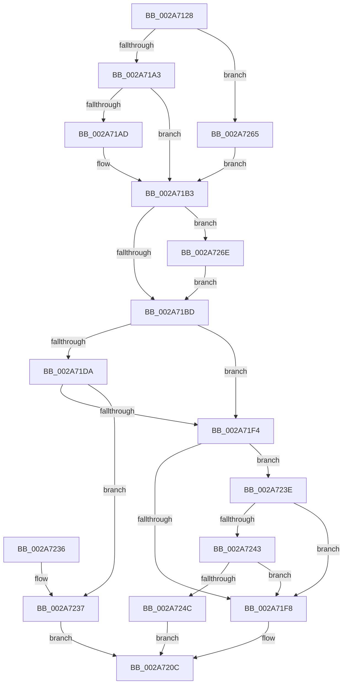

# MiEmptyWorkingSetInitiate

- RVA: `0x002A7128`–`0x002A727A` (길이 `338` bytes)
- VA: `0x00000001402A7128`
- 실행 섹션: `.text`
- PDB 이름 있음: `예`; PDB Function 태그: `아니요`
- unwind 정보 RVA: `0x00068B90`
- 디코드: `91`개 명령, `338/338` bytes 표시
- 미해석 바이트: `0` (있으면 어셈블리에 `.byte`로 보존)

> 이 문서는 커널 이미지의 기계어와 PDB 기호를 분석해 생성했습니다. 4번과 5번은 함수 원형과 자료형을 바이너리 사용 방식에서 추정한 C 해석이며 원본 소스 복구 결과는 아닙니다.

## 1. Dependencies

- 직접 호출 지점: **5**; 고유 호출 대상: **5**
- 직접 호출자로 확인된 함수: **5**
- RIP 상대 이미지 참조: **2**

### Outgoing calls
- `0x002A7166` → [memset](../6C/memset_function_006C6C40.md) (function, `0x006C6C40`)
- `0x002A71C8` → [MiLockWorkingSetShared](../27/MiLockWorkingSetShared_function_0027CBF0.md) (function, `0x0027CBF0`)
- `0x002A71FC` → [MiWalkPageTables](../2C/MiWalkPageTables_function_002C2710.md) (function, `0x002C2710`)
- `0x002A7212` → [MiUnlockWorkingSetShared](../27/MiUnlockWorkingSetShared_function_0027D690.md) (function, `0x0027D690`)
- `0x002A725E` → [MiTrimWorkingSet](MiTrimWorkingSet_function_002AD134.md) (function, `0x002AD134`)

### Direct callers
- [MiEmptyWorkingSetPrivatePagesByVa](MiEmptyWorkingSetPrivatePagesByVa_function_002A6AC0.md) at `0x002A6BA2`
- [MiEmptyWorkingSet](MiEmptyWorkingSet_function_002A710C.md) at `0x002A7117`
- [MiTrimOrAgeWorkingSet](../34/MiTrimOrAgeWorkingSet_function_0034EFC0.md) at `0x0034F070`
- [MiEmptyTargetedWorkingSet](../67/MiEmptyTargetedWorkingSet_function_0067E6F8.md) at `0x0067E788`
- [MiProcessRemoveFromWorkingSet](../../page/7F/MiProcessRemoveFromWorkingSet_function_007FE624.md) at `0x007FE691`

### Static image references
- `0x002A717D` → RVA `0x002413C0` (`MiEmptyPte`; read)
- `0x002A718C` → RVA `0x0046CC90` (`MiEmptyWorkingSetTail`; read)

## 2. Other-region calls and transfers

- 다른 실행 섹션으로 향하는 call: **0**
- 별도 외부 분기/꼬리 이동을 확인하지 못했습니다.

## 3. Assembly (complete function range)

```asm
002A7128  48 8B C4                        mov rax, rsp
002A712B  48 89 58 08                     mov qword ptr [rax + 8], rbx
002A712F  48 89 70 10                     mov qword ptr [rax + 0x10], rsi
002A7133  48 89 78 18                     mov qword ptr [rax + 0x18], rdi
002A7137  55                              push rbp
002A7138  41 56                           push r14
002A713A  41 57                           push r15
002A713C  48 8D 68 A1                     lea rbp, [rax - 0x5f]
002A7140  48 81 EC 00 01 00 00            sub rsp, 0x100
002A7147  4D 8B F8                        mov r15, r8
002A714A  8B F2                           mov esi, edx
002A714C  48 8B F9                        mov rdi, rcx
002A714F  0F 57 C0                        xorps xmm0, xmm0
002A7152  33 D2                           xor edx, edx
002A7154  48 8D 4D 87                     lea rcx, [rbp - 0x79]
002A7158  41 B8 C0 00 00 00               mov r8d, 0xc0
002A715E  4D 8B F1                        mov r14, r9
002A7161  0F 11 44 24 30                  movups xmmword ptr [rsp + 0x30], xmm0
002A7166  E8 D5 FA 41 00                  call 0x1406c6c40
002A716B  48 8D 44 24 30                  lea rax, [rsp + 0x30]
002A7170  C7 45 87 06 00 00 00            mov dword ptr [rbp - 0x79], 6
002A7177  48 89 45 3F                     mov qword ptr [rbp + 0x3f], rax
002A717B  33 DB                           xor ebx, ebx
002A717D  48 8D 05 3C A2 F9 FF            lea rax, [rip - 0x65dc4]
002A7184  48 89 7D A7                     mov qword ptr [rbp - 0x59], rdi
002A7188  48 89 45 2F                     mov qword ptr [rbp + 0x2f], rax
002A718C  48 8D 05 FD 5A 1C 00            lea rax, [rip + 0x1c5afd]
002A7193  48 89 45 37                     mov qword ptr [rbp + 0x37], rax
002A7197  8D 43 01                        lea eax, [rbx + 1]
002A719A  40 84 F0                        test al, sil
002A719D  0F 85 C2 00 00 00               jne 0x1402a7265
002A71A3  8D 4B 02                        lea ecx, [rbx + 2]
002A71A6  8B C3                           mov eax, ebx
002A71A8  40 84 F1                        test cl, sil
002A71AB  74 06                           je 0x1402a71b3
002A71AD  89 4C 24 30                     mov dword ptr [rsp + 0x30], ecx
002A71B1  8B C1                           mov eax, ecx
002A71B3  40 F6 C6 04                     test sil, 4
002A71B7  0F 85 B1 00 00 00               jne 0x1402a726e
002A71BD  48 8B CF                        mov rcx, rdi
002A71C0  4C 89 7D AF                     mov qword ptr [rbp - 0x51], r15
002A71C4  4C 89 75 B7                     mov qword ptr [rbp - 0x49], r14
002A71C8  E8 23 5A FD FF                  call 0x14027cbf0
002A71CD  88 45 90                        mov byte ptr [rbp - 0x70], al
002A71D0  8B 87 B8 00 00 00               mov eax, dword ptr [rdi + 0xb8]
002A71D6  A8 0F                           test al, 0xf
002A71D8  75 1A                           jne 0x1402a71f4
002A71DA  65 48 8B 04 25 88 01 00 00      mov rax, qword ptr gs:[0x188]
002A71E3  48 8B 88 B8 00 00 00            mov rcx, qword ptr [rax + 0xb8]
002A71EA  8B 81 F4 01 00 00               mov eax, dword ptr [rcx + 0x1f4]
002A71F0  A8 20                           test al, 0x20
002A71F2  75 43                           jne 0x1402a7237
002A71F4  85 F6                           test esi, esi
002A71F6  74 46                           je 0x1402a723e
002A71F8  48 8D 4D 87                     lea rcx, [rbp - 0x79]
002A71FC  E8 0F B5 01 00                  call 0x1402c2710
002A7201  83 F8 05                        cmp eax, 5
002A7204  B9 0A 01 00 C0                  mov ecx, 0xc000010a
002A7209  0F 44 D9                        cmove ebx, ecx
002A720C  8A 55 90                        mov dl, byte ptr [rbp - 0x70]
002A720F  48 8B CF                        mov rcx, rdi
002A7212  E8 79 64 FD FF                  call 0x14027d690
002A7217  4C 8D 9C 24 00 01 00 00         lea r11, [rsp + 0x100]
002A721F  8B C3                           mov eax, ebx
002A7221  49 8B 5B 20                     mov rbx, qword ptr [r11 + 0x20]
002A7225  49 8B 73 28                     mov rsi, qword ptr [r11 + 0x28]
002A7229  49 8B 7B 30                     mov rdi, qword ptr [r11 + 0x30]
002A722D  49 8B E3                        mov rsp, r11
002A7230  41 5F                           pop r15
002A7232  41 5E                           pop r14
002A7234  5D                              pop rbp
002A7235  C3                              ret
002A7236  CC                              int3
002A7237  BB 0A 01 00 C0                  mov ebx, 0xc000010a
002A723C  EB CE                           jmp 0x1402a720c
002A723E  4D 85 FF                        test r15, r15
002A7241  75 B5                           jne 0x1402a71f8
002A7243  48 83 CA FF                     or rdx, 0xffffffffffffffff
002A7247  4C 3B F2                        cmp r14, rdx
002A724A  75 AC                           jne 0x1402a71f8
002A724C  44 8A 45 90                     mov r8b, byte ptr [rbp - 0x70]
002A7250  45 33 C9                        xor r9d, r9d
002A7253  48 8B CF                        mov rcx, rdi
002A7256  C7 44 24 20 40 00 00 00         mov dword ptr [rsp + 0x20], 0x40
002A725E  E8 D1 5E 00 00                  call 0x1402ad134
002A7263  EB A7                           jmp 0x1402a720c
002A7265  89 44 24 30                     mov dword ptr [rsp + 0x30], eax
002A7269  E9 45 FF FF FF                  jmp 0x1402a71b3
002A726E  83 C8 04                        or eax, 4
002A7271  89 44 24 30                     mov dword ptr [rsp + 0x30], eax
002A7275  E9 43 FF FF FF                  jmp 0x1402a71bd
```

## 4. C-style interpretation (structured pseudocode)

```c
__int64 __fastcall MiEmptyWorkingSetInitiate(__int64 a1, int a2, __int64 a3, __int64 a4)
{
    __int64 result;
    __int64 v_rbx;
    __int64 v_rsp;
    unsigned __int64 v_stack_m18;
    unsigned int v_stack_mD0;
    unsigned int v_stack_mE0;
    unsigned __int64 v_stack_mE8;

    *(unsigned __int64 *)(v_rsp + 8) = v_rbx;
    *(unsigned __int64 *)(v_rsp + 16) = v_rsi;
    *(unsigned __int64 *)(v_rsp + 24) = v_rdi;
    v_rsp = (v_rsp) - (256);
    a2 = 0;
    v_stack_mE8 = v_xmm0;
    result = memset(v_rsp - 95 - 121, a2, 192, a4);
    *(unsigned int *)(v_rsp - 95 - 121) = 6;
    *(unsigned __int64 *)(v_rsp - 95 + 63) = v_stack_mE8;
    v_rbx = 0;
    *(unsigned __int64 *)(v_rsp - 95 - 89) = a1;
    *(unsigned __int64 *)(v_rsp - 95 + 47) = v_rip - 417220;
    *(unsigned __int64 *)(v_rsp - 95 + 55) = v_rip + 1858301;
    if ((((unsigned __int8)(v_rbx + 1)) & ((unsigned __int8)((unsigned int)(a2)))) != 0) goto loc_002A7265;
    result = 0;
    if ((((unsigned __int8)(v_rbx + 2)) & ((unsigned __int8)((unsigned int)(a2)))) != 0) {
        v_stack_mE8 = (unsigned int)(v_rbx + 2);
        result = (unsigned int)(v_rbx + 2);
    }
    if ((((unsigned __int8)((unsigned int)(a2))) & (4)) != 0) goto loc_002A726E;
loc_002A71BD:
    *(unsigned __int64 *)(v_rsp - 95 - 81) = a3;
    *(unsigned __int64 *)(v_rsp - 95 - 73) = a4;
    result = MiLockWorkingSetShared(a1, a2, 192, a4);
    *(unsigned __int8 *)(v_rsp - 95 - 112) = (unsigned __int8)(result);
    if ((((unsigned __int8)((unsigned int)(*(unsigned int *)(a1 + 184)))) & (15)) != 0) goto loc_002A71F4;
    if ((((unsigned __int8)((unsigned int)(*(unsigned int *)(*(unsigned __int64 *)(*(unsigned __int64 *)(gs_base + (0 + 392)) + 184) + 500)))) & (32)) != 0) goto loc_002A7237;
loc_002A71F4:
    if ((unsigned int)((unsigned int)(a2)) == 0) goto loc_002A723E;
loc_002A71F8:
    result = MiWalkPageTables(v_rsp - 95 - 121, a2, 192, a4);
    if (((unsigned int)(result)) == 5) { v_rbx = (unsigned int)((unsigned int)(0xC000010AULL)); }
loc_002A720C:
    result = MiUnlockWorkingSetShared(a1, *(unsigned __int8 *)(v_rsp - 95 - 112), 192, a4);
    return (unsigned int)((unsigned int)(v_rbx));
loc_002A7237:
    goto loc_002A720C;
loc_002A723E:
    if (a3 != 0) goto loc_002A71F8;
    a2 = (*(unsigned __int8 *)(v_rsp - 95 - 112)) | (-1);
    if (a4 != a2) goto loc_002A71F8;
    a4 = 0;
    v_stack_mE0 = 64;
    result = MiTrimWorkingSet(*(unsigned __int64 *)(v_stack_m18 + 48), a2, *(unsigned __int8 *)(v_rsp - 95 - 112), a4);
    goto loc_002A720C;
loc_002A7265:
    v_stack_mD0 = (unsigned int)(result);
    goto loc_002A71B3;
loc_002A726E:
    result = (unsigned int)((result) | (4));
    v_stack_mD0 = (unsigned int)(result);
    goto loc_002A71BD;
}
```

## 5. (Beta) C Style

```c
int64_t MiEmptyWorkingSetInitiate(void *Arg1, int32_t Arg2, int64_t Arg3, int64_t Arg4)
{
    uint8_t *arg1 = (uint8_t *)Arg1;

    int64_t result;
    int64_t local_rbx;
    int64_t local_rsp;
    uint64_t v_stack_m18;
    uint32_t v_stack_mD0;
    uint32_t v_stack_mE0;
    uint64_t v_stack_mE8;

    *(uint64_t *)(local_rsp + 0x8) = local_rbx;
    *(uint64_t *)(local_rsp + 0x10) = local_rsi;
    *(uint64_t *)(local_rsp + 0x18) = local_rdi;
    local_rsp = (local_rsp) - (256);
    Arg2 = 0;
    v_stack_mE8 = v_xmm0;
    result = memset(local_rsp - 95 - 121, Arg2, 192, Arg4);
    *(uint32_t *)(local_rsp - 0x5F - 0x79) = 6;
    *(uint64_t *)(local_rsp - 0x5F + 0x3F) = v_stack_mE8;
    local_rbx = 0;
    *(void **)(local_rsp - 0x5F - 0x59) = Arg1;
    *(uint64_t *)(local_rsp - 0x5F + 0x2F) = v_rip - 417220;
    *(uint64_t *)(local_rsp - 0x5F + 0x37) = v_rip + 1858301;
    if ((((uint8_t)(local_rbx + 1)) & ((uint8_t)((uint32_t)(Arg2)))) != 0) goto loc_002A7265;
    result = 0;
    if ((((uint8_t)(local_rbx + 2)) & ((uint8_t)((uint32_t)(Arg2)))) != 0) {
        v_stack_mE8 = (uint32_t)(local_rbx + 2);
        result = (uint32_t)(local_rbx + 2);
    }
    if ((((uint8_t)((uint32_t)(Arg2))) & (4)) != 0) goto loc_002A726E;
loc_002A71BD:
    *(uint64_t *)(local_rsp - 0x5F - 0x51) = Arg3;
    *(uint64_t *)(local_rsp - 0x5F - 0x49) = Arg4;
    result = MiLockWorkingSetShared(Arg1, Arg2, 192, Arg4);
    *(uint8_t *)(local_rsp - 0x5F - 0x70) = (uint8_t)(result);
    if ((((uint8_t)((uint32_t)(*(uint32_t *)(arg1 + 0xB8)))) & (15)) != 0) goto loc_002A71F4;
    if ((((uint8_t)((uint32_t)(*(uint32_t *)(*(uint64_t *)(*(uint64_t *)(gs_base + (0 + 0x188)) + 0xB8) + 0x1F4)))) & (32)) != 0) goto loc_002A7237;
loc_002A71F4:
    if ((uint32_t)((uint32_t)(Arg2)) == 0) goto loc_002A723E;
loc_002A71F8:
    result = MiWalkPageTables(local_rsp - 95 - 121, Arg2, 192, Arg4);
    if (((uint32_t)(result)) == 5) { local_rbx = (uint32_t)((uint32_t)(0xC000010AULL)); }
loc_002A720C:
    result = MiUnlockWorkingSetShared(Arg1, *(uint8_t *)(local_rsp - 0x5F - 0x70), 192, Arg4);
    return (uint32_t)((uint32_t)(local_rbx));
loc_002A7237:
    goto loc_002A720C;
loc_002A723E:
    if (Arg3 != 0) goto loc_002A71F8;
    Arg2 = (*(uint8_t *)(local_rsp - 0x5F - 0x70)) | (-1);
    if (Arg4 != Arg2) goto loc_002A71F8;
    Arg4 = 0;
    v_stack_mE0 = 64;
    result = MiTrimWorkingSet(*(uint64_t *)(v_stack_m18 + 0x30), Arg2, *(uint8_t *)(local_rsp - 0x5F - 0x70), Arg4);
    goto loc_002A720C;
loc_002A7265:
    v_stack_mD0 = (uint32_t)(result);
    goto loc_002A71B3;
loc_002A726E:
    result = (uint32_t)((result) | (4));
    v_stack_mD0 = (uint32_t)(result);
    goto loc_002A71BD;
}
```

### 관측된 메모리 오프셋

구조체 형식이 확인되지 않은 접근은 인자 기준의 오프셋으로만 기록했습니다.

| 기준 인자 | 오프셋 표현 | 폭 (bit) | 접근 |
|---|---:|---:|---|
| `Arg1` | `+ 0xB8` | `32` | `R` |

## 6. Execution-region graph

[열기: 2D/3D 그래프와 함수 탐색 컨트롤 패널](../../../control-panel.html?section=text&rva=0x002A7128&view=graph)

- 2D 그래프는 위에서 아래로 흐르고, 3D 그래프는 빈 공간을 드래그해 회전합니다. Shift+드래그는 이동, 휠은 확대·축소, 함수 노드 선택은 대상 보고서 이동입니다.

### Static fallback


