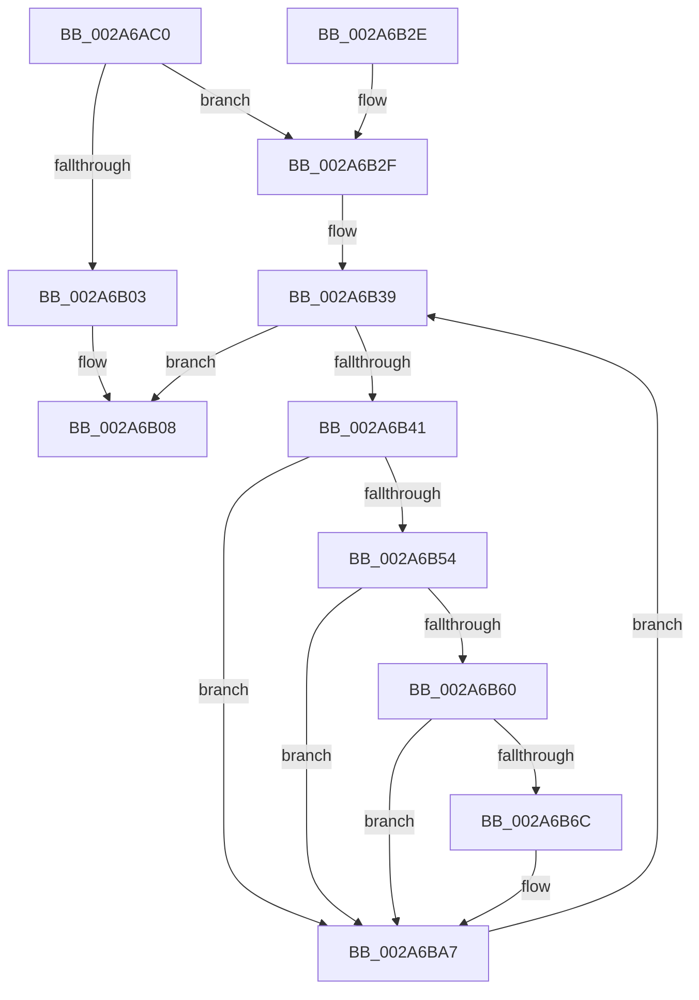

# MiEmptyWorkingSetPrivatePagesByVa

- RVA: `0x002A6AC0`–`0x002A6BBF` (길이 `255` bytes)
- VA: `0x00000001402A6AC0`
- 실행 섹션: `.text`
- PDB 이름 있음: `예`; PDB Function 태그: `아니요`
- unwind 정보 RVA: `0x00068B38`
- 디코드: `72`개 명령, `255/255` bytes 표시
- 미해석 바이트: `0` (있으면 어셈블리에 `.byte`로 보존)

> 이 문서는 커널 이미지의 기계어와 PDB 기호를 분석해 생성했습니다. 4번과 5번은 함수 원형과 자료형을 바이너리 사용 방식에서 추정한 C 해석이며 원본 소스 복구 결과는 아닙니다.

## 1. Dependencies

- 직접 호출 지점: **9**; 고유 호출 대상: **9**
- 직접 호출자로 확인된 함수: **2**
- RIP 상대 이미지 참조: **0**

### Outgoing calls
- `0x002A6AF4` → [LOCK_ADDRESS_SPACE_SHARED](LOCK_ADDRESS_SPACE_SHARED_function_002A8B3C.md) (function, `0x002A8B3C`)
- `0x002A6B0E` → [UNLOCK_ADDRESS_SPACE_SHARED](UNLOCK_ADDRESS_SPACE_SHARED_function_002A8ACC.md) (function, `0x002A8ACC`)
- `0x002A6B32` → [MiGetFirstVad](MiGetFirstVad_function_002A8BBC.md) (function, `0x002A8BBC`)
- `0x002A6B47` → [MiLockVad](../29/MiLockVad_function_00295810.md) (function, `0x00295810`)
- `0x002A6B57` → [MiVadSupportsPrivateCommit](../31/MiVadSupportsPrivateCommit_function_00316FD0.md) (function, `0x00316FD0`)
- `0x002A6B63` → [MiVadMapsLargeImage](MiVadMapsLargeImage_function_002A70F0.md) (function, `0x002A70F0`)
- `0x002A6BA2` → [MiEmptyWorkingSetInitiate](MiEmptyWorkingSetInitiate_function_002A7128.md) (function, `0x002A7128`)
- `0x002A6BAD` → [MiUnlockVad](MiUnlockVad_function_002A59C8.md) (function, `0x002A59C8`)
- `0x002A6BB5` → [MiGetNextVad](../29/MiGetNextVad_function_00297224.md) (function, `0x00297224`)

### Direct callers
- [MiFlushAllPages](../3B/MiFlushAllPages_function_003BD294.md) at `0x003BD33A`
- [MmProcessWorkingSetControl](../../page/A6/MmProcessWorkingSetControl_function_00A616C4.md) at `0x00A61869`

### Static image references
- 디코드된 RIP-relative 메모리 참조가 없습니다.

## 2. Other-region calls and transfers

- 다른 실행 섹션으로 향하는 call: **0**
- 별도 외부 분기/꼬리 이동을 확인하지 못했습니다.

## 3. Assembly (complete function range)

```asm
002A6AC0  48 89 5C 24 08                  mov qword ptr [rsp + 8], rbx
002A6AC5  48 89 6C 24 10                  mov qword ptr [rsp + 0x10], rbp
002A6ACA  48 89 74 24 18                  mov qword ptr [rsp + 0x18], rsi
002A6ACF  57                              push rdi
002A6AD0  41 56                           push r14
002A6AD2  41 57                           push r15
002A6AD4  48 83 EC 20                     sub rsp, 0x20
002A6AD8  65 48 8B 34 25 88 01 00 00      mov rsi, qword ptr gs:[0x188]
002A6AE1  44 8B F2                        mov r14d, edx
002A6AE4  4C 8B F9                        mov r15, rcx
002A6AE7  48 8B CE                        mov rcx, rsi
002A6AEA  48 8B AE B8 00 00 00            mov rbp, qword ptr [rsi + 0xb8]
002A6AF1  48 8B D5                        mov rdx, rbp
002A6AF4  E8 43 20 00 00                  call 0x1402a8b3c
002A6AF9  8B 85 F4 01 00 00               mov eax, dword ptr [rbp + 0x1f4]
002A6AFF  A8 20                           test al, 0x20
002A6B01  74 2C                           je 0x1402a6b2f
002A6B03  BF 0A 01 00 C0                  mov edi, 0xc000010a
002A6B08  48 8B D5                        mov rdx, rbp
002A6B0B  48 8B CE                        mov rcx, rsi
002A6B0E  E8 B9 1F 00 00                  call 0x1402a8acc
002A6B13  48 8B 5C 24 40                  mov rbx, qword ptr [rsp + 0x40]
002A6B18  8B C7                           mov eax, edi
002A6B1A  48 8B 6C 24 48                  mov rbp, qword ptr [rsp + 0x48]
002A6B1F  48 8B 74 24 50                  mov rsi, qword ptr [rsp + 0x50]
002A6B24  48 83 C4 20                     add rsp, 0x20
002A6B28  41 5F                           pop r15
002A6B2A  41 5E                           pop r14
002A6B2C  5F                              pop rdi
002A6B2D  C3                              ret
002A6B2E  CC                              int3
002A6B2F  48 8B CD                        mov rcx, rbp
002A6B32  E8 85 20 00 00                  call 0x1402a8bbc
002A6B37  33 FF                           xor edi, edi
002A6B39  48 8B D8                        mov rbx, rax
002A6B3C  48 85 C0                        test rax, rax
002A6B3F  74 C7                           je 0x1402a6b08
002A6B41  48 8B D0                        mov rdx, rax
002A6B44  48 8B CE                        mov rcx, rsi
002A6B47  E8 C4 EC FE FF                  call 0x140295810
002A6B4C  8B 4B 30                        mov ecx, dword ptr [rbx + 0x30]
002A6B4F  F6 C1 04                        test cl, 4
002A6B52  75 53                           jne 0x1402a6ba7
002A6B54  48 8B CB                        mov rcx, rbx
002A6B57  E8 74 04 07 00                  call 0x140316fd0
002A6B5C  85 C0                           test eax, eax
002A6B5E  74 47                           je 0x1402a6ba7
002A6B60  48 8B CB                        mov rcx, rbx
002A6B63  E8 88 05 00 00                  call 0x1402a70f0
002A6B68  85 C0                           test eax, eax
002A6B6A  75 3B                           jne 0x1402a6ba7
002A6B6C  8B 43 1C                        mov eax, dword ptr [rbx + 0x1c]
002A6B6F  41 8B D6                        mov edx, r14d
002A6B72  44 0F B6 4B 21                  movzx r9d, byte ptr [rbx + 0x21]
002A6B77  83 CA 02                        or edx, 2
002A6B7A  44 0F B6 43 20                  movzx r8d, byte ptr [rbx + 0x20]
002A6B7F  49 8B CF                        mov rcx, r15
002A6B82  49 C1 E1 20                     shl r9, 0x20
002A6B86  4C 0B C8                        or r9, rax
002A6B89  49 C1 E0 20                     shl r8, 0x20
002A6B8D  8B 43 18                        mov eax, dword ptr [rbx + 0x18]
002A6B90  4C 0B C0                        or r8, rax
002A6B93  49 C1 E1 0C                     shl r9, 0xc
002A6B97  49 C1 E0 0C                     shl r8, 0xc
002A6B9B  49 81 C9 FF 0F 00 00            or r9, 0xfff
002A6BA2  E8 81 05 00 00                  call 0x1402a7128
002A6BA7  48 8B D3                        mov rdx, rbx
002A6BAA  48 8B CE                        mov rcx, rsi
002A6BAD  E8 16 EE FF FF                  call 0x1402a59c8
002A6BB2  48 8B CB                        mov rcx, rbx
002A6BB5  E8 6A 06 FF FF                  call 0x140297224
002A6BBA  E9 7A FF FF FF                  jmp 0x1402a6b39
```

## 4. C-style interpretation (structured pseudocode)

```c
__int64 __fastcall MiEmptyWorkingSetPrivatePagesByVa(__int64 a1, int a2)
{
    __int64 result;
    __int64 v_rdi;
    __int64 v_rsp;
    unsigned __int64 v_stack_p10;
    unsigned __int64 v_stack_p18;
    unsigned __int64 v_stack_p8;

    v_stack_p8 = v_rbx;
    v_stack_p10 = v_rbp;
    v_stack_p18 = v_rsi;
    v_rsp = (v_rsp) - (32);
    result = LOCK_ADDRESS_SPACE_SHARED(*(unsigned __int64 *)(gs_base + (0 + 392)), *(unsigned __int64 *)(*(unsigned __int64 *)(gs_base + (0 + 392)) + 184), a3, a4);
    if ((((unsigned __int8)((unsigned int)(*(unsigned int *)(*(unsigned __int64 *)(*(unsigned __int64 *)(gs_base + (0 + 392)) + 184) + 500)))) & (32)) == 0) goto loc_002A6B2F;
loc_002A6B08:
    result = UNLOCK_ADDRESS_SPACE_SHARED(*(unsigned __int64 *)(gs_base + (0 + 392)), *(unsigned __int64 *)(*(unsigned __int64 *)(gs_base + (0 + 392)) + 184), a3, a4);
    v_rsp = (v_rsp) + (32);
    return (unsigned int)((unsigned int)((unsigned int)(0xC000010AULL)));
loc_002A6B2F:
    result = MiGetFirstVad(v_stack_p10, *(unsigned __int64 *)(*(unsigned __int64 *)(gs_base + (0 + 392)) + 184), a3, a4);
    v_rdi = 0;
loc_002A6B39:
    if (result == 0) goto loc_002A6B08;
    result = MiLockVad(v_stack_p18, result, a3, a4);
    if ((((unsigned __int8)((unsigned int)(*(unsigned int *)(result + 48)))) & (4)) != 0) goto loc_002A6BA7;
    result = MiVadSupportsPrivateCommit(result, result, a3, a4);
    if ((unsigned int)(result) == 0) goto loc_002A6BA7;
    result = MiVadMapsLargeImage(result, result, a3, a4);
    if ((unsigned int)(result) == 0) {
        result = *(unsigned int *)(result + 28);
        a2 = (unsigned int)((unsigned int)(a2));
        a4 = *(unsigned __int8 *)(result + 33);
        a2 = (unsigned int)((a2) | (2));
        a3 = *(unsigned __int8 *)(result + 32);
        a1 = a1;
        a4 = (a4) << (32);
        a4 = (a4) | (result);
        a3 = (a3) << (32);
        result = *(unsigned int *)(result + 24);
        a3 = (a3) | (result);
        a4 = (a4) << (12);
        a3 = (a3) << (12);
        a4 = (a4) | (0xFFFULL);
        result = MiEmptyWorkingSetInitiate(a1, a2, a3, a4);
    }
    result = MiUnlockVad(v_stack_p18, result, a3, a4);
    result = MiGetNextVad(result, result, a3, a4);
    goto loc_002A6B39;
}
```

## 5. (Beta) C Style

```c
int64_t MiEmptyWorkingSetPrivatePagesByVa(int64_t Arg1, int32_t Arg2)
{
    int64_t result;
    int64_t local_rdi;
    int64_t local_rsp;
    uint64_t v_stack_p10;
    uint64_t v_stack_p18;
    uint64_t v_stack_p8;

    v_stack_p8 = local_rbx;
    v_stack_p10 = local_rbp;
    v_stack_p18 = local_rsi;
    local_rsp = (local_rsp) - (32);
    result = LOCK_ADDRESS_SPACE_SHARED(*(uint64_t *)(gs_base + (0 + 0x188)), *(uint64_t *)(*(uint64_t *)(gs_base + (0 + 0x188)) + 0xB8), a3, a4);
    if ((((uint8_t)((uint32_t)(*(uint32_t *)(*(uint64_t *)(*(uint64_t *)(gs_base + (0 + 0x188)) + 0xB8) + 0x1F4)))) & (32)) == 0) goto loc_002A6B2F;
loc_002A6B08:
    result = UNLOCK_ADDRESS_SPACE_SHARED(*(uint64_t *)(gs_base + (0 + 0x188)), *(uint64_t *)(*(uint64_t *)(gs_base + (0 + 0x188)) + 0xB8), a3, a4);
    local_rsp = (local_rsp) + (32);
    return (uint32_t)((uint32_t)((uint32_t)(0xC000010AULL)));
loc_002A6B2F:
    result = MiGetFirstVad(v_stack_p10, *(uint64_t *)(*(uint64_t *)(gs_base + (0 + 0x188)) + 0xB8), a3, a4);
    local_rdi = 0;
loc_002A6B39:
    if (result == 0) goto loc_002A6B08;
    result = MiLockVad(v_stack_p18, result, a3, a4);
    if ((((uint8_t)((uint32_t)(*(uint32_t *)(result + 0x30)))) & (4)) != 0) goto loc_002A6BA7;
    result = MiVadSupportsPrivateCommit(result, result, a3, a4);
    if ((uint32_t)(result) == 0) goto loc_002A6BA7;
    result = MiVadMapsLargeImage(result, result, a3, a4);
    if ((uint32_t)(result) == 0) {
        result = *(uint32_t *)(result + 0x1C);
        Arg2 = (uint32_t)((uint32_t)(Arg2));
        a4 = *(uint8_t *)(result + 0x21);
        Arg2 = (uint32_t)((Arg2) | (2));
        a3 = *(uint8_t *)(result + 0x20);
        Arg1 = Arg1;
        a4 = (a4) << (32);
        a4 = (a4) | (result);
        a3 = (a3) << (32);
        result = *(uint32_t *)(result + 0x18);
        a3 = (a3) | (result);
        a4 = (a4) << (12);
        a3 = (a3) << (12);
        a4 = (a4) | (0xFFFULL);
        result = MiEmptyWorkingSetInitiate(Arg1, Arg2, a3, a4);
    }
    result = MiUnlockVad(v_stack_p18, result, a3, a4);
    result = MiGetNextVad(result, result, a3, a4);
    goto loc_002A6B39;
}
```

## 6. Execution-region graph

[열기: 2D/3D 그래프와 함수 탐색 컨트롤 패널](../../../control-panel.html?section=text&rva=0x002A6AC0&view=graph)

- 2D 그래프는 위에서 아래로 흐르고, 3D 그래프는 빈 공간을 드래그해 회전합니다. Shift+드래그는 이동, 휠은 확대·축소, 함수 노드 선택은 대상 보고서 이동입니다.

### Static fallback


