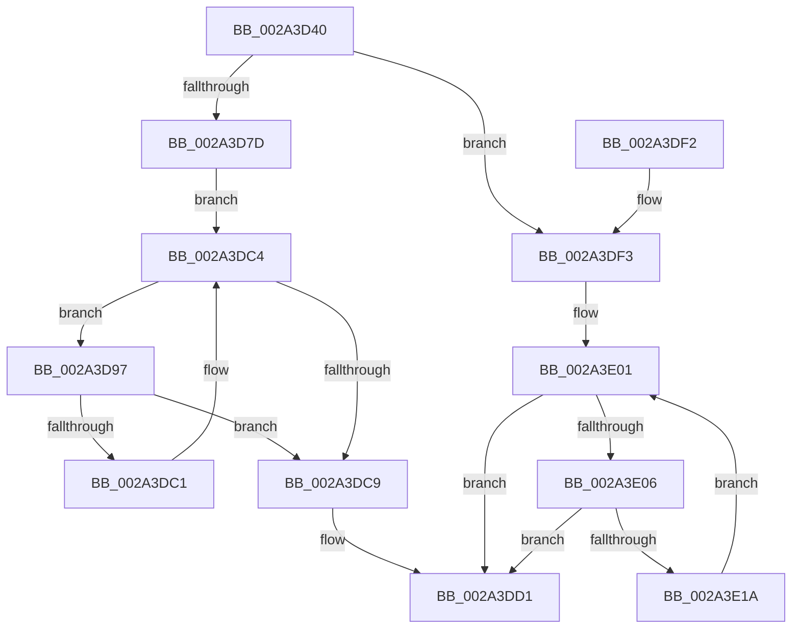

# MiEnumerateSystemImages

- RVA: `0x002A3D40`–`0x002A3E1F` (길이 `223` bytes)
- VA: `0x00000001402A3D40`
- 실행 섹션: `.text`
- PDB 이름 있음: `예`; PDB Function 태그: `아니요`
- unwind 정보 RVA: `0x00068810`
- 디코드: `65`개 명령, `223/223` bytes 표시
- 미해석 바이트: `0` (있으면 어셈블리에 `.byte`로 보존)

> 이 문서는 커널 이미지의 기계어와 PDB 기호를 분석해 생성했습니다. 4번과 5번은 함수 원형과 자료형을 바이너리 사용 방식에서 추정한 C 해석이며 원본 소스 복구 결과는 아닙니다.

## 1. Dependencies

- 직접 호출 지점: **6**; 고유 호출 대상: **5**
- 직접 호출자로 확인된 함수: **5**
- RIP 상대 이미지 참조: **2**

### Outgoing calls
- `0x002A3D7F` → [MiAcquireLoadLock](MiAcquireLoadLock_function_002A3950.md) (function, `0x002A3950`)
- `0x002A3D9D` → [MiLockLoaderEntry](MiLockLoaderEntry_function_002A3EE0.md) (function, `0x002A3EE0`)
- `0x002A3DAB` → [guard_dispatch_icall](../6B/guard_dispatch_icall_function_006BAAD0.md) (function, `0x006BAAD0`)
- `0x002A3DB8` → [MiUnlockLoaderEntry](MiUnlockLoaderEntry_function_002A3E28.md) (function, `0x002A3E28`)
- `0x002A3DCC` → [MmReleaseLoadLockShared](MmReleaseLoadLockShared_function_002A3FB0.md) (function, `0x002A3FB0`)
- `0x002A3E0F` → [guard_dispatch_icall](../6B/guard_dispatch_icall_function_006BAAD0.md) (function, `0x006BAAD0`)

### Direct callers
- [MmEnumerateSystemImagesShared](../4B/MmEnumerateSystemImagesShared_function_004BFFA0.md) at `0x004BFFAA`
- [MmEnumerateSystemImages](../4F/MmEnumerateSystemImages_function_004FC7B0.md) at `0x004FC7B7`
- [InitBootProcessor](../../init/C1/InitBootProcessor_function_00C1B1C8.md) at `0x00C1B89E`
- [InitBootProcessor](../../init/C1/InitBootProcessor_function_00C1B1C8.md) at `0x00C1B9C5`
- [MiInitSystem](../../init/C5/MiInitSystem_function_00C5E6C0.md) at `0x00C5E9D9`
- [MiInitSystem](../../init/C5/MiInitSystem_function_00C5E6C0.md) at `0x00C5ECE5`
- [MiInitSystem](../../init/C5/MiInitSystem_function_00C5E6C0.md) at `0x00C5ED35`
- [MiInitializeKernelCfg](../../init/C6/MiInitializeKernelCfg_function_00C6A2FC.md) at `0x00C6A3D9`
- [MiInitializeKernelCfg](../../init/C6/MiInitializeKernelCfg_function_00C6A2FC.md) at `0x00C6A3EC`

### Static image references
- `0x002A3D68` → RVA `0x00E2D910` (`.data`; read)
- `0x002A3D84` → RVA `0x00EF54C0` (`.data`; read)

## 2. Other-region calls and transfers

- 다른 실행 섹션으로 향하는 call: **0**
- 별도 외부 분기/꼬리 이동을 확인하지 못했습니다.

## 3. Assembly (complete function range)

```asm
002A3D40  48 8B C4                        mov rax, rsp
002A3D43  48 89 58 08                     mov qword ptr [rax + 8], rbx
002A3D47  48 89 68 10                     mov qword ptr [rax + 0x10], rbp
002A3D4B  48 89 70 18                     mov qword ptr [rax + 0x18], rsi
002A3D4F  48 89 78 20                     mov qword ptr [rax + 0x20], rdi
002A3D53  41 54                           push r12
002A3D55  41 56                           push r14
002A3D57  41 57                           push r15
002A3D59  48 83 EC 20                     sub rsp, 0x20
002A3D5D  65 4C 8B 0C 25 88 01 00 00      mov r9, qword ptr gs:[0x188]
002A3D66  33 FF                           xor edi, edi
002A3D68  48 8B 05 A1 9B B8 00            mov rax, qword ptr [rip + 0xb89ba1]
002A3D6F  45 8B E0                        mov r12d, r8d
002A3D72  4C 8B F2                        mov r14, rdx
002A3D75  4C 8B F9                        mov r15, rcx
002A3D78  49 3B C1                        cmp rax, r9
002A3D7B  74 76                           je 0x1402a3df3
002A3D7D  33 C9                           xor ecx, ecx
002A3D7F  E8 CC FB FF FF                  call 0x1402a3950
002A3D84  48 8B 1D 35 17 C5 00            mov rbx, qword ptr [rip + 0xc51735]
002A3D8B  48 8D 35 2E 17 C5 00            lea rsi, [rip + 0xc5172e]
002A3D92  48 8B E8                        mov rbp, rax
002A3D95  EB 2D                           jmp 0x1402a3dc4
002A3D97  41 8B D4                        mov edx, r12d
002A3D9A  48 8B CB                        mov rcx, rbx
002A3D9D  E8 3E 01 00 00                  call 0x1402a3ee0
002A3DA2  49 8B D6                        mov rdx, r14
002A3DA5  48 8B CB                        mov rcx, rbx
002A3DA8  49 8B C7                        mov rax, r15
002A3DAB  E8 20 6D 41 00                  call 0x1406baad0
002A3DB0  41 8B D4                        mov edx, r12d
002A3DB3  48 8B CB                        mov rcx, rbx
002A3DB6  8B F8                           mov edi, eax
002A3DB8  E8 6B 00 00 00                  call 0x1402a3e28
002A3DBD  85 FF                           test edi, edi
002A3DBF  78 08                           js 0x1402a3dc9
002A3DC1  48 8B 1B                        mov rbx, qword ptr [rbx]
002A3DC4  48 3B DE                        cmp rbx, rsi
002A3DC7  75 CE                           jne 0x1402a3d97
002A3DC9  48 8B CD                        mov rcx, rbp
002A3DCC  E8 DF 01 00 00                  call 0x1402a3fb0
002A3DD1  48 8B 5C 24 40                  mov rbx, qword ptr [rsp + 0x40]
002A3DD6  8B C7                           mov eax, edi
002A3DD8  48 8B 7C 24 58                  mov rdi, qword ptr [rsp + 0x58]
002A3DDD  48 8B 6C 24 48                  mov rbp, qword ptr [rsp + 0x48]
002A3DE2  48 8B 74 24 50                  mov rsi, qword ptr [rsp + 0x50]
002A3DE7  48 83 C4 20                     add rsp, 0x20
002A3DEB  41 5F                           pop r15
002A3DED  41 5E                           pop r14
002A3DEF  41 5C                           pop r12
002A3DF1  C3                              ret
002A3DF2  CC                              int3
002A3DF3  48 8B 1D C6 16 C5 00            mov rbx, qword ptr [rip + 0xc516c6]
002A3DFA  48 8D 35 BF 16 C5 00            lea rsi, [rip + 0xc516bf]
002A3E01  48 3B DE                        cmp rbx, rsi
002A3E04  74 CB                           je 0x1402a3dd1
002A3E06  49 8B D6                        mov rdx, r14
002A3E09  48 8B CB                        mov rcx, rbx
002A3E0C  49 8B C7                        mov rax, r15
002A3E0F  E8 BC 6C 41 00                  call 0x1406baad0
002A3E14  8B F8                           mov edi, eax
002A3E16  85 C0                           test eax, eax
002A3E18  78 B7                           js 0x1402a3dd1
002A3E1A  48 8B 1B                        mov rbx, qword ptr [rbx]
002A3E1D  EB E2                           jmp 0x1402a3e01
```

## 4. C-style interpretation (structured pseudocode)

```c
__int64 __fastcall MiEnumerateSystemImages(__int64 a1, __int64 a2, int a3)
{
    __int64 result;
    __int64 v_rdi;
    __int64 v_rsp;
    unsigned __int64 v_stack_p10;
    unsigned __int64 v_stack_p18;
    unsigned __int64 v_stack_p20;
    unsigned __int64 v_stack_p8;

    *(unsigned __int64 *)(v_rsp + 8) = v_rbx;
    *(unsigned __int64 *)(v_rsp + 16) = v_rbp;
    *(unsigned __int64 *)(v_rsp + 24) = v_rsi;
    *(unsigned __int64 *)(v_rsp + 32) = v_rdi;
    v_rsp = (v_rsp) - (32);
    v_rdi = 0;
    if ((*(unsigned __int64 *)(v_rip + 12098465)) == (*(unsigned __int64 *)(gs_base + (0 + 392)))) goto loc_002A3DF3;
    a1 = 0;
    result = MiAcquireLoadLock(a1, a2, a3, *(unsigned __int64 *)(gs_base + (0 + 392)));
    goto loc_002A3DC4;
loc_002A3D97:
    result = MiLockLoaderEntry(*(unsigned __int64 *)(v_rip + 12916533), (unsigned int)((unsigned int)((unsigned int)(a3))), a3, *(unsigned __int64 *)(gs_base + (0 + 392)));
    result = guard_dispatch_icall(*(unsigned __int64 *)(v_rip + 12916533), a2, a3, *(unsigned __int64 *)(gs_base + (0 + 392)));
    result = MiUnlockLoaderEntry(*(unsigned __int64 *)(v_rip + 12916533), (unsigned int)((unsigned int)((unsigned int)(a3))), a3, *(unsigned __int64 *)(gs_base + (0 + 392)));
    if (sign_flag) goto loc_002A3DC9;
loc_002A3DC4:
    if ((*(unsigned __int64 *)(*(unsigned __int64 *)(v_rip + 12916533))) != (v_rip + 12916526)) goto loc_002A3D97;
loc_002A3DC9:
    result = MmReleaseLoadLockShared(result, (unsigned int)((unsigned int)((unsigned int)(a3))), a3, *(unsigned __int64 *)(gs_base + (0 + 392)));
loc_002A3DD1:
    v_rsp = (v_rsp) + (32);
    return (unsigned int)((unsigned int)((unsigned int)((unsigned int)(result))));
loc_002A3DF3:
loc_002A3E01:
    if ((*(unsigned __int64 *)(v_rip + 12916422)) == (v_rip + 12916415)) goto loc_002A3DD1;
    result = guard_dispatch_icall(*(unsigned __int64 *)(v_rip + 12916422), a2, a3, *(unsigned __int64 *)(gs_base + (0 + 392)));
    if (sign_flag) goto loc_002A3DD1;
    goto loc_002A3E01;
}
```

## 5. (Beta) C Style

```c
int64_t MiEnumerateSystemImages(int64_t Arg1, int64_t Arg2, int32_t Arg3)
{
    int64_t result;
    int64_t local_rdi;
    int64_t local_rsp;
    uint64_t v_stack_p10;
    uint64_t v_stack_p18;
    uint64_t v_stack_p20;
    uint64_t v_stack_p8;

    *(uint64_t *)(local_rsp + 0x8) = local_rbx;
    *(uint64_t *)(local_rsp + 0x10) = local_rbp;
    *(uint64_t *)(local_rsp + 0x18) = local_rsi;
    *(uint64_t *)(local_rsp + 0x20) = local_rdi;
    local_rsp = (local_rsp) - (32);
    local_rdi = 0;
    if ((*(uint64_t *)(v_rip + 0xB89BA1)) == (*(uint64_t *)(gs_base + (0 + 0x188)))) goto loc_002A3DF3;
    Arg1 = 0;
    result = MiAcquireLoadLock(Arg1, Arg2, Arg3, *(uint64_t *)(gs_base + (0 + 0x188)));
    goto loc_002A3DC4;
loc_002A3D97:
    result = MiLockLoaderEntry(*(uint64_t *)(v_rip + 0xC51735), (uint32_t)((uint32_t)((uint32_t)(Arg3))), Arg3, *(uint64_t *)(gs_base + (0 + 0x188)));
    result = guard_dispatch_icall(*(uint64_t *)(v_rip + 0xC51735), Arg2, Arg3, *(uint64_t *)(gs_base + (0 + 0x188)));
    result = MiUnlockLoaderEntry(*(uint64_t *)(v_rip + 0xC51735), (uint32_t)((uint32_t)((uint32_t)(Arg3))), Arg3, *(uint64_t *)(gs_base + (0 + 0x188)));
    if (sign_flag) goto loc_002A3DC9;
loc_002A3DC4:
    if ((*(uint64_t *)(*(uint64_t *)(v_rip + 0xC51735))) != (v_rip + 12916526)) goto loc_002A3D97;
loc_002A3DC9:
    result = MmReleaseLoadLockShared(result, (uint32_t)((uint32_t)((uint32_t)(Arg3))), Arg3, *(uint64_t *)(gs_base + (0 + 0x188)));
loc_002A3DD1:
    local_rsp = (local_rsp) + (32);
    return (uint32_t)((uint32_t)((uint32_t)((uint32_t)(result))));
loc_002A3DF3:
loc_002A3E01:
    if ((*(uint64_t *)(v_rip + 0xC516C6)) == (v_rip + 12916415)) goto loc_002A3DD1;
    result = guard_dispatch_icall(*(uint64_t *)(v_rip + 0xC516C6), Arg2, Arg3, *(uint64_t *)(gs_base + (0 + 0x188)));
    if (sign_flag) goto loc_002A3DD1;
    goto loc_002A3E01;
}
```

## 6. Execution-region graph

[열기: 2D/3D 그래프와 함수 탐색 컨트롤 패널](../../../control-panel.html?section=text&rva=0x002A3D40&view=graph)

- 2D 그래프는 위에서 아래로 흐르고, 3D 그래프는 빈 공간을 드래그해 회전합니다. Shift+드래그는 이동, 휠은 확대·축소, 함수 노드 선택은 대상 보고서 이동입니다.

### Static fallback


