# MiFastTrimWorkingSet

- RVA: `0x002AD420`–`0x002AD866` (길이 `1,094` bytes)
- VA: `0x00000001402AD420`
- 실행 섹션: `.text`
- PDB 이름 있음: `예`; PDB Function 태그: `아니요`
- unwind 정보 RVA: `0x0006D2C0`
- 디코드: `259`개 명령, `1,094/1,094` bytes 표시
- 미해석 바이트: `0` (있으면 어셈블리에 `.byte`로 보존)

> 이 문서는 커널 이미지의 기계어와 PDB 기호를 분석해 생성했습니다. 4번과 5번은 함수 원형과 자료형을 바이너리 사용 방식에서 추정한 C 해석이며 원본 소스 복구 결과는 아닙니다.

## 1. Dependencies

- 직접 호출 지점: **20**; 고유 호출 대상: **13**
- 직접 호출자로 확인된 함수: **1**
- RIP 상대 이미지 참조: **1**

### Outgoing calls
- `0x002AD48E` → [MiLockActivePageTableInList](MiLockActivePageTableInList_function_002AD86C.md) (function, `0x002AD86C`)
- `0x002AD576` → [MI_READ_PTE_LOCK_FREE](../28/MI_READ_PTE_LOCK_FREE_function_002828A0.md) (function, `0x002828A0`)
- `0x002AD5B1` → [MiTrimWorkingSetTail](MiTrimWorkingSetTail_function_002AD970.md) (function, `0x002AD970`)
- `0x002AD5EC` → [MiUnlockPageTable](../21/MiUnlockPageTable_function_00216EC0.md) (function, `0x00216EC0`)
- `0x002AD605` → [MiWorkingSetIsContended](MiWorkingSetIsContended_function_002AE520.md) (function, `0x002AE520`)
- `0x002AD680` → [MI_READ_PTE_LOCK_FREE](../28/MI_READ_PTE_LOCK_FREE_function_002828A0.md) (function, `0x002828A0`)
- `0x002AD69C` → [MiTrimPte](../29/MiTrimPte_function_00292F30.md) (function, `0x00292F30`)
- `0x002AD6BE` → [MiGetSystemCacheReverseMap](../29/MiGetSystemCacheReverseMap_function_00294BF0.md) (function, `0x00294BF0`)
- `0x002AD6D2` → [MiUnlockPageTable](../21/MiUnlockPageTable_function_00216EC0.md) (function, `0x00216EC0`)
- `0x002AD757` → [MiRebuildPageTableAges](../40/MiRebuildPageTableAges_function_0040D4E0.md) (function, `0x0040D4E0`)
- `0x002AD767` → [MI_READ_PTE_LOCK_FREE](../28/MI_READ_PTE_LOCK_FREE_function_002828A0.md) (function, `0x002828A0`)
- `0x002AD77B` → [KeShouldYieldProcessor](../27/KeShouldYieldProcessor_function_002773E0.md) (function, `0x002773E0`)
- `0x002AD79D` → [MiUnlockWorkingSetShared](../27/MiUnlockWorkingSetShared_function_0027D690.md) (function, `0x0027D690`)
- `0x002AD7A5` → [MiLockWorkingSetShared](../27/MiLockWorkingSetShared_function_0027CBF0.md) (function, `0x0027CBF0`)
- `0x002AD815` → [MI_READ_PTE_LOCK_FREE](../28/MI_READ_PTE_LOCK_FREE_function_002828A0.md) (function, `0x002828A0`)
- `0x002AD82B` → [MiTrimPte](../29/MiTrimPte_function_00292F30.md) (function, `0x00292F30`)
- `0x002AD83D` → [MiLockWorkingSetShared](../27/MiLockWorkingSetShared_function_0027CBF0.md) (function, `0x0027CBF0`)
- `0x002AD84D` → [MiUnlockWorkingSetExclusive](../27/MiUnlockWorkingSetExclusive_function_0027EC70.md) (function, `0x0027EC70`)
- `0x002AD855` → [MiLockWorkingSetExclusive](../32/MiLockWorkingSetExclusive_function_003238A0.md) (function, `0x003238A0`)
- `0x002AD85F` → [MiLockWorkingSetExclusive](../32/MiLockWorkingSetExclusive_function_003238A0.md) (function, `0x003238A0`)

### Direct callers
- [MiTrimWorkingSet](MiTrimWorkingSet_function_002AD134.md) at `0x002AD326`
- [MiTrimWorkingSet](MiTrimWorkingSet_function_002AD134.md) at `0x002AD3DE`

### Static image references
- `0x002AD7F0` → RVA `0x00E2F380` (`.data`; read)

## 2. Other-region calls and transfers

- 다른 실행 섹션으로 향하는 call: **0**
- 별도 외부 분기/꼬리 이동을 확인하지 못했습니다.

## 3. Assembly (complete function range)

```asm
002AD420  88 54 24 10                     mov byte ptr [rsp + 0x10], dl
002AD424  53                              push rbx
002AD425  55                              push rbp
002AD426  56                              push rsi
002AD427  57                              push rdi
002AD428  41 54                           push r12
002AD42A  41 55                           push r13
002AD42C  41 56                           push r14
002AD42E  41 57                           push r15
002AD430  48 83 EC 48                     sub rsp, 0x48
002AD434  48 8B 79 20                     mov rdi, qword ptr [rcx + 0x20]
002AD438  4C 8B E1                        mov r12, rcx
002AD43B  48 89 BC 24 A8 00 00 00         mov qword ptr [rsp + 0xa8], rdi
002AD443  49 BF FF FF FF FF FF F6 FF FF   movabs r15, 0xfffff6ffffffffff
002AD44D  8B AF B8 00 00 00               mov ebp, dword ptr [rdi + 0xb8]
002AD453  48 8B 81 B8 00 00 00            mov rax, qword ptr [rcx + 0xb8]
002AD45A  40 80 E5 0F                     and bpl, 0xf
002AD45E  4C 8B 4F 10                     mov r9, qword ptr [rdi + 0x10]
002AD462  48 89 44 24 20                  mov qword ptr [rsp + 0x20], rax
002AD467  0F B6 C2                        movzx eax, dl
002AD46A  89 AC 24 A0 00 00 00            mov dword ptr [rsp + 0xa0], ebp
002AD471  4C 8D 04 40                     lea r8, [rax + rax*2]
002AD475  43 8B 44 C1 44                  mov eax, dword ptr [r9 + r8*8 + 0x44]
002AD47A  85 C0                           test eax, eax
002AD47C  0F 84 C9 01 00 00               je 0x1402ad64b
002AD482  FF C8                           dec eax
002AD484  48 8B CF                        mov rcx, rdi
002AD487  89 84 24 90 00 00 00            mov dword ptr [rsp + 0x90], eax
002AD48E  E8 D9 03 00 00                  call 0x1402ad86c
002AD493  48 89 44 24 28                  mov qword ptr [rsp + 0x28], rax
002AD498  4C 8B E8                        mov r13, rax
002AD49B  48 85 C0                        test rax, rax
002AD49E  0F 84 A7 01 00 00               je 0x1402ad64b
002AD4A4  33 F6                           xor esi, esi
002AD4A6  49 B8 00 00 00 00 80 F6 FF FF   movabs r8, 0xfffff68000000000
002AD4B0  4D 8B F0                        mov r14, r8
002AD4B3  49 C1 E6 19                     shl r14, 0x19
002AD4B7  48 8B D8                        mov rbx, rax
002AD4BA  48 C1 E3 19                     shl rbx, 0x19
002AD4BE  49 2B DE                        sub rbx, r14
002AD4C1  48 C1 FB 10                     sar rbx, 0x10
002AD4C5  48 8B D3                        mov rdx, rbx
002AD4C8  48 C1 E2 19                     shl rdx, 0x19
002AD4CC  49 2B D6                        sub rdx, r14
002AD4CF  48 C1 FA 10                     sar rdx, 0x10
002AD4D3  48 89 54 24 38                  mov qword ptr [rsp + 0x38], rdx
002AD4D8  48 8B CA                        mov rcx, rdx
002AD4DB  49 8B C0                        mov rax, r8
002AD4DE  48 3B D0                        cmp rdx, rax
002AD4E1  0F 83 D9 02 00 00               jae 0x1402ad7c0
002AD4E7  85 F6                           test esi, esi
002AD4E9  0F 84 C2 01 00 00               je 0x1402ad6b1
002AD4EF  4D 89 6C 24 38                  mov qword ptr [r12 + 0x38], r13
002AD4F4  45 33 FF                        xor r15d, r15d
002AD4F7  48 B8 68 DF BE 7D FB F6 FF FF   movabs rax, 0xfffff6fb7dbedf68
002AD501  48 8B C0                        mov rax, rax
002AD504  4C 3B E8                        cmp r13, rax
002AD507  BD 00 01 00 00                  mov ebp, 0x100
002AD50C  B8 00 02 00 00                  mov eax, 0x200
002AD511  49 BD 00 F0 FF FF FF FF 00 00   movabs r13, 0xfffffffff000
002AD51B  0F 45 E8                        cmovne ebp, eax
002AD51E  48 8B 44 24 20                  mov rax, qword ptr [rsp + 0x20]
002AD523  33 FF                           xor edi, edi
002AD525  48 8B 40 10                     mov rax, qword ptr [rax + 0x10]
002AD529  48 89 44 24 30                  mov qword ptr [rsp + 0x30], rax
002AD52E  66 90                           nop
002AD530  83 FE 03                        cmp esi, 3
002AD533  0F 84 2B 02 00 00               je 0x1402ad764
002AD539  48 8B 03                        mov rax, qword ptr [rbx]
002AD53C  A8 01                           test al, 1
002AD53E  0F 85 19 01 00 00               jne 0x1402ad65d
002AD544  FF C7                           inc edi
002AD546  49 B8 00 00 00 00 80 F6 FF FF   movabs r8, 0xfffff68000000000
002AD550  48 83 C3 08                     add rbx, 8
002AD554  3B FD                           cmp edi, ebp
002AD556  72 D8                           jb 0x1402ad530
002AD558  48 B8 68 DF BE 7D FB F6 FF FF   movabs rax, 0xfffff6fb7dbedf68
002AD562  48 8B C8                        mov rcx, rax
002AD565  4C 8B 6C 24 28                  mov r13, qword ptr [rsp + 0x28]
002AD56A  4C 3B E9                        cmp r13, rcx
002AD56D  0F 84 74 02 00 00               je 0x1402ad7e7
002AD573  49 8B CD                        mov rcx, r13
002AD576  E8 25 53 FD FF                  call 0x1402828a0
002AD57B  48 C1 E8 0C                     shr rax, 0xc
002AD57F  48 B9 FF FF FF FF FF 00 00 00   movabs rcx, 0xffffffffff
002AD589  48 23 C1                        and rax, rcx
002AD58C  48 8D 1C 40                     lea rbx, [rax + rax*2]
002AD590  48 B8 00 00 00 00 00 DE FF FF   movabs rax, 0xffffde0000000000
002AD59A  48 C1 E3 04                     shl rbx, 4
002AD59E  48 8B C0                        mov rax, rax
002AD5A1  48 03 D8                        add rbx, rax
002AD5A4  49 8B CC                        mov rcx, r12
002AD5A7  48 8B 3B                        mov rdi, qword ptr [rbx]
002AD5AA  48 C1 EF 37                     shr rdi, 0x37
002AD5AE  83 E7 07                        and edi, 7
002AD5B1  E8 BA 03 00 00                  call 0x1402ad970
002AD5B6  4C 8B 74 24 20                  mov r14, qword ptr [rsp + 0x20]
002AD5BB  8B F0                           mov esi, eax
002AD5BD  49 8B 4E 10                     mov rcx, qword ptr [r14 + 0x10]
002AD5C1  49 3B 4E 08                     cmp rcx, qword ptr [r14 + 8]
002AD5C5  0F 85 20 01 00 00               jne 0x1402ad6eb
002AD5CB  41 BF 04 00 00 00               mov r15d, 4
002AD5D1  48 8B BC 24 A8 00 00 00         mov rdi, qword ptr [rsp + 0xa8]
002AD5D9  41 8B 44 24 04                  mov eax, dword ptr [r12 + 4]
002AD5DE  48 8B CF                        mov rcx, rdi
002AD5E1  A8 01                           test al, 1
002AD5E3  0F 85 4C 02 00 00               jne 0x1402ad835
002AD5E9  49 8B D5                        mov rdx, r13
002AD5EC  E8 CF 98 F6 FF                  call 0x140216ec0
002AD5F1  41 8B 14 24                     mov edx, dword ptr [r12]
002AD5F5  F6 C2 02                        test dl, 2
002AD5F8  74 24                           je 0x1402ad61e
002AD5FA  C1 EA 02                        shr edx, 2
002AD5FD  48 8B CF                        mov rcx, rdi
002AD600  F7 D2                           not edx
002AD602  83 E2 01                        and edx, 1
002AD605  E8 16 0F 00 00                  call 0x1402ae520
002AD60A  85 C0                           test eax, eax
002AD60C  0F 85 76 01 00 00               jne 0x1402ad788
002AD612  41 80 7C 24 09 02               cmp byte ptr [r12 + 9], 2
002AD618  0F 82 5D 01 00 00               jb 0x1402ad77b
002AD61E  45 85 FF                        test r15d, r15d
002AD621  75 28                           jne 0x1402ad64b
002AD623  8B 84 24 90 00 00 00            mov eax, dword ptr [rsp + 0x90]
002AD62A  8B AC 24 A0 00 00 00            mov ebp, dword ptr [rsp + 0xa0]
002AD631  0F B6 94 24 98 00 00 00         movzx edx, byte ptr [rsp + 0x98]
002AD639  49 BF FF FF FF FF FF F6 FF FF   movabs r15, 0xfffff6ffffffffff
002AD643  85 F6                           test esi, esi
002AD645  0F 84 2F FE FF FF               je 0x1402ad47a
002AD64B  48 83 C4 48                     add rsp, 0x48
002AD64F  41 5F                           pop r15
002AD651  41 5E                           pop r14
002AD653  41 5D                           pop r13
002AD655  41 5C                           pop r12
002AD657  5F                              pop rdi
002AD658  5E                              pop rsi
002AD659  5D                              pop rbp
002AD65A  5B                              pop rbx
002AD65B  C3                              ret
002AD65C  CC                              int3
002AD65D  85 F6                           test esi, esi
002AD65F  0F 85 4A 01 00 00               jne 0x1402ad7af
002AD665  48 8B CB                        mov rcx, rbx
002AD668  48 C1 E1 19                     shl rcx, 0x19
002AD66C  49 2B CE                        sub rcx, r14
002AD66F  48 C1 F9 10                     sar rcx, 0x10
002AD673  49 23 CD                        and rcx, r13
002AD676  48 C1 E9 09                     shr rcx, 9
002AD67A  49 8B C0                        mov rax, r8
002AD67D  48 03 C8                        add rcx, rax
002AD680  E8 1B 52 FD FF                  call 0x1402828a0
002AD685  48 C1 E8 38                     shr rax, 0x38
002AD689  24 0F                           and al, 0xf
002AD68B  3C 08                           cmp al, 8
002AD68D  0F 83 B1 FE FF FF               jae 0x1402ad544
002AD693  44 8B C6                        mov r8d, esi
002AD696  48 8B D3                        mov rdx, rbx
002AD699  49 8B CC                        mov rcx, r12
002AD69C  E8 8F 58 FE FF                  call 0x140292f30
002AD6A1  44 8B F8                        mov r15d, eax
002AD6A4  85 C0                           test eax, eax
002AD6A6  0F 84 98 FE FF FF               je 0x1402ad544
002AD6AC  E9 A7 FE FF FF                  jmp 0x1402ad558
002AD6B1  40 80 FD 01                     cmp bpl, 1
002AD6B5  0F 85 34 FE FF FF               jne 0x1402ad4ef
002AD6BB  48 8B CA                        mov rcx, rdx
002AD6BE  E8 2D 75 FE FF                  call 0x140294bf0
002AD6C3  48 85 C0                        test rax, rax
002AD6C6  0F 85 23 FE FF FF               jne 0x1402ad4ef
002AD6CC  49 8B D5                        mov rdx, r13
002AD6CF  48 8B CF                        mov rcx, rdi
002AD6D2  E8 E9 97 F6 FF                  call 0x140216ec0
002AD6D7  8B 84 24 90 00 00 00            mov eax, dword ptr [rsp + 0x90]
002AD6DE  0F B6 94 24 98 00 00 00         movzx edx, byte ptr [rsp + 0x98]
002AD6E6  E9 8F FD FF FF                  jmp 0x1402ad47a
002AD6EB  48 39 4C 24 30                  cmp qword ptr [rsp + 0x30], rcx
002AD6F0  0F 85 DB FE FF FF               jne 0x1402ad5d1
002AD6F6  41 83 FF 04                     cmp r15d, 4
002AD6FA  0F 84 D1 FE FF FF               je 0x1402ad5d1
002AD700  41 F7 06 00 06 00 00            test dword ptr [r14], 0x600
002AD707  0F 85 C4 FE FF FF               jne 0x1402ad5d1
002AD70D  49 83 7E 50 00                  cmp qword ptr [r14 + 0x50], 0
002AD712  0F 85 B9 FE FF FF               jne 0x1402ad5d1
002AD718  41 8B 44 24 04                  mov eax, dword ptr [r12 + 4]
002AD71D  A8 01                           test al, 1
002AD71F  0F 85 AC FE FF FF               jne 0x1402ad5d1
002AD725  48 85 FF                        test rdi, rdi
002AD728  48 8B BC 24 A8 00 00 00         mov rdi, qword ptr [rsp + 0xa8]
002AD730  0F 84 A3 FE FF FF               je 0x1402ad5d9
002AD736  48 8B 03                        mov rax, qword ptr [rbx]
002AD739  48 B9 FF FF FF FF FF 1F 80 FF   movabs rcx, 0xff801fffffffffff
002AD743  48 8B 54 24 38                  mov rdx, qword ptr [rsp + 0x38]
002AD748  48 23 C1                        and rax, rcx
002AD74B  48 8B CF                        mov rcx, rdi
002AD74E  48 89 03                        mov qword ptr [rbx], rax
002AD751  41 B8 01 00 00 00               mov r8d, 1
002AD757  E8 84 FD 15 00                  call 0x14040d4e0
002AD75C  48 8B 03                        mov rax, qword ptr [rbx]
002AD75F  E9 75 FE FF FF                  jmp 0x1402ad5d9
002AD764  48 8B CB                        mov rcx, rbx
002AD767  E8 34 51 FD FF                  call 0x1402828a0
002AD76C  49 B8 00 00 00 00 80 F6 FF FF   movabs r8, 0xfffff68000000000
002AD776  E9 C1 FD FF FF                  jmp 0x1402ad53c
002AD77B  E8 60 9C FC FF                  call 0x1402773e0
002AD780  85 C0                           test eax, eax
002AD782  0F 84 96 FE FF FF               je 0x1402ad61e
002AD788  41 8B 04 24                     mov eax, dword ptr [r12]
002AD78C  48 8B CF                        mov rcx, rdi
002AD78F  41 0F B6 54 24 09               movzx edx, byte ptr [r12 + 9]
002AD795  A8 04                           test al, 4
002AD797  0F 84 B0 00 00 00               je 0x1402ad84d
002AD79D  E8 EE FE FC FF                  call 0x14027d690
002AD7A2  48 8B CF                        mov rcx, rdi
002AD7A5  E8 46 F4 FC FF                  call 0x14027cbf0
002AD7AA  E9 6F FE FF FF                  jmp 0x1402ad61e
002AD7AF  84 C0                           test al, al
002AD7B1  0F 88 8D FD FF FF               js 0x1402ad544
002AD7B7  E9 D7 FE FF FF                  jmp 0x1402ad693
002AD7BC  0F 1F 40 00                     nop dword ptr [rax]
002AD7C0  49 8B C7                        mov rax, r15
002AD7C3  48 3B C8                        cmp rcx, rax
002AD7C6  0F 87 1B FD FF FF               ja 0x1402ad4e7
002AD7CC  48 C1 E1 19                     shl rcx, 0x19
002AD7D0  FF C6                           inc esi
002AD7D2  49 2B CE                        sub rcx, r14
002AD7D5  48 C1 F9 10                     sar rcx, 0x10
002AD7D9  49 8B C0                        mov rax, r8
002AD7DC  48 3B C8                        cmp rcx, rax
002AD7DF  0F 82 02 FD FF FF               jb 0x1402ad4e7
002AD7E5  EB D9                           jmp 0x1402ad7c0
002AD7E7  45 85 FF                        test r15d, r15d
002AD7EA  0F 85 83 FD FF FF               jne 0x1402ad573
002AD7F0  48 8B 0D 89 1B B8 00            mov rcx, qword ptr [rip + 0xb81b89]
002AD7F7  48 C1 E9 27                     shr rcx, 0x27
002AD7FB  81 E1 FF 01 00 00               and ecx, 0x1ff
002AD801  48 B8 00 D0 BE 7D FB F6 FF FF   movabs rax, 0xfffff6fb7dbed000
002AD80B  48 8B C0                        mov rax, rax
002AD80E  48 8D 1C C8                     lea rbx, [rax + rcx*8]
002AD812  48 8B CB                        mov rcx, rbx
002AD815  E8 86 50 FD FF                  call 0x1402828a0
002AD81A  A8 01                           test al, 1
002AD81C  0F 84 51 FD FF FF               je 0x1402ad573
002AD822  44 8B C6                        mov r8d, esi
002AD825  48 8B D3                        mov rdx, rbx
002AD828  49 8B CC                        mov rcx, r12
002AD82B  E8 00 57 FE FF                  call 0x140292f30
002AD830  E9 3E FD FF FF                  jmp 0x1402ad573
002AD835  41 8B 04 24                     mov eax, dword ptr [r12]
002AD839  A8 04                           test al, 4
002AD83B  74 22                           je 0x1402ad85f
002AD83D  E8 AE F3 FC FF                  call 0x14027cbf0
002AD842  41 83 64 24 04 FE               and dword ptr [r12 + 4], 0xfffffffe
002AD848  E9 D1 FD FF FF                  jmp 0x1402ad61e
002AD84D  E8 1E 14 FD FF                  call 0x14027ec70
002AD852  48 8B CF                        mov rcx, rdi
002AD855  E8 46 60 07 00                  call 0x1403238a0
002AD85A  E9 BF FD FF FF                  jmp 0x1402ad61e
002AD85F  E8 3C 60 07 00                  call 0x1403238a0
002AD864  EB DC                           jmp 0x1402ad842
```

## 4. C-style interpretation (structured pseudocode)

```c
__int64 __fastcall MiFastTrimWorkingSet(__int64 a1, unsigned __int8 a2)
{
    __int64 result;
    __int64 v_r14;
    __int64 v_r15;
    __int64 v_rbp;
    __int64 v_rbx;
    __int64 v_rdi;
    __int64 v_rsi;
    __int64 v_rsp;
    unsigned __int64 v_stack_m50;
    unsigned __int64 v_stack_m58;
    unsigned __int64 v_stack_m60;
    unsigned __int64 v_stack_m68;
    unsigned __int8 v_stack_p10;
    unsigned int v_stack_p18;
    unsigned __int64 v_stack_p20;
    unsigned __int64 v_stack_p30;
    unsigned __int64 v_stack_p38;
    unsigned int v_stack_p8;
    unsigned int v_stack_p90;
    unsigned __int8 v_stack_p98;
    unsigned __int64 v_stack_pA8;

    v_stack_p10 = a2;
    v_rsp = (v_rsp) - (72);
    v_stack_p20 = *(unsigned __int64 *)(a1 + 32);
    v_rbp = (unsigned __int8)(((unsigned int)(*(unsigned int *)(*(unsigned __int64 *)(a1 + 32) + 184))) & (15));
    v_stack_m68 = *(unsigned __int64 *)(a1 + 184);
    v_stack_p18 = (unsigned int)(v_rbp);
loc_002AD47A:
    if ((unsigned int)((unsigned int)(*(unsigned int *)(*(unsigned __int64 *)(*(unsigned __int64 *)(a1 + 32) + 16) + a2 + a2 * 2 * 8 + 68))) == 0) goto loc_002AD64B;
    result = (unsigned int)(((unsigned int)(*(unsigned int *)(*(unsigned __int64 *)(*(unsigned __int64 *)(a1 + 32) + 16) + a2 + a2 * 2 * 8 + 68))) - 1);
    v_stack_p8 = (unsigned int)(result);
    result = MiLockActivePageTableInList(*(unsigned __int64 *)(a1 + 32), a2, a2 + a2 * 2, *(unsigned __int64 *)(*(unsigned __int64 *)(a1 + 32) + 16));
    v_stack_m60 = result;
    if (result == 0) goto loc_002AD64B;
    v_rsi = 0;
    v_r14 = (a2 + a2 * 2) << (25);
    v_rbx = (result) << (25);
    v_rbx = (v_rbx) - (v_r14);
    v_rbx = (v_rbx) >> (16);
    a2 = (v_rbx) << (25);
    a2 = (a2) - (v_r14);
    a2 = (a2) >> (16);
    v_stack_m50 = a2;
    if (a2 >= (a2 + a2 * 2)) goto loc_002AD7C0;
loc_002AD4E7:
    if (0 == 0) goto loc_002AD6B1;
loc_002AD4EF:
    *(unsigned __int64 *)(a1 + 56) = result;
    v_r15 = 0;
    v_rbp = 256;
    if (result != (a2 + a2 * 2)) { v_rbp = 512; }
    v_rdi = 0;
    v_stack_m58 = *(unsigned __int64 *)(v_stack_m68 + 16);
loc_002AD530:
    if (0 == 3) goto loc_002AD764;
loc_002AD53C:
    if ((((unsigned __int8)(*(unsigned __int64 *)(v_rbx))) & (1)) != 0) goto loc_002AD65D;
loc_002AD544:
    v_rdi = (unsigned int)((v_rdi) + 1);
    v_rbx = (v_rbx) + (8);
    if (((unsigned int)(v_rdi)) < ((unsigned int)(v_rbp))) goto loc_002AD530;
loc_002AD558:
    if (v_stack_m60 == (*(unsigned __int64 *)(v_rbx))) goto loc_002AD7E7;
loc_002AD573:
    result = MI_READ_PTE_LOCK_FREE(v_stack_m60, a2, a2 + a2 * 2, *(unsigned __int64 *)(*(unsigned __int64 *)(a1 + 32) + 16));
    result = (result) >> (12);
    result = (result) & (v_stack_m60);
    v_rbx = (result + result * 2) << (4);
    v_rbx = (v_rbx) + (result);
    v_rdi = (*(unsigned __int64 *)(v_rbx)) >> (55);
    v_rdi = (unsigned int)((v_rdi) & (7));
    result = MiTrimWorkingSetTail(a1, a2, a2 + a2 * 2, *(unsigned __int64 *)(*(unsigned __int64 *)(a1 + 32) + 16));
    if ((*(unsigned __int64 *)(v_stack_m68 + 16)) != (*(unsigned __int64 *)(v_stack_m68 + 8))) goto loc_002AD6EB;
loc_002AD5D1:
loc_002AD5D9:
    if ((((unsigned __int8)((unsigned int)(*(unsigned int *)(a1 + 4)))) & (1)) != 0) goto loc_002AD835;
    result = MiUnlockPageTable(v_stack_p20, v_stack_m60, a2 + a2 * 2, *(unsigned __int64 *)(*(unsigned __int64 *)(a1 + 32) + 16));
    if ((((unsigned __int8)((unsigned int)(*(unsigned int *)(a1)))) & (2)) == 0) goto loc_002AD61E;
    a2 = (unsigned int)(((unsigned int)(*(unsigned int *)(a1))) >> (2));
    a2 = (unsigned int)(~(a2));
    a2 = (unsigned int)((a2) & (1));
    result = MiWorkingSetIsContended(v_stack_p20, a2, a2 + a2 * 2, *(unsigned __int64 *)(*(unsigned __int64 *)(a1 + 32) + 16));
    if ((unsigned int)(result) != 0) goto loc_002AD788;
    if ((*(unsigned __int8 *)(a1 + 9)) < 2) goto loc_002AD77B;
loc_002AD61E:
    if (4 != 0) goto loc_002AD64B;
    if ((unsigned int)((unsigned int)((unsigned int)(result))) == 0) goto loc_002AD47A;
loc_002AD64B:
    v_rsp = (v_rsp) + (72);
    return (unsigned int)(v_stack_p8);
loc_002AD65D:
    if ((unsigned int)((unsigned int)((unsigned int)(result))) != 0) goto loc_002AD7AF;
    a1 = (v_rbx) << (25);
    a1 = (a1) - (v_stack_m68);
    a1 = (a1) >> (16);
    a1 = (a1) & (v_stack_m60);
    a1 = (a1) >> (9);
    a1 = (a1) + (a2 + a2 * 2);
    result = MI_READ_PTE_LOCK_FREE(a1, v_stack_p10, a2 + a2 * 2, *(unsigned __int64 *)(*(unsigned __int64 *)(a1 + 32) + 16));
    result = (result) >> (56);
    result = (unsigned __int8)((result) & (15));
    if (((unsigned __int8)(result)) >= 8) goto loc_002AD544;
loc_002AD693:
    result = MiTrimPte(a1, v_rbx, (unsigned int)((unsigned int)((unsigned int)((unsigned int)(result)))), *(unsigned __int64 *)(*(unsigned __int64 *)(a1 + 32) + 16));
    if ((unsigned int)(result) == 0) goto loc_002AD544;
    goto loc_002AD558;
loc_002AD6B1:
    if (((unsigned __int8)((unsigned int)(v_stack_p18))) != 1) goto loc_002AD4EF;
    result = MiGetSystemCacheReverseMap(v_rbx, v_rbx, (unsigned int)((unsigned int)((unsigned int)((unsigned int)(result)))), *(unsigned __int64 *)(*(unsigned __int64 *)(a1 + 32) + 16));
    if (result != 0) goto loc_002AD4EF;
    result = MiUnlockPageTable(v_stack_p20, v_stack_m60, (unsigned int)((unsigned int)((unsigned int)((unsigned int)(result)))), *(unsigned __int64 *)(*(unsigned __int64 *)(a1 + 32) + 16));
    goto loc_002AD47A;
loc_002AD6EB:
    if (v_stack_p30 != v_stack_p20) goto loc_002AD5D1;
    if (((unsigned int)((unsigned int)((unsigned int)(result)))) == 4) goto loc_002AD5D1;
    if (((*(unsigned int *)(v_stack_m68)) & (0x600ULL)) != 0) goto loc_002AD5D1;
    if ((*(unsigned __int64 *)(v_stack_m68 + 80)) != 0) goto loc_002AD5D1;
    if ((((unsigned __int8)((unsigned int)(*(unsigned int *)(a1 + 4)))) & (1)) != 0) goto loc_002AD5D1;
    if (v_stack_p20 == 0) goto loc_002AD5D9;
    result = (*(unsigned __int64 *)(v_rbx)) & (v_stack_p20);
    *(unsigned __int64 *)(v_rbx) = result;
    result = MiRebuildPageTableAges(v_stack_pA8, v_stack_p38, 1, *(unsigned __int64 *)(*(unsigned __int64 *)(a1 + 32) + 16));
    goto loc_002AD5D9;
loc_002AD764:
    result = MI_READ_PTE_LOCK_FREE(v_rbx, v_stack_p38, 1, *(unsigned __int64 *)(*(unsigned __int64 *)(a1 + 32) + 16));
    goto loc_002AD53C;
loc_002AD77B:
    result = KeShouldYieldProcessor(v_rbx, v_stack_p38, 1, *(unsigned __int64 *)(*(unsigned __int64 *)(a1 + 32) + 16));
    if ((unsigned int)(result) == 0) goto loc_002AD61E;
loc_002AD788:
    if ((((unsigned __int8)((unsigned int)(*(unsigned int *)(a1)))) & (4)) == 0) goto loc_002AD84D;
    result = MiUnlockWorkingSetShared(v_stack_pA8, *(unsigned __int8 *)(a1 + 9), 1, *(unsigned __int64 *)(*(unsigned __int64 *)(a1 + 32) + 16));
    result = MiLockWorkingSetShared(v_stack_pA8, *(unsigned __int8 *)(a1 + 9), 1, *(unsigned __int64 *)(*(unsigned __int64 *)(a1 + 32) + 16));
    goto loc_002AD61E;
loc_002AD7AF:
    if (sign_flag) goto loc_002AD544;
    goto loc_002AD693;
loc_002AD7C0:
    if (v_stack_pA8 > ((unsigned int)((unsigned int)(result)))) goto loc_002AD4E7;
    a1 = (v_stack_pA8) << (25);
    v_rsi = (unsigned int)(((unsigned int)((unsigned int)(result))) + 1);
    a1 = (a1) - (v_stack_m68);
    a1 = (a1) >> (16);
    if (a1 < 1) goto loc_002AD4E7;
    goto loc_002AD7C0;
loc_002AD7E7:
    if ((unsigned int)((unsigned int)((unsigned int)(result))) != 0) goto loc_002AD573;
    a1 = (*(unsigned __int64 *)(v_rip + 12065673)) >> (39);
    a1 = (unsigned int)((a1) & (511));
    result = MI_READ_PTE_LOCK_FREE(1 + a1 * 8, *(unsigned __int8 *)(a1 + 9), 1, *(unsigned __int64 *)(*(unsigned __int64 *)(a1 + 32) + 16));
    if ((((unsigned __int8)(result)) & (1)) == 0) goto loc_002AD573;
    result = MiTrimPte(a1, 1 + a1 * 8, (unsigned int)((unsigned int)(v_rsi)), *(unsigned __int64 *)(*(unsigned __int64 *)(a1 + 32) + 16));
    goto loc_002AD573;
loc_002AD835:
    if ((((unsigned __int8)((unsigned int)(*(unsigned int *)(a1)))) & (4)) == 0) goto loc_002AD85F;
    result = MiLockWorkingSetShared(a1, 1 + a1 * 8, (unsigned int)((unsigned int)(v_rsi)), *(unsigned __int64 *)(*(unsigned __int64 *)(a1 + 32) + 16));
loc_002AD842:
    goto loc_002AD61E;
loc_002AD84D:
    result = MiUnlockWorkingSetExclusive(a1, 1 + a1 * 8, (unsigned int)((unsigned int)(v_rsi)), *(unsigned __int64 *)(*(unsigned __int64 *)(a1 + 32) + 16));
    result = MiLockWorkingSetExclusive(v_stack_pA8, 1 + a1 * 8, (unsigned int)((unsigned int)(v_rsi)), *(unsigned __int64 *)(*(unsigned __int64 *)(a1 + 32) + 16));
    goto loc_002AD61E;
loc_002AD85F:
    result = MiLockWorkingSetExclusive(v_stack_pA8, 1 + a1 * 8, (unsigned int)((unsigned int)(v_rsi)), *(unsigned __int64 *)(*(unsigned __int64 *)(a1 + 32) + 16));
    goto loc_002AD842;
}
```

## 5. (Beta) C Style

```c
int64_t MiFastTrimWorkingSet(void *Arg1, void *Arg2)
{
    uint8_t *arg1 = (uint8_t *)Arg1;
    uint8_t *arg2 = (uint8_t *)Arg2;

    int64_t result;
    int64_t local_r14;
    int64_t local_r15;
    int64_t local_rbp;
    int64_t local_rbx;
    int64_t local_rdi;
    int64_t local_rsi;
    int64_t local_rsp;
    uint64_t v_stack_m50;
    uint64_t v_stack_m58;
    uint64_t v_stack_m60;
    uint64_t v_stack_m68;
    uint8_t v_stack_p10;
    uint32_t v_stack_p18;
    uint64_t v_stack_p20;
    uint64_t v_stack_p30;
    uint64_t v_stack_p38;
    uint32_t v_stack_p8;
    uint32_t v_stack_p90;
    uint8_t v_stack_p98;
    uint64_t v_stack_pA8;

    v_stack_p10 = Arg2;
    local_rsp = (local_rsp) - (72);
    v_stack_p20 = *(uint64_t *)(arg1 + 0x20);
    local_rbp = (uint8_t)(((uint32_t)(*(uint32_t *)(*(uint64_t *)(arg1 + 0x20) + 0xB8))) & (15));
    v_stack_m68 = *(uint64_t *)(arg1 + 0xB8);
    v_stack_p18 = (uint32_t)(local_rbp);
loc_002AD47A:
    if ((uint32_t)((uint32_t)(*(uint32_t *)(*(uint64_t *)(*(uint64_t *)(arg1 + 0x20) + 0x10) + arg2 + arg2 * 2 * 8 + 0x44))) == 0) goto loc_002AD64B;
    result = (uint32_t)(((uint32_t)(*(uint32_t *)(*(uint64_t *)(*(uint64_t *)(arg1 + 0x20) + 0x10) + arg2 + arg2 * 2 * 8 + 0x44))) - 1);
    v_stack_p8 = (uint32_t)(result);
    result = MiLockActivePageTableInList(*(uint64_t *)(arg1 + 0x20), Arg2, Arg2 + Arg2 * 2, *(uint64_t *)(*(uint64_t *)(arg1 + 0x20) + 0x10));
    v_stack_m60 = result;
    if (result == 0) goto loc_002AD64B;
    local_rsi = 0;
    local_r14 = (Arg2 + Arg2 * 2) << (25);
    local_rbx = (result) << (25);
    local_rbx = (local_rbx) - (local_r14);
    local_rbx = (local_rbx) >> (16);
    Arg2 = (local_rbx) << (25);
    Arg2 = (Arg2) - (local_r14);
    Arg2 = (Arg2) >> (16);
    v_stack_m50 = Arg2;
    if (Arg2 >= (Arg2 + Arg2 * 2)) goto loc_002AD7C0;
loc_002AD4E7:
    if (0 == 0) goto loc_002AD6B1;
loc_002AD4EF:
    *(uint64_t *)(arg1 + 0x38) = result;
    local_r15 = 0;
    local_rbp = 256;
    if (result != (Arg2 + Arg2 * 2)) { local_rbp = 512; }
    local_rdi = 0;
    v_stack_m58 = *(uint64_t *)(v_stack_m68 + 0x10);
loc_002AD530:
    if (0 == 3) goto loc_002AD764;
loc_002AD53C:
    if ((((uint8_t)(*(uint64_t *)(local_rbx))) & (1)) != 0) goto loc_002AD65D;
loc_002AD544:
    local_rdi = (uint32_t)((local_rdi) + 1);
    local_rbx = (local_rbx) + (8);
    if (((uint32_t)(local_rdi)) < ((uint32_t)(local_rbp))) goto loc_002AD530;
loc_002AD558:
    if (v_stack_m60 == (*(uint64_t *)(local_rbx))) goto loc_002AD7E7;
loc_002AD573:
    result = MI_READ_PTE_LOCK_FREE(v_stack_m60, Arg2, Arg2 + Arg2 * 2, *(uint64_t *)(*(uint64_t *)(arg1 + 0x20) + 0x10));
    result = (result) >> (12);
    result = (result) & (v_stack_m60);
    local_rbx = (result + result * 2) << (4);
    local_rbx = (local_rbx) + (result);
    local_rdi = (*(uint64_t *)(local_rbx)) >> (55);
    local_rdi = (uint32_t)((local_rdi) & (7));
    result = MiTrimWorkingSetTail(Arg1, Arg2, Arg2 + Arg2 * 2, *(uint64_t *)(*(uint64_t *)(arg1 + 0x20) + 0x10));
    if ((*(uint64_t *)(v_stack_m68 + 0x10)) != (*(uint64_t *)(v_stack_m68 + 0x8))) goto loc_002AD6EB;
loc_002AD5D1:
loc_002AD5D9:
    if ((((uint8_t)((uint32_t)(*(uint32_t *)(arg1 + 0x4)))) & (1)) != 0) goto loc_002AD835;
    result = MiUnlockPageTable(v_stack_p20, v_stack_m60, Arg2 + Arg2 * 2, *(uint64_t *)(*(uint64_t *)(arg1 + 0x20) + 0x10));
    if ((((uint8_t)((uint32_t)(*(uint32_t *)(arg1)))) & (2)) == 0) goto loc_002AD61E;
    Arg2 = (uint32_t)(((uint32_t)(*(uint32_t *)(arg1))) >> (2));
    Arg2 = (uint32_t)(~(Arg2));
    Arg2 = (uint32_t)((Arg2) & (1));
    result = MiWorkingSetIsContended(v_stack_p20, Arg2, Arg2 + Arg2 * 2, *(uint64_t *)(*(uint64_t *)(arg1 + 0x20) + 0x10));
    if ((uint32_t)(result) != 0) goto loc_002AD788;
    if ((*(uint8_t *)(arg1 + 0x9)) < 2) goto loc_002AD77B;
loc_002AD61E:
    if (4 != 0) goto loc_002AD64B;
    if ((uint32_t)((uint32_t)((uint32_t)(result))) == 0) goto loc_002AD47A;
loc_002AD64B:
    local_rsp = (local_rsp) + (72);
    return (uint32_t)(v_stack_p8);
loc_002AD65D:
    if ((uint32_t)((uint32_t)((uint32_t)(result))) != 0) goto loc_002AD7AF;
    Arg1 = (local_rbx) << (25);
    Arg1 = (Arg1) - (v_stack_m68);
    Arg1 = (Arg1) >> (16);
    Arg1 = (Arg1) & (v_stack_m60);
    Arg1 = (Arg1) >> (9);
    Arg1 = (Arg1) + (Arg2 + Arg2 * 2);
    result = MI_READ_PTE_LOCK_FREE(Arg1, v_stack_p10, Arg2 + Arg2 * 2, *(uint64_t *)(*(uint64_t *)(arg1 + 0x20) + 0x10));
    result = (result) >> (56);
    result = (uint8_t)((result) & (15));
    if (((uint8_t)(result)) >= 8) goto loc_002AD544;
loc_002AD693:
    result = MiTrimPte(Arg1, local_rbx, (uint32_t)((uint32_t)((uint32_t)((uint32_t)(result)))), *(uint64_t *)(*(uint64_t *)(arg1 + 0x20) + 0x10));
    if ((uint32_t)(result) == 0) goto loc_002AD544;
    goto loc_002AD558;
loc_002AD6B1:
    if (((uint8_t)((uint32_t)(v_stack_p18))) != 1) goto loc_002AD4EF;
    result = MiGetSystemCacheReverseMap(local_rbx, local_rbx, (uint32_t)((uint32_t)((uint32_t)((uint32_t)(result)))), *(uint64_t *)(*(uint64_t *)(arg1 + 0x20) + 0x10));
    if (result != 0) goto loc_002AD4EF;
    result = MiUnlockPageTable(v_stack_p20, v_stack_m60, (uint32_t)((uint32_t)((uint32_t)((uint32_t)(result)))), *(uint64_t *)(*(uint64_t *)(arg1 + 0x20) + 0x10));
    goto loc_002AD47A;
loc_002AD6EB:
    if (v_stack_p30 != v_stack_p20) goto loc_002AD5D1;
    if (((uint32_t)((uint32_t)((uint32_t)(result)))) == 4) goto loc_002AD5D1;
    if (((*(uint32_t *)(v_stack_m68)) & (0x600ULL)) != 0) goto loc_002AD5D1;
    if ((*(uint64_t *)(v_stack_m68 + 0x50)) != 0) goto loc_002AD5D1;
    if ((((uint8_t)((uint32_t)(*(uint32_t *)(arg1 + 0x4)))) & (1)) != 0) goto loc_002AD5D1;
    if (v_stack_p20 == 0) goto loc_002AD5D9;
    result = (*(uint64_t *)(local_rbx)) & (v_stack_p20);
    *(uint64_t *)(local_rbx) = result;
    result = MiRebuildPageTableAges(v_stack_pA8, v_stack_p38, 1, *(uint64_t *)(*(uint64_t *)(arg1 + 0x20) + 0x10));
    goto loc_002AD5D9;
loc_002AD764:
    result = MI_READ_PTE_LOCK_FREE(local_rbx, v_stack_p38, 1, *(uint64_t *)(*(uint64_t *)(arg1 + 0x20) + 0x10));
    goto loc_002AD53C;
loc_002AD77B:
    result = KeShouldYieldProcessor(local_rbx, v_stack_p38, 1, *(uint64_t *)(*(uint64_t *)(arg1 + 0x20) + 0x10));
    if ((uint32_t)(result) == 0) goto loc_002AD61E;
loc_002AD788:
    if ((((uint8_t)((uint32_t)(*(uint32_t *)(arg1)))) & (4)) == 0) goto loc_002AD84D;
    result = MiUnlockWorkingSetShared(v_stack_pA8, *(uint8_t *)(arg1 + 0x9), 1, *(uint64_t *)(*(uint64_t *)(arg1 + 0x20) + 0x10));
    result = MiLockWorkingSetShared(v_stack_pA8, *(uint8_t *)(arg1 + 0x9), 1, *(uint64_t *)(*(uint64_t *)(arg1 + 0x20) + 0x10));
    goto loc_002AD61E;
loc_002AD7AF:
    if (sign_flag) goto loc_002AD544;
    goto loc_002AD693;
loc_002AD7C0:
    if (v_stack_pA8 > ((uint32_t)((uint32_t)(result)))) goto loc_002AD4E7;
    Arg1 = (v_stack_pA8) << (25);
    local_rsi = (uint32_t)(((uint32_t)((uint32_t)(result))) + 1);
    Arg1 = (Arg1) - (v_stack_m68);
    Arg1 = (Arg1) >> (16);
    if (Arg1 < 1) goto loc_002AD4E7;
    goto loc_002AD7C0;
loc_002AD7E7:
    if ((uint32_t)((uint32_t)((uint32_t)(result))) != 0) goto loc_002AD573;
    Arg1 = (*(uint64_t *)(v_rip + 0xB81B89)) >> (39);
    Arg1 = (uint32_t)((Arg1) & (511));
    result = MI_READ_PTE_LOCK_FREE(1 + Arg1 * 8, *(uint8_t *)(arg1 + 0x9), 1, *(uint64_t *)(*(uint64_t *)(arg1 + 0x20) + 0x10));
    if ((((uint8_t)(result)) & (1)) == 0) goto loc_002AD573;
    result = MiTrimPte(Arg1, 1 + Arg1 * 8, (uint32_t)((uint32_t)(local_rsi)), *(uint64_t *)(*(uint64_t *)(arg1 + 0x20) + 0x10));
    goto loc_002AD573;
loc_002AD835:
    if ((((uint8_t)((uint32_t)(*(uint32_t *)(arg1)))) & (4)) == 0) goto loc_002AD85F;
    result = MiLockWorkingSetShared(Arg1, 1 + Arg1 * 8, (uint32_t)((uint32_t)(local_rsi)), *(uint64_t *)(*(uint64_t *)(arg1 + 0x20) + 0x10));
loc_002AD842:
    goto loc_002AD61E;
loc_002AD84D:
    result = MiUnlockWorkingSetExclusive(Arg1, 1 + Arg1 * 8, (uint32_t)((uint32_t)(local_rsi)), *(uint64_t *)(*(uint64_t *)(arg1 + 0x20) + 0x10));
    result = MiLockWorkingSetExclusive(v_stack_pA8, 1 + Arg1 * 8, (uint32_t)((uint32_t)(local_rsi)), *(uint64_t *)(*(uint64_t *)(arg1 + 0x20) + 0x10));
    goto loc_002AD61E;
loc_002AD85F:
    result = MiLockWorkingSetExclusive(v_stack_pA8, 1 + Arg1 * 8, (uint32_t)((uint32_t)(local_rsi)), *(uint64_t *)(*(uint64_t *)(arg1 + 0x20) + 0x10));
    goto loc_002AD842;
}
```

### 관측된 메모리 오프셋

구조체 형식이 확인되지 않은 접근은 인자 기준의 오프셋으로만 기록했습니다.

| 기준 인자 | 오프셋 표현 | 폭 (bit) | 접근 |
|---|---:|---:|---|
| `Arg1` | `+ 0x0` | `32` | `R` |
| `Arg1` | `+ 0x4` | `32` | `R` |
| `Arg1` | `+ 0x4` | `32` | `R/W` |
| `Arg1` | `+ 0x9` | `8` | `R` |
| `Arg1` | `+ 0x20` | `64` | `R` |
| `Arg1` | `+ 0x38` | `64` | `W` |
| `Arg1` | `+ 0xB8` | `64` | `R` |
| `Arg2` | `+ 0x0 + rax*2` | `64` | `R` |

## 6. Execution-region graph

[열기: 2D/3D 그래프와 함수 탐색 컨트롤 패널](../../../control-panel.html?section=text&rva=0x002AD420&view=graph)

- 2D 그래프는 위에서 아래로 흐르고, 3D 그래프는 빈 공간을 드래그해 회전합니다. Shift+드래그는 이동, 휠은 확대·축소, 함수 노드 선택은 대상 보고서 이동입니다.

### Static fallback

```mermaid
flowchart TD
  bb_002AD420[BB_002AD420]
  bb_002AD47A[BB_002AD47A]
  bb_002AD482[BB_002AD482]
  bb_002AD4A4[BB_002AD4A4]
  bb_002AD4E7[BB_002AD4E7]
  bb_002AD4EF[BB_002AD4EF]
  bb_002AD530[BB_002AD530]
  bb_002AD539[BB_002AD539]
  bb_002AD53C[BB_002AD53C]
  bb_002AD544[BB_002AD544]
  bb_002AD558[BB_002AD558]
  bb_002AD573[BB_002AD573]
  bb_002AD5CB[BB_002AD5CB]
  bb_002AD5D1[BB_002AD5D1]
  bb_002AD5D9[BB_002AD5D9]
  bb_002AD5E9[BB_002AD5E9]
  bb_002AD5FA[BB_002AD5FA]
  bb_002AD612[BB_002AD612]
  bb_002AD61E[BB_002AD61E]
  bb_002AD623[BB_002AD623]
  bb_002AD64B[BB_002AD64B]
  bb_002AD65C[BB_002AD65C]
  bb_002AD65D[BB_002AD65D]
  bb_002AD665[BB_002AD665]
  bb_002AD693[BB_002AD693]
  bb_002AD6AC[BB_002AD6AC]
  bb_002AD6B1[BB_002AD6B1]
  bb_002AD6BB[BB_002AD6BB]
  bb_002AD6CC[BB_002AD6CC]
  bb_002AD6EB[BB_002AD6EB]
  bb_002AD6F6[BB_002AD6F6]
  bb_002AD700[BB_002AD700]
  bb_002AD70D[BB_002AD70D]
  bb_002AD718[BB_002AD718]
  bb_002AD725[BB_002AD725]
  bb_002AD736[BB_002AD736]
  bb_002AD764[BB_002AD764]
  bb_002AD77B[BB_002AD77B]
  bb_002AD788[BB_002AD788]
  bb_002AD79D[BB_002AD79D]
  bb_002AD7AF[BB_002AD7AF]
  bb_002AD7B7[BB_002AD7B7]
  bb_002AD7BC[BB_002AD7BC]
  bb_002AD7C0[BB_002AD7C0]
  bb_002AD7CC[BB_002AD7CC]
  bb_002AD7E5[BB_002AD7E5]
  bb_002AD7E7[BB_002AD7E7]
  bb_002AD7F0[BB_002AD7F0]
  bb_002AD822[BB_002AD822]
  bb_002AD835[BB_002AD835]
  bb_002AD83D[BB_002AD83D]
  bb_002AD842[BB_002AD842]
  bb_002AD84D[BB_002AD84D]
  bb_002AD85F[BB_002AD85F]
  bb_002AD420 -->|flow| bb_002AD47A
  bb_002AD47A -->|branch| bb_002AD64B
  bb_002AD47A -->|fallthrough| bb_002AD482
  bb_002AD482 -->|branch| bb_002AD64B
  bb_002AD482 -->|fallthrough| bb_002AD4A4
  bb_002AD4A4 -->|branch| bb_002AD7C0
  bb_002AD4A4 -->|fallthrough| bb_002AD4E7
  bb_002AD4E7 -->|branch| bb_002AD6B1
  bb_002AD4E7 -->|fallthrough| bb_002AD4EF
  bb_002AD4EF -->|flow| bb_002AD530
  bb_002AD530 -->|branch| bb_002AD764
  bb_002AD530 -->|fallthrough| bb_002AD539
  bb_002AD539 -->|flow| bb_002AD53C
  bb_002AD53C -->|branch| bb_002AD65D
  bb_002AD53C -->|fallthrough| bb_002AD544
  bb_002AD544 -->|branch| bb_002AD530
  bb_002AD544 -->|fallthrough| bb_002AD558
  bb_002AD558 -->|branch| bb_002AD7E7
  bb_002AD558 -->|fallthrough| bb_002AD573
  bb_002AD573 -->|branch| bb_002AD6EB
  bb_002AD573 -->|fallthrough| bb_002AD5CB
  bb_002AD5CB -->|flow| bb_002AD5D1
  bb_002AD5D1 -->|flow| bb_002AD5D9
  bb_002AD5D9 -->|branch| bb_002AD835
  bb_002AD5D9 -->|fallthrough| bb_002AD5E9
  bb_002AD5E9 -->|branch| bb_002AD61E
  bb_002AD5E9 -->|fallthrough| bb_002AD5FA
  bb_002AD5FA -->|branch| bb_002AD788
  bb_002AD5FA -->|fallthrough| bb_002AD612
  bb_002AD612 -->|branch| bb_002AD77B
  bb_002AD612 -->|fallthrough| bb_002AD61E
  bb_002AD61E -->|branch| bb_002AD64B
  bb_002AD61E -->|fallthrough| bb_002AD623
  bb_002AD623 -->|branch| bb_002AD47A
  bb_002AD623 -->|fallthrough| bb_002AD64B
  bb_002AD65C -->|flow| bb_002AD65D
  bb_002AD65D -->|branch| bb_002AD7AF
  bb_002AD65D -->|fallthrough| bb_002AD665
  bb_002AD665 -->|branch| bb_002AD544
  bb_002AD665 -->|fallthrough| bb_002AD693
  bb_002AD693 -->|branch| bb_002AD544
  bb_002AD693 -->|fallthrough| bb_002AD6AC
  bb_002AD6AC -->|branch| bb_002AD558
  bb_002AD6B1 -->|branch| bb_002AD4EF
  bb_002AD6B1 -->|fallthrough| bb_002AD6BB
  bb_002AD6BB -->|branch| bb_002AD4EF
  bb_002AD6BB -->|fallthrough| bb_002AD6CC
  bb_002AD6CC -->|branch| bb_002AD47A
  bb_002AD6EB -->|branch| bb_002AD5D1
  bb_002AD6EB -->|fallthrough| bb_002AD6F6
  bb_002AD6F6 -->|branch| bb_002AD5D1
  bb_002AD6F6 -->|fallthrough| bb_002AD700
  bb_002AD700 -->|branch| bb_002AD5D1
  bb_002AD700 -->|fallthrough| bb_002AD70D
  bb_002AD70D -->|branch| bb_002AD5D1
  bb_002AD70D -->|fallthrough| bb_002AD718
  bb_002AD718 -->|branch| bb_002AD5D1
  bb_002AD718 -->|fallthrough| bb_002AD725
  bb_002AD725 -->|branch| bb_002AD5D9
  bb_002AD725 -->|fallthrough| bb_002AD736
  bb_002AD736 -->|branch| bb_002AD5D9
  bb_002AD764 -->|branch| bb_002AD53C
  bb_002AD77B -->|branch| bb_002AD61E
  bb_002AD77B -->|fallthrough| bb_002AD788
  bb_002AD788 -->|branch| bb_002AD84D
  bb_002AD788 -->|fallthrough| bb_002AD79D
  bb_002AD79D -->|branch| bb_002AD61E
  bb_002AD7AF -->|branch| bb_002AD544
  bb_002AD7AF -->|fallthrough| bb_002AD7B7
  bb_002AD7B7 -->|branch| bb_002AD693
  bb_002AD7BC -->|flow| bb_002AD7C0
  bb_002AD7C0 -->|branch| bb_002AD4E7
  bb_002AD7C0 -->|fallthrough| bb_002AD7CC
  bb_002AD7CC -->|branch| bb_002AD4E7
  bb_002AD7CC -->|fallthrough| bb_002AD7E5
  bb_002AD7E5 -->|branch| bb_002AD7C0
  bb_002AD7E7 -->|branch| bb_002AD573
  bb_002AD7E7 -->|fallthrough| bb_002AD7F0
  bb_002AD7F0 -->|branch| bb_002AD573
  bb_002AD7F0 -->|fallthrough| bb_002AD822
  bb_002AD822 -->|branch| bb_002AD573
  bb_002AD835 -->|branch| bb_002AD85F
  bb_002AD835 -->|fallthrough| bb_002AD83D
  bb_002AD83D -->|flow| bb_002AD842
  bb_002AD842 -->|branch| bb_002AD61E
  bb_002AD84D -->|branch| bb_002AD61E
  bb_002AD85F -->|branch| bb_002AD842
```


