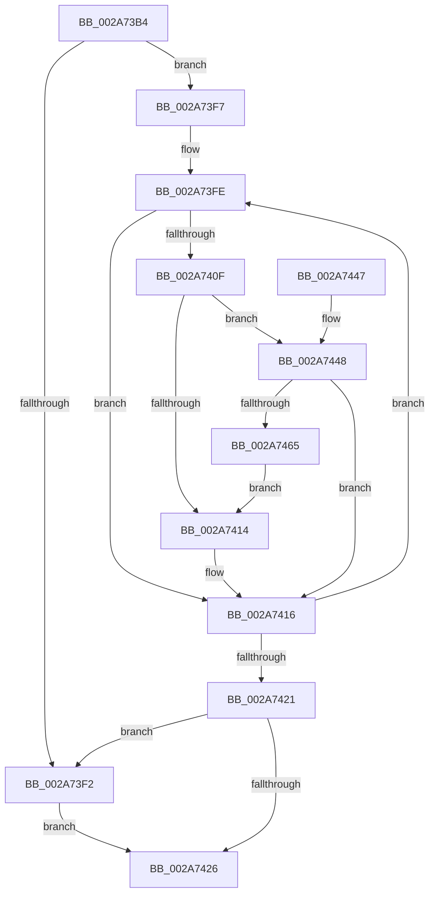

# MiFindBestOutswapPagefile

- RVA: `0x002A73B4`–`0x002A7467` (길이 `179` bytes)
- VA: `0x00000001402A73B4`
- 실행 섹션: `.text`
- PDB 이름 있음: `예`; PDB Function 태그: `아니요`
- unwind 정보 RVA: `0x00068BCC`
- 디코드: `55`개 명령, `179/179` bytes 표시
- 미해석 바이트: `0` (있으면 어셈블리에 `.byte`로 보존)

> 이 문서는 커널 이미지의 기계어와 PDB 기호를 분석해 생성했습니다. 4번과 5번은 함수 원형과 자료형을 바이너리 사용 방식에서 추정한 C 해석이며 원본 소스 복구 결과는 아닙니다.

## 1. Dependencies

- 직접 호출 지점: **3**; 고유 호출 대상: **2**
- 직접 호출자로 확인된 함수: **2**
- RIP 상대 이미지 참조: **0**

### Outgoing calls
- `0x002A73D7` → [MiWsSwapPageFileNumber](MiWsSwapPageFileNumber_function_002A7470.md) (function, `0x002A7470`)
- `0x002A7452` → [MiPageFileLargestBitmapsRun](MiPageFileLargestBitmapsRun_function_002AA708.md) (function, `0x002AA708`)
- `0x002A745C` → [MiPageFileLargestBitmapsRun](MiPageFileLargestBitmapsRun_function_002AA708.md) (function, `0x002AA708`)

### Direct callers
- [MmOutSwapWorkingSet](MmOutSwapWorkingSet_function_002A6BC8.md) at `0x002A6C98`
- [MmOutSwapVirtualAddresses](MmOutSwapVirtualAddresses_function_002A8C30.md) at `0x002A8CA9`

### Static image references
- 디코드된 RIP-relative 메모리 참조가 없습니다.

## 2. Other-region calls and transfers

- 다른 실행 섹션으로 향하는 call: **0**
- 별도 외부 분기/꼬리 이동을 확인하지 못했습니다.

## 3. Assembly (complete function range)

```asm
002A73B4  48 8B C4                        mov rax, rsp
002A73B7  48 89 58 08                     mov qword ptr [rax + 8], rbx
002A73BB  48 89 68 10                     mov qword ptr [rax + 0x10], rbp
002A73BF  48 89 70 18                     mov qword ptr [rax + 0x18], rsi
002A73C3  48 89 78 20                     mov qword ptr [rax + 0x20], rdi
002A73C7  41 54                           push r12
002A73C9  41 56                           push r14
002A73CB  41 57                           push r15
002A73CD  48 83 EC 20                     sub rsp, 0x20
002A73D1  4C 8B FA                        mov r15, rdx
002A73D4  48 8B E9                        mov rbp, rcx
002A73D7  E8 94 00 00 00                  call 0x1402a7470
002A73DC  44 8B A1 58 48 00 00            mov r12d, dword ptr [rcx + 0x4858]
002A73E3  33 F6                           xor esi, esi
002A73E5  41 89 07                        mov dword ptr [r15], eax
002A73E8  BF 10 00 00 00                  mov edi, 0x10
002A73ED  45 85 E4                        test r12d, r12d
002A73F0  75 05                           jne 0x1402a73f7
002A73F2  41 8B 3F                        mov edi, dword ptr [r15]
002A73F5  EB 2F                           jmp 0x1402a7426
002A73F7  4C 8D B1 60 48 00 00            lea r14, [rcx + 0x4860]
002A73FE  49 8B 06                        mov rax, qword ptr [r14]
002A7401  8A 88 AC 00 00 00               mov cl, byte ptr [rax + 0xac]
002A7407  80 E1 D0                        and cl, 0xd0
002A740A  80 F9 80                        cmp cl, 0x80
002A740D  75 07                           jne 0x1402a7416
002A740F  83 FF 10                        cmp edi, 0x10
002A7412  75 34                           jne 0x1402a7448
002A7414  8B FE                           mov edi, esi
002A7416  FF C6                           inc esi
002A7418  49 83 C6 08                     add r14, 8
002A741C  41 3B F4                        cmp esi, r12d
002A741F  72 DD                           jb 0x1402a73fe
002A7421  83 FF 10                        cmp edi, 0x10
002A7424  74 CC                           je 0x1402a73f2
002A7426  48 8B 5C 24 40                  mov rbx, qword ptr [rsp + 0x40]
002A742B  8B C7                           mov eax, edi
002A742D  48 8B 7C 24 58                  mov rdi, qword ptr [rsp + 0x58]
002A7432  48 8B 6C 24 48                  mov rbp, qword ptr [rsp + 0x48]
002A7437  48 8B 74 24 50                  mov rsi, qword ptr [rsp + 0x50]
002A743C  48 83 C4 20                     add rsp, 0x20
002A7440  41 5F                           pop r15
002A7442  41 5E                           pop r14
002A7444  41 5C                           pop r12
002A7446  C3                              ret
002A7447  CC                              int3
002A7448  8B CF                           mov ecx, edi
002A744A  48 8B 8C CD 60 48 00 00         mov rcx, qword ptr [rbp + rcx*8 + 0x4860]
002A7452  E8 B1 32 00 00                  call 0x1402aa708
002A7457  49 8B 0E                        mov rcx, qword ptr [r14]
002A745A  8B D8                           mov ebx, eax
002A745C  E8 A7 32 00 00                  call 0x1402aa708
002A7461  3B C3                           cmp eax, ebx
002A7463  76 B1                           jbe 0x1402a7416
002A7465  EB AD                           jmp 0x1402a7414
```

## 4. C-style interpretation (structured pseudocode)

```c
__int64 __fastcall MiFindBestOutswapPagefile(__int64 a1, __int64 a2)
{
    __int64 result;
    __int64 v_r14;
    __int64 v_rsi;
    __int64 v_rsp;
    unsigned __int64 v_stack_p10;
    unsigned __int64 v_stack_p18;
    unsigned __int64 v_stack_p20;
    unsigned __int64 v_stack_p8;

    *(unsigned __int64 *)(v_rsp + 8) = v_rbx;
    *(unsigned __int64 *)(v_rsp + 16) = v_rbp;
    *(unsigned __int64 *)(v_rsp + 24) = v_rsi;
    *(unsigned __int64 *)(v_rsp + 32) = v_rdi;
    v_rsp = (v_rsp) - (32);
    result = MiWsSwapPageFileNumber(a1, a2, a3, a4);
    v_rsi = 0;
    *(unsigned int *)(a2) = (unsigned int)(result);
    if ((unsigned int)((unsigned int)(*(unsigned int *)(a1 + 18520))) != 0) goto loc_002A73F7;
loc_002A73F2:
    goto loc_002A7426;
loc_002A73F7:
loc_002A73FE:
    a1 = (unsigned __int8)((*(unsigned __int8 *)(*(unsigned __int64 *)(a1 + 18528) + 172)) & (208));
    if (((unsigned __int8)(a1)) != 128) goto loc_002A7416;
    if (((unsigned int)((unsigned int)(*(unsigned int *)(a2)))) != 16) goto loc_002A7448;
loc_002A7414:
loc_002A7416:
    v_rsi = (unsigned int)((v_rsi) + 1);
    v_r14 = (a1 + 18528) + (8);
    if (((unsigned int)(v_rsi)) < ((unsigned int)((unsigned int)(*(unsigned int *)(a1 + 18520))))) goto loc_002A73FE;
    if (0 == 16) goto loc_002A73F2;
loc_002A7426:
    v_rsp = (v_rsp) + (32);
    return 0;
loc_002A7448:
    result = MiPageFileLargestBitmapsRun(*(unsigned __int64 *)(v_stack_p10 + (unsigned int)((unsigned int)(v_stack_p20)) * 8 + 18528), a2, a3, a4);
    result = MiPageFileLargestBitmapsRun(*(unsigned __int64 *)(v_r14), a2, a3, a4);
    if (((unsigned int)(result)) <= ((unsigned int)((unsigned int)((unsigned int)(result))))) goto loc_002A7416;
    goto loc_002A7414;
}
```

## 5. (Beta) C Style

```c
int64_t MiFindBestOutswapPagefile(void *Arg1, void *Arg2)
{
    uint8_t *arg1 = (uint8_t *)Arg1;
    uint8_t *arg2 = (uint8_t *)Arg2;

    int64_t result;
    int64_t local_r14;
    int64_t local_rsi;
    int64_t local_rsp;
    uint64_t v_stack_p10;
    uint64_t v_stack_p18;
    uint64_t v_stack_p20;
    uint64_t v_stack_p8;

    *(uint64_t *)(local_rsp + 0x8) = local_rbx;
    *(uint64_t *)(local_rsp + 0x10) = local_rbp;
    *(uint64_t *)(local_rsp + 0x18) = local_rsi;
    *(uint64_t *)(local_rsp + 0x20) = local_rdi;
    local_rsp = (local_rsp) - (32);
    result = MiWsSwapPageFileNumber(Arg1, Arg2, a3, a4);
    local_rsi = 0;
    *(uint32_t *)(arg2) = (uint32_t)(result);
    if ((uint32_t)((uint32_t)(*(uint32_t *)(arg1 + 0x4858))) != 0) goto loc_002A73F7;
loc_002A73F2:
    goto loc_002A7426;
loc_002A73F7:
loc_002A73FE:
    Arg1 = (uint8_t)((*(uint8_t *)(*(uint64_t *)(arg1 + 0x4860) + 0xAC)) & (208));
    if (((uint8_t)(Arg1)) != 128) goto loc_002A7416;
    if (((uint32_t)((uint32_t)(*(uint32_t *)(arg2)))) != 16) goto loc_002A7448;
loc_002A7414:
loc_002A7416:
    local_rsi = (uint32_t)((local_rsi) + 1);
    local_r14 = (Arg1 + 18528) + (8);
    if (((uint32_t)(local_rsi)) < ((uint32_t)((uint32_t)(*(uint32_t *)(arg1 + 0x4858))))) goto loc_002A73FE;
    if (0 == 16) goto loc_002A73F2;
loc_002A7426:
    local_rsp = (local_rsp) + (32);
    return 0;
loc_002A7448:
    result = MiPageFileLargestBitmapsRun(*(uint64_t *)(v_stack_p10 + (uint32_t)((uint32_t)(v_stack_p20)) * 8 + 0x4860), Arg2, a3, a4);
    result = MiPageFileLargestBitmapsRun(*(uint64_t *)(local_r14), Arg2, a3, a4);
    if (((uint32_t)(result)) <= ((uint32_t)((uint32_t)((uint32_t)(result))))) goto loc_002A7416;
    goto loc_002A7414;
}
```

### 관측된 메모리 오프셋

구조체 형식이 확인되지 않은 접근은 인자 기준의 오프셋으로만 기록했습니다.

| 기준 인자 | 오프셋 표현 | 폭 (bit) | 접근 |
|---|---:|---:|---|
| `Arg1` | `+ 0x4860 + rcx*8` | `64` | `R` |
| `Arg2` | `+ 0x0` | `32` | `R` |
| `Arg2` | `+ 0x0` | `32` | `W` |

## 6. Execution-region graph

[열기: 2D/3D 그래프와 함수 탐색 컨트롤 패널](../../../control-panel.html?section=text&rva=0x002A73B4&view=graph)

- 2D 그래프는 위에서 아래로 흐르고, 3D 그래프는 빈 공간을 드래그해 회전합니다. Shift+드래그는 이동, 휠은 확대·축소, 함수 노드 선택은 대상 보고서 이동입니다.

### Static fallback


