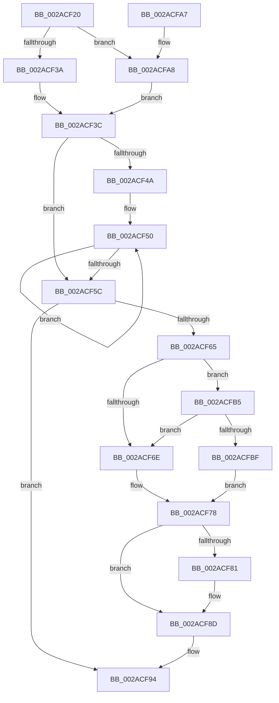

# MiFindLastSubsection

- RVA: `0x002ACF20`–`0x002ACFCE` (길이 `174` bytes)
- VA: `0x00000001402ACF20`
- 실행 섹션: `.text`
- PDB 이름 있음: `예`; PDB Function 태그: `아니요`
- unwind 정보 RVA: `0x0006D260`
- 디코드: `50`개 명령, `174/174` bytes 표시
- 미해석 바이트: `0` (있으면 어셈블리에 `.byte`로 보존)

> 이 문서는 커널 이미지의 기계어와 PDB 기호를 분석해 생성했습니다. 4번과 5번은 함수 원형과 자료형을 바이너리 사용 방식에서 추정한 C 해석이며 원본 소스 복구 결과는 아닙니다.

## 1. Dependencies

- 직접 호출 지점: **3**; 고유 호출 대상: **3**
- 직접 호출자로 확인된 함수: **4**
- RIP 상대 이미지 참조: **3**

### Outgoing calls
- `0x002ACF88` → [KiLowerIrqlProcessIrqlFlags](../4F/KiLowerIrqlProcessIrqlFlags_function_004F5698.md) (function, `0x004F5698`)
- `0x002ACFAB` → [ExAcquireSpinLockShared](../24/ExAcquireSpinLockShared_function_0024DCE0.md) (function, `0x0024DCE0`)
- `0x002ACFC7` → [ExpReleaseSpinLockSharedFromDpcLevelInstrumented](../2F/ExpReleaseSpinLockSharedFromDpcLevelInstrumented_function_002F0F48.md) (function, `0x002F0F48`)

### Direct callers
- [MiCanFileBeTruncatedInternal](MiCanFileBeTruncatedInternal_function_002ACCB4.md) at `0x002ACD84`
- [sub_002BBC73](../2B/Unknown_function_002BBC73.md) at `0x002BBC7B`
- [MmExtendSection](../../page/98/MmExtendSection_function_00982C38.md) at `0x00982CE5`
- [MmFlushVirtualMemory](../../page/9D/MmFlushVirtualMemory_function_009D6F5C.md) at `0x009D7281`

### Static image references
- `0x002ACF65` → RVA `0x00FC6B06` (`ALMOSTRO`; read)
- `0x002ACF78` → RVA `0x00FC6D20` (`ALMOSTRO`; read)
- `0x002ACFB5` → RVA `0x00F0DE58` (`.data`; read)

## 2. Other-region calls and transfers

- 다른 실행 섹션으로 향하는 call: **0**
- 별도 외부 분기/꼬리 이동을 확인하지 못했습니다.

## 3. Assembly (complete function range)

```asm
002ACF20  48 89 5C 24 08                  mov qword ptr [rsp + 8], rbx
002ACF25  48 89 74 24 10                  mov qword ptr [rsp + 0x10], rsi
002ACF2A  57                              push rdi
002ACF2B  48 83 EC 20                     sub rsp, 0x20
002ACF2F  48 8D 79 48                     lea rdi, [rcx + 0x48]
002ACF33  48 8B F1                        mov rsi, rcx
002ACF36  85 D2                           test edx, edx
002ACF38  74 6E                           je 0x1402acfa8
002ACF3A  B3 11                           mov bl, 0x11
002ACF3C  48 8B 8E 18 01 00 00            mov rcx, qword ptr [rsi + 0x118]
002ACF43  33 D2                           xor edx, edx
002ACF45  48 85 C9                        test rcx, rcx
002ACF48  74 12                           je 0x1402acf5c
002ACF4A  66 0F 1F 44 00 00               nop word ptr [rax + rax]
002ACF50  48 8B D1                        mov rdx, rcx
002ACF53  48 8B 49 08                     mov rcx, qword ptr [rcx + 8]
002ACF57  48 85 C9                        test rcx, rcx
002ACF5A  75 F4                           jne 0x1402acf50
002ACF5C  48 8D 72 C8                     lea rsi, [rdx - 0x38]
002ACF60  80 FB 11                        cmp bl, 0x11
002ACF63  74 2F                           je 0x1402acf94
002ACF65  F6 05 9A 9B D1 00 01            test byte ptr [rip + 0xd19b9a], 1
002ACF6C  75 47                           jne 0x1402acfb5
002ACF6E  F0 81 27 FF FF FF BF            lock and dword ptr [rdi], 0xbfffffff
002ACF75  F0 FF 0F                        lock dec dword ptr [rdi]
002ACF78  83 3D A1 9D D1 00 00            cmp dword ptr [rip + 0xd19da1], 0
002ACF7F  74 0C                           je 0x1402acf8d
002ACF81  44 0F 20 C1                     mov rcx, cr8
002ACF85  0F B6 D3                        movzx edx, bl
002ACF88  E8 0B 87 24 00                  call 0x1404f5698
002ACF8D  0F B6 CB                        movzx ecx, bl
002ACF90  44 0F 22 C1                     mov cr8, rcx
002ACF94  48 8B 5C 24 30                  mov rbx, qword ptr [rsp + 0x30]
002ACF99  48 8B C6                        mov rax, rsi
002ACF9C  48 8B 74 24 38                  mov rsi, qword ptr [rsp + 0x38]
002ACFA1  48 83 C4 20                     add rsp, 0x20
002ACFA5  5F                              pop rdi
002ACFA6  C3                              ret
002ACFA7  CC                              int3
002ACFA8  48 8B CF                        mov rcx, rdi
002ACFAB  E8 30 0D FA FF                  call 0x14024dce0
002ACFB0  0F B6 D8                        movzx ebx, al
002ACFB3  EB 87                           jmp 0x1402acf3c
002ACFB5  8B 05 9D 0E C6 00               mov eax, dword ptr [rip + 0xc60e9d]
002ACFBB  85 C0                           test eax, eax
002ACFBD  75 AF                           jne 0x1402acf6e
002ACFBF  48 8B 54 24 28                  mov rdx, qword ptr [rsp + 0x28]
002ACFC4  48 8B CF                        mov rcx, rdi
002ACFC7  E8 7C 3F 04 00                  call 0x1402f0f48
002ACFCC  EB AA                           jmp 0x1402acf78
```

## 4. C-style interpretation (structured pseudocode)

```c
__int64 __fastcall MiFindLastSubsection(__int64 a1, int a2)
{
    __int64 result;
    __int64 v_rsp;
    unsigned __int64 v_stack_p10;
    unsigned __int64 v_stack_p28;
    unsigned __int64 v_stack_p8;

    v_stack_p8 = v_rbx;
    v_stack_p10 = v_rsi;
    v_rsp = (v_rsp) - (32);
    if (a2 == 0) goto loc_002ACFA8;
loc_002ACF3C:
    a2 = 0;
    if (*(unsigned __int64 *)(a1 + 280) == 0) goto loc_002ACF5C;
loc_002ACF50:
    if (*(unsigned __int64 *)(*(unsigned __int64 *)(a1 + 280) + 8) != 0) goto loc_002ACF50;
loc_002ACF5C:
    if (17 == 17) goto loc_002ACF94;
    if (((*(unsigned __int8 *)(v_rip + 13736858)) & (1)) != 0) goto loc_002ACFB5;
loc_002ACF6E:
loc_002ACF78:
    if ((*(unsigned int *)(v_rip + 13737377)) != 0) {
        a1 = v_cr8;
        a2 = 17;
        result = KiLowerIrqlProcessIrqlFlags(a1, a2, a3, a4);
    }
loc_002ACF94:
    v_rsp = (v_rsp) + (32);
    return *(unsigned __int64 *)(a1 + 280) - 56;
loc_002ACFA8:
    result = ExAcquireSpinLockShared(a1 + 72, a2, a3, a4);
    goto loc_002ACF3C;
loc_002ACFB5:
    if ((unsigned int)((unsigned int)(*(unsigned int *)(v_rip + 12979869))) != 0) goto loc_002ACF6E;
    result = ExpReleaseSpinLockSharedFromDpcLevelInstrumented(a1 + 72, v_stack_p28, a3, a4);
    goto loc_002ACF78;
}
```

## 5. (Beta) C Style

```c
int64_t MiFindLastSubsection(void *Arg1, int32_t Arg2)
{
    uint8_t *arg1 = (uint8_t *)Arg1;

    int64_t result;
    int64_t local_rsp;
    uint64_t v_stack_p10;
    uint64_t v_stack_p28;
    uint64_t v_stack_p8;

    v_stack_p8 = local_rbx;
    v_stack_p10 = local_rsi;
    local_rsp = (local_rsp) - (32);
    if (Arg2 == 0) goto loc_002ACFA8;
loc_002ACF3C:
    Arg2 = 0;
    if (*(uint64_t *)(arg1 + 0x118) == 0) goto loc_002ACF5C;
loc_002ACF50:
    if (*(uint64_t *)(*(uint64_t *)(arg1 + 0x118) + 0x8) != 0) goto loc_002ACF50;
loc_002ACF5C:
    if (17 == 17) goto loc_002ACF94;
    if (((*(uint8_t *)(v_rip + 0xD19B9A)) & (1)) != 0) goto loc_002ACFB5;
loc_002ACF6E:
loc_002ACF78:
    if ((*(uint32_t *)(v_rip + 0xD19DA1)) != 0) {
        Arg1 = v_cr8;
        Arg2 = 17;
        result = KiLowerIrqlProcessIrqlFlags(Arg1, Arg2, a3, a4);
    }
loc_002ACF94:
    local_rsp = (local_rsp) + (32);
    return *(uint64_t *)(arg1 + 0x118) - 56;
loc_002ACFA8:
    result = ExAcquireSpinLockShared(Arg1 + 72, Arg2, a3, a4);
    goto loc_002ACF3C;
loc_002ACFB5:
    if ((uint32_t)((uint32_t)(*(uint32_t *)(v_rip + 0xC60E9D))) != 0) goto loc_002ACF6E;
    result = ExpReleaseSpinLockSharedFromDpcLevelInstrumented(Arg1 + 72, v_stack_p28, a3, a4);
    goto loc_002ACF78;
}
```

### 관측된 메모리 오프셋

구조체 형식이 확인되지 않은 접근은 인자 기준의 오프셋으로만 기록했습니다.

| 기준 인자 | 오프셋 표현 | 폭 (bit) | 접근 |
|---|---:|---:|---|
| `Arg1` | `+ 0x0` | `32` | `R/W` |
| `Arg1` | `+ 0x48` | `64` | `R` |
| `Arg1` | `+ 0x118` | `64` | `R` |

## 6. Execution-region graph

[열기: 2D/3D 그래프와 함수 탐색 컨트롤 패널](../../../control-panel.html?section=text&rva=0x002ACF20&view=graph)

- 2D 그래프는 위에서 아래로 흐르고, 3D 그래프는 빈 공간을 드래그해 회전합니다. Shift+드래그는 이동, 휠은 확대·축소, 함수 노드 선택은 대상 보고서 이동입니다.

### Static fallback


