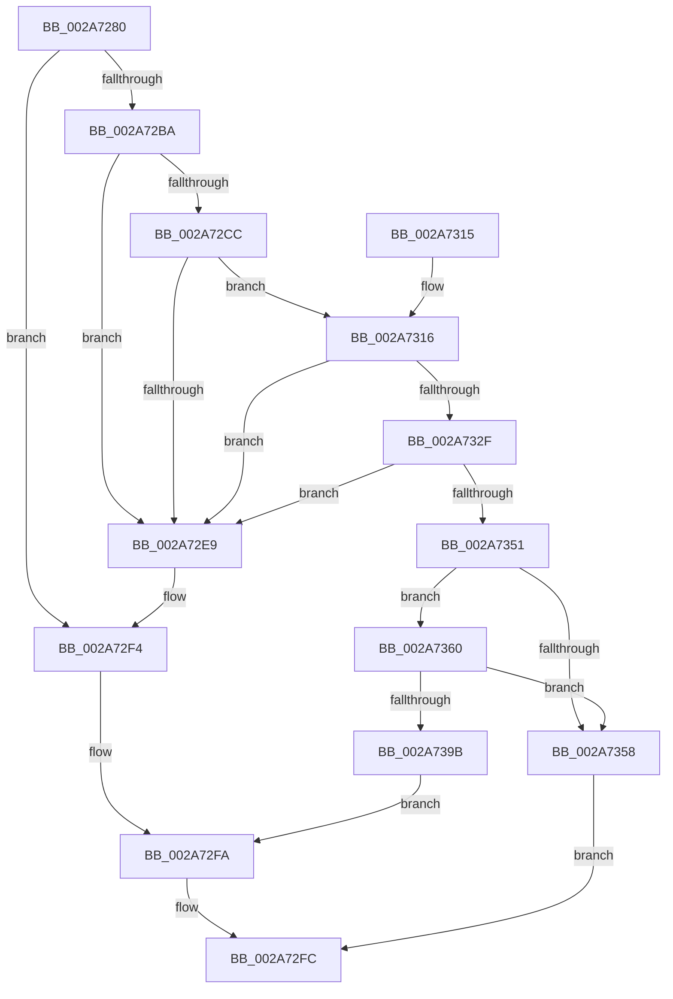

# MiFindPlaceholderVadToReplace

- RVA: `0x002A7280`–`0x002A73AB` (길이 `299` bytes)
- VA: `0x00000001402A7280`
- 실행 섹션: `.text`
- PDB 이름 있음: `예`; PDB Function 태그: `아니요`
- unwind 정보 RVA: `0x00068BB0`
- 디코드: `86`개 명령, `299/299` bytes 표시
- 미해석 바이트: `0` (있으면 어셈블리에 `.byte`로 보존)

> 이 문서는 커널 이미지의 기계어와 PDB 기호를 분석해 생성했습니다. 4번과 5번은 함수 원형과 자료형을 바이너리 사용 방식에서 추정한 C 해석이며 원본 소스 복구 결과는 아닙니다.

## 1. Dependencies

- 직접 호출 지점: **5**; 고유 호출 대상: **4**
- 직접 호출자로 확인된 함수: **2**
- RIP 상대 이미지 참조: **0**

### Outgoing calls
- `0x002A72AD` → [MiLocateAddress](../31/MiLocateAddress_function_003168D0.md) (function, `0x003168D0`)
- `0x002A72C0` → [MiLockVad](../29/MiLockVad_function_00295810.md) (function, `0x00295810`)
- `0x002A72EF` → [MiUnlockVad](MiUnlockVad_function_002A59C8.md) (function, `0x002A59C8`)
- `0x002A7390` → [MiCheckSecuredVad](../../page/88/MiCheckSecuredVad_function_00881FB4.md) (function, `0x00881FB4`)
- `0x002A73A1` → [MiUnlockVad](MiUnlockVad_function_002A59C8.md) (function, `0x002A59C8`)

### Direct callers
- [MiReserveUserMemory](../../page/88/MiReserveUserMemory_function_00884498.md) at `0x00884A31`
- [sub_00885AED](../../page/88/Unknown_function_00885AED.md) at `0x00885B39`

### Static image references
- 디코드된 RIP-relative 메모리 참조가 없습니다.

## 2. Other-region calls and transfers

- 다른 실행 섹션으로 향하는 call: **1**
  - `0x002A7390` → [MiCheckSecuredVad](../../page/88/MiCheckSecuredVad_function_00881FB4.md) (`.text` → `PAGE`)
- 별도 외부 분기/꼬리 이동을 확인하지 못했습니다.

## 3. Assembly (complete function range)

```asm
002A7280  48 89 5C 24 08                  mov qword ptr [rsp + 8], rbx
002A7285  48 89 6C 24 10                  mov qword ptr [rsp + 0x10], rbp
002A728A  48 89 74 24 18                  mov qword ptr [rsp + 0x18], rsi
002A728F  57                              push rdi
002A7290  41 56                           push r14
002A7292  41 57                           push r15
002A7294  48 83 EC 30                     sub rsp, 0x30
002A7298  65 48 8B 34 25 88 01 00 00      mov rsi, qword ptr gs:[0x188]
002A72A1  49 8B F9                        mov rdi, r9
002A72A4  45 8A F8                        mov r15b, r8b
002A72A7  4C 8B F2                        mov r14, rdx
002A72AA  48 8B E9                        mov rbp, rcx
002A72AD  E8 1E F6 06 00                  call 0x1403168d0
002A72B2  48 8B D8                        mov rbx, rax
002A72B5  48 85 C0                        test rax, rax
002A72B8  74 3A                           je 0x1402a72f4
002A72BA  48 8B D0                        mov rdx, rax
002A72BD  48 8B CE                        mov rcx, rsi
002A72C0  E8 4B E5 FE FF                  call 0x140295810
002A72C5  8B 43 30                        mov eax, dword ptr [rbx + 0x30]
002A72C8  A8 04                           test al, 4
002A72CA  75 1D                           jne 0x1402a72e9
002A72CC  8B 4B 34                        mov ecx, dword ptr [rbx + 0x34]
002A72CF  48 B8 FD FF FF FF 07 00 00 00   movabs rax, 0x7fffffffd
002A72D9  0F B6 53 22                     movzx edx, byte ptr [rbx + 0x22]
002A72DD  48 C1 E2 20                     shl rdx, 0x20
002A72E1  48 0B D1                        or rdx, rcx
002A72E4  48 3B D0                        cmp rdx, rax
002A72E7  74 2D                           je 0x1402a7316
002A72E9  48 8B D3                        mov rdx, rbx
002A72EC  48 8B CE                        mov rcx, rsi
002A72EF  E8 D4 E6 FF FF                  call 0x1402a59c8
002A72F4  C7 07 18 00 00 C0               mov dword ptr [rdi], 0xc0000018
002A72FA  33 C0                           xor eax, eax
002A72FC  48 8B 5C 24 50                  mov rbx, qword ptr [rsp + 0x50]
002A7301  48 8B 6C 24 58                  mov rbp, qword ptr [rsp + 0x58]
002A7306  48 8B 74 24 60                  mov rsi, qword ptr [rsp + 0x60]
002A730B  48 83 C4 30                     add rsp, 0x30
002A730F  41 5F                           pop r15
002A7311  41 5E                           pop r14
002A7313  5F                              pop rdi
002A7314  C3                              ret
002A7315  CC                              int3
002A7316  0F B6 53 20                     movzx edx, byte ptr [rbx + 0x20]
002A731A  8B 4B 18                        mov ecx, dword ptr [rbx + 0x18]
002A731D  8B C2                           mov eax, edx
002A731F  48 C1 E0 20                     shl rax, 0x20
002A7323  48 0B C1                        or rax, rcx
002A7326  48 C1 E0 0C                     shl rax, 0xc
002A732A  48 3B C5                        cmp rax, rbp
002A732D  75 BA                           jne 0x1402a72e9
002A732F  44 0F B6 43 21                  movzx r8d, byte ptr [rbx + 0x21]
002A7334  44 8B 4B 1C                     mov r9d, dword ptr [rbx + 0x1c]
002A7338  41 8B C0                        mov eax, r8d
002A733B  48 C1 E0 20                     shl rax, 0x20
002A733F  49 0B C1                        or rax, r9
002A7342  48 C1 E0 0C                     shl rax, 0xc
002A7346  48 0D FF 0F 00 00               or rax, 0xfff
002A734C  49 3B C6                        cmp rax, r14
002A734F  75 98                           jne 0x1402a72e9
002A7351  8B 43 30                        mov eax, dword ptr [rbx + 0x30]
002A7354  A8 08                           test al, 8
002A7356  75 08                           jne 0x1402a7360
002A7358  83 27 00                        and dword ptr [rdi], 0
002A735B  48 8B C3                        mov rax, rbx
002A735E  EB 9C                           jmp 0x1402a72fc
002A7360  48 83 64 24 28 00               and qword ptr [rsp + 0x28], 0
002A7366  49 C1 E0 20                     shl r8, 0x20
002A736A  4D 0B C1                        or r8, r9
002A736D  48 C1 E2 20                     shl rdx, 0x20
002A7371  48 0B D1                        or rdx, rcx
002A7374  44 88 7C 24 20                  mov byte ptr [rsp + 0x20], r15b
002A7379  4C 2B C2                        sub r8, rdx
002A737C  41 B9 55 00 00 00               mov r9d, 0x55
002A7382  49 FF C0                        inc r8
002A7385  48 C1 E2 0C                     shl rdx, 0xc
002A7389  49 C1 E0 0C                     shl r8, 0xc
002A738D  48 8B CB                        mov rcx, rbx
002A7390  E8 1F AC 5D 00                  call 0x140881fb4
002A7395  89 07                           mov dword ptr [rdi], eax
002A7397  85 C0                           test eax, eax
002A7399  79 BD                           jns 0x1402a7358
002A739B  48 8B D3                        mov rdx, rbx
002A739E  48 8B CE                        mov rcx, rsi
002A73A1  E8 22 E6 FF FF                  call 0x1402a59c8
002A73A6  E9 4F FF FF FF                  jmp 0x1402a72fa
```

## 4. C-style interpretation (structured pseudocode)

```c
__int64 __fastcall MiFindPlaceholderVadToReplace(__int64 a1, __int64 a2, unsigned __int8 a3, __int64 a4)
{
    __int64 result;
    __int64 v_rsp;
    unsigned __int64 v_stack_p10;
    unsigned __int64 v_stack_p18;
    unsigned __int8 v_stack_p20;
    unsigned __int64 v_stack_p28;
    unsigned __int64 v_stack_p8;

    v_stack_p8 = v_rbx;
    v_stack_p10 = v_rbp;
    v_stack_p18 = v_rsi;
    v_rsp = (v_rsp) - (48);
    result = MiLocateAddress(a1, a2, a3, a4);
    if (result == 0) goto loc_002A72F4;
    result = MiLockVad(*(unsigned __int64 *)(gs_base + (0 + 392)), result, a3, a4);
    if ((((unsigned __int8)((unsigned int)(*(unsigned int *)(result + 48)))) & (4)) != 0) goto loc_002A72E9;
    a2 = (*(unsigned __int8 *)(result + 34)) << (32);
    a2 = (a2) | ((unsigned int)(*(unsigned int *)(result + 52)));
    if (a2 == ((unsigned int)(*(unsigned int *)(result + 48)))) goto loc_002A7316;
loc_002A72E9:
    result = MiUnlockVad(*(unsigned __int64 *)(gs_base + (0 + 392)), result, a3, a4);
loc_002A72F4:
    *(unsigned int *)(a4) = 0xC0000018ULL;
loc_002A72FA:
    result = 0;
loc_002A72FC:
    v_rsp = (v_rsp) + (48);
    return result;
loc_002A7316:
    result = ((unsigned int)((unsigned int)(*(unsigned __int8 *)(v_stack_p8 + 32)))) << (32);
    result = (result) | ((unsigned int)(*(unsigned int *)(v_stack_p8 + 24)));
    result = (result) << (12);
    if (result != v_stack_p10) goto loc_002A72E9;
    result = ((unsigned int)((unsigned int)(*(unsigned __int8 *)(v_stack_p8 + 33)))) << (32);
    result = (result) | ((unsigned int)(*(unsigned int *)(v_stack_p8 + 28)));
    result = (result) << (12);
    result = (result) | (0xFFFULL);
    if (result != a2) goto loc_002A72E9;
    if ((((unsigned __int8)((unsigned int)(*(unsigned int *)(v_stack_p8 + 48)))) & (8)) != 0) goto loc_002A7360;
loc_002A7358:
    goto loc_002A72FC;
loc_002A7360:
    a3 = (*(unsigned __int8 *)(v_stack_p8 + 33)) << (32);
    a3 = (a3) | ((unsigned int)(*(unsigned int *)(v_stack_p8 + 28)));
    a2 = (*(unsigned __int8 *)(v_stack_p8 + 32)) << (32);
    a2 = (a2) | ((unsigned int)(*(unsigned int *)(v_stack_p8 + 24)));
    v_stack_p20 = a3;
    a3 = (a3) - (a2);
    a3 = (a3) + 1;
    a2 = (a2) << (12);
    a3 = (a3) << (12);
    result = MiCheckSecuredVad(v_stack_p8, a2, a3, 85);
    *(unsigned int *)(a4) = (unsigned int)(result);
    if (!sign_flag) goto loc_002A7358;
    result = MiUnlockVad(v_stack_p18, v_stack_p8, a3, 85);
    goto loc_002A72FA;
}
```

## 5. (Beta) C Style

```c
int64_t MiFindPlaceholderVadToReplace(int64_t Arg1, int64_t Arg2, uint8_t Arg3, void *Arg4)
{
    uint8_t *arg4 = (uint8_t *)Arg4;

    int64_t result;
    int64_t local_rsp;
    uint64_t v_stack_p10;
    uint64_t v_stack_p18;
    uint8_t v_stack_p20;
    uint64_t v_stack_p28;
    uint64_t v_stack_p8;

    v_stack_p8 = local_rbx;
    v_stack_p10 = local_rbp;
    v_stack_p18 = local_rsi;
    local_rsp = (local_rsp) - (48);
    result = MiLocateAddress(Arg1, Arg2, Arg3, Arg4);
    if (result == 0) goto loc_002A72F4;
    result = MiLockVad(*(uint64_t *)(gs_base + (0 + 0x188)), result, Arg3, Arg4);
    if ((((uint8_t)((uint32_t)(*(uint32_t *)(result + 0x30)))) & (4)) != 0) goto loc_002A72E9;
    Arg2 = (*(uint8_t *)(result + 0x22)) << (32);
    Arg2 = (Arg2) | ((uint32_t)(*(uint32_t *)(result + 0x34)));
    if (Arg2 == ((uint32_t)(*(uint32_t *)(result + 0x30)))) goto loc_002A7316;
loc_002A72E9:
    result = MiUnlockVad(*(uint64_t *)(gs_base + (0 + 0x188)), result, Arg3, Arg4);
loc_002A72F4:
    *(uint32_t *)(arg4) = 0xC0000018ULL;
loc_002A72FA:
    result = 0;
loc_002A72FC:
    local_rsp = (local_rsp) + (48);
    return result;
loc_002A7316:
    result = ((uint32_t)((uint32_t)(*(uint8_t *)(v_stack_p8 + 0x20)))) << (32);
    result = (result) | ((uint32_t)(*(uint32_t *)(v_stack_p8 + 0x18)));
    result = (result) << (12);
    if (result != v_stack_p10) goto loc_002A72E9;
    result = ((uint32_t)((uint32_t)(*(uint8_t *)(v_stack_p8 + 0x21)))) << (32);
    result = (result) | ((uint32_t)(*(uint32_t *)(v_stack_p8 + 0x1C)));
    result = (result) << (12);
    result = (result) | (0xFFFULL);
    if (result != Arg2) goto loc_002A72E9;
    if ((((uint8_t)((uint32_t)(*(uint32_t *)(v_stack_p8 + 0x30)))) & (8)) != 0) goto loc_002A7360;
loc_002A7358:
    goto loc_002A72FC;
loc_002A7360:
    Arg3 = (*(uint8_t *)(v_stack_p8 + 0x21)) << (32);
    Arg3 = (Arg3) | ((uint32_t)(*(uint32_t *)(v_stack_p8 + 0x1C)));
    Arg2 = (*(uint8_t *)(v_stack_p8 + 0x20)) << (32);
    Arg2 = (Arg2) | ((uint32_t)(*(uint32_t *)(v_stack_p8 + 0x18)));
    v_stack_p20 = Arg3;
    Arg3 = (Arg3) - (Arg2);
    Arg3 = (Arg3) + 1;
    Arg2 = (Arg2) << (12);
    Arg3 = (Arg3) << (12);
    result = MiCheckSecuredVad(v_stack_p8, Arg2, Arg3, 85);
    *(uint32_t *)(arg4) = (uint32_t)(result);
    if (!sign_flag) goto loc_002A7358;
    result = MiUnlockVad(v_stack_p18, v_stack_p8, Arg3, 85);
    goto loc_002A72FA;
}
```

### 관측된 메모리 오프셋

구조체 형식이 확인되지 않은 접근은 인자 기준의 오프셋으로만 기록했습니다.

| 기준 인자 | 오프셋 표현 | 폭 (bit) | 접근 |
|---|---:|---:|---|
| `Arg4` | `+ 0x0` | `32` | `R/W` |
| `Arg4` | `+ 0x0` | `32` | `W` |

## 6. Execution-region graph

[열기: 2D/3D 그래프와 함수 탐색 컨트롤 패널](../../../control-panel.html?section=text&rva=0x002A7280&view=graph)

- 2D 그래프는 위에서 아래로 흐르고, 3D 그래프는 빈 공간을 드래그해 회전합니다. Shift+드래그는 이동, 휠은 확대·축소, 함수 노드 선택은 대상 보고서 이동입니다.

### Static fallback


