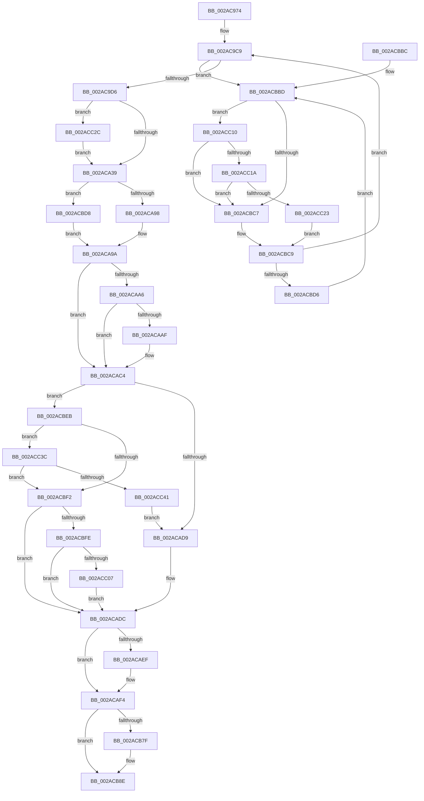

# MiFinishMdlForMappedFileFault

- RVA: `0x002AC974`–`0x002ACC46` (길이 `722` bytes)
- VA: `0x00000001402AC974`
- 실행 섹션: `.text`
- PDB 이름 있음: `예`; PDB Function 태그: `아니요`
- unwind 정보 RVA: `0x0006D218`
- 디코드: `173`개 명령, `722/722` bytes 표시
- 미해석 바이트: `0` (있으면 어셈블리에 `.byte`로 보존)

> 이 문서는 커널 이미지의 기계어와 PDB 기호를 분석해 생성했습니다. 4번과 5번은 함수 원형과 자료형을 바이너리 사용 방식에서 추정한 C 해석이며 원본 소스 복구 결과는 아닙니다.

## 1. Dependencies

- 직접 호출 지점: **11**; 고유 호출 대상: **11**
- 직접 호출자로 확인된 함수: **1**
- RIP 상대 이미지 참조: **2**

### Outgoing calls
- `0x002AC9B1` → [MiReferenceControlAreaPfn](../36/MiReferenceControlAreaPfn_function_00364084.md) (function, `0x00364084`)
- `0x002AC9C2` → [MiObtainProtoReference](../31/MiObtainProtoReference_function_00318178.md) (function, `0x00318178`)
- `0x002ACA59` → [MiStartingOffset](../34/MiStartingOffset_function_003482E0.md) (function, `0x003482E0`)
- `0x002ACA6A` → [ExAcquireSpinLockSharedAtDpcLevel](../24/ExAcquireSpinLockSharedAtDpcLevel_function_00248E30.md) (function, `0x00248E30`)
- `0x002ACA72` → [MiEndingOffset](MiEndingOffset_function_002ACEC8.md) (function, `0x002ACEC8`)
- `0x002ACA7E` → [ExReleaseSpinLockSharedFromDpcLevel](../24/ExReleaseSpinLockSharedFromDpcLevel_function_0024A590.md) (function, `0x0024A590`)
- `0x002ACAE5` → [PsGetIoPriorityThread](../34/PsGetIoPriorityThread_function_00343930.md) (function, `0x00343930`)
- `0x002ACB3D` → [MiUnlockProtoPoolPage](../24/MiUnlockProtoPoolPage_function_00246090.md) (function, `0x00246090`)
- `0x002ACC1A` → [KiCheckVpBackingLongSpinWaitHypercall](../30/KiCheckVpBackingLongSpinWaitHypercall_function_0030F490.md) (function, `0x0030F490`)
- `0x002ACC25` → [HvlNotifyLongSpinWait](../30/HvlNotifyLongSpinWait_function_0030F460.md) (function, `0x0030F460`)
- `0x002ACC32` → [MiFlowThroughInsertNode](../4B/MiFlowThroughInsertNode_function_004B560C.md) (function, `0x004B560C`)

### Direct callers
- [MiResolveMappedFileFault](../36/MiResolveMappedFileFault_function_0036B640.md) at `0x0036BAEC`

### Static image references
- `0x002ACBBF` → RVA `0x00FC52AC` (`ALMOSTRO`; reference)
- `0x002ACC10` → RVA `0x00FC6AB8` (`ALMOSTRO`; read)

## 2. Other-region calls and transfers

- 다른 실행 섹션으로 향하는 call: **0**
- 별도 외부 분기/꼬리 이동을 확인하지 못했습니다.

## 3. Assembly (complete function range)

```asm
002AC974  48 89 5C 24 18                  mov qword ptr [rsp + 0x18], rbx
002AC979  48 89 54 24 10                  mov qword ptr [rsp + 0x10], rdx
002AC97E  55                              push rbp
002AC97F  56                              push rsi
002AC980  57                              push rdi
002AC981  41 54                           push r12
002AC983  41 55                           push r13
002AC985  41 56                           push r14
002AC987  41 57                           push r15
002AC989  48 83 EC 20                     sub rsp, 0x20
002AC98D  4C 8B B9 D0 00 00 00            mov r15, qword ptr [rcx + 0xd0]
002AC994  48 8B F9                        mov rdi, rcx
002AC997  8B B1 B8 00 00 00               mov esi, dword ptr [rcx + 0xb8]
002AC99D  49 8B D7                        mov rdx, r15
002AC9A0  4D 8B F1                        mov r14, r9
002AC9A3  4D 8B E0                        mov r12, r8
002AC9A6  49 8B 07                        mov rax, qword ptr [r15]
002AC9A9  48 8B C8                        mov rcx, rax
002AC9AC  48 89 44 24 60                  mov qword ptr [rsp + 0x60], rax
002AC9B1  E8 CE 76 0B 00                  call 0x140364084
002AC9B6  48 8B AF A0 00 00 00            mov rbp, qword ptr [rdi + 0xa0]
002AC9BD  33 D2                           xor edx, edx
002AC9BF  48 8B CD                        mov rcx, rbp
002AC9C2  E8 B1 B7 06 00                  call 0x140318178
002AC9C7  33 DB                           xor ebx, ebx
002AC9C9  F0 48 0F BA 6D 18 3F            lock bts qword ptr [rbp + 0x18], 0x3f
002AC9D0  0F 82 E7 01 00 00               jb 0x1402acbbd
002AC9D6  48 8B 45 18                     mov rax, qword ptr [rbp + 0x18]
002AC9DA  4A 8D 0C 20                     lea rcx, [rax + r12]
002AC9DE  48 8B D1                        mov rdx, rcx
002AC9E1  48 33 D0                        xor rdx, rax
002AC9E4  48 B8 00 00 00 00 00 00 00 C0   movabs rax, 0xc000000000000000
002AC9EE  48 23 D0                        and rdx, rax
002AC9F1  48 B8 FF FF FF FF FF FF FF 7F   movabs rax, 0x7fffffffffffffff
002AC9FB  48 33 D1                        xor rdx, rcx
002AC9FE  48 89 55 18                     mov qword ptr [rbp + 0x18], rdx
002ACA02  F0 48 21 45 18                  lock and qword ptr [rbp + 0x18], rax
002ACA07  48 8B 87 40 01 00 00            mov rax, qword ptr [rdi + 0x140]
002ACA0E  48 8D 0C 40                     lea rcx, [rax + rax*2]
002ACA12  48 03 C9                        add rcx, rcx
002ACA15  48 B8 08 00 00 00 00 DE FF FF   movabs rax, 0xffffde0000000008
002ACA1F  4C 8B 24 C8                     mov r12, qword ptr [rax + rcx*8]
002ACA23  48 B8 00 00 00 00 00 00 00 80   movabs rax, 0x8000000000000000
002ACA2D  4C 0B E0                        or r12, rax
002ACA30  4D 85 F6                        test r14, r14
002ACA33  0F 85 F3 01 00 00               jne 0x1402acc2c
002ACA39  4C 8B AF E8 00 00 00            mov r13, qword ptr [rdi + 0xe8]
002ACA40  49 8B D4                        mov rdx, r12
002ACA43  44 8B 84 24 80 00 00 00         mov r8d, dword ptr [rsp + 0x80]
002ACA4B  49 8B CF                        mov rcx, r15
002ACA4E  49 8B 45 00                     mov rax, qword ptr [r13]
002ACA52  48 89 87 A8 00 00 00            mov qword ptr [rdi + 0xa8], rax
002ACA59  E8 82 B8 09 00                  call 0x1403482e0
002ACA5E  48 8B 5C 24 60                  mov rbx, qword ptr [rsp + 0x60]
002ACA63  4C 8B F0                        mov r14, rax
002ACA66  48 8D 4B 48                     lea rcx, [rbx + 0x48]
002ACA6A  E8 C1 C3 F9 FF                  call 0x140248e30
002ACA6F  49 8B CF                        mov rcx, r15
002ACA72  E8 51 04 00 00                  call 0x1402acec8
002ACA77  48 8D 4B 48                     lea rcx, [rbx + 0x48]
002ACA7B  4C 8B F8                        mov r15, rax
002ACA7E  E8 0D DB F9 FF                  call 0x14024a590
002ACA83  44 8B 8F C0 00 00 00            mov r9d, dword ptr [rdi + 0xc0]
002ACA8A  B9 00 00 04 00                  mov ecx, 0x40000
002ACA8F  44 85 C9                        test ecx, r9d
002ACA92  0F 85 40 01 00 00               jne 0x1402acbd8
002ACA98  32 DB                           xor bl, bl
002ACA9A  48 8B 44 24 60                  mov rax, qword ptr [rsp + 0x60]
002ACA9F  8B 40 38                        mov eax, dword ptr [rax + 0x38]
002ACAA2  A8 20                           test al, 0x20
002ACAA4  74 1E                           je 0x1402acac4
002ACAA6  49 8D 04 36                     lea rax, [r14 + rsi]
002ACAAA  49 3B C7                        cmp rax, r15
002ACAAD  76 15                           jbe 0x1402acac4
002ACAAF  41 8B F7                        mov esi, r15d
002ACAB2  41 2B F6                        sub esi, r14d
002ACAB5  81 C6 FF 01 00 00               add esi, 0x1ff
002ACABB  81 E6 00 FE FF FF               and esi, 0xfffffe00
002ACAC1  44 0B C9                        or r9d, ecx
002ACAC4  48 8B 4C 24 68                  mov rcx, qword ptr [rsp + 0x68]
002ACAC9  48 8B C1                        mov rax, rcx
002ACACC  48 83 E0 FE                     and rax, 0xfffffffffffffffe
002ACAD0  F6 C1 01                        test cl, 1
002ACAD3  0F 85 12 01 00 00               jne 0x1402acbeb
002ACAD9  45 33 FF                        xor r15d, r15d
002ACADC  65 48 8B 0C 25 88 01 00 00      mov rcx, qword ptr gs:[0x188]
002ACAE5  E8 46 6E 09 00                  call 0x140343930
002ACAEA  83 F8 02                        cmp eax, 2
002ACAED  7D 05                           jge 0x1402acaf4
002ACAEF  41 0F BA E9 09                  bts r9d, 9
002ACAF4  44 89 8F C0 00 00 00            mov dword ptr [rdi + 0xc0], r9d
002ACAFB  48 8D 86 FF 0F 00 00            lea rax, [rsi + 0xfff]
002ACB02  48 C1 E8 0C                     shr rax, 0xc
002ACB06  B2 11                           mov dl, 0x11
002ACB08  66 83 C0 06                     add ax, 6
002ACB0C  4C 89 BF 10 01 00 00            mov qword ptr [rdi + 0x110], r15
002ACB13  66 C1 E0 03                     shl ax, 3
002ACB17  48 8B CD                        mov rcx, rbp
002ACB1A  66 89 87 18 01 00 00            mov word ptr [rdi + 0x118], ax
002ACB21  66 44 89 BF 1A 01 00 00         mov word ptr [rdi + 0x11a], r15w
002ACB29  4C 89 BF 30 01 00 00            mov qword ptr [rdi + 0x130], r15
002ACB30  44 89 BF 3C 01 00 00            mov dword ptr [rdi + 0x13c], r15d
002ACB37  89 B7 38 01 00 00               mov dword ptr [rdi + 0x138], esi
002ACB3D  E8 4E 95 F9 FF                  call 0x140246090
002ACB42  4D 2B EC                        sub r13, r12
002ACB45  49 C1 FD 03                     sar r13, 3
002ACB49  4A 8B 84 EF 40 01 00 00         mov rax, qword ptr [rdi + r13*8 + 0x140]
002ACB51  48 8D 14 40                     lea rdx, [rax + rax*2]
002ACB55  48 C1 E2 04                     shl rdx, 4
002ACB59  48 B8 00 00 00 00 00 DE FF FF   movabs rax, 0xffffde0000000000
002ACB63  48 03 D0                        add rdx, rax
002ACB66  0F B7 87 1A 01 00 00            movzx eax, word ptr [rdi + 0x11a]
002ACB6D  66 83 C8 42                     or ax, 0x42
002ACB71  66 89 87 1A 01 00 00            mov word ptr [rdi + 0x11a], ax
002ACB78  0F B7 C8                        movzx ecx, ax
002ACB7B  84 DB                           test bl, bl
002ACB7D  75 0F                           jne 0x1402acb8e
002ACB7F  B8 00 40 00 00                  mov eax, 0x4000
002ACB84  66 0B C8                        or cx, ax
002ACB87  66 89 8F 1A 01 00 00            mov word ptr [rdi + 0x11a], cx
002ACB8E  48 8B 5C 24 70                  mov rbx, qword ptr [rsp + 0x70]
002ACB93  4C 89 77 60                     mov qword ptr [rdi + 0x60], r14
002ACB97  4C 89 A7 F0 00 00 00            mov qword ptr [rdi + 0xf0], r12
002ACB9E  48 89 97 F8 00 00 00            mov qword ptr [rdi + 0xf8], rdx
002ACBA5  4C 89 BF C8 00 00 00            mov qword ptr [rdi + 0xc8], r15
002ACBAC  48 83 C4 20                     add rsp, 0x20
002ACBB0  41 5F                           pop r15
002ACBB2  41 5E                           pop r14
002ACBB4  41 5D                           pop r13
002ACBB6  41 5C                           pop r12
002ACBB8  5F                              pop rdi
002ACBB9  5E                              pop rsi
002ACBBA  5D                              pop rbp
002ACBBB  C3                              ret
002ACBBC  CC                              int3
002ACBBD  FF C3                           inc ebx
002ACBBF  85 1D E7 86 D1 00               test dword ptr [rip + 0xd186e7], ebx
002ACBC5  74 49                           je 0x1402acc10
002ACBC7  F3 90                           pause
002ACBC9  48 8B 45 18                     mov rax, qword ptr [rbp + 0x18]
002ACBCD  48 85 C0                        test rax, rax
002ACBD0  0F 89 F3 FD FF FF               jns 0x1402ac9c9
002ACBD6  EB E5                           jmp 0x1402acbbd
002ACBD8  41 0F BA F1 12                  btr r9d, 0x12
002ACBDD  B3 01                           mov bl, 1
002ACBDF  44 89 8F C0 00 00 00            mov dword ptr [rdi + 0xc0], r9d
002ACBE6  E9 AF FE FF FF                  jmp 0x1402aca9a
002ACBEB  8A 08                           mov cl, byte ptr [rax]
002ACBED  80 F9 01                        cmp cl, 1
002ACBF0  75 4A                           jne 0x1402acc3c
002ACBF2  45 33 FF                        xor r15d, r15d
002ACBF5  48 85 C0                        test rax, rax
002ACBF8  0F 84 DE FE FF FF               je 0x1402acadc
002ACBFE  80 F9 02                        cmp cl, 2
002ACC01  0F 84 D5 FE FF FF               je 0x1402acadc
002ACC07  41 83 C9 20                     or r9d, 0x20
002ACC0B  E9 CC FE FF FF                  jmp 0x1402acadc
002ACC10  8B 05 A2 9E D1 00               mov eax, dword ptr [rip + 0xd19ea2]
002ACC16  A8 40                           test al, 0x40
002ACC18  74 AD                           je 0x1402acbc7
002ACC1A  E8 71 28 06 00                  call 0x14030f490
002ACC1F  84 C0                           test al, al
002ACC21  74 A4                           je 0x1402acbc7
002ACC23  8B CB                           mov ecx, ebx
002ACC25  E8 36 28 06 00                  call 0x14030f460
002ACC2A  EB 9D                           jmp 0x1402acbc9
002ACC2C  49 8B D6                        mov rdx, r14
002ACC2F  48 8B CF                        mov rcx, rdi
002ACC32  E8 D5 89 20 00                  call 0x1404b560c
002ACC37  E9 FD FD FF FF                  jmp 0x1402aca39
002ACC3C  80 F9 02                        cmp cl, 2
002ACC3F  74 B1                           je 0x1402acbf2
002ACC41  E9 93 FE FF FF                  jmp 0x1402acad9
```

## 4. C-style interpretation (structured pseudocode)

```c
__int64 __fastcall MiFinishMdlForMappedFileFault(__int64 a1, __int64 a2, __int64 a3, __int64 a4, unsigned int a5)
{
    __int64 result;
    __int64 v_r12;
    __int64 v_r13;
    __int64 v_r15;
    __int64 v_rbx;
    __int64 v_rsi;
    __int64 v_rsp;
    unsigned __int64 v_stack_p10;
    unsigned __int64 v_stack_p18;
    unsigned __int64 v_stack_p8;

    v_stack_p18 = v_rbx;
    v_stack_p10 = a2;
    v_rsp = (v_rsp) - (32);
    v_stack_p8 = *(unsigned __int64 *)(*(unsigned __int64 *)(a1 + 208));
    result = MiReferenceControlAreaPfn(*(unsigned __int64 *)(*(unsigned __int64 *)(a1 + 208)), *(unsigned __int64 *)(a1 + 208), a3, a4);
    a2 = 0;
    result = MiObtainProtoReference(*(unsigned __int64 *)(a1 + 160), a2, a3, a4);
    v_rbx = 0;
loc_002AC9C9:
    if (condition_is_below) goto loc_002ACBBD;
    a2 = (*(unsigned __int64 *)(*(unsigned __int64 *)(a1 + 160) + 24) + a3 * 1) ^ (*(unsigned __int64 *)(*(unsigned __int64 *)(a1 + 160) + 24));
    a2 = (a2) & (*(unsigned __int64 *)(*(unsigned __int64 *)(a1 + 160) + 24));
    a2 = (a2) ^ (*(unsigned __int64 *)(*(unsigned __int64 *)(a1 + 160) + 24) + a3 * 1);
    *(unsigned __int64 *)(*(unsigned __int64 *)(a1 + 160) + 24) = a2;
    a1 = (*(unsigned __int64 *)(a1 + 320) + *(unsigned __int64 *)(a1 + 320) * 2) + (*(unsigned __int64 *)(a1 + 320) + *(unsigned __int64 *)(a1 + 320) * 2);
    v_r12 = (*(unsigned __int64 *)(*(unsigned __int64 *)(a1 + 320) + a1 * 8)) | (*(unsigned __int64 *)(a1 + 320));
    if (a4 != 0) goto loc_002ACC2C;
loc_002ACA39:
    *(unsigned __int64 *)(a1 + 168) = *(unsigned __int64 *)(*(unsigned __int64 *)(a1 + 232));
    result = MiStartingOffset(*(unsigned __int64 *)(a1 + 208), v_r12, (unsigned int)(a5), a4);
    result = ExAcquireSpinLockSharedAtDpcLevel(v_stack_p8 + 72, v_r12, (unsigned int)(a5), a4);
    result = MiEndingOffset(*(unsigned __int64 *)(a1 + 208), v_r12, (unsigned int)(a5), a4);
    result = ExReleaseSpinLockSharedFromDpcLevel(v_stack_p8 + 72, v_r12, (unsigned int)(a5), a4);
    if ((((unsigned int)((unsigned int)(0x40000ULL))) & ((unsigned int)((unsigned int)(*(unsigned int *)(a1 + 192))))) != 0) goto loc_002ACBD8;
    v_rbx = 0;
loc_002ACA9A:
    if ((((unsigned __int8)((unsigned int)(*(unsigned int *)(v_stack_p8 + 56)))) & (32)) == 0) goto loc_002ACAC4;
    v_rsi = (unsigned int)(*(unsigned int *)(a1 + 184));
    if ((result + (unsigned int)(*(unsigned int *)(a1 + 184)) * 1) >= = result) {
        v_rsi = (unsigned int)(result);
        v_rsi = (unsigned int)((v_rsi) - ((unsigned int)(result)));
        v_rsi = (unsigned int)((v_rsi) + (511));
        v_rsi = (unsigned int)((v_rsi) & (0xFFFFFE00ULL));
        a4 = (unsigned int)(((unsigned int)(*(unsigned int *)(a1 + 192))) | ((unsigned int)((unsigned int)(0x40000ULL))));
    }
    result = (v_stack_p10) & (-2);
    if ((((unsigned __int8)(v_stack_p10)) & (1)) != 0) goto loc_002ACBEB;
loc_002ACAD9:
    v_r15 = 0;
loc_002ACADC:
    result = PsGetIoPriorityThread(*(unsigned __int64 *)(gs_base + (0 + 392)), v_r12, (unsigned int)(a5), a4);
    if (((unsigned int)(result)) < 2) {
    }
    *(unsigned int *)(a1 + 192) = (unsigned int)(a4);
    result = (v_rsi + 4095) >> (12);
    result = (unsigned __int16)((result) + (6));
    *(unsigned __int64 *)(a1 + 272) = 0;
    result = (unsigned __int16)((result) << (3));
    *(unsigned __int16 *)(a1 + 280) = (unsigned __int16)(result);
    *(unsigned __int16 *)(a1 + 282) = 0;
    *(unsigned __int64 *)(a1 + 304) = 0;
    *(unsigned int *)(a1 + 316) = 0;
    *(unsigned int *)(a1 + 312) = (unsigned int)(v_rsi);
    result = MiUnlockProtoPoolPage(*(unsigned __int64 *)(a1 + 160), 17, (unsigned int)(a5), a4);
    v_r13 = (*(unsigned __int64 *)(a1 + 232)) - (v_r12);
    v_r13 = (v_r13) >> (3);
    a2 = (*(unsigned __int64 *)(a1 + v_r13 * 8 + 320) + *(unsigned __int64 *)(a1 + v_r13 * 8 + 320) * 2) << (4);
    a2 = (a2) + (*(unsigned __int64 *)(a1 + v_r13 * 8 + 320));
    result = (unsigned __int16)((*(unsigned __int16 *)(a1 + 282)) | (66));
    *(unsigned __int16 *)(a1 + 282) = (unsigned __int16)(result);
    if (0 == 0) {
        result = 0x4000ULL;
        a1 = (unsigned __int16)(((unsigned __int16)(result)) | ((unsigned __int16)(result)));
        *(unsigned __int16 *)(a1 + 282) = (unsigned __int16)(a1);
    }
    *(unsigned __int64 *)(a1 + 96) = result;
    *(unsigned __int64 *)(a1 + 240) = v_r12;
    *(unsigned __int64 *)(a1 + 248) = a2;
    *(unsigned __int64 *)(a1 + 200) = 0;
    v_rsp = (v_rsp) + (32);
    return result;
loc_002ACBBD:
    v_rbx = (unsigned int)((v_stack_p18) + 1);
    if (((*(unsigned int *)(v_rip + 13731559)) & ((unsigned int)(v_rbx))) == 0) goto loc_002ACC10;
loc_002ACBC7:
loc_002ACBC9:
    if (!sign_flag) goto loc_002AC9C9;
    goto loc_002ACBBD;
loc_002ACBD8:
    *(unsigned int *)(a1 + 192) = (unsigned int)(a4);
    goto loc_002ACA9A;
loc_002ACBEB:
    if (((unsigned __int8)(*(unsigned __int8 *)(*(unsigned __int64 *)(*(unsigned __int64 *)(a1 + 160) + 24)))) != 1) goto loc_002ACC3C;
loc_002ACBF2:
    v_r15 = 0;
    if (*(unsigned __int64 *)(*(unsigned __int64 *)(a1 + 160) + 24) == 0) goto loc_002ACADC;
    if (((unsigned __int8)(*(unsigned __int8 *)(*(unsigned __int64 *)(*(unsigned __int64 *)(a1 + 160) + 24)))) == 2) goto loc_002ACADC;
    a4 = (unsigned int)((a4) | (32));
    goto loc_002ACADC;
loc_002ACC10:
    if ((((unsigned __int8)((unsigned int)(*(unsigned int *)(v_rip + 13737634)))) & (64)) == 0) goto loc_002ACBC7;
    result = KiCheckVpBackingLongSpinWaitHypercall(*(unsigned __int8 *)(*(unsigned __int64 *)(*(unsigned __int64 *)(a1 + 160) + 24)), a2, (unsigned int)(a5), a4);
    if ((unsigned __int8)(result) == 0) goto loc_002ACBC7;
    result = HvlNotifyLongSpinWait(1, a2, (unsigned int)(a5), a4);
    goto loc_002ACBC9;
loc_002ACC2C:
    result = MiFlowThroughInsertNode(a1, result, (unsigned int)(a5), a4);
    goto loc_002ACA39;
loc_002ACC3C:
    if (((unsigned __int8)(a1)) == 2) goto loc_002ACBF2;
    goto loc_002ACAD9;
}
```

## 5. (Beta) C Style

```c
int64_t MiFinishMdlForMappedFileFault(void *Arg1, int64_t Arg2, int64_t Arg3, int64_t Arg4, uint32_t Arg5)
{
    uint8_t *arg1 = (uint8_t *)Arg1;

    int64_t result;
    int64_t local_r12;
    int64_t local_r13;
    int64_t local_r15;
    int64_t local_rbx;
    int64_t local_rsi;
    int64_t local_rsp;
    uint64_t v_stack_p10;
    uint64_t v_stack_p18;
    uint64_t v_stack_p8;

    v_stack_p18 = local_rbx;
    v_stack_p10 = Arg2;
    local_rsp = (local_rsp) - (32);
    v_stack_p8 = *(uint64_t *)(*(uint64_t *)(arg1 + 0xD0));
    result = MiReferenceControlAreaPfn(*(uint64_t *)(*(uint64_t *)(arg1 + 0xD0)), *(uint64_t *)(arg1 + 0xD0), Arg3, Arg4);
    Arg2 = 0;
    result = MiObtainProtoReference(*(uint64_t *)(arg1 + 0xA0), Arg2, Arg3, Arg4);
    local_rbx = 0;
loc_002AC9C9:
    if (condition_is_below) goto loc_002ACBBD;
    Arg2 = (*(uint64_t *)(*(uint64_t *)(arg1 + 0xA0) + 0x18) + Arg3 * 1) ^ (*(uint64_t *)(*(uint64_t *)(arg1 + 0xA0) + 0x18));
    Arg2 = (Arg2) & (*(uint64_t *)(*(uint64_t *)(arg1 + 0xA0) + 0x18));
    Arg2 = (Arg2) ^ (*(uint64_t *)(*(uint64_t *)(arg1 + 0xA0) + 0x18) + Arg3 * 1);
    *(uint64_t *)(*(uint64_t *)(arg1 + 0xA0) + 0x18) = Arg2;
    Arg1 = (*(uint64_t *)(arg1 + 0x140) + *(uint64_t *)(arg1 + 0x140) * 2) + (*(uint64_t *)(arg1 + 0x140) + *(uint64_t *)(arg1 + 0x140) * 2);
    local_r12 = (*(uint64_t *)(*(uint64_t *)(arg1 + 0x140) + arg1 * 8)) | (*(uint64_t *)(arg1 + 0x140));
    if (Arg4 != 0) goto loc_002ACC2C;
loc_002ACA39:
    *(uint64_t *)(arg1 + 0xA8) = *(uint64_t *)(*(uint64_t *)(arg1 + 0xE8));
    result = MiStartingOffset(*(uint64_t *)(arg1 + 0xD0), local_r12, (uint32_t)(Arg5), Arg4);
    result = ExAcquireSpinLockSharedAtDpcLevel(v_stack_p8 + 72, local_r12, (uint32_t)(Arg5), Arg4);
    result = MiEndingOffset(*(uint64_t *)(arg1 + 0xD0), local_r12, (uint32_t)(Arg5), Arg4);
    result = ExReleaseSpinLockSharedFromDpcLevel(v_stack_p8 + 72, local_r12, (uint32_t)(Arg5), Arg4);
    if ((((uint32_t)((uint32_t)(0x40000ULL))) & ((uint32_t)((uint32_t)(*(uint32_t *)(arg1 + 0xC0))))) != 0) goto loc_002ACBD8;
    local_rbx = 0;
loc_002ACA9A:
    if ((((uint8_t)((uint32_t)(*(uint32_t *)(v_stack_p8 + 0x38)))) & (32)) == 0) goto loc_002ACAC4;
    local_rsi = (uint32_t)(*(uint32_t *)(arg1 + 0xB8));
    if ((result + (uint32_t)(*(uint32_t *)(arg1 + 0xB8)) * 1) >= = result) {
        local_rsi = (uint32_t)(result);
        local_rsi = (uint32_t)((local_rsi) - ((uint32_t)(result)));
        local_rsi = (uint32_t)((local_rsi) + (511));
        local_rsi = (uint32_t)((local_rsi) & (0xFFFFFE00ULL));
        Arg4 = (uint32_t)(((uint32_t)(*(uint32_t *)(arg1 + 0xC0))) | ((uint32_t)((uint32_t)(0x40000ULL))));
    }
    result = (v_stack_p10) & (-2);
    if ((((uint8_t)(v_stack_p10)) & (1)) != 0) goto loc_002ACBEB;
loc_002ACAD9:
    local_r15 = 0;
loc_002ACADC:
    result = PsGetIoPriorityThread(*(uint64_t *)(gs_base + (0 + 0x188)), local_r12, (uint32_t)(Arg5), Arg4);
    if (((uint32_t)(result)) < 2) {
    }
    *(uint32_t *)(arg1 + 0xC0) = (uint32_t)(Arg4);
    result = (local_rsi + 4095) >> (12);
    result = (uint16_t)((result) + (6));
    *(uint64_t *)(arg1 + 0x110) = 0;
    result = (uint16_t)((result) << (3));
    *(uint16_t *)(arg1 + 0x118) = (uint16_t)(result);
    *(uint16_t *)(arg1 + 0x11A) = 0;
    *(uint64_t *)(arg1 + 0x130) = 0;
    *(uint32_t *)(arg1 + 0x13C) = 0;
    *(uint32_t *)(arg1 + 0x138) = (uint32_t)(local_rsi);
    result = MiUnlockProtoPoolPage(*(uint64_t *)(arg1 + 0xA0), 17, (uint32_t)(Arg5), Arg4);
    local_r13 = (*(uint64_t *)(arg1 + 0xE8)) - (local_r12);
    local_r13 = (local_r13) >> (3);
    Arg2 = (*(uint64_t *)(arg1 + local_r13 * 8 + 0x140) + *(uint64_t *)(arg1 + local_r13 * 8 + 0x140) * 2) << (4);
    Arg2 = (Arg2) + (*(uint64_t *)(arg1 + local_r13 * 8 + 0x140));
    result = (uint16_t)((*(uint16_t *)(arg1 + 0x11A)) | (66));
    *(uint16_t *)(arg1 + 0x11A) = (uint16_t)(result);
    if (0 == 0) {
        result = 0x4000ULL;
        Arg1 = (uint16_t)(((uint16_t)(result)) | ((uint16_t)(result)));
        *(uint16_t *)(arg1 + 0x11A) = (uint16_t)(Arg1);
    }
    *(uint64_t *)(arg1 + 0x60) = result;
    *(uint64_t *)(arg1 + 0xF0) = local_r12;
    *(uint64_t *)(arg1 + 0xF8) = Arg2;
    *(uint64_t *)(arg1 + 0xC8) = 0;
    local_rsp = (local_rsp) + (32);
    return result;
loc_002ACBBD:
    local_rbx = (uint32_t)((v_stack_p18) + 1);
    if (((*(uint32_t *)(v_rip + 0xD186E7)) & ((uint32_t)(local_rbx))) == 0) goto loc_002ACC10;
loc_002ACBC7:
loc_002ACBC9:
    if (!sign_flag) goto loc_002AC9C9;
    goto loc_002ACBBD;
loc_002ACBD8:
    *(uint32_t *)(arg1 + 0xC0) = (uint32_t)(Arg4);
    goto loc_002ACA9A;
loc_002ACBEB:
    if (((uint8_t)(*(uint8_t *)(*(uint64_t *)(*(uint64_t *)(arg1 + 0xA0) + 0x18)))) != 1) goto loc_002ACC3C;
loc_002ACBF2:
    local_r15 = 0;
    if (*(uint64_t *)(*(uint64_t *)(arg1 + 0xA0) + 0x18) == 0) goto loc_002ACADC;
    if (((uint8_t)(*(uint8_t *)(*(uint64_t *)(*(uint64_t *)(arg1 + 0xA0) + 0x18)))) == 2) goto loc_002ACADC;
    Arg4 = (uint32_t)((Arg4) | (32));
    goto loc_002ACADC;
loc_002ACC10:
    if ((((uint8_t)((uint32_t)(*(uint32_t *)(v_rip + 0xD19EA2)))) & (64)) == 0) goto loc_002ACBC7;
    result = KiCheckVpBackingLongSpinWaitHypercall(*(uint8_t *)(*(uint64_t *)(*(uint64_t *)(arg1 + 0xA0) + 0x18)), Arg2, (uint32_t)(Arg5), Arg4);
    if ((uint8_t)(result) == 0) goto loc_002ACBC7;
    result = HvlNotifyLongSpinWait(1, Arg2, (uint32_t)(Arg5), Arg4);
    goto loc_002ACBC9;
loc_002ACC2C:
    result = MiFlowThroughInsertNode(Arg1, result, (uint32_t)(Arg5), Arg4);
    goto loc_002ACA39;
loc_002ACC3C:
    if (((uint8_t)(Arg1)) == 2) goto loc_002ACBF2;
    goto loc_002ACAD9;
}
```

### 관측된 메모리 오프셋

구조체 형식이 확인되지 않은 접근은 인자 기준의 오프셋으로만 기록했습니다.

| 기준 인자 | 오프셋 표현 | 폭 (bit) | 접근 |
|---|---:|---:|---|
| `Arg1` | `+ 0x60` | `64` | `W` |
| `Arg1` | `+ 0xA0` | `64` | `R` |
| `Arg1` | `+ 0xA8` | `64` | `W` |
| `Arg1` | `+ 0xB8` | `32` | `R` |
| `Arg1` | `+ 0xC0` | `32` | `R` |
| `Arg1` | `+ 0xC0` | `32` | `W` |
| `Arg1` | `+ 0xC8` | `64` | `W` |
| `Arg1` | `+ 0xD0` | `64` | `R` |
| `Arg1` | `+ 0xE8` | `64` | `R` |
| `Arg1` | `+ 0xF0` | `64` | `W` |
| `Arg1` | `+ 0xF8` | `64` | `W` |
| `Arg1` | `+ 0x110` | `64` | `W` |
| `Arg1` | `+ 0x118` | `16` | `W` |
| `Arg1` | `+ 0x11A` | `16` | `R` |
| `Arg1` | `+ 0x11A` | `16` | `W` |
| `Arg1` | `+ 0x130` | `64` | `W` |
| `Arg1` | `+ 0x138` | `32` | `W` |
| `Arg1` | `+ 0x13C` | `32` | `W` |
| `Arg1` | `+ 0x140` | `64` | `R` |
| `Arg1` | `+ 0x140 + r13*8` | `64` | `R` |

## 6. Execution-region graph

[열기: 2D/3D 그래프와 함수 탐색 컨트롤 패널](../../../control-panel.html?section=text&rva=0x002AC974&view=graph)

- 2D 그래프는 위에서 아래로 흐르고, 3D 그래프는 빈 공간을 드래그해 회전합니다. Shift+드래그는 이동, 휠은 확대·축소, 함수 노드 선택은 대상 보고서 이동입니다.

### Static fallback


