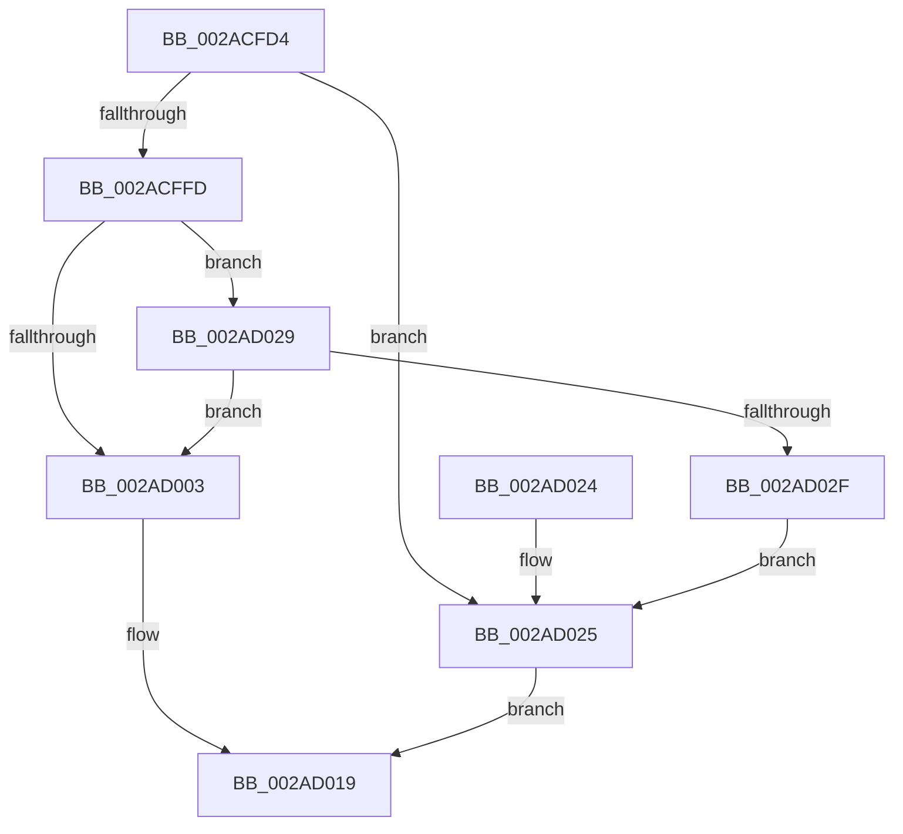

# MiForceSectionClosed

- RVA: `0x002ACFD4`–`0x002AD03E` (길이 `106` bytes)
- VA: `0x00000001402ACFD4`
- 실행 섹션: `.text`
- PDB 이름 있음: `예`; PDB Function 태그: `아니요`
- unwind 정보 RVA: `0x0006D274`
- 디코드: `34`개 명령, `106/106` bytes 표시
- 미해석 바이트: `0` (있으면 어셈블리에 `.byte`로 보존)

> 이 문서는 커널 이미지의 기계어와 PDB 기호를 분석해 생성했습니다. 4번과 5번은 함수 원형과 자료형을 바이너리 사용 방식에서 추정한 C 해석이며 원본 소스 복구 결과는 아닙니다.

## 1. Dependencies

- 직접 호출 지점: **3**; 고유 호출 대상: **3**
- 직접 호출자로 확인된 함수: **4**
- RIP 상대 이미지 참조: **0**

### Outgoing calls
- `0x002ACFF0` → [MiLockSectionControlArea](../2B/MiLockSectionControlArea_function_002BC930.md) (function, `0x002BC930`)
- `0x002AD00D` → [MiAttemptSectionDelete](MiAttemptSectionDelete_function_002AD044.md) (function, `0x002AD044`)
- `0x002AD037` → [MiReleaseSpinLockExclusive](../24/MiReleaseSpinLockExclusive_function_002482C0.md) (function, `0x002482C0`)

### Direct callers
- [MmForceSectionClosedEx](MmForceSectionClosedEx_function_002AB100.md) at `0x002AB140`
- [MmForceSectionClosedEx](MmForceSectionClosedEx_function_002AB100.md) at `0x002AB178`
- [MmForceSectionClosed](../48/MmForceSectionClosed_function_004838D0.md) at `0x004838EB`
- [MmForceSectionClosed](../48/MmForceSectionClosed_function_004838D0.md) at `0x00483914`
- [sub_00984B34](../../page/98/Unknown_function_00984B34.md) at `0x00984CD6`
- [sub_00984D37](../../page/98/Unknown_function_00984D37.md) at `0x00984E5C`

### Static image references
- 디코드된 RIP-relative 메모리 참조가 없습니다.

## 2. Other-region calls and transfers

- 다른 실행 섹션으로 향하는 call: **0**
- 별도 외부 분기/꼬리 이동을 확인하지 못했습니다.

## 3. Assembly (complete function range)

```asm
002ACFD4  48 89 5C 24 08                  mov qword ptr [rsp + 8], rbx
002ACFD9  57                              push rdi
002ACFDA  48 83 EC 20                     sub rsp, 0x20
002ACFDE  41 8B F8                        mov edi, r8d
002ACFE1  C6 44 24 38 00                  mov byte ptr [rsp + 0x38], 0
002ACFE6  8B DA                           mov ebx, edx
002ACFE8  4C 8D 44 24 38                  lea r8, [rsp + 0x38]
002ACFED  83 E2 01                        and edx, 1
002ACFF0  E8 3B F9 00 00                  call 0x1402bc930
002ACFF5  48 8B C8                        mov rcx, rax
002ACFF8  48 85 C0                        test rax, rax
002ACFFB  74 28                           je 0x1402ad025
002ACFFD  40 F6 C7 01                     test dil, 1
002AD001  75 26                           jne 0x1402ad029
002AD003  8A 54 24 38                     mov dl, byte ptr [rsp + 0x38]
002AD007  83 E3 04                        and ebx, 4
002AD00A  44 8B C3                        mov r8d, ebx
002AD00D  E8 32 00 00 00                  call 0x1402ad044
002AD012  F6 D8                           neg al
002AD014  1B C0                           sbb eax, eax
002AD016  83 C0 02                        add eax, 2
002AD019  48 8B 5C 24 30                  mov rbx, qword ptr [rsp + 0x30]
002AD01E  48 83 C4 20                     add rsp, 0x20
002AD022  5F                              pop rdi
002AD023  C3                              ret
002AD024  CC                              int3
002AD025  33 C0                           xor eax, eax
002AD027  EB F0                           jmp 0x1402ad019
002AD029  F6 40 3E 0C                     test byte ptr [rax + 0x3e], 0xc
002AD02D  75 D4                           jne 0x1402ad003
002AD02F  8A 54 24 38                     mov dl, byte ptr [rsp + 0x38]
002AD033  48 83 C1 48                     add rcx, 0x48
002AD037  E8 84 B2 F9 FF                  call 0x1402482c0
002AD03C  EB E7                           jmp 0x1402ad025
```

## 4. C-style interpretation (structured pseudocode)

```c
__int64 __fastcall MiForceSectionClosed(__int64 a1, int a2, int a3)
{
    __int64 result;
    __int64 v_rbx;
    __int64 v_rsp;
    unsigned __int8 v_stack_p10;
    unsigned __int8 v_stack_p38;
    unsigned __int64 v_stack_p8;

    v_stack_p8 = v_rbx;
    v_rsp = (v_rsp) - (32);
    v_stack_p10 = 0;
    a2 = (unsigned int)((a2) & (1));
    result = MiLockSectionControlArea(a1, a2, v_stack_p10, a4);
    if (result == 0) goto loc_002AD025;
    if ((((unsigned __int8)((unsigned int)(a3))) & (1)) != 0) goto loc_002AD029;
loc_002AD003:
    v_rbx = (unsigned int)(((unsigned int)(a2)) & (4));
    result = MiAttemptSectionDelete(result, v_stack_p10, (unsigned int)((unsigned int)(v_rbx)), a4);
    result = (unsigned __int8)(-(result));
    result = (unsigned int)((result) + (2));
loc_002AD019:
    v_rsp = (v_rsp) + (32);
    return result;
loc_002AD025:
    result = 0;
    goto loc_002AD019;
loc_002AD029:
    if (((*(unsigned __int8 *)(result + 62)) & (12)) != 0) goto loc_002AD003;
    a1 = (result) + (72);
    result = MiReleaseSpinLockExclusive(a1, v_stack_p38, (unsigned int)((unsigned int)(v_rbx)), a4);
    goto loc_002AD025;
}
```

## 5. (Beta) C Style

```c
int64_t MiForceSectionClosed(int64_t Arg1, int32_t Arg2, int32_t Arg3)
{
    int64_t result;
    int64_t local_rbx;
    int64_t local_rsp;
    uint8_t v_stack_p10;
    uint8_t v_stack_p38;
    uint64_t v_stack_p8;

    v_stack_p8 = local_rbx;
    local_rsp = (local_rsp) - (32);
    v_stack_p10 = 0;
    Arg2 = (uint32_t)((Arg2) & (1));
    result = MiLockSectionControlArea(Arg1, Arg2, v_stack_p10, a4);
    if (result == 0) goto loc_002AD025;
    if ((((uint8_t)((uint32_t)(Arg3))) & (1)) != 0) goto loc_002AD029;
loc_002AD003:
    local_rbx = (uint32_t)(((uint32_t)(Arg2)) & (4));
    result = MiAttemptSectionDelete(result, v_stack_p10, (uint32_t)((uint32_t)(local_rbx)), a4);
    result = (uint8_t)(-(result));
    result = (uint32_t)((result) + (2));
loc_002AD019:
    local_rsp = (local_rsp) + (32);
    return result;
loc_002AD025:
    result = 0;
    goto loc_002AD019;
loc_002AD029:
    if (((*(uint8_t *)(result + 0x3E)) & (12)) != 0) goto loc_002AD003;
    Arg1 = (result) + (72);
    result = MiReleaseSpinLockExclusive(Arg1, v_stack_p38, (uint32_t)((uint32_t)(local_rbx)), a4);
    goto loc_002AD025;
}
```

## 6. Execution-region graph

[열기: 2D/3D 그래프와 함수 탐색 컨트롤 패널](../../../control-panel.html?section=text&rva=0x002ACFD4&view=graph)

- 2D 그래프는 위에서 아래로 흐르고, 3D 그래프는 빈 공간을 드래그해 회전합니다. Shift+드래그는 이동, 휠은 확대·축소, 함수 노드 선택은 대상 보고서 이동입니다.

### Static fallback


