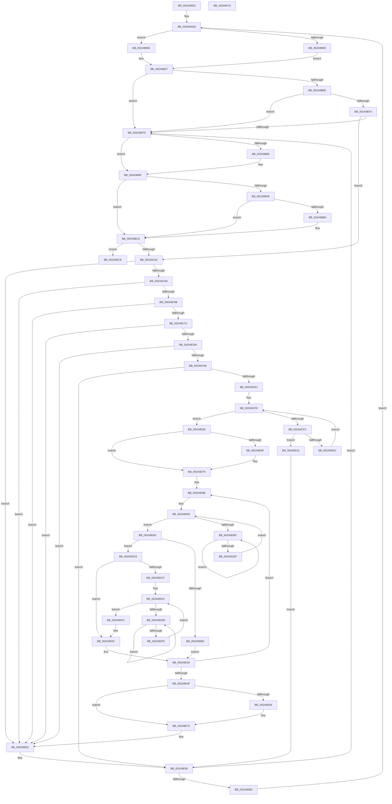

# MiFreeLargePages

- RVA: `0x002A99D0`–`0x002A9F16` (길이 `1,350` bytes)
- VA: `0x00000001402A99D0`
- 실행 섹션: `.text`
- PDB 이름 있음: `예`; PDB Function 태그: `아니요`
- unwind 정보 RVA: `0x00068E5C`
- 디코드: `309`개 명령, `1,350/1,350` bytes 표시
- 미해석 바이트: `0` (있으면 어셈블리에 `.byte`로 보존)

> 이 문서는 커널 이미지의 기계어와 PDB 기호를 분석해 생성했습니다. 4번과 5번은 함수 원형과 자료형을 바이너리 사용 방식에서 추정한 C 해석이며 원본 소스 복구 결과는 아닙니다.

## 1. Dependencies

- 직접 호출 지점: **16**; 고유 호출 대상: **13**
- 직접 호출자로 확인된 함수: **4**
- RIP 상대 이미지 참조: **4**

### Outgoing calls
- `0x002A9A37` → [MiMakeDemandZeroPte](../33/MiMakeDemandZeroPte_function_00337A00.md) (function, `0x00337A00`)
- `0x002A9AD6` → [MiPageToNode](../33/MiPageToNode_function_00338CD0.md) (function, `0x00338CD0`)
- `0x002A9B5B` → [MiPageToNode](../33/MiPageToNode_function_00338CD0.md) (function, `0x00338CD0`)
- `0x002A9B93` → [MiFreeLargeProcessPagesToCache](../69/MiFreeLargeProcessPagesToCache_function_00698F24.md) (function, `0x00698F24`)
- `0x002A9BC1` → [MiReturnCrossPartitionCharges](../28/MiReturnCrossPartitionCharges_function_002867D0.md) (function, `0x002867D0`)
- `0x002A9C35` → [MiGetPfnPageSizeIndex](../31/MiGetPfnPageSizeIndex_function_0031C710.md) (function, `0x0031C710`)
- `0x002A9C7D` → [MiLargePageHasNoDanglingReferences](../48/MiLargePageHasNoDanglingReferences_function_00485A24.md) (function, `0x00485A24`)
- `0x002A9C9C` → [MiLockPageInline](../31/MiLockPageInline_function_0031A340.md) (function, `0x0031A340`)
- `0x002A9CC7` → [MiUnlockPage](../31/MiUnlockPage_function_0031A3E0.md) (function, `0x0031A3E0`)
- `0x002A9D21` → [MiFreeLargeProcessPagesToCache](../69/MiFreeLargeProcessPagesToCache_function_00698F24.md) (function, `0x00698F24`)
- `0x002A9D74` → [KiRaiseIrqlProcessIrqlFlags](../4F/KiRaiseIrqlProcessIrqlFlags_function_004F56FC.md) (function, `0x004F56FC`)
- `0x002A9DA1` → [KeYieldProcessorEx](../3F/KeYieldProcessorEx_function_003FBD00.md) (function, `0x003FBD00`)
- `0x002A9DE2` → [KeYieldProcessorEx](../3F/KeYieldProcessorEx_function_003FBD00.md) (function, `0x003FBD00`)
- `0x002A9E6F` → [KiLowerIrqlProcessIrqlFlags](../4F/KiLowerIrqlProcessIrqlFlags_function_004F5698.md) (function, `0x004F5698`)
- `0x002A9E8B` → [MiFreeLargePageMemory](../37/MiFreeLargePageMemory_function_00377938.md) (function, `0x00377938`)
- `0x002A9EF5` → [_security_check_cookie](../6A/_security_check_cookie_function_006AC640.md) (function, `0x006AC640`)

### Direct callers
- [MiDeleteVaFinal](MiDeleteVaFinal_function_002A9940.md) at `0x002A999F`
- [MiDeleteSubsectionLargePages](../4D/MiDeleteSubsectionLargePages_function_004D51E0.md) at `0x004D5299`
- [MiFreeContiguousLargePageRun](../68/MiFreeContiguousLargePageRun_function_00688A34.md) at `0x00688C85`
- [MiDecommitRegion](../../page/88/MiDecommitRegion_function_008807A0.md) at `0x00880925`

### Static image references
- `0x002A99E7` → RVA `0x00E0A740` (`.data`; read)
- `0x002A9A7E` → RVA `0x00E30088` (`.data`; read)
- `0x002A9C3D` → RVA `0x00011C60` (`.rdata`; read)
- `0x002A9D66` → RVA `0x00FC6D20` (`ALMOSTRO`; read)

## 2. Other-region calls and transfers

- 다른 실행 섹션으로 향하는 call: **0**
- 별도 외부 분기/꼬리 이동을 확인하지 못했습니다.

## 3. Assembly (complete function range)

```asm
002A99D0  48 89 5C 24 08                  mov qword ptr [rsp + 8], rbx
002A99D5  55                              push rbp
002A99D6  56                              push rsi
002A99D7  57                              push rdi
002A99D8  41 54                           push r12
002A99DA  41 55                           push r13
002A99DC  41 56                           push r14
002A99DE  41 57                           push r15
002A99E0  48 81 EC D0 01 00 00            sub rsp, 0x1d0
002A99E7  48 8B 05 52 0D B6 00            mov rax, qword ptr [rip + 0xb60d52]
002A99EE  48 33 C4                        xor rax, rsp
002A99F1  48 89 84 24 C0 01 00 00         mov qword ptr [rsp + 0x1c0], rax
002A99F9  33 DB                           xor ebx, ebx
002A99FB  48 89 8C 24 90 00 00 00         mov qword ptr [rsp + 0x90], rcx
002A9A03  4C 89 8C 24 B0 00 00 00         mov qword ptr [rsp + 0xb0], r9
002A9A0B  4C 8B F2                        mov r14, rdx
002A9A0E  4C 89 84 24 A8 00 00 00         mov qword ptr [rsp + 0xa8], r8
002A9A16  8B EB                           mov ebp, ebx
002A9A18  44 8B EB                        mov r13d, ebx
002A9A1B  48 89 5C 24 60                  mov qword ptr [rsp + 0x60], rbx
002A9A20  8D 4B 04                        lea ecx, [rbx + 4]
002A9A23  48 89 5C 24 58                  mov qword ptr [rsp + 0x58], rbx
002A9A28  48 89 5C 24 28                  mov qword ptr [rsp + 0x28], rbx
002A9A2D  48 89 5C 24 40                  mov qword ptr [rsp + 0x40], rbx
002A9A32  48 89 5C 24 70                  mov qword ptr [rsp + 0x70], rbx
002A9A37  E8 C4 DF 08 00                  call 0x140337a00
002A9A3C  48 8B F0                        mov rsi, rax
002A9A3F  48 89 84 24 A0 00 00 00         mov qword ptr [rsp + 0xa0], rax
002A9A47  65 48 8B 04 25 88 01 00 00      mov rax, qword ptr gs:[0x188]
002A9A50  49 BF 00 00 00 00 00 DE FF FF   movabs r15, 0xffffde0000000000
002A9A5A  48 8B 88 B8 00 00 00            mov rcx, qword ptr [rax + 0xb8]
002A9A61  48 8B 81 10 04 00 00            mov rax, qword ptr [rcx + 0x410]
002A9A68  0F B7 89 AE 04 00 00            movzx ecx, word ptr [rcx + 0x4ae]
002A9A6F  48 8B 80 18 04 00 00            mov rax, qword ptr [rax + 0x418]
002A9A76  48 89 84 24 98 00 00 00         mov qword ptr [rsp + 0x98], rax
002A9A7E  48 8B 05 03 66 B8 00            mov rax, qword ptr [rip + 0xb86603]
002A9A85  48 8B 04 C8                     mov rax, qword ptr [rax + rcx*8]
002A9A89  48 89 44 24 78                  mov qword ptr [rsp + 0x78], rax
002A9A8E  48 8B 42 28                     mov rax, qword ptr [rdx + 0x28]
002A9A92  48 8B 0D EF 65 B8 00            mov rcx, qword ptr [rip + 0xb865ef]
002A9A99  48 C1 E8 2B                     shr rax, 0x2b
002A9A9D  25 FF 03 00 00                  and eax, 0x3ff
002A9AA2  48 8B 04 C1                     mov rax, qword ptr [rcx + rax*8]
002A9AA6  48 89 44 24 30                  mov qword ptr [rsp + 0x30], rax
002A9AAB  8B 42 20                        mov eax, dword ptr [rdx + 0x20]
002A9AAE  C1 E8 10                        shr eax, 0x10
002A9AB1  0F B6 C0                        movzx eax, al
002A9AB4  C1 E8 06                        shr eax, 6
002A9AB7  89 44 24 38                     mov dword ptr [rsp + 0x38], eax
002A9ABB  49 8B C7                        mov rax, r15
002A9ABE  48 8B CA                        mov rcx, rdx
002A9AC1  49 BC AB AA AA AA AA AA AA AA   movabs r12, 0xaaaaaaaaaaaaaaab
002A9ACB  48 2B C8                        sub rcx, rax
002A9ACE  48 C1 F9 04                     sar rcx, 4
002A9AD2  49 0F AF CC                     imul rcx, r12
002A9AD6  E8 F5 F1 08 00                  call 0x140338cd0
002A9ADB  8B F8                           mov edi, eax
002A9ADD  49 8B C7                        mov rax, r15
002A9AE0  4D 8B FE                        mov r15, r14
002A9AE3  4C 2B F8                        sub r15, rax
002A9AE6  48 B8 FE FF FF FF FF 0F 00 00   movabs rax, 0xffffffffffe
002A9AF0  49 C1 FF 04                     sar r15, 4
002A9AF4  4D 0F AF FC                     imul r15, r12
002A9AF8  4D 8B 26                        mov r12, qword ptr [r14]
002A9AFB  4C 85 E0                        test rax, r12
002A9AFE  75 0A                           jne 0x1402a9b0a
002A9B00  48 89 9C 24 88 00 00 00         mov qword ptr [rsp + 0x88], rbx
002A9B08  EB 1D                           jmp 0x1402a9b27
002A9B0A  49 83 E4 FE                     and r12, 0xfffffffffffffffe
002A9B0E  48 B8 00 00 00 00 00 F0 FF FF   movabs rax, 0xfffff00000000000
002A9B18  4C 0B E0                        or r12, rax
002A9B1B  49 C1 E4 03                     shl r12, 3
002A9B1F  4C 89 A4 24 88 00 00 00         mov qword ptr [rsp + 0x88], r12
002A9B27  49 8B 46 28                     mov rax, qword ptr [r14 + 0x28]
002A9B2B  48 8B 0D 56 65 B8 00            mov rcx, qword ptr [rip + 0xb86556]
002A9B32  48 C1 E8 2B                     shr rax, 0x2b
002A9B36  25 FF 03 00 00                  and eax, 0x3ff
002A9B3B  48 8B 04 C1                     mov rax, qword ptr [rcx + rax*8]
002A9B3F  49 8B CF                        mov rcx, r15
002A9B42  48 89 44 24 68                  mov qword ptr [rsp + 0x68], rax
002A9B47  41 8B 46 20                     mov eax, dword ptr [r14 + 0x20]
002A9B4B  C1 E8 10                        shr eax, 0x10
002A9B4E  44 0F B6 E0                     movzx r12d, al
002A9B52  41 C1 EC 06                     shr r12d, 6
002A9B56  44 89 64 24 48                  mov dword ptr [rsp + 0x48], r12d
002A9B5B  E8 70 F1 08 00                  call 0x140338cd0
002A9B60  8B D8                           mov ebx, eax
002A9B62  48 8B 44 24 30                  mov rax, qword ptr [rsp + 0x30]
002A9B67  48 39 44 24 68                  cmp qword ptr [rsp + 0x68], rax
002A9B6C  75 0F                           jne 0x1402a9b7d
002A9B6E  44 3B 64 24 38                  cmp r12d, dword ptr [rsp + 0x38]
002A9B73  75 08                           jne 0x1402a9b7d
002A9B75  3B DF                           cmp ebx, edi
002A9B77  0F 84 B5 00 00 00               je 0x1402a9c32
002A9B7D  4C 8B 64 24 58                  mov r12, qword ptr [rsp + 0x58]
002A9B82  49 8B FD                        mov rdi, r13
002A9B85  85 ED                           test ebp, ebp
002A9B87  74 16                           je 0x1402a9b9f
002A9B89  8B D5                           mov edx, ebp
002A9B8B  48 8D 8C 24 C0 00 00 00         lea rcx, [rsp + 0xc0]
002A9B93  E8 8C F3 3E 00                  call 0x140698f24
002A9B98  48 8B 44 24 30                  mov rax, qword ptr [rsp + 0x30]
002A9B9D  33 ED                           xor ebp, ebp
002A9B9F  F6 84 24 30 02 00 00 01         test byte ptr [rsp + 0x230], 1
002A9BA7  75 1D                           jne 0x1402a9bc6
002A9BA9  48 3B 44 24 78                  cmp rax, qword ptr [rsp + 0x78]
002A9BAE  74 16                           je 0x1402a9bc6
002A9BB0  4C 8B 4C 24 40                  mov r9, qword ptr [rsp + 0x40]
002A9BB5  BA 02 00 00 00                  mov edx, 2
002A9BBA  48 8B C8                        mov rcx, rax
002A9BBD  44 8D 42 FF                     lea r8d, [rdx - 1]
002A9BC1  E8 0A CC FD FF                  call 0x1402867d0
002A9BC6  4C 03 6C 24 40                  add r13, qword ptr [rsp + 0x40]
002A9BCB  49 8B C4                        mov rax, r12
002A9BCE  48 8B 4C 24 30                  mov rcx, qword ptr [rsp + 0x30]
002A9BD3  48 3B 8C 24 90 00 00 00         cmp rcx, qword ptr [rsp + 0x90]
002A9BDB  4C 0F 45 EF                     cmovne r13, rdi
002A9BDF  48 03 44 24 28                  add rax, qword ptr [rsp + 0x28]
002A9BE4  48 3B 8C 24 90 00 00 00         cmp rcx, qword ptr [rsp + 0x90]
002A9BEC  8B FB                           mov edi, ebx
002A9BEE  48 8B 4C 24 68                  mov rcx, qword ptr [rsp + 0x68]
002A9BF3  49 0F 45 C4                     cmovne rax, r12
002A9BF7  48 89 4C 24 30                  mov qword ptr [rsp + 0x30], rcx
002A9BFC  8B 4C 24 48                     mov ecx, dword ptr [rsp + 0x48]
002A9C00  48 83 64 24 28 00               and qword ptr [rsp + 0x28], 0
002A9C06  89 4C 24 38                     mov dword ptr [rsp + 0x38], ecx
002A9C0A  48 8B 4C 24 70                  mov rcx, qword ptr [rsp + 0x70]
002A9C0F  48 03 4C 24 40                  add rcx, qword ptr [rsp + 0x40]
002A9C14  48 83 64 24 40 00               and qword ptr [rsp + 0x40], 0
002A9C1A  4C 89 6C 24 60                  mov qword ptr [rsp + 0x60], r13
002A9C1F  48 89 44 24 58                  mov qword ptr [rsp + 0x58], rax
002A9C24  48 89 4C 24 70                  mov qword ptr [rsp + 0x70], rcx
002A9C29  4D 85 F6                        test r14, r14
002A9C2C  0F 84 9C 02 00 00               je 0x1402a9ece
002A9C32  49 8B CE                        mov rcx, r14
002A9C35  E8 D6 2A 07 00                  call 0x14031c710
002A9C3A  44 8B E8                        mov r13d, eax
002A9C3D  4C 8D 25 1C 80 D6 FF            lea r12, [rip - 0x297fe4]
002A9C44  B8 02 00 00 00                  mov eax, 2
002A9C49  4F 8B 24 EC                     mov r12, qword ptr [r12 + r13*8]
002A9C4D  4C 01 64 24 40                  add qword ptr [rsp + 0x40], r12
002A9C52  44 3B E8                        cmp r13d, eax
002A9C55  0F 85 27 02 00 00               jne 0x1402a9e82
002A9C5B  48 8B 4C 24 30                  mov rcx, qword ptr [rsp + 0x30]
002A9C60  48 3B 4C 24 78                  cmp rcx, qword ptr [rsp + 0x78]
002A9C65  0F 85 17 02 00 00               jne 0x1402a9e82
002A9C6B  48 83 BC 24 98 00 00 00 00      cmp qword ptr [rsp + 0x98], 0
002A9C74  0F 84 08 02 00 00               je 0x1402a9e82
002A9C7A  49 8B CE                        mov rcx, r14
002A9C7D  E8 A2 BD 1D 00                  call 0x140485a24
002A9C82  85 C0                           test eax, eax
002A9C84  0F 84 F8 01 00 00               je 0x1402a9e82
002A9C8A  49 8B 46 28                     mov rax, qword ptr [r14 + 0x28]
002A9C8E  48 0F BA E0 29                  bt rax, 0x29
002A9C93  0F 82 E9 01 00 00               jb 0x1402a9e82
002A9C99  49 8B CE                        mov rcx, r14
002A9C9C  E8 9F 06 07 00                  call 0x14031a340
002A9CA1  41 8B 56 20                     mov edx, dword ptr [r14 + 0x20]
002A9CA5  49 8B CE                        mov rcx, r14
002A9CA8  89 54 24 20                     mov dword ptr [rsp + 0x20], edx
002A9CAC  C1 EA 10                        shr edx, 0x10
002A9CAF  80 E2 FD                        and dl, 0xfd
002A9CB2  80 CA 05                        or dl, 5
002A9CB5  88 54 24 22                     mov byte ptr [rsp + 0x22], dl
002A9CB9  8B 54 24 20                     mov edx, dword ptr [rsp + 0x20]
002A9CBD  41 89 56 20                     mov dword ptr [r14 + 0x20], edx
002A9CC1  8A D0                           mov dl, al
002A9CC3  49 89 76 10                     mov qword ptr [r14 + 0x10], rsi
002A9CC7  E8 14 07 07 00                  call 0x14031a3e0
002A9CCC  8B C5                           mov eax, ebp
002A9CCE  FF C5                           inc ebp
002A9CD0  4C 89 BC C4 C0 00 00 00         mov qword ptr [rsp + rax*8 + 0xc0], r15
002A9CD8  83 FD 20                        cmp ebp, 0x20
002A9CDB  0F 85 B4 01 00 00               jne 0x1402a9e95
002A9CE1  4C 8B BC 24 C0 00 00 00         mov r15, qword ptr [rsp + 0xc0]
002A9CE9  8D 4D E1                        lea ecx, [rbp - 0x1f]
002A9CEC  48 C7 C2 00 FE FF FF            mov rdx, 0xfffffffffffffe00
002A9CF3  4C 23 FA                        and r15, rdx
002A9CF6  48 83 F9 20                     cmp rcx, 0x20
002A9CFA  73 3A                           jae 0x1402a9d36
002A9CFC  48 8B 84 CC C0 00 00 00         mov rax, qword ptr [rsp + rcx*8 + 0xc0]
002A9D04  48 23 C2                        and rax, rdx
002A9D07  49 3B C7                        cmp rax, r15
002A9D0A  75 05                           jne 0x1402a9d11
002A9D0C  48 FF C1                        inc rcx
002A9D0F  EB E5                           jmp 0x1402a9cf6
002A9D11  49 83 CF FF                     or r15, 0xffffffffffffffff
002A9D15  48 8D 8C 24 C0 00 00 00         lea rcx, [rsp + 0xc0]
002A9D1D  41 8D 57 21                     lea edx, [r15 + 0x21]
002A9D21  E8 FE F1 3E 00                  call 0x140698f24
002A9D26  49 C1 E4 05                     shl r12, 5
002A9D2A  4C 01 64 24 28                  add qword ptr [rsp + 0x28], r12
002A9D2F  33 ED                           xor ebp, ebp
002A9D31  E9 5F 01 00 00                  jmp 0x1402a9e95
002A9D36  4F 8D 34 7F                     lea r14, [r15 + r15*2]
002A9D3A  48 B8 00 00 00 00 00 DE FF FF   movabs rax, 0xffffde0000000000
002A9D44  49 C1 E6 04                     shl r14, 4
002A9D48  48 8B C0                        mov rax, rax
002A9D4B  4C 03 F0                        add r14, rax
002A9D4E  49 8B EE                        mov rbp, r14
002A9D51  45 0F 20 C0                     mov r8, cr8
002A9D55  4C 89 84 24 80 00 00 00         mov qword ptr [rsp + 0x80], r8
002A9D5D  B8 02 00 00 00                  mov eax, 2
002A9D62  44 0F 22 C0                     mov cr8, rax
002A9D66  83 3D B3 CF D1 00 00            cmp dword ptr [rip + 0xd1cfb3], 0
002A9D6D  74 0A                           je 0x1402a9d79
002A9D6F  8A D0                           mov dl, al
002A9D71  41 8A C8                        mov cl, r8b
002A9D74  E8 83 B9 24 00                  call 0x1404f56fc
002A9D79  45 33 ED                        xor r13d, r13d
002A9D7C  4F 8D 24 64                     lea r12, [r12 + r12*2]
002A9D80  49 C1 E4 04                     shl r12, 4
002A9D84  48 BE 00 00 00 00 00 02 00 00   movabs rsi, 0x20000000000
002A9D8E  83 64 24 4C 00                  and dword ptr [rsp + 0x4c], 0
002A9D93  F0 48 0F BA 6D 18 3F            lock bts qword ptr [rbp + 0x18], 0x3f
002A9D9A  73 15                           jae 0x1402a9db1
002A9D9C  48 8D 4C 24 4C                  lea rcx, [rsp + 0x4c]
002A9DA1  E8 5A 1F 15 00                  call 0x1403fbd00
002A9DA6  48 8B 45 18                     mov rax, qword ptr [rbp + 0x18]
002A9DAA  48 85 C0                        test rax, rax
002A9DAD  78 ED                           js 0x1402a9d9c
002A9DAF  EB E2                           jmp 0x1402a9d93
002A9DB1  45 85 ED                        test r13d, r13d
002A9DB4  75 10                           jne 0x1402a9dc6
002A9DB6  8B 45 24                        mov eax, dword ptr [rbp + 0x24]
002A9DB9  0F BA F0 1B                     btr eax, 0x1b
002A9DBD  0F BA E8 1C                     bts eax, 0x1c
002A9DC1  89 45 24                        mov dword ptr [rbp + 0x24], eax
002A9DC4  EB 6A                           jmp 0x1402a9e30
002A9DC6  48 8B 45 28                     mov rax, qword ptr [rbp + 0x28]
002A9DCA  48 85 C6                        test rsi, rax
002A9DCD  74 3D                           je 0x1402a9e0c
002A9DCF  83 64 24 50 00                  and dword ptr [rsp + 0x50], 0
002A9DD4  F0 49 0F BA 6E 18 3F            lock bts qword ptr [r14 + 0x18], 0x3f
002A9DDB  73 15                           jae 0x1402a9df2
002A9DDD  48 8D 4C 24 50                  lea rcx, [rsp + 0x50]
002A9DE2  E8 19 1F 15 00                  call 0x1403fbd00
002A9DE7  49 8B 46 18                     mov rax, qword ptr [r14 + 0x18]
002A9DEB  48 85 C0                        test rax, rax
002A9DEE  78 ED                           js 0x1402a9ddd
002A9DF0  EB E2                           jmp 0x1402a9dd4
002A9DF2  49 8B 46 28                     mov rax, qword ptr [r14 + 0x28]
002A9DF6  48 0B C6                        or rax, rsi
002A9DF9  49 89 46 28                     mov qword ptr [r14 + 0x28], rax
002A9DFD  48 B8 FF FF FF FF FF FF FF 7F   movabs rax, 0x7fffffffffffffff
002A9E07  F0 49 21 46 18                  lock and qword ptr [r14 + 0x18], rax
002A9E0C  8B 45 24                        mov eax, dword ptr [rbp + 0x24]
002A9E0F  25 FF FF FF E7                  and eax, 0xe7ffffff
002A9E14  89 45 24                        mov dword ptr [rbp + 0x24], eax
002A9E17  8B 45 20                        mov eax, dword ptr [rbp + 0x20]
002A9E1A  89 44 24 20                     mov dword ptr [rsp + 0x20], eax
002A9E1E  C1 E8 10                        shr eax, 0x10
002A9E21  24 FE                           and al, 0xfe
002A9E23  0C 06                           or al, 6
002A9E25  88 44 24 22                     mov byte ptr [rsp + 0x22], al
002A9E29  8B 44 24 20                     mov eax, dword ptr [rsp + 0x20]
002A9E2D  89 45 20                        mov dword ptr [rbp + 0x20], eax
002A9E30  48 B8 FF FF FF FF FF FF FF 7F   movabs rax, 0x7fffffffffffffff
002A9E3A  F0 48 21 45 18                  lock and qword ptr [rbp + 0x18], rax
002A9E3F  49 03 EC                        add rbp, r12
002A9E42  41 FF C5                        inc r13d
002A9E45  41 83 FD 20                     cmp r13d, 0x20
002A9E49  0F 82 3F FF FF FF               jb 0x1402a9d8e
002A9E4F  83 3D CA CE D1 00 00            cmp dword ptr [rip + 0xd1ceca], 0
002A9E56  48 8B B4 24 A0 00 00 00         mov rsi, qword ptr [rsp + 0xa0]
002A9E5E  48 8B AC 24 80 00 00 00         mov rbp, qword ptr [rsp + 0x80]
002A9E66  74 0C                           je 0x1402a9e74
002A9E68  44 0F 20 C1                     mov rcx, cr8
002A9E6C  40 8A D5                        mov dl, bpl
002A9E6F  E8 24 B8 24 00                  call 0x1404f5698
002A9E74  40 0F B6 C5                     movzx eax, bpl
002A9E78  44 0F 22 C0                     mov cr8, rax
002A9E7C  33 ED                           xor ebp, ebp
002A9E7E  44 8D 6D 01                     lea r13d, [rbp + 1]
002A9E82  45 33 C0                        xor r8d, r8d
002A9E85  41 8B D5                        mov edx, r13d
002A9E88  49 8B CF                        mov rcx, r15
002A9E8B  E8 A8 DA 0C 00                  call 0x140377938
002A9E90  48 01 44 24 28                  add qword ptr [rsp + 0x28], rax
002A9E95  4C 8B A4 24 88 00 00 00         mov r12, qword ptr [rsp + 0x88]
002A9E9D  4C 8B 6C 24 60                  mov r13, qword ptr [rsp + 0x60]
002A9EA2  4D 8B F4                        mov r14, r12
002A9EA5  48 8B 44 24 30                  mov rax, qword ptr [rsp + 0x30]
002A9EAA  4D 85 E4                        test r12, r12
002A9EAD  0F 84 CA FC FF FF               je 0x1402a9b7d
002A9EB3  33 DB                           xor ebx, ebx
002A9EB5  49 BF 00 00 00 00 00 DE FF FF   movabs r15, 0xffffde0000000000
002A9EBF  49 BC AB AA AA AA AA AA AA AA   movabs r12, 0xaaaaaaaaaaaaaaab
002A9EC9  E9 0F FC FF FF                  jmp 0x1402a9add
002A9ECE  48 8B 94 24 A8 00 00 00         mov rdx, qword ptr [rsp + 0xa8]
002A9ED6  4C 2B E8                        sub r13, rax
002A9ED9  48 89 02                        mov qword ptr [rdx], rax
002A9EDC  49 8B C5                        mov rax, r13
002A9EDF  48 8B 94 24 B0 00 00 00         mov rdx, qword ptr [rsp + 0xb0]
002A9EE7  48 89 0A                        mov qword ptr [rdx], rcx
002A9EEA  48 8B 8C 24 C0 01 00 00         mov rcx, qword ptr [rsp + 0x1c0]
002A9EF2  48 33 CC                        xor rcx, rsp
002A9EF5  E8 46 27 40 00                  call 0x1406ac640
002A9EFA  48 8B 9C 24 10 02 00 00         mov rbx, qword ptr [rsp + 0x210]
002A9F02  48 81 C4 D0 01 00 00            add rsp, 0x1d0
002A9F09  41 5F                           pop r15
002A9F0B  41 5E                           pop r14
002A9F0D  41 5D                           pop r13
002A9F0F  41 5C                           pop r12
002A9F11  5F                              pop rdi
002A9F12  5E                              pop rsi
002A9F13  5D                              pop rbp
002A9F14  C3                              ret
002A9F15  CC                              int3
```

## 4. C-style interpretation (structured pseudocode)

```c
__int64 __fastcall MiFreeLargePages(__int64 a1, __int64 a2, __int64 a3, __int64 a4, unsigned __int8 a5)
{
    __int64 result;
    __int64 v_r12;
    __int64 v_r13;
    __int64 v_r14;
    __int64 v_r15;
    __int64 v_rbp;
    __int64 v_rbx;
    __int64 v_rsp;
    unsigned __int64 v_stack_m148;
    unsigned __int64 v_stack_m158;
    unsigned __int64 v_stack_m160;
    unsigned __int64 v_stack_m168;
    unsigned __int64 v_stack_m170;
    unsigned __int64 v_stack_m178;
    unsigned __int64 v_stack_m180;
    unsigned __int64 v_stack_m188;
    unsigned __int64 v_stack_m190;
    unsigned __int64 v_stack_m198;
    unsigned __int64 v_stack_m1A0;
    unsigned __int64 v_stack_m1A8;
    unsigned __int64 v_stack_m1B0;
    unsigned int v_stack_m1B8;
    unsigned int v_stack_m1BC;
    unsigned int v_stack_m1C0;
    unsigned __int64 v_stack_m1C8;
    unsigned int v_stack_m1D0;
    unsigned __int64 v_stack_m1D8;
    unsigned __int64 v_stack_m1E0;
    unsigned __int8 v_stack_m1E6;
    unsigned int v_stack_m1E8;
    unsigned __int64 v_stack_m48;
    unsigned __int64 v_stack_p8;

    v_stack_p8 = v_rbx;
    v_rsp = (v_rsp) - (464);
    result = (*(unsigned __int64 *)(v_rip + 11930962)) ^ (v_rsp);
    v_stack_m48 = result;
    v_rbx = 0;
    v_stack_m178 = a1;
    v_stack_m158 = a4;
    v_stack_m160 = a3;
    v_stack_m1A8 = 0;
    v_stack_m1B0 = 0;
    v_stack_m1E0 = 0;
    v_stack_m1C8 = 0;
    v_stack_m198 = 0;
    result = MiMakeDemandZeroPte(v_rbx + 4, a2, a3, a4);
    v_stack_m168 = result;
    v_stack_m170 = *(unsigned __int64 *)(*(unsigned __int64 *)(*(unsigned __int64 *)(*(unsigned __int64 *)(gs_base + (0 + 392)) + 184) + 1040) + 1048);
    v_stack_m190 = *(unsigned __int64 *)(*(unsigned __int64 *)(v_rip + 12084739) + *(unsigned __int16 *)(*(unsigned __int64 *)(*(unsigned __int64 *)(gs_base + (0 + 392)) + 184) + 1198) * 8);
    result = (*(unsigned __int64 *)(a2 + 40)) >> (43);
    result = (unsigned int)((result) & (0x3FFULL));
    v_stack_m1D8 = *(unsigned __int64 *)(*(unsigned __int64 *)(v_rip + 12084719) + result * 8);
    result = (unsigned int)(((unsigned int)(*(unsigned int *)(a2 + 32))) >> (16));
    result = (unsigned int)(((unsigned __int8)(result)) >> (6));
    v_stack_m1D0 = (unsigned int)(result);
    a1 = (a2) - (v_r15);
    a1 = (a1) >> (4);
    a1 = (a1) * (v_r12);
    result = MiPageToNode(a1, a2, a3, a4);
loc_002A9ADD:
    v_r15 = (a2) - (v_r15);
    v_r15 = (v_r15) >> (4);
    v_r15 = (v_r15) * (v_r12);
    if (((v_r15) & (*(unsigned __int64 *)(a2))) != 0) goto loc_002A9B0A;
    v_stack_m180 = 0;
    goto loc_002A9B27;
loc_002A9B0A:
    v_r12 = (*(unsigned __int64 *)(a2)) & (-2);
    v_r12 = (v_r12) | (v_r15);
    v_r12 = (v_r12) << (3);
    v_stack_m180 = v_r12;
loc_002A9B27:
    result = (*(unsigned __int64 *)(a2 + 40)) >> (43);
    result = (unsigned int)((result) & (0x3FFULL));
    v_stack_m1A0 = *(unsigned __int64 *)(*(unsigned __int64 *)(v_rip + 12084566) + result * 8);
    result = (unsigned int)(((unsigned int)(*(unsigned int *)(a2 + 32))) >> (16));
    v_r12 = (unsigned int)(((unsigned __int8)(result)) >> (6));
    v_stack_m1C0 = (unsigned int)(v_r12);
    result = MiPageToNode(v_r15, a2, a3, a4);
    if (v_stack_m1A0 != v_stack_m1D8) goto loc_002A9B7D;
    if (((unsigned int)(v_r12)) != v_stack_m1D0) goto loc_002A9B7D;
    if (((unsigned int)((unsigned int)((unsigned int)(result)))) == ((unsigned int)((unsigned int)((unsigned int)(result))))) goto loc_002A9C32;
loc_002A9B7D:
    result = v_stack_m1D8;
    v_rbp = 0;
    if (0 != 0) {
        a2 = 0;
        a1 = v_stack_m148;
        result = MiFreeLargeProcessPagesToCache(a1, a2, a3, a4);
        result = v_stack_m1D8;
        v_rbp = 0;
    }
    if (((a5) & (1)) != 0) goto loc_002A9BC6;
    if (result != v_stack_m190) {
        a4 = v_stack_m1C8;
        a2 = 2;
        a1 = result;
        a3 = a2 - 1;
        result = MiReturnCrossPartitionCharges(a1, a2, a3, a4);
    }
    v_r13 = (0) + (v_stack_m1C8);
    if (v_stack_m1D8 != v_stack_m178) { v_r13 = 0; }
    result = (v_stack_m1B0) + (v_stack_m1E0);
    if (v_stack_m1D8 != v_stack_m178) { result = v_stack_m1B0; }
    v_stack_m1D8 = v_stack_m1A0;
    v_stack_m1D0 = (unsigned int)((unsigned int)(v_stack_m1C0));
    a1 = (v_stack_m198) + (v_stack_m1C8);
    v_stack_m1A8 = v_r13;
    v_stack_m1B0 = result;
    v_stack_m198 = a1;
    if (a2 == 0) goto loc_002A9ECE;
loc_002A9C32:
    result = MiGetPfnPageSizeIndex(a2, a2, a3, a4);
    if (((unsigned int)((unsigned int)((unsigned int)(result)))) != 2) goto loc_002A9E82;
    if (v_stack_m1D8 != v_stack_m190) goto loc_002A9E82;
    if (v_stack_m170 == 0) goto loc_002A9E82;
    result = MiLargePageHasNoDanglingReferences(a2, a2, a3, a4);
    if ((unsigned int)(result) == 0) goto loc_002A9E82;
    if (condition_is_below) goto loc_002A9E82;
    result = MiLockPageInline(a2, a2, a3, a4);
    v_stack_m1E8 = (unsigned int)((unsigned int)(*(unsigned int *)(a2 + 32)));
    a2 = (unsigned int)(((unsigned int)(*(unsigned int *)(a2 + 32))) >> (16));
    a2 = (unsigned __int8)((a2) & (253));
    a2 = (unsigned __int8)((a2) | (5));
    v_stack_m1E6 = (unsigned __int8)(a2);
    *(unsigned int *)(a2 + 32) = (unsigned int)((unsigned int)(v_stack_m1E8));
    *(unsigned __int64 *)(a2 + 16) = result;
    result = MiUnlockPage(a2, (unsigned __int8)(result), a3, a4);
    v_rbp = (unsigned int)((v_rbp) + 1);
    *(unsigned __int64 *)(v_rsp + 0 * 8 + 192) = v_r15;
    if (((unsigned int)(v_rbp)) != 32) goto loc_002A9E95;
    v_r15 = (v_stack_m148) & (-512);
loc_002A9CF6:
    if ((v_rbp - 31) >= 32) goto loc_002A9D36;
    result = (*(unsigned __int64 *)(v_rsp + v_rbp - 31 * 8 + 192)) & (-512);
    if (result != v_r15) goto loc_002A9D11;
    a1 = (v_rbp - 31) + 1;
    goto loc_002A9CF6;
loc_002A9D11:
    v_r15 = (v_r15) | (-1);
    result = MiFreeLargeProcessPagesToCache(v_stack_m148, v_r15 + 33, a3, a4);
    v_r12 = (*(unsigned __int64 *)(v_rip - 2719716 + (unsigned int)((unsigned int)(result)) * 8)) << (5);
    v_rbp = 0;
    goto loc_002A9E95;
loc_002A9D36:
    v_r14 = (v_r15 + v_r15 * 2) << (4);
    v_r14 = (v_r14) + (result);
    v_stack_m188 = v_cr8;
    result = 2;
    if ((*(unsigned int *)(v_rip + 13750195)) != 0) {
        a2 = 2;
        a1 = (unsigned __int8)(v_cr8);
        result = KiRaiseIrqlProcessIrqlFlags(a1, a2, v_cr8, a4);
    }
    v_r13 = 0;
    v_r12 = (v_r12 + v_r12 * 2) << (4);
loc_002A9D8E:
loc_002A9D93:
    if (condition_is_above_or_equal) goto loc_002A9DB1;
loc_002A9D9C:
    result = KeYieldProcessorEx(v_stack_m1BC, a2, v_cr8, a4);
    if (sign_flag) goto loc_002A9D9C;
    goto loc_002A9D93;
loc_002A9DB1:
    if (0 != 0) goto loc_002A9DC6;
    *(unsigned int *)(v_r14 + 36) = (unsigned int)((unsigned int)(*(unsigned int *)(v_r14 + 36)));
    goto loc_002A9E30;
loc_002A9DC6:
    if (((result) & (*(unsigned __int64 *)(v_r14 + 40))) == 0) goto loc_002A9E0C;
loc_002A9DD4:
    if (condition_is_above_or_equal) goto loc_002A9DF2;
loc_002A9DDD:
    result = KeYieldProcessorEx(v_stack_m1B8, a2, v_cr8, a4);
    if (sign_flag) goto loc_002A9DDD;
    goto loc_002A9DD4;
loc_002A9DF2:
    result = (*(unsigned __int64 *)(v_r14 + 40)) | (result);
    *(unsigned __int64 *)(v_r14 + 40) = result;
loc_002A9E0C:
    result = (unsigned int)(((unsigned int)(*(unsigned int *)(v_r14 + 36))) & (0xE7FFFFFFULL));
    *(unsigned int *)(v_r14 + 36) = (unsigned int)(result);
    v_stack_m1E8 = (unsigned int)((unsigned int)(*(unsigned int *)(v_r14 + 32)));
    result = (unsigned int)(((unsigned int)(*(unsigned int *)(v_r14 + 32))) >> (16));
    result = (unsigned __int8)((result) & (254));
    result = (unsigned __int8)((result) | (6));
    v_stack_m1E6 = (unsigned __int8)(result);
    *(unsigned int *)(v_r14 + 32) = (unsigned int)((unsigned int)(v_stack_m1E8));
loc_002A9E30:
    v_rbp = (v_r14) + (v_r12);
    v_r13 = (unsigned int)((v_r13) + 1);
    if (((unsigned int)(v_r13)) < 32) goto loc_002A9D8E;
    result = (unsigned int)(v_stack_m1E8);
    if ((*(unsigned int *)(v_rip + 13749962)) != 0) {
        a1 = 2;
        a2 = (unsigned __int8)(v_stack_m188);
        result = KiLowerIrqlProcessIrqlFlags(a1, a2, v_cr8, a4);
    }
    v_rbp = 0;
loc_002A9E82:
    a3 = 0;
    result = MiFreeLargePageMemory(v_r15, (unsigned int)((unsigned int)(v_rbp + 1)), a3, a4);
loc_002A9E95:
    if (v_stack_m180 == 0) goto loc_002A9B7D;
    v_rbx = 0;
    goto loc_002A9ADD;
loc_002A9ECE:
    v_r13 = (v_stack_m1A8) - (v_stack_m1D8);
    *(unsigned __int64 *)(v_stack_m160) = v_stack_m1D8;
    *(unsigned __int64 *)(v_stack_m158) = v_r15;
    a1 = (v_stack_m48) ^ (v_rsp);
    result = _security_check_cookie(a1, v_stack_m158, a3, a4);
    v_rsp = (v_rsp) + (464);
    return result;
}
```

## 5. (Beta) C Style

```c
int64_t MiFreeLargePages(int64_t Arg1, int64_t Arg2, int64_t Arg3, int64_t Arg4, uint8_t Arg5)
{
    int64_t result;
    int64_t local_r12;
    int64_t local_r13;
    int64_t local_r14;
    int64_t local_r15;
    int64_t local_rbp;
    int64_t local_rbx;
    int64_t local_rsp;
    uint64_t v_stack_m148;
    uint64_t v_stack_m158;
    uint64_t v_stack_m160;
    uint64_t v_stack_m168;
    uint64_t v_stack_m170;
    uint64_t v_stack_m178;
    uint64_t v_stack_m180;
    uint64_t v_stack_m188;
    uint64_t v_stack_m190;
    uint64_t v_stack_m198;
    uint64_t v_stack_m1A0;
    uint64_t v_stack_m1A8;
    uint64_t v_stack_m1B0;
    uint32_t v_stack_m1B8;
    uint32_t v_stack_m1BC;
    uint32_t v_stack_m1C0;
    uint64_t v_stack_m1C8;
    uint32_t v_stack_m1D0;
    uint64_t v_stack_m1D8;
    uint64_t v_stack_m1E0;
    uint8_t v_stack_m1E6;
    uint32_t v_stack_m1E8;
    uint64_t v_stack_m48;
    uint64_t v_stack_p8;

    v_stack_p8 = local_rbx;
    local_rsp = (local_rsp) - (464);
    result = (*(uint64_t *)(v_rip + 0xB60D52)) ^ (local_rsp);
    v_stack_m48 = result;
    local_rbx = 0;
    v_stack_m178 = Arg1;
    v_stack_m158 = Arg4;
    v_stack_m160 = Arg3;
    v_stack_m1A8 = 0;
    v_stack_m1B0 = 0;
    v_stack_m1E0 = 0;
    v_stack_m1C8 = 0;
    v_stack_m198 = 0;
    result = MiMakeDemandZeroPte(local_rbx + 4, Arg2, Arg3, Arg4);
    v_stack_m168 = result;
    v_stack_m170 = *(uint64_t *)(*(uint64_t *)(*(uint64_t *)(*(uint64_t *)(gs_base + (0 + 0x188)) + 0xB8) + 0x410) + 0x418);
    v_stack_m190 = *(uint64_t *)(*(uint64_t *)(v_rip + 0xB86603) + *(uint16_t *)(*(uint64_t *)(*(uint64_t *)(gs_base + (0 + 0x188)) + 0xB8) + 0x4AE) * 8);
    result = (*(uint64_t *)(Arg2 + 0x28)) >> (43);
    result = (uint32_t)((result) & (0x3FFULL));
    v_stack_m1D8 = *(uint64_t *)(*(uint64_t *)(v_rip + 0xB865EF) + result * 8);
    result = (uint32_t)(((uint32_t)(*(uint32_t *)(Arg2 + 0x20))) >> (16));
    result = (uint32_t)(((uint8_t)(result)) >> (6));
    v_stack_m1D0 = (uint32_t)(result);
    Arg1 = (Arg2) - (local_r15);
    Arg1 = (Arg1) >> (4);
    Arg1 = (Arg1) * (local_r12);
    result = MiPageToNode(Arg1, Arg2, Arg3, Arg4);
loc_002A9ADD:
    local_r15 = (Arg2) - (local_r15);
    local_r15 = (local_r15) >> (4);
    local_r15 = (local_r15) * (local_r12);
    if (((local_r15) & (*(uint64_t *)(Arg2))) != 0) goto loc_002A9B0A;
    v_stack_m180 = 0;
    goto loc_002A9B27;
loc_002A9B0A:
    local_r12 = (*(uint64_t *)(Arg2)) & (-2);
    local_r12 = (local_r12) | (local_r15);
    local_r12 = (local_r12) << (3);
    v_stack_m180 = local_r12;
loc_002A9B27:
    result = (*(uint64_t *)(Arg2 + 0x28)) >> (43);
    result = (uint32_t)((result) & (0x3FFULL));
    v_stack_m1A0 = *(uint64_t *)(*(uint64_t *)(v_rip + 0xB86556) + result * 8);
    result = (uint32_t)(((uint32_t)(*(uint32_t *)(Arg2 + 0x20))) >> (16));
    local_r12 = (uint32_t)(((uint8_t)(result)) >> (6));
    v_stack_m1C0 = (uint32_t)(local_r12);
    result = MiPageToNode(local_r15, Arg2, Arg3, Arg4);
    if (v_stack_m1A0 != v_stack_m1D8) goto loc_002A9B7D;
    if (((uint32_t)(local_r12)) != v_stack_m1D0) goto loc_002A9B7D;
    if (((uint32_t)((uint32_t)((uint32_t)(result)))) == ((uint32_t)((uint32_t)((uint32_t)(result))))) goto loc_002A9C32;
loc_002A9B7D:
    result = v_stack_m1D8;
    local_rbp = 0;
    if (0 != 0) {
        Arg2 = 0;
        Arg1 = v_stack_m148;
        result = MiFreeLargeProcessPagesToCache(Arg1, Arg2, Arg3, Arg4);
        result = v_stack_m1D8;
        local_rbp = 0;
    }
    if (((Arg5) & (1)) != 0) goto loc_002A9BC6;
    if (result != v_stack_m190) {
        Arg4 = v_stack_m1C8;
        Arg2 = 2;
        Arg1 = result;
        Arg3 = Arg2 - 1;
        result = MiReturnCrossPartitionCharges(Arg1, Arg2, Arg3, Arg4);
    }
    local_r13 = (0) + (v_stack_m1C8);
    if (v_stack_m1D8 != v_stack_m178) { local_r13 = 0; }
    result = (v_stack_m1B0) + (v_stack_m1E0);
    if (v_stack_m1D8 != v_stack_m178) { result = v_stack_m1B0; }
    v_stack_m1D8 = v_stack_m1A0;
    v_stack_m1D0 = (uint32_t)((uint32_t)(v_stack_m1C0));
    Arg1 = (v_stack_m198) + (v_stack_m1C8);
    v_stack_m1A8 = local_r13;
    v_stack_m1B0 = result;
    v_stack_m198 = Arg1;
    if (Arg2 == 0) goto loc_002A9ECE;
loc_002A9C32:
    result = MiGetPfnPageSizeIndex(Arg2, Arg2, Arg3, Arg4);
    if (((uint32_t)((uint32_t)((uint32_t)(result)))) != 2) goto loc_002A9E82;
    if (v_stack_m1D8 != v_stack_m190) goto loc_002A9E82;
    if (v_stack_m170 == 0) goto loc_002A9E82;
    result = MiLargePageHasNoDanglingReferences(Arg2, Arg2, Arg3, Arg4);
    if ((uint32_t)(result) == 0) goto loc_002A9E82;
    if (condition_is_below) goto loc_002A9E82;
    result = MiLockPageInline(Arg2, Arg2, Arg3, Arg4);
    v_stack_m1E8 = (uint32_t)((uint32_t)(*(uint32_t *)(Arg2 + 0x20)));
    Arg2 = (uint32_t)(((uint32_t)(*(uint32_t *)(Arg2 + 0x20))) >> (16));
    Arg2 = (uint8_t)((Arg2) & (253));
    Arg2 = (uint8_t)((Arg2) | (5));
    v_stack_m1E6 = (uint8_t)(Arg2);
    *(uint32_t *)(Arg2 + 0x20) = (uint32_t)((uint32_t)(v_stack_m1E8));
    *(uint64_t *)(Arg2 + 0x10) = result;
    result = MiUnlockPage(Arg2, (uint8_t)(result), Arg3, Arg4);
    local_rbp = (uint32_t)((local_rbp) + 1);
    *(uint64_t *)(local_rsp + 0x0 * 8 + 0xC0) = local_r15;
    if (((uint32_t)(local_rbp)) != 32) goto loc_002A9E95;
    local_r15 = (v_stack_m148) & (-512);
loc_002A9CF6:
    if ((local_rbp - 31) >= 32) goto loc_002A9D36;
    result = (*(uint64_t *)(local_rsp + local_rbp - 0x1F * 8 + 0xC0)) & (-512);
    if (result != local_r15) goto loc_002A9D11;
    Arg1 = (local_rbp - 31) + 1;
    goto loc_002A9CF6;
loc_002A9D11:
    local_r15 = (local_r15) | (-1);
    result = MiFreeLargeProcessPagesToCache(v_stack_m148, local_r15 + 33, Arg3, Arg4);
    local_r12 = (*(uint64_t *)(v_rip - 0x297FE4 + (uint32_t)((uint32_t)(result)) * 8)) << (5);
    local_rbp = 0;
    goto loc_002A9E95;
loc_002A9D36:
    local_r14 = (local_r15 + local_r15 * 2) << (4);
    local_r14 = (local_r14) + (result);
    v_stack_m188 = v_cr8;
    result = 2;
    if ((*(uint32_t *)(v_rip + 0xD1CFB3)) != 0) {
        Arg2 = 2;
        Arg1 = (uint8_t)(v_cr8);
        result = KiRaiseIrqlProcessIrqlFlags(Arg1, Arg2, v_cr8, Arg4);
    }
    local_r13 = 0;
    local_r12 = (local_r12 + local_r12 * 2) << (4);
loc_002A9D8E:
loc_002A9D93:
    if (condition_is_above_or_equal) goto loc_002A9DB1;
loc_002A9D9C:
    result = KeYieldProcessorEx(v_stack_m1BC, Arg2, v_cr8, Arg4);
    if (sign_flag) goto loc_002A9D9C;
    goto loc_002A9D93;
loc_002A9DB1:
    if (0 != 0) goto loc_002A9DC6;
    *(uint32_t *)(local_r14 + 0x24) = (uint32_t)((uint32_t)(*(uint32_t *)(local_r14 + 0x24)));
    goto loc_002A9E30;
loc_002A9DC6:
    if (((result) & (*(uint64_t *)(local_r14 + 0x28))) == 0) goto loc_002A9E0C;
loc_002A9DD4:
    if (condition_is_above_or_equal) goto loc_002A9DF2;
loc_002A9DDD:
    result = KeYieldProcessorEx(v_stack_m1B8, Arg2, v_cr8, Arg4);
    if (sign_flag) goto loc_002A9DDD;
    goto loc_002A9DD4;
loc_002A9DF2:
    result = (*(uint64_t *)(local_r14 + 0x28)) | (result);
    *(uint64_t *)(local_r14 + 0x28) = result;
loc_002A9E0C:
    result = (uint32_t)(((uint32_t)(*(uint32_t *)(local_r14 + 0x24))) & (0xE7FFFFFFULL));
    *(uint32_t *)(local_r14 + 0x24) = (uint32_t)(result);
    v_stack_m1E8 = (uint32_t)((uint32_t)(*(uint32_t *)(local_r14 + 0x20)));
    result = (uint32_t)(((uint32_t)(*(uint32_t *)(local_r14 + 0x20))) >> (16));
    result = (uint8_t)((result) & (254));
    result = (uint8_t)((result) | (6));
    v_stack_m1E6 = (uint8_t)(result);
    *(uint32_t *)(local_r14 + 0x20) = (uint32_t)((uint32_t)(v_stack_m1E8));
loc_002A9E30:
    local_rbp = (local_r14) + (local_r12);
    local_r13 = (uint32_t)((local_r13) + 1);
    if (((uint32_t)(local_r13)) < 32) goto loc_002A9D8E;
    result = (uint32_t)(v_stack_m1E8);
    if ((*(uint32_t *)(v_rip + 0xD1CECA)) != 0) {
        Arg1 = 2;
        Arg2 = (uint8_t)(v_stack_m188);
        result = KiLowerIrqlProcessIrqlFlags(Arg1, Arg2, v_cr8, Arg4);
    }
    local_rbp = 0;
loc_002A9E82:
    Arg3 = 0;
    result = MiFreeLargePageMemory(local_r15, (uint32_t)((uint32_t)(local_rbp + 1)), Arg3, Arg4);
loc_002A9E95:
    if (v_stack_m180 == 0) goto loc_002A9B7D;
    local_rbx = 0;
    goto loc_002A9ADD;
loc_002A9ECE:
    local_r13 = (v_stack_m1A8) - (v_stack_m1D8);
    *(uint64_t *)(v_stack_m160) = v_stack_m1D8;
    *(uint64_t *)(v_stack_m158) = local_r15;
    Arg1 = (v_stack_m48) ^ (local_rsp);
    result = _security_check_cookie(Arg1, v_stack_m158, Arg3, Arg4);
    local_rsp = (local_rsp) + (464);
    return result;
}
```

## 6. Execution-region graph

[열기: 2D/3D 그래프와 함수 탐색 컨트롤 패널](../../../control-panel.html?section=text&rva=0x002A99D0&view=graph)

- 2D 그래프는 위에서 아래로 흐르고, 3D 그래프는 빈 공간을 드래그해 회전합니다. Shift+드래그는 이동, 휠은 확대·축소, 함수 노드 선택은 대상 보고서 이동입니다.

### Static fallback


