# MiFreePageToSlabAllocator

- RVA: `0x002A0A60`–`0x002A0CDD` (길이 `637` bytes)
- VA: `0x00000001402A0A60`
- 실행 섹션: `.text`
- PDB 이름 있음: `예`; PDB Function 태그: `아니요`
- unwind 정보 RVA: `0x00068404`
- 디코드: `160`개 명령, `637/637` bytes 표시
- 미해석 바이트: `0` (있으면 어셈블리에 `.byte`로 보존)

> 이 문서는 커널 이미지의 기계어와 PDB 기호를 분석해 생성했습니다. 4번과 5번은 함수 원형과 자료형을 바이너리 사용 방식에서 추정한 C 해석이며 원본 소스 복구 결과는 아닙니다.

## 1. Dependencies

- 직접 호출 지점: **10**; 고유 호출 대상: **8**
- 직접 호출자로 확인된 함수: **1**
- RIP 상대 이미지 참조: **0**

### Outgoing calls
- `0x002A0AB7` → [ExAcquireSpinLockSharedAtDpcLevel](../24/ExAcquireSpinLockSharedAtDpcLevel_function_00248E30.md) (function, `0x00248E30`)
- `0x002A0B46` → [MiReInitializeFreeSlabPfn](../37/MiReInitializeFreeSlabPfn_function_003758D8.md) (function, `0x003758D8`)
- `0x002A0B5D` → [MiUpdateSlabPagePlaceholderState](MiUpdateSlabPagePlaceholderState_function_002A0FB0.md) (function, `0x002A0FB0`)
- `0x002A0B6B` → [MiFreePageToSlabEntry](MiFreePageToSlabEntry_function_002A0D94.md) (function, `0x002A0D94`)
- `0x002A0B81` → [MiSlabEntryPageFreed](MiSlabEntryPageFreed_function_002A0CE4.md) (function, `0x002A0CE4`)
- `0x002A0BA2` → [ExReleaseSpinLockSharedFromDpcLevel](../24/ExReleaseSpinLockSharedFromDpcLevel_function_0024A590.md) (function, `0x0024A590`)
- `0x002A0BE7` → [ExReleaseSpinLockSharedFromDpcLevel](../24/ExReleaseSpinLockSharedFromDpcLevel_function_0024A590.md) (function, `0x0024A590`)
- `0x002A0BFA` → [MiZeroPhysicalPage](../33/MiZeroPhysicalPage_function_00332590.md) (function, `0x00332590`)
- `0x002A0C1B` → [ExAcquireSpinLockSharedAtDpcLevel](../24/ExAcquireSpinLockSharedAtDpcLevel_function_00248E30.md) (function, `0x00248E30`)
- `0x002A0C60` → [MiGetCurrentSlabIdentity](../3B/MiGetCurrentSlabIdentity_function_003BD020.md) (function, `0x003BD020`)

### Direct callers
- [sub_003354FB](../33/Unknown_function_003354FB.md) at `0x00335CBC`

### Static image references
- 디코드된 RIP-relative 메모리 참조가 없습니다.

## 2. Other-region calls and transfers

- 다른 실행 섹션으로 향하는 call: **0**
- 별도 외부 분기/꼬리 이동을 확인하지 못했습니다.

## 3. Assembly (complete function range)

```asm
002A0A60  48 89 5C 24 10                  mov qword ptr [rsp + 0x10], rbx
002A0A65  48 89 6C 24 18                  mov qword ptr [rsp + 0x18], rbp
002A0A6A  48 89 74 24 20                  mov qword ptr [rsp + 0x20], rsi
002A0A6F  57                              push rdi
002A0A70  41 56                           push r14
002A0A72  41 57                           push r15
002A0A74  48 83 EC 20                     sub rsp, 0x20
002A0A78  4C 8B F2                        mov r14, rdx
002A0A7B  48 8B F9                        mov rdi, rcx
002A0A7E  48 B8 00 00 00 00 00 DE FF FF   movabs rax, 0xffffde0000000000
002A0A88  48 8B EA                        mov rbp, rdx
002A0A8B  48 2B E8                        sub rbp, rax
002A0A8E  48 B8 AB AA AA AA AA AA AA AA   movabs rax, 0xaaaaaaaaaaaaaaab
002A0A98  48 C1 FD 04                     sar rbp, 4
002A0A9C  48 0F AF E8                     imul rbp, rax
002A0AA0  83 B9 80 00 00 00 08            cmp dword ptr [rcx + 0x80], 8
002A0AA7  0F 84 AA 01 00 00               je 0x1402a0c57
002A0AAD  40 B6 FF                        mov sil, 0xff
002A0AB0  4C 8D 7F 10                     lea r15, [rdi + 0x10]
002A0AB4  49 8B CF                        mov rcx, r15
002A0AB7  E8 74 83 FA FF                  call 0x140248e30
002A0ABC  83 BF 80 00 00 00 08            cmp dword ptr [rdi + 0x80], 8
002A0AC3  0F 84 BD 01 00 00               je 0x1402a0c86
002A0AC9  48 8D 5F 28                     lea rbx, [rdi + 0x28]
002A0ACD  48 85 DB                        test rbx, rbx
002A0AD0  74 14                           je 0x1402a0ae6
002A0AD2  48 8B 1B                        mov rbx, qword ptr [rbx]
002A0AD5  48 85 DB                        test rbx, rbx
002A0AD8  74 0C                           je 0x1402a0ae6
002A0ADA  48 3B 6B 30                     cmp rbp, qword ptr [rbx + 0x30]
002A0ADE  77 06                           ja 0x1402a0ae6
002A0AE0  48 3B 6B 28                     cmp rbp, qword ptr [rbx + 0x28]
002A0AE4  73 3E                           jae 0x1402a0b24
002A0AE6  F6 47 08 01                     test byte ptr [rdi + 8], 1
002A0AEA  48 8B 1F                        mov rbx, qword ptr [rdi]
002A0AED  0F 85 82 01 00 00               jne 0x1402a0c75
002A0AF3  0F B6 4F 08                     movzx ecx, byte ptr [rdi + 8]
002A0AF7  83 E1 01                        and ecx, 1
002A0AFA  EB 23                           jmp 0x1402a0b1f
002A0AFC  48 3B 6B 30                     cmp rbp, qword ptr [rbx + 0x30]
002A0B00  0F 87 B6 01 00 00               ja 0x1402a0cbc
002A0B06  48 3B 6B 28                     cmp rbp, qword ptr [rbx + 0x28]
002A0B0A  73 18                           jae 0x1402a0b24
002A0B0C  48 8B 03                        mov rax, qword ptr [rbx]
002A0B0F  85 C9                           test ecx, ecx
002A0B11  74 09                           je 0x1402a0b1c
002A0B13  48 85 C0                        test rax, rax
002A0B16  0F 85 51 01 00 00               jne 0x1402a0c6d
002A0B1C  48 8B D8                        mov rbx, rax
002A0B1F  48 85 DB                        test rbx, rbx
002A0B22  75 D8                           jne 0x1402a0afc
002A0B24  8B 87 88 00 00 00               mov eax, dword ptr [rdi + 0x88]
002A0B2A  A8 08                           test al, 8
002A0B2C  0F 85 8F 00 00 00               jne 0x1402a0bc1
002A0B32  8B 87 80 00 00 00               mov eax, dword ptr [rdi + 0x80]
002A0B38  85 C0                           test eax, eax
002A0B3A  0F 89 E5 00 00 00               jns 0x1402a0c25
002A0B40  48 8B D7                        mov rdx, rdi
002A0B43  49 8B CE                        mov rcx, r14
002A0B46  E8 8D 4D 0D 00                  call 0x1403758d8
002A0B4B  8B 8F 80 00 00 00               mov ecx, dword ptr [rdi + 0x80]
002A0B51  41 B9 01 00 00 00               mov r9d, 1
002A0B57  45 8B C1                        mov r8d, r9d
002A0B5A  48 8B D5                        mov rdx, rbp
002A0B5D  E8 4E 04 00 00                  call 0x1402a0fb0
002A0B62  4C 8B C7                        mov r8, rdi
002A0B65  48 8B D3                        mov rdx, rbx
002A0B68  49 8B CE                        mov rcx, r14
002A0B6B  E8 24 02 00 00                  call 0x1402a0d94
002A0B70  8B 43 5C                        mov eax, dword ptr [rbx + 0x5c]
002A0B73  A8 04                           test al, 4
002A0B75  0F 85 4A 01 00 00               jne 0x1402a0cc5
002A0B7B  48 8B D3                        mov rdx, rbx
002A0B7E  48 8B CF                        mov rcx, rdi
002A0B81  E8 5E 01 00 00                  call 0x1402a0ce4
002A0B86  83 BF 80 00 00 00 08            cmp dword ptr [rdi + 0x80], 8
002A0B8D  0F 84 0E 01 00 00               je 0x1402a0ca1
002A0B93  48 83 C7 28                     add rdi, 0x28
002A0B97  48 85 FF                        test rdi, rdi
002A0B9A  74 03                           je 0x1402a0b9f
002A0B9C  48 89 1F                        mov qword ptr [rdi], rbx
002A0B9F  49 8B CF                        mov rcx, r15
002A0BA2  E8 E9 99 FA FF                  call 0x14024a590
002A0BA7  48 8B 5C 24 48                  mov rbx, qword ptr [rsp + 0x48]
002A0BAC  48 8B 6C 24 50                  mov rbp, qword ptr [rsp + 0x50]
002A0BB1  48 8B 74 24 58                  mov rsi, qword ptr [rsp + 0x58]
002A0BB6  48 83 C4 20                     add rsp, 0x20
002A0BBA  41 5F                           pop r15
002A0BBC  41 5E                           pop r14
002A0BBE  5F                              pop rdi
002A0BBF  C3                              ret
002A0BC0  CC                              int3
002A0BC1  41 F6 46 22 07                  test byte ptr [r14 + 0x22], 7
002A0BC6  0F 84 66 FF FF FF               je 0x1402a0b32
002A0BCC  F0 FF 87 A0 00 00 00            lock inc dword ptr [rdi + 0xa0]
002A0BD3  41 8B 46 20                     mov eax, dword ptr [r14 + 0x20]
002A0BD7  C1 E8 10                        shr eax, 0x10
002A0BDA  24 C0                           and al, 0xc0
002A0BDC  3C 40                           cmp al, 0x40
002A0BDE  0F 85 4E FF FF FF               jne 0x1402a0b32
002A0BE4  49 8B CF                        mov rcx, r15
002A0BE7  E8 A4 99 FA FF                  call 0x14024a590
002A0BEC  41 B9 01 00 00 00               mov r9d, 1
002A0BF2  45 33 C0                        xor r8d, r8d
002A0BF5  48 8B D5                        mov rdx, rbp
002A0BF8  33 C9                           xor ecx, ecx
002A0BFA  E8 91 19 09 00                  call 0x140332590
002A0BFF  41 8B 46 20                     mov eax, dword ptr [r14 + 0x20]
002A0C03  49 8B CF                        mov rcx, r15
002A0C06  89 44 24 40                     mov dword ptr [rsp + 0x40], eax
002A0C0A  C1 E8 10                        shr eax, 0x10
002A0C0D  24 F8                           and al, 0xf8
002A0C0F  88 44 24 42                     mov byte ptr [rsp + 0x42], al
002A0C13  8B 44 24 40                     mov eax, dword ptr [rsp + 0x40]
002A0C17  41 89 46 20                     mov dword ptr [r14 + 0x20], eax
002A0C1B  E8 10 82 FA FF                  call 0x140248e30
002A0C20  E9 0D FF FF FF                  jmp 0x1402a0b32
002A0C25  83 F8 04                        cmp eax, 4
002A0C28  0F 8F 12 FF FF FF               jg 0x1402a0b40
002A0C2E  83 F8 02                        cmp eax, 2
002A0C31  0F 84 09 FF FF FF               je 0x1402a0b40
002A0C37  41 8B 46 20                     mov eax, dword ptr [r14 + 0x20]
002A0C3B  89 44 24 40                     mov dword ptr [rsp + 0x40], eax
002A0C3F  C1 E8 10                        shr eax, 0x10
002A0C42  24 F9                           and al, 0xf9
002A0C44  0C 01                           or al, 1
002A0C46  88 44 24 42                     mov byte ptr [rsp + 0x42], al
002A0C4A  8B 44 24 40                     mov eax, dword ptr [rsp + 0x40]
002A0C4E  41 89 46 20                     mov dword ptr [r14 + 0x20], eax
002A0C52  E9 E9 FE FF FF                  jmp 0x1402a0b40
002A0C57  65 48 8B 0C 25 88 01 00 00      mov rcx, qword ptr gs:[0x188]
002A0C60  E8 BB C3 11 00                  call 0x1403bd020
002A0C65  40 8A F0                        mov sil, al
002A0C68  E9 43 FE FF FF                  jmp 0x1402a0ab0
002A0C6D  48 33 D8                        xor rbx, rax
002A0C70  E9 AA FE FF FF                  jmp 0x1402a0b1f
002A0C75  48 85 DB                        test rbx, rbx
002A0C78  0F 84 75 FE FF FF               je 0x1402a0af3
002A0C7E  48 33 DF                        xor rbx, rdi
002A0C81  E9 6D FE FF FF                  jmp 0x1402a0af3
002A0C86  40 80 FE FF                     cmp sil, 0xff
002A0C8A  0F 84 56 FE FF FF               je 0x1402a0ae6
002A0C90  48 8B 47 28                     mov rax, qword ptr [rdi + 0x28]
002A0C94  40 0F B6 CE                     movzx ecx, sil
002A0C98  48 8D 1C C8                     lea rbx, [rax + rcx*8]
002A0C9C  E9 2C FE FF FF                  jmp 0x1402a0acd
002A0CA1  40 80 FE FF                     cmp sil, 0xff
002A0CA5  0F 84 F4 FE FF FF               je 0x1402a0b9f
002A0CAB  48 8B 47 28                     mov rax, qword ptr [rdi + 0x28]
002A0CAF  40 0F B6 CE                     movzx ecx, sil
002A0CB3  48 8D 3C C8                     lea rdi, [rax + rcx*8]
002A0CB7  E9 DB FE FF FF                  jmp 0x1402a0b97
002A0CBC  48 8B 43 08                     mov rax, qword ptr [rbx + 8]
002A0CC0  E9 4A FE FF FF                  jmp 0x1402a0b0f
002A0CC5  40 80 FE FF                     cmp sil, 0xff
002A0CC9  0F 85 AC FE FF FF               jne 0x1402a0b7b
002A0CCF  8B F0                           mov esi, eax
002A0CD1  C1 EE 03                        shr esi, 3
002A0CD4  40 80 E6 3F                     and sil, 0x3f
002A0CD8  E9 9E FE FF FF                  jmp 0x1402a0b7b
```

## 4. C-style interpretation (structured pseudocode)

```c
__int64 __fastcall MiFreePageToSlabAllocator(__int64 a1, __int64 a2)
{
    __int64 result;
    __int64 v_rbp;
    __int64 v_rbx;
    __int64 v_rdi;
    __int64 v_rsi;
    __int64 v_rsp;
    unsigned __int64 v_stack_p10;
    unsigned __int64 v_stack_p18;
    unsigned __int64 v_stack_p20;
    unsigned int v_stack_p40;
    unsigned __int8 v_stack_p42;

    v_stack_p10 = v_rbx;
    v_stack_p18 = v_rbp;
    v_stack_p20 = v_rsi;
    v_rsp = (v_rsp) - (32);
    v_rbp = (a2) - (result);
    v_rbp = (v_rbp) >> (4);
    v_rbp = (v_rbp) * (result);
    if ((*(unsigned int *)(a1 + 128)) == 8) goto loc_002A0C57;
loc_002A0AB0:
    result = ExAcquireSpinLockSharedAtDpcLevel(a1 + 16, a2, a3, a4);
    if ((*(unsigned int *)(a1 + 128)) == 8) goto loc_002A0C86;
loc_002A0ACD:
    if (a1 + 40 == 0) goto loc_002A0AE6;
    if (*(unsigned __int64 *)(a1 + 40) == 0) goto loc_002A0AE6;
    if (v_rbp > (*(unsigned __int64 *)(*(unsigned __int64 *)(a1 + 40) + 48))) goto loc_002A0AE6;
    if (v_rbp >= (*(unsigned __int64 *)(*(unsigned __int64 *)(a1 + 40) + 40))) goto loc_002A0B24;
loc_002A0AE6:
    if (((*(unsigned __int8 *)(a1 + 8)) & (1)) != 0) goto loc_002A0C75;
loc_002A0AF3:
    a1 = (unsigned int)((*(unsigned __int8 *)(a1 + 8)) & (1));
    goto loc_002A0B1F;
loc_002A0AFC:
    if (v_rbp > (*(unsigned __int64 *)(*(unsigned __int64 *)(a1) + 48))) goto loc_002A0CBC;
    if (v_rbp >= (*(unsigned __int64 *)(*(unsigned __int64 *)(a1) + 40))) goto loc_002A0B24;
loc_002A0B0F:
    if ((unsigned int)(a1) == 0) goto loc_002A0B1C;
    if (*(unsigned __int64 *)(*(unsigned __int64 *)(a1)) != 0) goto loc_002A0C6D;
loc_002A0B1C:
loc_002A0B1F:
    if (*(unsigned __int64 *)(*(unsigned __int64 *)(a1)) != 0) goto loc_002A0AFC;
loc_002A0B24:
    if ((((unsigned __int8)((unsigned int)(*(unsigned int *)(a1 + 136)))) & (8)) != 0) goto loc_002A0BC1;
loc_002A0B32:
    if (!sign_flag) goto loc_002A0C25;
loc_002A0B40:
    result = MiReInitializeFreeSlabPfn(a2, a1, a3, a4);
    result = MiUpdateSlabPagePlaceholderState((unsigned int)(*(unsigned int *)(a1 + 128)), v_rbp, 1, 1);
    result = MiFreePageToSlabEntry(a2, *(unsigned __int64 *)(*(unsigned __int64 *)(a1)), a1, 1);
    if ((((unsigned __int8)((unsigned int)(*(unsigned int *)(*(unsigned __int64 *)(*(unsigned __int64 *)(a1)) + 92)))) & (4)) != 0) goto loc_002A0CC5;
loc_002A0B7B:
    result = MiSlabEntryPageFreed(a1, *(unsigned __int64 *)(*(unsigned __int64 *)(a1)), a1, 1);
    if ((*(unsigned int *)(a1 + 128)) == 8) goto loc_002A0CA1;
    v_rdi = (a1) + (40);
loc_002A0B97:
    if (v_rdi != 0) {
        *(unsigned __int64 *)(v_rdi) = *(unsigned __int64 *)(*(unsigned __int64 *)(a1));
    }
    result = ExReleaseSpinLockSharedFromDpcLevel(a1 + 16, *(unsigned __int64 *)(*(unsigned __int64 *)(a1)), a1, 1);
    v_rsp = (v_rsp) + (32);
    return result;
loc_002A0BC1:
    if (((*(unsigned __int8 *)(a2 + 34)) & (7)) == 0) goto loc_002A0B32;
    result = (unsigned int)(((unsigned int)(*(unsigned int *)(a2 + 32))) >> (16));
    result = (unsigned __int8)((result) & (192));
    if (((unsigned __int8)(result)) != 64) goto loc_002A0B32;
    result = ExReleaseSpinLockSharedFromDpcLevel(a1 + 16, *(unsigned __int64 *)(*(unsigned __int64 *)(a1)), a1, 1);
    a3 = 0;
    a1 = 0;
    result = MiZeroPhysicalPage(a1, v_stack_p18, a3, 1);
    v_stack_p40 = (unsigned int)((unsigned int)(*(unsigned int *)(a2 + 32)));
    result = (unsigned int)(((unsigned int)(*(unsigned int *)(a2 + 32))) >> (16));
    result = (unsigned __int8)((result) & (248));
    v_stack_p42 = (unsigned __int8)(result);
    *(unsigned int *)(a2 + 32) = (unsigned int)((unsigned int)(v_stack_p40));
    result = ExAcquireSpinLockSharedAtDpcLevel(a1 + 16, v_stack_p18, a3, 1);
    goto loc_002A0B32;
loc_002A0C25:
    if (((unsigned int)(result)) > 4) goto loc_002A0B40;
    if (((unsigned int)(result)) == 2) goto loc_002A0B40;
    v_stack_p40 = (unsigned int)((unsigned int)(*(unsigned int *)(a2 + 32)));
    result = (unsigned int)(((unsigned int)(*(unsigned int *)(a2 + 32))) >> (16));
    result = (unsigned __int8)((result) & (249));
    result = (unsigned __int8)((result) | (1));
    v_stack_p42 = (unsigned __int8)(result);
    *(unsigned int *)(a2 + 32) = (unsigned int)((unsigned int)(v_stack_p40));
    goto loc_002A0B40;
loc_002A0C57:
    result = MiGetCurrentSlabIdentity(*(unsigned __int64 *)(gs_base + (0 + 392)), v_stack_p18, a3, 1);
    goto loc_002A0AB0;
loc_002A0C6D:
    v_rbx = (v_stack_p10) ^ (result);
    goto loc_002A0B1F;
loc_002A0C75:
    if (v_rbx == 0) goto loc_002A0AF3;
    v_rbx = (v_rbx) ^ (v_rdi);
    goto loc_002A0AF3;
loc_002A0C86:
    if (((unsigned __int8)((unsigned __int8)(result))) == 255) goto loc_002A0AE6;
    goto loc_002A0ACD;
loc_002A0CA1:
    if (((unsigned __int8)((unsigned __int8)(result))) == 255) goto loc_002A0B9F;
    goto loc_002A0B97;
loc_002A0CBC:
    goto loc_002A0B0F;
loc_002A0CC5:
    if (((unsigned __int8)((unsigned __int8)(result))) != 255) goto loc_002A0B7B;
    v_rsi = (unsigned int)(((unsigned int)((unsigned int)(*(unsigned __int64 *)(*(unsigned __int64 *)(v_rdi + 40) + (unsigned __int8)((unsigned __int8)(result)) * 8 + 8)))) >> (3));
    v_rsi = (unsigned __int8)((v_rsi) & (63));
    goto loc_002A0B7B;
}
```

## 5. (Beta) C Style

```c
int64_t MiFreePageToSlabAllocator(void *Arg1, void *Arg2)
{
    uint8_t *arg1 = (uint8_t *)Arg1;
    uint8_t *arg2 = (uint8_t *)Arg2;

    int64_t result;
    int64_t local_rbp;
    int64_t local_rbx;
    int64_t local_rdi;
    int64_t local_rsi;
    int64_t local_rsp;
    uint64_t v_stack_p10;
    uint64_t v_stack_p18;
    uint64_t v_stack_p20;
    uint32_t v_stack_p40;
    uint8_t v_stack_p42;

    v_stack_p10 = local_rbx;
    v_stack_p18 = local_rbp;
    v_stack_p20 = local_rsi;
    local_rsp = (local_rsp) - (32);
    local_rbp = (Arg2) - (result);
    local_rbp = (local_rbp) >> (4);
    local_rbp = (local_rbp) * (result);
    if ((*(uint32_t *)(arg1 + 0x80)) == 8) goto loc_002A0C57;
loc_002A0AB0:
    result = ExAcquireSpinLockSharedAtDpcLevel(Arg1 + 16, Arg2, a3, a4);
    if ((*(uint32_t *)(arg1 + 0x80)) == 8) goto loc_002A0C86;
loc_002A0ACD:
    if (Arg1 + 40 == 0) goto loc_002A0AE6;
    if (*(uint64_t *)(arg1 + 0x28) == 0) goto loc_002A0AE6;
    if (local_rbp > (*(uint64_t *)(*(uint64_t *)(arg1 + 0x28) + 0x30))) goto loc_002A0AE6;
    if (local_rbp >= (*(uint64_t *)(*(uint64_t *)(arg1 + 0x28) + 0x28))) goto loc_002A0B24;
loc_002A0AE6:
    if (((*(uint8_t *)(arg1 + 0x8)) & (1)) != 0) goto loc_002A0C75;
loc_002A0AF3:
    Arg1 = (uint32_t)((*(uint8_t *)(arg1 + 0x8)) & (1));
    goto loc_002A0B1F;
loc_002A0AFC:
    if (local_rbp > (*(uint64_t *)(*(uint64_t *)(arg1) + 0x30))) goto loc_002A0CBC;
    if (local_rbp >= (*(uint64_t *)(*(uint64_t *)(arg1) + 0x28))) goto loc_002A0B24;
loc_002A0B0F:
    if ((uint32_t)(Arg1) == 0) goto loc_002A0B1C;
    if (*(uint64_t *)(*(uint64_t *)(arg1)) != 0) goto loc_002A0C6D;
loc_002A0B1C:
loc_002A0B1F:
    if (*(uint64_t *)(*(uint64_t *)(arg1)) != 0) goto loc_002A0AFC;
loc_002A0B24:
    if ((((uint8_t)((uint32_t)(*(uint32_t *)(arg1 + 0x88)))) & (8)) != 0) goto loc_002A0BC1;
loc_002A0B32:
    if (!sign_flag) goto loc_002A0C25;
loc_002A0B40:
    result = MiReInitializeFreeSlabPfn(Arg2, Arg1, a3, a4);
    result = MiUpdateSlabPagePlaceholderState((uint32_t)(*(uint32_t *)(arg1 + 0x80)), local_rbp, 1, 1);
    result = MiFreePageToSlabEntry(Arg2, *(uint64_t *)(*(uint64_t *)(arg1)), Arg1, 1);
    if ((((uint8_t)((uint32_t)(*(uint32_t *)(*(uint64_t *)(*(uint64_t *)(arg1)) + 0x5C)))) & (4)) != 0) goto loc_002A0CC5;
loc_002A0B7B:
    result = MiSlabEntryPageFreed(Arg1, *(uint64_t *)(*(uint64_t *)(arg1)), Arg1, 1);
    if ((*(uint32_t *)(arg1 + 0x80)) == 8) goto loc_002A0CA1;
    local_rdi = (Arg1) + (40);
loc_002A0B97:
    if (local_rdi != 0) {
        *(uint64_t *)(local_rdi) = *(uint64_t *)(*(uint64_t *)(arg1));
    }
    result = ExReleaseSpinLockSharedFromDpcLevel(Arg1 + 16, *(uint64_t *)(*(uint64_t *)(arg1)), Arg1, 1);
    local_rsp = (local_rsp) + (32);
    return result;
loc_002A0BC1:
    if (((*(uint8_t *)(arg2 + 0x22)) & (7)) == 0) goto loc_002A0B32;
    result = (uint32_t)(((uint32_t)(*(uint32_t *)(arg2 + 0x20))) >> (16));
    result = (uint8_t)((result) & (192));
    if (((uint8_t)(result)) != 64) goto loc_002A0B32;
    result = ExReleaseSpinLockSharedFromDpcLevel(Arg1 + 16, *(uint64_t *)(*(uint64_t *)(arg1)), Arg1, 1);
    a3 = 0;
    Arg1 = 0;
    result = MiZeroPhysicalPage(Arg1, v_stack_p18, a3, 1);
    v_stack_p40 = (uint32_t)((uint32_t)(*(uint32_t *)(arg2 + 0x20)));
    result = (uint32_t)(((uint32_t)(*(uint32_t *)(arg2 + 0x20))) >> (16));
    result = (uint8_t)((result) & (248));
    v_stack_p42 = (uint8_t)(result);
    *(uint32_t *)(arg2 + 0x20) = (uint32_t)((uint32_t)(v_stack_p40));
    result = ExAcquireSpinLockSharedAtDpcLevel(Arg1 + 16, v_stack_p18, a3, 1);
    goto loc_002A0B32;
loc_002A0C25:
    if (((uint32_t)(result)) > 4) goto loc_002A0B40;
    if (((uint32_t)(result)) == 2) goto loc_002A0B40;
    v_stack_p40 = (uint32_t)((uint32_t)(*(uint32_t *)(arg2 + 0x20)));
    result = (uint32_t)(((uint32_t)(*(uint32_t *)(arg2 + 0x20))) >> (16));
    result = (uint8_t)((result) & (249));
    result = (uint8_t)((result) | (1));
    v_stack_p42 = (uint8_t)(result);
    *(uint32_t *)(arg2 + 0x20) = (uint32_t)((uint32_t)(v_stack_p40));
    goto loc_002A0B40;
loc_002A0C57:
    result = MiGetCurrentSlabIdentity(*(uint64_t *)(gs_base + (0 + 0x188)), v_stack_p18, a3, 1);
    goto loc_002A0AB0;
loc_002A0C6D:
    local_rbx = (v_stack_p10) ^ (result);
    goto loc_002A0B1F;
loc_002A0C75:
    if (local_rbx == 0) goto loc_002A0AF3;
    local_rbx = (local_rbx) ^ (local_rdi);
    goto loc_002A0AF3;
loc_002A0C86:
    if (((uint8_t)((uint8_t)(result))) == 255) goto loc_002A0AE6;
    goto loc_002A0ACD;
loc_002A0CA1:
    if (((uint8_t)((uint8_t)(result))) == 255) goto loc_002A0B9F;
    goto loc_002A0B97;
loc_002A0CBC:
    goto loc_002A0B0F;
loc_002A0CC5:
    if (((uint8_t)((uint8_t)(result))) != 255) goto loc_002A0B7B;
    local_rsi = (uint32_t)(((uint32_t)((uint32_t)(*(uint64_t *)(*(uint64_t *)(local_rdi + 0x28) + (uint8_t)((uint8_t)(result)) * 8 + 0x8)))) >> (3));
    local_rsi = (uint8_t)((local_rsi) & (63));
    goto loc_002A0B7B;
}
```

### 관측된 메모리 오프셋

구조체 형식이 확인되지 않은 접근은 인자 기준의 오프셋으로만 기록했습니다.

| 기준 인자 | 오프셋 표현 | 폭 (bit) | 접근 |
|---|---:|---:|---|
| `Arg1` | `+ 0x0` | `64` | `R` |
| `Arg1` | `+ 0x8` | `8` | `R` |
| `Arg1` | `+ 0x10` | `64` | `R` |
| `Arg1` | `+ 0x28` | `64` | `R` |
| `Arg1` | `+ 0x80` | `32` | `R` |
| `Arg1` | `+ 0x88` | `32` | `R` |
| `Arg1` | `+ 0xA0` | `32` | `R/W` |
| `Arg2` | `+ 0x20` | `32` | `R` |
| `Arg2` | `+ 0x20` | `32` | `W` |
| `Arg2` | `+ 0x22` | `8` | `R` |

## 6. Execution-region graph

[열기: 2D/3D 그래프와 함수 탐색 컨트롤 패널](../../../control-panel.html?section=text&rva=0x002A0A60&view=graph)

- 2D 그래프는 위에서 아래로 흐르고, 3D 그래프는 빈 공간을 드래그해 회전합니다. Shift+드래그는 이동, 휠은 확대·축소, 함수 노드 선택은 대상 보고서 이동입니다.

### Static fallback

```mermaid
flowchart TD
  bb_002A0A60[BB_002A0A60]
  bb_002A0AAD[BB_002A0AAD]
  bb_002A0AB0[BB_002A0AB0]
  bb_002A0AC9[BB_002A0AC9]
  bb_002A0ACD[BB_002A0ACD]
  bb_002A0AD2[BB_002A0AD2]
  bb_002A0ADA[BB_002A0ADA]
  bb_002A0AE0[BB_002A0AE0]
  bb_002A0AE6[BB_002A0AE6]
  bb_002A0AF3[BB_002A0AF3]
  bb_002A0AFC[BB_002A0AFC]
  bb_002A0B06[BB_002A0B06]
  bb_002A0B0C[BB_002A0B0C]
  bb_002A0B0F[BB_002A0B0F]
  bb_002A0B13[BB_002A0B13]
  bb_002A0B1C[BB_002A0B1C]
  bb_002A0B1F[BB_002A0B1F]
  bb_002A0B24[BB_002A0B24]
  bb_002A0B32[BB_002A0B32]
  bb_002A0B40[BB_002A0B40]
  bb_002A0B7B[BB_002A0B7B]
  bb_002A0B93[BB_002A0B93]
  bb_002A0B97[BB_002A0B97]
  bb_002A0B9C[BB_002A0B9C]
  bb_002A0B9F[BB_002A0B9F]
  bb_002A0BC0[BB_002A0BC0]
  bb_002A0BC1[BB_002A0BC1]
  bb_002A0BCC[BB_002A0BCC]
  bb_002A0BE4[BB_002A0BE4]
  bb_002A0C25[BB_002A0C25]
  bb_002A0C2E[BB_002A0C2E]
  bb_002A0C37[BB_002A0C37]
  bb_002A0C57[BB_002A0C57]
  bb_002A0C6D[BB_002A0C6D]
  bb_002A0C75[BB_002A0C75]
  bb_002A0C7E[BB_002A0C7E]
  bb_002A0C86[BB_002A0C86]
  bb_002A0C90[BB_002A0C90]
  bb_002A0CA1[BB_002A0CA1]
  bb_002A0CAB[BB_002A0CAB]
  bb_002A0CBC[BB_002A0CBC]
  bb_002A0CC5[BB_002A0CC5]
  bb_002A0CCF[BB_002A0CCF]
  bb_002A0A60 -->|branch| bb_002A0C57
  bb_002A0A60 -->|fallthrough| bb_002A0AAD
  bb_002A0AAD -->|flow| bb_002A0AB0
  bb_002A0AB0 -->|branch| bb_002A0C86
  bb_002A0AB0 -->|fallthrough| bb_002A0AC9
  bb_002A0AC9 -->|flow| bb_002A0ACD
  bb_002A0ACD -->|branch| bb_002A0AE6
  bb_002A0ACD -->|fallthrough| bb_002A0AD2
  bb_002A0AD2 -->|branch| bb_002A0AE6
  bb_002A0AD2 -->|fallthrough| bb_002A0ADA
  bb_002A0ADA -->|branch| bb_002A0AE6
  bb_002A0ADA -->|fallthrough| bb_002A0AE0
  bb_002A0AE0 -->|branch| bb_002A0B24
  bb_002A0AE0 -->|fallthrough| bb_002A0AE6
  bb_002A0AE6 -->|branch| bb_002A0C75
  bb_002A0AE6 -->|fallthrough| bb_002A0AF3
  bb_002A0AF3 -->|branch| bb_002A0B1F
  bb_002A0AFC -->|branch| bb_002A0CBC
  bb_002A0AFC -->|fallthrough| bb_002A0B06
  bb_002A0B06 -->|branch| bb_002A0B24
  bb_002A0B06 -->|fallthrough| bb_002A0B0C
  bb_002A0B0C -->|flow| bb_002A0B0F
  bb_002A0B0F -->|branch| bb_002A0B1C
  bb_002A0B0F -->|fallthrough| bb_002A0B13
  bb_002A0B13 -->|branch| bb_002A0C6D
  bb_002A0B13 -->|fallthrough| bb_002A0B1C
  bb_002A0B1C -->|flow| bb_002A0B1F
  bb_002A0B1F -->|branch| bb_002A0AFC
  bb_002A0B1F -->|fallthrough| bb_002A0B24
  bb_002A0B24 -->|branch| bb_002A0BC1
  bb_002A0B24 -->|fallthrough| bb_002A0B32
  bb_002A0B32 -->|branch| bb_002A0C25
  bb_002A0B32 -->|fallthrough| bb_002A0B40
  bb_002A0B40 -->|branch| bb_002A0CC5
  bb_002A0B40 -->|fallthrough| bb_002A0B7B
  bb_002A0B7B -->|branch| bb_002A0CA1
  bb_002A0B7B -->|fallthrough| bb_002A0B93
  bb_002A0B93 -->|flow| bb_002A0B97
  bb_002A0B97 -->|branch| bb_002A0B9F
  bb_002A0B97 -->|fallthrough| bb_002A0B9C
  bb_002A0B9C -->|flow| bb_002A0B9F
  bb_002A0BC0 -->|flow| bb_002A0BC1
  bb_002A0BC1 -->|branch| bb_002A0B32
  bb_002A0BC1 -->|fallthrough| bb_002A0BCC
  bb_002A0BCC -->|branch| bb_002A0B32
  bb_002A0BCC -->|fallthrough| bb_002A0BE4
  bb_002A0BE4 -->|branch| bb_002A0B32
  bb_002A0C25 -->|branch| bb_002A0B40
  bb_002A0C25 -->|fallthrough| bb_002A0C2E
  bb_002A0C2E -->|branch| bb_002A0B40
  bb_002A0C2E -->|fallthrough| bb_002A0C37
  bb_002A0C37 -->|branch| bb_002A0B40
  bb_002A0C57 -->|branch| bb_002A0AB0
  bb_002A0C6D -->|branch| bb_002A0B1F
  bb_002A0C75 -->|branch| bb_002A0AF3
  bb_002A0C75 -->|fallthrough| bb_002A0C7E
  bb_002A0C7E -->|branch| bb_002A0AF3
  bb_002A0C86 -->|branch| bb_002A0AE6
  bb_002A0C86 -->|fallthrough| bb_002A0C90
  bb_002A0C90 -->|branch| bb_002A0ACD
  bb_002A0CA1 -->|branch| bb_002A0B9F
  bb_002A0CA1 -->|fallthrough| bb_002A0CAB
  bb_002A0CAB -->|branch| bb_002A0B97
  bb_002A0CBC -->|branch| bb_002A0B0F
  bb_002A0CC5 -->|branch| bb_002A0B7B
  bb_002A0CC5 -->|fallthrough| bb_002A0CCF
  bb_002A0CCF -->|branch| bb_002A0B7B
```


