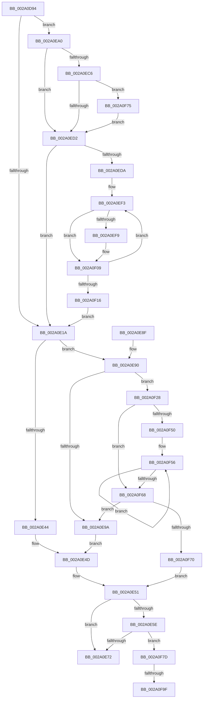

# MiFreePageToSlabEntry

- RVA: `0x002A0D94`–`0x002A0FAA` (길이 `534` bytes)
- VA: `0x00000001402A0D94`
- 실행 섹션: `.text`
- PDB 이름 있음: `예`; PDB Function 태그: `예`
- unwind 정보 RVA: `0x00068420`
- 디코드: `142`개 명령, `534/534` bytes 표시
- 미해석 바이트: `0` (있으면 어셈블리에 `.byte`로 보존)

> 이 문서는 커널 이미지의 기계어와 PDB 기호를 분석해 생성했습니다. 4번과 5번은 함수 원형과 자료형을 바이너리 사용 방식에서 추정한 C 해석이며 원본 소스 복구 결과는 아닙니다.

## 1. Dependencies

- 직접 호출 지점: **3**; 고유 호출 대상: **3**
- 직접 호출자로 확인된 함수: **1**
- RIP 상대 이미지 참조: **1**

### Outgoing calls
- `0x002A0EE4` → [ExAcquireSpinLockExclusiveAtDpcLevel](../24/ExAcquireSpinLockExclusiveAtDpcLevel_function_00248E80.md) (function, `0x00248E80`)
- `0x002A0F02` → [KeSetEvent](../33/KeSetEvent_function_0033F310.md) (function, `0x0033F310`)
- `0x002A0F19` → [ExReleaseSpinLockExclusiveFromDpcLevel](../24/ExReleaseSpinLockExclusiveFromDpcLevel_function_002497E0.md) (function, `0x002497E0`)

### Direct callers
- [MiFreePageToSlabAllocator](MiFreePageToSlabAllocator_function_002A0A60.md) at `0x002A0B6B`

### Static image references
- `0x002A0DB7` → RVA `0x00011C60` (`.rdata`; read)

## 2. Other-region calls and transfers

- 다른 실행 섹션으로 향하는 call: **0**
- call이 아닌 외부 분기/꼬리 이동: **2**
  - `0x002A0F99` → [sub_006DAD62](../6D/Unknown_function_006DAD62.md) (`tail-transfer`)
  - `0x002A0FA5` → [sub_006DAD62 + 0x5](../6D/Unknown_function_006DAD62.md) (`tail-transfer`)

## 3. Assembly (complete function range)

```asm
002A0D94  48 89 5C 24 10                  mov qword ptr [rsp + 0x10], rbx
002A0D99  48 89 6C 24 18                  mov qword ptr [rsp + 0x18], rbp
002A0D9E  48 89 74 24 20                  mov qword ptr [rsp + 0x20], rsi
002A0DA3  57                              push rdi
002A0DA4  41 54                           push r12
002A0DA6  41 55                           push r13
002A0DA8  41 56                           push r14
002A0DAA  41 57                           push r15
002A0DAC  48 83 EC 20                     sub rsp, 0x20
002A0DB0  41 8B 80 88 00 00 00            mov eax, dword ptr [r8 + 0x88]
002A0DB7  4C 8D 15 A2 0E D7 FF            lea r10, [rip - 0x28f15e]
002A0DBE  48 C1 E8 04                     shr rax, 4
002A0DC2  49 8B E8                        mov rbp, r8
002A0DC5  83 E0 03                        and eax, 3
002A0DC8  4C 8B EA                        mov r13, rdx
002A0DCB  4C 8B F9                        mov r15, rcx
002A0DCE  45 8B 14 C2                     mov r10d, dword ptr [r10 + rax*8]
002A0DD2  44 89 54 24 50                  mov dword ptr [rsp + 0x50], r10d
002A0DD7  48 B8 00 00 00 00 00 DE FF FF   movabs rax, 0xffffde0000000000
002A0DE1  4C 2B F8                        sub r15, rax
002A0DE4  BB 01 00 00 00                  mov ebx, 1
002A0DE9  49 C1 FF 04                     sar r15, 4
002A0DED  48 B8 AB AA AA AA AA AA AA AA   movabs rax, 0xaaaaaaaaaaaaaaab
002A0DF7  4C 0F AF F8                     imul r15, rax
002A0DFB  44 2B 7A 28                     sub r15d, dword ptr [rdx + 0x28]
002A0DFF  F0 01 5A 54                     lock add dword ptr [rdx + 0x54], ebx
002A0E03  F0 41 01 58 60                  lock add dword ptr [r8 + 0x60], ebx
002A0E08  41 83 B8 80 00 00 00 08         cmp dword ptr [r8 + 0x80], 8
002A0E10  49 8B 70 18                     mov rsi, qword ptr [r8 + 0x18]
002A0E14  0F 84 86 00 00 00               je 0x1402a0ea0
002A0E1A  49 8B 45 48                     mov rax, qword ptr [r13 + 0x48]
002A0E1E  83 CE FF                        or esi, 0xffffffff
002A0E21  45 8B CF                        mov r9d, r15d
002A0E24  8B CB                           mov ecx, ebx
002A0E26  41 83 E1 1F                     and r9d, 0x1f
002A0E2A  41 8B D7                        mov edx, r15d
002A0E2D  48 C1 EA 05                     shr rdx, 5
002A0E31  BF E0 FF FF FF                  mov edi, 0xffffffe0
002A0E36  4C 8D 04 90                     lea r8, [rax + rdx*4]
002A0E3A  49 8D 41 01                     lea rax, [r9 + 1]
002A0E3E  48 83 F8 20                     cmp rax, 0x20
002A0E42  77 4C                           ja 0x1402a0e90
002A0E44  41 8B C9                        mov ecx, r9d
002A0E47  8B C3                           mov eax, ebx
002A0E49  D3 E0                           shl eax, cl
002A0E4B  F7 D0                           not eax
002A0E4D  F0 41 21 00                     lock and dword ptr [r8], eax
002A0E51  41 8B 45 58                     mov eax, dword ptr [r13 + 0x58]
002A0E55  41 03 45 54                     add eax, dword ptr [r13 + 0x54]
002A0E59  41 3B C2                        cmp eax, r10d
002A0E5C  72 14                           jb 0x1402a0e72
002A0E5E  F0 09 9D 88 00 00 00            lock or dword ptr [rbp + 0x88], ebx
002A0E65  83 BD 80 00 00 00 08            cmp dword ptr [rbp + 0x80], 8
002A0E6C  0F 84 0B 01 00 00               je 0x1402a0f7d
002A0E72  48 8B 5C 24 58                  mov rbx, qword ptr [rsp + 0x58]
002A0E77  48 8B 6C 24 60                  mov rbp, qword ptr [rsp + 0x60]
002A0E7C  48 8B 74 24 68                  mov rsi, qword ptr [rsp + 0x68]
002A0E81  48 83 C4 20                     add rsp, 0x20
002A0E85  41 5F                           pop r15
002A0E87  41 5E                           pop r14
002A0E89  41 5D                           pop r13
002A0E8B  41 5C                           pop r12
002A0E8D  5F                              pop rdi
002A0E8E  C3                              ret
002A0E8F  CC                              int3
002A0E90  41 83 E7 1F                     and r15d, 0x1f
002A0E94  0F 85 8E 00 00 00               jne 0x1402a0f28
002A0E9A  8B C6                           mov eax, esi
002A0E9C  D3 E0                           shl eax, cl
002A0E9E  EB AD                           jmp 0x1402a0e4d
002A0EA0  48 8B C3                        mov rax, rbx
002A0EA3  F0 48 0F C1 86 80 47 00 00      lock xadd qword ptr [rsi + 0x4780], rax
002A0EAC  48 03 C3                        add rax, rbx
002A0EAF  B9 00 00 00 00                  mov ecx, 0
002A0EB4  48 2B C3                        sub rax, rbx
002A0EB7  BA 20 04 00 00                  mov edx, 0x420
002A0EBC  0F 94 C1                        sete cl
002A0EBF  8B F9                           mov edi, ecx
002A0EC1  48 3B C2                        cmp rax, rdx
002A0EC4  7D 0C                           jge 0x1402a0ed2
002A0EC6  48 FF C0                        inc rax
002A0EC9  48 3B C2                        cmp rax, rdx
002A0ECC  0F 8D A3 00 00 00               jge 0x1402a0f75
002A0ED2  85 FF                           test edi, edi
002A0ED4  0F 84 40 FF FF FF               je 0x1402a0e1a
002A0EDA  4C 8D A6 40 3F 00 00            lea r12, [rsi + 0x3f40]
002A0EE1  49 8B CC                        mov rcx, r12
002A0EE4  E8 97 7F FA FF                  call 0x140248e80
002A0EE9  45 33 F6                        xor r14d, r14d
002A0EEC  48 81 C6 A0 47 00 00            add rsi, 0x47a0
002A0EF3  44 0F A3 F7                     bt edi, r14d
002A0EF7  73 10                           jae 0x1402a0f09
002A0EF9  48 8D 4E E8                     lea rcx, [rsi - 0x18]
002A0EFD  45 33 C0                        xor r8d, r8d
002A0F00  33 D2                           xor edx, edx
002A0F02  E8 09 E4 09 00                  call 0x14033f310
002A0F07  01 1E                           add dword ptr [rsi], ebx
002A0F09  44 03 F3                        add r14d, ebx
002A0F0C  48 83 C6 20                     add rsi, 0x20
002A0F10  41 83 FE 02                     cmp r14d, 2
002A0F14  72 DD                           jb 0x1402a0ef3
002A0F16  49 8B CC                        mov rcx, r12
002A0F19  E8 C2 88 FA FF                  call 0x1402497e0
002A0F1E  44 8B 54 24 50                  mov r10d, dword ptr [rsp + 0x50]
002A0F23  E9 F2 FE FF FF                  jmp 0x1402a0e1a
002A0F28  BA 20 00 00 00                  mov edx, 0x20
002A0F2D  8B C3                           mov eax, ebx
002A0F2F  41 2B D7                        sub edx, r15d
002A0F32  8B CA                           mov ecx, edx
002A0F34  D3 E0                           shl eax, cl
002A0F36  49 8B C9                        mov rcx, r9
002A0F39  2B C3                           sub eax, ebx
002A0F3B  D3 E0                           shl eax, cl
002A0F3D  F7 D0                           not eax
002A0F3F  F0 41 21 00                     lock and dword ptr [r8], eax
002A0F43  8B CB                           mov ecx, ebx
002A0F45  49 83 C0 04                     add r8, 4
002A0F49  2B CA                           sub ecx, edx
002A0F4B  83 F9 20                        cmp ecx, 0x20
002A0F4E  72 18                           jb 0x1402a0f68
002A0F50  8B C1                           mov eax, ecx
002A0F52  48 C1 E8 05                     shr rax, 5
002A0F56  41 C7 00 00 00 00 00            mov dword ptr [r8], 0
002A0F5D  03 CF                           add ecx, edi
002A0F5F  49 83 C0 04                     add r8, 4
002A0F63  48 2B C3                        sub rax, rbx
002A0F66  75 EE                           jne 0x1402a0f56
002A0F68  85 C9                           test ecx, ecx
002A0F6A  0F 85 2A FF FF FF               jne 0x1402a0e9a
002A0F70  E9 DC FE FF FF                  jmp 0x1402a0e51
002A0F75  83 CF 02                        or edi, 2
002A0F78  E9 55 FF FF FF                  jmp 0x1402a0ed2
002A0F7D  8B 85 84 00 00 00               mov eax, dword ptr [rbp + 0x84]
002A0F83  41 8B 4D 5C                     mov ecx, dword ptr [r13 + 0x5c]
002A0F87  48 69 D0 80 DF 00 00            imul rdx, rax, 0xdf80
002A0F8E  48 8B 45 18                     mov rax, qword ptr [rbp + 0x18]
002A0F92  48 03 50 10                     add rdx, qword ptr [rax + 0x10]
002A0F96  F6 C1 04                        test cl, 4
002A0F99  0F 84 C3 9D 43 00               je 0x1406dad62
002A0F9F  C1 E9 03                        shr ecx, 3
002A0FA2  83 E1 3F                        and ecx, 0x3f
002A0FA5  E9 BD 9D 43 00                  jmp 0x1406dad67
```

## 4. C-style interpretation (structured pseudocode)

```c
__int64 __fastcall MiFreePageToSlabEntry(__int64 a1, __int64 a2, __int64 a3)
{
    __int64 result;
    __int64 v_r14;
    __int64 v_r15;
    __int64 v_rdi;
    __int64 v_rsi;
    __int64 v_rsp;
    unsigned __int64 v_stack_p10;
    unsigned __int64 v_stack_p18;
    unsigned __int64 v_stack_p20;
    unsigned int v_stack_p50;
    unsigned int v_stack_p8;

    v_stack_p10 = v_rbx;
    v_stack_p18 = v_rbp;
    v_stack_p20 = v_rsi;
    v_rsp = (v_rsp) - (32);
    result = ((unsigned int)(*(unsigned int *)(a3 + 136))) >> (4);
    result = (unsigned int)((result) & (3));
    v_stack_p8 = (unsigned int)((unsigned int)(*(unsigned int *)(v_rip - 2683230 + result * 8)));
    v_r15 = (a1) - (result);
    v_r15 = (v_r15) >> (4);
    v_r15 = (v_r15) * (result);
    v_r15 = (unsigned int)((v_r15) - (*(unsigned int *)(a2 + 40)));
    if ((*(unsigned int *)(a3 + 128)) == 8) goto loc_002A0EA0;
loc_002A0E1A:
    v_rsi = (unsigned int)((*(unsigned __int64 *)(a3 + 24)) | (0xFFFFFFFFULL));
    a4 = (unsigned int)(((unsigned int)((unsigned int)(v_r15))) & (31));
    a2 = ((unsigned int)((unsigned int)(v_r15))) >> (5);
    if ((a4 + 1) > 32) goto loc_002A0E90;
    result = (unsigned int)((1) << ((unsigned __int8)((unsigned int)((unsigned int)(a4)))));
    result = (unsigned int)(~(result));
loc_002A0E4D:
loc_002A0E51:
    result = (unsigned int)(((unsigned int)(*(unsigned int *)(a2 + 88))) + (*(unsigned int *)(a2 + 84)));
    if (((unsigned int)(result)) < ((unsigned int)((unsigned int)(*(unsigned int *)(v_rip - 2683230 + result * 8))))) goto loc_002A0E72;
    if ((*(unsigned int *)(a3 + 128)) == 8) goto loc_002A0F7D;
loc_002A0E72:
    v_rsp = (v_rsp) + (32);
    return result;
loc_002A0E90:
    v_r15 = (unsigned int)((v_r15) & (31));
    if (condition_is_not_equal) goto loc_002A0F28;
loc_002A0E9A:
    result = (unsigned int)(((unsigned int)((unsigned int)(v_stack_p20))) << ((unsigned __int8)((unsigned int)((unsigned int)(a4)))));
    goto loc_002A0E4D;
loc_002A0EA0:
    result = (v_stack_p10) + (v_stack_p10);
    result = (result) - (v_stack_p10);
    a1 = (condition_is_equal) ? 1 : 0;
    if (result >= ((unsigned int)(0x420ULL))) goto loc_002A0ED2;
    result = (result) + 1;
    if (result >= ((unsigned int)(0x420ULL))) goto loc_002A0F75;
loc_002A0ED2:
    if ((unsigned int)((unsigned int)((unsigned int)(a1))) == 0) goto loc_002A0E1A;
    result = ExAcquireSpinLockExclusiveAtDpcLevel(v_stack_p20 + 16192, (unsigned int)(0x420ULL), *(unsigned __int64 *)(a2 + 72) + a2 * 4, a4);
    v_r14 = 0;
    v_rsi = (v_stack_p20) + (0x47A0ULL);
loc_002A0EF3:
    if (!(condition_is_above_or_equal)) {
        a1 = v_rsi - 24;
        a3 = 0;
        a2 = 0;
        result = KeSetEvent(a1, a2, a3, a4);
    }
    v_r14 = (unsigned int)((v_r14) + ((unsigned int)(v_stack_p10)));
    v_rsi = (v_rsi) + (32);
    if (((unsigned int)(v_r14)) < 2) goto loc_002A0EF3;
    result = ExReleaseSpinLockExclusiveFromDpcLevel(v_stack_p20 + 16192, a2, a3, a4);
    goto loc_002A0E1A;
loc_002A0F28:
    a2 = (unsigned int)((32) - ((unsigned int)(v_r15)));
    result = (unsigned int)(((unsigned int)((unsigned int)(v_stack_p10))) << ((unsigned __int8)((unsigned int)((unsigned int)(a2)))));
    result = (unsigned int)((result) - ((unsigned int)(v_stack_p10)));
    result = (unsigned int)((result) << ((unsigned __int8)(a4)));
    result = (unsigned int)(~(result));
    a3 = (a3) + (4);
    a1 = (unsigned int)(((unsigned int)((unsigned int)(v_stack_p10))) - ((unsigned int)(a2)));
    if (((unsigned int)(a1)) < 32) goto loc_002A0F68;
    result = ((unsigned int)((unsigned int)(a1))) >> (5);
loc_002A0F56:
    *(unsigned int *)(a3) = 0;
    a1 = (unsigned int)((a1) + ((unsigned int)((unsigned int)((unsigned int)(a1)))));
    a3 = (a3) + (4);
    result = (result) - (v_stack_p10);
    if (condition_is_not_equal) goto loc_002A0F56;
loc_002A0F68:
    if ((unsigned int)(a1) != 0) goto loc_002A0E9A;
    goto loc_002A0E51;
loc_002A0F75:
    v_rdi = (unsigned int)(((unsigned int)((unsigned int)(a1))) | (2));
    goto loc_002A0ED2;
loc_002A0F7D:
    a2 = (a2) * ((unsigned int)(*(unsigned int *)(v_stack_p18 + 132)));
    a2 = (a2) + (*(unsigned __int64 *)(*(unsigned __int64 *)(v_stack_p18 + 24) + 16));
    a1 = (unsigned int)(((unsigned int)(*(unsigned int *)(a2 + 92))) >> (3));
    a1 = (unsigned int)((a1) & (63));
}
```

## 5. (Beta) C Style

```c
int64_t MiFreePageToSlabEntry(int64_t Arg1, void *Arg2, void *Arg3)
{
    uint8_t *arg2 = (uint8_t *)Arg2;
    uint8_t *arg3 = (uint8_t *)Arg3;

    int64_t result;
    int64_t local_r14;
    int64_t local_r15;
    int64_t local_rdi;
    int64_t local_rsi;
    int64_t local_rsp;
    uint64_t v_stack_p10;
    uint64_t v_stack_p18;
    uint64_t v_stack_p20;
    uint32_t v_stack_p50;
    uint32_t v_stack_p8;

    v_stack_p10 = local_rbx;
    v_stack_p18 = local_rbp;
    v_stack_p20 = local_rsi;
    local_rsp = (local_rsp) - (32);
    result = ((uint32_t)(*(uint32_t *)(arg3 + 0x88))) >> (4);
    result = (uint32_t)((result) & (3));
    v_stack_p8 = (uint32_t)((uint32_t)(*(uint32_t *)(v_rip - 0x28F15E + result * 8)));
    local_r15 = (Arg1) - (result);
    local_r15 = (local_r15) >> (4);
    local_r15 = (local_r15) * (result);
    local_r15 = (uint32_t)((local_r15) - (*(uint32_t *)(arg2 + 0x28)));
    if ((*(uint32_t *)(arg3 + 0x80)) == 8) goto loc_002A0EA0;
loc_002A0E1A:
    local_rsi = (uint32_t)((*(uint64_t *)(arg3 + 0x18)) | (0xFFFFFFFFULL));
    a4 = (uint32_t)(((uint32_t)((uint32_t)(local_r15))) & (31));
    Arg2 = ((uint32_t)((uint32_t)(local_r15))) >> (5);
    if ((a4 + 1) > 32) goto loc_002A0E90;
    result = (uint32_t)((1) << ((uint8_t)((uint32_t)((uint32_t)(a4)))));
    result = (uint32_t)(~(result));
loc_002A0E4D:
loc_002A0E51:
    result = (uint32_t)(((uint32_t)(*(uint32_t *)(arg2 + 0x58))) + (*(uint32_t *)(arg2 + 0x54)));
    if (((uint32_t)(result)) < ((uint32_t)((uint32_t)(*(uint32_t *)(v_rip - 0x28F15E + result * 8))))) goto loc_002A0E72;
    if ((*(uint32_t *)(arg3 + 0x80)) == 8) goto loc_002A0F7D;
loc_002A0E72:
    local_rsp = (local_rsp) + (32);
    return result;
loc_002A0E90:
    local_r15 = (uint32_t)((local_r15) & (31));
    if (condition_is_not_equal) goto loc_002A0F28;
loc_002A0E9A:
    result = (uint32_t)(((uint32_t)((uint32_t)(v_stack_p20))) << ((uint8_t)((uint32_t)((uint32_t)(a4)))));
    goto loc_002A0E4D;
loc_002A0EA0:
    result = (v_stack_p10) + (v_stack_p10);
    result = (result) - (v_stack_p10);
    Arg1 = (condition_is_equal) ? 1 : 0;
    if (result >= ((uint32_t)(0x420ULL))) goto loc_002A0ED2;
    result = (result) + 1;
    if (result >= ((uint32_t)(0x420ULL))) goto loc_002A0F75;
loc_002A0ED2:
    if ((uint32_t)((uint32_t)((uint32_t)(Arg1))) == 0) goto loc_002A0E1A;
    result = ExAcquireSpinLockExclusiveAtDpcLevel(v_stack_p20 + 16192, (uint32_t)(0x420ULL), *(uint64_t *)(arg2 + 0x48) + Arg2 * 4, a4);
    local_r14 = 0;
    local_rsi = (v_stack_p20) + (0x47A0ULL);
loc_002A0EF3:
    if (!(condition_is_above_or_equal)) {
        Arg1 = local_rsi - 24;
        Arg3 = 0;
        Arg2 = 0;
        result = KeSetEvent(Arg1, Arg2, Arg3, a4);
    }
    local_r14 = (uint32_t)((local_r14) + ((uint32_t)(v_stack_p10)));
    local_rsi = (local_rsi) + (32);
    if (((uint32_t)(local_r14)) < 2) goto loc_002A0EF3;
    result = ExReleaseSpinLockExclusiveFromDpcLevel(v_stack_p20 + 16192, Arg2, Arg3, a4);
    goto loc_002A0E1A;
loc_002A0F28:
    Arg2 = (uint32_t)((32) - ((uint32_t)(local_r15)));
    result = (uint32_t)(((uint32_t)((uint32_t)(v_stack_p10))) << ((uint8_t)((uint32_t)((uint32_t)(Arg2)))));
    result = (uint32_t)((result) - ((uint32_t)(v_stack_p10)));
    result = (uint32_t)((result) << ((uint8_t)(a4)));
    result = (uint32_t)(~(result));
    Arg3 = (Arg3) + (4);
    Arg1 = (uint32_t)(((uint32_t)((uint32_t)(v_stack_p10))) - ((uint32_t)(Arg2)));
    if (((uint32_t)(Arg1)) < 32) goto loc_002A0F68;
    result = ((uint32_t)((uint32_t)(Arg1))) >> (5);
loc_002A0F56:
    *(uint32_t *)(arg3) = 0;
    Arg1 = (uint32_t)((Arg1) + ((uint32_t)((uint32_t)((uint32_t)(Arg1)))));
    Arg3 = (Arg3) + (4);
    result = (result) - (v_stack_p10);
    if (condition_is_not_equal) goto loc_002A0F56;
loc_002A0F68:
    if ((uint32_t)(Arg1) != 0) goto loc_002A0E9A;
    goto loc_002A0E51;
loc_002A0F75:
    local_rdi = (uint32_t)(((uint32_t)((uint32_t)(Arg1))) | (2));
    goto loc_002A0ED2;
loc_002A0F7D:
    Arg2 = (Arg2) * ((uint32_t)(*(uint32_t *)(v_stack_p18 + 0x84)));
    Arg2 = (Arg2) + (*(uint64_t *)(*(uint64_t *)(v_stack_p18 + 0x18) + 0x10));
    Arg1 = (uint32_t)(((uint32_t)(*(uint32_t *)(arg2 + 0x5C))) >> (3));
    Arg1 = (uint32_t)((Arg1) & (63));
}
```

### 관측된 메모리 오프셋

구조체 형식이 확인되지 않은 접근은 인자 기준의 오프셋으로만 기록했습니다.

| 기준 인자 | 오프셋 표현 | 폭 (bit) | 접근 |
|---|---:|---:|---|
| `Arg2` | `+ 0x28` | `32` | `R` |
| `Arg2` | `+ 0x48` | `64` | `R` |
| `Arg2` | `+ 0x54` | `32` | `R` |
| `Arg2` | `+ 0x54` | `32` | `R/W` |
| `Arg2` | `+ 0x58` | `32` | `R` |
| `Arg2` | `+ 0x5C` | `32` | `R` |
| `Arg3` | `+ 0x18` | `64` | `R` |
| `Arg3` | `+ 0x60` | `32` | `R/W` |
| `Arg3` | `+ 0x80` | `32` | `R` |
| `Arg3` | `+ 0x84` | `32` | `R` |
| `Arg3` | `+ 0x88` | `32` | `R` |
| `Arg3` | `+ 0x88` | `32` | `R/W` |

## 6. Execution-region graph

[열기: 2D/3D 그래프와 함수 탐색 컨트롤 패널](../../../control-panel.html?section=text&rva=0x002A0D94&view=graph)

- 2D 그래프는 위에서 아래로 흐르고, 3D 그래프는 빈 공간을 드래그해 회전합니다. Shift+드래그는 이동, 휠은 확대·축소, 함수 노드 선택은 대상 보고서 이동입니다.

### Static fallback


