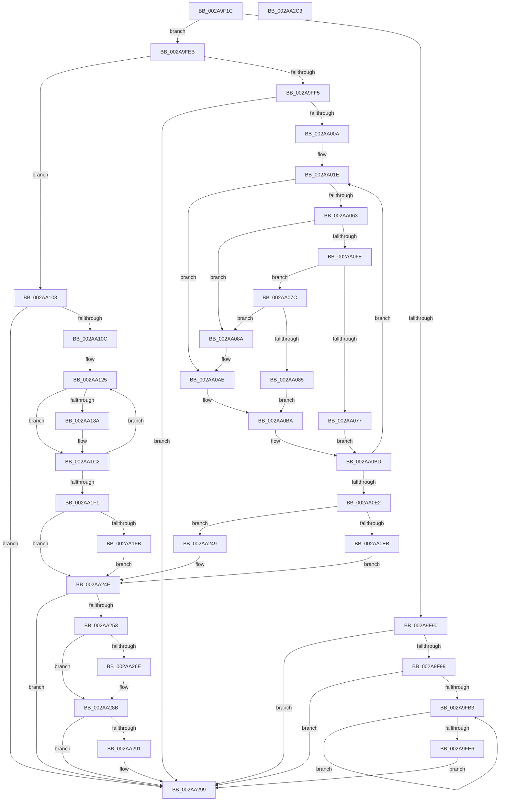

# MiFreePhysicalPageChain

- RVA: `0x002A9F1C`–`0x002AA2C4` (길이 `936` bytes)
- VA: `0x00000001402A9F1C`
- 실행 섹션: `.text`
- PDB 이름 있음: `예`; PDB Function 태그: `아니요`
- unwind 정보 RVA: `0x00068E84`
- 디코드: `227`개 명령, `936/936` bytes 표시
- 미해석 바이트: `0` (있으면 어셈블리에 `.byte`로 보존)

> 이 문서는 커널 이미지의 기계어와 PDB 기호를 분석해 생성했습니다. 4번과 5번은 함수 원형과 자료형을 바이너리 사용 방식에서 추정한 C 해석이며 원본 소스 복구 결과는 아닙니다.

## 1. Dependencies

- 직접 호출 지점: **14**; 고유 호출 대상: **11**
- 직접 호출자로 확인된 함수: **4**
- RIP 상대 이미지 참조: **3**

### Outgoing calls
- `0x002A9F64` → [memset](../6C/memset_function_006C6C40.md) (function, `0x006C6C40`)
- `0x002A9F74` → [MiGetAweInfoPartition](MiGetAweInfoPartition_function_002AA2CC.md) (function, `0x002AA2CC`)
- `0x002A9FD9` → [MiFreePhysicalRange](../68/MiFreePhysicalRange_function_00688CD0.md) (function, `0x00688CD0`)
- `0x002AA023` → [MiGetLeafPfnBuddy](../43/MiGetLeafPfnBuddy_function_00438E30.md) (function, `0x00438E30`)
- `0x002AA044` → [MiReadyLargeAwePageForFree](../68/MiReadyLargeAwePageForFree_function_00689258.md) (function, `0x00689258`)
- `0x002AA095` → [MiFreeContiguousLargePageRun](../68/MiFreeContiguousLargePageRun_function_00688A34.md) (function, `0x00688A34`)
- `0x002AA0F9` → [MiFreeContiguousLargePageRun](../68/MiFreeContiguousLargePageRun_function_00688A34.md) (function, `0x00688A34`)
- `0x002AA12A` → [MiGetLeafPfnBuddy](../43/MiGetLeafPfnBuddy_function_00438E30.md) (function, `0x00438E30`)
- `0x002AA14B` → [MiLockPageInline](../31/MiLockPageInline_function_0031A340.md) (function, `0x0031A340`)
- `0x002AA17B` → [MiUnlockPage](../31/MiUnlockPage_function_0031A3E0.md) (function, `0x0031A3E0`)
- `0x002AA1B2` → [MiFreePagesFromMdl](../3F/MiFreePagesFromMdl_function_003F8300.md) (function, `0x003F8300`)
- `0x002AA23C` → [MiFreePagesFromMdl](../3F/MiFreePagesFromMdl_function_003F8300.md) (function, `0x003F8300`)
- `0x002AA281` → [MiReturnProcessPhysicalPages](../../page/AB/MiReturnProcessPhysicalPages_function_00AB91B8.md) (function, `0x00AB91B8`)
- `0x002AA2A3` → [_security_check_cookie](../6A/_security_check_cookie_function_006AC640.md) (function, `0x006AC640`)

### Direct callers
- [MiDeleteVaFinal](MiDeleteVaFinal_function_002A9940.md) at `0x002A99C2`
- [NtFreeUserPhysicalPages](../../page/80/NtFreeUserPhysicalPages_function_0080AF30.md) at `0x0080B28E`
- [NtMapUserPhysicalPages](../../page/80/NtMapUserPhysicalPages_function_0080B460.md) at `0x0080B6CC`
- [NtMapUserPhysicalPagesScatter](../../page/80/NtMapUserPhysicalPagesScatter_function_0080B750.md) at `0x0080BA97`

### Static image references
- `0x002A9F3B` → RVA `0x00E0A740` (`.data`; read)
- `0x002A9F99` → RVA `0x00E300C0` (`.data`; read)
- `0x002AA04D` → RVA `0x00E30088` (`.data`; read)

## 2. Other-region calls and transfers

- 다른 실행 섹션으로 향하는 call: **1**
  - `0x002AA281` → [MiReturnProcessPhysicalPages](../../page/AB/MiReturnProcessPhysicalPages_function_00AB91B8.md) (`.text` → `PAGE`)
- 별도 외부 분기/꼬리 이동을 확인하지 못했습니다.

## 3. Assembly (complete function range)

```asm
002A9F1C  48 89 5C 24 18                  mov qword ptr [rsp + 0x18], rbx
002A9F21  55                              push rbp
002A9F22  56                              push rsi
002A9F23  57                              push rdi
002A9F24  41 54                           push r12
002A9F26  41 55                           push r13
002A9F28  41 56                           push r14
002A9F2A  41 57                           push r15
002A9F2C  48 8D AC 24 80 F0 FF FF         lea rbp, [rsp - 0xf80]
002A9F34  48 81 EC 80 10 00 00            sub rsp, 0x1080
002A9F3B  48 8B 05 FE 07 B6 00            mov rax, qword ptr [rip + 0xb607fe]
002A9F42  48 33 C4                        xor rax, rsp
002A9F45  48 89 85 70 0F 00 00            mov qword ptr [rbp + 0xf70], rax
002A9F4C  48 8B 32                        mov rsi, qword ptr [rdx]
002A9F4F  4C 8B E9                        mov r13, rcx
002A9F52  48 89 4C 24 28                  mov qword ptr [rsp + 0x28], rcx
002A9F57  33 D2                           xor edx, edx
002A9F59  48 8D 4C 24 40                  lea rcx, [rsp + 0x40]
002A9F5E  41 B8 30 10 00 00               mov r8d, 0x1030
002A9F64  E8 D7 CC 41 00                  call 0x1406c6c40
002A9F69  33 DB                           xor ebx, ebx
002A9F6B  49 8B CD                        mov rcx, r13
002A9F6E  44 8B E3                        mov r12d, ebx
002A9F71  44 8B F3                        mov r14d, ebx
002A9F74  E8 53 03 00 00                  call 0x1402aa2cc
002A9F79  41 8B 4D 08                     mov ecx, dword ptr [r13 + 8]
002A9F7D  4D 8B 7D 10                     mov r15, qword ptr [r13 + 0x10]
002A9F81  48 89 44 24 38                  mov qword ptr [rsp + 0x38], rax
002A9F86  4C 89 7C 24 20                  mov qword ptr [rsp + 0x20], r15
002A9F8B  F6 C1 08                        test cl, 8
002A9F8E  74 5B                           je 0x1402a9feb
002A9F90  48 85 F6                        test rsi, rsi
002A9F93  0F 84 00 03 00 00               je 0x1402aa299
002A9F99  48 2B 35 20 61 B8 00            sub rsi, qword ptr [rip + 0xb86120]
002A9FA0  41 BE FF FF 3F 00               mov r14d, 0x3fffff
002A9FA6  48 C1 FE 03                     sar rsi, 3
002A9FAA  49 85 F6                        test r14, rsi
002A9FAD  0F 84 E6 02 00 00               je 0x1402aa299
002A9FB3  48 8B 05 06 61 B8 00            mov rax, qword ptr [rip + 0xb86106]
002A9FBA  49 23 F6                        and rsi, r14
002A9FBD  48 8B 3C F0                     mov rdi, qword ptr [rax + rsi*8]
002A9FC1  48 C1 EF 11                     shr rdi, 0x11
002A9FC5  48 33 DF                        xor rbx, rdi
002A9FC8  49 0F AF F7                     imul rsi, r15
002A9FCC  48 81 E3 00 00 C0 FF            and rbx, 0xffffffffffc00000
002A9FD3  48 8B D6                        mov rdx, rsi
002A9FD6  48 33 DF                        xor rbx, rdi
002A9FD9  E8 F2 EC 3D 00                  call 0x140688cd0
002A9FDE  48 8B F3                        mov rsi, rbx
002A9FE1  49 85 FE                        test r14, rdi
002A9FE4  75 CD                           jne 0x1402a9fb3
002A9FE6  E9 AE 02 00 00                  jmp 0x1402aa299
002A9FEB  49 83 FF 01                     cmp r15, 1
002A9FEF  0F 84 0E 01 00 00               je 0x1402aa103
002A9FF5  49 83 CD FF                     or r13, 0xffffffffffffffff
002A9FF9  48 89 5C 24 20                  mov qword ptr [rsp + 0x20], rbx
002A9FFE  48 8B FB                        mov rdi, rbx
002AA001  48 85 F6                        test rsi, rsi
002AA004  0F 84 8F 02 00 00               je 0x1402aa299
002AA00A  49 B8 00 00 00 00 00 DE FF FF   movabs r8, 0xffffde0000000000
002AA014  49 B9 AB AA AA AA AA AA AA AA   movabs r9, 0xaaaaaaaaaaaaaaab
002AA01E  33 D2                           xor edx, edx
002AA020  48 8B CE                        mov rcx, rsi
002AA023  E8 08 EE 18 00                  call 0x140438e30
002AA028  48 89 44 24 30                  mov qword ptr [rsp + 0x30], rax
002AA02D  49 8B C8                        mov rcx, r8
002AA030  4C 8B F6                        mov r14, rsi
002AA033  4D 03 E7                        add r12, r15
002AA036  4C 2B F1                        sub r14, rcx
002AA039  48 8B CE                        mov rcx, rsi
002AA03C  49 C1 FE 04                     sar r14, 4
002AA040  4D 0F AF F1                     imul r14, r9
002AA044  E8 0F F2 3D 00                  call 0x140689258
002AA049  48 8B 46 28                     mov rax, qword ptr [rsi + 0x28]
002AA04D  48 8B 0D 34 60 B8 00            mov rcx, qword ptr [rip + 0xb86034]
002AA054  48 C1 E8 2B                     shr rax, 0x2b
002AA058  25 FF 03 00 00                  and eax, 0x3ff
002AA05D  49 83 FD FF                     cmp r13, -1
002AA061  74 4B                           je 0x1402aa0ae
002AA063  48 8B 54 24 20                  mov rdx, qword ptr [rsp + 0x20]
002AA068  48 39 14 C1                     cmp qword ptr [rcx + rax*8], rdx
002AA06C  75 1C                           jne 0x1402aa08a
002AA06E  4A 8D 04 2F                     lea rax, [rdi + r13]
002AA072  49 3B C6                        cmp rax, r14
002AA075  75 05                           jne 0x1402aa07c
002AA077  49 03 FF                        add rdi, r15
002AA07A  EB 41                           jmp 0x1402aa0bd
002AA07C  4B 8D 04 37                     lea rax, [r15 + r14]
002AA080  49 3B C5                        cmp rax, r13
002AA083  75 05                           jne 0x1402aa08a
002AA085  49 03 FF                        add rdi, r15
002AA088  EB 30                           jmp 0x1402aa0ba
002AA08A  48 8B 4C 24 28                  mov rcx, qword ptr [rsp + 0x28]
002AA08F  4C 8B C7                        mov r8, rdi
002AA092  49 8B D5                        mov rdx, r13
002AA095  E8 9A E9 3D 00                  call 0x140688a34
002AA09A  48 8B 46 28                     mov rax, qword ptr [rsi + 0x28]
002AA09E  48 8B 0D E3 5F B8 00            mov rcx, qword ptr [rip + 0xb85fe3]
002AA0A5  48 C1 E8 2B                     shr rax, 0x2b
002AA0A9  25 FF 03 00 00                  and eax, 0x3ff
002AA0AE  48 8B 04 C1                     mov rax, qword ptr [rcx + rax*8]
002AA0B2  49 8B FF                        mov rdi, r15
002AA0B5  48 89 44 24 20                  mov qword ptr [rsp + 0x20], rax
002AA0BA  4D 8B EE                        mov r13, r14
002AA0BD  48 8B 44 24 30                  mov rax, qword ptr [rsp + 0x30]
002AA0C2  49 B9 AB AA AA AA AA AA AA AA   movabs r9, 0xaaaaaaaaaaaaaaab
002AA0CC  49 B8 00 00 00 00 00 DE FF FF   movabs r8, 0xffffde0000000000
002AA0D6  48 8B F0                        mov rsi, rax
002AA0D9  48 85 C0                        test rax, rax
002AA0DC  0F 85 3C FF FF FF               jne 0x1402aa01e
002AA0E2  48 85 FF                        test rdi, rdi
002AA0E5  0F 84 5E 01 00 00               je 0x1402aa249
002AA0EB  49 8B D5                        mov rdx, r13
002AA0EE  4C 8B C7                        mov r8, rdi
002AA0F1  4C 8B 6C 24 28                  mov r13, qword ptr [rsp + 0x28]
002AA0F6  49 8B CD                        mov rcx, r13
002AA0F9  E8 36 E9 3D 00                  call 0x140688a34
002AA0FE  E9 4B 01 00 00                  jmp 0x1402aa24e
002AA103  48 85 F6                        test rsi, rsi
002AA106  0F 84 8D 01 00 00               je 0x1402aa299
002AA10C  49 B8 00 00 00 00 00 DE FF FF   movabs r8, 0xffffde0000000000
002AA116  4C 8D 7C 24 70                  lea r15, [rsp + 0x70]
002AA11B  49 B9 AB AA AA AA AA AA AA AA   movabs r9, 0xaaaaaaaaaaaaaaab
002AA125  33 D2                           xor edx, edx
002AA127  48 8B CE                        mov rcx, rsi
002AA12A  E8 01 ED 18 00                  call 0x140438e30
002AA12F  48 8B F8                        mov rdi, rax
002AA132  49 8B C8                        mov rcx, r8
002AA135  48 8B C6                        mov rax, rsi
002AA138  48 2B C1                        sub rax, rcx
002AA13B  48 8B CE                        mov rcx, rsi
002AA13E  48 C1 F8 04                     sar rax, 4
002AA142  49 0F AF C1                     imul rax, r9
002AA146  48 89 44 24 30                  mov qword ptr [rsp + 0x30], rax
002AA14B  E8 F0 01 07 00                  call 0x14031a340
002AA150  48 8B 56 18                     mov rdx, qword ptr [rsi + 0x18]
002AA154  48 B9 00 00 00 00 00 00 00 C0   movabs rcx, 0xc000000000000000
002AA15E  4C 8D 42 01                     lea r8, [rdx + 1]
002AA162  4D 8B C8                        mov r9, r8
002AA165  4C 33 CA                        xor r9, rdx
002AA168  8A D0                           mov dl, al
002AA16A  4C 23 C9                        and r9, rcx
002AA16D  48 8B CE                        mov rcx, rsi
002AA170  4D 33 C8                        xor r9, r8
002AA173  4C 89 4E 18                     mov qword ptr [rsi + 0x18], r9
002AA177  48 89 5E 10                     mov qword ptr [rsi + 0x10], rbx
002AA17B  E8 60 02 07 00                  call 0x14031a3e0
002AA180  BE 00 02 00 00                  mov esi, 0x200
002AA185  44 3B F6                        cmp r14d, esi
002AA188  75 38                           jne 0x1402aa1c2
002AA18A  4D 8B CD                        mov r9, r13
002AA18D  48 89 5C 24 40                  mov qword ptr [rsp + 0x40], rbx
002AA192  45 33 C0                        xor r8d, r8d
002AA195  C7 44 24 48 30 10 02 00         mov dword ptr [rsp + 0x48], 0x21030
002AA19D  33 D2                           xor edx, edx
002AA19F  48 89 5C 24 60                  mov qword ptr [rsp + 0x60], rbx
002AA1A4  48 8D 4C 24 40                  lea rcx, [rsp + 0x40]
002AA1A9  48 C7 44 24 68 00 00 20 00      mov qword ptr [rsp + 0x68], 0x200000
002AA1B2  E8 49 E1 14 00                  call 0x1403f8300
002AA1B7  4C 03 E6                        add r12, rsi
002AA1BA  4C 8D 7C 24 70                  lea r15, [rsp + 0x70]
002AA1BF  44 8B F3                        mov r14d, ebx
002AA1C2  48 8B 44 24 30                  mov rax, qword ptr [rsp + 0x30]
002AA1C7  41 FF C6                        inc r14d
002AA1CA  49 89 07                        mov qword ptr [r15], rax
002AA1CD  48 8B F7                        mov rsi, rdi
002AA1D0  49 83 C7 08                     add r15, 8
002AA1D4  49 B8 00 00 00 00 00 DE FF FF   movabs r8, 0xffffde0000000000
002AA1DE  49 B9 AB AA AA AA AA AA AA AA   movabs r9, 0xaaaaaaaaaaaaaaab
002AA1E8  48 85 FF                        test rdi, rdi
002AA1EB  0F 85 34 FF FF FF               jne 0x1402aa125
002AA1F1  4C 8B 7C 24 20                  mov r15, qword ptr [rsp + 0x20]
002AA1F6  45 85 F6                        test r14d, r14d
002AA1F9  74 53                           je 0x1402aa24e
002AA1FB  41 8B CE                        mov ecx, r14d
002AA1FE  48 89 5C 24 40                  mov qword ptr [rsp + 0x40], rbx
002AA203  C1 E1 0C                        shl ecx, 0xc
002AA206  4D 8B CD                        mov r9, r13
002AA209  8B C1                           mov eax, ecx
002AA20B  89 4C 24 68                     mov dword ptr [rsp + 0x68], ecx
002AA20F  C1 E8 0C                        shr eax, 0xc
002AA212  48 8D 4C 24 40                  lea rcx, [rsp + 0x40]
002AA217  66 83 C0 06                     add ax, 6
002AA21B  48 89 5C 24 60                  mov qword ptr [rsp + 0x60], rbx
002AA220  66 C1 E0 03                     shl ax, 3
002AA224  45 33 C0                        xor r8d, r8d
002AA227  66 89 44 24 48                  mov word ptr [rsp + 0x48], ax
002AA22C  33 D2                           xor edx, edx
002AA22E  B8 02 00 00 00                  mov eax, 2
002AA233  89 5C 24 6C                     mov dword ptr [rsp + 0x6c], ebx
002AA237  66 89 44 24 4A                  mov word ptr [rsp + 0x4a], ax
002AA23C  E8 BF E0 14 00                  call 0x1403f8300
002AA241  41 8B C6                        mov eax, r14d
002AA244  4C 03 E0                        add r12, rax
002AA247  EB 05                           jmp 0x1402aa24e
002AA249  4C 8B 6C 24 28                  mov r13, qword ptr [rsp + 0x28]
002AA24E  4D 85 E4                        test r12, r12
002AA251  74 46                           je 0x1402aa299
002AA253  48 8B 4C 24 38                  mov rcx, qword ptr [rsp + 0x38]
002AA258  4D 8B C4                        mov r8, r12
002AA25B  49 F7 D8                        neg r8
002AA25E  F0 4C 01 81 A8 4C 00 00         lock add qword ptr [rcx + 0x4ca8], r8
002AA266  41 8B 45 08                     mov eax, dword ptr [r13 + 8]
002AA26A  A8 01                           test al, 1
002AA26C  74 1D                           je 0x1402aa28b
002AA26E  65 48 8B 0C 25 88 01 00 00      mov rcx, qword ptr gs:[0x188]
002AA277  49 8B D4                        mov rdx, r12
002AA27A  48 8B 89 B8 00 00 00            mov rcx, qword ptr [rcx + 0xb8]
002AA281  E8 32 EF 80 00                  call 0x140ab91b8
002AA286  48 8B 4C 24 38                  mov rcx, qword ptr [rsp + 0x38]
002AA28B  49 83 FF 01                     cmp r15, 1
002AA28F  74 08                           je 0x1402aa299
002AA291  F0 4C 01 81 C0 4C 00 00         lock add qword ptr [rcx + 0x4cc0], r8
002AA299  48 8B 8D 70 0F 00 00            mov rcx, qword ptr [rbp + 0xf70]
002AA2A0  48 33 CC                        xor rcx, rsp
002AA2A3  E8 98 23 40 00                  call 0x1406ac640
002AA2A8  48 8B 9C 24 D0 10 00 00         mov rbx, qword ptr [rsp + 0x10d0]
002AA2B0  48 81 C4 80 10 00 00            add rsp, 0x1080
002AA2B7  41 5F                           pop r15
002AA2B9  41 5E                           pop r14
002AA2BB  41 5D                           pop r13
002AA2BD  41 5C                           pop r12
002AA2BF  5F                              pop rdi
002AA2C0  5E                              pop rsi
002AA2C1  5D                              pop rbp
002AA2C2  C3                              ret
002AA2C3  CC                              int3
```

## 4. C-style interpretation (structured pseudocode)

```c
__int64 __fastcall MiFreePhysicalPageChain(__int64 a1, __int64 a2)
{
    __int64 result;
    __int64 v_r12;
    __int64 v_r13;
    __int64 v_r14;
    __int64 v_r15;
    __int64 v_rbx;
    __int64 v_rdi;
    __int64 v_rsi;
    __int64 v_rsp;
    unsigned __int64 v_stack_m1048;
    unsigned int v_stack_m104C;
    unsigned __int64 v_stack_m1050;
    unsigned __int64 v_stack_m1058;
    unsigned __int16 v_stack_m106E;
    unsigned int v_stack_m1070;
    unsigned __int64 v_stack_m1078;
    unsigned __int64 v_stack_m1080;
    unsigned __int64 v_stack_m1088;
    unsigned __int64 v_stack_m1090;
    unsigned __int64 v_stack_m1098;
    unsigned __int64 v_stack_m48;
    unsigned __int64 v_stack_mFB8;
    unsigned __int64 v_stack_p18;

    v_stack_p18 = v_rbx;
    v_rsp = (v_rsp) - (0x1080ULL);
    result = (*(unsigned __int64 *)(v_rip + 11929598)) ^ (v_rsp);
    v_stack_m48 = result;
    v_stack_m1090 = a1;
    a2 = 0;
    result = memset(v_stack_m1078, a2, (unsigned int)(0x1030ULL), a4);
    v_rbx = 0;
    result = MiGetAweInfoPartition(a1, a2, (unsigned int)(0x1030ULL), a4);
    v_stack_m1080 = result;
    v_stack_m1098 = *(unsigned __int64 *)(a1 + 16);
    if ((((unsigned __int8)((unsigned int)(*(unsigned int *)(a1 + 8)))) & (8)) == 0) goto loc_002A9FEB;
    if (*(unsigned __int64 *)(a2) == 0) goto loc_002AA299;
    v_rsi = (*(unsigned __int64 *)(a2)) - (*(unsigned __int64 *)(v_rip + 12083488));
    v_rsi = (v_rsi) >> (3);
    if ((((unsigned int)(0x3FFFFFULL)) & (v_rsi)) == 0) goto loc_002AA299;
loc_002A9FB3:
    v_rsi = (v_rsi) & ((unsigned int)(0x3FFFFFULL));
    v_rdi = (*(unsigned __int64 *)(*(unsigned __int64 *)(v_rip + 12083462) + v_rsi * 8)) >> (17);
    v_rbx = (v_rbx) ^ (v_rdi);
    v_rsi = (v_rsi) * (*(unsigned __int64 *)(a1 + 16));
    v_rbx = (v_rbx) & (0xFFFFFFFFFFC00000ULL);
    v_rbx = (v_rbx) ^ (v_rdi);
    result = MiFreePhysicalRange((unsigned int)(*(unsigned int *)(a1 + 8)), v_rsi, (unsigned int)(0x1030ULL), a4);
    if ((((unsigned int)(0x3FFFFFULL)) & (v_rdi)) != 0) goto loc_002A9FB3;
    goto loc_002AA299;
loc_002A9FEB:
    if ((*(unsigned __int64 *)(a1 + 16)) == 1) goto loc_002AA103;
    v_r13 = (a1) | (-1);
    v_stack_m1098 = v_rbx;
    if (v_rbx == 0) goto loc_002AA299;
loc_002AA01E:
    a2 = 0;
    result = MiGetLeafPfnBuddy(v_rbx, a2, (unsigned int)(0x1030ULL), a4);
    v_stack_m1088 = result;
    v_r12 = (0) + (*(unsigned __int64 *)(a1 + 16));
    v_r14 = (v_rbx) - ((unsigned int)(0x1030ULL));
    v_r14 = (v_r14) >> (4);
    v_r14 = (v_r14) * (a4);
    result = MiReadyLargeAwePageForFree(v_rbx, a2, (unsigned int)(0x1030ULL), a4);
    result = (*(unsigned __int64 *)(v_rbx + 40)) >> (43);
    result = (unsigned int)((result) & (0x3FFULL));
    if (v_r13 == -1) goto loc_002AA0AE;
    if ((*(unsigned __int64 *)(*(unsigned __int64 *)(v_rip + 12083252) + result * 8)) != v_stack_m1098) goto loc_002AA08A;
    if ((v_rbx + v_r13 * 1) != v_r14) goto loc_002AA07C;
    v_rdi = (v_rbx) + (*(unsigned __int64 *)(a1 + 16));
    goto loc_002AA0BD;
loc_002AA07C:
    if ((*(unsigned __int64 *)(a1 + 16) + v_r14 * 1) != v_r13) goto loc_002AA08A;
    v_rdi = (v_rdi) + (*(unsigned __int64 *)(a1 + 16));
    goto loc_002AA0BA;
loc_002AA08A:
    result = MiFreeContiguousLargePageRun(v_stack_m1090, v_r13, v_rdi, a4);
    result = (*(unsigned __int64 *)(v_rbx + 40)) >> (43);
    result = (unsigned int)((result) & (0x3FFULL));
loc_002AA0AE:
    v_stack_m1098 = *(unsigned __int64 *)(*(unsigned __int64 *)(v_rip + 12083171) + result * 8);
loc_002AA0BA:
loc_002AA0BD:
    if (v_stack_m1088 != 0) goto loc_002AA01E;
    if (*(unsigned __int64 *)(a1 + 16) == 0) goto loc_002AA249;
    result = MiFreeContiguousLargePageRun(v_stack_m1090, v_r14, *(unsigned __int64 *)(a1 + 16), a4);
    goto loc_002AA24E;
loc_002AA103:
    if (v_stack_m1088 == 0) goto loc_002AA299;
loc_002AA125:
    a2 = 0;
    result = MiGetLeafPfnBuddy(v_stack_m1088, a2, *(unsigned __int64 *)(a1 + 16), a4);
    result = (v_stack_m1088) - (*(unsigned __int64 *)(a1 + 16));
    result = (result) >> (4);
    result = (result) * (a4);
    v_stack_m1088 = result;
    result = MiLockPageInline(v_stack_m1088, a2, *(unsigned __int64 *)(a1 + 16), a4);
    a4 = (*(unsigned __int64 *)(v_stack_m1088 + 24) + 1) ^ (*(unsigned __int64 *)(v_stack_m1088 + 24));
    a4 = (a4) & (v_stack_m1088);
    a4 = (a4) ^ (*(unsigned __int64 *)(v_stack_m1088 + 24) + 1);
    *(unsigned __int64 *)(v_stack_m1088 + 24) = a4;
    *(unsigned __int64 *)(v_stack_m1088 + 16) = v_rbx;
    result = MiUnlockPage(v_stack_m1088, (unsigned __int8)(result), *(unsigned __int64 *)(v_stack_m1088 + 24) + 1, a4);
    v_r15 = v_stack_m1048;
    if (((unsigned int)(v_r14)) == 512) {
        a4 = v_stack_m1090;
        v_stack_m1078 = v_rbx;
        a3 = 0;
        v_stack_m1070 = 0x21030ULL;
        a2 = 0;
        v_stack_m1058 = v_rbx;
        a1 = v_stack_m1078;
        v_stack_m1050 = 0x200000ULL;
        result = MiFreePagesFromMdl(a1, a2, a3, a4);
        v_r12 = (v_r12) + (512);
        v_r15 = v_stack_m1048;
        v_r14 = (unsigned int)(v_rbx);
    }
    v_r14 = (unsigned int)((v_r14) + 1);
    *(unsigned __int64 *)(v_r15) = v_stack_m1088;
    v_r15 = (v_r15) + (8);
    if (result != 0) goto loc_002AA125;
    if ((unsigned int)(v_r14) == 0) goto loc_002AA24E;
    v_stack_m1078 = v_rbx;
    a1 = (unsigned int)(((unsigned int)((unsigned int)(v_r14))) << (12));
    v_stack_m1050 = (unsigned int)(a1);
    result = (unsigned int)(((unsigned int)((unsigned int)(a1))) >> (12));
    result = (unsigned __int16)((result) + (6));
    v_stack_m1058 = v_rbx;
    result = (unsigned __int16)((result) << (3));
    a3 = 0;
    v_stack_m1070 = (unsigned __int16)(result);
    a2 = 0;
    v_stack_m104C = (unsigned int)(v_rbx);
    v_stack_m106E = 2;
    result = MiFreePagesFromMdl(v_stack_m1078, a2, a3, v_stack_m1090);
    v_r12 = (v_r12) + ((unsigned int)((unsigned int)(v_r14)));
    goto loc_002AA24E;
loc_002AA249:
loc_002AA24E:
    if (v_r12 == 0) goto loc_002AA299;
    a3 = -(v_r12);
    result = (unsigned int)(*(unsigned int *)(v_stack_m1090 + 8));
    if ((((unsigned __int8)((unsigned int)(*(unsigned int *)(v_stack_m1090 + 8)))) & (1)) != 0) {
        a1 = *(unsigned __int64 *)(gs_base + (0 + 392));
        a2 = v_r12;
        a1 = *(unsigned __int64 *)(a1 + 184);
        result = MiReturnProcessPhysicalPages(a1, a2, a3, v_stack_m1090);
        a1 = v_stack_m1080;
    }
    if (v_stack_m1098 != 1) {
    }
    a1 = (v_stack_m48) ^ (v_rsp);
    result = _security_check_cookie(a1, a2, a3, v_stack_m1090);
    v_rsp = (v_rsp) + (0x1080ULL);
    return result;
}
```

## 5. (Beta) C Style

```c
int64_t MiFreePhysicalPageChain(void *Arg1, void *Arg2)
{
    uint8_t *arg1 = (uint8_t *)Arg1;
    uint8_t *arg2 = (uint8_t *)Arg2;

    int64_t result;
    int64_t local_r12;
    int64_t local_r13;
    int64_t local_r14;
    int64_t local_r15;
    int64_t local_rbx;
    int64_t local_rdi;
    int64_t local_rsi;
    int64_t local_rsp;
    uint64_t v_stack_m1048;
    uint32_t v_stack_m104C;
    uint64_t v_stack_m1050;
    uint64_t v_stack_m1058;
    uint16_t v_stack_m106E;
    uint32_t v_stack_m1070;
    uint64_t v_stack_m1078;
    uint64_t v_stack_m1080;
    uint64_t v_stack_m1088;
    uint64_t v_stack_m1090;
    uint64_t v_stack_m1098;
    uint64_t v_stack_m48;
    uint64_t v_stack_mFB8;
    uint64_t v_stack_p18;

    v_stack_p18 = local_rbx;
    local_rsp = (local_rsp) - (0x1080ULL);
    result = (*(uint64_t *)(v_rip + 0xB607FE)) ^ (local_rsp);
    v_stack_m48 = result;
    v_stack_m1090 = Arg1;
    Arg2 = 0;
    result = memset(v_stack_m1078, Arg2, (uint32_t)(0x1030ULL), a4);
    local_rbx = 0;
    result = MiGetAweInfoPartition(Arg1, Arg2, (uint32_t)(0x1030ULL), a4);
    v_stack_m1080 = result;
    v_stack_m1098 = *(uint64_t *)(arg1 + 0x10);
    if ((((uint8_t)((uint32_t)(*(uint32_t *)(arg1 + 0x8)))) & (8)) == 0) goto loc_002A9FEB;
    if (*(uint64_t *)(arg2) == 0) goto loc_002AA299;
    local_rsi = (*(uint64_t *)(arg2)) - (*(uint64_t *)(v_rip + 0xB86120));
    local_rsi = (local_rsi) >> (3);
    if ((((uint32_t)(0x3FFFFFULL)) & (local_rsi)) == 0) goto loc_002AA299;
loc_002A9FB3:
    local_rsi = (local_rsi) & ((uint32_t)(0x3FFFFFULL));
    local_rdi = (*(uint64_t *)(*(uint64_t *)(v_rip + 0xB86106) + local_rsi * 8)) >> (17);
    local_rbx = (local_rbx) ^ (local_rdi);
    local_rsi = (local_rsi) * (*(uint64_t *)(arg1 + 0x10));
    local_rbx = (local_rbx) & (0xFFFFFFFFFFC00000ULL);
    local_rbx = (local_rbx) ^ (local_rdi);
    result = MiFreePhysicalRange((uint32_t)(*(uint32_t *)(arg1 + 0x8)), local_rsi, (uint32_t)(0x1030ULL), a4);
    if ((((uint32_t)(0x3FFFFFULL)) & (local_rdi)) != 0) goto loc_002A9FB3;
    goto loc_002AA299;
loc_002A9FEB:
    if ((*(uint64_t *)(arg1 + 0x10)) == 1) goto loc_002AA103;
    local_r13 = (Arg1) | (-1);
    v_stack_m1098 = local_rbx;
    if (local_rbx == 0) goto loc_002AA299;
loc_002AA01E:
    Arg2 = 0;
    result = MiGetLeafPfnBuddy(local_rbx, Arg2, (uint32_t)(0x1030ULL), a4);
    v_stack_m1088 = result;
    local_r12 = (0) + (*(uint64_t *)(arg1 + 0x10));
    local_r14 = (local_rbx) - ((uint32_t)(0x1030ULL));
    local_r14 = (local_r14) >> (4);
    local_r14 = (local_r14) * (a4);
    result = MiReadyLargeAwePageForFree(local_rbx, Arg2, (uint32_t)(0x1030ULL), a4);
    result = (*(uint64_t *)(local_rbx + 0x28)) >> (43);
    result = (uint32_t)((result) & (0x3FFULL));
    if (local_r13 == -1) goto loc_002AA0AE;
    if ((*(uint64_t *)(*(uint64_t *)(v_rip + 0xB86034) + result * 8)) != v_stack_m1098) goto loc_002AA08A;
    if ((local_rbx + local_r13 * 1) != local_r14) goto loc_002AA07C;
    local_rdi = (local_rbx) + (*(uint64_t *)(arg1 + 0x10));
    goto loc_002AA0BD;
loc_002AA07C:
    if ((*(uint64_t *)(arg1 + 0x10) + local_r14 * 1) != local_r13) goto loc_002AA08A;
    local_rdi = (local_rdi) + (*(uint64_t *)(arg1 + 0x10));
    goto loc_002AA0BA;
loc_002AA08A:
    result = MiFreeContiguousLargePageRun(v_stack_m1090, local_r13, local_rdi, a4);
    result = (*(uint64_t *)(local_rbx + 0x28)) >> (43);
    result = (uint32_t)((result) & (0x3FFULL));
loc_002AA0AE:
    v_stack_m1098 = *(uint64_t *)(*(uint64_t *)(v_rip + 0xB85FE3) + result * 8);
loc_002AA0BA:
loc_002AA0BD:
    if (v_stack_m1088 != 0) goto loc_002AA01E;
    if (*(uint64_t *)(arg1 + 0x10) == 0) goto loc_002AA249;
    result = MiFreeContiguousLargePageRun(v_stack_m1090, local_r14, *(uint64_t *)(arg1 + 0x10), a4);
    goto loc_002AA24E;
loc_002AA103:
    if (v_stack_m1088 == 0) goto loc_002AA299;
loc_002AA125:
    Arg2 = 0;
    result = MiGetLeafPfnBuddy(v_stack_m1088, Arg2, *(uint64_t *)(arg1 + 0x10), a4);
    result = (v_stack_m1088) - (*(uint64_t *)(arg1 + 0x10));
    result = (result) >> (4);
    result = (result) * (a4);
    v_stack_m1088 = result;
    result = MiLockPageInline(v_stack_m1088, Arg2, *(uint64_t *)(arg1 + 0x10), a4);
    a4 = (*(uint64_t *)(v_stack_m1088 + 0x18) + 1) ^ (*(uint64_t *)(v_stack_m1088 + 0x18));
    a4 = (a4) & (v_stack_m1088);
    a4 = (a4) ^ (*(uint64_t *)(v_stack_m1088 + 0x18) + 1);
    *(uint64_t *)(v_stack_m1088 + 0x18) = a4;
    *(uint64_t *)(v_stack_m1088 + 0x10) = local_rbx;
    result = MiUnlockPage(v_stack_m1088, (uint8_t)(result), *(uint64_t *)(v_stack_m1088 + 0x18) + 1, a4);
    local_r15 = v_stack_m1048;
    if (((uint32_t)(local_r14)) == 512) {
        a4 = v_stack_m1090;
        v_stack_m1078 = local_rbx;
        a3 = 0;
        v_stack_m1070 = 0x21030ULL;
        Arg2 = 0;
        v_stack_m1058 = local_rbx;
        Arg1 = v_stack_m1078;
        v_stack_m1050 = 0x200000ULL;
        result = MiFreePagesFromMdl(Arg1, Arg2, a3, a4);
        local_r12 = (local_r12) + (512);
        local_r15 = v_stack_m1048;
        local_r14 = (uint32_t)(local_rbx);
    }
    local_r14 = (uint32_t)((local_r14) + 1);
    *(uint64_t *)(local_r15) = v_stack_m1088;
    local_r15 = (local_r15) + (8);
    if (result != 0) goto loc_002AA125;
    if ((uint32_t)(local_r14) == 0) goto loc_002AA24E;
    v_stack_m1078 = local_rbx;
    Arg1 = (uint32_t)(((uint32_t)((uint32_t)(local_r14))) << (12));
    v_stack_m1050 = (uint32_t)(Arg1);
    result = (uint32_t)(((uint32_t)((uint32_t)(Arg1))) >> (12));
    result = (uint16_t)((result) + (6));
    v_stack_m1058 = local_rbx;
    result = (uint16_t)((result) << (3));
    a3 = 0;
    v_stack_m1070 = (uint16_t)(result);
    Arg2 = 0;
    v_stack_m104C = (uint32_t)(local_rbx);
    v_stack_m106E = 2;
    result = MiFreePagesFromMdl(v_stack_m1078, Arg2, a3, v_stack_m1090);
    local_r12 = (local_r12) + ((uint32_t)((uint32_t)(local_r14)));
    goto loc_002AA24E;
loc_002AA249:
loc_002AA24E:
    if (local_r12 == 0) goto loc_002AA299;
    a3 = -(local_r12);
    result = (uint32_t)(*(uint32_t *)(v_stack_m1090 + 0x8));
    if ((((uint8_t)((uint32_t)(*(uint32_t *)(v_stack_m1090 + 0x8)))) & (1)) != 0) {
        Arg1 = *(uint64_t *)(gs_base + (0 + 0x188));
        Arg2 = local_r12;
        Arg1 = *(uint64_t *)(arg1 + 0xB8);
        result = MiReturnProcessPhysicalPages(Arg1, Arg2, a3, v_stack_m1090);
        Arg1 = v_stack_m1080;
    }
    if (v_stack_m1098 != 1) {
    }
    Arg1 = (v_stack_m48) ^ (local_rsp);
    result = _security_check_cookie(Arg1, Arg2, a3, v_stack_m1090);
    local_rsp = (local_rsp) + (0x1080ULL);
    return result;
}
```

### 관측된 메모리 오프셋

구조체 형식이 확인되지 않은 접근은 인자 기준의 오프셋으로만 기록했습니다.

| 기준 인자 | 오프셋 표현 | 폭 (bit) | 접근 |
|---|---:|---:|---|
| `Arg1` | `+ 0x8` | `32` | `R` |
| `Arg1` | `+ 0x10` | `64` | `R` |
| `Arg2` | `+ 0x0` | `64` | `R` |

## 6. Execution-region graph

[열기: 2D/3D 그래프와 함수 탐색 컨트롤 패널](../../../control-panel.html?section=text&rva=0x002A9F1C&view=graph)

- 2D 그래프는 위에서 아래로 흐르고, 3D 그래프는 빈 공간을 드래그해 회전합니다. Shift+드래그는 이동, 휠은 확대·축소, 함수 노드 선택은 대상 보고서 이동입니다.

### Static fallback


