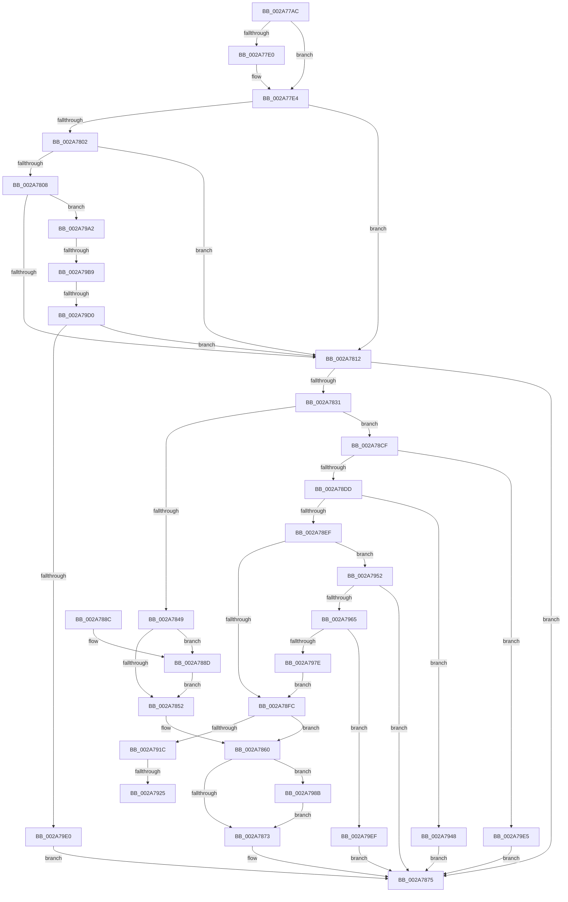

# MiFreeVadRange

- RVA: `0x002A77AC`–`0x002A7A04` (길이 `600` bytes)
- VA: `0x00000001402A77AC`
- 실행 섹션: `.text`
- PDB 이름 있음: `예`; PDB Function 태그: `예`
- unwind 정보 RVA: `0x00068C28`
- 디코드: `160`개 명령, `600/600` bytes 표시
- 미해석 바이트: `0` (있으면 어셈블리에 `.byte`로 보존)

> 이 문서는 커널 이미지의 기계어와 PDB 기호를 분석해 생성했습니다. 4번과 5번은 함수 원형과 자료형을 바이너리 사용 방식에서 추정한 C 해석이며 원본 소스 복구 결과는 아닙니다.

## 1. Dependencies

- 직접 호출 지점: **15**; 고유 호출 대상: **12**
- 직접 호출자로 확인된 함수: **3**
- RIP 상대 이미지 참조: **1**

### Outgoing calls
- `0x002A7828` → [MiPrepareVadDelete](../../page/A2/MiPrepareVadDelete_function_00A25E98.md) (function, `0x00A25E98`)
- `0x002A785B` → [MiDeleteVad](../../page/88/MiDeleteVad_function_00888C80.md) (function, `0x00888C80`)
- `0x002A7895` → [MiLocateLockedVadEvent](MiLocateLockedVadEvent_function_002A7A0C.md) (function, `0x002A7A0C`)
- `0x002A78A6` → [MiLockNestedVad](../../page/A2/MiLockNestedVad_function_00A25FBC.md) (function, `0x00A25FBC`)
- `0x002A78E5` → [MiLocateLockedVadEvent](MiLocateLockedVadEvent_function_002A7A0C.md) (function, `0x002A7A0C`)
- `0x002A790D` → [MiDeletePartialVad](MiDeletePartialVad_function_002A7A30.md) (function, `0x002A7A30`)
- `0x002A7928` → [MiUnlockNestedVad](../../page/A2/MiUnlockNestedVad_function_00A26BC4.md) (function, `0x00A26BC4`)
- `0x002A7932` → [ExFreePoolWithTag](../../poolcode/B8/ExFreePoolWithTag_function_00B82870.md) (function, `0x00B82870`)
- `0x002A793D` → [PsReturnProcessNonPagedPoolQuota](../41/PsReturnProcessNonPagedPoolQuota_function_0041C200.md) (function, `0x0041C200`)
- `0x002A7958` → [PsChargeProcessNonPagedPoolQuota](PsChargeProcessNonPagedPoolQuota_function_002A7B80.md) (function, `0x002A7B80`)
- `0x002A7971` → [MiAllocateVad](../../page/8C/MiAllocateVad_function_008CF3F8.md) (function, `0x008CF3F8`)
- `0x002A7981` → [MiLockNestedVad](../../page/A2/MiLockNestedVad_function_00A25FBC.md) (function, `0x00A25FBC`)
- `0x002A7998` → [PerfInfoLogVirtualFree](../../page/88/PerfInfoLogVirtualFree_function_00880B98.md) (function, `0x00880B98`)
- `0x002A79D3` → [MiCanDeleteEnclave](../68/MiCanDeleteEnclave_function_00686D18.md) (function, `0x00686D18`)
- `0x002A79F5` → [PsReturnProcessNonPagedPoolQuota](../41/PsReturnProcessNonPagedPoolQuota_function_0041C200.md) (function, `0x0041C200`)

### Direct callers
- [MiFreeVirtualMemory](../../page/88/MiFreeVirtualMemory_function_00880268.md) at `0x0088048C`
- [MmStoreAllocateVirtualMemory](../../page/A6/MmStoreAllocateVirtualMemory_function_00A68238.md) at `0x00A68406`
- [MmStoreFreeVirtualMemory](../../page/A7/MmStoreFreeVirtualMemory_function_00A767A8.md) at `0x00A76831`

### Static image references
- `0x002A7866` → RVA `0x00FC6B04` (`ALMOSTRO`; reference)

## 2. Other-region calls and transfers

- 다른 실행 섹션으로 향하는 call: **8**
  - `0x002A7828` → [MiPrepareVadDelete](../../page/A2/MiPrepareVadDelete_function_00A25E98.md) (`.text` → `PAGE`)
  - `0x002A785B` → [MiDeleteVad](../../page/88/MiDeleteVad_function_00888C80.md) (`.text` → `PAGE`)
  - `0x002A78A6` → [MiLockNestedVad](../../page/A2/MiLockNestedVad_function_00A25FBC.md) (`.text` → `PAGE`)
  - `0x002A7928` → [MiUnlockNestedVad](../../page/A2/MiUnlockNestedVad_function_00A26BC4.md) (`.text` → `PAGE`)
  - `0x002A7932` → [ExFreePoolWithTag](../../poolcode/B8/ExFreePoolWithTag_function_00B82870.md) (`.text` → `POOLCODE`)
  - `0x002A7971` → [MiAllocateVad](../../page/8C/MiAllocateVad_function_008CF3F8.md) (`.text` → `PAGE`)
  - `0x002A7981` → [MiLockNestedVad](../../page/A2/MiLockNestedVad_function_00A25FBC.md) (`.text` → `PAGE`)
  - `0x002A7998` → [PerfInfoLogVirtualFree](../../page/88/PerfInfoLogVirtualFree_function_00880B98.md) (`.text` → `PAGE`)
- call이 아닌 외부 분기/꼬리 이동: **4**
  - `0x002A791F` → [sub_006DAFB8 + 0xA](../6D/Unknown_function_006DAFB8.md) (`tail-transfer`)
  - `0x002A7943` → [sub_006DAFB8 + 0xA](../6D/Unknown_function_006DAFB8.md) (`tail-transfer`)
  - `0x002A79B3` → [sub_006DAFB8](../6D/Unknown_function_006DAFB8.md) (`tail-transfer`)
  - `0x002A79CA` → [sub_006DAFB8](../6D/Unknown_function_006DAFB8.md) (`tail-transfer`)

## 3. Assembly (complete function range)

```asm
002A77AC  48 89 5C 24 10                  mov qword ptr [rsp + 0x10], rbx
002A77B1  48 89 6C 24 18                  mov qword ptr [rsp + 0x18], rbp
002A77B6  56                              push rsi
002A77B7  57                              push rdi
002A77B8  41 55                           push r13
002A77BA  41 56                           push r14
002A77BC  41 57                           push r15
002A77BE  48 83 EC 30                     sub rsp, 0x30
002A77C2  83 64 24 60 00                  and dword ptr [rsp + 0x60], 0
002A77C7  4C 8B FA                        mov r15, rdx
002A77CA  48 8B 94 24 90 00 00 00         mov rdx, qword ptr [rsp + 0x90]
002A77D2  49 8B D9                        mov rbx, r9
002A77D5  49 8B E8                        mov rbp, r8
002A77D8  48 8B F1                        mov rsi, rcx
002A77DB  48 85 D2                        test rdx, rdx
002A77DE  74 04                           je 0x1402a77e4
002A77E0  48 83 22 00                     and qword ptr [rdx], 0
002A77E4  8B 41 30                        mov eax, dword ptr [rcx + 0x30]
002A77E7  48 8B FB                        mov rdi, rbx
002A77EA  48 C1 E7 0C                     shl rdi, 0xc
002A77EE  4C 8B F5                        mov r14, rbp
002A77F1  48 81 CF FF 0F 00 00            or rdi, 0xfff
002A77F8  49 C1 E6 0C                     shl r14, 0xc
002A77FC  0F BA E0 15                     bt eax, 0x15
002A7800  73 10                           jae 0x1402a7812
002A7802  0F BA E0 1A                     bt eax, 0x1a
002A7806  72 0A                           jb 0x1402a7812
002A7808  0F BA E0 1B                     bt eax, 0x1b
002A780C  0F 82 90 01 00 00               jb 0x1402a79a2
002A7812  48 8D 44 24 60                  lea rax, [rsp + 0x60]
002A7817  4C 8B CB                        mov r9, rbx
002A781A  4C 8B C5                        mov r8, rbp
002A781D  48 89 44 24 20                  mov qword ptr [rsp + 0x20], rax
002A7822  49 8B D7                        mov rdx, r15
002A7825  48 8B CE                        mov rcx, rsi
002A7828  E8 6B E6 77 00                  call 0x140a25e98
002A782D  85 C0                           test eax, eax
002A782F  78 44                           js 0x1402a7875
002A7831  44 8B 7C 24 60                  mov r15d, dword ptr [rsp + 0x60]
002A7836  33 DB                           xor ebx, ebx
002A7838  48 8B AC 24 80 00 00 00         mov rbp, qword ptr [rsp + 0x80]
002A7840  45 85 FF                        test r15d, r15d
002A7843  0F 85 86 00 00 00               jne 0x1402a78cf
002A7849  39 9C 24 88 00 00 00            cmp dword ptr [rsp + 0x88], ebx
002A7850  75 3B                           jne 0x1402a788d
002A7852  45 33 C0                        xor r8d, r8d
002A7855  48 8B D3                        mov rdx, rbx
002A7858  48 8B CE                        mov rcx, rsi
002A785B  E8 20 14 5E 00                  call 0x140888c80
002A7860  41 B9 00 80 00 00               mov r9d, 0x8000
002A7866  44 85 0D 97 F2 D1 00            test dword ptr [rip + 0xd1f297], r9d
002A786D  0F 85 18 01 00 00               jne 0x1402a798b
002A7873  33 C0                           xor eax, eax
002A7875  48 8B 5C 24 68                  mov rbx, qword ptr [rsp + 0x68]
002A787A  48 8B 6C 24 70                  mov rbp, qword ptr [rsp + 0x70]
002A787F  48 83 C4 30                     add rsp, 0x30
002A7883  41 5F                           pop r15
002A7885  41 5E                           pop r14
002A7887  41 5D                           pop r13
002A7889  5F                              pop rdi
002A788A  5E                              pop rsi
002A788B  C3                              ret
002A788C  CC                              int3
002A788D  BA 80 00 00 00                  mov edx, 0x80
002A7892  48 8B CE                        mov rcx, rsi
002A7895  E8 72 01 00 00                  call 0x1402a7a0c
002A789A  48 8B 58 08                     mov rbx, qword ptr [rax + 8]
002A789E  48 83 60 08 00                  and qword ptr [rax + 8], 0
002A78A3  48 8B CB                        mov rcx, rbx
002A78A6  E8 11 E7 77 00                  call 0x140a25fbc
002A78AB  49 8B C6                        mov rax, r14
002A78AE  48 C1 E8 0C                     shr rax, 0xc
002A78B2  89 43 18                        mov dword ptr [rbx + 0x18], eax
002A78B5  48 C1 E8 20                     shr rax, 0x20
002A78B9  88 43 20                        mov byte ptr [rbx + 0x20], al
002A78BC  48 8B C7                        mov rax, rdi
002A78BF  48 C1 E8 0C                     shr rax, 0xc
002A78C3  89 43 1C                        mov dword ptr [rbx + 0x1c], eax
002A78C6  48 C1 E8 20                     shr rax, 0x20
002A78CA  88 43 21                        mov byte ptr [rbx + 0x21], al
002A78CD  EB 83                           jmp 0x1402a7852
002A78CF  8B 85 F4 01 00 00               mov eax, dword ptr [rbp + 0x1f4]
002A78D5  A8 20                           test al, 0x20
002A78D7  0F 85 08 01 00 00               jne 0x1402a79e5
002A78DD  BA 02 00 00 00                  mov edx, 2
002A78E2  48 8B CE                        mov rcx, rsi
002A78E5  E8 22 01 00 00                  call 0x1402a7a0c
002A78EA  48 85 C0                        test rax, rax
002A78ED  75 59                           jne 0x1402a7948
002A78EF  44 8D 6A 3E                     lea r13d, [rdx + 0x3e]
002A78F3  39 9C 24 88 00 00 00            cmp dword ptr [rsp + 0x88], ebx
002A78FA  75 56                           jne 0x1402a7952
002A78FC  45 8B CF                        mov r9d, r15d
002A78FF  48 89 5C 24 20                  mov qword ptr [rsp + 0x20], rbx
002A7904  4C 8B C7                        mov r8, rdi
002A7907  49 8B D6                        mov rdx, r14
002A790A  48 8B CE                        mov rcx, rsi
002A790D  E8 1E 01 00 00                  call 0x1402a7a30
002A7912  8B F0                           mov esi, eax
002A7914  85 C0                           test eax, eax
002A7916  0F 89 44 FF FF FF               jns 0x1402a7860
002A791C  48 85 DB                        test rbx, rbx
002A791F  0F 84 9D 36 43 00               je 0x1406dafc2
002A7925  48 8B CB                        mov rcx, rbx
002A7928  E8 97 F2 77 00                  call 0x140a26bc4
002A792D  33 D2                           xor edx, edx
002A792F  48 8B CB                        mov rcx, rbx
002A7932  E8 39 AF 8D 00                  call 0x140b82870
002A7937  49 8B D5                        mov rdx, r13
002A793A  48 8B CD                        mov rcx, rbp
002A793D  E8 BE 48 17 00                  call 0x14041c200
002A7942  90                              nop
002A7943  E9 7A 36 43 00                  jmp 0x1406dafc2
002A7948  B8 45 00 00 C0                  mov eax, 0xc0000045
002A794D  E9 23 FF FF FF                  jmp 0x1402a7875
002A7952  49 8B D5                        mov rdx, r13
002A7955  48 8B CD                        mov rcx, rbp
002A7958  E8 23 02 00 00                  call 0x1402a7b80
002A795D  85 C0                           test eax, eax
002A795F  0F 88 10 FF FF FF               js 0x1402a7875
002A7965  41 B8 02 00 00 00               mov r8d, 2
002A796B  48 8B D7                        mov rdx, rdi
002A796E  49 8B CE                        mov rcx, r14
002A7971  E8 82 7A 62 00                  call 0x1408cf3f8
002A7976  48 8B D8                        mov rbx, rax
002A7979  48 85 C0                        test rax, rax
002A797C  74 71                           je 0x1402a79ef
002A797E  48 8B C8                        mov rcx, rax
002A7981  E8 36 E6 77 00                  call 0x140a25fbc
002A7986  E9 71 FF FF FF                  jmp 0x1402a78fc
002A798B  49 2B FE                        sub rdi, r14
002A798E  4C 8B C5                        mov r8, rbp
002A7991  49 8B CE                        mov rcx, r14
002A7994  48 8D 57 01                     lea rdx, [rdi + 1]
002A7998  E8 FB 91 5D 00                  call 0x140880b98
002A799D  E9 D1 FE FF FF                  jmp 0x1402a7873
002A79A2  0F B6 49 20                     movzx ecx, byte ptr [rcx + 0x20]
002A79A6  8B 46 18                        mov eax, dword ptr [rsi + 0x18]
002A79A9  48 C1 E1 20                     shl rcx, 0x20
002A79AD  48 0B C8                        or rcx, rax
002A79B0  48 3B E9                        cmp rbp, rcx
002A79B3  0F 85 FF 35 43 00               jne 0x1406dafb8
002A79B9  0F B6 4E 21                     movzx ecx, byte ptr [rsi + 0x21]
002A79BD  8B 46 1C                        mov eax, dword ptr [rsi + 0x1c]
002A79C0  48 C1 E1 20                     shl rcx, 0x20
002A79C4  48 0B C8                        or rcx, rax
002A79C7  48 3B D9                        cmp rbx, rcx
002A79CA  0F 85 E8 35 43 00               jne 0x1406dafb8
002A79D0  48 8B CE                        mov rcx, rsi
002A79D3  E8 40 F3 3D 00                  call 0x140686d18
002A79D8  85 C0                           test eax, eax
002A79DA  0F 89 32 FE FF FF               jns 0x1402a7812
002A79E0  E9 90 FE FF FF                  jmp 0x1402a7875
002A79E5  B8 0A 01 00 C0                  mov eax, 0xc000010a
002A79EA  E9 86 FE FF FF                  jmp 0x1402a7875
002A79EF  49 8B D5                        mov rdx, r13
002A79F2  48 8B CD                        mov rcx, rbp
002A79F5  E8 06 48 17 00                  call 0x14041c200
002A79FA  B8 9A 00 00 C0                  mov eax, 0xc000009a
002A79FF  E9 71 FE FF FF                  jmp 0x1402a7875
```

## 4. C-style interpretation (structured pseudocode)

```c
__int64 __fastcall MiFreeVadRange(__int64 a1, __int64 a2, __int64 a3, __int64 a4, __int64 a5, unsigned int a6, __int64 a7)
{
    __int64 result;
    __int64 v_r14;
    __int64 v_rbx;
    __int64 v_rdi;
    __int64 v_rsp;
    unsigned __int64 v_stack_m38;
    unsigned __int64 v_stack_p10;
    unsigned __int64 v_stack_p18;
    unsigned __int64 v_stack_p20;
    unsigned int v_stack_p8;

    v_stack_p10 = v_rbx;
    v_stack_p18 = v_rbp;
    v_rsp = (v_rsp) - (48);
    if (a7 != 0) {
    }
    v_rdi = (a4) << (12);
    v_rdi = (v_rdi) | (0xFFFULL);
    v_r14 = (a3) << (12);
    if (condition_is_above_or_equal) goto loc_002A7812;
    if (condition_is_below) goto loc_002A7812;
    if (condition_is_below) goto loc_002A79A2;
loc_002A7812:
    v_stack_m38 = v_stack_p8;
    result = MiPrepareVadDelete(a1, a2, a3, a4);
    if (sign_flag) goto loc_002A7875;
    v_rbx = 0;
    if ((unsigned int)((unsigned int)(v_stack_p8)) != 0) goto loc_002A78CF;
    if (a6 != 0) goto loc_002A788D;
loc_002A7852:
    a3 = 0;
    result = MiDeleteVad(a1, 0, a3, a4);
loc_002A7860:
    if (((*(unsigned int *)(v_rip + 13759127)) & ((unsigned int)((unsigned int)(0x8000ULL)))) != 0) goto loc_002A798B;
loc_002A7873:
    result = 0;
loc_002A7875:
    v_rsp = (v_rsp) + (48);
    return result;
loc_002A788D:
    result = MiLocateLockedVadEvent(a1, 128, a3, (unsigned int)(0x8000ULL));
    result = MiLockNestedVad(*(unsigned __int64 *)(result + 8), 128, a3, (unsigned int)(0x8000ULL));
    result = (v_r14) >> (12);
    *(unsigned int *)(*(unsigned __int64 *)(result + 8) + 24) = (unsigned int)(result);
    result = (result) >> (32);
    *(unsigned __int8 *)(*(unsigned __int64 *)(result + 8) + 32) = (unsigned __int8)(result);
    result = (v_rdi) >> (12);
    *(unsigned int *)(*(unsigned __int64 *)(result + 8) + 28) = (unsigned int)(result);
    result = (result) >> (32);
    *(unsigned __int8 *)(*(unsigned __int64 *)(result + 8) + 33) = (unsigned __int8)(result);
    goto loc_002A7852;
loc_002A78CF:
    if ((((unsigned __int8)((unsigned int)(*(unsigned int *)(v_stack_p18 + 500)))) & (32)) != 0) goto loc_002A79E5;
    result = MiLocateLockedVadEvent(a1, 2, a3, (unsigned int)(0x8000ULL));
    if (result != 0) goto loc_002A7948;
    if (a6 != ((unsigned int)(*(unsigned __int64 *)(result + 8)))) goto loc_002A7952;
loc_002A78FC:
    v_stack_p20 = *(unsigned __int64 *)(result + 8);
    result = MiDeletePartialVad(a1, v_r14, v_rdi, (unsigned int)((unsigned int)((unsigned int)(v_stack_p8))));
    if (!sign_flag) goto loc_002A7860;
    result = MiUnlockNestedVad(*(unsigned __int64 *)(result + 8), v_r14, v_rdi, (unsigned int)((unsigned int)((unsigned int)(v_stack_p8))));
    a2 = 0;
    result = ExFreePoolWithTag(*(unsigned __int64 *)(result + 8), a2, v_rdi, (unsigned int)((unsigned int)((unsigned int)(v_stack_p8))));
    result = PsReturnProcessNonPagedPoolQuota(v_stack_p18, 2 + 62, v_rdi, (unsigned int)((unsigned int)((unsigned int)(v_stack_p8))));
loc_002A7948:
    goto loc_002A7875;
loc_002A7952:
    result = PsChargeProcessNonPagedPoolQuota(v_stack_p18, 2 + 62, v_rdi, (unsigned int)((unsigned int)((unsigned int)(v_stack_p8))));
    if (sign_flag) goto loc_002A7875;
    result = MiAllocateVad(v_r14, v_rdi, 2, (unsigned int)((unsigned int)((unsigned int)(v_stack_p8))));
    if (result == 0) goto loc_002A79EF;
    result = MiLockNestedVad(result, v_rdi, 2, (unsigned int)((unsigned int)((unsigned int)(v_stack_p8))));
    goto loc_002A78FC;
loc_002A798B:
    v_rdi = (v_rdi) - (v_r14);
    result = PerfInfoLogVirtualFree(v_r14, v_rdi + 1, v_stack_p18, (unsigned int)((unsigned int)((unsigned int)(v_stack_p8))));
    goto loc_002A7873;
loc_002A79A2:
    a1 = (*(unsigned __int8 *)(v_r14 + 32)) << (32);
    a1 = (a1) | ((unsigned int)(*(unsigned int *)((unsigned int)((unsigned int)(result)) + 24)));
    a1 = (*(unsigned __int8 *)((unsigned int)((unsigned int)(result)) + 33)) << (32);
    a1 = (a1) | ((unsigned int)(*(unsigned int *)((unsigned int)((unsigned int)(result)) + 28)));
    result = MiCanDeleteEnclave((unsigned int)((unsigned int)(result)), v_rdi + 1, v_stack_p18, (unsigned int)((unsigned int)((unsigned int)(v_stack_p8))));
    if (!sign_flag) goto loc_002A7812;
    goto loc_002A7875;
loc_002A79E5:
    goto loc_002A7875;
loc_002A79EF:
    result = PsReturnProcessNonPagedPoolQuota(v_stack_p18, 2 + 62, v_stack_p18, (unsigned int)((unsigned int)((unsigned int)(v_stack_p8))));
    goto loc_002A7875;
}
```

## 5. (Beta) C Style

```c
int64_t MiFreeVadRange(void *Arg1, int64_t Arg2, int64_t Arg3, int64_t Arg4, void *Arg5, uint32_t Arg6, int64_t Arg7)
{
    uint8_t *arg1 = (uint8_t *)Arg1;
    uint8_t *arg5 = (uint8_t *)Arg5;

    int64_t result;
    int64_t local_r14;
    int64_t local_rbx;
    int64_t local_rdi;
    int64_t local_rsp;
    uint64_t v_stack_m38;
    uint64_t v_stack_p10;
    uint64_t v_stack_p18;
    uint64_t v_stack_p20;
    uint32_t v_stack_p8;

    v_stack_p10 = local_rbx;
    v_stack_p18 = local_rbp;
    local_rsp = (local_rsp) - (48);
    if (Arg7 != 0) {
    }
    local_rdi = (Arg4) << (12);
    local_rdi = (local_rdi) | (0xFFFULL);
    local_r14 = (Arg3) << (12);
    if (condition_is_above_or_equal) goto loc_002A7812;
    if (condition_is_below) goto loc_002A7812;
    if (condition_is_below) goto loc_002A79A2;
loc_002A7812:
    v_stack_m38 = v_stack_p8;
    result = MiPrepareVadDelete(Arg1, Arg2, Arg3, Arg4);
    if (sign_flag) goto loc_002A7875;
    local_rbx = 0;
    if ((uint32_t)((uint32_t)(v_stack_p8)) != 0) goto loc_002A78CF;
    if (Arg6 != 0) goto loc_002A788D;
loc_002A7852:
    Arg3 = 0;
    result = MiDeleteVad(Arg1, 0, Arg3, Arg4);
loc_002A7860:
    if (((*(uint32_t *)(v_rip + 0xD1F297)) & ((uint32_t)((uint32_t)(0x8000ULL)))) != 0) goto loc_002A798B;
loc_002A7873:
    result = 0;
loc_002A7875:
    local_rsp = (local_rsp) + (48);
    return result;
loc_002A788D:
    result = MiLocateLockedVadEvent(Arg1, 128, Arg3, (uint32_t)(0x8000ULL));
    result = MiLockNestedVad(*(uint64_t *)(result + 0x8), 128, Arg3, (uint32_t)(0x8000ULL));
    result = (local_r14) >> (12);
    *(uint32_t *)(*(uint64_t *)(result + 0x8) + 0x18) = (uint32_t)(result);
    result = (result) >> (32);
    *(uint8_t *)(*(uint64_t *)(result + 0x8) + 0x20) = (uint8_t)(result);
    result = (local_rdi) >> (12);
    *(uint32_t *)(*(uint64_t *)(result + 0x8) + 0x1C) = (uint32_t)(result);
    result = (result) >> (32);
    *(uint8_t *)(*(uint64_t *)(result + 0x8) + 0x21) = (uint8_t)(result);
    goto loc_002A7852;
loc_002A78CF:
    if ((((uint8_t)((uint32_t)(*(uint32_t *)(v_stack_p18 + 0x1F4)))) & (32)) != 0) goto loc_002A79E5;
    result = MiLocateLockedVadEvent(Arg1, 2, Arg3, (uint32_t)(0x8000ULL));
    if (result != 0) goto loc_002A7948;
    if (Arg6 != ((uint32_t)(*(uint64_t *)(result + 0x8)))) goto loc_002A7952;
loc_002A78FC:
    v_stack_p20 = *(uint64_t *)(result + 0x8);
    result = MiDeletePartialVad(Arg1, local_r14, local_rdi, (uint32_t)((uint32_t)((uint32_t)(v_stack_p8))));
    if (!sign_flag) goto loc_002A7860;
    result = MiUnlockNestedVad(*(uint64_t *)(result + 0x8), local_r14, local_rdi, (uint32_t)((uint32_t)((uint32_t)(v_stack_p8))));
    Arg2 = 0;
    result = ExFreePoolWithTag(*(uint64_t *)(result + 0x8), Arg2, local_rdi, (uint32_t)((uint32_t)((uint32_t)(v_stack_p8))));
    result = PsReturnProcessNonPagedPoolQuota(v_stack_p18, 2 + 62, local_rdi, (uint32_t)((uint32_t)((uint32_t)(v_stack_p8))));
loc_002A7948:
    goto loc_002A7875;
loc_002A7952:
    result = PsChargeProcessNonPagedPoolQuota(v_stack_p18, 2 + 62, local_rdi, (uint32_t)((uint32_t)((uint32_t)(v_stack_p8))));
    if (sign_flag) goto loc_002A7875;
    result = MiAllocateVad(local_r14, local_rdi, 2, (uint32_t)((uint32_t)((uint32_t)(v_stack_p8))));
    if (result == 0) goto loc_002A79EF;
    result = MiLockNestedVad(result, local_rdi, 2, (uint32_t)((uint32_t)((uint32_t)(v_stack_p8))));
    goto loc_002A78FC;
loc_002A798B:
    local_rdi = (local_rdi) - (local_r14);
    result = PerfInfoLogVirtualFree(local_r14, local_rdi + 1, v_stack_p18, (uint32_t)((uint32_t)((uint32_t)(v_stack_p8))));
    goto loc_002A7873;
loc_002A79A2:
    Arg1 = (*(uint8_t *)(local_r14 + 0x20)) << (32);
    Arg1 = (Arg1) | ((uint32_t)(*(uint32_t *)((uint32_t)((uint32_t)(result)) + 0x18)));
    Arg1 = (*(uint8_t *)((uint32_t)((uint32_t)(result)) + 0x21)) << (32);
    Arg1 = (Arg1) | ((uint32_t)(*(uint32_t *)((uint32_t)((uint32_t)(result)) + 0x1C)));
    result = MiCanDeleteEnclave((uint32_t)((uint32_t)(result)), local_rdi + 1, v_stack_p18, (uint32_t)((uint32_t)((uint32_t)(v_stack_p8))));
    if (!sign_flag) goto loc_002A7812;
    goto loc_002A7875;
loc_002A79E5:
    goto loc_002A7875;
loc_002A79EF:
    result = PsReturnProcessNonPagedPoolQuota(v_stack_p18, 2 + 62, v_stack_p18, (uint32_t)((uint32_t)((uint32_t)(v_stack_p8))));
    goto loc_002A7875;
}
```

### 관측된 메모리 오프셋

구조체 형식이 확인되지 않은 접근은 인자 기준의 오프셋으로만 기록했습니다.

| 기준 인자 | 오프셋 표현 | 폭 (bit) | 접근 |
|---|---:|---:|---|
| `Arg1` | `+ 0x18` | `32` | `R` |
| `Arg1` | `+ 0x1C` | `32` | `R` |
| `Arg1` | `+ 0x20` | `8` | `R` |
| `Arg1` | `+ 0x21` | `8` | `R` |
| `Arg1` | `+ 0x30` | `32` | `R` |
| `Arg5` | `+ 0x1F4` | `32` | `R` |

## 6. Execution-region graph

[열기: 2D/3D 그래프와 함수 탐색 컨트롤 패널](../../../control-panel.html?section=text&rva=0x002A77AC&view=graph)

- 2D 그래프는 위에서 아래로 흐르고, 3D 그래프는 빈 공간을 드래그해 회전합니다. Shift+드래그는 이동, 휠은 확대·축소, 함수 노드 선택은 대상 보고서 이동입니다.

### Static fallback


