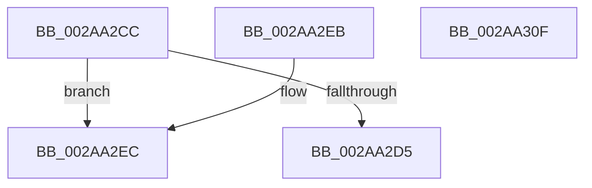

# MiGetAweInfoPartition

- RVA: `0x002AA2CC`–`0x002AA310` (길이 `68` bytes)
- VA: `0x00000001402AA2CC`
- 실행 섹션: `.text`
- PDB 이름 있음: `예`; PDB Function 태그: `아니요`
- unwind 정보 RVA: `0x000DB714`
- 디코드: `16`개 명령, `68/68` bytes 표시
- 미해석 바이트: `0` (있으면 어셈블리에 `.byte`로 보존)

> 이 문서는 커널 이미지의 기계어와 PDB 기호를 분석해 생성했습니다. 4번과 5번은 함수 원형과 자료형을 바이너리 사용 방식에서 추정한 C 해석이며 원본 소스 복구 결과는 아닙니다.

## 1. Dependencies

- 직접 호출 지점: **0**; 고유 호출 대상: **0**
- 직접 호출자로 확인된 함수: **9**
- RIP 상대 이미지 참조: **1**

### Outgoing calls
- 직접 디코드된 call 명령이 없습니다.

### Direct callers
- [MiGetAweVadPartition](MiGetAweVadPartition_function_002A94E8.md) at `0x002A9531`
- [MiFreePhysicalPageChain](MiFreePhysicalPageChain_function_002A9F1C.md) at `0x002A9F74`
- [MiAllocateAweInfo](../../page/80/MiAllocateAweInfo_function_00809518.md) at `0x00809600`
- [MiAllocateFastAwePages](../../page/80/MiAllocateFastAwePages_function_0080969C.md) at `0x008096FF`
- [MiAllocateUserPhysicalPages](../../page/80/MiAllocateUserPhysicalPages_function_00809828.md) at `0x00809C92`
- [MiCreateAweInfoBitMap](../../page/80/MiCreateAweInfoBitMap_function_0080A770.md) at `0x0080A7AF`
- [MiDeleteAweInfoPages](../../page/80/MiDeleteAweInfoPages_function_0080AA40.md) at `0x0080AA89`
- [NtFreeUserPhysicalPages](../../page/80/NtFreeUserPhysicalPages_function_0080AF30.md) at `0x0080B2CC`
- [MiCreateUserPhysicalView](../../page/AD/MiCreateUserPhysicalView_function_00ADA4B4.md) at `0x00ADA6EC`

### Static image references
- `0x002AA2D9` → RVA `0x00E30088` (`.data`; read)

## 2. Other-region calls and transfers

- 다른 실행 섹션으로 향하는 call: **0**
- 별도 외부 분기/꼬리 이동을 확인하지 못했습니다.

## 3. Assembly (complete function range)

```asm
002AA2CC  48 8B 41 28                     mov rax, qword ptr [rcx + 0x28]
002AA2D0  48 85 C0                        test rax, rax
002AA2D3  74 17                           je 0x1402aa2ec
002AA2D5  0F B7 48 3C                     movzx ecx, word ptr [rax + 0x3c]
002AA2D9  48 8B 05 A8 5D B8 00            mov rax, qword ptr [rip + 0xb85da8]
002AA2E0  81 E1 FF 03 00 00               and ecx, 0x3ff
002AA2E6  48 8B 04 C8                     mov rax, qword ptr [rax + rcx*8]
002AA2EA  C3                              ret
002AA2EB  CC                              int3
002AA2EC  65 48 8B 04 25 88 01 00 00      mov rax, qword ptr gs:[0x188]
002AA2F5  48 8B 88 B8 00 00 00            mov rcx, qword ptr [rax + 0xb8]
002AA2FC  48 8B 05 85 5D B8 00            mov rax, qword ptr [rip + 0xb85d85]
002AA303  0F B7 91 AE 04 00 00            movzx edx, word ptr [rcx + 0x4ae]
002AA30A  48 8B 04 D0                     mov rax, qword ptr [rax + rdx*8]
002AA30E  C3                              ret
002AA30F  CC                              int3
```

## 4. C-style interpretation (structured pseudocode)

```c
__int64 __fastcall MiGetAweInfoPartition(__int64 a1)
{
    if (*(unsigned __int64 *)(a1 + 40) == 0) goto loc_002AA2EC;
    a1 = (unsigned int)((*(unsigned __int16 *)(*(unsigned __int64 *)(a1 + 40) + 60)) & (0x3FFULL));
    return *(unsigned __int64 *)(*(unsigned __int64 *)(v_rip + 12082600) + a1 * 8);
loc_002AA2EC:
    return *(unsigned __int64 *)(*(unsigned __int64 *)(v_rip + 12082565) + *(unsigned __int16 *)(*(unsigned __int64 *)(*(unsigned __int64 *)(gs_base + (0 + 392)) + 184) + 1198) * 8);
}
```

## 5. (Beta) C Style

```c
int64_t MiGetAweInfoPartition(void *Arg1)
{
    uint8_t *arg1 = (uint8_t *)Arg1;

    if (*(uint64_t *)(arg1 + 0x28) == 0) goto loc_002AA2EC;
    Arg1 = (uint32_t)((*(uint16_t *)(*(uint64_t *)(arg1 + 0x28) + 0x3C)) & (0x3FFULL));
    return *(uint64_t *)(*(uint64_t *)(v_rip + 0xB85DA8) + arg1 * 8);
loc_002AA2EC:
    return *(uint64_t *)(*(uint64_t *)(v_rip + 0xB85D85) + *(uint16_t *)(*(uint64_t *)(*(uint64_t *)(gs_base + (0 + 0x188)) + 0xB8) + 0x4AE) * 8);
}
```

### 관측된 메모리 오프셋

구조체 형식이 확인되지 않은 접근은 인자 기준의 오프셋으로만 기록했습니다.

| 기준 인자 | 오프셋 표현 | 폭 (bit) | 접근 |
|---|---:|---:|---|
| `Arg1` | `+ 0x28` | `64` | `R` |

## 6. Execution-region graph

[열기: 2D/3D 그래프와 함수 탐색 컨트롤 패널](../../../control-panel.html?section=text&rva=0x002AA2CC&view=graph)

- 2D 그래프는 위에서 아래로 흐르고, 3D 그래프는 빈 공간을 드래그해 회전합니다. Shift+드래그는 이동, 휠은 확대·축소, 함수 노드 선택은 대상 보고서 이동입니다.

### Static fallback


