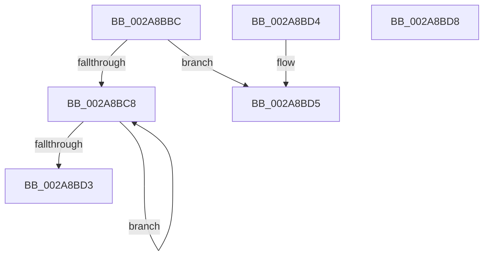

# MiGetFirstVad

- RVA: `0x002A8BBC`–`0x002A8BD9` (길이 `29` bytes)
- VA: `0x00000001402A8BBC`
- 실행 섹션: `.text`
- PDB 이름 있음: `예`; PDB Function 태그: `아니요`
- unwind 정보 RVA: `0x000DB714`
- 디코드: `12`개 명령, `29/29` bytes 표시
- 미해석 바이트: `0` (있으면 어셈블리에 `.byte`로 보존)

> 이 문서는 커널 이미지의 기계어와 PDB 기호를 분석해 생성했습니다. 4번과 5번은 함수 원형과 자료형을 바이너리 사용 방식에서 추정한 C 해석이며 원본 소스 복구 결과는 아닙니다.

## 1. Dependencies

- 직접 호출 지점: **0**; 고유 호출 대상: **0**
- 직접 호출자로 확인된 함수: **10**
- RIP 상대 이미지 참조: **0**

### Outgoing calls
- 직접 디코드된 call 명령이 없습니다.

### Direct callers
- [MiEmptyWorkingSetPrivatePagesByVa](MiEmptyWorkingSetPrivatePagesByVa_function_002A6AC0.md) at `0x002A6B32`
- [MmOutSwapWorkingSet](MmOutSwapWorkingSet_function_002A6BC8.md) at `0x002A6E3D`
- [MiReleaseOutSwappedProcessCommit](../3C/MiReleaseOutSwappedProcessCommit_function_003C8320.md) at `0x003C844F`
- [MiReleaseCommitForResetPages](../66/MiReleaseCommitForResetPages_function_0066FAF8.md) at `0x0066FB70`
- [MiHotPatchProcess](../../page/80/MiHotPatchProcess_function_00803B78.md) at `0x00803BEB`
- [sub_0087F646](../../page/87/Unknown_function_0087F646.md) at `0x0087F646`
- [MiLockVadRange](../../page/87/MiLockVadRange_function_0087F670.md) at `0x0087F86A`
- [MiMapAllImageScpPages](../../page/8D/MiMapAllImageScpPages_function_008D0534.md) at `0x008D056B`
- [MiCommitInitialVadMetadataBits](../../page/8D/MiCommitInitialVadMetadataBits_function_008D09CC.md) at `0x008D0A33`
- [MmCleanProcessAddressSpace](../../page/A1/MmCleanProcessAddressSpace_function_00A17EC0.md) at `0x00A17F69`

### Static image references
- 디코드된 RIP-relative 메모리 참조가 없습니다.

## 2. Other-region calls and transfers

- 다른 실행 섹션으로 향하는 call: **0**
- 별도 외부 분기/꼬리 이동을 확인하지 못했습니다.

## 3. Assembly (complete function range)

```asm
002A8BBC  48 8B 91 58 05 00 00            mov rdx, qword ptr [rcx + 0x558]
002A8BC3  48 85 D2                        test rdx, rdx
002A8BC6  74 0D                           je 0x1402a8bd5
002A8BC8  48 8B C2                        mov rax, rdx
002A8BCB  48 8B 12                        mov rdx, qword ptr [rdx]
002A8BCE  48 85 D2                        test rdx, rdx
002A8BD1  75 F5                           jne 0x1402a8bc8
002A8BD3  C3                              ret
002A8BD4  CC                              int3
002A8BD5  33 C0                           xor eax, eax
002A8BD7  C3                              ret
002A8BD8  CC                              int3
```

## 4. C-style interpretation (structured pseudocode)

```c
__int64 __fastcall MiGetFirstVad(__int64 a1)
{
    __int64 result;

    if (*(unsigned __int64 *)(a1 + 1368) == 0) goto loc_002A8BD5;
loc_002A8BC8:
    if (*(unsigned __int64 *)(*(unsigned __int64 *)(a1 + 1368)) != 0) goto loc_002A8BC8;
    return *(unsigned __int64 *)(a1 + 1368);
loc_002A8BD5:
    result = 0;
    return result;
}
```

## 5. (Beta) C Style

```c
int64_t MiGetFirstVad(void *Arg1)
{
    uint8_t *arg1 = (uint8_t *)Arg1;

    int64_t result;

    if (*(uint64_t *)(arg1 + 0x558) == 0) goto loc_002A8BD5;
loc_002A8BC8:
    if (*(uint64_t *)(*(uint64_t *)(arg1 + 0x558)) != 0) goto loc_002A8BC8;
    return *(uint64_t *)(arg1 + 0x558);
loc_002A8BD5:
    result = 0;
    return result;
}
```

### 관측된 메모리 오프셋

구조체 형식이 확인되지 않은 접근은 인자 기준의 오프셋으로만 기록했습니다.

| 기준 인자 | 오프셋 표현 | 폭 (bit) | 접근 |
|---|---:|---:|---|
| `Arg1` | `+ 0x558` | `64` | `R` |

## 6. Execution-region graph

[열기: 2D/3D 그래프와 함수 탐색 컨트롤 패널](../../../control-panel.html?section=text&rva=0x002A8BBC&view=graph)

- 2D 그래프는 위에서 아래로 흐르고, 3D 그래프는 빈 공간을 드래그해 회전합니다. Shift+드래그는 이동, 휠은 확대·축소, 함수 노드 선택은 대상 보고서 이동입니다.

### Static fallback


