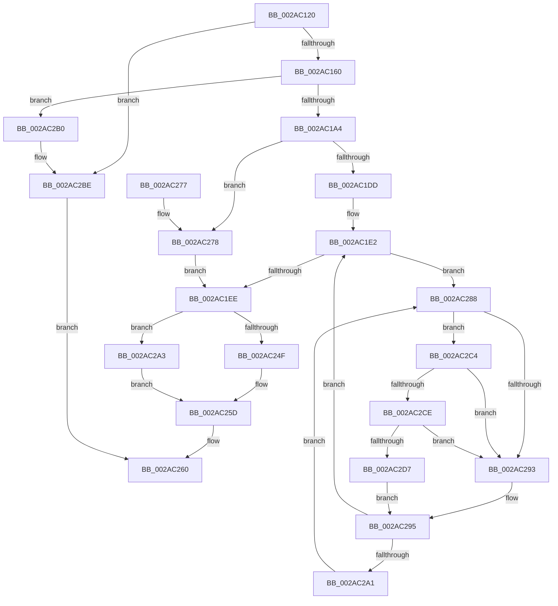

# MiGetPageForHeader

- RVA: `0x002AC120`–`0x002AC2E0` (길이 `448` bytes)
- VA: `0x00000001402AC120`
- 실행 섹션: `.text`
- PDB 이름 있음: `예`; PDB Function 태그: `아니요`
- unwind 정보 RVA: `0x0006D120`
- 디코드: `116`개 명령, `448/448` bytes 표시
- 미해석 바이트: `0` (있으면 어셈블리에 `.byte`로 보존)

> 이 문서는 커널 이미지의 기계어와 PDB 기호를 분석해 생성했습니다. 4번과 5번은 함수 원형과 자료형을 바이너리 사용 방식에서 추정한 C 해석이며 원본 소스 복구 결과는 아닙니다.

## 1. Dependencies

- 직접 호출 지점: **9**; 고유 호출 대상: **9**
- 직접 호출자로 확인된 함수: **3**
- RIP 상대 이미지 참조: **3**

### Outgoing calls
- `0x002AC152` → [MiObtainFaultCharges](../28/MiObtainFaultCharges_function_0028AEB0.md) (function, `0x0028AEB0`)
- `0x002AC184` → [MiInitializePageColorBase](../32/MiInitializePageColorBase_function_00320410.md) (function, `0x00320410`)
- `0x002AC193` → [MiGetSystemPage](MiGetSystemPage_function_002AB7E8.md) (function, `0x002AB7E8`)
- `0x002AC1C9` → [MiGetEffectivePagePriorityThread](../36/MiGetEffectivePagePriorityThread_function_003626E0.md) (function, `0x003626E0`)
- `0x002AC27B` → [MiLockPageInline](../31/MiLockPageInline_function_0031A340.md) (function, `0x0031A340`)
- `0x002AC2A9` → [MiUnlockPage](../31/MiUnlockPage_function_0031A3E0.md) (function, `0x0031A3E0`)
- `0x002AC2B9` → [MiReturnFaultCharges](../36/MiReturnFaultCharges_function_0036D928.md) (function, `0x0036D928`)
- `0x002AC2CE` → [KiCheckVpBackingLongSpinWaitHypercall](../30/KiCheckVpBackingLongSpinWaitHypercall_function_0030F490.md) (function, `0x0030F490`)
- `0x002AC2D9` → [HvlNotifyLongSpinWait](../30/HvlNotifyLongSpinWait_function_0030F460.md) (function, `0x0030F460`)

### Direct callers
- [MiInitializeImageProtos](MiInitializeImageProtos_function_002ABDAC.md) at `0x002ABEDB`
- [MiPfPutPagesInTransition](../36/MiPfPutPagesInTransition_function_003640EC.md) at `0x0036477B`
- [MiCreateMdl](../../page/98/MiCreateMdl_function_009883A8.md) at `0x0098844A`

### Static image references
- `0x002AC202` → RVA `0x00010880` (`.rdata`; read)
- `0x002AC28B` → RVA `0x00FC52AC` (`ALMOSTRO`; reference)
- `0x002AC2C4` → RVA `0x00FC6AB8` (`ALMOSTRO`; read)

## 2. Other-region calls and transfers

- 다른 실행 섹션으로 향하는 call: **0**
- 별도 외부 분기/꼬리 이동을 확인하지 못했습니다.

## 3. Assembly (complete function range)

```asm
002AC120  48 89 5C 24 08                  mov qword ptr [rsp + 8], rbx
002AC125  48 89 6C 24 10                  mov qword ptr [rsp + 0x10], rbp
002AC12A  56                              push rsi
002AC12B  57                              push rdi
002AC12C  41 54                           push r12
002AC12E  41 56                           push r14
002AC130  41 57                           push r15
002AC132  48 83 EC 30                     sub rsp, 0x30
002AC136  41 BC 01 00 00 00               mov r12d, 1
002AC13C  41 8B E8                        mov ebp, r8d
002AC13F  8B DA                           mov ebx, edx
002AC141  0F 57 C0                        xorps xmm0, xmm0
002AC144  45 8B C4                        mov r8d, r12d
002AC147  41 8B D4                        mov edx, r12d
002AC14A  48 8B F1                        mov rsi, rcx
002AC14D  0F 11 44 24 20                  movups xmmword ptr [rsp + 0x20], xmm0
002AC152  E8 59 ED FD FF                  call 0x14028aeb0
002AC157  48 85 C0                        test rax, rax
002AC15A  0F 84 5E 01 00 00               je 0x1402ac2be
002AC160  65 4C 8B 34 25 88 01 00 00      mov r14, qword ptr gs:[0x188]
002AC169  4C 8D 4C 24 20                  lea r9, [rsp + 0x20]
002AC16E  44 8B C3                        mov r8d, ebx
002AC171  41 8D 54 24 02                  lea edx, [r12 + 2]
002AC176  49 8B 8E B8 00 00 00            mov rcx, qword ptr [r14 + 0xb8]
002AC17D  48 81 C1 00 04 00 00            add rcx, 0x400
002AC184  E8 87 42 07 00                  call 0x140320410
002AC189  4C 8D 44 24 20                  lea r8, [rsp + 0x20]
002AC18E  8B D5                           mov edx, ebp
002AC190  48 8B CE                        mov rcx, rsi
002AC193  E8 50 F6 FF FF                  call 0x1402ab7e8
002AC198  48 8B F8                        mov rdi, rax
002AC19B  48 85 C0                        test rax, rax
002AC19E  0F 84 0C 01 00 00               je 0x1402ac2b0
002AC1A4  48 B8 00 00 00 00 00 DE FF FF   movabs rax, 0xffffde0000000000
002AC1AE  48 8B F7                        mov rsi, rdi
002AC1B1  49 8B CE                        mov rcx, r14
002AC1B4  48 2B F0                        sub rsi, rax
002AC1B7  48 B8 AB AA AA AA AA AA AA AA   movabs rax, 0xaaaaaaaaaaaaaaab
002AC1C1  48 C1 FE 04                     sar rsi, 4
002AC1C5  48 0F AF F0                     imul rsi, rax
002AC1C9  E8 12 65 0B 00                  call 0x1403626e0
002AC1CE  48 8D 5F 18                     lea rbx, [rdi + 0x18]
002AC1D2  44 8B F8                        mov r15d, eax
002AC1D5  85 ED                           test ebp, ebp
002AC1D7  0F 84 9B 00 00 00               je 0x1402ac278
002AC1DD  41 B6 11                        mov r14b, 0x11
002AC1E0  33 ED                           xor ebp, ebp
002AC1E2  F0 48 0F BA 2B 3F               lock bts qword ptr [rbx], 0x3f
002AC1E8  0F 82 9A 00 00 00               jb 0x1402ac288
002AC1EE  8B 4F 20                        mov ecx, dword ptr [rdi + 0x20]
002AC1F1  89 4C 24 78                     mov dword ptr [rsp + 0x78], ecx
002AC1F5  66 44 89 64 24 78               mov word ptr [rsp + 0x78], r12w
002AC1FB  8B 4C 24 78                     mov ecx, dword ptr [rsp + 0x78]
002AC1FF  89 4F 20                        mov dword ptr [rdi + 0x20], ecx
002AC202  48 8B 0D 77 46 D6 FF            mov rcx, qword ptr [rip - 0x29b989]
002AC209  48 89 4F 10                     mov qword ptr [rdi + 0x10], rcx
002AC20D  48 B9 00 00 00 00 00 00 00 40   movabs rcx, 0x4000000000000000
002AC217  8B 47 20                        mov eax, dword ptr [rdi + 0x20]
002AC21A  89 44 24 78                     mov dword ptr [rsp + 0x78], eax
002AC21E  C1 E8 18                        shr eax, 0x18
002AC221  44 32 F8                        xor r15b, al
002AC224  41 80 E7 07                     and r15b, 7
002AC228  44 32 F8                        xor r15b, al
002AC22B  44 88 7C 24 7B                  mov byte ptr [rsp + 0x7b], r15b
002AC230  8B 44 24 78                     mov eax, dword ptr [rsp + 0x78]
002AC234  89 47 20                        mov dword ptr [rdi + 0x20], eax
002AC237  48 C7 47 08 00 00 00 00         mov qword ptr [rdi + 8], 0
002AC23F  48 8B 03                        mov rax, qword ptr [rbx]
002AC242  48 0B C1                        or rax, rcx
002AC245  48 89 47 18                     mov qword ptr [rdi + 0x18], rax
002AC249  41 80 FE 11                     cmp r14b, 0x11
002AC24D  75 54                           jne 0x1402ac2a3
002AC24F  48 B8 FF FF FF FF FF FF FF 7F   movabs rax, 0x7fffffffffffffff
002AC259  F0 48 21 03                     lock and qword ptr [rbx], rax
002AC25D  48 8B C6                        mov rax, rsi
002AC260  48 8B 5C 24 60                  mov rbx, qword ptr [rsp + 0x60]
002AC265  48 8B 6C 24 68                  mov rbp, qword ptr [rsp + 0x68]
002AC26A  48 83 C4 30                     add rsp, 0x30
002AC26E  41 5F                           pop r15
002AC270  41 5E                           pop r14
002AC272  41 5C                           pop r12
002AC274  5F                              pop rdi
002AC275  5E                              pop rsi
002AC276  C3                              ret
002AC277  CC                              int3
002AC278  48 8B CF                        mov rcx, rdi
002AC27B  E8 C0 E0 06 00                  call 0x14031a340
002AC280  44 8A F0                        mov r14b, al
002AC283  E9 66 FF FF FF                  jmp 0x1402ac1ee
002AC288  41 03 EC                        add ebp, r12d
002AC28B  85 2D 1B 90 D1 00               test dword ptr [rip + 0xd1901b], ebp
002AC291  74 31                           je 0x1402ac2c4
002AC293  F3 90                           pause
002AC295  48 8B 03                        mov rax, qword ptr [rbx]
002AC298  48 85 C0                        test rax, rax
002AC29B  0F 89 41 FF FF FF               jns 0x1402ac1e2
002AC2A1  EB E5                           jmp 0x1402ac288
002AC2A3  41 8A D6                        mov dl, r14b
002AC2A6  48 8B CF                        mov rcx, rdi
002AC2A9  E8 32 E1 06 00                  call 0x14031a3e0
002AC2AE  EB AD                           jmp 0x1402ac25d
002AC2B0  45 8B C4                        mov r8d, r12d
002AC2B3  49 8B D4                        mov rdx, r12
002AC2B6  48 8B CE                        mov rcx, rsi
002AC2B9  E8 6A 16 0C 00                  call 0x14036d928
002AC2BE  48 83 C8 FF                     or rax, 0xffffffffffffffff
002AC2C2  EB 9C                           jmp 0x1402ac260
002AC2C4  8B 05 EE A7 D1 00               mov eax, dword ptr [rip + 0xd1a7ee]
002AC2CA  A8 40                           test al, 0x40
002AC2CC  74 C5                           je 0x1402ac293
002AC2CE  E8 BD 31 06 00                  call 0x14030f490
002AC2D3  84 C0                           test al, al
002AC2D5  74 BC                           je 0x1402ac293
002AC2D7  8B CD                           mov ecx, ebp
002AC2D9  E8 82 31 06 00                  call 0x14030f460
002AC2DE  EB B5                           jmp 0x1402ac295
```

## 4. C-style interpretation (structured pseudocode)

```c
__int64 __fastcall MiGetPageForHeader(__int64 a1, int a2, int a3)
{
    __int64 result;
    __int64 v_r15;
    __int64 v_rbp;
    __int64 v_rsi;
    __int64 v_rsp;
    unsigned __int64 v_stack_m38;
    unsigned __int64 v_stack_p10;
    unsigned int v_stack_p20;
    unsigned __int8 v_stack_p23;
    unsigned __int64 v_stack_p8;

    v_stack_p8 = v_rbx;
    v_stack_p10 = v_rbp;
    v_rsp = (v_rsp) - (48);
    v_stack_m38 = v_xmm0;
    result = MiObtainFaultCharges(a1, 1, 1, a4);
    if (result == 0) goto loc_002AC2BE;
    a1 = (*(unsigned __int64 *)(*(unsigned __int64 *)(gs_base + (0 + 392)) + 184)) + (0x400ULL);
    result = MiInitializePageColorBase(a1, 1 + 2, (unsigned int)((unsigned int)((unsigned int)(a2))), v_stack_m38);
    result = MiGetSystemPage(a1, (unsigned int)((unsigned int)((unsigned int)(a3))), v_stack_m38, v_stack_m38);
    if (result == 0) goto loc_002AC2B0;
    v_rsi = (result) - (result);
    v_rsi = (v_rsi) >> (4);
    v_rsi = (v_rsi) * (result);
    result = MiGetEffectivePagePriorityThread(*(unsigned __int64 *)(gs_base + (0 + 392)), (unsigned int)((unsigned int)((unsigned int)(a3))), v_stack_m38, v_stack_m38);
    if ((unsigned int)((unsigned int)(a3)) == 0) goto loc_002AC278;
    v_rbp = 0;
loc_002AC1E2:
    if (condition_is_below) goto loc_002AC288;
loc_002AC1EE:
    v_stack_p20 = (unsigned int)((unsigned int)(*(unsigned int *)(result + 32)));
    v_stack_p20 = 1;
    *(unsigned int *)(result + 32) = (unsigned int)((unsigned int)(v_stack_p20));
    *(unsigned __int64 *)(result + 16) = *(unsigned __int64 *)(v_rip - 2734473);
    v_stack_p20 = (unsigned int)((unsigned int)(*(unsigned int *)(result + 32)));
    result = (unsigned int)(((unsigned int)(*(unsigned int *)(result + 32))) >> (24));
    v_r15 = (unsigned __int8)(((unsigned int)((unsigned int)(result))) ^ ((unsigned __int8)(result)));
    v_r15 = (unsigned __int8)((v_r15) & (7));
    v_r15 = (unsigned __int8)((v_r15) ^ ((unsigned __int8)(result)));
    v_stack_p23 = (unsigned __int8)(v_r15);
    *(unsigned int *)(result + 32) = (unsigned int)((unsigned int)(v_stack_p20));
    *(unsigned __int64 *)(result + 8) = 0;
    result = (*(unsigned __int64 *)(result + 24)) | (*(unsigned __int64 *)(v_rip - 2734473));
    *(unsigned __int64 *)(result + 24) = result;
    if (17 != 17) goto loc_002AC2A3;
loc_002AC25D:
loc_002AC260:
    v_rsp = (v_rsp) + (48);
    return v_rsi;
loc_002AC278:
    result = MiLockPageInline(result, (unsigned int)((unsigned int)((unsigned int)(a3))), v_stack_m38, v_stack_m38);
    goto loc_002AC1EE;
loc_002AC288:
    v_rbp = (unsigned int)((v_stack_p10) + (1));
    if (((*(unsigned int *)(v_rip + 13733915)) & ((unsigned int)(v_rbp))) == 0) goto loc_002AC2C4;
loc_002AC293:
loc_002AC295:
    if (!sign_flag) goto loc_002AC1E2;
    goto loc_002AC288;
loc_002AC2A3:
    result = MiUnlockPage(result, (unsigned __int8)((unsigned __int8)(result)), v_stack_m38, v_stack_m38);
    goto loc_002AC25D;
loc_002AC2B0:
    result = MiReturnFaultCharges(v_rsi, 1, 1, v_stack_m38);
loc_002AC2BE:
    result = (result) | (-1);
    goto loc_002AC260;
loc_002AC2C4:
    if ((((unsigned __int8)((unsigned int)(*(unsigned int *)(v_rip + 13740014)))) & (64)) == 0) goto loc_002AC293;
    result = KiCheckVpBackingLongSpinWaitHypercall(v_rsi, 1, 1, v_stack_m38);
    if ((unsigned __int8)(result) == 0) goto loc_002AC293;
    result = HvlNotifyLongSpinWait((unsigned int)((unsigned int)(v_rbp)), 1, 1, v_stack_m38);
    goto loc_002AC295;
}
```

## 5. (Beta) C Style

```c
int64_t MiGetPageForHeader(int64_t Arg1, int32_t Arg2, int32_t Arg3)
{
    int64_t result;
    int64_t local_r15;
    int64_t local_rbp;
    int64_t local_rsi;
    int64_t local_rsp;
    uint64_t v_stack_m38;
    uint64_t v_stack_p10;
    uint32_t v_stack_p20;
    uint8_t v_stack_p23;
    uint64_t v_stack_p8;

    v_stack_p8 = local_rbx;
    v_stack_p10 = local_rbp;
    local_rsp = (local_rsp) - (48);
    v_stack_m38 = v_xmm0;
    result = MiObtainFaultCharges(Arg1, 1, 1, a4);
    if (result == 0) goto loc_002AC2BE;
    Arg1 = (*(uint64_t *)(*(uint64_t *)(gs_base + (0 + 0x188)) + 0xB8)) + (0x400ULL);
    result = MiInitializePageColorBase(Arg1, 1 + 2, (uint32_t)((uint32_t)((uint32_t)(Arg2))), v_stack_m38);
    result = MiGetSystemPage(Arg1, (uint32_t)((uint32_t)((uint32_t)(Arg3))), v_stack_m38, v_stack_m38);
    if (result == 0) goto loc_002AC2B0;
    local_rsi = (result) - (result);
    local_rsi = (local_rsi) >> (4);
    local_rsi = (local_rsi) * (result);
    result = MiGetEffectivePagePriorityThread(*(uint64_t *)(gs_base + (0 + 0x188)), (uint32_t)((uint32_t)((uint32_t)(Arg3))), v_stack_m38, v_stack_m38);
    if ((uint32_t)((uint32_t)(Arg3)) == 0) goto loc_002AC278;
    local_rbp = 0;
loc_002AC1E2:
    if (condition_is_below) goto loc_002AC288;
loc_002AC1EE:
    v_stack_p20 = (uint32_t)((uint32_t)(*(uint32_t *)(result + 0x20)));
    v_stack_p20 = 1;
    *(uint32_t *)(result + 0x20) = (uint32_t)((uint32_t)(v_stack_p20));
    *(uint64_t *)(result + 0x10) = *(uint64_t *)(v_rip - 0x29B989);
    v_stack_p20 = (uint32_t)((uint32_t)(*(uint32_t *)(result + 0x20)));
    result = (uint32_t)(((uint32_t)(*(uint32_t *)(result + 0x20))) >> (24));
    local_r15 = (uint8_t)(((uint32_t)((uint32_t)(result))) ^ ((uint8_t)(result)));
    local_r15 = (uint8_t)((local_r15) & (7));
    local_r15 = (uint8_t)((local_r15) ^ ((uint8_t)(result)));
    v_stack_p23 = (uint8_t)(local_r15);
    *(uint32_t *)(result + 0x20) = (uint32_t)((uint32_t)(v_stack_p20));
    *(uint64_t *)(result + 0x8) = 0;
    result = (*(uint64_t *)(result + 0x18)) | (*(uint64_t *)(v_rip - 0x29B989));
    *(uint64_t *)(result + 0x18) = result;
    if (17 != 17) goto loc_002AC2A3;
loc_002AC25D:
loc_002AC260:
    local_rsp = (local_rsp) + (48);
    return local_rsi;
loc_002AC278:
    result = MiLockPageInline(result, (uint32_t)((uint32_t)((uint32_t)(Arg3))), v_stack_m38, v_stack_m38);
    goto loc_002AC1EE;
loc_002AC288:
    local_rbp = (uint32_t)((v_stack_p10) + (1));
    if (((*(uint32_t *)(v_rip + 0xD1901B)) & ((uint32_t)(local_rbp))) == 0) goto loc_002AC2C4;
loc_002AC293:
loc_002AC295:
    if (!sign_flag) goto loc_002AC1E2;
    goto loc_002AC288;
loc_002AC2A3:
    result = MiUnlockPage(result, (uint8_t)((uint8_t)(result)), v_stack_m38, v_stack_m38);
    goto loc_002AC25D;
loc_002AC2B0:
    result = MiReturnFaultCharges(local_rsi, 1, 1, v_stack_m38);
loc_002AC2BE:
    result = (result) | (-1);
    goto loc_002AC260;
loc_002AC2C4:
    if ((((uint8_t)((uint32_t)(*(uint32_t *)(v_rip + 0xD1A7EE)))) & (64)) == 0) goto loc_002AC293;
    result = KiCheckVpBackingLongSpinWaitHypercall(local_rsi, 1, 1, v_stack_m38);
    if ((uint8_t)(result) == 0) goto loc_002AC293;
    result = HvlNotifyLongSpinWait((uint32_t)((uint32_t)(local_rbp)), 1, 1, v_stack_m38);
    goto loc_002AC295;
}
```

## 6. Execution-region graph

[열기: 2D/3D 그래프와 함수 탐색 컨트롤 패널](../../../control-panel.html?section=text&rva=0x002AC120&view=graph)

- 2D 그래프는 위에서 아래로 흐르고, 3D 그래프는 빈 공간을 드래그해 회전합니다. Shift+드래그는 이동, 휠은 확대·축소, 함수 노드 선택은 대상 보고서 이동입니다.

### Static fallback


