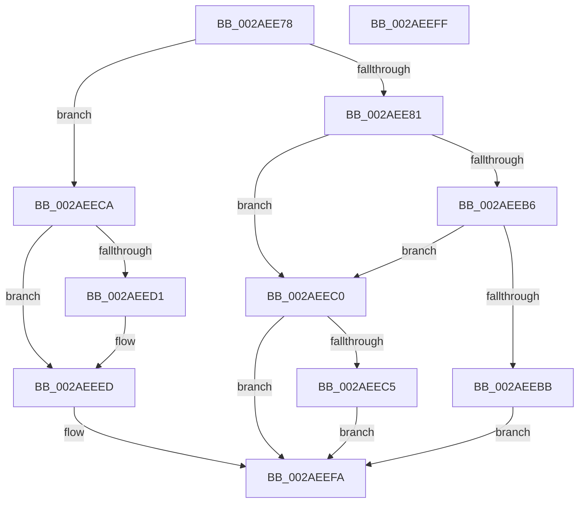

# MiGetProtectionFromPte

- RVA: `0x002AEE78`–`0x002AEF00` (길이 `136` bytes)
- VA: `0x00000001402AEE78`
- 실행 섹션: `.text`
- PDB 이름 있음: `예`; PDB Function 태그: `아니요`
- unwind 정보 RVA: `0x0005D2F4`
- 디코드: `44`개 명령, `136/136` bytes 표시
- 미해석 바이트: `0` (있으면 어셈블리에 `.byte`로 보존)

> 이 문서는 커널 이미지의 기계어와 PDB 기호를 분석해 생성했습니다. 4번과 5번은 함수 원형과 자료형을 바이너리 사용 방식에서 추정한 C 해석이며 원본 소스 복구 결과는 아닙니다.

## 1. Dependencies

- 직접 호출 지점: **1**; 고유 호출 대상: **1**
- 직접 호출자로 확인된 함수: **2**
- RIP 상대 이미지 참조: **0**

### Outgoing calls
- `0x002AEEE7` → [KeBugCheckEx](../4F/KeBugCheckEx_function_004FD660.md) (function, `0x004FD660`)

### Direct callers
- [MiGetWorkingSetInfoList](MiGetWorkingSetInfoList_function_002AF770.md) at `0x002AFEC0`
- [MiQueryAddressState](../32/MiQueryAddressState_function_0032C380.md) at `0x0032D549`

### Static image references
- 디코드된 RIP-relative 메모리 참조가 없습니다.

## 2. Other-region calls and transfers

- 다른 실행 섹션으로 향하는 call: **0**
- 별도 외부 분기/꼬리 이동을 확인하지 못했습니다.

## 3. Assembly (complete function range)

```asm
002AEE78  48 83 EC 38                     sub rsp, 0x38
002AEE7C  F6 C2 01                        test dl, 1
002AEE7F  74 49                           je 0x1402aeeca
002AEE81  8B 49 30                        mov ecx, dword ptr [rcx + 0x30]
002AEE84  48 8B C2                        mov rax, rdx
002AEE87  25 00 08 00 00                  and eax, 0x800
002AEE8C  48 F7 D8                        neg rax
002AEE8F  45 1B C0                        sbb r8d, r8d
002AEE92  41 83 E0 03                     and r8d, 3
002AEE96  41 FF C0                        inc r8d
002AEE99  41 8B C0                        mov eax, r8d
002AEE9C  83 C8 02                        or eax, 2
002AEE9F  48 85 D2                        test rdx, rdx
002AEEA2  41 0F 48 C0                     cmovs eax, r8d
002AEEA6  C1 E9 07                        shr ecx, 7
002AEEA9  83 E1 1F                        and ecx, 0x1f
002AEEAC  8B D1                           mov edx, ecx
002AEEAE  C1 EA 03                        shr edx, 3
002AEEB1  83 FA 03                        cmp edx, 3
002AEEB4  75 0A                           jne 0x1402aeec0
002AEEB6  F6 C1 07                        test cl, 7
002AEEB9  74 05                           je 0x1402aeec0
002AEEBB  83 C8 18                        or eax, 0x18
002AEEBE  EB 3A                           jmp 0x1402aeefa
002AEEC0  83 FA 01                        cmp edx, 1
002AEEC3  75 35                           jne 0x1402aeefa
002AEEC5  83 C8 08                        or eax, 8
002AEEC8  EB 30                           jmp 0x1402aeefa
002AEECA  48 0F BA E2 0A                  bt rdx, 0xa
002AEECF  73 1C                           jae 0x1402aeeed
002AEED1  48 83 64 24 20 00               and qword ptr [rsp + 0x20], 0
002AEED7  4C 8B CA                        mov r9, rdx
002AEEDA  4C 8B C1                        mov r8, rcx
002AEEDD  BA 12 04 00 00                  mov edx, 0x412
002AEEE2  B9 1A 00 00 00                  mov ecx, 0x1a
002AEEE7  E8 74 E7 24 00                  call 0x1404fd660
002AEEEC  CC                              int3
002AEEED  48 8B C2                        mov rax, rdx
002AEEF0  48 C1 E8 08                     shr rax, 8
002AEEF4  83 E0 08                        and eax, 8
002AEEF7  83 C8 10                        or eax, 0x10
002AEEFA  48 83 C4 38                     add rsp, 0x38
002AEEFE  C3                              ret
002AEEFF  CC                              int3
```

## 4. C-style interpretation (structured pseudocode)

```c
__int64 __fastcall MiGetProtectionFromPte(__int64 a1, __int64 a2, int a3)
{
    __int64 result;
    __int64 v_rsp;
    unsigned __int64 v_stack_m18;

    v_rsp = (v_rsp) - (56);
    if ((((unsigned __int8)(a2)) & (1)) == 0) goto loc_002AEECA;
    result = (unsigned int)((a2) & (0x800ULL));
    result = -(result);
    a3 = (unsigned int)((a3) & (3));
    a3 = (unsigned int)((a3) + 1);
    result = (unsigned int)(((unsigned int)(a3)) | (2));
    if (sign_flag) { result = a3; }
    a1 = (unsigned int)(((unsigned int)(*(unsigned int *)(a1 + 48))) >> (7));
    a1 = (unsigned int)((a1) & (31));
    a2 = (unsigned int)(((unsigned int)((unsigned int)(a1))) >> (3));
    if (((unsigned int)(a2)) != 3) goto loc_002AEEC0;
    if ((((unsigned __int8)(a1)) & (7)) == 0) goto loc_002AEEC0;
    result = (unsigned int)((result) | (24));
    goto loc_002AEEFA;
loc_002AEEC0:
    if (((unsigned int)(a2)) != 1) goto loc_002AEEFA;
    result = (unsigned int)((result) | (8));
    goto loc_002AEEFA;
loc_002AEECA:
    if (!(condition_is_above_or_equal)) {
        a4 = a2;
        a3 = a1;
        a2 = 0x412ULL;
        a1 = 26;
        result = KeBugCheckEx(a1, a2, a3, a4);
    }
    result = (a2) >> (8);
    result = (unsigned int)((result) & (8));
    result = (unsigned int)((result) | (16));
loc_002AEEFA:
    v_rsp = (v_rsp) + (56);
    return result;
}
```

## 5. (Beta) C Style

```c
int64_t MiGetProtectionFromPte(void *Arg1, int64_t Arg2, int32_t Arg3)
{
    uint8_t *arg1 = (uint8_t *)Arg1;

    int64_t result;
    int64_t local_rsp;
    uint64_t v_stack_m18;

    local_rsp = (local_rsp) - (56);
    if ((((uint8_t)(Arg2)) & (1)) == 0) goto loc_002AEECA;
    result = (uint32_t)((Arg2) & (0x800ULL));
    result = -(result);
    Arg3 = (uint32_t)((Arg3) & (3));
    Arg3 = (uint32_t)((Arg3) + 1);
    result = (uint32_t)(((uint32_t)(Arg3)) | (2));
    if (sign_flag) { result = Arg3; }
    Arg1 = (uint32_t)(((uint32_t)(*(uint32_t *)(arg1 + 0x30))) >> (7));
    Arg1 = (uint32_t)((Arg1) & (31));
    Arg2 = (uint32_t)(((uint32_t)((uint32_t)(Arg1))) >> (3));
    if (((uint32_t)(Arg2)) != 3) goto loc_002AEEC0;
    if ((((uint8_t)(Arg1)) & (7)) == 0) goto loc_002AEEC0;
    result = (uint32_t)((result) | (24));
    goto loc_002AEEFA;
loc_002AEEC0:
    if (((uint32_t)(Arg2)) != 1) goto loc_002AEEFA;
    result = (uint32_t)((result) | (8));
    goto loc_002AEEFA;
loc_002AEECA:
    if (!(condition_is_above_or_equal)) {
        a4 = Arg2;
        Arg3 = Arg1;
        Arg2 = 0x412ULL;
        Arg1 = 26;
        result = KeBugCheckEx(Arg1, Arg2, Arg3, a4);
    }
    result = (Arg2) >> (8);
    result = (uint32_t)((result) & (8));
    result = (uint32_t)((result) | (16));
loc_002AEEFA:
    local_rsp = (local_rsp) + (56);
    return result;
}
```

### 관측된 메모리 오프셋

구조체 형식이 확인되지 않은 접근은 인자 기준의 오프셋으로만 기록했습니다.

| 기준 인자 | 오프셋 표현 | 폭 (bit) | 접근 |
|---|---:|---:|---|
| `Arg1` | `+ 0x30` | `32` | `R` |

## 6. Execution-region graph

[열기: 2D/3D 그래프와 함수 탐색 컨트롤 패널](../../../control-panel.html?section=text&rva=0x002AEE78&view=graph)

- 2D 그래프는 위에서 아래로 흐르고, 3D 그래프는 빈 공간을 드래그해 회전합니다. Shift+드래그는 이동, 휠은 확대·축소, 함수 노드 선택은 대상 보고서 이동입니다.

### Static fallback


