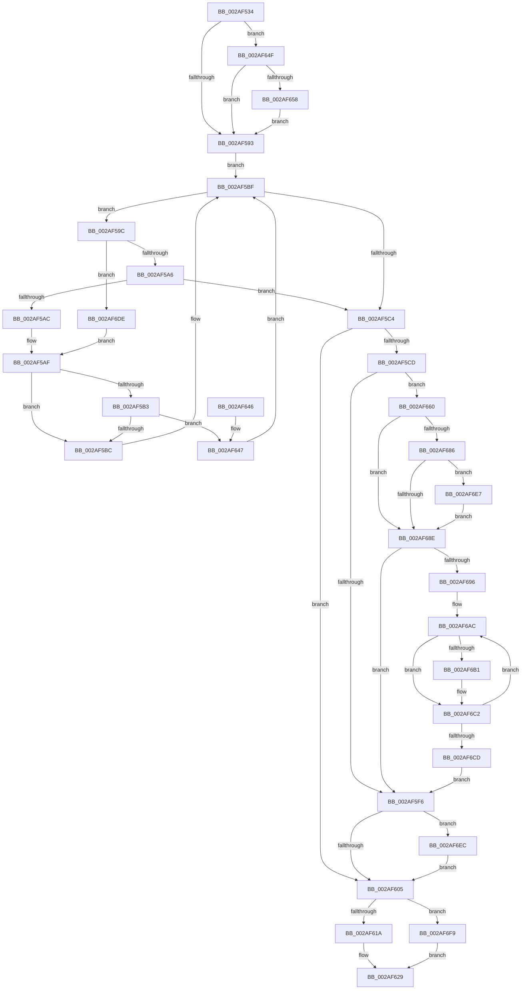

# MiGetSlabRepurposedStandbyListWorker

- RVA: `0x002AF534`–`0x002AF702` (길이 `462` bytes)
- VA: `0x00000001402AF534`
- 실행 섹션: `.text`
- PDB 이름 있음: `예`; PDB Function 태그: `아니요`
- unwind 정보 RVA: `0x0006D500`
- 디코드: `121`개 명령, `462/462` bytes 표시
- 미해석 바이트: `0` (있으면 어셈블리에 `.byte`로 보존)

> 이 문서는 커널 이미지의 기계어와 PDB 기호를 분석해 생성했습니다. 4번과 5번은 함수 원형과 자료형을 바이너리 사용 방식에서 추정한 C 해석이며 원본 소스 복구 결과는 아닙니다.

## 1. Dependencies

- 직접 호출 지점: **6**; 고유 호출 대상: **6**
- 직접 호출자로 확인된 함수: **2**
- RIP 상대 이미지 참조: **1**

### Outgoing calls
- `0x002AF57F` → [ExAcquireSpinLockSharedAtDpcLevel](../24/ExAcquireSpinLockSharedAtDpcLevel_function_00248E30.md) (function, `0x00248E30`)
- `0x002AF608` → [ExReleaseSpinLockSharedFromDpcLevel](../24/ExReleaseSpinLockSharedFromDpcLevel_function_0024A590.md) (function, `0x0024A590`)
- `0x002AF620` → [MI_SET_SLAB_STANDBY_PAGE_SLAB_ENTRY](MI_SET_SLAB_STANDBY_PAGE_SLAB_ENTRY_function_002AF708.md) (function, `0x002AF708`)
- `0x002AF6A0` → [ExAcquireSpinLockExclusiveAtDpcLevel](../24/ExAcquireSpinLockExclusiveAtDpcLevel_function_00248E80.md) (function, `0x00248E80`)
- `0x002AF6BA` → [KeSetEvent](../33/KeSetEvent_function_0033F310.md) (function, `0x0033F310`)
- `0x002AF6D0` → [ExReleaseSpinLockExclusiveFromDpcLevel](../24/ExReleaseSpinLockExclusiveFromDpcLevel_function_002497E0.md) (function, `0x002497E0`)

### Direct callers
- [MiGetSlabAllocatorRepurposedStandbyList](MiGetSlabAllocatorRepurposedStandbyList_function_002AF428.md) at `0x002AF4A5`
- [MiInsertPageInList](../2B/MiInsertPageInList_function_002BA000.md) at `0x002BA755`

### Static image references
- `0x002AF5D3` → RVA `0x00011C60` (`.rdata`; read)

## 2. Other-region calls and transfers

- 다른 실행 섹션으로 향하는 call: **0**
- 별도 외부 분기/꼬리 이동을 확인하지 못했습니다.

## 3. Assembly (complete function range)

```asm
002AF534  48 89 5C 24 08                  mov qword ptr [rsp + 8], rbx
002AF539  48 89 6C 24 10                  mov qword ptr [rsp + 0x10], rbp
002AF53E  48 89 74 24 18                  mov qword ptr [rsp + 0x18], rsi
002AF543  57                              push rdi
002AF544  41 54                           push r12
002AF546  41 55                           push r13
002AF548  41 56                           push r14
002AF54A  41 57                           push r15
002AF54C  48 83 EC 20                     sub rsp, 0x20
002AF550  4C 8B EA                        mov r13, rdx
002AF553  48 8B F9                        mov rdi, rcx
002AF556  48 B8 00 00 00 00 00 DE FF FF   movabs rax, 0xffffde0000000000
002AF560  48 8B EA                        mov rbp, rdx
002AF563  4C 8D 79 10                     lea r15, [rcx + 0x10]
002AF567  48 2B E8                        sub rbp, rax
002AF56A  49 8B CF                        mov rcx, r15
002AF56D  48 B8 AB AA AA AA AA AA AA AA   movabs rax, 0xaaaaaaaaaaaaaaab
002AF577  48 C1 FD 04                     sar rbp, 4
002AF57B  48 0F AF E8                     imul rbp, rax
002AF57F  E8 AC 98 F9 FF                  call 0x140248e30
002AF584  48 8B 1F                        mov rbx, qword ptr [rdi]
002AF587  33 F6                           xor esi, esi
002AF589  F6 47 08 01                     test byte ptr [rdi + 8], 1
002AF58D  0F 85 BC 00 00 00               jne 0x1402af64f
002AF593  0F B6 4F 08                     movzx ecx, byte ptr [rdi + 8]
002AF597  83 E1 01                        and ecx, 1
002AF59A  EB 23                           jmp 0x1402af5bf
002AF59C  48 3B 6B 30                     cmp rbp, qword ptr [rbx + 0x30]
002AF5A0  0F 87 38 01 00 00               ja 0x1402af6de
002AF5A6  48 3B 6B 28                     cmp rbp, qword ptr [rbx + 0x28]
002AF5AA  73 18                           jae 0x1402af5c4
002AF5AC  48 8B 03                        mov rax, qword ptr [rbx]
002AF5AF  85 C9                           test ecx, ecx
002AF5B1  74 09                           je 0x1402af5bc
002AF5B3  48 85 C0                        test rax, rax
002AF5B6  0F 85 8B 00 00 00               jne 0x1402af647
002AF5BC  48 8B D8                        mov rbx, rax
002AF5BF  48 85 DB                        test rbx, rbx
002AF5C2  75 D8                           jne 0x1402af59c
002AF5C4  83 BF 80 00 00 00 08            cmp dword ptr [rdi + 0x80], 8
002AF5CB  74 38                           je 0x1402af605
002AF5CD  8B 87 88 00 00 00               mov eax, dword ptr [rdi + 0x88]
002AF5D3  4C 8D 25 86 26 D6 FF            lea r12, [rip - 0x29d97a]
002AF5DA  48 C1 E8 04                     shr rax, 4
002AF5DE  83 E0 03                        and eax, 3
002AF5E1  45 8B 24 C4                     mov r12d, dword ptr [r12 + rax*8]
002AF5E5  F0 FF 43 58                     lock inc dword ptr [rbx + 0x58]
002AF5E9  83 BF 80 00 00 00 08            cmp dword ptr [rdi + 0x80], 8
002AF5F0  4C 8B 77 18                     mov r14, qword ptr [rdi + 0x18]
002AF5F4  74 6A                           je 0x1402af660
002AF5F6  8B 43 54                        mov eax, dword ptr [rbx + 0x54]
002AF5F9  03 43 58                        add eax, dword ptr [rbx + 0x58]
002AF5FC  41 3B C4                        cmp eax, r12d
002AF5FF  0F 83 E7 00 00 00               jae 0x1402af6ec
002AF605  49 8B CF                        mov rcx, r15
002AF608  E8 83 AF F9 FF                  call 0x14024a590
002AF60D  83 BF 80 00 00 00 08            cmp dword ptr [rdi + 0x80], 8
002AF614  0F 84 DF 00 00 00               je 0x1402af6f9
002AF61A  48 8B D3                        mov rdx, rbx
002AF61D  49 8B CD                        mov rcx, r13
002AF620  E8 E3 00 00 00                  call 0x1402af708
002AF625  48 8B 47 50                     mov rax, qword ptr [rdi + 0x50]
002AF629  48 8B 5C 24 50                  mov rbx, qword ptr [rsp + 0x50]
002AF62E  48 8B 6C 24 58                  mov rbp, qword ptr [rsp + 0x58]
002AF633  48 8B 74 24 60                  mov rsi, qword ptr [rsp + 0x60]
002AF638  48 83 C4 20                     add rsp, 0x20
002AF63C  41 5F                           pop r15
002AF63E  41 5E                           pop r14
002AF640  41 5D                           pop r13
002AF642  41 5C                           pop r12
002AF644  5F                              pop rdi
002AF645  C3                              ret
002AF646  CC                              int3
002AF647  48 33 D8                        xor rbx, rax
002AF64A  E9 70 FF FF FF                  jmp 0x1402af5bf
002AF64F  48 85 DB                        test rbx, rbx
002AF652  0F 84 3B FF FF FF               je 0x1402af593
002AF658  48 33 DF                        xor rbx, rdi
002AF65B  E9 33 FF FF FF                  jmp 0x1402af593
002AF660  B8 01 00 00 00                  mov eax, 1
002AF665  F0 49 0F C1 86 80 47 00 00      lock xadd qword ptr [r14 + 0x4780], rax
002AF66E  48 FF C0                        inc rax
002AF671  8B CE                           mov ecx, esi
002AF673  48 83 E8 01                     sub rax, 1
002AF677  BA 20 04 00 00                  mov edx, 0x420
002AF67C  0F 94 C1                        sete cl
002AF67F  8B E9                           mov ebp, ecx
002AF681  48 3B C2                        cmp rax, rdx
002AF684  7D 08                           jge 0x1402af68e
002AF686  48 FF C0                        inc rax
002AF689  48 3B C2                        cmp rax, rdx
002AF68C  7D 59                           jge 0x1402af6e7
002AF68E  85 ED                           test ebp, ebp
002AF690  0F 84 60 FF FF FF               je 0x1402af5f6
002AF696  4D 8D BE 40 3F 00 00            lea r15, [r14 + 0x3f40]
002AF69D  49 8B CF                        mov rcx, r15
002AF6A0  E8 DB 97 F9 FF                  call 0x140248e80
002AF6A5  49 81 C6 A0 47 00 00            add r14, 0x47a0
002AF6AC  0F A3 F5                        bt ebp, esi
002AF6AF  73 11                           jae 0x1402af6c2
002AF6B1  49 8D 4E E8                     lea rcx, [r14 - 0x18]
002AF6B5  45 33 C0                        xor r8d, r8d
002AF6B8  33 D2                           xor edx, edx
002AF6BA  E8 51 FC 08 00                  call 0x14033f310
002AF6BF  41 FF 06                        inc dword ptr [r14]
002AF6C2  FF C6                           inc esi
002AF6C4  49 83 C6 20                     add r14, 0x20
002AF6C8  83 FE 02                        cmp esi, 2
002AF6CB  72 DF                           jb 0x1402af6ac
002AF6CD  49 8B CF                        mov rcx, r15
002AF6D0  E8 0B A1 F9 FF                  call 0x1402497e0
002AF6D5  4C 8D 7F 10                     lea r15, [rdi + 0x10]
002AF6D9  E9 18 FF FF FF                  jmp 0x1402af5f6
002AF6DE  48 8B 43 08                     mov rax, qword ptr [rbx + 8]
002AF6E2  E9 C8 FE FF FF                  jmp 0x1402af5af
002AF6E7  83 CD 02                        or ebp, 2
002AF6EA  EB A2                           jmp 0x1402af68e
002AF6EC  F0 83 8F 88 00 00 00 01         lock or dword ptr [rdi + 0x88], 1
002AF6F4  E9 0C FF FF FF                  jmp 0x1402af605
002AF6F9  48 83 C8 FF                     or rax, 0xffffffffffffffff
002AF6FD  E9 27 FF FF FF                  jmp 0x1402af629
```

## 4. C-style interpretation (structured pseudocode)

```c
__int64 __fastcall MiGetSlabRepurposedStandbyListWorker(__int64 a1, __int64 a2, int a3)
{
    __int64 result;
    __int64 v_r14;
    __int64 v_rbp;
    __int64 v_rbx;
    __int64 v_rsi;
    __int64 v_rsp;
    unsigned __int64 v_stack_p10;
    unsigned __int64 v_stack_p18;
    unsigned __int64 v_stack_p8;

    v_stack_p8 = v_rbx;
    v_stack_p10 = v_rbp;
    v_stack_p18 = v_rsi;
    v_rsp = (v_rsp) - (32);
    v_rbp = (a2) - (result);
    v_rbp = (v_rbp) >> (4);
    v_rbp = (v_rbp) * (result);
    result = ExAcquireSpinLockSharedAtDpcLevel(a1 + 16, a2, a3, a4);
    v_rsi = 0;
    if (((*(unsigned __int8 *)(a1 + 8)) & (1)) != 0) goto loc_002AF64F;
loc_002AF593:
    a1 = (unsigned int)((*(unsigned __int8 *)(a1 + 8)) & (1));
    goto loc_002AF5BF;
loc_002AF59C:
    if (v_rbp > (*(unsigned __int64 *)(*(unsigned __int64 *)(a1) + 48))) goto loc_002AF6DE;
    if (v_rbp >= (*(unsigned __int64 *)(*(unsigned __int64 *)(a1) + 40))) goto loc_002AF5C4;
loc_002AF5AF:
    if ((unsigned int)(a1) == 0) goto loc_002AF5BC;
    if (*(unsigned __int64 *)(*(unsigned __int64 *)(a1)) != 0) goto loc_002AF647;
loc_002AF5BC:
loc_002AF5BF:
    if (*(unsigned __int64 *)(*(unsigned __int64 *)(a1)) != 0) goto loc_002AF59C;
loc_002AF5C4:
    if ((*(unsigned int *)(a1 + 128)) == 8) goto loc_002AF605;
    result = ((unsigned int)(*(unsigned int *)(a1 + 136))) >> (4);
    result = (unsigned int)((result) & (3));
    if ((*(unsigned int *)(a1 + 128)) == 8) goto loc_002AF660;
loc_002AF5F6:
    result = (unsigned int)(((unsigned int)(*(unsigned int *)(*(unsigned __int64 *)(*(unsigned __int64 *)(a1)) + 84))) + (*(unsigned int *)(*(unsigned __int64 *)(*(unsigned __int64 *)(a1)) + 88)));
    if (((unsigned int)(result)) >= ((unsigned int)((unsigned int)(*(unsigned int *)(v_rip - 2742650 + result * 8))))) goto loc_002AF6EC;
loc_002AF605:
    result = ExReleaseSpinLockSharedFromDpcLevel(a1 + 16, a2, a3, a4);
    if ((*(unsigned int *)(a1 + 128)) == 8) goto loc_002AF6F9;
    result = MI_SET_SLAB_STANDBY_PAGE_SLAB_ENTRY(a2, *(unsigned __int64 *)(*(unsigned __int64 *)(a1)), a3, a4);
loc_002AF629:
    v_rsp = (v_rsp) + (32);
    return *(unsigned __int64 *)(a1 + 80);
loc_002AF647:
    v_rbx = (v_stack_p8) ^ (*(unsigned __int64 *)(a1 + 80));
    goto loc_002AF5BF;
loc_002AF64F:
    if (v_rbx == 0) goto loc_002AF593;
    v_rbx = (v_rbx) ^ (a1);
    goto loc_002AF593;
loc_002AF660:
    result = (1) + 1;
    result = (result) - (1);
    a1 = (condition_is_equal) ? 1 : 0;
    if (result >= ((unsigned int)(0x420ULL))) goto loc_002AF68E;
    result = (result) + 1;
    if (result >= ((unsigned int)(0x420ULL))) goto loc_002AF6E7;
loc_002AF68E:
    if ((unsigned int)((unsigned int)((unsigned int)(a1))) == 0) goto loc_002AF5F6;
    result = ExAcquireSpinLockExclusiveAtDpcLevel(*(unsigned __int64 *)(a1 + 24) + 16192, (unsigned int)(0x420ULL), a3, a4);
    v_r14 = (*(unsigned __int64 *)(a1 + 24)) + (0x47A0ULL);
loc_002AF6AC:
    if (!(condition_is_above_or_equal)) {
        a1 = v_r14 - 24;
        a3 = 0;
        a2 = 0;
        result = KeSetEvent(a1, a2, a3, a4);
    }
    v_rsi = (unsigned int)((v_stack_p18) + 1);
    v_r14 = (v_r14) + (32);
    if (((unsigned int)(v_rsi)) < 2) goto loc_002AF6AC;
    result = ExReleaseSpinLockExclusiveFromDpcLevel(*(unsigned __int64 *)(a1 + 24) + 16192, a2, a3, a4);
    goto loc_002AF5F6;
loc_002AF6DE:
    goto loc_002AF5AF;
loc_002AF6E7:
    v_rbp = (unsigned int)(((unsigned int)((unsigned int)(a1))) | (2));
    goto loc_002AF68E;
loc_002AF6EC:
    goto loc_002AF605;
loc_002AF6F9:
    result = (*(unsigned __int64 *)(v_rbx + 8)) | (-1);
    goto loc_002AF629;
}
```

## 5. (Beta) C Style

```c
int64_t MiGetSlabRepurposedStandbyListWorker(void *Arg1, int64_t Arg2, int32_t Arg3)
{
    uint8_t *arg1 = (uint8_t *)Arg1;

    int64_t result;
    int64_t local_r14;
    int64_t local_rbp;
    int64_t local_rbx;
    int64_t local_rsi;
    int64_t local_rsp;
    uint64_t v_stack_p10;
    uint64_t v_stack_p18;
    uint64_t v_stack_p8;

    v_stack_p8 = local_rbx;
    v_stack_p10 = local_rbp;
    v_stack_p18 = local_rsi;
    local_rsp = (local_rsp) - (32);
    local_rbp = (Arg2) - (result);
    local_rbp = (local_rbp) >> (4);
    local_rbp = (local_rbp) * (result);
    result = ExAcquireSpinLockSharedAtDpcLevel(Arg1 + 16, Arg2, Arg3, a4);
    local_rsi = 0;
    if (((*(uint8_t *)(arg1 + 0x8)) & (1)) != 0) goto loc_002AF64F;
loc_002AF593:
    Arg1 = (uint32_t)((*(uint8_t *)(arg1 + 0x8)) & (1));
    goto loc_002AF5BF;
loc_002AF59C:
    if (local_rbp > (*(uint64_t *)(*(uint64_t *)(arg1) + 0x30))) goto loc_002AF6DE;
    if (local_rbp >= (*(uint64_t *)(*(uint64_t *)(arg1) + 0x28))) goto loc_002AF5C4;
loc_002AF5AF:
    if ((uint32_t)(Arg1) == 0) goto loc_002AF5BC;
    if (*(uint64_t *)(*(uint64_t *)(arg1)) != 0) goto loc_002AF647;
loc_002AF5BC:
loc_002AF5BF:
    if (*(uint64_t *)(*(uint64_t *)(arg1)) != 0) goto loc_002AF59C;
loc_002AF5C4:
    if ((*(uint32_t *)(arg1 + 0x80)) == 8) goto loc_002AF605;
    result = ((uint32_t)(*(uint32_t *)(arg1 + 0x88))) >> (4);
    result = (uint32_t)((result) & (3));
    if ((*(uint32_t *)(arg1 + 0x80)) == 8) goto loc_002AF660;
loc_002AF5F6:
    result = (uint32_t)(((uint32_t)(*(uint32_t *)(*(uint64_t *)(*(uint64_t *)(arg1)) + 0x54))) + (*(uint32_t *)(*(uint64_t *)(*(uint64_t *)(arg1)) + 0x58)));
    if (((uint32_t)(result)) >= ((uint32_t)((uint32_t)(*(uint32_t *)(v_rip - 0x29D97A + result * 8))))) goto loc_002AF6EC;
loc_002AF605:
    result = ExReleaseSpinLockSharedFromDpcLevel(Arg1 + 16, Arg2, Arg3, a4);
    if ((*(uint32_t *)(arg1 + 0x80)) == 8) goto loc_002AF6F9;
    result = MI_SET_SLAB_STANDBY_PAGE_SLAB_ENTRY(Arg2, *(uint64_t *)(*(uint64_t *)(arg1)), Arg3, a4);
loc_002AF629:
    local_rsp = (local_rsp) + (32);
    return *(uint64_t *)(arg1 + 0x50);
loc_002AF647:
    local_rbx = (v_stack_p8) ^ (*(uint64_t *)(arg1 + 0x50));
    goto loc_002AF5BF;
loc_002AF64F:
    if (local_rbx == 0) goto loc_002AF593;
    local_rbx = (local_rbx) ^ (Arg1);
    goto loc_002AF593;
loc_002AF660:
    result = (1) + 1;
    result = (result) - (1);
    Arg1 = (condition_is_equal) ? 1 : 0;
    if (result >= ((uint32_t)(0x420ULL))) goto loc_002AF68E;
    result = (result) + 1;
    if (result >= ((uint32_t)(0x420ULL))) goto loc_002AF6E7;
loc_002AF68E:
    if ((uint32_t)((uint32_t)((uint32_t)(Arg1))) == 0) goto loc_002AF5F6;
    result = ExAcquireSpinLockExclusiveAtDpcLevel(*(uint64_t *)(arg1 + 0x18) + 16192, (uint32_t)(0x420ULL), Arg3, a4);
    local_r14 = (*(uint64_t *)(arg1 + 0x18)) + (0x47A0ULL);
loc_002AF6AC:
    if (!(condition_is_above_or_equal)) {
        Arg1 = local_r14 - 24;
        Arg3 = 0;
        Arg2 = 0;
        result = KeSetEvent(Arg1, Arg2, Arg3, a4);
    }
    local_rsi = (uint32_t)((v_stack_p18) + 1);
    local_r14 = (local_r14) + (32);
    if (((uint32_t)(local_rsi)) < 2) goto loc_002AF6AC;
    result = ExReleaseSpinLockExclusiveFromDpcLevel(*(uint64_t *)(arg1 + 0x18) + 16192, Arg2, Arg3, a4);
    goto loc_002AF5F6;
loc_002AF6DE:
    goto loc_002AF5AF;
loc_002AF6E7:
    local_rbp = (uint32_t)(((uint32_t)((uint32_t)(Arg1))) | (2));
    goto loc_002AF68E;
loc_002AF6EC:
    goto loc_002AF605;
loc_002AF6F9:
    result = (*(uint64_t *)(local_rbx + 0x8)) | (-1);
    goto loc_002AF629;
}
```

### 관측된 메모리 오프셋

구조체 형식이 확인되지 않은 접근은 인자 기준의 오프셋으로만 기록했습니다.

| 기준 인자 | 오프셋 표현 | 폭 (bit) | 접근 |
|---|---:|---:|---|
| `Arg1` | `+ 0x0` | `64` | `R` |
| `Arg1` | `+ 0x8` | `8` | `R` |
| `Arg1` | `+ 0x10` | `64` | `R` |
| `Arg1` | `+ 0x18` | `64` | `R` |
| `Arg1` | `+ 0x50` | `64` | `R` |
| `Arg1` | `+ 0x80` | `32` | `R` |
| `Arg1` | `+ 0x88` | `32` | `R` |
| `Arg1` | `+ 0x88` | `32` | `R/W` |

## 6. Execution-region graph

[열기: 2D/3D 그래프와 함수 탐색 컨트롤 패널](../../../control-panel.html?section=text&rva=0x002AF534&view=graph)

- 2D 그래프는 위에서 아래로 흐르고, 3D 그래프는 빈 공간을 드래그해 회전합니다. Shift+드래그는 이동, 휠은 확대·축소, 함수 노드 선택은 대상 보고서 이동입니다.

### Static fallback


