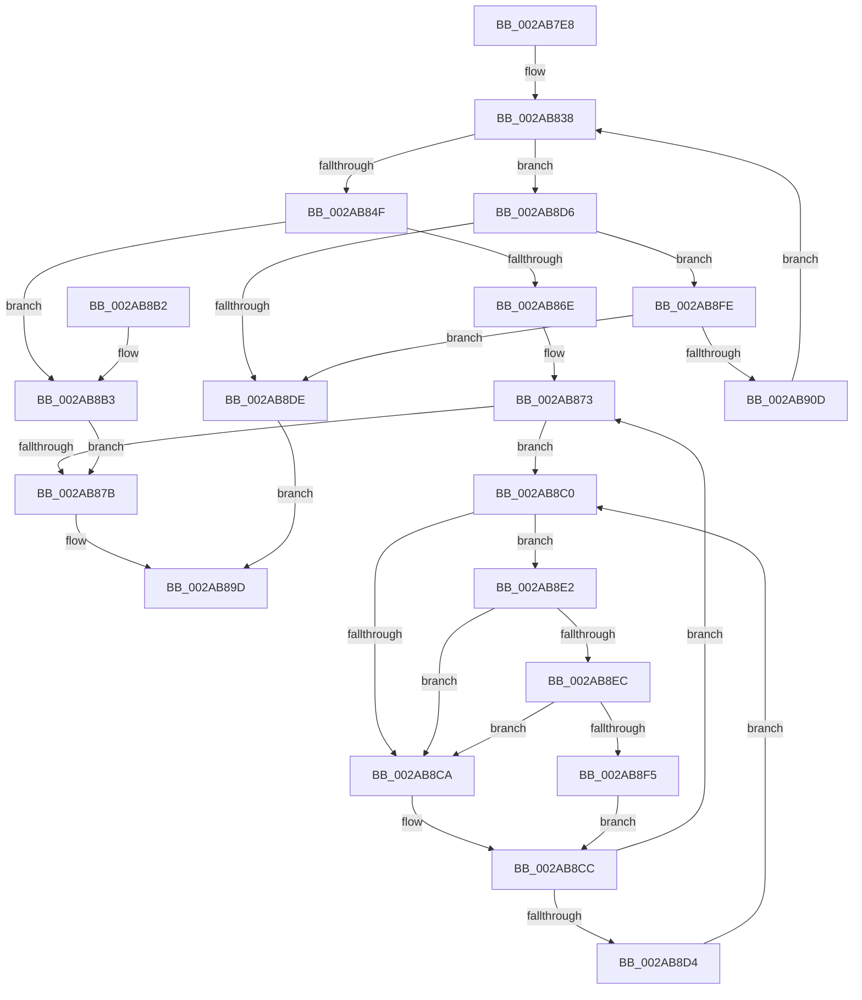

# MiGetSystemPage

- RVA: `0x002AB7E8`–`0x002AB91C` (길이 `308` bytes)
- VA: `0x00000001402AB7E8`
- 실행 섹션: `.text`
- PDB 이름 있음: `예`; PDB Function 태그: `아니요`
- unwind 정보 RVA: `0x0006D084`
- 디코드: `88`개 명령, `308/308` bytes 표시
- 미해석 바이트: `0` (있으면 어셈블리에 `.byte`로 보존)

> 이 문서는 커널 이미지의 기계어와 PDB 기호를 분석해 생성했습니다. 4번과 5번은 함수 원형과 자료형을 바이너리 사용 방식에서 추정한 C 해석이며 원본 소스 복구 결과는 아닙니다.

## 1. Dependencies

- 직접 호출 지점: **6**; 고유 호출 대상: **6**
- 직접 호출자로 확인된 함수: **1**
- RIP 상대 이미지 참조: **3**

### Outgoing calls
- `0x002AB840` → [MiGetPage](../28/MiGetPage_function_002884C0.md) (function, `0x002884C0`)
- `0x002AB895` → [MiUnlockPage](../31/MiUnlockPage_function_0031A3E0.md) (function, `0x0031A3E0`)
- `0x002AB8B6` → [MiLockPageInline](../31/MiLockPageInline_function_0031A340.md) (function, `0x0031A340`)
- `0x002AB8EC` → [KiCheckVpBackingLongSpinWaitHypercall](../30/KiCheckVpBackingLongSpinWaitHypercall_function_0030F490.md) (function, `0x0030F490`)
- `0x002AB8F7` → [HvlNotifyLongSpinWait](../30/HvlNotifyLongSpinWait_function_0030F460.md) (function, `0x0030F460`)
- `0x002AB912` → [MiWaitForFreePage](MiWaitForFreePage_function_002A3324.md) (function, `0x002A3324`)

### Direct callers
- [MiGetPageForHeader](MiGetPageForHeader_function_002AC120.md) at `0x002AC193`

### Static image references
- `0x002AB81A` → RVA `0x00E2DCC0` (`.data`; read)
- `0x002AB8C2` → RVA `0x00FC52AC` (`ALMOSTRO`; reference)
- `0x002AB8E2` → RVA `0x00FC6AB8` (`ALMOSTRO`; read)

## 2. Other-region calls and transfers

- 다른 실행 섹션으로 향하는 call: **0**
- 별도 외부 분기/꼬리 이동을 확인하지 못했습니다.

## 3. Assembly (complete function range)

```asm
002AB7E8  48 89 5C 24 08                  mov qword ptr [rsp + 8], rbx
002AB7ED  48 89 6C 24 10                  mov qword ptr [rsp + 0x10], rbp
002AB7F2  48 89 74 24 18                  mov qword ptr [rsp + 0x18], rsi
002AB7F7  57                              push rdi
002AB7F8  48 83 EC 20                     sub rsp, 0x20
002AB7FC  45 8B 48 08                     mov r9d, dword ptr [r8 + 8]
002AB800  F7 DA                           neg edx
002AB802  49 8B 10                        mov rdx, qword ptr [r8]
002AB805  48 8B F9                        mov rdi, rcx
002AB808  1B F6                           sbb esi, esi
002AB80A  B8 01 00 00 00                  mov eax, 1
002AB80F  F7 DE                           neg esi
002AB811  83 C6 30                        add esi, 0x30
002AB814  F0 0F C1 02                     lock xadd dword ptr [rdx], eax
002AB818  33 D2                           xor edx, edx
002AB81A  4C 8D 05 9F 24 B8 00            lea r8, [rip + 0xb8249f]
002AB821  41 8B C9                        mov ecx, r9d
002AB824  48 C1 E9 10                     shr rcx, 0x10
002AB828  83 E1 03                        and ecx, 3
002AB82B  41 F7 34 88                     div dword ptr [r8 + rcx*4]
002AB82F  41 33 D1                        xor edx, r9d
002AB832  0F B6 DA                        movzx ebx, dl
002AB835  41 33 D9                        xor ebx, r9d
002AB838  44 8B C6                        mov r8d, esi
002AB83B  8B D3                           mov edx, ebx
002AB83D  48 8B CF                        mov rcx, rdi
002AB840  E8 7B CC FD FF                  call 0x1402884c0
002AB845  48 83 F8 FF                     cmp rax, -1
002AB849  0F 84 87 00 00 00               je 0x1402ab8d6
002AB84F  48 8D 1C 40                     lea rbx, [rax + rax*2]
002AB853  48 C1 E3 04                     shl rbx, 4
002AB857  48 B8 00 00 00 00 00 DE FF FF   movabs rax, 0xffffde0000000000
002AB861  48 03 D8                        add rbx, rax
002AB864  48 8D 7B 18                     lea rdi, [rbx + 0x18]
002AB868  40 F6 C6 01                     test sil, 1
002AB86C  74 45                           je 0x1402ab8b3
002AB86E  40 B5 11                        mov bpl, 0x11
002AB871  33 F6                           xor esi, esi
002AB873  F0 48 0F BA 2F 3F               lock bts qword ptr [rdi], 0x3f
002AB879  72 45                           jb 0x1402ab8c0
002AB87B  48 8B 0F                        mov rcx, qword ptr [rdi]
002AB87E  48 B8 00 00 00 00 00 00 00 C0   movabs rax, 0xc000000000000000
002AB888  48 23 C8                        and rcx, rax
002AB88B  40 8A D5                        mov dl, bpl
002AB88E  48 89 4B 18                     mov qword ptr [rbx + 0x18], rcx
002AB892  48 8B CB                        mov rcx, rbx
002AB895  E8 46 EB 06 00                  call 0x14031a3e0
002AB89A  48 8B C3                        mov rax, rbx
002AB89D  48 8B 5C 24 30                  mov rbx, qword ptr [rsp + 0x30]
002AB8A2  48 8B 6C 24 38                  mov rbp, qword ptr [rsp + 0x38]
002AB8A7  48 8B 74 24 40                  mov rsi, qword ptr [rsp + 0x40]
002AB8AC  48 83 C4 20                     add rsp, 0x20
002AB8B0  5F                              pop rdi
002AB8B1  C3                              ret
002AB8B2  CC                              int3
002AB8B3  48 8B CB                        mov rcx, rbx
002AB8B6  E8 85 EA 06 00                  call 0x14031a340
002AB8BB  40 8A E8                        mov bpl, al
002AB8BE  EB BB                           jmp 0x1402ab87b
002AB8C0  FF C6                           inc esi
002AB8C2  85 35 E4 99 D1 00               test dword ptr [rip + 0xd199e4], esi
002AB8C8  74 18                           je 0x1402ab8e2
002AB8CA  F3 90                           pause
002AB8CC  48 8B 07                        mov rax, qword ptr [rdi]
002AB8CF  48 85 C0                        test rax, rax
002AB8D2  79 9F                           jns 0x1402ab873
002AB8D4  EB EA                           jmp 0x1402ab8c0
002AB8D6  44 0F 20 C0                     mov rax, cr8
002AB8DA  3C 02                           cmp al, 2
002AB8DC  75 20                           jne 0x1402ab8fe
002AB8DE  33 C0                           xor eax, eax
002AB8E0  EB BB                           jmp 0x1402ab89d
002AB8E2  8B 05 D0 B1 D1 00               mov eax, dword ptr [rip + 0xd1b1d0]
002AB8E8  A8 40                           test al, 0x40
002AB8EA  74 DE                           je 0x1402ab8ca
002AB8EC  E8 9F 3B 06 00                  call 0x14030f490
002AB8F1  84 C0                           test al, al
002AB8F3  74 D5                           je 0x1402ab8ca
002AB8F5  8B CE                           mov ecx, esi
002AB8F7  E8 64 3B 06 00                  call 0x14030f460
002AB8FC  EB CE                           jmp 0x1402ab8cc
002AB8FE  65 8B 04 25 3C 3A 00 00         mov eax, dword ptr gs:[0x3a3c]
002AB906  A9 01 00 01 00                  test eax, 0x10001
002AB90B  75 D1                           jne 0x1402ab8de
002AB90D  33 D2                           xor edx, edx
002AB90F  48 8B CF                        mov rcx, rdi
002AB912  E8 0D 7A FF FF                  call 0x1402a3324
002AB917  E9 1C FF FF FF                  jmp 0x1402ab838
```

## 4. C-style interpretation (structured pseudocode)

```c
__int64 __fastcall MiGetSystemPage(__int64 a1, int a2, __int64 a3)
{
    __int64 result;
    __int64 v_rbx;
    __int64 v_rsi;
    __int64 v_rsp;
    unsigned __int64 v_stack_p10;
    unsigned __int64 v_stack_p18;
    unsigned __int64 v_stack_p8;

    v_stack_p8 = v_rbx;
    v_stack_p10 = v_rbp;
    v_stack_p18 = v_rsi;
    v_rsp = (v_rsp) - (32);
    a2 = (unsigned int)(-(a2));
    v_rsi = (unsigned int)(-(v_rsi));
    v_rsi = (unsigned int)((v_rsi) + (48));
    a2 = 0;
    a1 = ((unsigned int)((unsigned int)((unsigned int)(*(unsigned int *)(a3 + 8))))) >> (16);
    a1 = (unsigned int)((a1) & (3));
    a2 = (unsigned int)((a2) ^ ((unsigned int)((unsigned int)(*(unsigned int *)(a3 + 8)))));
    v_rbx = (unsigned int)(((unsigned __int8)(a2)) ^ ((unsigned int)((unsigned int)(*(unsigned int *)(a3 + 8)))));
loc_002AB838:
    result = MiGetPage(a1, (unsigned int)((unsigned int)(v_rbx)), (unsigned int)((unsigned int)(v_rsi)), (unsigned int)(*(unsigned int *)(a3 + 8)));
    if (result == -1) goto loc_002AB8D6;
    v_rbx = (result + result * 2) << (4);
    v_rbx = (v_rbx) + (result);
    if ((((unsigned __int8)(v_rsi)) & (1)) == 0) goto loc_002AB8B3;
    v_rsi = 0;
loc_002AB873:
    if (condition_is_below) goto loc_002AB8C0;
loc_002AB87B:
    a1 = (*(unsigned __int64 *)(v_rbx + 24)) & (result);
    *(unsigned __int64 *)(v_rbx + 24) = a1;
    result = MiUnlockPage(v_rbx, 17, (unsigned int)((unsigned int)(v_rsi)), (unsigned int)(*(unsigned int *)(a3 + 8)));
loc_002AB89D:
    v_rsp = (v_rsp) + (32);
    return v_rbx;
loc_002AB8B3:
    result = MiLockPageInline(v_stack_p8, 17, (unsigned int)((unsigned int)(v_rsi)), (unsigned int)(*(unsigned int *)(a3 + 8)));
    goto loc_002AB87B;
loc_002AB8C0:
    v_rsi = (unsigned int)((v_stack_p18) + 1);
    if (((*(unsigned int *)(v_rip + 13736420)) & ((unsigned int)(v_rsi))) == 0) goto loc_002AB8E2;
loc_002AB8CA:
loc_002AB8CC:
    if (!sign_flag) goto loc_002AB873;
    goto loc_002AB8C0;
loc_002AB8D6:
    if (((unsigned __int8)(v_cr8)) != 2) goto loc_002AB8FE;
loc_002AB8DE:
    result = 0;
    goto loc_002AB89D;
loc_002AB8E2:
    if ((((unsigned __int8)((unsigned int)(*(unsigned int *)(v_rip + 13742544)))) & (64)) == 0) goto loc_002AB8CA;
    result = KiCheckVpBackingLongSpinWaitHypercall(v_stack_p8, 17, (unsigned int)((unsigned int)(v_rsi)), (unsigned int)(*(unsigned int *)(a3 + 8)));
    if ((unsigned __int8)(result) == 0) goto loc_002AB8CA;
    result = HvlNotifyLongSpinWait((unsigned int)((unsigned int)(v_rsi)), 17, (unsigned int)((unsigned int)(v_rsi)), (unsigned int)(*(unsigned int *)(a3 + 8)));
    goto loc_002AB8CC;
loc_002AB8FE:
    if ((((unsigned int)((unsigned int)(*(unsigned int *)(gs_base + (0 + 14908))))) & (0x10001ULL)) != 0) goto loc_002AB8DE;
    a2 = 0;
    result = MiWaitForFreePage(v_rbx + 24, a2, (unsigned int)((unsigned int)(v_rsi)), (unsigned int)(*(unsigned int *)(a3 + 8)));
    goto loc_002AB838;
}
```

## 5. (Beta) C Style

```c
int64_t MiGetSystemPage(int64_t Arg1, int32_t Arg2, void *Arg3)
{
    uint8_t *arg3 = (uint8_t *)Arg3;

    int64_t result;
    int64_t local_rbx;
    int64_t local_rsi;
    int64_t local_rsp;
    uint64_t v_stack_p10;
    uint64_t v_stack_p18;
    uint64_t v_stack_p8;

    v_stack_p8 = local_rbx;
    v_stack_p10 = local_rbp;
    v_stack_p18 = local_rsi;
    local_rsp = (local_rsp) - (32);
    Arg2 = (uint32_t)(-(Arg2));
    local_rsi = (uint32_t)(-(local_rsi));
    local_rsi = (uint32_t)((local_rsi) + (48));
    Arg2 = 0;
    Arg1 = ((uint32_t)((uint32_t)((uint32_t)(*(uint32_t *)(arg3 + 0x8))))) >> (16);
    Arg1 = (uint32_t)((Arg1) & (3));
    Arg2 = (uint32_t)((Arg2) ^ ((uint32_t)((uint32_t)(*(uint32_t *)(arg3 + 0x8)))));
    local_rbx = (uint32_t)(((uint8_t)(Arg2)) ^ ((uint32_t)((uint32_t)(*(uint32_t *)(arg3 + 0x8)))));
loc_002AB838:
    result = MiGetPage(Arg1, (uint32_t)((uint32_t)(local_rbx)), (uint32_t)((uint32_t)(local_rsi)), (uint32_t)(*(uint32_t *)(arg3 + 0x8)));
    if (result == -1) goto loc_002AB8D6;
    local_rbx = (result + result * 2) << (4);
    local_rbx = (local_rbx) + (result);
    if ((((uint8_t)(local_rsi)) & (1)) == 0) goto loc_002AB8B3;
    local_rsi = 0;
loc_002AB873:
    if (condition_is_below) goto loc_002AB8C0;
loc_002AB87B:
    Arg1 = (*(uint64_t *)(local_rbx + 0x18)) & (result);
    *(uint64_t *)(local_rbx + 0x18) = Arg1;
    result = MiUnlockPage(local_rbx, 17, (uint32_t)((uint32_t)(local_rsi)), (uint32_t)(*(uint32_t *)(arg3 + 0x8)));
loc_002AB89D:
    local_rsp = (local_rsp) + (32);
    return local_rbx;
loc_002AB8B3:
    result = MiLockPageInline(v_stack_p8, 17, (uint32_t)((uint32_t)(local_rsi)), (uint32_t)(*(uint32_t *)(arg3 + 0x8)));
    goto loc_002AB87B;
loc_002AB8C0:
    local_rsi = (uint32_t)((v_stack_p18) + 1);
    if (((*(uint32_t *)(v_rip + 0xD199E4)) & ((uint32_t)(local_rsi))) == 0) goto loc_002AB8E2;
loc_002AB8CA:
loc_002AB8CC:
    if (!sign_flag) goto loc_002AB873;
    goto loc_002AB8C0;
loc_002AB8D6:
    if (((uint8_t)(v_cr8)) != 2) goto loc_002AB8FE;
loc_002AB8DE:
    result = 0;
    goto loc_002AB89D;
loc_002AB8E2:
    if ((((uint8_t)((uint32_t)(*(uint32_t *)(v_rip + 0xD1B1D0)))) & (64)) == 0) goto loc_002AB8CA;
    result = KiCheckVpBackingLongSpinWaitHypercall(v_stack_p8, 17, (uint32_t)((uint32_t)(local_rsi)), (uint32_t)(*(uint32_t *)(arg3 + 0x8)));
    if ((uint8_t)(result) == 0) goto loc_002AB8CA;
    result = HvlNotifyLongSpinWait((uint32_t)((uint32_t)(local_rsi)), 17, (uint32_t)((uint32_t)(local_rsi)), (uint32_t)(*(uint32_t *)(arg3 + 0x8)));
    goto loc_002AB8CC;
loc_002AB8FE:
    if ((((uint32_t)((uint32_t)(*(uint32_t *)(gs_base + (0 + 0x3A3C))))) & (0x10001ULL)) != 0) goto loc_002AB8DE;
    Arg2 = 0;
    result = MiWaitForFreePage(local_rbx + 24, Arg2, (uint32_t)((uint32_t)(local_rsi)), (uint32_t)(*(uint32_t *)(arg3 + 0x8)));
    goto loc_002AB838;
}
```

### 관측된 메모리 오프셋

구조체 형식이 확인되지 않은 접근은 인자 기준의 오프셋으로만 기록했습니다.

| 기준 인자 | 오프셋 표현 | 폭 (bit) | 접근 |
|---|---:|---:|---|
| `Arg3` | `+ 0x0` | `64` | `R` |
| `Arg3` | `+ 0x8` | `32` | `R` |

## 6. Execution-region graph

[열기: 2D/3D 그래프와 함수 탐색 컨트롤 패널](../../../control-panel.html?section=text&rva=0x002AB7E8&view=graph)

- 2D 그래프는 위에서 아래로 흐르고, 3D 그래프는 빈 공간을 드래그해 회전합니다. Shift+드래그는 이동, 휠은 확대·축소, 함수 노드 선택은 대상 보고서 이동입니다.

### Static fallback


