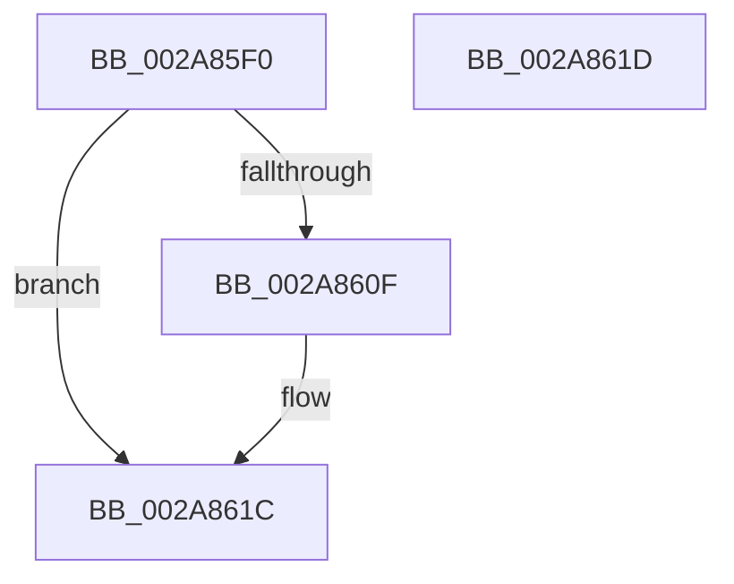

# MiGetVadMandatoryPageSize

- RVA: `0x002A85F0`–`0x002A861E` (길이 `46` bytes)
- VA: `0x00000001402A85F0`
- 실행 섹션: `.text`
- PDB 이름 있음: `예`; PDB Function 태그: `아니요`
- unwind 정보 RVA: `0x000DB714`
- 디코드: `13`개 명령, `46/46` bytes 표시
- 미해석 바이트: `0` (있으면 어셈블리에 `.byte`로 보존)

> 이 문서는 커널 이미지의 기계어와 PDB 기호를 분석해 생성했습니다. 4번과 5번은 함수 원형과 자료형을 바이너리 사용 방식에서 추정한 C 해석이며 원본 소스 복구 결과는 아닙니다.

## 1. Dependencies

- 직접 호출 지점: **0**; 고유 호출 대상: **0**
- 직접 호출자로 확인된 함수: **5**
- RIP 상대 이미지 참조: **1**

### Outgoing calls
- 직접 디코드된 call 명령이 없습니다.

### Direct callers
- [NtGetWriteWatch](NtGetWriteWatch_function_002A7CE0.md) at `0x002A7F92`
- [NtGetWriteWatch](NtGetWriteWatch_function_002A7CE0.md) at `0x002A7FF8`
- [MiMoveDirtyBitsToPfns](MiMoveDirtyBitsToPfns_function_002A8624.md) at `0x002A8861`
- [sub_006F2D78](../6F/Unknown_function_006F2D78.md) at `0x006F2DAB`
- [MiCreateWriteWatchView](../../page/98/MiCreateWriteWatchView_function_0098039C.md) at `0x009803AB`
- [NtResetWriteWatch](../../page/A4/NtResetWriteWatch_function_00A48F60.md) at `0x00A4904B`

### Static image references
- `0x002A85F9` → RVA `0x00014578` (`.rdata`; read)

## 2. Other-region calls and transfers

- 다른 실행 섹션으로 향하는 call: **0**
- 별도 외부 분기/꼬리 이동을 확인하지 못했습니다.

## 3. Assembly (complete function range)

```asm
002A85F0  8B 51 30                        mov edx, dword ptr [rcx + 0x30]
002A85F3  8B C2                           mov eax, edx
002A85F5  48 C1 E8 13                     shr rax, 0x13
002A85F9  48 8D 0D 78 BF D6 FF            lea rcx, [rip - 0x294088]
002A8600  83 E0 03                        and eax, 3
002A8603  48 8B 04 C1                     mov rax, qword ptr [rcx + rax*8]
002A8607  48 3D 00 02 00 00               cmp rax, 0x200
002A860D  73 0D                           jae 0x1402a861c
002A860F  0F BA E2 17                     bt edx, 0x17
002A8613  B9 01 00 00 00                  mov ecx, 1
002A8618  48 0F 43 C1                     cmovae rax, rcx
002A861C  C3                              ret
002A861D  CC                              int3
```

## 4. C-style interpretation (structured pseudocode)

```c
__int64 __fastcall MiGetVadMandatoryPageSize(__int64 a1)
{
    __int64 result;

    result = ((unsigned int)((unsigned int)((unsigned int)(*(unsigned int *)(a1 + 48))))) >> (19);
    result = (unsigned int)((result) & (3));
    result = *(unsigned __int64 *)(v_rip - 2703496 + result * 8);
    if ((*(unsigned __int64 *)(v_rip - 2703496 + result * 8)) < 512) {
        a1 = 1;
        result = *(unsigned __int64 *)(v_rip - 2703496 + result * 8);
        if ((*(unsigned __int64 *)(v_rip - 2703496 + result * 8)) >= 512) { result = a1; }
    }
    return result;
}
```

## 5. (Beta) C Style

```c
int64_t MiGetVadMandatoryPageSize(void *Arg1)
{
    uint8_t *arg1 = (uint8_t *)Arg1;

    int64_t result;

    result = ((uint32_t)((uint32_t)((uint32_t)(*(uint32_t *)(arg1 + 0x30))))) >> (19);
    result = (uint32_t)((result) & (3));
    result = *(uint64_t *)(v_rip - 0x294088 + result * 8);
    if ((*(uint64_t *)(v_rip - 0x294088 + result * 8)) < 512) {
        Arg1 = 1;
        result = *(uint64_t *)(v_rip - 0x294088 + result * 8);
        if ((*(uint64_t *)(v_rip - 0x294088 + result * 8)) >= 512) { result = Arg1; }
    }
    return result;
}
```

### 관측된 메모리 오프셋

구조체 형식이 확인되지 않은 접근은 인자 기준의 오프셋으로만 기록했습니다.

| 기준 인자 | 오프셋 표현 | 폭 (bit) | 접근 |
|---|---:|---:|---|
| `Arg1` | `+ 0x30` | `32` | `R` |

## 6. Execution-region graph

[열기: 2D/3D 그래프와 함수 탐색 컨트롤 패널](../../../control-panel.html?section=text&rva=0x002A85F0&view=graph)

- 2D 그래프는 위에서 아래로 흐르고, 3D 그래프는 빈 공간을 드래그해 회전합니다. Shift+드래그는 이동, 휠은 확대·축소, 함수 노드 선택은 대상 보고서 이동입니다.

### Static fallback


