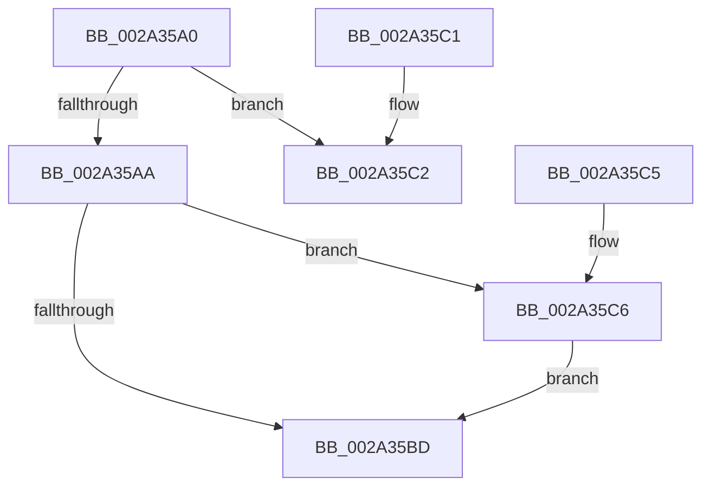

# MiGetWorkingSetSwapSupport

- RVA: `0x002A35A0`–`0x002A35CF` (길이 `47` bytes)
- VA: `0x00000001402A35A0`
- 실행 섹션: `.text`
- PDB 이름 있음: `예`; PDB Function 태그: `아니요`
- unwind 정보 RVA: `0x000DB714`
- 디코드: `16`개 명령, `47/47` bytes 표시
- 미해석 바이트: `0` (있으면 어셈블리에 `.byte`로 보존)

> 이 문서는 커널 이미지의 기계어와 PDB 기호를 분석해 생성했습니다. 4번과 5번은 함수 원형과 자료형을 바이너리 사용 방식에서 추정한 C 해석이며 원본 소스 복구 결과는 아닙니다.

## 1. Dependencies

- 직접 호출 지점: **0**; 고유 호출 대상: **0**
- 직접 호출자로 확인된 함수: **5**
- RIP 상대 이미지 참조: **1**

### Outgoing calls
- 직접 디코드된 call 명령이 없습니다.

### Direct callers
- [MiOutPageSingleKernelStack](MiOutPageSingleKernelStack_function_002A1790.md) at `0x002A18F4`
- [MiOutPageSingleKernelStack](MiOutPageSingleKernelStack_function_002A1790.md) at `0x002A1911`
- [MiOutPageSingleKernelStack](MiOutPageSingleKernelStack_function_002A1790.md) at `0x002A1920`
- [MiOutlawInswaps](MiOutlawInswaps_function_002A48B8.md) at `0x002A48F1`
- [MmQueryProcessWorkingSetSwapPages](MmQueryProcessWorkingSetSwapPages_function_002A49BC.md) at `0x002A49E0`
- [MmQueryProcessWorkingSetSwapPages](MmQueryProcessWorkingSetSwapPages_function_002A49BC.md) at `0x002A4A15`
- [MmOutSwapWorkingSet](MmOutSwapWorkingSet_function_002A6BC8.md) at `0x002A6D67`
- [MmOutSwapWorkingSet](MmOutSwapWorkingSet_function_002A6BC8.md) at `0x002A6F08`
- [MmInSwapWorkingSet](../45/MmInSwapWorkingSet_function_0045B6C4.md) at `0x0045B741`
- [MmInSwapWorkingSet](../45/MmInSwapWorkingSet_function_0045B6C4.md) at `0x0045B7F5`

### Static image references
- `0x002A35B4` → RVA `0x00E38858` (`.data`; read)

## 2. Other-region calls and transfers

- 다른 실행 섹션으로 향하는 call: **0**
- 별도 외부 분기/꼬리 이동을 확인하지 못했습니다.

## 3. Assembly (complete function range)

```asm
002A35A0  8B 81 B8 00 00 00               mov eax, dword ptr [rcx + 0xb8]
002A35A6  A8 0F                           test al, 0xf
002A35A8  75 18                           jne 0x1402a35c2
002A35AA  8B 81 B8 00 00 00               mov eax, dword ptr [rcx + 0xb8]
002A35B0  24 0F                           and al, 0xf
002A35B2  3C 01                           cmp al, 1
002A35B4  48 8D 05 9D 52 B9 00            lea rax, [rip + 0xb9529d]
002A35BB  75 09                           jne 0x1402a35c6
002A35BD  48 8B 00                        mov rax, qword ptr [rax]
002A35C0  C3                              ret
002A35C1  CC                              int3
002A35C2  33 C0                           xor eax, eax
002A35C4  C3                              ret
002A35C5  CC                              int3
002A35C6  48 8D 81 D8 00 00 00            lea rax, [rcx + 0xd8]
002A35CD  EB EE                           jmp 0x1402a35bd
```

## 4. C-style interpretation (structured pseudocode)

```c
__int64 __fastcall MiGetWorkingSetSwapSupport(__int64 a1)
{
    __int64 result;

    if ((((unsigned __int8)((unsigned int)(*(unsigned int *)(a1 + 184)))) & (15)) != 0) goto loc_002A35C2;
    result = (unsigned __int8)(((unsigned int)(*(unsigned int *)(a1 + 184))) & (15));
    if (((unsigned __int8)(result)) != 1) goto loc_002A35C6;
loc_002A35BD:
    return *(unsigned __int64 *)(v_rip + 12145309);
loc_002A35C2:
    result = 0;
    return result;
loc_002A35C6:
    goto loc_002A35BD;
}
```

## 5. (Beta) C Style

```c
int64_t MiGetWorkingSetSwapSupport(void *Arg1)
{
    uint8_t *arg1 = (uint8_t *)Arg1;

    int64_t result;

    if ((((uint8_t)((uint32_t)(*(uint32_t *)(arg1 + 0xB8)))) & (15)) != 0) goto loc_002A35C2;
    result = (uint8_t)(((uint32_t)(*(uint32_t *)(arg1 + 0xB8))) & (15));
    if (((uint8_t)(result)) != 1) goto loc_002A35C6;
loc_002A35BD:
    return *(uint64_t *)(v_rip + 0xB9529D);
loc_002A35C2:
    result = 0;
    return result;
loc_002A35C6:
    goto loc_002A35BD;
}
```

### 관측된 메모리 오프셋

구조체 형식이 확인되지 않은 접근은 인자 기준의 오프셋으로만 기록했습니다.

| 기준 인자 | 오프셋 표현 | 폭 (bit) | 접근 |
|---|---:|---:|---|
| `Arg1` | `+ 0xB8` | `32` | `R` |
| `Arg1` | `+ 0xD8` | `64` | `R` |

## 6. Execution-region graph

[열기: 2D/3D 그래프와 함수 탐색 컨트롤 패널](../../../control-panel.html?section=text&rva=0x002A35A0&view=graph)

- 2D 그래프는 위에서 아래로 흐르고, 3D 그래프는 빈 공간을 드래그해 회전합니다. Shift+드래그는 이동, 휠은 확대·축소, 함수 노드 선택은 대상 보고서 이동입니다.

### Static fallback


