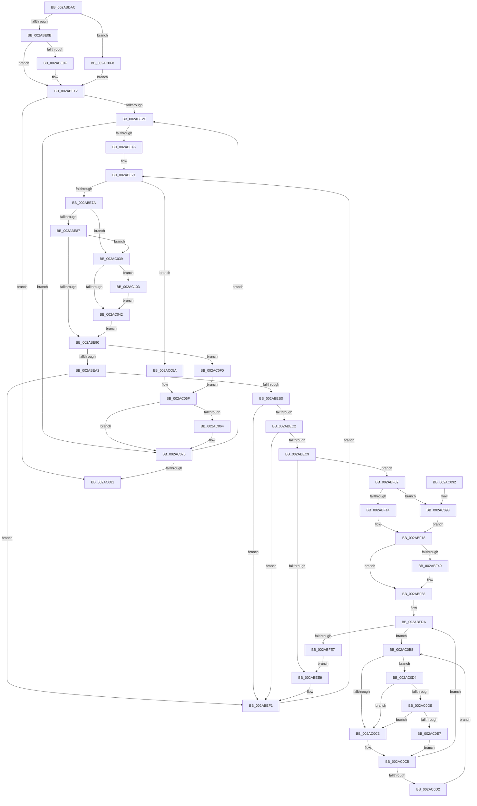

# MiInitializeImageProtos

- RVA: `0x002ABDAC`–`0x002AC117` (길이 `875` bytes)
- VA: `0x00000001402ABDAC`
- 실행 섹션: `.text`
- PDB 이름 있음: `예`; PDB Function 태그: `아니요`
- unwind 정보 RVA: `0x0006D104`
- 디코드: `214`개 명령, `875/875` bytes 표시
- 미해석 바이트: `0` (있으면 어셈블리에 `.byte`로 보존)

> 이 문서는 커널 이미지의 기계어와 PDB 기호를 분석해 생성했습니다. 4번과 5번은 함수 원형과 자료형을 바이너리 사용 방식에서 추정한 C 해석이며 원본 소스 복구 결과는 아닙니다.

## 1. Dependencies

- 직접 호출 지점: **16**; 고유 호출 대상: **15**
- 직접 호출자로 확인된 함수: **1**
- RIP 상대 이미지 참조: **4**

### Outgoing calls
- `0x002ABDFA` → [MiGetEffectivePagePriorityThread](../36/MiGetEffectivePagePriorityThread_function_003626E0.md) (function, `0x003626E0`)
- `0x002ABE50` → [MiStartingOffset](../34/MiStartingOffset_function_003482E0.md) (function, `0x003482E0`)
- `0x002ABE5B` → [MiEndingOffset](MiEndingOffset_function_002ACEC8.md) (function, `0x002ACEC8`)
- `0x002ABEDB` → [MiGetPageForHeader](MiGetPageForHeader_function_002AC120.md) (function, `0x002AC120`)
- `0x002ABF26` → [MiMapPageInHyperSpaceWorker](../33/MiMapPageInHyperSpaceWorker_function_00332B10.md) (function, `0x00332B10`)
- `0x002ABF3A` → [KeCopyPage](../6B/KeCopyPage_function_006BA0F0.md) (function, `0x006BA0F0`)
- `0x002ABF63` → [memset](../6C/memset_function_006C6C40.md) (function, `0x006C6C40`)
- `0x002ABFD3` → [MiReferenceControlAreaPfn](../36/MiReferenceControlAreaPfn_function_00364084.md) (function, `0x00364084`)
- `0x002ABFF1` → [MiInitializeTransitionPfn](MiInitializeTransitionPfn_function_002AC2E8.md) (function, `0x002AC2E8`)
- `0x002AC020` → [MiRemoveLockedPageChargeAndDecRef](../24/MiRemoveLockedPageChargeAndDecRef_function_002459D0.md) (function, `0x002459D0`)
- `0x002AC04D` → [MiLockProtoPoolPageForce](../32/MiLockProtoPoolPageForce_function_00320E10.md) (function, `0x00320E10`)
- `0x002AC06E` → [MiUnlockProtoPoolPage](../24/MiUnlockProtoPoolPage_function_00246090.md) (function, `0x00246090`)
- `0x002AC0AB` → [MmMapLockedPagesSpecifyCache](../31/MmMapLockedPagesSpecifyCache_function_00318800.md) (function, `0x00318800`)
- `0x002AC0DE` → [KiCheckVpBackingLongSpinWaitHypercall](../30/KiCheckVpBackingLongSpinWaitHypercall_function_0030F490.md) (function, `0x0030F490`)
- `0x002AC0E9` → [HvlNotifyLongSpinWait](../30/HvlNotifyLongSpinWait_function_0030F460.md) (function, `0x0030F460`)
- `0x002AC10D` → [MiUnlockProtoPoolPage](../24/MiUnlockProtoPoolPage_function_00246090.md) (function, `0x00246090`)

### Direct callers
- [MiCreateImageFileMap](../../page/98/MiCreateImageFileMap_function_00986830.md) at `0x00986C0C`

### Static image references
- `0x002ABDE2` → RVA `0x00E30088` (`.data`; read)
- `0x002ABFA5` → RVA `0x00010880` (`.rdata`; read)
- `0x002AC0BB` → RVA `0x00FC52AC` (`ALMOSTRO`; reference)
- `0x002AC0D4` → RVA `0x00FC6AB8` (`ALMOSTRO`; read)

## 2. Other-region calls and transfers

- 다른 실행 섹션으로 향하는 call: **0**
- 별도 외부 분기/꼬리 이동을 확인하지 못했습니다.

## 3. Assembly (complete function range)

```asm
002ABDAC  48 89 54 24 10                  mov qword ptr [rsp + 0x10], rdx
002ABDB1  48 89 4C 24 08                  mov qword ptr [rsp + 8], rcx
002ABDB6  53                              push rbx
002ABDB7  55                              push rbp
002ABDB8  56                              push rsi
002ABDB9  57                              push rdi
002ABDBA  41 54                           push r12
002ABDBC  41 55                           push r13
002ABDBE  41 56                           push r14
002ABDC0  41 57                           push r15
002ABDC2  48 83 EC 68                     sub rsp, 0x68
002ABDC6  0F B7 41 3C                     movzx eax, word ptr [rcx + 0x3c]
002ABDCA  4C 8B E9                        mov r13, rcx
002ABDCD  B9 FF 03 00 00                  mov ecx, 0x3ff
002ABDD2  66 23 C1                        and ax, cx
002ABDD5  65 48 8B 0C 25 88 01 00 00      mov rcx, qword ptr gs:[0x188]
002ABDDE  44 0F B7 C0                     movzx r8d, ax
002ABDE2  48 8B 05 9F 42 B8 00            mov rax, qword ptr [rip + 0xb8429f]
002ABDE9  4A 8B 04 C0                     mov rax, qword ptr [rax + r8*8]
002ABDED  48 89 44 24 38                  mov qword ptr [rsp + 0x38], rax
002ABDF2  8B 42 28                        mov eax, dword ptr [rdx + 0x28]
002ABDF5  48 89 44 24 30                  mov qword ptr [rsp + 0x30], rax
002ABDFA  E8 E1 68 0B 00                  call 0x1403626e0
002ABDFF  44 8B F0                        mov r14d, eax
002ABE02  83 F8 05                        cmp eax, 5
002ABE05  0F 87 ED 02 00 00               ja 0x1402ac0f8
002ABE0B  85 C0                           test eax, eax
002ABE0D  74 03                           je 0x1402abe12
002ABE0F  41 FF CE                        dec r14d
002ABE12  49 8D 9D 80 00 00 00            lea rbx, [r13 + 0x80]
002ABE19  C6 84 24 C0 00 00 00 11         mov byte ptr [rsp + 0xc0], 0x11
002ABE21  33 ED                           xor ebp, ebp
002ABE23  48 85 DB                        test rbx, rbx
002ABE26  0F 84 55 02 00 00               je 0x1402ac081
002ABE2C  4C 8B 7B 10                     mov r15, qword ptr [rbx + 0x10]
002ABE30  8B 43 20                        mov eax, dword ptr [rbx + 0x20]
002ABE33  48 8B 7B 08                     mov rdi, qword ptr [rbx + 8]
002ABE37  4C 89 7C 24 50                  mov qword ptr [rsp + 0x50], r15
002ABE3C  0F BA E0 11                     bt eax, 0x11
002ABE40  0F 82 2F 02 00 00               jb 0x1402ac075
002ABE46  41 83 C8 FF                     or r8d, 0xffffffff
002ABE4A  48 8B D7                        mov rdx, rdi
002ABE4D  48 8B CB                        mov rcx, rbx
002ABE50  E8 8B C4 09 00                  call 0x1403482e0
002ABE55  48 8B CB                        mov rcx, rbx
002ABE58  48 8B F0                        mov rsi, rax
002ABE5B  E8 68 10 00 00                  call 0x1402acec8
002ABE60  8B 4B 2C                        mov ecx, dword ptr [rbx + 0x2c]
002ABE63  48 89 44 24 40                  mov qword ptr [rsp + 0x40], rax
002ABE68  48 8D 04 CF                     lea rax, [rdi + rcx*8]
002ABE6C  48 89 44 24 48                  mov qword ptr [rsp + 0x48], rax
002ABE71  48 3B F8                        cmp rdi, rax
002ABE74  0F 83 E0 01 00 00               jae 0x1402ac05a
002ABE7A  48 F7 C7 FF 0F 00 00            test rdi, 0xfff
002ABE81  0F 84 B2 01 00 00               je 0x1402ac039
002ABE87  48 85 ED                        test rbp, rbp
002ABE8A  0F 84 A9 01 00 00               je 0x1402ac039
002ABE90  4C 8D A6 00 10 00 00            lea r12, [rsi + 0x1000]
002ABE97  4C 3B 64 24 30                  cmp r12, qword ptr [rsp + 0x30]
002ABE9C  0F 87 4E 02 00 00               ja 0x1402ac0f0
002ABEA2  48 8B 07                        mov rax, qword ptr [rdi]
002ABEA5  41 BF 01 00 00 00               mov r15d, 1
002ABEAB  41 84 C7                        test r15b, al
002ABEAE  75 41                           jne 0x1402abef1
002ABEB0  48 8B C8                        mov rcx, rax
002ABEB3  81 E1 00 0C 00 00               and ecx, 0xc00
002ABEB9  48 81 F9 00 08 00 00            cmp rcx, 0x800
002ABEC0  74 2F                           je 0x1402abef1
002ABEC2  48 0F BA E0 0A                  bt rax, 0xa
002ABEC7  73 28                           jae 0x1402abef1
002ABEC9  41 8B 55 38                     mov edx, dword ptr [r13 + 0x38]
002ABECD  45 8B C7                        mov r8d, r15d
002ABED0  48 8B 4C 24 38                  mov rcx, qword ptr [rsp + 0x38]
002ABED5  C1 EA 14                        shr edx, 0x14
002ABED8  83 E2 7F                        and edx, 0x7f
002ABEDB  E8 40 02 00 00                  call 0x1402ac120
002ABEE0  4C 8B E8                        mov r13, rax
002ABEE3  48 83 F8 FF                     cmp rax, -1
002ABEE7  75 19                           jne 0x1402abf02
002ABEE9  4C 8B AC 24 B0 00 00 00         mov r13, qword ptr [rsp + 0xb0]
002ABEF1  48 8B 44 24 48                  mov rax, qword ptr [rsp + 0x48]
002ABEF6  48 83 C7 08                     add rdi, 8
002ABEFA  49 8B F4                        mov rsi, r12
002ABEFD  E9 6F FF FF FF                  jmp 0x1402abe71
002ABF02  48 8B 84 24 B8 00 00 00         mov rax, qword ptr [rsp + 0xb8]
002ABF0A  F6 40 0A 05                     test byte ptr [rax + 0xa], 5
002ABF0E  0F 84 7F 01 00 00               je 0x1402ac093
002ABF14  48 8B 58 18                     mov rbx, qword ptr [rax + 0x18]
002ABF18  33 D2                           xor edx, edx
002ABF1A  41 B8 00 00 00 80               mov r8d, 0x80000000
002ABF20  49 8B CD                        mov rcx, r13
002ABF23  48 03 DE                        add rbx, rsi
002ABF26  E8 E5 6B 08 00                  call 0x140332b10
002ABF2B  41 B8 01 00 00 00               mov r8d, 1
002ABF31  48 8B D3                        mov rdx, rbx
002ABF34  48 8B C8                        mov rcx, rax
002ABF37  4C 8B F8                        mov r15, rax
002ABF3A  E8 B1 E1 40 00                  call 0x1406ba0f0
002ABF3F  48 8B 44 24 40                  mov rax, qword ptr [rsp + 0x40]
002ABF44  4C 3B E0                        cmp r12, rax
002ABF47  76 1F                           jbe 0x1402abf68
002ABF49  48 2B F0                        sub rsi, rax
002ABF4C  49 8B CF                        mov rcx, r15
002ABF4F  B8 00 10 00 00                  mov eax, 0x1000
002ABF54  33 D2                           xor edx, edx
002ABF56  4C 8D 04 30                     lea r8, [rax + rsi]
002ABF5A  45 8B C0                        mov r8d, r8d
002ABF5D  49 2B C8                        sub rcx, r8
002ABF60  48 03 C8                        add rcx, rax
002ABF63  E8 D8 AC 41 00                  call 0x1406c6c40
002ABF68  49 C1 EF 09                     shr r15, 9
002ABF6C  48 B8 F8 FF FF FF 7F 00 00 00   movabs rax, 0x7ffffffff8
002ABF76  4C 23 F8                        and r15, rax
002ABF79  48 B8 00 00 00 00 80 F6 FF FF   movabs rax, 0xfffff68000000000
002ABF83  4C 03 F8                        add r15, rax
002ABF86  4A 8D 1C 6D 00 00 00 00         lea rbx, [r13*2]
002ABF8E  65 48 8B 04 25 20 00 00 00      mov rax, qword ptr gs:[0x20]
002ABF97  49 03 DD                        add rbx, r13
002ABF9A  48 C1 E3 04                     shl rbx, 4
002ABF9E  48 8B 88 38 88 00 00            mov rcx, qword ptr [rax + 0x8838]
002ABFA5  48 8B 05 D4 48 D6 FF            mov rax, qword ptr [rip - 0x29b72c]
002ABFAC  48 83 21 00                     and qword ptr [rcx], 0
002ABFB0  49 89 07                        mov qword ptr [r15], rax
002ABFB3  48 B8 00 00 00 00 00 DE FF FF   movabs rax, 0xffffde0000000000
002ABFBD  48 8B 8C 24 B0 00 00 00         mov rcx, qword ptr [rsp + 0xb0]
002ABFC5  41 BF 01 00 00 00               mov r15d, 1
002ABFCB  45 8B C7                        mov r8d, r15d
002ABFCE  33 D2                           xor edx, edx
002ABFD0  48 03 D8                        add rbx, rax
002ABFD3  E8 AC 80 0B 00                  call 0x140364084
002ABFD8  33 F6                           xor esi, esi
002ABFDA  F0 48 0F BA 6B 18 3F            lock bts qword ptr [rbx + 0x18], 0x3f
002ABFE1  0F 82 D1 00 00 00               jb 0x1402ac0b8
002ABFE7  49 83 C8 FF                     or r8, 0xffffffffffffffff
002ABFEB  48 8B D7                        mov rdx, rdi
002ABFEE  49 8B CD                        mov rcx, r13
002ABFF1  E8 F2 02 00 00                  call 0x1402ac2e8
002ABFF6  8B 4B 20                        mov ecx, dword ptr [rbx + 0x20]
002ABFF9  41 8A C6                        mov al, r14b
002ABFFC  89 8C 24 C8 00 00 00            mov dword ptr [rsp + 0xc8], ecx
002AC003  C1 E9 18                        shr ecx, 0x18
002AC006  32 C1                           xor al, cl
002AC008  24 07                           and al, 7
002AC00A  32 C1                           xor al, cl
002AC00C  48 8B CB                        mov rcx, rbx
002AC00F  88 84 24 CB 00 00 00            mov byte ptr [rsp + 0xcb], al
002AC016  8B 84 24 C8 00 00 00            mov eax, dword ptr [rsp + 0xc8]
002AC01D  89 43 20                        mov dword ptr [rbx + 0x20], eax
002AC020  E8 AB 99 F9 FF                  call 0x1402459d0
002AC025  48 B8 FF FF FF FF FF FF FF 7F   movabs rax, 0x7fffffffffffffff
002AC02F  F0 48 21 43 18                  lock and qword ptr [rbx + 0x18], rax
002AC034  E9 B0 FE FF FF                  jmp 0x1402abee9
002AC039  48 85 ED                        test rbp, rbp
002AC03C  0F 85 C1 00 00 00               jne 0x1402ac103
002AC042  48 8D 94 24 C0 00 00 00         lea rdx, [rsp + 0xc0]
002AC04A  48 8B CF                        mov rcx, rdi
002AC04D  E8 BE 4D 07 00                  call 0x140320e10
002AC052  48 8B E8                        mov rbp, rax
002AC055  E9 36 FE FF FF                  jmp 0x1402abe90
002AC05A  4C 8B 7C 24 50                  mov r15, qword ptr [rsp + 0x50]
002AC05F  48 85 ED                        test rbp, rbp
002AC062  74 11                           je 0x1402ac075
002AC064  8A 94 24 C0 00 00 00            mov dl, byte ptr [rsp + 0xc0]
002AC06B  48 8B CD                        mov rcx, rbp
002AC06E  E8 1D A0 F9 FF                  call 0x140246090
002AC073  33 ED                           xor ebp, ebp
002AC075  49 8B DF                        mov rbx, r15
002AC078  4D 85 FF                        test r15, r15
002AC07B  0F 85 AB FD FF FF               jne 0x1402abe2c
002AC081  48 83 C4 68                     add rsp, 0x68
002AC085  41 5F                           pop r15
002AC087  41 5E                           pop r14
002AC089  41 5D                           pop r13
002AC08B  41 5C                           pop r12
002AC08D  5F                              pop rdi
002AC08E  5E                              pop rsi
002AC08F  5D                              pop rbp
002AC090  5B                              pop rbx
002AC091  C3                              ret
002AC092  CC                              int3
002AC093  C7 44 24 28 20 00 00 C0         mov dword ptr [rsp + 0x28], 0xc0000020
002AC09B  45 33 C9                        xor r9d, r9d
002AC09E  83 64 24 20 00                  and dword ptr [rsp + 0x20], 0
002AC0A3  45 8B C7                        mov r8d, r15d
002AC0A6  33 D2                           xor edx, edx
002AC0A8  48 8B C8                        mov rcx, rax
002AC0AB  E8 50 C7 06 00                  call 0x140318800
002AC0B0  48 8B D8                        mov rbx, rax
002AC0B3  E9 60 FE FF FF                  jmp 0x1402abf18
002AC0B8  41 03 F7                        add esi, r15d
002AC0BB  85 35 EB 91 D1 00               test dword ptr [rip + 0xd191eb], esi
002AC0C1  74 11                           je 0x1402ac0d4
002AC0C3  F3 90                           pause
002AC0C5  48 8B 43 18                     mov rax, qword ptr [rbx + 0x18]
002AC0C9  48 85 C0                        test rax, rax
002AC0CC  0F 89 08 FF FF FF               jns 0x1402abfda
002AC0D2  EB E4                           jmp 0x1402ac0b8
002AC0D4  8B 05 DE A9 D1 00               mov eax, dword ptr [rip + 0xd1a9de]
002AC0DA  A8 40                           test al, 0x40
002AC0DC  74 E5                           je 0x1402ac0c3
002AC0DE  E8 AD 33 06 00                  call 0x14030f490
002AC0E3  84 C0                           test al, al
002AC0E5  74 DC                           je 0x1402ac0c3
002AC0E7  8B CE                           mov ecx, esi
002AC0E9  E8 72 33 06 00                  call 0x14030f460
002AC0EE  EB D5                           jmp 0x1402ac0c5
002AC0F0  45 33 FF                        xor r15d, r15d
002AC0F3  E9 67 FF FF FF                  jmp 0x1402ac05f
002AC0F8  41 BE 05 00 00 00               mov r14d, 5
002AC0FE  E9 0F FD FF FF                  jmp 0x1402abe12
002AC103  8A 94 24 C0 00 00 00            mov dl, byte ptr [rsp + 0xc0]
002AC10A  48 8B CD                        mov rcx, rbp
002AC10D  E8 7E 9F F9 FF                  call 0x140246090
002AC112  E9 2B FF FF FF                  jmp 0x1402ac042
```

## 4. C-style interpretation (structured pseudocode)

```c
__int64 __fastcall MiInitializeImageProtos(__int64 a1, __int64 a2, __int64 a3, int a4)
{
    __int64 result;
    __int64 v_r14;
    __int64 v_r15;
    __int64 v_rbp;
    __int64 v_rbx;
    __int64 v_rdi;
    __int64 v_rsi;
    __int64 v_rsp;
    unsigned __int64 v_stack_m58;
    unsigned __int64 v_stack_m60;
    unsigned __int64 v_stack_m68;
    unsigned __int64 v_stack_m70;
    unsigned __int64 v_stack_m78;
    unsigned __int64 v_stack_p10;
    unsigned __int8 v_stack_p18;
    unsigned int v_stack_p20;
    unsigned __int8 v_stack_p23;
    unsigned int v_stack_p28;
    unsigned __int64 v_stack_p8;
    unsigned __int8 v_stack_pC0;

    v_stack_p10 = a2;
    v_stack_p8 = a1;
    v_rsp = (v_rsp) - (104);
    result = (unsigned __int16)((*(unsigned __int16 *)(a1 + 60)) & ((unsigned __int16)((unsigned int)(0x3FFULL))));
    v_stack_m70 = *(unsigned __int64 *)(*(unsigned __int64 *)(v_rip + 12075679) + (unsigned __int16)(result) * 8);
    v_stack_m78 = (unsigned int)(*(unsigned int *)(a2 + 40));
    result = MiGetEffectivePagePriorityThread(*(unsigned __int64 *)(gs_base + (0 + 392)), a2, (unsigned __int16)(result), a4);
    if (((unsigned int)(result)) > 5) goto loc_002AC0F8;
    v_r14 = (unsigned int)((unsigned int)(result));
    if ((unsigned int)(result) != 0) {
        v_r14 = (unsigned int)(((unsigned int)((unsigned int)(result))) - 1);
    }
    v_stack_p18 = 17;
    v_rbp = 0;
    if (a1 + 128 == 0) goto loc_002AC081;
loc_002ABE2C:
    v_stack_m58 = *(unsigned __int64 *)(a1 + 128 + 16);
    if (condition_is_below) goto loc_002AC075;
    a3 = (unsigned int)(((unsigned __int16)(result)) | (0xFFFFFFFFULL));
    result = MiStartingOffset(a1 + 128, *(unsigned __int64 *)(a1 + 128 + 8), a3, a4);
    result = MiEndingOffset(a1 + 128, *(unsigned __int64 *)(a1 + 128 + 8), a3, a4);
    v_stack_m68 = result;
    v_stack_m60 = *(unsigned __int64 *)(a1 + 128 + 8) + (unsigned int)(*(unsigned int *)(a1 + 128 + 44)) * 8;
loc_002ABE71:
    if ((*(unsigned __int64 *)(a1 + 128 + 8)) >= (*(unsigned __int64 *)(a1 + 128 + 8) + (unsigned int)(*(unsigned int *)(a1 + 128 + 44)) * 8)) goto loc_002AC05A;
    if (((*(unsigned __int64 *)(a1 + 128 + 8)) & (0xFFFULL)) == 0) goto loc_002AC039;
    if (0 == 0) goto loc_002AC039;
loc_002ABE90:
    if ((result + 4096) > v_stack_m78) goto loc_002AC0F0;
    if (((1) & ((unsigned __int8)(*(unsigned __int64 *)(*(unsigned __int64 *)(a1 + 128 + 8))))) != 0) goto loc_002ABEF1;
    a1 = (unsigned int)((*(unsigned __int64 *)(*(unsigned __int64 *)(a1 + 128 + 8))) & (0xC00ULL));
    if (a1 == 0x800ULL) goto loc_002ABEF1;
    if (a1 >= 0x800ULL) goto loc_002ABEF1;
    a2 = (unsigned int)(((unsigned int)(*(unsigned int *)(a1 + 56))) >> (20));
    a2 = (unsigned int)((a2) & (127));
    result = MiGetPageForHeader(v_stack_m70, a2, 1, a4);
    if (result != -1) goto loc_002ABF02;
loc_002ABEE9:
loc_002ABEF1:
    v_rdi = (*(unsigned __int64 *)(a1 + 128 + 8)) + (8);
    goto loc_002ABE71;
loc_002ABF02:
    if (((*(unsigned __int8 *)(v_stack_p10 + 10)) & (5)) == 0) goto loc_002AC093;
loc_002ABF18:
    a2 = 0;
    v_rbx = (*(unsigned __int64 *)(v_stack_p10 + 24)) + (result + 4096);
    result = MiMapPageInHyperSpaceWorker(v_stack_p8, a2, (unsigned int)(0x80000000ULL), a4);
    result = KeCopyPage(result, v_rbx, 1, a4);
    result = v_stack_m68;
    v_rsi = result + 4096;
    if ((result + 4096) >= = v_stack_m68) {
        v_rsi = (result + 4096) - (v_stack_m68);
        a1 = result;
        result = 0x1000ULL;
        a2 = 0;
        a3 = result + v_rsi * 1;
        a3 = (unsigned int)(a3);
        a1 = (a1) - (a3);
        a1 = (a1) + (result);
        result = memset(a1, a2, a3, a4);
    }
    v_r15 = (result) >> (9);
    v_r15 = (v_r15) & (result);
    v_r15 = (v_r15) + (result);
    v_rbx = (v_stack_p8 * 2) + (v_stack_p8);
    v_rbx = (v_rbx) << (4);
    *(unsigned __int64 *)(v_r15) = *(unsigned __int64 *)(v_rip - 2733868);
    a2 = 0;
    v_rbx = (v_rbx) + (*(unsigned __int64 *)(v_rip - 2733868));
    result = MiReferenceControlAreaPfn(v_stack_p8, a2, 1, a4);
    v_rsi = 0;
loc_002ABFDA:
    if (condition_is_below) goto loc_002AC0B8;
    a3 = (1) | (-1);
    result = MiInitializeTransitionPfn(v_stack_p8, v_rdi, a3, a4);
    v_stack_p20 = (unsigned int)((unsigned int)(*(unsigned int *)(v_rbx + 32)));
    a1 = (unsigned int)(((unsigned int)(*(unsigned int *)(v_rbx + 32))) >> (24));
    result = (unsigned __int8)(((unsigned __int8)(v_r14)) ^ ((unsigned __int8)(a1)));
    result = (unsigned __int8)((result) & (7));
    result = (unsigned __int8)((result) ^ ((unsigned __int8)(a1)));
    v_stack_p23 = (unsigned __int8)(result);
    *(unsigned int *)(v_rbx + 32) = (unsigned int)((unsigned int)(v_stack_p20));
    result = MiRemoveLockedPageChargeAndDecRef(v_rbx, v_rdi, a3, a4);
    goto loc_002ABEE9;
loc_002AC039:
    if (0 != 0) goto loc_002AC103;
loc_002AC042:
    result = MiLockProtoPoolPageForce(v_rdi, v_stack_p18, a3, a4);
    goto loc_002ABE90;
loc_002AC05A:
loc_002AC05F:
    v_rbp = result;
    if (result != 0) {
        a2 = v_stack_p18;
        a1 = result;
        result = MiUnlockProtoPoolPage(a1, a2, a3, a4);
        v_rbp = 0;
    }
    if (v_stack_m58 != 0) goto loc_002ABE2C;
loc_002AC081:
    v_rsp = (v_rsp) + (104);
    return result;
loc_002AC093:
    v_stack_p28 = 0xC0000020ULL;
    a4 = 0;
    a2 = 0;
    result = MmMapLockedPagesSpecifyCache(result, a2, (unsigned int)((unsigned int)(v_stack_m58)), a4);
    goto loc_002ABF18;
loc_002AC0B8:
    v_rsi = (unsigned int)((v_rsi) + ((unsigned int)(v_stack_m58)));
    if (((*(unsigned int *)(v_rip + 13734379)) & ((unsigned int)(v_rsi))) == 0) goto loc_002AC0D4;
loc_002AC0C3:
loc_002AC0C5:
    if (!sign_flag) goto loc_002ABFDA;
    goto loc_002AC0B8;
loc_002AC0D4:
    if ((((unsigned __int8)((unsigned int)(*(unsigned int *)(v_rip + 13740510)))) & (64)) == 0) goto loc_002AC0C3;
    result = KiCheckVpBackingLongSpinWaitHypercall(result, a2, (unsigned int)((unsigned int)(v_stack_m58)), a4);
    if ((unsigned __int8)(result) == 0) goto loc_002AC0C3;
    result = HvlNotifyLongSpinWait((unsigned int)((unsigned int)(v_rsi)), a2, (unsigned int)((unsigned int)(v_stack_m58)), a4);
    goto loc_002AC0C5;
loc_002AC0F0:
    v_r15 = 0;
    goto loc_002AC05F;
loc_002AC0F8:
    goto loc_002ABE12;
loc_002AC103:
    result = MiUnlockProtoPoolPage(0, v_stack_pC0, (unsigned int)((unsigned int)(v_stack_m58)), a4);
    goto loc_002AC042;
}
```

## 5. (Beta) C Style

```c
int64_t MiInitializeImageProtos(void *Arg1, void *Arg2, int64_t Arg3, int32_t Arg4)
{
    uint8_t *arg1 = (uint8_t *)Arg1;
    uint8_t *arg2 = (uint8_t *)Arg2;

    int64_t result;
    int64_t local_r14;
    int64_t local_r15;
    int64_t local_rbp;
    int64_t local_rbx;
    int64_t local_rdi;
    int64_t local_rsi;
    int64_t local_rsp;
    uint64_t v_stack_m58;
    uint64_t v_stack_m60;
    uint64_t v_stack_m68;
    uint64_t v_stack_m70;
    uint64_t v_stack_m78;
    uint64_t v_stack_p10;
    uint8_t v_stack_p18;
    uint32_t v_stack_p20;
    uint8_t v_stack_p23;
    uint32_t v_stack_p28;
    uint64_t v_stack_p8;
    uint8_t v_stack_pC0;

    v_stack_p10 = Arg2;
    v_stack_p8 = Arg1;
    local_rsp = (local_rsp) - (104);
    result = (uint16_t)((*(uint16_t *)(arg1 + 0x3C)) & ((uint16_t)((uint32_t)(0x3FFULL))));
    v_stack_m70 = *(uint64_t *)(*(uint64_t *)(v_rip + 0xB8429F) + (uint16_t)(result) * 8);
    v_stack_m78 = (uint32_t)(*(uint32_t *)(arg2 + 0x28));
    result = MiGetEffectivePagePriorityThread(*(uint64_t *)(gs_base + (0 + 0x188)), Arg2, (uint16_t)(result), Arg4);
    if (((uint32_t)(result)) > 5) goto loc_002AC0F8;
    local_r14 = (uint32_t)((uint32_t)(result));
    if ((uint32_t)(result) != 0) {
        local_r14 = (uint32_t)(((uint32_t)((uint32_t)(result))) - 1);
    }
    v_stack_p18 = 17;
    local_rbp = 0;
    if (Arg1 + 128 == 0) goto loc_002AC081;
loc_002ABE2C:
    v_stack_m58 = *(uint64_t *)(arg1 + 0x80 + 0x10);
    if (condition_is_below) goto loc_002AC075;
    Arg3 = (uint32_t)(((uint16_t)(result)) | (0xFFFFFFFFULL));
    result = MiStartingOffset(Arg1 + 128, *(uint64_t *)(arg1 + 0x80 + 0x8), Arg3, Arg4);
    result = MiEndingOffset(Arg1 + 128, *(uint64_t *)(arg1 + 0x80 + 0x8), Arg3, Arg4);
    v_stack_m68 = result;
    v_stack_m60 = *(uint64_t *)(arg1 + 0x80 + 0x8) + (uint32_t)(*(uint32_t *)(arg1 + 0x80 + 0x2C)) * 8;
loc_002ABE71:
    if ((*(uint64_t *)(arg1 + 0x80 + 0x8)) >= (*(uint64_t *)(arg1 + 0x80 + 0x8) + (uint32_t)(*(uint32_t *)(arg1 + 0x80 + 0x2C)) * 8)) goto loc_002AC05A;
    if (((*(uint64_t *)(arg1 + 0x80 + 0x8)) & (0xFFFULL)) == 0) goto loc_002AC039;
    if (0 == 0) goto loc_002AC039;
loc_002ABE90:
    if ((result + 4096) > v_stack_m78) goto loc_002AC0F0;
    if (((1) & ((uint8_t)(*(uint64_t *)(*(uint64_t *)(arg1 + 0x80 + 0x8))))) != 0) goto loc_002ABEF1;
    Arg1 = (uint32_t)((*(uint64_t *)(*(uint64_t *)(arg1 + 0x80 + 0x8))) & (0xC00ULL));
    if (Arg1 == 0x800ULL) goto loc_002ABEF1;
    if (Arg1 >= 0x800ULL) goto loc_002ABEF1;
    Arg2 = (uint32_t)(((uint32_t)(*(uint32_t *)(arg1 + 0x38))) >> (20));
    Arg2 = (uint32_t)((Arg2) & (127));
    result = MiGetPageForHeader(v_stack_m70, Arg2, 1, Arg4);
    if (result != -1) goto loc_002ABF02;
loc_002ABEE9:
loc_002ABEF1:
    local_rdi = (*(uint64_t *)(arg1 + 0x80 + 0x8)) + (8);
    goto loc_002ABE71;
loc_002ABF02:
    if (((*(uint8_t *)(v_stack_p10 + 0xA)) & (5)) == 0) goto loc_002AC093;
loc_002ABF18:
    Arg2 = 0;
    local_rbx = (*(uint64_t *)(v_stack_p10 + 0x18)) + (result + 4096);
    result = MiMapPageInHyperSpaceWorker(v_stack_p8, Arg2, (uint32_t)(0x80000000ULL), Arg4);
    result = KeCopyPage(result, local_rbx, 1, Arg4);
    result = v_stack_m68;
    local_rsi = result + 4096;
    if ((result + 4096) >= = v_stack_m68) {
        local_rsi = (result + 4096) - (v_stack_m68);
        Arg1 = result;
        result = 0x1000ULL;
        Arg2 = 0;
        Arg3 = result + local_rsi * 1;
        Arg3 = (uint32_t)(Arg3);
        Arg1 = (Arg1) - (Arg3);
        Arg1 = (Arg1) + (result);
        result = memset(Arg1, Arg2, Arg3, Arg4);
    }
    local_r15 = (result) >> (9);
    local_r15 = (local_r15) & (result);
    local_r15 = (local_r15) + (result);
    local_rbx = (v_stack_p8 * 2) + (v_stack_p8);
    local_rbx = (local_rbx) << (4);
    *(uint64_t *)(local_r15) = *(uint64_t *)(v_rip - 0x29B72C);
    Arg2 = 0;
    local_rbx = (local_rbx) + (*(uint64_t *)(v_rip - 0x29B72C));
    result = MiReferenceControlAreaPfn(v_stack_p8, Arg2, 1, Arg4);
    local_rsi = 0;
loc_002ABFDA:
    if (condition_is_below) goto loc_002AC0B8;
    Arg3 = (1) | (-1);
    result = MiInitializeTransitionPfn(v_stack_p8, local_rdi, Arg3, Arg4);
    v_stack_p20 = (uint32_t)((uint32_t)(*(uint32_t *)(local_rbx + 0x20)));
    Arg1 = (uint32_t)(((uint32_t)(*(uint32_t *)(local_rbx + 0x20))) >> (24));
    result = (uint8_t)(((uint8_t)(local_r14)) ^ ((uint8_t)(Arg1)));
    result = (uint8_t)((result) & (7));
    result = (uint8_t)((result) ^ ((uint8_t)(Arg1)));
    v_stack_p23 = (uint8_t)(result);
    *(uint32_t *)(local_rbx + 0x20) = (uint32_t)((uint32_t)(v_stack_p20));
    result = MiRemoveLockedPageChargeAndDecRef(local_rbx, local_rdi, Arg3, Arg4);
    goto loc_002ABEE9;
loc_002AC039:
    if (0 != 0) goto loc_002AC103;
loc_002AC042:
    result = MiLockProtoPoolPageForce(local_rdi, v_stack_p18, Arg3, Arg4);
    goto loc_002ABE90;
loc_002AC05A:
loc_002AC05F:
    local_rbp = result;
    if (result != 0) {
        Arg2 = v_stack_p18;
        Arg1 = result;
        result = MiUnlockProtoPoolPage(Arg1, Arg2, Arg3, Arg4);
        local_rbp = 0;
    }
    if (v_stack_m58 != 0) goto loc_002ABE2C;
loc_002AC081:
    local_rsp = (local_rsp) + (104);
    return result;
loc_002AC093:
    v_stack_p28 = 0xC0000020ULL;
    Arg4 = 0;
    Arg2 = 0;
    result = MmMapLockedPagesSpecifyCache(result, Arg2, (uint32_t)((uint32_t)(v_stack_m58)), Arg4);
    goto loc_002ABF18;
loc_002AC0B8:
    local_rsi = (uint32_t)((local_rsi) + ((uint32_t)(v_stack_m58)));
    if (((*(uint32_t *)(v_rip + 0xD191EB)) & ((uint32_t)(local_rsi))) == 0) goto loc_002AC0D4;
loc_002AC0C3:
loc_002AC0C5:
    if (!sign_flag) goto loc_002ABFDA;
    goto loc_002AC0B8;
loc_002AC0D4:
    if ((((uint8_t)((uint32_t)(*(uint32_t *)(v_rip + 0xD1A9DE)))) & (64)) == 0) goto loc_002AC0C3;
    result = KiCheckVpBackingLongSpinWaitHypercall(result, Arg2, (uint32_t)((uint32_t)(v_stack_m58)), Arg4);
    if ((uint8_t)(result) == 0) goto loc_002AC0C3;
    result = HvlNotifyLongSpinWait((uint32_t)((uint32_t)(local_rsi)), Arg2, (uint32_t)((uint32_t)(v_stack_m58)), Arg4);
    goto loc_002AC0C5;
loc_002AC0F0:
    local_r15 = 0;
    goto loc_002AC05F;
loc_002AC0F8:
    goto loc_002ABE12;
loc_002AC103:
    result = MiUnlockProtoPoolPage(0, v_stack_pC0, (uint32_t)((uint32_t)(v_stack_m58)), Arg4);
    goto loc_002AC042;
}
```

### 관측된 메모리 오프셋

구조체 형식이 확인되지 않은 접근은 인자 기준의 오프셋으로만 기록했습니다.

| 기준 인자 | 오프셋 표현 | 폭 (bit) | 접근 |
|---|---:|---:|---|
| `Arg1` | `+ 0x3C` | `16` | `R` |
| `Arg1` | `+ 0x80` | `64` | `R` |
| `Arg2` | `+ 0x28` | `32` | `R` |

## 6. Execution-region graph

[열기: 2D/3D 그래프와 함수 탐색 컨트롤 패널](../../../control-panel.html?section=text&rva=0x002ABDAC&view=graph)

- 2D 그래프는 위에서 아래로 흐르고, 3D 그래프는 빈 공간을 드래그해 회전합니다. Shift+드래그는 이동, 휠은 확대·축소, 함수 노드 선택은 대상 보고서 이동입니다.

### Static fallback


