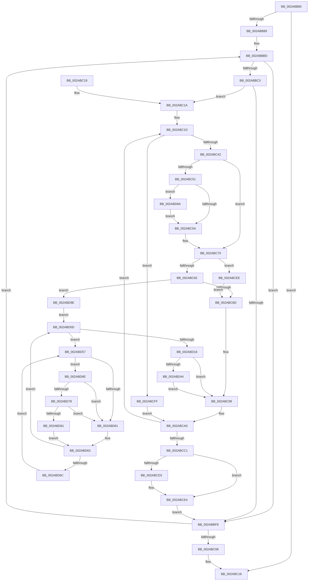

# MiInitializeNewImageSectionProtos

- RVA: `0x002ABB80`–`0x002ABDA5` (길이 `549` bytes)
- VA: `0x00000001402ABB80`
- 실행 섹션: `.text`
- PDB 이름 있음: `예`; PDB Function 태그: `아니요`
- unwind 정보 RVA: `0x0006D0E8`
- 디코드: `143`개 명령, `549/549` bytes 표시
- 미해석 바이트: `0` (있으면 어셈블리에 `.byte`로 보존)

> 이 문서는 커널 이미지의 기계어와 PDB 기호를 분석해 생성했습니다. 4번과 5번은 함수 원형과 자료형을 바이너리 사용 방식에서 추정한 C 해석이며 원본 소스 복구 결과는 아닙니다.

## 1. Dependencies

- 직접 호출 지점: **11**; 고유 호출 대상: **10**
- 직접 호출자로 확인된 함수: **1**
- RIP 상대 이미지 참조: **2**

### Outgoing calls
- `0x002ABBCA` → [MmUnmapLockedPages](../24/MmUnmapLockedPages_function_00246E60.md) (function, `0x00246E60`)
- `0x002ABC65` → [MiLockProtoPoolPageForce](../32/MiLockProtoPoolPageForce_function_00320E10.md) (function, `0x00320E10`)
- `0x002ABC75` → [MiLockLeafPage](../36/MiLockLeafPage_function_003658C0.md) (function, `0x003658C0`)
- `0x002ABC90` → [MiReturnPfnReferenceCountAtDpc](../36/MiReturnPfnReferenceCountAtDpc_function_00364010.md) (function, `0x00364010`)
- `0x002ABCDF` → [MiUnlockProtoPoolPage](../24/MiUnlockProtoPoolPage_function_00246090.md) (function, `0x00246090`)
- `0x002ABD02` → [MiReturnPfnReferenceCount](MiReturnPfnReferenceCount_function_002AA824.md) (function, `0x002AA824`)
- `0x002ABD22` → [MiInitializeTransitionPfn](MiInitializeTransitionPfn_function_002AC2E8.md) (function, `0x002AC2E8`)
- `0x002ABD4D` → [MiReferenceControlAreaPfn](../36/MiReferenceControlAreaPfn_function_00364084.md) (function, `0x00364084`)
- `0x002ABD78` → [KiCheckVpBackingLongSpinWaitHypercall](../30/KiCheckVpBackingLongSpinWaitHypercall_function_0030F490.md) (function, `0x0030F490`)
- `0x002ABD83` → [HvlNotifyLongSpinWait](../30/HvlNotifyLongSpinWait_function_0030F460.md) (function, `0x0030F460`)
- `0x002ABD94` → [MiUnlockProtoPoolPage](../24/MiUnlockProtoPoolPage_function_00246090.md) (function, `0x00246090`)

### Direct callers
- [MiSectionCreated](MiSectionCreated_function_002ABA18.md) at `0x002ABB16`

### Static image references
- `0x002ABD59` → RVA `0x00FC52AC` (`ALMOSTRO`; reference)
- `0x002ABD6E` → RVA `0x00FC6AB8` (`ALMOSTRO`; read)

## 2. Other-region calls and transfers

- 다른 실행 섹션으로 향하는 call: **0**
- 별도 외부 분기/꼬리 이동을 확인하지 못했습니다.

## 3. Assembly (complete function range)

```asm
002ABB80  48 85 D2                        test rdx, rdx
002ABB83  0F 84 8F 00 00 00               je 0x1402abc18
002ABB89  48 89 54 24 10                  mov qword ptr [rsp + 0x10], rdx
002ABB8E  53                              push rbx
002ABB8F  55                              push rbp
002ABB90  56                              push rsi
002ABB91  57                              push rdi
002ABB92  41 54                           push r12
002ABB94  41 55                           push r13
002ABB96  41 56                           push r14
002ABB98  41 57                           push r15
002ABB9A  48 83 EC 38                     sub rsp, 0x38
002ABB9E  48 8B B9 88 00 00 00            mov rdi, qword ptr [rcx + 0x88]
002ABBA5  48 8B DA                        mov rbx, rdx
002ABBA8  8B B1 AC 00 00 00               mov esi, dword ptr [rcx + 0xac]
002ABBAE  4C 8B E9                        mov r13, rcx
002ABBB1  48 89 7C 24 28                  mov qword ptr [rsp + 0x28], rdi
002ABBB6  89 B4 24 90 00 00 00            mov dword ptr [rsp + 0x90], esi
002ABBBD  F6 43 0A 04                     test byte ptr [rbx + 0xa], 4
002ABBC1  75 35                           jne 0x1402abbf8
002ABBC3  48 8B 4B 18                     mov rcx, qword ptr [rbx + 0x18]
002ABBC7  48 8B D3                        mov rdx, rbx
002ABBCA  E8 91 B2 F9 FF                  call 0x140246e60
002ABBCF  8B 4B 10                        mov ecx, dword ptr [rbx + 0x10]
002ABBD2  4C 8D 7B 30                     lea r15, [rbx + 0x30]
002ABBD6  8B 6B 28                        mov ebp, dword ptr [rbx + 0x28]
002ABBD9  33 C0                           xor eax, eax
002ABBDB  C1 ED 0C                        shr ebp, 0xc
002ABBDE  45 33 E4                        xor r12d, r12d
002ABBE1  89 8C 24 98 00 00 00            mov dword ptr [rsp + 0x98], ecx
002ABBE8  C6 84 24 80 00 00 00 11         mov byte ptr [rsp + 0x80], 0x11
002ABBF0  4C 8D 34 CF                     lea r14, [rdi + rcx*8]
002ABBF4  85 ED                           test ebp, ebp
002ABBF6  75 22                           jne 0x1402abc1a
002ABBF8  48 8B 1B                        mov rbx, qword ptr [rbx]
002ABBFB  48 89 9C 24 88 00 00 00         mov qword ptr [rsp + 0x88], rbx
002ABC03  48 85 DB                        test rbx, rbx
002ABC06  75 B5                           jne 0x1402abbbd
002ABC08  48 83 C4 38                     add rsp, 0x38
002ABC0C  41 5F                           pop r15
002ABC0E  41 5E                           pop r14
002ABC10  41 5D                           pop r13
002ABC12  41 5C                           pop r12
002ABC14  5F                              pop rdi
002ABC15  5E                              pop rsi
002ABC16  5D                              pop rbp
002ABC17  5B                              pop rbx
002ABC18  C3                              ret
002ABC19  CC                              int3
002ABC1A  48 8B D8                        mov rbx, rax
002ABC1D  49 8B 07                        mov rax, qword ptr [r15]
002ABC20  48 89 44 24 20                  mov qword ptr [rsp + 0x20], rax
002ABC25  48 8D 3C 40                     lea rdi, [rax + rax*2]
002ABC29  48 C1 E7 04                     shl rdi, 4
002ABC2D  48 B8 00 00 00 00 00 DE FF FF   movabs rax, 0xffffde0000000000
002ABC37  48 03 F8                        add rdi, rax
002ABC3A  3B CE                           cmp ecx, esi
002ABC3C  0F 83 BD 00 00 00               jae 0x1402abcff
002ABC42  49 8B F6                        mov rsi, r14
002ABC45  48 81 E6 00 F0 FF FF            and rsi, 0xfffffffffffff000
002ABC4C  49 3B F4                        cmp rsi, r12
002ABC4F  74 1F                           je 0x1402abc70
002ABC51  4D 85 E4                        test r12, r12
002ABC54  0F 85 30 01 00 00               jne 0x1402abd8a
002ABC5A  48 8D 94 24 80 00 00 00         lea rdx, [rsp + 0x80]
002ABC62  49 8B CE                        mov rcx, r14
002ABC65  E8 A6 51 07 00                  call 0x140320e10
002ABC6A  48 8B D8                        mov rbx, rax
002ABC6D  4C 8B E6                        mov r12, rsi
002ABC70  33 D2                           xor edx, edx
002ABC72  49 8B CE                        mov rcx, r14
002ABC75  E8 46 9C 0B 00                  call 0x1403658c0
002ABC7A  49 8B 0E                        mov rcx, qword ptr [r14]
002ABC7D  48 85 C0                        test rax, rax
002ABC80  75 6C                           jne 0x1402abcee
002ABC82  48 0F BA E1 0A                  bt rcx, 0xa
002ABC87  0F 82 11 01 00 00               jb 0x1402abd9e
002ABC8D  48 8B CF                        mov rcx, rdi
002ABC90  E8 7B 83 0B 00                  call 0x140364010
002ABC95  49 83 0F FF                     or qword ptr [r15], 0xffffffffffffffff
002ABC99  8B B4 24 90 00 00 00            mov esi, dword ptr [rsp + 0x90]
002ABCA0  8B 8C 24 98 00 00 00            mov ecx, dword ptr [rsp + 0x98]
002ABCA7  49 83 C6 08                     add r14, 8
002ABCAB  FF C1                           inc ecx
002ABCAD  49 83 C7 08                     add r15, 8
002ABCB1  89 8C 24 98 00 00 00            mov dword ptr [rsp + 0x98], ecx
002ABCB8  83 C5 FF                        add ebp, -1
002ABCBB  0F 85 5C FF FF FF               jne 0x1402abc1d
002ABCC1  48 89 5C 24 20                  mov qword ptr [rsp + 0x20], rbx
002ABCC6  48 8B 9C 24 88 00 00 00         mov rbx, qword ptr [rsp + 0x88]
002ABCCE  4D 85 E4                        test r12, r12
002ABCD1  74 11                           je 0x1402abce4
002ABCD3  8A 94 24 80 00 00 00            mov dl, byte ptr [rsp + 0x80]
002ABCDA  48 8B 4C 24 20                  mov rcx, qword ptr [rsp + 0x20]
002ABCDF  E8 AC A3 F9 FF                  call 0x140246090
002ABCE4  48 8B 7C 24 28                  mov rdi, qword ptr [rsp + 0x28]
002ABCE9  E9 0A FF FF FF                  jmp 0x1402abbf8
002ABCEE  48 B9 FF FF FF FF FF FF FF 7F   movabs rcx, 0x7fffffffffffffff
002ABCF8  F0 48 21 48 18                  lock and qword ptr [rax + 0x18], rcx
002ABCFD  EB 8E                           jmp 0x1402abc8d
002ABCFF  48 8B CF                        mov rcx, rdi
002ABD02  E8 1D EB FF FF                  call 0x1402aa824
002ABD07  49 83 0F FF                     or qword ptr [r15], 0xffffffffffffffff
002ABD0B  EB 93                           jmp 0x1402abca0
002ABD0D  F0 48 0F BA 6F 18 3F            lock bts qword ptr [rdi + 0x18], 0x3f
002ABD14  72 41                           jb 0x1402abd57
002ABD16  48 8B 4C 24 20                  mov rcx, qword ptr [rsp + 0x20]
002ABD1B  49 83 C8 FF                     or r8, 0xffffffffffffffff
002ABD1F  49 8B D6                        mov rdx, r14
002ABD22  E8 C1 05 00 00                  call 0x1402ac2e8
002ABD27  48 B8 FF FF FF FF FF FF FF 7F   movabs rax, 0x7fffffffffffffff
002ABD31  F0 48 21 47 18                  lock and qword ptr [rdi + 0x18], rax
002ABD36  8B 47 10                        mov eax, dword ptr [rdi + 0x10]
002ABD39  48 0F BA E0 0A                  bt rax, 0xa
002ABD3E  0F 83 55 FF FF FF               jae 0x1402abc99
002ABD44  33 D2                           xor edx, edx
002ABD46  49 8B CD                        mov rcx, r13
002ABD49  44 8D 42 01                     lea r8d, [rdx + 1]
002ABD4D  E8 32 83 0B 00                  call 0x140364084
002ABD52  E9 42 FF FF FF                  jmp 0x1402abc99
002ABD57  FF C6                           inc esi
002ABD59  85 35 4D 95 D1 00               test dword ptr [rip + 0xd1954d], esi
002ABD5F  74 0D                           je 0x1402abd6e
002ABD61  F3 90                           pause
002ABD63  48 8B 47 18                     mov rax, qword ptr [rdi + 0x18]
002ABD67  48 85 C0                        test rax, rax
002ABD6A  79 A1                           jns 0x1402abd0d
002ABD6C  EB E9                           jmp 0x1402abd57
002ABD6E  8B 05 44 AD D1 00               mov eax, dword ptr [rip + 0xd1ad44]
002ABD74  A8 40                           test al, 0x40
002ABD76  74 E9                           je 0x1402abd61
002ABD78  E8 13 37 06 00                  call 0x14030f490
002ABD7D  84 C0                           test al, al
002ABD7F  74 E0                           je 0x1402abd61
002ABD81  8B CE                           mov ecx, esi
002ABD83  E8 D8 36 06 00                  call 0x14030f460
002ABD88  EB D9                           jmp 0x1402abd63
002ABD8A  8A 94 24 80 00 00 00            mov dl, byte ptr [rsp + 0x80]
002ABD91  48 8B CB                        mov rcx, rbx
002ABD94  E8 F7 A2 F9 FF                  call 0x140246090
002ABD99  E9 BC FE FF FF                  jmp 0x1402abc5a
002ABD9E  33 F6                           xor esi, esi
002ABDA0  E9 68 FF FF FF                  jmp 0x1402abd0d
```

## 4. C-style interpretation (structured pseudocode)

```c
__int64 __fastcall MiInitializeNewImageSectionProtos(__int64 a1, __int64 a2, __int64 a3)
{
    __int64 result;
    __int64 v_r12;
    __int64 v_r14;
    __int64 v_r15;
    __int64 v_rbp;
    __int64 v_rdi;
    __int64 v_rsi;
    __int64 v_rsp;
    unsigned __int64 v_stack_m50;
    unsigned __int64 v_stack_p10;
    unsigned int v_stack_p18;
    unsigned int v_stack_p20;
    unsigned __int64 v_stack_p28;
    unsigned __int8 v_stack_p8;
    unsigned __int64 v_stack_p80;
    unsigned __int64 v_stack_p88;
    unsigned int v_stack_p90;
    unsigned int v_stack_p98;

    if (a2 == 0) goto loc_002ABC18;
    v_stack_p10 = a2;
    v_rsp = (v_rsp) - (56);
    v_stack_m50 = *(unsigned __int64 *)(a1 + 136);
    v_stack_p18 = (unsigned int)((unsigned int)(*(unsigned int *)(a1 + 172)));
loc_002ABBBD:
    if (((*(unsigned __int8 *)(a2 + 10)) & (4)) != 0) goto loc_002ABBF8;
    result = MmUnmapLockedPages(*(unsigned __int64 *)(a2 + 24), a2, a3, a4);
    result = 0;
    v_rbp = (unsigned int)(((unsigned int)(*(unsigned int *)(a2 + 40))) >> (12));
    v_r12 = 0;
    v_stack_p20 = (unsigned int)((unsigned int)(*(unsigned int *)(a2 + 16)));
    v_stack_p8 = 17;
    if ((unsigned int)(v_rbp) != 0) goto loc_002ABC1A;
loc_002ABBF8:
    v_stack_p10 = *(unsigned __int64 *)(a2);
    if (*(unsigned __int64 *)(a2) != 0) goto loc_002ABBBD;
    v_rsp = (v_rsp) + (56);
loc_002ABC18:
    return result;
loc_002ABC1A:
loc_002ABC1D:
    v_stack_p20 = *(unsigned __int64 *)(a2 + 48);
    v_rdi = (*(unsigned __int64 *)(a2 + 48) + *(unsigned __int64 *)(a2 + 48) * 2) << (4);
    v_rdi = (v_rdi) + (*(unsigned __int64 *)(a2 + 48));
    if (((unsigned int)((unsigned int)(*(unsigned int *)(a2 + 16)))) >= ((unsigned int)((unsigned int)(*(unsigned int *)(a1 + 172))))) goto loc_002ABCFF;
    v_rsi = (*(unsigned __int64 *)(a1 + 136) + (unsigned int)(*(unsigned int *)(a2 + 16)) * 8) & (0xFFFFFFFFFFFFF000ULL);
    if (v_rsi == 0) goto loc_002ABC70;
    if (0 != 0) goto loc_002ABD8A;
loc_002ABC5A:
    result = MiLockProtoPoolPageForce(*(unsigned __int64 *)(a1 + 136) + (unsigned int)(*(unsigned int *)(a2 + 16)) * 8, v_stack_p80, a3, a4);
loc_002ABC70:
    a2 = 0;
    result = MiLockLeafPage(*(unsigned __int64 *)(a1 + 136) + (unsigned int)(*(unsigned int *)(a2 + 16)) * 8, a2, a3, a4);
    if (result != 0) goto loc_002ABCEE;
    if (condition_is_below) goto loc_002ABD9E;
loc_002ABC8D:
    result = MiReturnPfnReferenceCountAtDpc(v_rdi, a2, a3, a4);
loc_002ABC99:
loc_002ABCA0:
    v_r14 = (*(unsigned __int64 *)(a1 + 136) + (unsigned int)(*(unsigned int *)(a2 + 16)) * 8) + (8);
    a1 = (unsigned int)(((unsigned int)(v_stack_p98)) + 1);
    v_r15 = (a2 + 48) + (8);
    v_stack_p98 = (unsigned int)(a1);
    v_rbp = (unsigned int)((v_rbp) + (-1));
    if (condition_is_not_equal) goto loc_002ABC1D;
    v_stack_p20 = result;
    if (v_rsi != 0) {
        a2 = v_stack_p80;
        a1 = v_stack_p20;
        result = MiUnlockProtoPoolPage(a1, a2, a3, a4);
    }
    goto loc_002ABBF8;
loc_002ABCEE:
    goto loc_002ABC8D;
loc_002ABCFF:
    result = MiReturnPfnReferenceCount(v_stack_p28, a2, a3, a4);
    goto loc_002ABCA0;
loc_002ABD0D:
    if (condition_is_below) goto loc_002ABD57;
    a3 = (a3) | (-1);
    result = MiInitializeTransitionPfn(v_stack_p20, v_r14, a3, a4);
    if (condition_is_above_or_equal) goto loc_002ABC99;
    a2 = 0;
    result = MiReferenceControlAreaPfn(a1, a2, a2 + 1, a4);
    goto loc_002ABC99;
loc_002ABD57:
    v_rsi = (unsigned int)(((unsigned int)(v_stack_p90)) + 1);
    if (((*(unsigned int *)(v_rip + 13735245)) & ((unsigned int)(v_rsi))) == 0) goto loc_002ABD6E;
loc_002ABD61:
loc_002ABD63:
    if (!sign_flag) goto loc_002ABD0D;
    goto loc_002ABD57;
loc_002ABD6E:
    if ((((unsigned __int8)((unsigned int)(*(unsigned int *)(v_rip + 13741380)))) & (64)) == 0) goto loc_002ABD61;
    result = KiCheckVpBackingLongSpinWaitHypercall(a1, a2, a2 + 1, a4);
    if ((unsigned __int8)(result) == 0) goto loc_002ABD61;
    result = HvlNotifyLongSpinWait((unsigned int)((unsigned int)(v_rsi)), a2, a2 + 1, a4);
    goto loc_002ABD63;
loc_002ABD8A:
    result = MiUnlockProtoPoolPage(v_stack_p88, v_stack_p80, a2 + 1, a4);
    goto loc_002ABC5A;
loc_002ABD9E:
    v_rsi = 0;
    goto loc_002ABD0D;
}
```

## 5. (Beta) C Style

```c
int64_t MiInitializeNewImageSectionProtos(void *Arg1, int64_t Arg2, int64_t Arg3)
{
    uint8_t *arg1 = (uint8_t *)Arg1;

    int64_t result;
    int64_t local_r12;
    int64_t local_r14;
    int64_t local_r15;
    int64_t local_rbp;
    int64_t local_rdi;
    int64_t local_rsi;
    int64_t local_rsp;
    uint64_t v_stack_m50;
    uint64_t v_stack_p10;
    uint32_t v_stack_p18;
    uint32_t v_stack_p20;
    uint64_t v_stack_p28;
    uint8_t v_stack_p8;
    uint64_t v_stack_p80;
    uint64_t v_stack_p88;
    uint32_t v_stack_p90;
    uint32_t v_stack_p98;

    if (Arg2 == 0) goto loc_002ABC18;
    v_stack_p10 = Arg2;
    local_rsp = (local_rsp) - (56);
    v_stack_m50 = *(uint64_t *)(arg1 + 0x88);
    v_stack_p18 = (uint32_t)((uint32_t)(*(uint32_t *)(arg1 + 0xAC)));
loc_002ABBBD:
    if (((*(uint8_t *)(Arg2 + 0xA)) & (4)) != 0) goto loc_002ABBF8;
    result = MmUnmapLockedPages(*(uint64_t *)(Arg2 + 0x18), Arg2, Arg3, a4);
    result = 0;
    local_rbp = (uint32_t)(((uint32_t)(*(uint32_t *)(Arg2 + 0x28))) >> (12));
    local_r12 = 0;
    v_stack_p20 = (uint32_t)((uint32_t)(*(uint32_t *)(Arg2 + 0x10)));
    v_stack_p8 = 17;
    if ((uint32_t)(local_rbp) != 0) goto loc_002ABC1A;
loc_002ABBF8:
    v_stack_p10 = *(uint64_t *)(Arg2);
    if (*(uint64_t *)(Arg2) != 0) goto loc_002ABBBD;
    local_rsp = (local_rsp) + (56);
loc_002ABC18:
    return result;
loc_002ABC1A:
loc_002ABC1D:
    v_stack_p20 = *(uint64_t *)(Arg2 + 0x30);
    local_rdi = (*(uint64_t *)(Arg2 + 0x30) + *(uint64_t *)(Arg2 + 0x30) * 2) << (4);
    local_rdi = (local_rdi) + (*(uint64_t *)(Arg2 + 0x30));
    if (((uint32_t)((uint32_t)(*(uint32_t *)(Arg2 + 0x10)))) >= ((uint32_t)((uint32_t)(*(uint32_t *)(arg1 + 0xAC))))) goto loc_002ABCFF;
    local_rsi = (*(uint64_t *)(arg1 + 0x88) + (uint32_t)(*(uint32_t *)(Arg2 + 0x10)) * 8) & (0xFFFFFFFFFFFFF000ULL);
    if (local_rsi == 0) goto loc_002ABC70;
    if (0 != 0) goto loc_002ABD8A;
loc_002ABC5A:
    result = MiLockProtoPoolPageForce(*(uint64_t *)(arg1 + 0x88) + (uint32_t)(*(uint32_t *)(Arg2 + 0x10)) * 8, v_stack_p80, Arg3, a4);
loc_002ABC70:
    Arg2 = 0;
    result = MiLockLeafPage(*(uint64_t *)(arg1 + 0x88) + (uint32_t)(*(uint32_t *)(Arg2 + 0x10)) * 8, Arg2, Arg3, a4);
    if (result != 0) goto loc_002ABCEE;
    if (condition_is_below) goto loc_002ABD9E;
loc_002ABC8D:
    result = MiReturnPfnReferenceCountAtDpc(local_rdi, Arg2, Arg3, a4);
loc_002ABC99:
loc_002ABCA0:
    local_r14 = (*(uint64_t *)(arg1 + 0x88) + (uint32_t)(*(uint32_t *)(Arg2 + 0x10)) * 8) + (8);
    Arg1 = (uint32_t)(((uint32_t)(v_stack_p98)) + 1);
    local_r15 = (Arg2 + 48) + (8);
    v_stack_p98 = (uint32_t)(Arg1);
    local_rbp = (uint32_t)((local_rbp) + (-1));
    if (condition_is_not_equal) goto loc_002ABC1D;
    v_stack_p20 = result;
    if (local_rsi != 0) {
        Arg2 = v_stack_p80;
        Arg1 = v_stack_p20;
        result = MiUnlockProtoPoolPage(Arg1, Arg2, Arg3, a4);
    }
    goto loc_002ABBF8;
loc_002ABCEE:
    goto loc_002ABC8D;
loc_002ABCFF:
    result = MiReturnPfnReferenceCount(v_stack_p28, Arg2, Arg3, a4);
    goto loc_002ABCA0;
loc_002ABD0D:
    if (condition_is_below) goto loc_002ABD57;
    Arg3 = (Arg3) | (-1);
    result = MiInitializeTransitionPfn(v_stack_p20, local_r14, Arg3, a4);
    if (condition_is_above_or_equal) goto loc_002ABC99;
    Arg2 = 0;
    result = MiReferenceControlAreaPfn(Arg1, Arg2, Arg2 + 1, a4);
    goto loc_002ABC99;
loc_002ABD57:
    local_rsi = (uint32_t)(((uint32_t)(v_stack_p90)) + 1);
    if (((*(uint32_t *)(v_rip + 0xD1954D)) & ((uint32_t)(local_rsi))) == 0) goto loc_002ABD6E;
loc_002ABD61:
loc_002ABD63:
    if (!sign_flag) goto loc_002ABD0D;
    goto loc_002ABD57;
loc_002ABD6E:
    if ((((uint8_t)((uint32_t)(*(uint32_t *)(v_rip + 0xD1AD44)))) & (64)) == 0) goto loc_002ABD61;
    result = KiCheckVpBackingLongSpinWaitHypercall(Arg1, Arg2, Arg2 + 1, a4);
    if ((uint8_t)(result) == 0) goto loc_002ABD61;
    result = HvlNotifyLongSpinWait((uint32_t)((uint32_t)(local_rsi)), Arg2, Arg2 + 1, a4);
    goto loc_002ABD63;
loc_002ABD8A:
    result = MiUnlockProtoPoolPage(v_stack_p88, v_stack_p80, Arg2 + 1, a4);
    goto loc_002ABC5A;
loc_002ABD9E:
    local_rsi = 0;
    goto loc_002ABD0D;
}
```

### 관측된 메모리 오프셋

구조체 형식이 확인되지 않은 접근은 인자 기준의 오프셋으로만 기록했습니다.

| 기준 인자 | 오프셋 표현 | 폭 (bit) | 접근 |
|---|---:|---:|---|
| `Arg1` | `+ 0x88` | `64` | `R` |
| `Arg1` | `+ 0xAC` | `32` | `R` |

## 6. Execution-region graph

[열기: 2D/3D 그래프와 함수 탐색 컨트롤 패널](../../../control-panel.html?section=text&rva=0x002ABB80&view=graph)

- 2D 그래프는 위에서 아래로 흐르고, 3D 그래프는 빈 공간을 드래그해 회전합니다. Shift+드래그는 이동, 휠은 확대·축소, 함수 노드 선택은 대상 보고서 이동입니다.

### Static fallback


