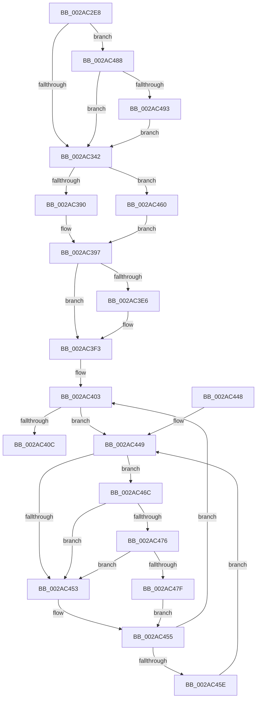

# MiInitializeTransitionPfn

- RVA: `0x002AC2E8`–`0x002AC4AD` (길이 `453` bytes)
- VA: `0x00000001402AC2E8`
- 실행 섹션: `.text`
- PDB 이름 있음: `예`; PDB Function 태그: `아니요`
- unwind 정보 RVA: `0x0006D13C`
- 디코드: `124`개 명령, `453/453` bytes 표시
- 미해석 바이트: `0` (있으면 어셈블리에 `.byte`로 보존)

> 이 문서는 커널 이미지의 기계어와 PDB 기호를 분석해 생성했습니다. 4번과 5번은 함수 원형과 자료형을 바이너리 사용 방식에서 추정한 C 해석이며 원본 소스 복구 결과는 아닙니다.

## 1. Dependencies

- 직접 호출 지점: **9**; 고유 호출 대상: **8**
- 직접 호출자로 확인된 함수: **4**
- RIP 상대 이미지 참조: **2**

### Outgoing calls
- `0x002AC320` → [MiGetContainingPageTable](../34/MiGetContainingPageTable_function_003467F0.md) (function, `0x003467F0`)
- `0x002AC332` → [MI_READ_PTE_LOCK_FREE](../28/MI_READ_PTE_LOCK_FREE_function_002828A0.md) (function, `0x002828A0`)
- `0x002AC361` → [MiSetPfnContainingFrame](../36/MiSetPfnContainingFrame_function_00363FC0.md) (function, `0x00363FC0`)
- `0x002AC3A5` → [MI_READ_PTE_LOCK_FREE](../28/MI_READ_PTE_LOCK_FREE_function_002828A0.md) (function, `0x002828A0`)
- `0x002AC3B6` → [MiProtectionToCacheAttribute](../2B/MiProtectionToCacheAttribute_function_002B8530.md) (function, `0x002B8530`)
- `0x002AC3C6` → [MiFinalizePageAttribute](../33/MiFinalizePageAttribute_function_00332E30.md) (function, `0x00332E30`)
- `0x002AC3EB` → [MiMakeTransitionPte](../36/MiMakeTransitionPte_function_00363F70.md) (function, `0x00363F70`)
- `0x002AC476` → [KiCheckVpBackingLongSpinWaitHypercall](../30/KiCheckVpBackingLongSpinWaitHypercall_function_0030F490.md) (function, `0x0030F490`)
- `0x002AC481` → [HvlNotifyLongSpinWait](../30/HvlNotifyLongSpinWait_function_0030F460.md) (function, `0x0030F460`)

### Direct callers
- [MiInitializeNewImageSectionProtos](MiInitializeNewImageSectionProtos_function_002ABB80.md) at `0x002ABD22`
- [MiInitializeImageProtos](MiInitializeImageProtos_function_002ABDAC.md) at `0x002ABFF1`
- [MiCopyDataPageToImagePage](MiCopyDataPageToImagePage_function_002AE818.md) at `0x002AEC02`
- [MiCopyFileOnlyGlobalSubsectionPage](../36/MiCopyFileOnlyGlobalSubsectionPage_function_0036A9EC.md) at `0x0036AAC2`

### Static image references
- `0x002AC44B` → RVA `0x00FC52AC` (`ALMOSTRO`; reference)
- `0x002AC46C` → RVA `0x00FC6AB8` (`ALMOSTRO`; read)

## 2. Other-region calls and transfers

- 다른 실행 섹션으로 향하는 call: **0**
- 별도 외부 분기/꼬리 이동을 확인하지 못했습니다.

## 3. Assembly (complete function range)

```asm
002AC2E8  48 89 5C 24 18                  mov qword ptr [rsp + 0x18], rbx
002AC2ED  55                              push rbp
002AC2EE  56                              push rsi
002AC2EF  57                              push rdi
002AC2F0  41 54                           push r12
002AC2F2  41 55                           push r13
002AC2F4  41 56                           push r14
002AC2F6  41 57                           push r15
002AC2F8  48 83 EC 20                     sub rsp, 0x20
002AC2FC  48 8D 1C 49                     lea rbx, [rcx + rcx*2]
002AC300  48 BD 00 00 00 00 00 DE FF FF   movabs rbp, 0xffffde0000000000
002AC30A  48 C1 E3 04                     shl rbx, 4
002AC30E  4D 8B F0                        mov r14, r8
002AC311  48 8B FA                        mov rdi, rdx
002AC314  4C 8B E1                        mov r12, rcx
002AC317  48 8B C5                        mov rax, rbp
002AC31A  48 8B CA                        mov rcx, rdx
002AC31D  48 03 D8                        add rbx, rax
002AC320  E8 CB A4 09 00                  call 0x1403467f0
002AC325  48 8B CF                        mov rcx, rdi
002AC328  48 C7 03 00 00 00 00            mov qword ptr [rbx], 0
002AC32F  4C 8B F8                        mov r15, rax
002AC332  E8 69 65 FD FF                  call 0x1402828a0
002AC337  48 0F BA E0 0A                  bt rax, 0xa
002AC33C  0F 83 46 01 00 00               jae 0x1402ac488
002AC342  48 89 43 10                     mov qword ptr [rbx + 0x10], rax
002AC346  48 B9 00 00 00 00 00 00 00 80   movabs rcx, 0x8000000000000000
002AC350  48 8B 43 28                     mov rax, qword ptr [rbx + 0x28]
002AC354  49 8B D7                        mov rdx, r15
002AC357  48 0B C1                        or rax, rcx
002AC35A  48 8B CB                        mov rcx, rbx
002AC35D  48 89 43 28                     mov qword ptr [rbx + 0x28], rax
002AC361  E8 5A 7C 0B 00                  call 0x140363fc0
002AC366  48 89 7B 08                     mov qword ptr [rbx + 8], rdi
002AC36A  48 B9 FF FF FF FF FF FF FF BF   movabs rcx, 0xbfffffffffffffff
002AC374  48 8B 43 18                     mov rax, qword ptr [rbx + 0x18]
002AC378  48 23 C1                        and rax, rcx
002AC37B  48 89 43 18                     mov qword ptr [rbx + 0x18], rax
002AC37F  F6 43 22 10                     test byte ptr [rbx + 0x22], 0x10
002AC383  8B 43 20                        mov eax, dword ptr [rbx + 0x20]
002AC386  89 44 24 60                     mov dword ptr [rsp + 0x60], eax
002AC38A  0F 85 D0 00 00 00               jne 0x1402ac460
002AC390  C1 E8 10                        shr eax, 0x10
002AC393  24 FA                           and al, 0xfa
002AC395  0C 02                           or al, 2
002AC397  88 44 24 62                     mov byte ptr [rsp + 0x62], al
002AC39B  48 8B CF                        mov rcx, rdi
002AC39E  8B 44 24 60                     mov eax, dword ptr [rsp + 0x60]
002AC3A2  89 43 20                        mov dword ptr [rbx + 0x20], eax
002AC3A5  E8 F6 64 FD FF                  call 0x1402828a0
002AC3AA  48 8B F0                        mov rsi, rax
002AC3AD  48 C1 EE 05                     shr rsi, 5
002AC3B1  83 E6 1F                        and esi, 0x1f
002AC3B4  8B CE                           mov ecx, esi
002AC3B6  E8 75 C1 00 00                  call 0x1402b8530
002AC3BB  8B D0                           mov edx, eax
002AC3BD  48 8B CB                        mov rcx, rbx
002AC3C0  41 B8 01 00 00 00               mov r8d, 1
002AC3C6  E8 65 6A 08 00                  call 0x140332e30
002AC3CB  48 8B 4B 18                     mov rcx, qword ptr [rbx + 0x18]
002AC3CF  49 BD 00 00 00 00 00 00 00 C0   movabs r13, 0xc000000000000000
002AC3D9  49 23 CD                        and rcx, r13
002AC3DC  48 89 4B 18                     mov qword ptr [rbx + 0x18], rcx
002AC3E0  49 83 FE FF                     cmp r14, -1
002AC3E4  75 0D                           jne 0x1402ac3f3
002AC3E6  8B D6                           mov edx, esi
002AC3E8  49 8B CC                        mov rcx, r12
002AC3EB  E8 80 7B 0B 00                  call 0x140363f70
002AC3F0  48 89 07                        mov qword ptr [rdi], rax
002AC3F3  4B 8D 1C 7F                     lea rbx, [r15 + r15*2]
002AC3F7  48 C1 E3 04                     shl rbx, 4
002AC3FB  48 8B C5                        mov rax, rbp
002AC3FE  48 03 D8                        add rbx, rax
002AC401  33 FF                           xor edi, edi
002AC403  F0 48 0F BA 6B 18 3F            lock bts qword ptr [rbx + 0x18], 0x3f
002AC40A  72 3D                           jb 0x1402ac449
002AC40C  48 8B 43 18                     mov rax, qword ptr [rbx + 0x18]
002AC410  48 8D 48 01                     lea rcx, [rax + 1]
002AC414  48 8B D1                        mov rdx, rcx
002AC417  48 33 D0                        xor rdx, rax
002AC41A  48 B8 FF FF FF FF FF FF FF 7F   movabs rax, 0x7fffffffffffffff
002AC424  49 23 D5                        and rdx, r13
002AC427  48 33 D1                        xor rdx, rcx
002AC42A  48 89 53 18                     mov qword ptr [rbx + 0x18], rdx
002AC42E  F0 48 21 43 18                  lock and qword ptr [rbx + 0x18], rax
002AC433  48 8B 5C 24 70                  mov rbx, qword ptr [rsp + 0x70]
002AC438  48 83 C4 20                     add rsp, 0x20
002AC43C  41 5F                           pop r15
002AC43E  41 5E                           pop r14
002AC440  41 5D                           pop r13
002AC442  41 5C                           pop r12
002AC444  5F                              pop rdi
002AC445  5E                              pop rsi
002AC446  5D                              pop rbp
002AC447  C3                              ret
002AC448  CC                              int3
002AC449  FF C7                           inc edi
002AC44B  85 3D 5B 8E D1 00               test dword ptr [rip + 0xd18e5b], edi
002AC451  74 19                           je 0x1402ac46c
002AC453  F3 90                           pause
002AC455  48 8B 43 18                     mov rax, qword ptr [rbx + 0x18]
002AC459  48 85 C0                        test rax, rax
002AC45C  79 A5                           jns 0x1402ac403
002AC45E  EB E9                           jmp 0x1402ac449
002AC460  C1 E8 10                        shr eax, 0x10
002AC463  24 FB                           and al, 0xfb
002AC465  0C 03                           or al, 3
002AC467  E9 2B FF FF FF                  jmp 0x1402ac397
002AC46C  8B 05 46 A6 D1 00               mov eax, dword ptr [rip + 0xd1a646]
002AC472  A8 40                           test al, 0x40
002AC474  74 DD                           je 0x1402ac453
002AC476  E8 15 30 06 00                  call 0x14030f490
002AC47B  84 C0                           test al, al
002AC47D  74 D4                           je 0x1402ac453
002AC47F  8B CF                           mov ecx, edi
002AC481  E8 DA 2F 06 00                  call 0x14030f460
002AC486  EB CD                           jmp 0x1402ac455
002AC488  48 0F BA E0 0B                  bt rax, 0xb
002AC48D  0F 83 AF FE FF FF               jae 0x1402ac342
002AC493  4B 8D 04 76                     lea rax, [r14 + r14*2]
002AC497  48 03 C0                        add rax, rax
002AC49A  48 B9 10 00 00 00 00 DE FF FF   movabs rcx, 0xffffde0000000010
002AC4A4  48 8B 04 C1                     mov rax, qword ptr [rcx + rax*8]
002AC4A8  E9 95 FE FF FF                  jmp 0x1402ac342
```

## 4. C-style interpretation (structured pseudocode)

```c
__int64 __fastcall MiInitializeTransitionPfn(__int64 a1, __int64 a2, __int64 a3)
{
    __int64 result;
    __int64 v_rbx;
    __int64 v_rdi;
    __int64 v_rsi;
    __int64 v_rsp;
    unsigned __int64 v_stack_p18;
    unsigned int v_stack_p8;
    unsigned __int8 v_stack_pA;

    v_stack_p18 = v_rbx;
    v_rsp = (v_rsp) - (32);
    v_rbx = (a1 + a1 * 2) << (4);
    v_rbx = (v_rbx) + (v_rbp);
    result = MiGetContainingPageTable(a2, a2, a3, a4);
    *(unsigned __int64 *)(v_rbx) = 0;
    result = MI_READ_PTE_LOCK_FREE(a2, a2, a3, a4);
    if (condition_is_above_or_equal) goto loc_002AC488;
loc_002AC342:
    *(unsigned __int64 *)(v_rbx + 16) = result;
    result = (*(unsigned __int64 *)(v_rbx + 40)) | (a2);
    *(unsigned __int64 *)(v_rbx + 40) = result;
    result = MiSetPfnContainingFrame(v_rbx, result, a3, a4);
    *(unsigned __int64 *)(v_rbx + 8) = a2;
    result = (*(unsigned __int64 *)(v_rbx + 24)) & (v_rbx);
    *(unsigned __int64 *)(v_rbx + 24) = result;
    v_stack_p8 = (unsigned int)((unsigned int)(*(unsigned int *)(v_rbx + 32)));
    if (((*(unsigned __int8 *)(v_rbx + 34)) & (16)) != 0) goto loc_002AC460;
    result = (unsigned int)(((unsigned int)(*(unsigned int *)(v_rbx + 32))) >> (16));
    result = (unsigned __int8)((result) & (250));
    result = (unsigned __int8)((result) | (2));
loc_002AC397:
    v_stack_pA = (unsigned __int8)(result);
    *(unsigned int *)(v_rbx + 32) = (unsigned int)((unsigned int)(v_stack_p8));
    result = MI_READ_PTE_LOCK_FREE(a2, result, a3, a4);
    v_rsi = (result) >> (5);
    v_rsi = (unsigned int)((v_rsi) & (31));
    result = MiProtectionToCacheAttribute((unsigned int)((unsigned int)(v_rsi)), result, a3, a4);
    result = MiFinalizePageAttribute(v_rbx, (unsigned int)((unsigned int)(result)), 1, a4);
    a1 = (*(unsigned __int64 *)(v_rbx + 24)) & (v_r13);
    *(unsigned __int64 *)(v_rbx + 24) = a1;
    if (a3 == -1) {
        a2 = (unsigned int)(v_rsi);
        a1 = a1;
        result = MiMakeTransitionPte(a1, a2, 1, a4);
        *(unsigned __int64 *)(a2) = result;
    }
    v_rbx = (result + result * 2) << (4);
    v_rbx = (v_rbx) + (v_rbp);
    v_rdi = 0;
loc_002AC403:
    if (condition_is_below) goto loc_002AC449;
    a2 = (*(unsigned __int64 *)(v_rbx + 24) + 1) ^ (*(unsigned __int64 *)(v_rbx + 24));
    a2 = (a2) & (v_r13);
    a2 = (a2) ^ (*(unsigned __int64 *)(v_rbx + 24) + 1);
    *(unsigned __int64 *)(v_rbx + 24) = a2;
    v_rsp = (v_rsp) + (32);
    return *(unsigned __int64 *)(v_rbx + 24);
loc_002AC449:
    v_rdi = (unsigned int)((v_rdi) + 1);
    if (((*(unsigned int *)(v_rip + 13733467)) & ((unsigned int)(v_rdi))) == 0) goto loc_002AC46C;
loc_002AC453:
loc_002AC455:
    if (!sign_flag) goto loc_002AC403;
    goto loc_002AC449;
loc_002AC460:
    result = (unsigned int)((*(unsigned __int64 *)(v_stack_p18 + 24)) >> (16));
    result = (unsigned __int8)((result) & (251));
    result = (unsigned __int8)((result) | (3));
    goto loc_002AC397;
loc_002AC46C:
    if ((((unsigned __int8)((unsigned int)(*(unsigned int *)(v_rip + 13739590)))) & (64)) == 0) goto loc_002AC453;
    result = KiCheckVpBackingLongSpinWaitHypercall(*(unsigned __int64 *)(v_rbx + 24) + 1, a2, 1, a4);
    if ((unsigned __int8)(result) == 0) goto loc_002AC453;
    result = HvlNotifyLongSpinWait((unsigned int)((unsigned int)(v_rdi)), a2, 1, a4);
    goto loc_002AC455;
loc_002AC488:
    if (condition_is_above_or_equal) goto loc_002AC342;
    result = (a3 + a3 * 2) + (a3 + a3 * 2);
    goto loc_002AC342;
}
```

## 5. (Beta) C Style

```c
int64_t MiInitializeTransitionPfn(void *Arg1, void *Arg2, void *Arg3)
{
    uint8_t *arg1 = (uint8_t *)Arg1;
    uint8_t *arg2 = (uint8_t *)Arg2;
    uint8_t *arg3 = (uint8_t *)Arg3;

    int64_t result;
    int64_t local_rbx;
    int64_t local_rdi;
    int64_t local_rsi;
    int64_t local_rsp;
    uint64_t v_stack_p18;
    uint32_t v_stack_p8;
    uint8_t v_stack_pA;

    v_stack_p18 = local_rbx;
    local_rsp = (local_rsp) - (32);
    local_rbx = (Arg1 + Arg1 * 2) << (4);
    local_rbx = (local_rbx) + (local_rbp);
    result = MiGetContainingPageTable(Arg2, Arg2, Arg3, a4);
    *(uint64_t *)(local_rbx) = 0;
    result = MI_READ_PTE_LOCK_FREE(Arg2, Arg2, Arg3, a4);
    if (condition_is_above_or_equal) goto loc_002AC488;
loc_002AC342:
    *(uint64_t *)(local_rbx + 0x10) = result;
    result = (*(uint64_t *)(local_rbx + 0x28)) | (Arg2);
    *(uint64_t *)(local_rbx + 0x28) = result;
    result = MiSetPfnContainingFrame(local_rbx, result, Arg3, a4);
    *(void **)(local_rbx + 0x8) = Arg2;
    result = (*(uint64_t *)(local_rbx + 0x18)) & (local_rbx);
    *(uint64_t *)(local_rbx + 0x18) = result;
    v_stack_p8 = (uint32_t)((uint32_t)(*(uint32_t *)(local_rbx + 0x20)));
    if (((*(uint8_t *)(local_rbx + 0x22)) & (16)) != 0) goto loc_002AC460;
    result = (uint32_t)(((uint32_t)(*(uint32_t *)(local_rbx + 0x20))) >> (16));
    result = (uint8_t)((result) & (250));
    result = (uint8_t)((result) | (2));
loc_002AC397:
    v_stack_pA = (uint8_t)(result);
    *(uint32_t *)(local_rbx + 0x20) = (uint32_t)((uint32_t)(v_stack_p8));
    result = MI_READ_PTE_LOCK_FREE(Arg2, result, Arg3, a4);
    local_rsi = (result) >> (5);
    local_rsi = (uint32_t)((local_rsi) & (31));
    result = MiProtectionToCacheAttribute((uint32_t)((uint32_t)(local_rsi)), result, Arg3, a4);
    result = MiFinalizePageAttribute(local_rbx, (uint32_t)((uint32_t)(result)), 1, a4);
    Arg1 = (*(uint64_t *)(local_rbx + 0x18)) & (local_r13);
    *(void **)(local_rbx + 0x18) = Arg1;
    if (Arg3 == -1) {
        Arg2 = (uint32_t)(local_rsi);
        Arg1 = Arg1;
        result = MiMakeTransitionPte(Arg1, Arg2, 1, a4);
        *(uint64_t *)(arg2) = result;
    }
    local_rbx = (result + result * 2) << (4);
    local_rbx = (local_rbx) + (local_rbp);
    local_rdi = 0;
loc_002AC403:
    if (condition_is_below) goto loc_002AC449;
    Arg2 = (*(uint64_t *)(local_rbx + 0x18) + 1) ^ (*(uint64_t *)(local_rbx + 0x18));
    Arg2 = (Arg2) & (local_r13);
    Arg2 = (Arg2) ^ (*(uint64_t *)(local_rbx + 0x18) + 1);
    *(void **)(local_rbx + 0x18) = Arg2;
    local_rsp = (local_rsp) + (32);
    return *(uint64_t *)(local_rbx + 0x18);
loc_002AC449:
    local_rdi = (uint32_t)((local_rdi) + 1);
    if (((*(uint32_t *)(v_rip + 0xD18E5B)) & ((uint32_t)(local_rdi))) == 0) goto loc_002AC46C;
loc_002AC453:
loc_002AC455:
    if (!sign_flag) goto loc_002AC403;
    goto loc_002AC449;
loc_002AC460:
    result = (uint32_t)((*(uint64_t *)(v_stack_p18 + 0x18)) >> (16));
    result = (uint8_t)((result) & (251));
    result = (uint8_t)((result) | (3));
    goto loc_002AC397;
loc_002AC46C:
    if ((((uint8_t)((uint32_t)(*(uint32_t *)(v_rip + 0xD1A646)))) & (64)) == 0) goto loc_002AC453;
    result = KiCheckVpBackingLongSpinWaitHypercall(*(uint64_t *)(local_rbx + 0x18) + 1, Arg2, 1, a4);
    if ((uint8_t)(result) == 0) goto loc_002AC453;
    result = HvlNotifyLongSpinWait((uint32_t)((uint32_t)(local_rdi)), Arg2, 1, a4);
    goto loc_002AC455;
loc_002AC488:
    if (condition_is_above_or_equal) goto loc_002AC342;
    result = (Arg3 + Arg3 * 2) + (Arg3 + Arg3 * 2);
    goto loc_002AC342;
}
```

### 관측된 메모리 오프셋

구조체 형식이 확인되지 않은 접근은 인자 기준의 오프셋으로만 기록했습니다.

| 기준 인자 | 오프셋 표현 | 폭 (bit) | 접근 |
|---|---:|---:|---|
| `Arg1` | `+ 0x0 + rcx*2` | `64` | `R` |
| `Arg2` | `+ 0x0` | `64` | `W` |
| `Arg3` | `+ 0x0 + r14*2` | `64` | `R` |

## 6. Execution-region graph

[열기: 2D/3D 그래프와 함수 탐색 컨트롤 패널](../../../control-panel.html?section=text&rva=0x002AC2E8&view=graph)

- 2D 그래프는 위에서 아래로 흐르고, 3D 그래프는 빈 공간을 드래그해 회전합니다. Shift+드래그는 이동, 휠은 확대·축소, 함수 노드 선택은 대상 보고서 이동입니다.

### Static fallback


