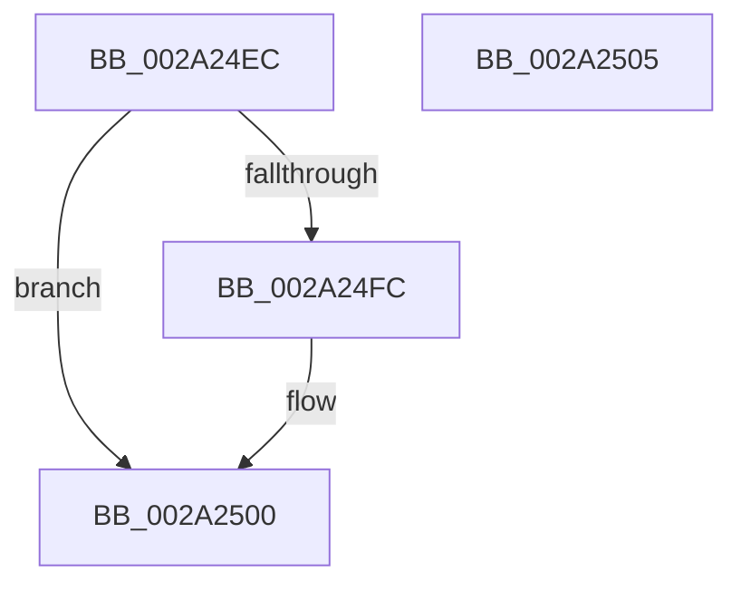

# MiInsertPageChainHead

- RVA: `0x002A24EC`–`0x002A2506` (길이 `26` bytes)
- VA: `0x00000001402A24EC`
- 실행 섹션: `.text`
- PDB 이름 있음: `예`; PDB Function 태그: `아니요`
- unwind 정보 RVA: `0x000DB714`
- 디코드: `9`개 명령, `26/26` bytes 표시
- 미해석 바이트: `0` (있으면 어셈블리에 `.byte`로 보존)

> 이 문서는 커널 이미지의 기계어와 PDB 기호를 분석해 생성했습니다. 4번과 5번은 함수 원형과 자료형을 바이너리 사용 방식에서 추정한 C 해석이며 원본 소스 복구 결과는 아닙니다.

## 1. Dependencies

- 직접 호출 지점: **0**; 고유 호출 대상: **0**
- 직접 호출자로 확인된 함수: **11**
- RIP 상대 이미지 참조: **0**

### Outgoing calls
- 직접 디코드된 call 명령이 없습니다.

### Direct callers
- [MiAddSystemPageTableToList](MiAddSystemPageTableToList_function_002A23A4.md) at `0x002A241C`
- [MiGetLargePageChain](../3B/MiGetLargePageChain_function_003B82D0.md) at `0x003B8416`
- [MiAllocateEnclavePages](../3B/MiAllocateEnclavePages_function_003BC43C.md) at `0x003BC647`
- [MiMapMdlWithLargePages](../4D/MiMapMdlWithLargePages_function_004D10B8.md) at `0x004D12AB`
- [MiSplitDirectMapPage](../4D/MiSplitDirectMapPage_function_004DAAA0.md) at `0x004DAD4E`
- [MiGetClusterPage](../4D/MiGetClusterPage_function_004DC57C.md) at `0x004DCA76`
- [MiInitializeDynamicBitmap](../67/MiInitializeDynamicBitmap_function_0067F5BC.md) at `0x0067F7F8`
- [MiAddExpansionNonPagedPool](../68/MiAddExpansionNonPagedPool_function_00682B4C.md) at `0x00682C87`
- [MiCaptureSparsePages](../../page/80/MiCaptureSparsePages_function_0080BAF8.md) at `0x0080BB7E`
- [MiPfPrepareReadList](../../page/93/MiPfPrepareReadList_function_0093CD5C.md) at `0x0093D250`
- [sub_00B25214](../../page/B2/Unknown_function_00B25214.md) at `0x00B25294`

### Static image references
- 디코드된 RIP-relative 메모리 참조가 없습니다.

## 2. Other-region calls and transfers

- 다른 실행 섹션으로 향하는 call: **0**
- 별도 외부 분기/꼬리 이동을 확인하지 못했습니다.

## 3. Assembly (complete function range)

```asm
002A24EC  48 8B 01                        mov rax, qword ptr [rcx]
002A24EF  48 89 02                        mov qword ptr [rdx], rax
002A24F2  48 83 79 08 00                  cmp qword ptr [rcx + 8], 0
002A24F7  48 89 11                        mov qword ptr [rcx], rdx
002A24FA  75 04                           jne 0x1402a2500
002A24FC  48 89 51 08                     mov qword ptr [rcx + 8], rdx
002A2500  48 FF 41 10                     inc qword ptr [rcx + 0x10]
002A2504  C3                              ret
002A2505  CC                              int3
```

## 4. C-style interpretation (structured pseudocode)

```c
__int64 __fastcall MiInsertPageChainHead(__int64 a1, __int64 a2)
{
    *(unsigned __int64 *)(a2) = *(unsigned __int64 *)(a1);
    *(unsigned __int64 *)(a1) = a2;
    if ((*(unsigned __int64 *)(a1 + 8)) == 0) {
        *(unsigned __int64 *)(a1 + 8) = a2;
    }
    return *(unsigned __int64 *)(a1);
}
```

## 5. (Beta) C Style

```c
int64_t MiInsertPageChainHead(void *Arg1, void *Arg2)
{
    uint8_t *arg1 = (uint8_t *)Arg1;
    uint8_t *arg2 = (uint8_t *)Arg2;

    *(uint64_t *)(arg2) = *(uint64_t *)(arg1);
    *(void **)(arg1) = Arg2;
    if ((*(uint64_t *)(arg1 + 0x8)) == 0) {
        *(void **)(arg1 + 0x8) = Arg2;
    }
    return *(uint64_t *)(arg1);
}
```

### 관측된 메모리 오프셋

구조체 형식이 확인되지 않은 접근은 인자 기준의 오프셋으로만 기록했습니다.

| 기준 인자 | 오프셋 표현 | 폭 (bit) | 접근 |
|---|---:|---:|---|
| `Arg1` | `+ 0x0` | `64` | `R` |
| `Arg1` | `+ 0x0` | `64` | `W` |
| `Arg1` | `+ 0x8` | `64` | `R` |
| `Arg1` | `+ 0x8` | `64` | `W` |
| `Arg1` | `+ 0x10` | `64` | `R/W` |
| `Arg2` | `+ 0x0` | `64` | `W` |

## 6. Execution-region graph

[열기: 2D/3D 그래프와 함수 탐색 컨트롤 패널](../../../control-panel.html?section=text&rva=0x002A24EC&view=graph)

- 2D 그래프는 위에서 아래로 흐르고, 3D 그래프는 빈 공간을 드래그해 회전합니다. Shift+드래그는 이동, 휠은 확대·축소, 함수 노드 선택은 대상 보고서 이동입니다.

### Static fallback


