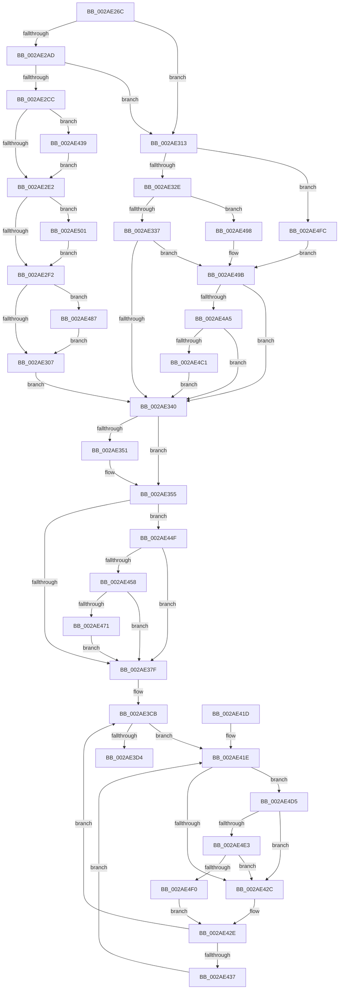

# MiInsertPhysicalPteMapping

- RVA: `0x002AE26C`–`0x002AE511` (길이 `677` bytes)
- VA: `0x00000001402AE26C`
- 실행 섹션: `.text`
- PDB 이름 있음: `예`; PDB Function 태그: `아니요`
- unwind 정보 RVA: `0x0006D458`
- 디코드: `168`개 명령, `677/677` bytes 표시
- 미해석 바이트: `0` (있으면 어셈블리에 `.byte`로 보존)

> 이 문서는 커널 이미지의 기계어와 PDB 기호를 분석해 생성했습니다. 4번과 5번은 함수 원형과 자료형을 바이너리 사용 방식에서 추정한 C 해석이며 원본 소스 복구 결과는 아닙니다.

## 1. Dependencies

- 직접 호출 지점: **13**; 고유 호출 대상: **13**
- 직접 호출자로 확인된 함수: **2**
- RIP 상대 이미지 참조: **4**

### Outgoing calls
- `0x002AE292` → [MiProtectionToCacheAttribute](../2B/MiProtectionToCacheAttribute_function_002B8530.md) (function, `0x002B8530`)
- `0x002AE31B` → [MiLookupIoPageNode](MiLookupIoPageNode_function_002AC5C8.md) (function, `0x002AC5C8`)
- `0x002AE35E` → [MiMakeValidPte](../2C/MiMakeValidPte_function_002C5590.md) (function, `0x002C5590`)
- `0x002AE3A6` → [MiIncreaseUsedPtes](../24/MiIncreaseUsedPtes_function_00243630.md) (function, `0x00243630`)
- `0x002AE3AE` → [MiGetContainingPageTable](../34/MiGetContainingPageTable_function_003467F0.md) (function, `0x003467F0`)
- `0x002AE445` → [MiShowBadMapper](../2F/MiShowBadMapper_function_002F1840.md) (function, `0x002F1840`)
- `0x002AE47D` → [MiCheckLinearProtectedPteAccessedBit](../29/MiCheckLinearProtectedPteAccessedBit_function_00292D80.md) (function, `0x00292D80`)
- `0x002AE48C` → [MiMakeProtectionPfnCompatible](../22/MiMakeProtectionPfnCompatible_function_00229CD0.md) (function, `0x00229CD0`)
- `0x002AE4A5` → [KeChangeMemoryAttributes](../30/KeChangeMemoryAttributes_function_00304D08.md) (function, `0x00304D08`)
- `0x002AE4C6` → [MiLocateLockedVadEvent](MiLocateLockedVadEvent_function_002A7A0C.md) (function, `0x002A7A0C`)
- `0x002AE4E3` → [KiCheckVpBackingLongSpinWaitHypercall](../30/KiCheckVpBackingLongSpinWaitHypercall_function_0030F490.md) (function, `0x0030F490`)
- `0x002AE4F2` → [HvlNotifyLongSpinWait](../30/HvlNotifyLongSpinWait_function_0030F460.md) (function, `0x0030F460`)
- `0x002AE507` → [MiAssignInitialPageAttribute](../3B/MiAssignInitialPageAttribute_function_003B472C.md) (function, `0x003B472C`)

### Direct callers
- [MiInsertViewOfPhysicalSection](MiInsertViewOfPhysicalSection_function_002A57E0.md) at `0x002A58F8`
- [MiMapLockedPagesInUserSpaceHelper](MiMapLockedPagesInUserSpaceHelper_function_002ADFE0.md) at `0x002AE109`

### Static image references
- `0x002AE297` → RVA `0x00E2DCE0` (`.data`; read)
- `0x002AE363` → RVA `0x00FC6A88` (`ALMOSTRO`; read)
- `0x002AE420` → RVA `0x00FC52AC` (`ALMOSTRO`; reference)
- `0x002AE4D5` → RVA `0x00FC6AB8` (`ALMOSTRO`; read)

## 2. Other-region calls and transfers

- 다른 실행 섹션으로 향하는 call: **0**
- 별도 외부 분기/꼬리 이동을 확인하지 못했습니다.

## 3. Assembly (complete function range)

```asm
002AE26C  48 89 5C 24 10                  mov qword ptr [rsp + 0x10], rbx
002AE271  48 89 6C 24 18                  mov qword ptr [rsp + 0x18], rbp
002AE276  56                              push rsi
002AE277  57                              push rdi
002AE278  41 54                           push r12
002AE27A  41 56                           push r14
002AE27C  41 57                           push r15
002AE27E  48 83 EC 20                     sub rsp, 0x20
002AE282  4C 8B 79 08                     mov r15, qword ptr [rcx + 8]
002AE286  48 8B F9                        mov rdi, rcx
002AE289  48 8B 71 10                     mov rsi, qword ptr [rcx + 0x10]
002AE28D  8B 59 18                        mov ebx, dword ptr [rcx + 0x18]
002AE290  8B CB                           mov ecx, ebx
002AE292  E8 99 A2 00 00                  call 0x1402b8530
002AE297  48 3B 35 42 FA B7 00            cmp rsi, qword ptr [rip + 0xb7fa42]
002AE29E  44 8B E0                        mov r12d, eax
002AE2A1  48 BD 00 00 00 00 00 DE FF FF   movabs rbp, 0xffffde0000000000
002AE2AB  77 66                           ja 0x1402ae313
002AE2AD  48 8D 14 76                     lea rdx, [rsi + rsi*2]
002AE2B1  48 03 D2                        add rdx, rdx
002AE2B4  48 B9 28 00 00 00 00 DE FF FF   movabs rcx, 0xffffde0000000028
002AE2BE  48 8B 0C D1                     mov rcx, qword ptr [rcx + rdx*8]
002AE2C2  48 C1 E9 36                     shr rcx, 0x36
002AE2C6  0F BA E1 00                     bt ecx, 0
002AE2CA  73 47                           jae 0x1402ae313
002AE2CC  48 8B C5                        mov rax, rbp
002AE2CF  48 8D 2C D0                     lea rbp, [rax + rdx*8]
002AE2D3  45 33 F6                        xor r14d, r14d
002AE2D6  8B 45 20                        mov eax, dword ptr [rbp + 0x20]
002AE2D9  66 85 C0                        test ax, ax
002AE2DC  0F 84 57 01 00 00               je 0x1402ae439
002AE2E2  8B 45 20                        mov eax, dword ptr [rbp + 0x20]
002AE2E5  C1 E8 10                        shr eax, 0x10
002AE2E8  24 C0                           and al, 0xc0
002AE2EA  3C C0                           cmp al, 0xc0
002AE2EC  0F 84 0F 02 00 00               je 0x1402ae501
002AE2F2  8B 45 20                        mov eax, dword ptr [rbp + 0x20]
002AE2F5  C1 E8 10                        shr eax, 0x10
002AE2F8  0F B6 D0                        movzx edx, al
002AE2FB  C1 EA 06                        shr edx, 6
002AE2FE  41 3B D4                        cmp edx, r12d
002AE301  0F 85 80 01 00 00               jne 0x1402ae487
002AE307  48 BD 00 00 00 00 00 DE FF FF   movabs rbp, 0xffffde0000000000
002AE311  EB 2D                           jmp 0x1402ae340
002AE313  BA 01 00 00 00                  mov edx, 1
002AE318  48 8B CE                        mov rcx, rsi
002AE31B  E8 A8 E2 FF FF                  call 0x1402ac5c8
002AE320  83 E3 07                        and ebx, 7
002AE323  45 33 F6                        xor r14d, r14d
002AE326  85 C0                           test eax, eax
002AE328  0F 84 CE 01 00 00               je 0x1402ae4fc
002AE32E  83 F8 02                        cmp eax, 2
002AE331  0F 84 61 01 00 00               je 0x1402ae498
002AE337  83 F8 01                        cmp eax, 1
002AE33A  0F 85 5B 01 00 00               jne 0x1402ae49b
002AE340  48 8B 07                        mov rax, qword ptr [rdi]
002AE343  8B 48 30                        mov ecx, dword ptr [rax + 0x30]
002AE346  B8 00 00 60 00                  mov eax, 0x600000
002AE34B  23 C8                           and ecx, eax
002AE34D  3B C8                           cmp ecx, eax
002AE34F  74 04                           je 0x1402ae355
002AE351  0F BA EB 1F                     bts ebx, 0x1f
002AE355  44 8B C3                        mov r8d, ebx
002AE358  48 8B D6                        mov rdx, rsi
002AE35B  49 8B CF                        mov rcx, r15
002AE35E  E8 2D 72 01 00                  call 0x1402c5590
002AE363  48 0F BA 25 1C 87 D1 00 24      bt qword ptr [rip + 0xd1871c], 0x24
002AE36C  48 BF 00 00 00 00 80 F6 FF FF   movabs rdi, 0xfffff68000000000
002AE376  48 8B D8                        mov rbx, rax
002AE379  0F 82 D0 00 00 00               jb 0x1402ae44f
002AE37F  49 8B D7                        mov rdx, r15
002AE382  49 89 1F                        mov qword ptr [r15], rbx
002AE385  48 C1 EA 09                     shr rdx, 9
002AE389  48 B8 F8 FF FF FF 7F 00 00 00   movabs rax, 0x7ffffffff8
002AE393  48 23 D0                        and rdx, rax
002AE396  48 8B C7                        mov rax, rdi
002AE399  41 B9 02 00 00 00               mov r9d, 2
002AE39F  48 03 D0                        add rdx, rax
002AE3A2  45 8D 41 FF                     lea r8d, [r9 - 1]
002AE3A6  E8 85 52 F9 FF                  call 0x140243630
002AE3AB  49 8B CF                        mov rcx, r15
002AE3AE  E8 3D 84 09 00                  call 0x1403467f0
002AE3B3  48 8D 1C 40                     lea rbx, [rax + rax*2]
002AE3B7  48 C1 E3 04                     shl rbx, 4
002AE3BB  48 8B F5                        mov rsi, rbp
002AE3BE  41 8B FE                        mov edi, r14d
002AE3C1  48 BD 18 00 00 00 00 DE FF FF   movabs rbp, 0xffffde0000000018
002AE3CB  F0 48 0F BA 2C 2B 3F            lock bts qword ptr [rbx + rbp], 0x3f
002AE3D2  72 4A                           jb 0x1402ae41e
002AE3D4  48 8B 04 2B                     mov rax, qword ptr [rbx + rbp]
002AE3D8  48 8D 48 01                     lea rcx, [rax + 1]
002AE3DC  48 8B D1                        mov rdx, rcx
002AE3DF  48 33 D0                        xor rdx, rax
002AE3E2  48 B8 00 00 00 00 00 00 00 C0   movabs rax, 0xc000000000000000
002AE3EC  48 23 D0                        and rdx, rax
002AE3EF  48 B8 FF FF FF FF FF FF FF 7F   movabs rax, 0x7fffffffffffffff
002AE3F9  48 33 D1                        xor rdx, rcx
002AE3FC  48 89 54 33 18                  mov qword ptr [rbx + rsi + 0x18], rdx
002AE401  F0 48 21 04 2B                  lock and qword ptr [rbx + rbp], rax
002AE406  48 8B 5C 24 58                  mov rbx, qword ptr [rsp + 0x58]
002AE40B  48 8B 6C 24 60                  mov rbp, qword ptr [rsp + 0x60]
002AE410  48 83 C4 20                     add rsp, 0x20
002AE414  41 5F                           pop r15
002AE416  41 5E                           pop r14
002AE418  41 5C                           pop r12
002AE41A  5F                              pop rdi
002AE41B  5E                              pop rsi
002AE41C  C3                              ret
002AE41D  CC                              int3
002AE41E  FF C7                           inc edi
002AE420  85 3D 86 6E D1 00               test dword ptr [rip + 0xd16e86], edi
002AE426  0F 84 A9 00 00 00               je 0x1402ae4d5
002AE42C  F3 90                           pause
002AE42E  48 8B 04 2B                     mov rax, qword ptr [rbx + rbp]
002AE432  48 85 C0                        test rax, rax
002AE435  79 94                           jns 0x1402ae3cb
002AE437  EB E5                           jmp 0x1402ae41e
002AE439  BA 03 00 00 00                  mov edx, 3
002AE43E  48 8B CE                        mov rcx, rsi
002AE441  44 8D 42 FF                     lea r8d, [rdx - 1]
002AE445  E8 F6 33 04 00                  call 0x1402f1840
002AE44A  E9 93 FE FF FF                  jmp 0x1402ae2e2
002AE44F  F6 C3 20                        test bl, 0x20
002AE452  0F 85 27 FF FF FF               jne 0x1402ae37f
002AE458  48 8B C7                        mov rax, rdi
002AE45B  48 B9 00 00 00 00 40 00 00 00   movabs rcx, 0x4000000000
002AE465  48 03 C1                        add rax, rcx
002AE468  4C 3B F8                        cmp r15, rax
002AE46B  0F 82 0E FF FF FF               jb 0x1402ae37f
002AE471  41 B8 80 00 00 00               mov r8d, 0x80
002AE477  48 8B D3                        mov rdx, rbx
002AE47A  49 8B CF                        mov rcx, r15
002AE47D  E8 FE 48 FE FF                  call 0x140292d80
002AE482  E9 F8 FE FF FF                  jmp 0x1402ae37f
002AE487  48 8B D5                        mov rdx, rbp
002AE48A  8B CB                           mov ecx, ebx
002AE48C  E8 3F B8 F7 FF                  call 0x140229cd0
002AE491  8B D8                           mov ebx, eax
002AE493  E9 6F FE FF FF                  jmp 0x1402ae307
002AE498  83 CB 18                        or ebx, 0x18
002AE49B  44 39 77 1C                     cmp dword ptr [rdi + 0x1c], r14d
002AE49F  0F 85 9B FE FF FF               jne 0x1402ae340
002AE4A5  E8 5E 68 05 00                  call 0x140304d08
002AE4AA  48 8B 0F                        mov rcx, qword ptr [rdi]
002AE4AD  C7 47 1C 01 00 00 00            mov dword ptr [rdi + 0x1c], 1
002AE4B4  8B 41 30                        mov eax, dword ptr [rcx + 0x30]
002AE4B7  24 70                           and al, 0x70
002AE4B9  3C 40                           cmp al, 0x40
002AE4BB  0F 85 7F FE FF FF               jne 0x1402ae340
002AE4C1  BA 08 00 00 00                  mov edx, 8
002AE4C6  E8 41 95 FF FF                  call 0x1402a7a0c
002AE4CB  F0 83 48 54 01                  lock or dword ptr [rax + 0x54], 1
002AE4D0  E9 6B FE FF FF                  jmp 0x1402ae340
002AE4D5  8B 05 DD 85 D1 00               mov eax, dword ptr [rip + 0xd185dd]
002AE4DB  A8 40                           test al, 0x40
002AE4DD  0F 84 49 FF FF FF               je 0x1402ae42c
002AE4E3  E8 A8 0F 06 00                  call 0x14030f490
002AE4E8  84 C0                           test al, al
002AE4EA  0F 84 3C FF FF FF               je 0x1402ae42c
002AE4F0  8B CF                           mov ecx, edi
002AE4F2  E8 69 0F 06 00                  call 0x14030f460
002AE4F7  E9 32 FF FF FF                  jmp 0x1402ae42e
002AE4FC  83 CB 10                        or ebx, 0x10
002AE4FF  EB 9A                           jmp 0x1402ae49b
002AE501  41 8B D4                        mov edx, r12d
002AE504  48 8B CD                        mov rcx, rbp
002AE507  E8 20 62 10 00                  call 0x1403b472c
002AE50C  E9 E1 FD FF FF                  jmp 0x1402ae2f2
```

## 4. C-style interpretation (structured pseudocode)

```c
__int64 __fastcall MiInsertPhysicalPteMapping(__int64 a1)
{
    __int64 result;
    __int64 v_r14;
    __int64 v_rbx;
    __int64 v_rdi;
    __int64 v_rsp;
    unsigned __int64 v_stack_p10;
    unsigned __int64 v_stack_p18;

    v_stack_p10 = v_rbx;
    v_stack_p18 = v_rbp;
    v_rsp = (v_rsp) - (32);
    result = MiProtectionToCacheAttribute((unsigned int)((unsigned int)((unsigned int)(*(unsigned int *)(a1 + 24)))), a2, a3, a4);
    if ((*(unsigned __int64 *)(a1 + 16)) > (*(unsigned __int64 *)(v_rip + 12057154))) goto loc_002AE313;
    a2 = (*(unsigned __int64 *)(a1 + 16) + *(unsigned __int64 *)(a1 + 16) * 2) + (*(unsigned __int64 *)(a1 + 16) + *(unsigned __int64 *)(a1 + 16) * 2);
    a1 = (*(unsigned __int64 *)((unsigned int)((unsigned int)((unsigned int)(*(unsigned int *)(a1 + 24)))) + a2 * 8)) >> (54);
    if (condition_is_above_or_equal) goto loc_002AE313;
    v_r14 = 0;
    if ((unsigned __int16)((unsigned int)(*(unsigned int *)(v_rbp + a2 * 8 + 32))) == 0) goto loc_002AE439;
loc_002AE2E2:
    result = (unsigned int)(((unsigned int)(*(unsigned int *)(v_rbp + a2 * 8 + 32))) >> (16));
    result = (unsigned __int8)((result) & (192));
    if (((unsigned __int8)(result)) == 192) goto loc_002AE501;
loc_002AE2F2:
    result = (unsigned int)(((unsigned int)(*(unsigned int *)(v_rbp + a2 * 8 + 32))) >> (16));
    a2 = (unsigned int)(((unsigned __int8)(result)) >> (6));
    if (((unsigned int)(a2)) != ((unsigned int)((unsigned int)((unsigned int)(result))))) goto loc_002AE487;
loc_002AE307:
    goto loc_002AE340;
loc_002AE313:
    result = MiLookupIoPageNode(*(unsigned __int64 *)(a1 + 16), 1, a3, a4);
    v_rbx = (unsigned int)(((unsigned int)(*(unsigned int *)(a1 + 24))) & (7));
    v_r14 = 0;
    if ((unsigned int)(result) == 0) goto loc_002AE4FC;
    if (((unsigned int)(result)) == 2) goto loc_002AE498;
    if (((unsigned int)(result)) != 1) goto loc_002AE49B;
loc_002AE340:
    a1 = (unsigned int)(((unsigned int)(*(unsigned int *)(*(unsigned __int64 *)(a1) + 48))) & ((unsigned int)((unsigned int)(0x600000ULL))));
    if (((unsigned int)(a1)) != ((unsigned int)((unsigned int)(0x600000ULL)))) {
    }
    result = MiMakeValidPte(*(unsigned __int64 *)(a1 + 8), *(unsigned __int64 *)(a1 + 16), (unsigned int)((unsigned int)(v_rbx)), a4);
    if (((unsigned int)(a1)) < ((unsigned int)((unsigned int)(0x600000ULL)))) goto loc_002AE44F;
loc_002AE37F:
    *(unsigned __int64 *)(*(unsigned __int64 *)(a1 + 8)) = result;
    a2 = (*(unsigned __int64 *)(a1 + 8)) >> (9);
    a2 = (a2) & (result);
    a2 = (a2) + (a1);
    result = MiIncreaseUsedPtes(*(unsigned __int64 *)(a1 + 8), a2, 2 - 1, 2);
    result = MiGetContainingPageTable(*(unsigned __int64 *)(a1 + 8), a2, 2 - 1, 2);
    v_rbx = (result + result * 2) << (4);
loc_002AE3CB:
    if (condition_is_below) goto loc_002AE41E;
    a2 = (*(unsigned __int64 *)(v_rbx + v_rbp + a2 * 8 * 1) + 1) ^ (*(unsigned __int64 *)(v_rbx + v_rbp + a2 * 8 * 1));
    a2 = (a2) & (*(unsigned __int64 *)(v_rbx + v_rbp + a2 * 8 * 1));
    a2 = (a2) ^ (*(unsigned __int64 *)(v_rbx + v_rbp + a2 * 8 * 1) + 1);
    *(unsigned __int64 *)(v_rbx + v_rbp + a2 * 8 * 1 + 24) = a2;
    v_rsp = (v_rsp) + (32);
    return *(unsigned __int64 *)(v_rbx + v_rbp + a2 * 8 * 1);
loc_002AE41E:
    v_rdi = (unsigned int)((0) + 1);
    if (((*(unsigned int *)(v_rip + 13725318)) & ((unsigned int)(v_rdi))) == 0) goto loc_002AE4D5;
loc_002AE42C:
loc_002AE42E:
    if (!sign_flag) goto loc_002AE3CB;
    goto loc_002AE41E;
loc_002AE439:
    result = MiShowBadMapper(v_rbp + a2 * 8, 3, 3 - 1, 2);
    goto loc_002AE2E2;
loc_002AE44F:
    if ((((unsigned __int8)(v_stack_p10)) & (32)) != 0) goto loc_002AE37F;
    result = (v_rdi) + (v_rbp + a2 * 8);
    if ((*(unsigned __int64 *)(a1 + 8)) < result) goto loc_002AE37F;
    result = MiCheckLinearProtectedPteAccessedBit(*(unsigned __int64 *)(a1 + 8), v_stack_p10, 128, 2);
    goto loc_002AE37F;
loc_002AE487:
    result = MiMakeProtectionPfnCompatible((unsigned int)((unsigned int)(v_stack_p10)), v_stack_p18, 128, 2);
    goto loc_002AE307;
loc_002AE498:
    v_rbx = (unsigned int)(((unsigned int)((unsigned int)(result))) | (24));
loc_002AE49B:
    if ((*(unsigned int *)(v_rdi + 28)) != 0) goto loc_002AE340;
    result = KeChangeMemoryAttributes((unsigned int)((unsigned int)(v_stack_p10)), v_stack_p18, 128, 2);
    *(unsigned int *)(v_rdi + 28) = 1;
    result = (unsigned __int8)(((unsigned int)(*(unsigned int *)(*(unsigned __int64 *)(v_rdi) + 48))) & (112));
    if (((unsigned __int8)(result)) != 64) goto loc_002AE340;
    result = MiLocateLockedVadEvent(*(unsigned __int64 *)(v_rdi), 8, 128, 2);
    goto loc_002AE340;
loc_002AE4D5:
    if ((((unsigned __int8)((unsigned int)(*(unsigned int *)(v_rip + 13731293)))) & (64)) == 0) goto loc_002AE42C;
    result = KiCheckVpBackingLongSpinWaitHypercall(*(unsigned __int64 *)(v_rdi), 8, 128, 2);
    if ((unsigned __int8)(result) == 0) goto loc_002AE42C;
    result = HvlNotifyLongSpinWait((unsigned int)((unsigned int)(v_rdi)), 8, 128, 2);
    goto loc_002AE42E;
loc_002AE4FC:
    v_rbx = (unsigned int)((v_rbx) | (16));
    goto loc_002AE49B;
loc_002AE501:
    result = MiAssignInitialPageAttribute(v_stack_p18, (unsigned int)((unsigned int)((unsigned int)((unsigned int)(result)))), 128, 2);
    goto loc_002AE2F2;
}
```

## 5. (Beta) C Style

```c
int64_t MiInsertPhysicalPteMapping(void *Arg1)
{
    uint8_t *arg1 = (uint8_t *)Arg1;

    int64_t result;
    int64_t local_r14;
    int64_t local_rbx;
    int64_t local_rdi;
    int64_t local_rsp;
    uint64_t v_stack_p10;
    uint64_t v_stack_p18;

    v_stack_p10 = local_rbx;
    v_stack_p18 = local_rbp;
    local_rsp = (local_rsp) - (32);
    result = MiProtectionToCacheAttribute((uint32_t)((uint32_t)((uint32_t)(*(uint32_t *)(arg1 + 0x18)))), a2, a3, a4);
    if ((*(uint64_t *)(arg1 + 0x10)) > (*(uint64_t *)(v_rip + 0xB7FA42))) goto loc_002AE313;
    a2 = (*(uint64_t *)(arg1 + 0x10) + *(uint64_t *)(arg1 + 0x10) * 2) + (*(uint64_t *)(arg1 + 0x10) + *(uint64_t *)(arg1 + 0x10) * 2);
    Arg1 = (*(uint64_t *)((uint32_t)((uint32_t)((uint32_t)(*(uint32_t *)(arg1 + 0x18)))) + a2 * 8)) >> (54);
    if (condition_is_above_or_equal) goto loc_002AE313;
    local_r14 = 0;
    if ((uint16_t)((uint32_t)(*(uint32_t *)(local_rbp + a2 * 8 + 0x20))) == 0) goto loc_002AE439;
loc_002AE2E2:
    result = (uint32_t)(((uint32_t)(*(uint32_t *)(local_rbp + a2 * 8 + 0x20))) >> (16));
    result = (uint8_t)((result) & (192));
    if (((uint8_t)(result)) == 192) goto loc_002AE501;
loc_002AE2F2:
    result = (uint32_t)(((uint32_t)(*(uint32_t *)(local_rbp + a2 * 8 + 0x20))) >> (16));
    a2 = (uint32_t)(((uint8_t)(result)) >> (6));
    if (((uint32_t)(a2)) != ((uint32_t)((uint32_t)((uint32_t)(result))))) goto loc_002AE487;
loc_002AE307:
    goto loc_002AE340;
loc_002AE313:
    result = MiLookupIoPageNode(*(uint64_t *)(arg1 + 0x10), 1, a3, a4);
    local_rbx = (uint32_t)(((uint32_t)(*(uint32_t *)(arg1 + 0x18))) & (7));
    local_r14 = 0;
    if ((uint32_t)(result) == 0) goto loc_002AE4FC;
    if (((uint32_t)(result)) == 2) goto loc_002AE498;
    if (((uint32_t)(result)) != 1) goto loc_002AE49B;
loc_002AE340:
    Arg1 = (uint32_t)(((uint32_t)(*(uint32_t *)(*(uint64_t *)(arg1) + 0x30))) & ((uint32_t)((uint32_t)(0x600000ULL))));
    if (((uint32_t)(Arg1)) != ((uint32_t)((uint32_t)(0x600000ULL)))) {
    }
    result = MiMakeValidPte(*(uint64_t *)(arg1 + 0x8), *(uint64_t *)(arg1 + 0x10), (uint32_t)((uint32_t)(local_rbx)), a4);
    if (((uint32_t)(Arg1)) < ((uint32_t)((uint32_t)(0x600000ULL)))) goto loc_002AE44F;
loc_002AE37F:
    *(uint64_t *)(*(uint64_t *)(arg1 + 0x8)) = result;
    a2 = (*(uint64_t *)(arg1 + 0x8)) >> (9);
    a2 = (a2) & (result);
    a2 = (a2) + (Arg1);
    result = MiIncreaseUsedPtes(*(uint64_t *)(arg1 + 0x8), a2, 2 - 1, 2);
    result = MiGetContainingPageTable(*(uint64_t *)(arg1 + 0x8), a2, 2 - 1, 2);
    local_rbx = (result + result * 2) << (4);
loc_002AE3CB:
    if (condition_is_below) goto loc_002AE41E;
    a2 = (*(uint64_t *)(local_rbx + local_rbp + a2 * 8 * 1) + 1) ^ (*(uint64_t *)(local_rbx + local_rbp + a2 * 8 * 1));
    a2 = (a2) & (*(uint64_t *)(local_rbx + local_rbp + a2 * 8 * 1));
    a2 = (a2) ^ (*(uint64_t *)(local_rbx + local_rbp + a2 * 8 * 1) + 1);
    *(uint64_t *)(local_rbx + local_rbp + a2 * 8 * 1 + 0x18) = a2;
    local_rsp = (local_rsp) + (32);
    return *(uint64_t *)(local_rbx + local_rbp + a2 * 8 * 1);
loc_002AE41E:
    local_rdi = (uint32_t)((0) + 1);
    if (((*(uint32_t *)(v_rip + 0xD16E86)) & ((uint32_t)(local_rdi))) == 0) goto loc_002AE4D5;
loc_002AE42C:
loc_002AE42E:
    if (!sign_flag) goto loc_002AE3CB;
    goto loc_002AE41E;
loc_002AE439:
    result = MiShowBadMapper(local_rbp + a2 * 8, 3, 3 - 1, 2);
    goto loc_002AE2E2;
loc_002AE44F:
    if ((((uint8_t)(v_stack_p10)) & (32)) != 0) goto loc_002AE37F;
    result = (local_rdi) + (local_rbp + a2 * 8);
    if ((*(uint64_t *)(arg1 + 0x8)) < result) goto loc_002AE37F;
    result = MiCheckLinearProtectedPteAccessedBit(*(uint64_t *)(arg1 + 0x8), v_stack_p10, 128, 2);
    goto loc_002AE37F;
loc_002AE487:
    result = MiMakeProtectionPfnCompatible((uint32_t)((uint32_t)(v_stack_p10)), v_stack_p18, 128, 2);
    goto loc_002AE307;
loc_002AE498:
    local_rbx = (uint32_t)(((uint32_t)((uint32_t)(result))) | (24));
loc_002AE49B:
    if ((*(uint32_t *)(local_rdi + 0x1C)) != 0) goto loc_002AE340;
    result = KeChangeMemoryAttributes((uint32_t)((uint32_t)(v_stack_p10)), v_stack_p18, 128, 2);
    *(uint32_t *)(local_rdi + 0x1C) = 1;
    result = (uint8_t)(((uint32_t)(*(uint32_t *)(*(uint64_t *)(local_rdi) + 0x30))) & (112));
    if (((uint8_t)(result)) != 64) goto loc_002AE340;
    result = MiLocateLockedVadEvent(*(uint64_t *)(local_rdi), 8, 128, 2);
    goto loc_002AE340;
loc_002AE4D5:
    if ((((uint8_t)((uint32_t)(*(uint32_t *)(v_rip + 0xD185DD)))) & (64)) == 0) goto loc_002AE42C;
    result = KiCheckVpBackingLongSpinWaitHypercall(*(uint64_t *)(local_rdi), 8, 128, 2);
    if ((uint8_t)(result) == 0) goto loc_002AE42C;
    result = HvlNotifyLongSpinWait((uint32_t)((uint32_t)(local_rdi)), 8, 128, 2);
    goto loc_002AE42E;
loc_002AE4FC:
    local_rbx = (uint32_t)((local_rbx) | (16));
    goto loc_002AE49B;
loc_002AE501:
    result = MiAssignInitialPageAttribute(v_stack_p18, (uint32_t)((uint32_t)((uint32_t)((uint32_t)(result)))), 128, 2);
    goto loc_002AE2F2;
}
```

### 관측된 메모리 오프셋

구조체 형식이 확인되지 않은 접근은 인자 기준의 오프셋으로만 기록했습니다.

| 기준 인자 | 오프셋 표현 | 폭 (bit) | 접근 |
|---|---:|---:|---|
| `Arg1` | `+ 0x0` | `64` | `R` |
| `Arg1` | `+ 0x8` | `64` | `R` |
| `Arg1` | `+ 0x10` | `64` | `R` |
| `Arg1` | `+ 0x18` | `32` | `R` |
| `Arg1` | `+ 0x1C` | `32` | `R` |
| `Arg1` | `+ 0x1C` | `32` | `W` |

## 6. Execution-region graph

[열기: 2D/3D 그래프와 함수 탐색 컨트롤 패널](../../../control-panel.html?section=text&rva=0x002AE26C&view=graph)

- 2D 그래프는 위에서 아래로 흐르고, 3D 그래프는 빈 공간을 드래그해 회전합니다. Shift+드래그는 이동, 휠은 확대·축소, 함수 노드 선택은 대상 보고서 이동입니다.

### Static fallback


