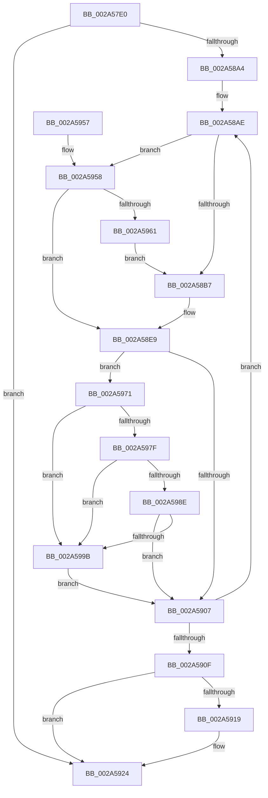

# MiInsertViewOfPhysicalSection

- RVA: `0x002A57E0`–`0x002A59BF` (길이 `479` bytes)
- VA: `0x00000001402A57E0`
- 실행 섹션: `.text`
- PDB 이름 있음: `예`; PDB Function 태그: `아니요`
- unwind 정보 RVA: `0x000689F8`
- 디코드: `130`개 명령, `479/479` bytes 표시
- 미해석 바이트: `0` (있으면 어셈블리에 `.byte`로 보존)

> 이 문서는 커널 이미지의 기계어와 PDB 기호를 분석해 생성했습니다. 4번과 5번은 함수 원형과 자료형을 바이너리 사용 방식에서 추정한 C 해석이며 원본 소스 복구 결과는 아닙니다.

## 1. Dependencies

- 직접 호출 지점: **15**; 고유 호출 대상: **11**
- 직접 호출자로 확인된 함수: **1**
- RIP 상대 이미지 참조: **0**

### Outgoing calls
- `0x002A587E` → [MiLockVad](../29/MiLockVad_function_00295810.md) (function, `0x00295810`)
- `0x002A588C` → [MiInsertVad](../26/MiInsertVad_function_00265540.md) (function, `0x00265540`)
- `0x002A5894` → [MiLockWorkingSetShared](../27/MiLockWorkingSetShared_function_0027CBF0.md) (function, `0x0027CBF0`)
- `0x002A58CA` → [MiMakeSystemAddressValid](../27/MiMakeSystemAddressValid_function_0027FF70.md) (function, `0x0027FF70`)
- `0x002A58F8` → [MiInsertPhysicalPteMapping](MiInsertPhysicalPteMapping_function_002AE26C.md) (function, `0x002AE26C`)
- `0x002A591F` → [MiUnlockPageTable](../21/MiUnlockPageTable_function_00216EC0.md) (function, `0x00216EC0`)
- `0x002A5929` → [MiUnlockWorkingSetShared](../27/MiUnlockWorkingSetShared_function_0027D690.md) (function, `0x0027D690`)
- `0x002A5934` → [MiUnlockVad](MiUnlockVad_function_002A59C8.md) (function, `0x002A59C8`)
- `0x002A5967` → [MiUnlockPageTable](../21/MiUnlockPageTable_function_00216EC0.md) (function, `0x00216EC0`)
- `0x002A5976` → [MiWorkingSetIsContended](MiWorkingSetIsContended_function_002AE520.md) (function, `0x002AE520`)
- `0x002A5985` → [MiPageTableLockIsContended](MiPageTableLockIsContended_function_002AE650.md) (function, `0x002AE650`)
- `0x002A598E` → [KeShouldYieldProcessor](../27/KeShouldYieldProcessor_function_002773E0.md) (function, `0x002773E0`)
- `0x002A59A1` → [MiUnlockPageTable](../21/MiUnlockPageTable_function_00216EC0.md) (function, `0x00216EC0`)
- `0x002A59AB` → [MiUnlockWorkingSetShared](../27/MiUnlockWorkingSetShared_function_0027D690.md) (function, `0x0027D690`)
- `0x002A59B5` → [MiLockWorkingSetShared](../27/MiLockWorkingSetShared_function_0027CBF0.md) (function, `0x0027CBF0`)

### Direct callers
- [MiMapViewOfPhysicalSection](../../page/97/MiMapViewOfPhysicalSection_function_0097F984.md) at `0x0097FBC4`

### Static image references
- 디코드된 RIP-relative 메모리 참조가 없습니다.

## 2. Other-region calls and transfers

- 다른 실행 섹션으로 향하는 call: **0**
- 별도 외부 분기/꼬리 이동을 확인하지 못했습니다.

## 3. Assembly (complete function range)

```asm
002A57E0  48 8B C4                        mov rax, rsp
002A57E3  48 89 58 10                     mov qword ptr [rax + 0x10], rbx
002A57E7  48 89 68 18                     mov qword ptr [rax + 0x18], rbp
002A57EB  48 89 70 20                     mov qword ptr [rax + 0x20], rsi
002A57EF  57                              push rdi
002A57F0  41 54                           push r12
002A57F2  41 55                           push r13
002A57F4  41 56                           push r14
002A57F6  41 57                           push r15
002A57F8  48 83 EC 40                     sub rsp, 0x40
002A57FC  83 60 D4 00                     and dword ptr [rax - 0x2c], 0
002A5800  4C 8B FA                        mov r15, rdx
002A5803  44 0F B6 4A 20                  movzx r9d, byte ptr [rdx + 0x20]
002A5808  4D 8B F0                        mov r14, r8
002A580B  48 89 50 B8                     mov qword ptr [rax - 0x48], rdx
002A580F  48 8B D9                        mov rbx, rcx
002A5812  8B 42 30                        mov eax, dword ptr [rdx + 0x30]
002A5815  C1 E8 07                        shr eax, 7
002A5818  83 E0 1F                        and eax, 0x1f
002A581B  49 C1 E1 20                     shl r9, 0x20
002A581F  89 44 24 38                     mov dword ptr [rsp + 0x38], eax
002A5823  8B 42 18                        mov eax, dword ptr [rdx + 0x18]
002A5826  48 BA FF FF FF FF 0F 00 00 00   movabs rdx, 0xfffffffff
002A5830  4C 0B C8                        or r9, rax
002A5833  49 B8 00 00 00 00 80 F6 FF FF   movabs r8, 0xfffff68000000000
002A583D  4C 23 CA                        and r9, rdx
002A5840  49 8B C0                        mov rax, r8
002A5843  41 0F B6 4F 21                  movzx ecx, byte ptr [r15 + 0x21]
002A5848  4A 8D 2C C8                     lea rbp, [rax + r9*8]
002A584C  41 8B 47 1C                     mov eax, dword ptr [r15 + 0x1c]
002A5850  48 C1 E1 20                     shl rcx, 0x20
002A5854  48 0B C8                        or rcx, rax
002A5857  48 23 CA                        and rcx, rdx
002A585A  49 8B C0                        mov rax, r8
002A585D  65 4C 8B 2C 25 88 01 00 00      mov r13, qword ptr gs:[0x188]
002A5866  4C 8D 24 C8                     lea r12, [rax + rcx*8]
002A586A  49 8B CD                        mov rcx, r13
002A586D  4C 89 6C 24 70                  mov qword ptr [rsp + 0x70], r13
002A5872  49 8B D7                        mov rdx, r15
002A5875  48 8D B3 00 04 00 00            lea rsi, [rbx + 0x400]
002A587C  33 FF                           xor edi, edi
002A587E  E8 8D FF FE FF                  call 0x140295810
002A5883  45 33 C0                        xor r8d, r8d
002A5886  48 8B D3                        mov rdx, rbx
002A5889  49 8B CF                        mov rcx, r15
002A588C  E8 AF FC FB FF                  call 0x140265540
002A5891  48 8B CE                        mov rcx, rsi
002A5894  E8 57 73 FD FF                  call 0x14027cbf0
002A5899  8A D8                           mov bl, al
002A589B  49 3B EC                        cmp rbp, r12
002A589E  0F 87 80 00 00 00               ja 0x1402a5924
002A58A4  49 BD 00 00 00 00 80 F6 FF FF   movabs r13, 0xfffff68000000000
002A58AE  48 85 FF                        test rdi, rdi
002A58B1  0F 85 A1 00 00 00               jne 0x1402a5958
002A58B7  41 8B 57 30                     mov edx, dword ptr [r15 + 0x30]
002A58BB  45 33 C9                        xor r9d, r9d
002A58BE  C1 EA 0C                        shr edx, 0xc
002A58C1  44 8A C3                        mov r8b, bl
002A58C4  83 E2 7F                        and edx, 0x7f
002A58C7  48 8B CD                        mov rcx, rbp
002A58CA  E8 A1 A6 FD FF                  call 0x14027ff70
002A58CF  48 8B FD                        mov rdi, rbp
002A58D2  48 B8 F8 FF FF FF 7F 00 00 00   movabs rax, 0x7ffffffff8
002A58DC  48 C1 EF 09                     shr rdi, 9
002A58E0  48 23 F8                        and rdi, rax
002A58E3  49 8B C5                        mov rax, r13
002A58E6  48 03 F8                        add rdi, rax
002A58E9  48 8D 4C 24 20                  lea rcx, [rsp + 0x20]
002A58EE  48 89 6C 24 28                  mov qword ptr [rsp + 0x28], rbp
002A58F3  4C 89 74 24 30                  mov qword ptr [rsp + 0x30], r14
002A58F8  E8 6F 89 00 00                  call 0x1402ae26c
002A58FD  48 83 C5 08                     add rbp, 8
002A5901  40 F6 C5 78                     test bpl, 0x78
002A5905  74 6A                           je 0x1402a5971
002A5907  49 FF C6                        inc r14
002A590A  49 3B EC                        cmp rbp, r12
002A590D  76 9F                           jbe 0x1402a58ae
002A590F  4C 8B 6C 24 70                  mov r13, qword ptr [rsp + 0x70]
002A5914  48 85 FF                        test rdi, rdi
002A5917  74 0B                           je 0x1402a5924
002A5919  48 8B D7                        mov rdx, rdi
002A591C  48 8B CE                        mov rcx, rsi
002A591F  E8 9C 15 F7 FF                  call 0x140216ec0
002A5924  8A D3                           mov dl, bl
002A5926  48 8B CE                        mov rcx, rsi
002A5929  E8 62 7D FD FF                  call 0x14027d690
002A592E  49 8B D7                        mov rdx, r15
002A5931  49 8B CD                        mov rcx, r13
002A5934  E8 8F 00 00 00                  call 0x1402a59c8
002A5939  4C 8D 5C 24 40                  lea r11, [rsp + 0x40]
002A593E  49 8B 5B 38                     mov rbx, qword ptr [r11 + 0x38]
002A5942  49 8B 6B 40                     mov rbp, qword ptr [r11 + 0x40]
002A5946  49 8B 73 48                     mov rsi, qword ptr [r11 + 0x48]
002A594A  49 8B E3                        mov rsp, r11
002A594D  41 5F                           pop r15
002A594F  41 5E                           pop r14
002A5951  41 5D                           pop r13
002A5953  41 5C                           pop r12
002A5955  5F                              pop rdi
002A5956  C3                              ret
002A5957  CC                              int3
002A5958  48 F7 C5 FF 0F 00 00            test rbp, 0xfff
002A595F  75 88                           jne 0x1402a58e9
002A5961  48 8B D7                        mov rdx, rdi
002A5964  48 8B CE                        mov rcx, rsi
002A5967  E8 54 15 F7 FF                  call 0x140216ec0
002A596C  E9 46 FF FF FF                  jmp 0x1402a58b7
002A5971  33 D2                           xor edx, edx
002A5973  48 8B CE                        mov rcx, rsi
002A5976  E8 A5 8B 00 00                  call 0x1402ae520
002A597B  85 C0                           test eax, eax
002A597D  75 1C                           jne 0x1402a599b
002A597F  48 8B D7                        mov rdx, rdi
002A5982  48 8B CE                        mov rcx, rsi
002A5985  E8 C6 8C 00 00                  call 0x1402ae650
002A598A  85 C0                           test eax, eax
002A598C  75 0D                           jne 0x1402a599b
002A598E  E8 4D 1A FD FF                  call 0x1402773e0
002A5993  85 C0                           test eax, eax
002A5995  0F 84 6C FF FF FF               je 0x1402a5907
002A599B  48 8B D7                        mov rdx, rdi
002A599E  48 8B CE                        mov rcx, rsi
002A59A1  E8 1A 15 F7 FF                  call 0x140216ec0
002A59A6  8A D3                           mov dl, bl
002A59A8  48 8B CE                        mov rcx, rsi
002A59AB  E8 E0 7C FD FF                  call 0x14027d690
002A59B0  48 8B CE                        mov rcx, rsi
002A59B3  33 FF                           xor edi, edi
002A59B5  E8 36 72 FD FF                  call 0x14027cbf0
002A59BA  E9 48 FF FF FF                  jmp 0x1402a5907
```

## 4. C-style interpretation (structured pseudocode)

```c
__int64 __fastcall MiInsertViewOfPhysicalSection(__int64 a1, __int64 a2, __int64 a3)
{
    __int64 result;
    __int64 v_r14;
    __int64 v_rbp;
    __int64 v_rdi;
    __int64 v_rsp;
    unsigned __int64 v_stack_m28;
    unsigned int v_stack_m30;
    unsigned __int64 v_stack_m38;
    unsigned __int64 v_stack_m40;
    unsigned __int64 v_stack_m48;
    unsigned __int64 v_stack_p8;

    *(unsigned __int64 *)(v_rsp + 16) = v_rbx;
    *(unsigned __int64 *)(v_rsp + 24) = v_rbp;
    *(unsigned __int64 *)(v_rsp + 32) = v_rsi;
    v_rsp = (v_rsp) - (64);
    *(unsigned __int64 *)(v_rsp - 72) = a2;
    result = (unsigned int)(((unsigned int)(*(unsigned int *)(a2 + 48))) >> (7));
    result = (unsigned int)((result) & (31));
    a4 = (*(unsigned __int8 *)(a2 + 32)) << (32);
    v_stack_m30 = (unsigned int)(result);
    a4 = (a4) | ((unsigned int)(*(unsigned int *)(a2 + 24)));
    a4 = (a4) & (a2);
    a1 = (*(unsigned __int8 *)(a2 + 33)) << (32);
    a1 = (a1) | ((unsigned int)(*(unsigned int *)(a2 + 28)));
    a1 = (a1) & (a2);
    v_stack_p8 = *(unsigned __int64 *)(gs_base + (0 + 392));
    v_rdi = 0;
    result = MiLockVad(*(unsigned __int64 *)(gs_base + (0 + 392)), a2, a3, a4);
    a3 = 0;
    result = MiInsertVad(a2, a1, a3, a4);
    result = MiLockWorkingSetShared(a1 + 1024, a1, a3, a4);
    if ((a3 + a4 * 8) > (a3 + a1 * 8)) goto loc_002A5924;
loc_002A58AE:
    if (0 != 0) goto loc_002A5958;
loc_002A58B7:
    a4 = 0;
    a2 = (unsigned int)(((unsigned int)(*(unsigned int *)(a2 + 48))) >> (12));
    a2 = (unsigned int)((a2) & (127));
    result = MiMakeSystemAddressValid(a3 + a4 * 8, a2, (unsigned __int8)((unsigned __int8)(result)), a4);
    v_rdi = (a3 + a4 * 8) >> (9);
    v_rdi = (v_rdi) & (result);
    v_rdi = (v_rdi) + (*(unsigned __int64 *)(gs_base + (0 + 392)));
loc_002A58E9:
    v_stack_m40 = a3 + a4 * 8;
    v_stack_m38 = 0;
    result = MiInsertPhysicalPteMapping(v_stack_m48, a2, (unsigned __int8)((unsigned __int8)(result)), a4);
    v_rbp = (a3 + a4 * 8) + (8);
    if ((((unsigned __int8)(v_rbp)) & (120)) == 0) goto loc_002A5971;
loc_002A5907:
    v_r14 = (a3) + 1;
    if (v_rbp <= (a3 + a1 * 8)) goto loc_002A58AE;
    if (v_rdi != 0) {
        a2 = v_rdi;
        a1 = a1 + 1024;
        result = MiUnlockPageTable(a1, a2, (unsigned __int8)((unsigned __int8)(result)), a4);
    }
    result = MiUnlockWorkingSetShared(a1 + 1024, (unsigned __int8)((unsigned __int8)(result)), (unsigned __int8)((unsigned __int8)(result)), a4);
    result = MiUnlockVad(v_stack_p8, a2, (unsigned __int8)((unsigned __int8)(result)), a4);
    return result;
loc_002A5958:
    if (((*(unsigned __int64 *)(v_stack_m28 + 64)) & (0xFFFULL)) != 0) goto loc_002A58E9;
    result = MiUnlockPageTable(*(unsigned __int64 *)(v_stack_m28 + 72), v_rdi, (unsigned __int8)((unsigned __int8)(result)), a4);
    goto loc_002A58B7;
loc_002A5971:
    a2 = 0;
    result = MiWorkingSetIsContended(*(unsigned __int64 *)(v_stack_m28 + 72), a2, (unsigned __int8)((unsigned __int8)(result)), a4);
    if ((unsigned int)(result) != 0) goto loc_002A599B;
    result = MiPageTableLockIsContended(*(unsigned __int64 *)(v_stack_m28 + 72), v_rdi, (unsigned __int8)((unsigned __int8)(result)), a4);
    if ((unsigned int)(result) != 0) goto loc_002A599B;
    result = KeShouldYieldProcessor(*(unsigned __int64 *)(v_stack_m28 + 72), v_rdi, (unsigned __int8)((unsigned __int8)(result)), a4);
    if ((unsigned int)(result) == 0) goto loc_002A5907;
loc_002A599B:
    result = MiUnlockPageTable(*(unsigned __int64 *)(v_stack_m28 + 72), v_rdi, (unsigned __int8)((unsigned __int8)(result)), a4);
    result = MiUnlockWorkingSetShared(*(unsigned __int64 *)(v_stack_m28 + 72), (unsigned __int8)(*(unsigned __int64 *)(v_stack_m28 + 56)), (unsigned __int8)((unsigned __int8)(result)), a4);
    v_rdi = 0;
    result = MiLockWorkingSetShared(*(unsigned __int64 *)(v_stack_m28 + 72), (unsigned __int8)(*(unsigned __int64 *)(v_stack_m28 + 56)), (unsigned __int8)((unsigned __int8)(result)), a4);
    goto loc_002A5907;
}
```

## 5. (Beta) C Style

```c
int64_t MiInsertViewOfPhysicalSection(void *Arg1, void *Arg2, int64_t Arg3)
{
    uint8_t *arg1 = (uint8_t *)Arg1;
    uint8_t *arg2 = (uint8_t *)Arg2;

    int64_t result;
    int64_t local_r14;
    int64_t local_rbp;
    int64_t local_rdi;
    int64_t local_rsp;
    uint64_t v_stack_m28;
    uint32_t v_stack_m30;
    uint64_t v_stack_m38;
    uint64_t v_stack_m40;
    uint64_t v_stack_m48;
    uint64_t v_stack_p8;

    *(uint64_t *)(local_rsp + 0x10) = local_rbx;
    *(uint64_t *)(local_rsp + 0x18) = local_rbp;
    *(uint64_t *)(local_rsp + 0x20) = local_rsi;
    local_rsp = (local_rsp) - (64);
    *(void **)(local_rsp - 0x48) = Arg2;
    result = (uint32_t)(((uint32_t)(*(uint32_t *)(arg2 + 0x30))) >> (7));
    result = (uint32_t)((result) & (31));
    a4 = (*(uint8_t *)(arg2 + 0x20)) << (32);
    v_stack_m30 = (uint32_t)(result);
    a4 = (a4) | ((uint32_t)(*(uint32_t *)(arg2 + 0x18)));
    a4 = (a4) & (Arg2);
    Arg1 = (*(uint8_t *)(arg2 + 0x21)) << (32);
    Arg1 = (Arg1) | ((uint32_t)(*(uint32_t *)(arg2 + 0x1C)));
    Arg1 = (Arg1) & (Arg2);
    v_stack_p8 = *(uint64_t *)(gs_base + (0 + 0x188));
    local_rdi = 0;
    result = MiLockVad(*(uint64_t *)(gs_base + (0 + 0x188)), Arg2, Arg3, a4);
    Arg3 = 0;
    result = MiInsertVad(Arg2, Arg1, Arg3, a4);
    result = MiLockWorkingSetShared(Arg1 + 1024, Arg1, Arg3, a4);
    if ((Arg3 + a4 * 8) > (Arg3 + Arg1 * 8)) goto loc_002A5924;
loc_002A58AE:
    if (0 != 0) goto loc_002A5958;
loc_002A58B7:
    a4 = 0;
    Arg2 = (uint32_t)(((uint32_t)(*(uint32_t *)(arg2 + 0x30))) >> (12));
    Arg2 = (uint32_t)((Arg2) & (127));
    result = MiMakeSystemAddressValid(Arg3 + a4 * 8, Arg2, (uint8_t)((uint8_t)(result)), a4);
    local_rdi = (Arg3 + a4 * 8) >> (9);
    local_rdi = (local_rdi) & (result);
    local_rdi = (local_rdi) + (*(uint64_t *)(gs_base + (0 + 0x188)));
loc_002A58E9:
    v_stack_m40 = Arg3 + a4 * 8;
    v_stack_m38 = 0;
    result = MiInsertPhysicalPteMapping(v_stack_m48, Arg2, (uint8_t)((uint8_t)(result)), a4);
    local_rbp = (Arg3 + a4 * 8) + (8);
    if ((((uint8_t)(local_rbp)) & (120)) == 0) goto loc_002A5971;
loc_002A5907:
    local_r14 = (Arg3) + 1;
    if (local_rbp <= (Arg3 + Arg1 * 8)) goto loc_002A58AE;
    if (local_rdi != 0) {
        Arg2 = local_rdi;
        Arg1 = Arg1 + 1024;
        result = MiUnlockPageTable(Arg1, Arg2, (uint8_t)((uint8_t)(result)), a4);
    }
    result = MiUnlockWorkingSetShared(Arg1 + 1024, (uint8_t)((uint8_t)(result)), (uint8_t)((uint8_t)(result)), a4);
    result = MiUnlockVad(v_stack_p8, Arg2, (uint8_t)((uint8_t)(result)), a4);
    return result;
loc_002A5958:
    if (((*(uint64_t *)(v_stack_m28 + 0x40)) & (0xFFFULL)) != 0) goto loc_002A58E9;
    result = MiUnlockPageTable(*(uint64_t *)(v_stack_m28 + 0x48), local_rdi, (uint8_t)((uint8_t)(result)), a4);
    goto loc_002A58B7;
loc_002A5971:
    Arg2 = 0;
    result = MiWorkingSetIsContended(*(uint64_t *)(v_stack_m28 + 0x48), Arg2, (uint8_t)((uint8_t)(result)), a4);
    if ((uint32_t)(result) != 0) goto loc_002A599B;
    result = MiPageTableLockIsContended(*(uint64_t *)(v_stack_m28 + 0x48), local_rdi, (uint8_t)((uint8_t)(result)), a4);
    if ((uint32_t)(result) != 0) goto loc_002A599B;
    result = KeShouldYieldProcessor(*(uint64_t *)(v_stack_m28 + 0x48), local_rdi, (uint8_t)((uint8_t)(result)), a4);
    if ((uint32_t)(result) == 0) goto loc_002A5907;
loc_002A599B:
    result = MiUnlockPageTable(*(uint64_t *)(v_stack_m28 + 0x48), local_rdi, (uint8_t)((uint8_t)(result)), a4);
    result = MiUnlockWorkingSetShared(*(uint64_t *)(v_stack_m28 + 0x48), (uint8_t)(*(uint64_t *)(v_stack_m28 + 0x38)), (uint8_t)((uint8_t)(result)), a4);
    local_rdi = 0;
    result = MiLockWorkingSetShared(*(uint64_t *)(v_stack_m28 + 0x48), (uint8_t)(*(uint64_t *)(v_stack_m28 + 0x38)), (uint8_t)((uint8_t)(result)), a4);
    goto loc_002A5907;
}
```

### 관측된 메모리 오프셋

구조체 형식이 확인되지 않은 접근은 인자 기준의 오프셋으로만 기록했습니다.

| 기준 인자 | 오프셋 표현 | 폭 (bit) | 접근 |
|---|---:|---:|---|
| `Arg1` | `+ 0x400` | `64` | `R` |
| `Arg2` | `+ 0x18` | `32` | `R` |
| `Arg2` | `+ 0x1C` | `32` | `R` |
| `Arg2` | `+ 0x20` | `8` | `R` |
| `Arg2` | `+ 0x21` | `8` | `R` |
| `Arg2` | `+ 0x30` | `32` | `R` |

## 6. Execution-region graph

[열기: 2D/3D 그래프와 함수 탐색 컨트롤 패널](../../../control-panel.html?section=text&rva=0x002A57E0&view=graph)

- 2D 그래프는 위에서 아래로 흐르고, 3D 그래프는 빈 공간을 드래그해 회전합니다. Shift+드래그는 이동, 휠은 확대·축소, 함수 노드 선택은 대상 보고서 이동입니다.

### Static fallback


