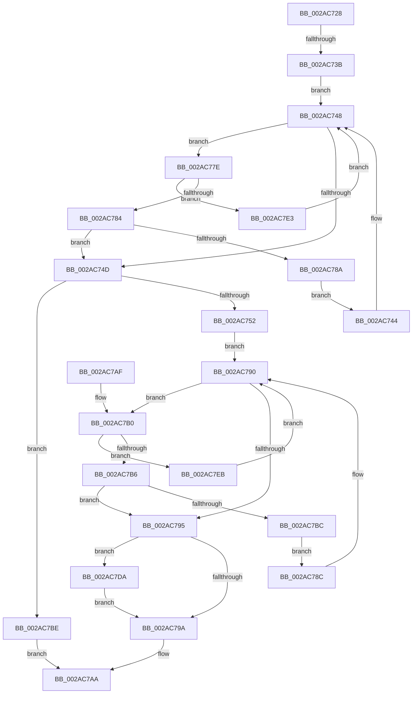

# MiIoSpaceGetBounds

- RVA: `0x002AC728`–`0x002AC7F0` (길이 `200` bytes)
- VA: `0x00000001402AC728`
- 실행 섹션: `.text`
- PDB 이름 있음: `예`; PDB Function 태그: `예`
- unwind 정보 RVA: `0x000DB714`
- 디코드: `56`개 명령, `200/200` bytes 표시
- 미해석 바이트: `0` (있으면 어셈블리에 `.byte`로 보존)

> 이 문서는 커널 이미지의 기계어와 PDB 기호를 분석해 생성했습니다. 4번과 5번은 함수 원형과 자료형을 바이너리 사용 방식에서 추정한 C 해석이며 원본 소스 복구 결과는 아닙니다.

## 1. Dependencies

- 직접 호출 지점: **0**; 고유 호출 대상: **0**
- 직접 호출자로 확인된 함수: **7**
- RIP 상대 이미지 참조: **2**

### Outgoing calls
- 직접 디코드된 call 명령이 없습니다.

### Direct callers
- [MiReferenceIoPages](../23/MiReferenceIoPages_function_0023C804.md) at `0x0023C920`
- [MiReferenceIoPages](../23/MiReferenceIoPages_function_0023C804.md) at `0x0023CBE7`
- [MiReferenceIoPages](../23/MiReferenceIoPages_function_0023C804.md) at `0x0023CF4A`
- [MiReferenceIoPages](../23/MiReferenceIoPages_function_0023C804.md) at `0x0023CFE4`
- [MiDereferenceIoPages](MiDereferenceIoPages_function_002AB1B0.md) at `0x002AB689`
- [MiLookupIoPageNode](MiLookupIoPageNode_function_002AC5C8.md) at `0x002AC62F`
- [MiFillSystemPtes](../31/MiFillSystemPtes_function_00319850.md) at `0x00319E4D`
- [MiMapMdlWithLargePages](../4D/MiMapMdlWithLargePages_function_004D10B8.md) at `0x004D13B5`
- [MiMapMdlCommon](../67/MiMapMdlCommon_function_00674524.md) at `0x006746F7`
- [MiMapMdlCommon](../67/MiMapMdlCommon_function_00674524.md) at `0x00674A0D`
- [sub_006D79AA](../6D/Unknown_function_006D79AA.md) at `0x006D79F1`

### Static image references
- `0x002AC72B` → RVA `0x00E300B8` (`.data`; read)
- `0x002AC73B` → RVA `0x00E37300` (`.data`; read)

## 2. Other-region calls and transfers

- 다른 실행 섹션으로 향하는 call: **0**
- call이 아닌 외부 분기/꼬리 이동: **1**
  - `0x002AC735` → `0x006DB4F4` (`tail-transfer`)

## 3. Assembly (complete function range)

```asm
002AC728  4C 8B C1                        mov r8, rcx
002AC72B  48 8B 0D 86 39 B8 00            mov rcx, qword ptr [rip + 0xb83986]
002AC732  48 85 C9                        test rcx, rcx
002AC735  0F 85 B9 ED 42 00               jne 0x1406db4f4
002AC73B  48 8B 0D BE AB B8 00            mov rcx, qword ptr [rip + 0xb8abbe]
002AC742  EB 04                           jmp 0x1402ac748
002AC744  48 8B 49 08                     mov rcx, qword ptr [rcx + 8]
002AC748  48 85 C9                        test rcx, rcx
002AC74B  75 31                           jne 0x1402ac77e
002AC74D  48 85 C9                        test rcx, rcx
002AC750  75 6C                           jne 0x1402ac7be
002AC752  48 8D 82 FF FF 03 00            lea rax, [rdx + 0x3ffff]
002AC759  B9 01 00 00 00                  mov ecx, 1
002AC75E  48 25 00 00 FC FF               and rax, 0xfffffffffffc0000
002AC764  4C 8D 8A 00 00 04 00            lea r9, [rdx + 0x40000]
002AC76B  48 3B D0                        cmp rdx, rax
002AC76E  4C 0F 45 C8                     cmovne r9, rax
002AC772  48 8B 05 87 AB B8 00            mov rax, qword ptr [rip + 0xb8ab87]
002AC779  4C 2B C9                        sub r9, rcx
002AC77C  EB 12                           jmp 0x1402ac790
002AC77E  48 3B 51 18                     cmp rdx, qword ptr [rcx + 0x18]
002AC782  72 5F                           jb 0x1402ac7e3
002AC784  48 3B 51 20                     cmp rdx, qword ptr [rcx + 0x20]
002AC788  76 C3                           jbe 0x1402ac74d
002AC78A  EB B8                           jmp 0x1402ac744
002AC78C  48 8B 40 08                     mov rax, qword ptr [rax + 8]
002AC790  48 85 C0                        test rax, rax
002AC793  75 1B                           jne 0x1402ac7b0
002AC795  48 85 C0                        test rax, rax
002AC798  75 40                           jne 0x1402ac7da
002AC79A  4D 89 48 08                     mov qword ptr [r8 + 8], r9
002AC79E  B9 03 00 00 00                  mov ecx, 3
002AC7A3  49 89 10                        mov qword ptr [r8], rdx
002AC7A6  41 89 48 14                     mov dword ptr [r8 + 0x14], ecx
002AC7AA  41 89 48 10                     mov dword ptr [r8 + 0x10], ecx
002AC7AE  C3                              ret
002AC7AF  CC                              int3
002AC7B0  4C 3B 48 18                     cmp r9, qword ptr [rax + 0x18]
002AC7B4  72 35                           jb 0x1402ac7eb
002AC7B6  48 3B 50 20                     cmp rdx, qword ptr [rax + 0x20]
002AC7BA  76 D9                           jbe 0x1402ac795
002AC7BC  EB CE                           jmp 0x1402ac78c
002AC7BE  48 8B 41 18                     mov rax, qword ptr [rcx + 0x18]
002AC7C2  49 89 00                        mov qword ptr [r8], rax
002AC7C5  48 8B 41 20                     mov rax, qword ptr [rcx + 0x20]
002AC7C9  8B 49 28                        mov ecx, dword ptr [rcx + 0x28]
002AC7CC  49 89 40 08                     mov qword ptr [r8 + 8], rax
002AC7D0  41 C7 40 14 02 00 00 00         mov dword ptr [r8 + 0x14], 2
002AC7D8  EB D0                           jmp 0x1402ac7aa
002AC7DA  4C 8B 48 18                     mov r9, qword ptr [rax + 0x18]
002AC7DE  4C 2B C9                        sub r9, rcx
002AC7E1  EB B7                           jmp 0x1402ac79a
002AC7E3  48 8B 09                        mov rcx, qword ptr [rcx]
002AC7E6  E9 5D FF FF FF                  jmp 0x1402ac748
002AC7EB  48 8B 00                        mov rax, qword ptr [rax]
002AC7EE  EB A0                           jmp 0x1402ac790
```

## 4. C-style interpretation (structured pseudocode)

```c
__int64 __fastcall MiIoSpaceGetBounds(__int64 a1, __int64 a2)
{
    __int64 result;

    goto loc_002AC748;
loc_002AC744:
loc_002AC748:
    if (*(unsigned __int64 *)(*(unsigned __int64 *)(v_rip + 12102590) + 8) != 0) goto loc_002AC77E;
loc_002AC74D:
    if (*(unsigned __int64 *)(*(unsigned __int64 *)(v_rip + 12102590) + 8) != 0) goto loc_002AC7BE;
    result = (a2 + 262143) & (0xFFFFFFFFFFFC0000ULL);
    a4 = a2 + 262144;
    if (a2 != result) { a4 = result; }
    a4 = (a4) - (1);
    goto loc_002AC790;
loc_002AC77E:
    if (a2 < (*(unsigned __int64 *)(1 + 24))) goto loc_002AC7E3;
    if (a2 <= (*(unsigned __int64 *)(1 + 32))) goto loc_002AC74D;
    goto loc_002AC744;
loc_002AC78C:
loc_002AC790:
    if (*(unsigned __int64 *)(*(unsigned __int64 *)(v_rip + 12102535) + 8) != 0) goto loc_002AC7B0;
loc_002AC795:
    if (*(unsigned __int64 *)(*(unsigned __int64 *)(v_rip + 12102535) + 8) != 0) goto loc_002AC7DA;
loc_002AC79A:
    *(unsigned __int64 *)(a1 + 8) = a4;
    *(unsigned __int64 *)(a1) = a2;
    *(unsigned int *)(a1 + 20) = 3;
loc_002AC7AA:
    *(unsigned int *)(a1 + 16) = 3;
    return *(unsigned __int64 *)(*(unsigned __int64 *)(v_rip + 12102535) + 8);
loc_002AC7B0:
    if (a4 < (*(unsigned __int64 *)(*(unsigned __int64 *)(*(unsigned __int64 *)(v_rip + 12102535) + 8) + 24))) goto loc_002AC7EB;
    if (a2 <= (*(unsigned __int64 *)(*(unsigned __int64 *)(*(unsigned __int64 *)(v_rip + 12102535) + 8) + 32))) goto loc_002AC795;
    goto loc_002AC78C;
loc_002AC7BE:
    *(unsigned __int64 *)(a1) = *(unsigned __int64 *)(3 + 24);
    *(unsigned __int64 *)(a1 + 8) = *(unsigned __int64 *)(3 + 32);
    *(unsigned int *)(a1 + 20) = 2;
    goto loc_002AC7AA;
loc_002AC7DA:
    a4 = (*(unsigned __int64 *)(*(unsigned __int64 *)(3 + 32) + 24)) - ((unsigned int)(*(unsigned int *)(3 + 40)));
    goto loc_002AC79A;
loc_002AC7E3:
    goto loc_002AC748;
loc_002AC7EB:
    goto loc_002AC790;
}
```

## 5. (Beta) C Style

```c
int64_t MiIoSpaceGetBounds(void *Arg1, int64_t Arg2)
{
    uint8_t *arg1 = (uint8_t *)Arg1;

    int64_t result;

    goto loc_002AC748;
loc_002AC744:
loc_002AC748:
    if (*(uint64_t *)(*(uint64_t *)(v_rip + 0xB8ABBE) + 0x8) != 0) goto loc_002AC77E;
loc_002AC74D:
    if (*(uint64_t *)(*(uint64_t *)(v_rip + 0xB8ABBE) + 0x8) != 0) goto loc_002AC7BE;
    result = (Arg2 + 262143) & (0xFFFFFFFFFFFC0000ULL);
    a4 = Arg2 + 262144;
    if (Arg2 != result) { a4 = result; }
    a4 = (a4) - (1);
    goto loc_002AC790;
loc_002AC77E:
    if (Arg2 < (*(uint64_t *)(1 + 0x18))) goto loc_002AC7E3;
    if (Arg2 <= (*(uint64_t *)(1 + 0x20))) goto loc_002AC74D;
    goto loc_002AC744;
loc_002AC78C:
loc_002AC790:
    if (*(uint64_t *)(*(uint64_t *)(v_rip + 0xB8AB87) + 0x8) != 0) goto loc_002AC7B0;
loc_002AC795:
    if (*(uint64_t *)(*(uint64_t *)(v_rip + 0xB8AB87) + 0x8) != 0) goto loc_002AC7DA;
loc_002AC79A:
    *(uint64_t *)(arg1 + 0x8) = a4;
    *(uint64_t *)(arg1) = Arg2;
    *(uint32_t *)(arg1 + 0x14) = 3;
loc_002AC7AA:
    *(uint32_t *)(arg1 + 0x10) = 3;
    return *(uint64_t *)(*(uint64_t *)(v_rip + 0xB8AB87) + 0x8);
loc_002AC7B0:
    if (a4 < (*(uint64_t *)(*(uint64_t *)(*(uint64_t *)(v_rip + 0xB8AB87) + 0x8) + 0x18))) goto loc_002AC7EB;
    if (Arg2 <= (*(uint64_t *)(*(uint64_t *)(*(uint64_t *)(v_rip + 0xB8AB87) + 0x8) + 0x20))) goto loc_002AC795;
    goto loc_002AC78C;
loc_002AC7BE:
    *(uint64_t *)(arg1) = *(uint64_t *)(3 + 0x18);
    *(uint64_t *)(arg1 + 0x8) = *(uint64_t *)(3 + 0x20);
    *(uint32_t *)(arg1 + 0x14) = 2;
    goto loc_002AC7AA;
loc_002AC7DA:
    a4 = (*(uint64_t *)(*(uint64_t *)(3 + 0x20) + 0x18)) - ((uint32_t)(*(uint32_t *)(3 + 0x28)));
    goto loc_002AC79A;
loc_002AC7E3:
    goto loc_002AC748;
loc_002AC7EB:
    goto loc_002AC790;
}
```

### 관측된 메모리 오프셋

구조체 형식이 확인되지 않은 접근은 인자 기준의 오프셋으로만 기록했습니다.

| 기준 인자 | 오프셋 표현 | 폭 (bit) | 접근 |
|---|---:|---:|---|
| `Arg1` | `+ 0x0` | `64` | `W` |
| `Arg1` | `+ 0x8` | `64` | `W` |
| `Arg1` | `+ 0x10` | `32` | `W` |
| `Arg1` | `+ 0x14` | `32` | `W` |

## 6. Execution-region graph

[열기: 2D/3D 그래프와 함수 탐색 컨트롤 패널](../../../control-panel.html?section=text&rva=0x002AC728&view=graph)

- 2D 그래프는 위에서 아래로 흐르고, 3D 그래프는 빈 공간을 드래그해 회전합니다. Shift+드래그는 이동, 휠은 확대·축소, 함수 노드 선택은 대상 보고서 이동입니다.

### Static fallback


