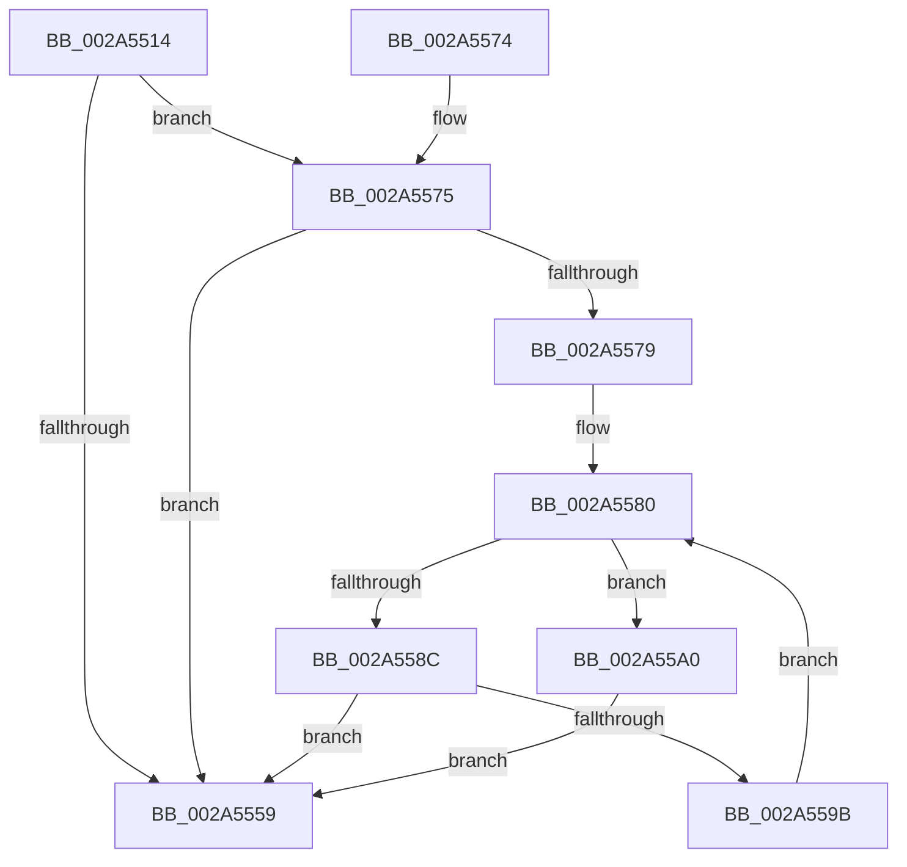

# MiIsDriverPage

- RVA: `0x002A5514`–`0x002A55A4` (길이 `144` bytes)
- VA: `0x00000001402A5514`
- 실행 섹션: `.text`
- PDB 이름 있음: `예`; PDB Function 태그: `아니요`
- unwind 정보 RVA: `0x0005EBC0`
- 디코드: `42`개 명령, `144/144` bytes 표시
- 미해석 바이트: `0` (있으면 어셈블리에 `.byte`로 보존)

> 이 문서는 커널 이미지의 기계어와 PDB 기호를 분석해 생성했습니다. 4번과 5번은 함수 원형과 자료형을 바이너리 사용 방식에서 추정한 C 해석이며 원본 소스 복구 결과는 아닙니다.

## 1. Dependencies

- 직접 호출 지점: **4**; 고유 호출 대상: **4**
- 직접 호출자로 확인된 함수: **5**
- RIP 상대 이미지 참조: **1**

### Outgoing calls
- `0x002A5541` → [MmLockLoadedModuleListShared](../2F/MmLockLoadedModuleListShared_function_002F21E4.md) (function, `0x002F21E4`)
- `0x002A554C` → [MmFindDataTableEntryByAddress](MmFindDataTableEntryByAddress_function_002A3C0C.md) (function, `0x002A3C0C`)
- `0x002A555C` → [MmUnlockLoadedModuleListShared](../2F/MmUnlockLoadedModuleListShared_function_002F2230.md) (function, `0x002F2230`)
- `0x002A5592` → [MiImageContainsVa](../4B/MiImageContainsVa_function_004B1874.md) (function, `0x004B1874`)

### Direct callers
- [MiRemoveWsle](../22/MiRemoveWsle_function_0022D0C4.md) at `0x0022D287`
- [MiAddWorkingSetEntries](../27/MiAddWorkingSetEntries_function_0027DC00.md) at `0x0027E29B`
- [sub_0029273F](../29/Unknown_function_0029273F.md) at `0x00292A2F`
- [MiCompleteProtoPteFault](../34/MiCompleteProtoPteFault_function_00345710.md) at `0x00346629`
- [sub_006D7AEE](../6D/Unknown_function_006D7AEE.md) at `0x006D7B06`

### Static image references
- `0x002A5579` → RVA `0x00E2D988` (`.data`; read)

## 2. Other-region calls and transfers

- 다른 실행 섹션으로 향하는 call: **0**
- 별도 외부 분기/꼬리 이동을 확인하지 못했습니다.

## 3. Assembly (complete function range)

```asm
002A5514  48 89 5C 24 08                  mov qword ptr [rsp + 8], rbx
002A5519  48 89 74 24 10                  mov qword ptr [rsp + 0x10], rsi
002A551E  57                              push rdi
002A551F  48 83 EC 20                     sub rsp, 0x20
002A5523  48 8B F9                        mov rdi, rcx
002A5526  8B F2                           mov esi, edx
002A5528  48 C1 E7 19                     shl rdi, 0x19
002A552C  48 B8 00 00 00 00 80 F6 FF FF   movabs rax, 0xfffff68000000000
002A5536  48 C1 E0 19                     shl rax, 0x19
002A553A  48 2B F8                        sub rdi, rax
002A553D  48 C1 FF 10                     sar rdi, 0x10
002A5541  E8 9E CC 04 00                  call 0x1402f21e4
002A5546  48 8B CF                        mov rcx, rdi
002A5549  44 8A D8                        mov r11b, al
002A554C  E8 BB E6 FF FF                  call 0x1402a3c0c
002A5551  48 8B D8                        mov rbx, rax
002A5554  48 85 C0                        test rax, rax
002A5557  74 1C                           je 0x1402a5575
002A5559  41 8A CB                        mov cl, r11b
002A555C  E8 CF CC 04 00                  call 0x1402f2230
002A5561  48 8B 74 24 38                  mov rsi, qword ptr [rsp + 0x38]
002A5566  48 8B C3                        mov rax, rbx
002A5569  48 8B 5C 24 30                  mov rbx, qword ptr [rsp + 0x30]
002A556E  48 83 C4 20                     add rsp, 0x20
002A5572  5F                              pop rdi
002A5573  C3                              ret
002A5574  CC                              int3
002A5575  85 F6                           test esi, esi
002A5577  74 E0                           je 0x1402a5559
002A5579  48 8B 1D 08 84 B8 00            mov rbx, qword ptr [rip + 0xb88408]
002A5580  48 8D 05 01 84 B8 00            lea rax, [rip + 0xb88401]
002A5587  48 3B D8                        cmp rbx, rax
002A558A  74 14                           je 0x1402a55a0
002A558C  48 8B D7                        mov rdx, rdi
002A558F  48 8B CB                        mov rcx, rbx
002A5592  E8 DD C2 20 00                  call 0x1404b1874
002A5597  85 C0                           test eax, eax
002A5599  75 BE                           jne 0x1402a5559
002A559B  48 8B 1B                        mov rbx, qword ptr [rbx]
002A559E  EB E0                           jmp 0x1402a5580
002A55A0  33 DB                           xor ebx, ebx
002A55A2  EB B5                           jmp 0x1402a5559
```

## 4. C-style interpretation (structured pseudocode)

```c
__int64 __fastcall MiIsDriverPage(__int64 a1, int a2)
{
    __int64 result;
    __int64 v_rbx;
    __int64 v_rdi;
    __int64 v_rsp;
    unsigned __int64 v_stack_p10;
    unsigned __int64 v_stack_p8;

    v_stack_p8 = v_rbx;
    v_stack_p10 = v_rsi;
    v_rsp = (v_rsp) - (32);
    v_rdi = (a1) << (25);
    result = (result) << (25);
    v_rdi = (v_rdi) - (result);
    v_rdi = (v_rdi) >> (16);
    result = MmLockLoadedModuleListShared(a1, a2, a3, a4);
    result = MmFindDataTableEntryByAddress(v_rdi, a2, a3, a4);
    if (result == 0) goto loc_002A5575;
loc_002A5559:
    result = MmUnlockLoadedModuleListShared((unsigned __int8)((unsigned __int8)(result)), a2, a3, a4);
    v_rsp = (v_rsp) + (32);
    return result;
loc_002A5575:
    if ((unsigned int)(v_stack_p10) == 0) goto loc_002A5559;
loc_002A5580:
    if ((*(unsigned __int64 *)(v_rip + 12092424)) == (v_rip + 12092417)) goto loc_002A55A0;
    result = MiImageContainsVa(*(unsigned __int64 *)(v_rip + 12092424), v_rdi, a3, a4);
    if ((unsigned int)(result) != 0) goto loc_002A5559;
    goto loc_002A5580;
loc_002A55A0:
    v_rbx = 0;
    goto loc_002A5559;
}
```

## 5. (Beta) C Style

```c
int64_t MiIsDriverPage(int64_t Arg1, int32_t Arg2)
{
    int64_t result;
    int64_t local_rbx;
    int64_t local_rdi;
    int64_t local_rsp;
    uint64_t v_stack_p10;
    uint64_t v_stack_p8;

    v_stack_p8 = local_rbx;
    v_stack_p10 = local_rsi;
    local_rsp = (local_rsp) - (32);
    local_rdi = (Arg1) << (25);
    result = (result) << (25);
    local_rdi = (local_rdi) - (result);
    local_rdi = (local_rdi) >> (16);
    result = MmLockLoadedModuleListShared(Arg1, Arg2, a3, a4);
    result = MmFindDataTableEntryByAddress(local_rdi, Arg2, a3, a4);
    if (result == 0) goto loc_002A5575;
loc_002A5559:
    result = MmUnlockLoadedModuleListShared((uint8_t)((uint8_t)(result)), Arg2, a3, a4);
    local_rsp = (local_rsp) + (32);
    return result;
loc_002A5575:
    if ((uint32_t)(v_stack_p10) == 0) goto loc_002A5559;
loc_002A5580:
    if ((*(uint64_t *)(v_rip + 0xB88408)) == (v_rip + 12092417)) goto loc_002A55A0;
    result = MiImageContainsVa(*(uint64_t *)(v_rip + 0xB88408), local_rdi, a3, a4);
    if ((uint32_t)(result) != 0) goto loc_002A5559;
    goto loc_002A5580;
loc_002A55A0:
    local_rbx = 0;
    goto loc_002A5559;
}
```

## 6. Execution-region graph

[열기: 2D/3D 그래프와 함수 탐색 컨트롤 패널](../../../control-panel.html?section=text&rva=0x002A5514&view=graph)

- 2D 그래프는 위에서 아래로 흐르고, 3D 그래프는 빈 공간을 드래그해 회전합니다. Shift+드래그는 이동, 휠은 확대·축소, 함수 노드 선택은 대상 보고서 이동입니다.

### Static fallback


